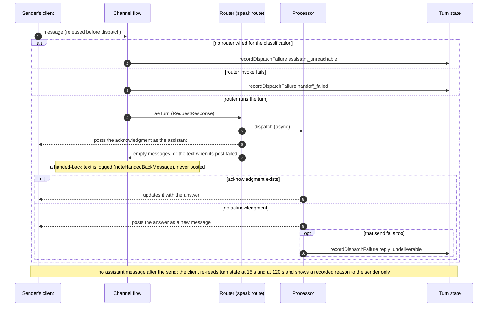

# ADR-025: Who posts the placeholder

## Status

**Accepted: option 1.** Built and deployed 2026-08-10.

The turn posts its own acknowledgment on a flow entry and returns an empty `messages` array. Implemented as a wrapper at the handler's entry rather than by editing every return path, which also means the dispatch is NOT reordered and no `placeholderMessageId` is handed over on the `@all` and `/battle` paths - priced at one skipped GetItem and declined (see the accounting under option 1).

**The flow never speaks, including on a hand-back.** The router posts the acknowledgment on a speak route (`speak-router-<uuid>`), a session the vend narrows to the messaging calls a post makes. When that post fails, the router returns the text in `messages`, and the channel flow only logs it (`noteHandedBackMessage` in `channel-flow-processor.ts`): it holds no send, no vend invoke and no routing-table write. The processor that answers the turn finds no acknowledgment and posts the answer as a new message on its own session; only if that send fails too does it record `reply_undeliverable` for the sender. A turn that never starts is recorded the same way, as turn state rather than a message: an unwired router is `assistant_unreachable`, a failed router invoke is `handoff_failed` (`recordDispatchFailure`, `lib/turn-lock.ts`). The sender's client re-reads turn state at two deadlines after the send, 15 s and 120 s (`FIRST_RESPONSE_DEADLINE_MS`, `TURN_DEADLINE_MS` in `useTurnState.ts`), and shows the recorded reason to that person only. See "The hand-back" below.

Verified by `assistant-posts-its-own-acknowledgment.test.ts` and `handler-send-grant-carries-archive-deny.test.ts`, mutation-proven three ways (removing the flow-entry gate fails the Lex-path test; trusting a caller-supplied bot identity fails the sanction test; a raw send grant outside the shared helper fails the source scan), and exercised live: `mentions.spec.ts` 4/4 against the deployment, including "a 1:1 `@all` is answered exactly once, by one entry". The flow's lack of any speaking grant or session is pinned by `a-shared-service-only-speaks.test.ts` and `only-declared-speakers-can-speak.test.ts`; the client's deadline reads by `useTurnState.dispatchFailed.test.ts`.

## Context

A `PLACEHOLDER_UPDATE` turn shows the user an acknowledgment ("One moment...") that the async processor later overwrites with the answer. **The handler already decides what that acknowledgment says**: `getQuickResponse` and `getTaskPlaceholder` live in `lib/delivery-options.ts` and are resolved in `router-agent-handler.ts`, from the profile version the handler loaded.

**Sending is not the handler's job by default, and that is the constraint this decision confronts.** `AgentHandlerRole` is scoped to reads of channel state, and `chime:SendChannelMessage` belongs to `ProcessorRole` (`assistant-profile-stack.ts:208-216`), the component that writes the answer. Giving the handler any send is a real widening of a role kept deliberately read-only, so it is the cost an answer has to justify rather than a detail. Whichever way it is resolved, the words are authored in one component and performed by another.

**The routing this decision is called on to fix**, one profile-resolved behavior reaching the channel by four routes:

| Entry | Who performs the send |
|---|---|
| ordinary Lex turn | Amazon Chime SDK, materializing the fulfillment return |
| `@all`, `/battle` round 1 | the channel flow, via `sendBotMessage` |
| battle continuation | the channel flow (or it reuses the waiting message) |
| round 2 | the battle orchestrator |

Under the accepted option the middle two rows become the assistant itself; the Lex path and round 2 are unchanged. See **Decision** below.

**Why this is worth an ADR rather than a cleanup.** Nothing is broken today. The problem is that one profile-resolved behavior reaches the channel by four routes, which is the divergence class the `@all` and round-1 handoffs exist to remove: a difference that cannot error, only drift. It is also the last product-shaped thing the channel flow does on a turn path, against the rule that the flow decides who responds and nothing else (MESSAGE-FLOW 4 and 6.1).

**The question was closed early once.** The prior framing was that the handler cannot write to a channel, therefore posting stays where it is, therefore the `corr#` mapping and its marker-scan fallback are unavoidable. The premise is true and the conclusion does not follow: the grant is a deployment decision rather than a platform limit, and the handler is not the only alternative to the flow.

### What must be true of any answer

- **The acknowledgment is the assistant's behavior.** Whether to acknowledge, in what words, and whether a long task announces itself differently, are properties of the profile version, so an assistant's author controls them by editing a profile rather than by editing a Lambda.
- **One authored behavior, one route to the channel**, or an explicitly stated reason for more.
- **TTFF does not regress.** It is measured as placeholder timestamp minus user message timestamp and is already around 4.5s against a 1s target, so anything added to the handler's synchronous path is paid on every turn.
- **Archived channels stay read-only.** Any new send grant must carry the existing Deny.
- **A duplicate turn still produces one placeholder.** ADR-022's guarantee is not weakened.

## Options

### 1. The handler posts on the bypass paths (leaning)

The handler posts its own placeholder for `@all`, `/battle` and any future bypass, and returns to its caller the fact that it has done so rather than the text to post. The Lex path is unchanged: Amazon Chime SDK keeps materializing that placeholder from the fulfillment return.

- **It matches what is actually happening.** The assistant acknowledges the request it received, then hands off to the processor for the full response. The component that decided what the turn IS is the component that speaks.
- **The channel flow stops writing user-visible messages on a turn path entirely**, leaving it with release, drop, and hand the turn over. Its remaining sends are its own rejection notices, which are the flow speaking for itself rather than for an assistant. **It does NOT leave the flow uninvolved in the turn**: the flow still claims the `corr#` mapping on every placeholder it observes, which the Lex path depends on. The claim is not a product behavior, so it is consistent with the rule; but "the flow is out of the placeholder business" would be false and is not what this option delivers.
- **The handler holds the `MessageId`**, from `SendChannelMessage`'s own response; no lookup is involved, and `sendBotMessage` (`channel-flow-processor.ts`) already returns it for exactly this reason. It can therefore hand `placeholderMessageId` to the processor at dispatch - but see the accounting below before treating that as a benefit, because resolution is not currently a problem on either path.
- **It requires REORDERING the handler, and that is the part an implementer would otherwise discover.** Today the handler dispatches the processor and THEN returns the placeholder text (`router-agent-handler.ts`, the `invokeAsyncProcessor` call precedes the `formatLexResponse` return), which is why it currently cannot hand over an id: at dispatch time the placeholder does not exist. Holding the id means the sequence becomes **compose, send, take the id from the response, dispatch with it, return**. Three consequences follow, and the third is an improvement rather than a cost:
  - **TTFF improves slightly.** The placeholder is posted before the handler returns rather than after its caller receives the return, which removes one hop from the first visible feedback on a bypass.
  - **The processor dispatch is delayed by one Amazon Chime SDK round trip.** The answer lands that much later. Small, and paid only on bypass turns.
  - **A failed send stops being silent.** Today the dispatch has already gone when the caller's send fails, so the processor produces an answer with no placeholder to update and falls back to a scan. Posting first lets the handler decline to dispatch and say so, which is the honest failure.
- **One property to verify rather than assume: a handler-posted placeholder is created `PENDING`.** Every message crosses the channel flow, so `SendChannelMessage` returns the id immediately while the message is still pending release. The processor could in principle be handed an id it cannot yet update. This is not new and there is shipped evidence it holds: the battle continuation's fallback path already posts a placeholder, takes the returned id and dispatches with it immediately (`waitingMsgId` in `channel-flow-processor.ts`). The evidence is that path working, not an argument from timing, and a test should pin it.
- **Cost: two resolution paths again.** The Lex path still resolves by lookup, because Amazon Chime SDK materializes that placeholder and no AE component ever sees its id. The `@all` handoff deliberately collapsed to one path; this re-splits it. The split is at least principled - whoever can know the id passes it - but it is a real reversal and must be recorded as one rather than discovered later.
- **IT BUYS ESSENTIALLY NOTHING FOR PLACEHOLDER RESOLUTION, and that must not be claimed for it.** The tempting argument is that holding the id removes the `corr#` mapping and the marker/poll fallback. It does not, because **resolution already works on both paths today**:
  - The id IS known, and known in time. The channel flow learns it the moment the Lex-materialized placeholder crosses it, and `claimPlaceholderMapping` writes `corr# -> MessageId` there. Nothing is missing; what is true is only that no component holds the id at DISPATCH time.
  - The processor does not need it at dispatch. It resolves at FINALIZE, after the model call, by a single mapping read. The mapping lands in about a second and the model call takes seconds, so the read succeeds.
  - The last resort is `scanForPlaceholderMessage`, behind the mapping read and an explicitly handed id, and it runs on BOTH the success and error paths - so an error notice still lands on the person's "One moment..." bubble even when the mapping write failed. It is deferred until the answer (or the error) is ready to deliver, never before the model call, so on an ordinary turn it does not run.

  So the honest accounting is: this option lets the bypass paths skip **one GetItem**. The mapping, the fallback and the flow's claim all stay, and they stay under option 2 as well for as long as any path is Lex-materialized. **Option 1 is an ownership change, not a simplification, and the case for it has to rest on ownership alone.**
- **Cost: one IAM grant**, `classificationChannelScopedAllow(classification, appInstanceArn, ['chime:SendChannelMessage'])` - the same helper `ProcessorRole` uses, which layers the archived-channel read-only Deny automatically because `SendChannelMessage` is in `ARCHIVE_DENIED_ACTIONS`. It is an existing grant shape applied to a second role, not a new privilege shape.
- **TTFF: neutral.** The send happens on the bypass either way; it moves from the flow's process into the handler's, saving one return trip.

### 2. The handler posts on every path, and returns an empty envelope to Lex

As option 1, plus the Lex path: the handler posts the placeholder itself and returns `messages: []`.

- **One resolution path everywhere, reached from the other side.** Not "everyone looks it up" but "nobody needs to": every placeholder has a known id at dispatch, so the `corr#` mapping and its fallback could retire. **Weigh this modestly.** Resolution is not failing today - the mapping is written by the flow the instant the placeholder appears and is read once, at finalize, long after it has landed. This removes a working mechanism rather than a broken one.
- **Blocker: Amazon Chime SDK materializes a message even from an empty `messages` array.** Verified live and recorded at the flow's duplicate-placeholder guard. So every ordinary turn would leave a stray empty envelope beside the real placeholder. Removing it means the channel flow inspecting and dropping Lex envelopes, which is more flow behavior rather than less and contradicts the rule this ADR is trying to serve.
- **Cost: TTFF on every ordinary turn.** A synchronous `SendChannelMessage` enters the handler's critical path on the one path that does not currently pay for it. Against a 1s target already missed by 3.5s, that is the expensive kind of elegant.

### 3. The processor posts

The handler dispatches; the processor posts the placeholder as its first act, then updates it.

- **Attraction:** no IAM change at all - the processor already sends - and the poster and the updater become the same component, so no id ever has to be handed anywhere.
- **Against it: the acknowledgment stops being the handler's.** The processor would be performing a behavior resolved from a profile it did not load, which is the same authored-here-performed-there split this ADR exists to close, moved one component along.
- **Against it: TTFF.** First visible feedback would wait on an async invoke and a possible cold start, where today it is posted the moment the handler returns. This is the worst option for the metric that matters most.

### 4. Status quo

The flow keeps posting on bypasses, Amazon Chime SDK keeps materializing on the Lex path.

- **Nothing breaks, and that is the point.** It costs nothing today and leaves one profile-resolved behavior with four routes to the channel, none of them written down as a decision.
- Worth keeping on the list because the alternatives all buy consistency with either latency or a second resolution path, and "not yet" is a legitimate answer to a defect that has not bitten.

## Decision direction (maintainer, 2026-08-10): option 1

Rationale in the owner's terms: it is truer to what is happening - the assistant acknowledges a received request, then passes off to the processor for the full response - and it gives an assistant's author control over how their assistant responds, because the acknowledgment becomes profile behavior end to end rather than something the platform performs on the assistant's behalf.

Option 2 is the more complete version of the same idea and is rejected on cost: it buys a single resolution path with a stray envelope on every ordinary turn and a synchronous send on the one path whose latency is already the problem.

## Consequences

- `AgentHandlerRole` carries a classification-scoped `chime:SendChannelMessage` (`assistant-profile-stack.ts:843`). The archived-channel Deny comes with it through the shared helper, and `handler-send-grant-carries-archive-deny.test.ts` pins that the grant only ever goes through that helper, because a Deny arriving by side effect is exactly the kind of protection that disappears quietly if the helper is bypassed.
- **The handler's dispatch and return are reordered** (send, then dispatch with the id, then return). That ordering IS the feature - it is what lets the id be handed over at all - so it needs a test that fails if the dispatch moves back in front of the send, not merely one that checks the id arrives.
- `channel-flow-processor.ts` holds no `sendBotMessage` and posts nothing on any path. A handed-back reply is logged (`noteHandedBackMessage`) and the processor posts the answer itself (see Status and "The hand-back"). Its notices are named by the flow and said by the router as the assistant they concern (`sayNotice`, an `aeNotice` invoke; MESSAGE-FLOW §4, "Flow-posted messages"). The same holds for the services that put a line in a conversation outside a turn - Battle Mode administration, conversation management (archive), federated member add, the proactive briefing, the typed-conversation creator and conversation share: each names a notice kind and its variables to the router of the conversation's classification (`sayThroughRouter`, `lib/say-through-router.ts`), and the router says it from the assistant's own copy. Those services hold the router invoke and the room-primary reads only (`sayThroughRouterWiring`), no vend and no speak grant.
- A duel's waiting markers are cleared by the router of the conversation's classification as each side's assistant, on a speak route of its own (`aeClearMarkers`, `clearDuelMarkers` in `router-agent-handler.ts`), named to it by whoever ended the duel (`lib/battle-marker-clear.ts`). A duel the router ends itself (its experiment ended under a duel turn or a rebuttal round) is cleared in place by `clearDuelMarkers` (`endDuelHere`), never by invoking a router, because a router's environment resolves only its own ARN. The router checks each marker against the battle state first: the duel was ended, it ran in this conversation, and the message is the one that side recorded as its waiting question.
- The battle orchestrator speaks as no assistant. It holds the router invoke and the room-primary reads only: no vend, no routing-table write, no Amazon Chime SDK send. Its "did not finish in time" and nobody-finished lines are notices the router says (`battleSideDidNotFinish`, `battleSideDidNotFinishUnnamed`, `battleNoneFinished`, through `sayThroughRouter`), and each round's placeholder is posted by the router (next bullet).
- **The bypass paths do NOT hand `placeholderMessageId` to the processor.** An earlier draft of this bullet said they would, on the reasoning that a component which posts the message holds its id. It does hold it, and passing it on would require posting BEFORE the dispatch, which means reordering every return path in the handler to buy one skipped `GetItem`. Priced and declined (see option 1): this decision is justified on OWNERSHIP, not on shortening a resolution path. So `@all` and `/battle` round 1 resolve through the `corr# -> MessageId` mapping exactly as the Lex path does. **That mapping and the marker scan are therefore load-bearing on every path and must not be deleted** - the claim in `channel-flow-processor.ts` is what round 1 depends on, not a redundant duplicate guard. The one exception is the battle CONTINUATION, which answers onto a message that already exists and so is given its id (`TurnRequest.placeholderMessageId`).
- The flow's duplicate-placeholder guard keeps its job unchanged: it claims on the marker in a bot message's content, and a handler-posted placeholder still carries one.
- The battle continuation dispatches through the handler entry (`channel-flow-processor.ts:936`) and so inherits this decision rather than needing its own, except that it answers onto the side's existing waiting message instead of posting a new one. Round 2's placeholder is posted by the duel classification's router as the side, when it takes the round from the orchestrator (`aeRebuttal`, `dispatchRebuttalRound`): the router validates the round against the battle state (the fan-out was claimed, the side finished round 1, the duel ran in this conversation), posts the placeholder from the one battle-marker builder (`battlePlaceholderContent`) on a speak route of its own, then records the round and dispatches the processor, returning the placeholder's id to the orchestrator. A placeholder that cannot be posted dispatches nothing. The round itself still goes straight to the processor rather than through the entry ([ADR-023](./023-battle-round-coordination.md) A-prime).

## The hand-back

The acknowledgment, the answer and a failure each have one writer, and the channel flow is none of them.

A recorded failure is shown for 10 minutes after it is written (`DISPATCH_FAILURE_FRESH_MS`) and only to the person whose turn it was; it is turn state, never a message in the conversation.
