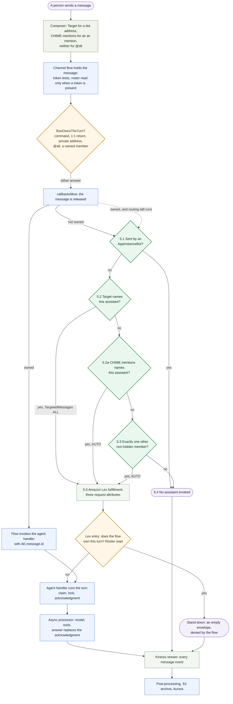
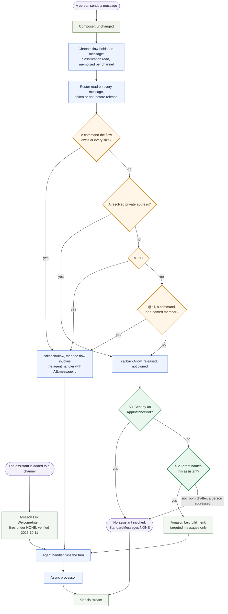

# ADR-041: Simplifying how a message reaches an assistant, one entry instead of two

> **Amended 2026-10-23.** `create-bot` and `create-lex-bot`, the deploy-time provisioners this record cites, are removed: no stack owns an assistant identity, and every identity and Amazon Lex bot is built by the provisioner (`backend/lambda/src/lib/assistant-provisioner.ts`, [ADR-048](./048-an-assistant-is-not-a-classification.md), amended 2026-10-23). The line numbers cited for them are of the removed files. The behavior cited is unchanged: every identity is built with `StandardMessages: NONE` and `TargetedMessages: ALL`.

## Status

**Accepted (2026-09-17), option 2, on every assistant.** The provisioner (`backend/lambda/src/lib/assistant-provisioner.ts`) builds every assistant identity with `InvokedBy: { StandardMessages: NONE, TargetedMessages: 'ALL' }` (`assistantBotConfiguration` in `backend/lambda/src/lib/assistant-identity.ts`, whose default is `NONE`). No per-profile setting exists. `flowOwnsTheTurn` (`backend/lambda/src/lib/flow-bypass.ts`) never claims a privately addressed message and claims every other 1:1 turn unconditionally, so the channel flow is the only entry for an untargeted message and Amazon Lex is reached only by a targeted message and the welcome. Verified by `backend/test/lib/a-flow-entry-profile-owns-its-one-to-one-turn.test.ts` (including that no per-profile entry and no `probe` classification remain) and `backend/test/a-targeted-turn-is-separable-from-a-standard-one.test.ts`. The code provisions `NONE`/`ALL`, and the deployed `InvokedBy` is verified 2026-10-11 with `DescribeAppInstanceBot` per assistant on the default instance ([ADR-036, Recorded evidence](./036-why-turns-enter-through-amazon-lex.md#recorded-evidence)).

**The `probe` classification and its per-profile `turnEntry: 'flow'`, which Appendices F, G and M describe, are the measurement build for this decision.** Neither is in the tree. Where an appendix cites them, it records how the decision was measured, not how a deployment is configured.

## Goal

**A message a person sends reaches an assistant by one route, decided by one component, and that component knows exactly which message it is answering.**

The change succeeds when all four hold:

1. **One decision per message.** For every untargeted message, AgentEchelon's channel flow alone decides whether a turn starts. No second component has to reach the complementary answer for the message to be answered exactly once.
2. **Every turn knows its message id.** A turn is handed the inbound `MessageId`, so it never recovers the message by reading the channel back, and analytics pairs the answer to the question by declaration rather than by inference.
3. **One rule a person can be told.** In a conversation with one assistant, the assistant answers everything. In a room, it answers when it is named (`@`) or addressed (`.`). The same words behave the same way whatever the room size.
4. **No worse time to first feedback.** The change holds the one second target at least as well as today.

## Context

- **A message reaches an assistant two ways today.** Amazon Chime SDK invokes the assistant's Amazon Lex bot, which fulfills into the agent handler (Appendix A describes what triggers it). Or AgentEchelon's channel flow invokes that handler directly. Which one runs depends on the room size and on how the message is addressed (Appendix E).
- **Amazon Lex hands the handler almost nothing.** Three request attributes: channel, sender, platform. No message id, no `Metadata`, no `Target` (Appendix B, captured). So a Lex-entered turn derives its identity from a hash of the text and reads the channel back to find its own message.
- **The channel flow logic has grown to include half the routing.** `@all`, a room `@<assistant>`, `/battle`, an unaddressed `/stop` in a room and a leading item reference are all decided in AgentEchelon's own code, and they carry the message id and attachment (Appendix C). Amazon Lex carries what is left: every message in a 1:1, and every message addressed with a `Target`.
- **Two entries is the largest single source of complexity in this path.** Of seventeen reachable routing cells, eleven are decided by two components that must reach exact complements without seeing each other. On 2026-08-12 one `@all` in a 1:1 was answered by both: two placeholders 558 ms apart, one stranded permanently (Appendix J).
- **The reasons behind the original choice have narrowed.** The strongest reason to keep Amazon Lex, session state, does not apply to AgentEchelon. Time to first feedback now has a one second target, and the entry comparison is measured: the flow entry is faster by a few hundred milliseconds at the median once the prompt is held fixed, an effect consistent in direction and not decisive in size (Appendix G).

## Decision

**Set every assistant to `StandardMessages: NONE` with `TargetedMessages: ALL`.** The channel flow becomes the only entry for untargeted messages at every room size. Amazon Lex keeps two jobs: a message whose `Target` names the assistant (a `.` private address, a private work-item answer, a battle clarification) and the `WelcomeIntent` when the assistant joins a channel.

**Amazon Lex cannot be narrowed to the welcome alone.** Amazon Chime SDK refuses an `InvokedBy` with both members set to `NONE`, measured across eight combinations (Appendix A). So `NONE`/`ALL` is the narrowest configuration that removes the standard-message entry.

**Why this and not keeping both.** It collects the whole analytics gain, because the population that pairs by inference is untargeted by construction (Appendix H), and most of the test gain, because the size boundary and the empty Amazon Lex envelope live in the cells it removes (Appendix G). The double-decided cells go from eleven to five. The case rests on that countable simplification. Latency confirms the direction and does not carry it.

**What was checked, and what stays open:**

1. **Verified 2026-10-11: what `WelcomeIntent` does under `StandardMessages: NONE`.** Acceptance at create is measured (Appendix A). That the welcome fires when the assistant is added to a channel is reported 2026-09-16 in ADR-043 and confirmed by the recorded reading of 2026-10-11 on the default instance: 422 welcomes handled by assistants configured `NONE`/`ALL` ([ADR-036, Recorded evidence](./036-why-turns-enter-through-amazon-lex.md#recorded-evidence)). This is a follow-up to the decision, not a precondition of it.
2. **A monitoring answer for a flow failure: built, not yet deployed.** The processor is associated with `FallbackAction: CONTINUE`, so with the flow as the only entry for untargeted messages, an outage delivers the person's words and starts no turn. It presents as a slow assistant rather than a broken one. `channel-flow-stack.ts` alarms on the processor's errors, throttles and occupancy at 80% of its reserved concurrency (ADR-036, Recorded evidence E3). This is a follow-up to the decision, not a precondition of it.

## Options considered

| Option | Configuration | Outcome |
|---|---|---|
| 1. Keep both entries | `AUTO`/`ALL` | Eleven double-decided cells, inferred turn identity on the ordinary Lex turn, the empty envelope stays. A 1:1 survives a flow outage |
| **2. Cut Amazon Lex from standard messages** | **`NONE`/`ALL`** | **Taken.** Five double-decided cells, every untargeted turn declares its message id. Flow-failure monitoring is OPEN |
| 2a. Flip the 1:1 branch in code only | `AUTO`/`ALL` | Buys the analytics half of option 2. Keeps the empty envelope, because Amazon Chime SDK still invokes the entry on every 1:1 message |
| 3, 3a, 3b. Amazon Lex for the welcome only | `NONE`/`NONE` | **Refuted by measurement.** The service refuses the configuration |
| 4. A cached "is this a 1:1" bit | any | Not rejected, not needed until the roster read it removes is measured and found too slow (Appendix K) |

## Consequences

- **The routing surface shrinks.** Eleven double-decided cells become five, the 1:1 size boundary stops deciding who answers, and the four test files that hold a two-sided complement lose their subject.
- **Every untargeted turn carries `mention-<MessageId>`,** so `paired_by = 'declared'` becomes the ordinary case and the headline TTFF stops censoring slow Lex turns by entry. The headline figure moves for that reason alone and must not be read as a speed change (Appendix H).
- **A 1:1 depends on the channel flow.** Plain prose in a 1:1 pays a live `ListChannelMemberships` in the flow. That read sits after `callbackAllow` for every message, a possibly-private one included, as rule 4 below requires; only a message whose `Metadata` carries a task-answer hint waits for the read before release, so the flow holds its claim before `task-answer-repair` competes for it (`mightBeRepaired` in `channel-flow-processor.ts`; Appendix N, item 1).
- **`@all` in a 1:1 is answered by the flow**, the same component that answers it in a room (Appendix E).
- **Only `Target` decides who sees a message.** Neither a mention nor a push filter changes delivery or readability, measured with live sessions (Appendix I). A push filter on mentions would never match `@all`, because `@all` carries no `CHIME.mentions`.
- **Documentation owes corrections, recorded here rather than made silently.**
  - MESSAGE-FLOW §2.6 shows `x-amz-lex:channels:platform` as `Chime`; the captured value is `Amazon Chime SDK Messaging` (Appendix B).
  - MESSAGE-FLOW §2.6 shows a percent-encoded `Content` in the flow event; the captured flow logs and stream records show a person's message un-encoded (Appendices C and D).
  - MESSAGE-FLOW §2.1's diagram has no node for §5.2a, the mention invocation (Appendix E).
  - MESSAGE-FLOW §2.2 and §4.9 and `backend/lambda/src/channel-flow-processor.ts:1172-1177` say a mention notifies the person. Nothing built sends a push (Appendix I).
  - MESSAGE-FLOW §9.1 states that stream records carry `Target` and `Metadata` and cites no measurement; Appendix D is one.
- **Related records gain boundaries.**
  - ADR-036's option C is refuted, and its parked entry measurement is taken.
  - ADR-039's refusal of a cached routing fact holds only in the two-entry world.
  - ADR-037's residual population is defined by the entry and disappears with it.
  - ADR-038's second blocker narrows to the room, where the cost is the confirming read.
  - ADR-040's metadata-beside-the-words option gains a routing caller.
  - `kinesis-archival.ts` reads neither `Target` nor `MessageAttributes`, so how a message was addressed is recorded nowhere on the projection (Appendix D).

## Rules that outlast the configuration

1. **A second entry is a multiplier on the routing surface, not one extra code path.** Seventeen reachable routing cells, eleven decided by two components at once, 29 states once queue state is included; three pairing labels and two correlation derivations for one question; 63 of 425 backend test files and 13 of 57 end-to-end specs naming the entry; four test files existing to hold a complement that has no error in it when it breaks. Any future argument about the entry states this cost.
2. **Routing and enforcement are separate concerns and the platform already treats them so.** Amazon Chime SDK enforces readability from `Target` whether or not any AgentEchelon component reads it, so a routing rule is never the privacy authority. Conflating the two is what made a missing field look like a platform limitation.
3. **A message whose text and stored `Target` disagree is reported to the sender, and is not deleted.** The check reads the stored `Target` after release, so a delete would unsend nothing; the sender decides whether to delete it (`lib/private-command.ts`). A misdirected message, whose `Target` names a different member than the text addressed, starts no turn. A private address that reached the room without a `Target` is routed as addressed, and the sender is told it was not private (`backend/test/lib/a-private-address-without-a-target-is-routed.test.ts`).
4. **A read that decides who answers goes after `callbackAllow`, not before it.** The flow is synchronous and the release gates the person's own message. The pattern is already in the tree, and it is what makes the latency budget a comparison between the roster read and the Amazon Lex leg rather than a new cost on every message.
5. **A cached routing fact may be a bit, may not be a count, and is written from the source the decision is actually about.** A human-only count answers a different question than the one Amazon Chime SDK's routing asks, which is the recorded refusal in `backend/lambda/src/lib/channel-size.ts` and it stands. What does not stand is the second refusal: the complement that made a one-sided cache unsafe is a property of the two-entry world, and one entry removes it.
6. **If a failure direction must be chosen for a routing decision about privacy, over-privatizing is the cheaper error.** Choosing it is not available under the recommendation: the confirming read fails toward public because of its other caller, the Amazon Lex entry's own inference, and `TargetedMessages: ALL` keeps that caller. The inversion becomes available only if the targeted entry is ever removed, which the service does not currently permit. It would not be free either, because a read failure would answer a public turn privately and nothing counts that.
7. **An out-of-band transport is triggered after delivery, not before it.** Email, SMS and any transport that follows them reach somebody who is not in the room, so nothing in the room waits on them. This is tenet D6 applied rather than a decision weighed here; the as-built account is SPEC-NOTIFICATION-BRIDGE, "Where the fan-out runs", which names its own tests. **This point keeps its number because the code and documents that carry the move cite it by number.**
8. **The head start and the certainty are not in tension.** The flow already releases before it dispatches, so the leg a flow dispatch removes is the Amazon Chime SDK to Amazon Lex to Lambda hop rather than the wait for the release. A dispatch moved ahead of `callbackAllow` is a different proposal and is refused: it answers a message that may be denied, edited or unreadable, and it generalizes the acknowledgment-before-the-question inversion fixed in this repository on 2026-09-15.
9. **`TargetedMessages` does not gate assistant-to-assistant, so setting it to `NONE` does not enable it.** The block is on the sender's kind and runs before `InvokedBy`. The route is a handover message targeted at the receiving assistant, which the channel flow routes from its address token after release, with post-processing on the stream as the backstop for one it could not route. The design and its loop bounds are in DESIGN-SEPARATE-ASSISTANTS-AND-DELEGATION §3.4.
10. **An entry configuration is established by attempting it, not by reading the model.** Amazon Chime SDK refuses an all-`NONE` `InvokedBy` and no SDK type, service model or public reference says so. Two records reasoned about that configuration for months on the strength of the model permitting it. Any future claim that a configuration is available cites an attempt.

## Appendices

A. `InvokedBy` settings and what triggers an assistant. B. What Amazon Lex receives. C. What the channel flow sees. D. What the message stream carries. E. The current message flow, and why `@all`. F. The flow under `NONE`/`ALL`. G. What is removed and what is added. H. What changes in analytics. I. Mentions: seeing a message versus being notified of it. J. What the current path costs. K. The cache proposal. L. The targeted populations. M. Probing it on a deployment, and what proves it.

---

## Appendix A. `InvokedBy` settings and what triggers an assistant

**Where the setting lives.** `InvokedBy` exists only on the `AppInstanceBot` (`Configuration.Lex`), not on the app instance, the channel or the flow. `WelcomeIntent` sits beside it in the same block and is not part of it. AgentEchelon writes `StandardMessages: NONE` and `TargetedMessages: 'ALL'` on every assistant, from `INVOKED_BY_STANDARD_MESSAGES` in `create-bot`.

**The attributes that decide it**, as the web composer sets them (`frontend/packages/chat/src/utils/mentionParser.ts`, `frontend/packages/chat/src/services/chimeService.ts:370-403`):

| What the person wrote | `Target` | `CHIME.mentions` message attribute | `Metadata` |
|---|---|---|---|
| plain prose | none | none | attachment, if any |
| `@Atlas what changed?` (an assistant) | none | the assistant's ARN | attachment, if any |
| `@Alice can you look?` (a person) | none | Alice's ARN | attachment, if any |
| `@all status?` | none | **none** | attachment, if any |
| `.Atlas just between us` | the assistant | none | attachment, if any |
| a reply to a private work item | the assistant that asked | none | `task.id` |
| a reply to a shared work item | none | the assistant that asked | `task.id` |
| a reply to a waiting battle side | the waiting assistant | none | attachment, if any |

**The rules Amazon Chime SDK applies, in order** (MESSAGE-FLOW §5.1 to §5.5). None of them is AgentEchelon code.

1. **Sent by an `AppInstanceBot`?** Invokes no assistant, whatever its `Target` or mentions. Measured with a control (ADR-023).
2. **`Target` names this assistant, and `TargetedMessages: ALL`?** Invokes it.
3. **Otherwise `StandardMessages` decides**, per the table below.

**`StandardMessages`, one value at a time.** "1:1" means exactly one other non-hidden member from the assistant's point of view, and other assistants count.

| Value | Invokes on | Plain prose, 1:1 | Plain prose, room | `@Atlas`, room | `@all`, room | Status |
|---|---|---|---|---|---|---|
| `AUTO` | every message when the assistant has exactly one other member; otherwise a message whose `CHIME.mentions` names it | yes | no | yes | no | measured; a mention alone invokes (2026-09-15) |
| `MENTIONS` | a message whose `CHIME.mentions` names it | expected no | no | expected yes | no | accepted at create; runtime not measured |
| `ALL` | every standard message | expected yes | expected yes | expected yes | expected yes | accepted at create; runtime not measured |
| `NONE` | no standard message | no | no | no | no | accepted at create; the recommendation |

**`TargetedMessages`, one value at a time.**

| Value | `.Atlas ...`, any size | Private work-item reply | Battle clarification | Status |
|---|---|---|---|---|
| `ALL` | invokes Atlas | invokes the assistant that asked | invokes the waiting side | in use; this is how all three reach an assistant today |
| `NONE` | no | no | no | accepted at create beside a live `StandardMessages`; not proposed |

**`WelcomeIntent`.** When the assistant is added to a channel, Amazon Lex is invoked with `WelcomeIntent` and no transcript, and the handler composes the welcome or starts onboarding (`backend/lambda/src/router-agent-handler.ts:1945` onward). That it fires under `StandardMessages: NONE` is reported 2026-09-16 in ADR-043 and verified 2026-10-11 (ADR-036, Recorded evidence).

**Worked example under option A (`AUTO`/`ALL`)**, in a room of Alice, Bob and Atlas:

- `@Atlas what changed?` Amazon Chime SDK invokes Atlas's Amazon Lex (mention) **and** the flow dispatches the handler. The Lex entry reads the roster and stands down. Captured in Appendix C.
- `@all what changed?` Amazon Chime SDK invokes nothing (no mention). The flow dispatches.
- `.Atlas just between us` Amazon Chime SDK invokes Atlas (target). The flow stands aside.
- `what changed?` Nobody answers, which is correct.

The same four messages in a 1:1 of Alice and Atlas are all invoked by Amazon Chime SDK under `AUTO`, and the flow stands aside for all of them.

**The acceptance matrix.** MEASURED 2026-09-16 with `CreateAppInstanceBot` against the development app instance. Each probe assistant was inert, never added to a channel, reused an existing Amazon Lex alias, and was deleted in the same run.

| `StandardMessages` | `TargetedMessages` | `WelcomeIntent` | Result |
|---|---|---|---|
| `AUTO` | `ALL` | present | accepted |
| `NONE` | `ALL` | present | accepted |
| `NONE` | `ALL` | absent | accepted |
| `ALL` | `NONE` | present | accepted |
| `MENTIONS` | `NONE` | present | accepted |
| `MENTIONS` | `ALL` | present | accepted |
| `NONE` | `NONE` | present | **refused** |
| `NONE` | `NONE` | absent | **refused** |

Both refusals carry `BadRequestException: Either RespondsTo or InvokedBy must be set`, so the service reads an all-`NONE` `InvokedBy` as absent. The SDK's `LexConfiguration` marks `RespondsTo` and `InvokedBy` both optional, the botocore model carries no at-least-one trait, and the public API reference is silent. **The constraint is expressed nowhere but in the service's validation.**

## Appendix B. What Amazon Lex receives

**Captured on the Amazon Lex entry.** The premium assistant's Amazon Lex text conversation log for the room `@Assistant-premium` message traced through Appendices C and D, 2026-09-16. Abridged to the fields a fulfillment can act on; identifiers replaced.

```json
{
  "timestamp": "2026-09-16T05:03:38.302Z",
  "operationName": "RecognizeText",
  "messageVersion": "2.0",
  "requestAttributes": {
    "CHIME.channel.arn": "arn:aws:chime:us-east-1:111122223333:app-instance/abc/channel/conv-c1",
    "CHIME.sender.arn": "arn:aws:chime:us-east-1:111122223333:app-instance/abc/user/alice",
    "x-amz-lex:channels:platform": "Amazon Chime SDK Messaging"
  },
  "inputTranscript": "@Assistant-premium anything else you need?",
  "interpretations": [
    { "interpretationSource": "Lex", "intent": { "name": "FallbackIntent", "state": "Fulfilled", "slots": {}, "confirmationState": "None" } },
    { "interpretationSource": "Lex", "intent": { "name": "WelcomeIntent", "slots": {} }, "nluConfidence": "0.51" }
  ],
  "sessionState": {
    "sessionAttributes": {},
    "intent": { "name": "FallbackIntent", "state": "Fulfilled", "slots": {}, "confirmationState": "None" },
    "dialogAction": { "type": "Close" }
  },
  "sessionId": "a83c4a89...",
  "bot": { "name": "Assistant-premium-...", "aliasName": "TestBotAlias", "localeId": "en_US" }
}
```

**What that record establishes.**

- **Exactly three request attributes.** No message id, no `Metadata`, no `Target`, no `CHIME.mentions`. The same holds across fourteen days of these logs on all three classifications (`backend/lambda/src/router-agent-handler.ts:3518-3533`).
- **The record has no `messages`**, because this entry stood down (Appendix C). A Lex-entered turn that answers returns its acknowledgment there. The next record in the same log carries `"Understanding your report needs... <!--corr:abefe2fd14670aee-->"`, whose correlation id is the sixteen-hex `turnCorrelationId` hash.
- **The platform value is `Amazon Chime SDK Messaging`.** The handler never reads it.

**The handler's view of the same event** is the `LexEvent` shape (`backend/lambda/src/router-agent-handler.ts:588-597`): `inputTranscript`, `sessionId`, `sessionState.intent`, `requestAttributes`.

**What the channel flow hands the handler instead.** The flow invokes the handler with `{ aeTurn: TurnRequest }`, and `bypassToLexEvent` rewrites it into the same `LexEvent` shape so one handler serves both entries (`backend/lambda/src/router-agent-handler.ts:1080-1114`). READ FROM CODE, with the values the Appendix C message carries:

```json
{
  "inputTranscript": "%40Assistant-premium%20anything%20else%20you%20need%3F",
  "sessionState": { "intent": { "name": "FallbackIntent" }, "sessionAttributes": {} },
  "requestAttributes": {
    "CHIME.channel.arn": "arn:aws:chime:us-east-1:111122223333:app-instance/abc/channel/conv-c1",
    "CHIME.sender.arn": "arn:aws:chime:us-east-1:111122223333:app-instance/abc/user/alice",
    "AE.entry": "channel-flow",
    "AE.message.id": "3ca49355bb9179cdc4141aa7ec08405625ed9e03bb5fb8065d3582c4d223a844"
  }
}
```

A flow caller also sets, when it has them, `AE.attachment`, `AE.bot.arn`, `AE.corr`, `AE.battle`, `AE.trigger`, `AE.trigger.at`, `AE.triage.queued`, `AE.turn.amendedFold`, `AE.turn.foldedIds`, `AE.turn.userContent`, `AE.stop.evaluation`, `AE.placeholder.id` and `AE.handover.from`.

| | Amazon Lex entry | Channel flow entry |
|---|---|---|
| Message id | none; the turn derives `turnCorrelationId` and looks the message up by content | `AE.message.id`; the correlation id is `mention-<MessageId>` |
| Attachment | none; recovered from the channel only for a 1:1 `@all` | `AE.attachment` |
| `Metadata`, `Target`, mentions | none | the flow holds `Metadata`; it does not receive `Target` |
| Acknowledgment | returned in `messages`; Amazon Chime SDK posts it as a Lex envelope | posted by the handler as the assistant; `messages` is empty |
| Stand-down guard | runs (`!isFlowEntry(event)`, `backend/lambda/src/router-agent-handler.ts:1675`) | never runs |

## Appendix C. What the channel flow sees

**The processor does not log its event, deliberately.** `Content` is a person's words and the processor runs on every message, so it logs ids and shapes only (`backend/lambda/src/channel-flow-processor.ts:303-309`). What follows is therefore two things kept apart: the processor's own log lines for one real message, captured, and the event those lines were computed from, reconstructed and labeled.

**Captured.** The development deployment's channel flow processor, 2026-09-16, for one message in a room of two people and the premium assistant. Identifiers and the sender's name replaced; message id, callback id and times as captured.

```text
05:03:38.091Z  ChannelFlowProcessor invoked: {
  callbackId: 'RrwZblzburZksJ7x47_7dW6xGVOOCTgoQ5fr5tThn6g',
  messageId: '3ca49355bb9179cdc4141aa7ec08405625ed9e03bb5fb8065d3582c4d223a844',
  channelArn: 'arn:aws:chime:us-east-1:111122223333:app-instance/abc/channel/conv-c1'
}
05:03:38.091Z  [ChannelFlow] routing {
  invokesBattle: false, mentionsAll: false, targets: 0, metaLen: 0, decodeChanged: false,
  rawHead: '"@Assistant-premium anything else you need?"',
  decHead: '"@Assistant-premium anything else you need?"'
}
05:03:38.150Z  [ChannelFlow] addressing {
  messageId: '3ca49355...a844', ownsTheTurn: true, mentionsAll: false, namedSomeone: true,
  namedAnAssistant: true, privatelyAddressed: false, privatelyAddressedAnAssistant: null,
  rosterSize: 3, isOneToOne: false, rosterUnknown: false
}
05:03:38.231Z  [ChannelFlow] Mention detected { broadcast: true, senderName: 'Alice', hasAttachment: false }
05:03:39.286Z  [ChannelFlow] nothing to post; the turn either posted its own message or was silent { broadcast: true }
REPORT Duration: 1196.90 ms
```

**The same message on the other components, captured in the same window.** Together these are a complete trace of today's double-decided cell 9 (Appendix J). Lambda log times and Amazon Chime SDK timestamps are different clocks.

| UTC | Component | What happened |
|---|---|---|
| 05:03:38.091 | channel flow | invoked with the message held |
| 05:03:38.150 | channel flow | roster read, 3 members; `flowOwnsTheTurn` is true |
| 05:03:38.198 | Amazon Chime SDK | the message's `CreatedTimestamp` |
| 05:03:38.231 | channel flow | dispatches the agent handler synchronously |
| 05:03:38.302 | Amazon Lex | conversation log records the same transcript (Appendix B), because `CHIME.mentions` names the assistant and `AUTO` invokes it |
| 05:03:38.307 | agent handler, flow entry | `[Router] Invoked`, classifies, and runs the turn |
| 05:03:38.496 | Kinesis | the person's message arrives on the stream (Appendix D) |
| 05:03:39.557 | agent handler, Amazon Lex entry | `[Router] Invoked` |
| 05:03:39.751 | agent handler, Amazon Lex entry | `the channel flow owns this turn; returning no visible message { memberCount: 3 }` |
| 05:03:40.490 | Kinesis | the assistant's placeholder, `Drafting outline... <!--corr:mention-bb9179cd...a844-->` |

**Reconstructed, not captured.** The event behind those log lines, as the processor's type declares it (`backend/lambda/src/channel-flow-processor.ts:244-262`), with the values the logs and the stream record fix:

```json
{
  "CallbackId": "RrwZblzburZksJ7x47_7dW6xGVOOCTgoQ5fr5tThn6g",
  "EventType": "CREATE_CHANNEL_MESSAGE",
  "ChannelMessage": {
    "MessageId": "3ca49355bb9179cdc4141aa7ec08405625ed9e03bb5fb8065d3582c4d223a844",
    "Content": "@Assistant-premium anything else you need?",
    "Sender": { "Arn": "arn:aws:chime:us-east-1:111122223333:app-instance/abc/user/alice", "Name": "Alice" },
    "ChannelArn": "arn:aws:chime:us-east-1:111122223333:app-instance/abc/channel/conv-c1"
  }
}
```

**What the flow can and cannot see.**

| Field | In the flow's event | Established by |
|---|---|---|
| `MessageId`, `Content`, `Sender`, `ChannelArn` | yes | captured above |
| `Metadata` | yes | `metaLen` is logged; a work-item reply carries `task.id` (MESSAGE-FLOW Appendix B) |
| `Target` | **no** | `targets: 0` is logged on every message, targeted ones included, measured 2026-08-14 |
| `MessageAttributes` (`CHIME.mentions`) | **not established** | the type does not declare it and nothing logs it; the flow resolves `@` from the text |
| `CreatedTimestamp`, `Persistence`, `Type`, `PushNotification` | listed as carried in MESSAGE-FLOW §4.1 | documented, not captured |

`ChannelMessageCallback`, the write-back, is a different structure: it carries `MessageId`, `Content`, `Metadata`, `MessageAttributes`, `PushNotification` and `SubChannelId`, and cannot set `Target`.

## Appendix D. What the message stream carries

**Captured.** Both shards of the development deployment's Amazon Chime SDK messaging stream, read from `TRIM_HORIZON` on 2026-09-16 and decoded. 1,191 records over the 24 hour retention: 432 `CREATE_CHANNEL_MESSAGE`, 248 `UPDATE_CHANNEL_MESSAGE`, 9 `DELETE_CHANNEL_MESSAGE`, 157 `CREATE_CHANNEL_MEMBERSHIP`, 7 `DELETE_CHANNEL_MEMBERSHIP`, and channel and moderator events. Of 155 person-sent message creates, 25 carried a `Target`, 4 carried `MessageAttributes` and 3 carried `Metadata`.

**The Kinesis envelope.** Each record is `{ SequenceNumber, ApproximateArrivalTimestamp, PartitionKey, Data, EncryptionType: "KMS" }`, and `Data` is base64 JSON. Decoded `Data` follows.

**The same `@` message as Appendix C.**

```json
{
  "EventType": "CREATE_CHANNEL_MESSAGE",
  "Payload": {
    "MessageId": "3ca49355bb9179cdc4141aa7ec08405625ed9e03bb5fb8065d3582c4d223a844",
    "ChannelArn": "arn:aws:chime:us-east-1:111122223333:app-instance/abc/channel/conv-c1",
    "Content": "@Assistant-premium anything else you need?",
    "Type": "STANDARD",
    "Persistence": "PERSISTENT",
    "Redacted": false,
    "CreatedTimestamp": "2026-09-16T05:03:38.198Z",
    "LastUpdatedTimestamp": "2026-09-16T05:03:38.198Z",
    "Sender": { "Name": "Alice", "Arn": "arn:aws:chime:us-east-1:111122223333:app-instance/abc/user/alice" },
    "MessageAttributes": {
      "CHIME.mentions": { "StringValues": ["arn:aws:chime:us-east-1:111122223333:app-instance/abc/bot/atlas"] }
    }
  }
}
```

**A targeted message**, a private `/stop` sent to the assistant, 2026-09-15:

```json
{
  "EventType": "CREATE_CHANNEL_MESSAGE",
  "Payload": {
    "MessageId": "5c92ecceee76e0f609fd7e8a3f98a33a3c2663568804ac0ffef2e87184bbc7fb",
    "ChannelArn": "arn:aws:chime:us-east-1:111122223333:app-instance/abc/channel/conv-c2",
    "Content": "/stop",
    "Type": "STANDARD",
    "Persistence": "PERSISTENT",
    "Redacted": false,
    "CreatedTimestamp": "2026-09-15T21:30:59.069Z",
    "LastUpdatedTimestamp": "2026-09-15T21:30:59.069Z",
    "Sender": { "Name": "Alice", "Arn": "arn:aws:chime:us-east-1:111122223333:app-instance/abc/user/alice" },
    "Target": [{ "MemberArn": "arn:aws:chime:us-east-1:111122223333:app-instance/abc/bot/atlas" }]
  }
}
```

**A work-item reply**, where `Metadata` carries the task and nothing addresses the assistant. Abridged:

```json
{
  "EventType": "CREATE_CHANNEL_MESSAGE",
  "Payload": {
    "MessageId": "3709e83ac08daf60fb79f00eed9c557da759dfa4345c01ccb650cfe6f3b0a194",
    "Content": "#1 The audience is engineering leadership and one page is enough.",
    "Metadata": "{\"task\":{\"id\":\"fd6477a2-3105-4bd6-80b4-17686ae69993\"}}",
    "Sender": { "Name": "Alice", "Arn": "arn:aws:chime:us-east-1:111122223333:app-instance/abc/user/alice" }
  }
}
```

**Two further facts the sweep established.**

- **A message Amazon Lex materializes is marked on the stream.** 349 assistant-sent records carry `MessageAttributes` named `CHIME.LEX.sessionState.intent.name`, `CHIME.LEX.sessionState.intent.state`, `CHIME.LEX.sessionState.sessionId` and `CHIME.LEX.sessionState.originatingRequestId`, and their `Content` is the Lex envelope `{"Messages":[{"Content":"..."}]}`. A message the handler posts itself carries `Metadata` such as `{"botResponse":true}` instead. So the stream already says which entry produced an assistant message.
- **A person's `Content` arrived un-encoded in all 155 creates**, while an assistant's `UPDATE_CHANNEL_MESSAGE` content is percent-encoded.

**What the Aurora projection keeps.** `transformToMessageRecord` reads the id, channel, sender, persistence, timestamps, content and `Metadata`, and never reads `Target` or `MessageAttributes` (`backend/lambda/src/analytics-aurora/kinesis-archival.ts:508-556`). The `target_arn` column holds a membership event's member, a different fact. So how a message was addressed, and which entry produced an assistant message, arrive on every record and are written nowhere on the projection. The S3 archive holds them, because Firehose writes the record raw.

## Appendix E. The current message flow, and why `@all`

**Option A, `AUTO`/`ALL`, which this decision replaces.** Green is the client, blue AgentEchelon's services, amber a decision AgentEchelon makes, dark green a decision Amazon Chime SDK makes.



**The dotted edge is the defect this record is about.** Releasing a message does not stop Amazon Chime SDK routing it. So whenever the flow dispatches and Amazon Chime SDK also invokes the assistant (a room `@<assistant>` through 5.2a, or anything in a 1:1 through 5.3), two components start on one message and the Lex entry has to discover, with its own roster read, that it must stay silent. In a 1:1 the flow is the one that stands aside instead, which is the same complement from the other side. Appendix C is a captured instance.

### Why `@all` bypasses Amazon Lex rather than carrying a mention

**The reason for the original choice is not recorded.** No ADR, specification or guide says why `@all` is dispatched by the channel flow rather than sent with the primary assistant in `CHIME.mentions`, which `AUTO` would route. The bypass is present in the repository's first commit, and every record since states the mechanism and not the choice:

- The first version of `backend/lambda/src/channel-flow-processor.ts` says "`@all` is not a Chime CHIME.mentions value, so AUTO + Lex would not route it; we invoke the async processor directly". That explains why a bypass is needed once no mention is set, not why no mention is set. The same comment notes that an attachment "rides the @all bypass cleanly", with no double processing.
- ADR-034 ("`@all` is not a vocabulary Amazon Chime SDK understands") and DESIGN-MULTI-ASSISTANT-TURN-ENGINE ("bypassing Lex is legitimate, because neither is a native Amazon Chime SDK mention") repeat that premise.
- **A mention-only route was unmeasured when the bypass was built.** That a `CHIME.mentions` attribute with no `Target` invokes an assistant was first measured on 2026-09-15 (ADR-034). That would explain the choice, and nothing says it did.

**What holds today, whatever the original reason.** These are properties of the current design, each with its source. They are not a reconstruction of the original rationale.

1. **Amazon Chime SDK has no vocabulary for "everyone".** `Target` names one member and makes the message private; `CHIME.mentions` names members and leaves it public. `@all` names nobody, so AgentEchelon routes it itself (MESSAGE-FLOW §5, "Why AgentEchelon routes `@` and `/battle` itself").
2. **Adding a mention to `@all` reintroduces the double entry.** A room message whose `CHIME.mentions` names the assistant invokes the Lex entry through `AUTO` (measured 2026-09-15) while the flow dispatches it, so the Lex entry has to read the roster and stand down, as traced in Appendix C for `@<assistant>`. `@all` carries no `Target` and no `CHIME.mentions` (`frontend/packages/chat/src/utils/mentionParser.ts:202`; the composer sends no options for it, `frontend/packages/chat/src/components/MessageInput.tsx:428`), so in a room the flow's dispatch is its only entry.
3. **The flow's dispatch carries what Amazon Lex cannot.** The message id, so the turn's correlation id is exact (ADR-022), and the attachment, which Amazon Lex never sees (MESSAGE-FLOW §4.9).
4. **`@all` reaches the conversation's primary assistant, which hands off.** It is dispatched to the router for the conversation's classification, and delegation onward is the existing handover (ADR-030, ADR-034). A mention would have to name one assistant ARN in the composer, which is a routing decision made by the client rather than by the platform.
5. **`@all` is the pattern ADR-034 generalizes.** `@<assistant>` sets only `CHIME.mentions` and `.` sets `Target`, and the flow resolves every `@` the way it resolves `@all` (`backend/lambda/src/lib/flow-bypass.ts:10-15`).

**In a 1:1 none of this holds.** `AUTO` invokes the Lex entry on every message there whatever it carries, so `@all` in a 1:1 is answered by Amazon Lex and the flow stands aside. The composer offers `@all` only with two or more human members (`frontend/packages/chat/src/components/MessageInput.tsx:229-235`), and once used it becomes a sticky target prepended to later messages (`frontend/packages/chat/src/components/MessageInput.tsx:373-377`).

## Appendix F. The flow under `NONE`/`ALL`

READ FROM CODE, as the `probe` classification builds it: `turnEntry: 'flow'` in `backend/lib/config/profiles.ts`, read by the flow (`backend/lambda/src/channel-flow-processor.ts:706-724`), by `flowOwnsTheTurn` (`backend/lambda/src/lib/flow-bypass.ts:407-451`) and by the handler's stand-down guard (`backend/lambda/src/router-agent-handler.ts:1754-1766`).



**No path reaches an assistant twice.** A message the flow owns never carries a `Target` naming the assistant (the private check comes before every claim), and without a `Target` Amazon Chime SDK invokes nothing.

**Who answers each message shape.**

| Message | 1:1 today | 1:1 under `NONE`/`ALL` | Room today | Room under `NONE`/`ALL` |
|---|---|---|---|---|
| plain prose | Amazon Lex | **flow** | nobody | nobody |
| `@<assistant>` | Amazon Lex | **flow** | flow, and Amazon Lex stands down | **flow only** |
| `@all` | Amazon Lex | **flow** | flow | flow |
| `.<assistant>`, `Target` set | Amazon Lex | Amazon Lex | Amazon Lex | Amazon Lex |
| `Target` set, no token (work-item or battle reply) | Amazon Lex | Amazon Lex | Amazon Lex | Amazon Lex |
| `/stop`, unaddressed | Amazon Lex | **flow** | flow | flow |
| `/stop`, `Target` set | Amazon Lex | Amazon Lex | Amazon Lex, which refuses it | Amazon Lex, which refuses it |
| `#n` reference | Amazon Lex | **flow, as an ordinary turn** | flow, as a resolved reference | flow, as a resolved reference |
| `/battle` | not reachable | not reachable | flow | flow |
| `@<person>` | not reachable | not reachable | nobody | nobody |
| assistant added | Amazon Lex `WelcomeIntent` | Amazon Lex `WelcomeIntent` | Amazon Lex `WelcomeIntent` | Amazon Lex `WelcomeIntent` |

**The one row that is not yet equivalent** is `#n` in a 1:1. The reference resolver returns null at that size on the premise that Amazon Lex already reaches the assistant. Under `NONE` the message is still claimed by the 1:1 return and answered, but as an ordinary turn rather than as a resolved reference.

## Appendix G. What is removed and what is added

### Removed

| Item | What it is | Where it lands today | Read from |
|---|---|---|---|
| The Amazon Lex leg for untargeted turns | Amazon Chime SDK invokes Amazon Lex, which fulfills into the handler: two hops and a second Lambda invocation | after release, in front of the reply | code |
| The empty envelope | A silent fulfillment is still a message send, a flow invocation and a `callbackDeny`. Exists only on the Amazon Lex entry | after release; a flow invocation, not the person's wait | MESSAGE-FLOW Appendix A |
| The stand-aside roster read | A room mention invokes the Lex entry, which reads the roster (`backend/lambda/src/router-agent-handler.ts:1689`) to discover the flow owns the turn. In Appendix C, 194 ms from its invocation log to its decision | after release, on an entry that answers nothing | code, captured |
| The stand-aside channel read | A `ListChannelMessages` to recover an attachment the flow held (`backend/lambda/src/router-agent-handler.ts:1818`) | after release | code |
| The content-match lookup | `findInboundMessage` exists because Amazon Lex is handed no message id (`backend/lambda/src/lib/inbound-message.ts:1-12`) | after release, on the turn | code |
| The size complement | Every check that exists because two components must agree: four test files, the size axis in nine more, the empty-envelope artifact in eight | maintenance | counted |
| The ordinary population of the duplicate-fulfillment replay | Amazon Lex can fulfill one entry twice; the guard stays for targeted turns and the welcome | after release | code |

### Added

| Item | What it is | Where it lands | Read from |
|---|---|---|---|
| The is-this-a-1:1 read on every message | `isOneToOne` comes only from a live `ListChannelMemberships`, one to ten pages (`backend/lambda/src/lib/channel-size.ts:101`). The token gate stops being a gate for a `'flow'` classification | **after `callbackAllow`.** Rule 4 is built: every message is released before the roster read, a possibly-private one included, so the read is not in front of the person's own message. Only a message whose `Metadata` carries a task-answer hint waits for the read before release, so the flow holds its claim before `task-answer-repair` competes for it (`mightBeRepaired`) | code |
| A classification read on every message | The flow reads the conversation's classification tag to learn its profile's `turnEntry`, memoized per channel per container, and only when some profile asks (`anyProfileEntersThroughTheFlow`) | before `callbackAllow` | code |
| The delivery claim on every 1:1 turn | One conditional `PutItem` per dispatched turn, now on every 1:1 turn | after release | MESSAGE-FLOW §4.18 |
| Flow concurrency sized against turns | The dispatch is synchronous because the acknowledgment comes back from the turn, so the flow's concurrency is consumed by turn duration (`backend/lib/stacks/channel-flow-stack.ts:291-296`) | after release | code |
| A single point of failure for untargeted turns | `FallbackAction: CONTINUE` (`backend/lib/stacks/channel-flow-stack.ts:480`) delivers a message the flow did not resolve and starts no turn | on failure only | code |

### The placement that decides the budget

**A 1:1 claim decided after release puts the roster read where the Amazon Lex hop is today,** which makes the two directly comparable: one `ListChannelMemberships` page against one Amazon Chime SDK invocation of Amazon Lex plus one fulfillment into Lambda. `enforcePrivateAddressTarget` already releases first and reads afterward (`backend/lambda/src/lib/private-command.ts:170-186`).

**The `probe` build reads before release,** so a probe measurement includes the read in front of the person's own message, and whether time to first feedback sees it depends on when Amazon Chime SDK stamps `CreatedTimestamp`. In Appendix C that stamp (05:03:38.198, service clock) falls after the flow's roster read (05:03:38.150, Lambda clock). That is one observation across two clocks. It suggests pre-release work is outside the TTFF anchor and does not establish it.

### The entry latency figure

**MEASURED ON A DEPLOYMENT, 2026-09-16, read-only, through the deployed signed analytics path.** Thirty days of development traffic, 990 responses carrying a placeholder instant, split by correlation id shape: a flow-dispatched turn carries `mention-<MessageId>`, an Amazon Lex turn a sixteen-hex hash. The boundary was verified in live traffic, where one conversation crosses it when a second person joins.

| Control | Amazon Lex-entered | Flow-dispatched | Difference | 95% CI |
|---|---|---|---|---|
| All non-greeting turns | 2374 ms (n=792) | 1478 ms (n=33) | 896 ms | 671 to 1119 |
| First message of the conversation | 2528 ms (n=639) | 1618 ms (n=18) | 910 ms | 624 to 1195 |
| Later message, cold start less likely | 1729 ms (n=153) | 1310 ms (n=15) | 419 ms | 116 to 722 |
| Later message and text under 80 characters | 1644 ms (n=73) | 1310 ms (n=15) | 334 ms | -8 to 676 |

**The tightest control's interval crosses zero.** Holding message length fixed removes about two thirds of the raw gap, because the Amazon Lex population spans one-line questions to multi-paragraph report requests. On byte-identical prompts, three of four pairs favor the flow, with a median difference around 265 ms. **Direction consistent, magnitude a few hundred milliseconds, possibly near zero.** Quoting the uncontrolled 896 ms as the result would be a mistake, because two thirds of it is message length.

**Four confounds travel with the entry.** A flow turn existed only because the room had more than two members, so room size and assistant count are properties of the entry. Cold start is exposed only as a rate. Classification cannot be controlled through `turn_latency_audit`. And the flow sample is 33 turns. The `probe` classification removes the first and third: same prompts, same room size, entry bound to an agent type the read path already groups by.

## Appendix H. What changes in analytics

**How it is calculated today.** READ FROM CODE, and LATENCY-TARGETS "Measured and reconstructed pairings".

- **Turn identity.** A flow or bypass turn uses `mention-<MessageId>` (`backend/lambda/src/lib/correlation.ts:345`). An Amazon Lex turn uses `turnCorrelationId`, a hash of channel, sender, text and a 90 second bucket (`backend/lambda/src/lib/correlation.ts:83`), because it has no message id. The precedence is `AE.corr`, then `AE.message.id`, then the hash (`backend/lambda/src/router-agent-handler.ts:3874-3884`).
- **Pairing a question to its answer.** `exchanges.paired_by` is `declared` when the answer names the message it answers, `in_batch` when inferred inside one Kinesis batch, and `swept` when a cross-batch pass reconstructs it (`backend/lambda/src/analytics-aurora/kinesis-archival.ts:1245-1246`, `:1482-1486`). A folded queued message pairs `declared` with `queued_as = 'folded'`.
- **Who votes in the headline TTFF.** TTFF is the placeholder instant less the person's message instant, both on the Amazon Chime SDK clock. The measured predicate excludes `swept` by name (`backend/lambda/src/analytics-aurora/analytics-query.ts:3184-3188`) and counts it as `ttff_reconstructed_count`.
- **The censoring this produces.** Archival batches with a five second window, so a turn slower than that cannot pair `in_batch`. A flow turn always declares and pairs `declared`. An ordinary Amazon Lex turn on a queue-off deployment declares nothing and is swept whenever it is slow. **So the headline drops slow Amazon Lex turns and almost no flow turns**, a censoring that varies with the very variable an entry comparison is about.

**What changes under `NONE`/`ALL`.**

| Quantity | Today | Under `NONE`/`ALL` |
|---|---|---|
| Correlation id of an untargeted turn | a hash in a 1:1; `mention-<MessageId>` for a flow turn in a room | `mention-<MessageId>` at every size |
| Correlation id of a targeted turn | a hash | a hash, unchanged |
| `paired_by` of an ordinary slow turn | `swept` on a queue-off deployment | `declared` |
| `ttff_measured_count` against `ttff_reconstructed_count` | 766 against 158 over the 30-day window | measured rises; reconstructed falls toward the targeted population |
| Headline `avg_ttff_ms` | biased fast, because slow Amazon Lex turns are held out | **rises from readmission alone.** A comparison across the cut date reads per row with `paired_by` alongside, never off the average |
| Entry as a dimension | recoverable only from the shape of a correlation id | for `probe`, the agent type; after the cut, not a dimension of untargeted turns |
| Empty Amazon Lex envelopes | produced on every room `@<assistant>` and every Lex stand-down | produced only by a stand-down on a targeted message |
| Stream marker of which entry answered | `CHIME.LEX.*` attributes on a Lex-materialized message, `botResponse` metadata on a handler-posted one (Appendix D) | handler-posted for every untargeted turn |
| Waiting that TTFF may not see | none of note | the pre-release classification and roster reads, if they fall before the anchor (Appendix G) |

**Unchanged, and still open.**

- **The Amazon Lex leg cannot be isolated from the handler through the read path,** because no query returns `router_ms` and `ttff_ms` on one row: `router_steps` has no turn id, and `turn_latency_audit` omits `router_ms`, `classifier_ms` and `inbound_ms` (`backend/lambda/src/analytics-aurora/analytics-query.ts:2439`). Adding those columns is worth doing under either configuration.
- **The projection does not record how a message was addressed** or which entry produced an assistant message (Appendix D).
- **A pre-release read is invisible to TTFF if the anchor is stamped at release.** If the cut ships with the roster read before `callbackAllow`, the metric can hold steady while the person waits longer for their own message to appear. Seeing that needs the flow's own duration beside the anchor.

## Appendix I. Mentions: seeing a message versus being notified of it

**Three separate mechanisms, and a mention touches only one of them.**

| Mechanism | Controlled by | Does `CHIME.mentions` change it? | Built in AgentEchelon? |
|---|---|---|---|
| **Who can read the message** | `Target` on the send. With a `Target`, only the sender and that member can read it | **No** | Yes, the `.` prefix |
| **Which assistant is invoked** | `InvokedBy` (Appendix A) | Yes, under `AUTO` or `MENTIONS` | Yes |
| **Who gets a push notification** | a registered device endpoint, a `PushNotification` on the send, and the member's channel preferences | Only through a member's `FilterRule`, if the rule keys on it | **No** |

**Readability.** MEASURED 2026-09-15, re-measured 2026-09-16 with positive controls: a targeted message is readable by the sender and the target only. The app-instance administrator is refused with `ForbiddenException` both as a non-member and after joining the channel, and `ListChannelMessages` does not return the message to the administrator either. The target and the sender both read it, which is what makes the refusal a finding rather than a broken test. A mention is a public attribute and gates nothing (ADR-034). The message stream carries every message in full regardless of `Target` (Appendix D), so the stream is not a readability boundary.

**AND IT CONTRADICTS THE PUBLISHED TABLE, WHICH IS THE POINT OF RE-MEASURING IT.** Amazon Chime SDK's authorization-by-role page lists `GetChannelMessage` and `ListChannelMessage` for an `AppInstanceAdmin` as **Allowed**, with membership required only for `SendChannelMessage` and `UpdateChannelReadMarker`. It never mentions `Target`. That page also lists `GetChannelMessage` twice for that role with different verdicts, so it is inconsistent on its own terms. Membership is a red herring in both directions: the administrator is refused without it and with it, and the page is right that membership is not required and silent on the restriction that actually applies.

**This is the second undocumented service behavior this record rests on**, alongside the all-`NONE` refusal in Appendix A, and it is the same lesson: a capability is established by attempting it. A reader who finds this paragraph and the AWS page disagreeing should not correct the paragraph.

**THE FIRST RUN OF THIS RE-MEASUREMENT WAS INVALID AND SAID SO.** An expired credential made every read fail, and the probe's verdict function reported each failure as `REFUSED` - the exact result the hypothesis predicted, for all four cases at once. The positive controls are what exposed it, because the target reading its own message cannot legitimately fail. The probe now reports an authentication failure as `INVALID RUN` rather than as a refusal, because a harness able to confirm a security finding from an auth error is not measuring the boundary.

### Measured: a filter changes nothing about who sees a message

**MEASURED ON A DEPLOYMENT, 2026-09-16.** A throwaway channel on the development app instance, created for the test and deleted after it, with four test users and no assistant and no channel flow. A is the sender and the channel's moderator. B sets `FILTERED` with `{"$or":[{"mention":["<B's ARN>"]},{"everyone":["true"]}]}`. C sets `FILTERED` with `{"CHIME.mentions":["<C's ARN>"]}`. D sets `NONE`. A sets nothing, which is `ALL`. Each member held a live messaging session (the websocket the web app uses) opened before A sent nine messages, and after sending, each member listed the channel with `ListChannelMessages` and fetched every message with `GetChannelMessage`.

| Message from A | A (`ALL`) | B (`FILTERED`, custom key) | C (`FILTERED`, `CHIME.mentions`) | D (`NONE`) |
|---|---|---|---|---|
| plain, with `PushNotification` | live, listed, readable | live, listed, readable | live, listed, readable | live, listed, readable |
| `CHIME.mentions` = B, with push | all three | all three | all three | all three |
| custom `mention` = B, with push | all three | all three | all three | all three |
| custom `mention` = D, with push | all three | all three | all three | all three |
| `@all` text, custom `everyone` = true, with push | all three | all three | all three | all three |
| `CHIME.mentions` = C, with push | all three | all three | all three | all three |
| `Target` = B, with push | all three | all three | **none: not live, not listed, `ForbiddenException`** | **none** |
| `Target` = C and `CHIME.mentions` = C, with push | all three | **none** | all three | **none** |
| `CHIME.mentions` = B, no push | all three | all three | all three | all three |

**The documentation's own examples, run the same way.** The filter rules page says a member with `{"type":[{"anything-but":["Room"]}]}` "doesn't see a channel message" whose `type` is `Room`, and that a member with `{"mention":["Bob"]}` "will not receive" one whose `mention` is `Tom`. A second throwaway channel set those rules exactly, on the membership through `PutChannelMembershipPreferences`, read each back with `GetChannelMembershipPreferences`, and held live sessions open for every member. B set the exclusion example, C the AND example (`anything-but` `Room` and `mention` `Bob`), D the inclusion example, and A nothing.

| Message from A | A (unset) | B (`anything-but` Room) | C (not Room AND Bob) | D (`mention` Bob) |
|---|---|---|---|---|
| `type` = Room, with push | live, listed, readable | **live, listed, readable** | **live, listed, readable** | live, listed, readable |
| `type` = Conversation, with push | all three | all three | all three | all three |
| `mention` = Tom, with push | all three | all three | all three | **all three** |
| `mention` = Bob and Alice, with push | all three | all three | all three | all three |
| `type` = Room and `mention` = Bob, with push | all three | **all three** | **all three** | all three |
| `type` = Room, no push | all three | all three | all three | all three |

**What it establishes.**

- **`AllowNotifications` and `FilterRule` do not change visibility in any form**, including on the exact messages the documentation says a filtered member does not see or receive. A filtered or silenced member receives every message live, lists it and reads it, exactly as an unfiltered member does. The documentation's "doesn't see" and "will not receive" describe the push notification, which is the only field the rule sits under (`Preferences.PushNotifications`).
- **`Target` is the only thing that hides a message**, and it hides it completely: the live session does not deliver it, the list omits it, and a direct read is refused. A mention alongside a `Target` changes nothing.
- **Whether a push was sent or suppressed is not observable here.** No `AppInstanceUserEndpoint` exists on the deployment, so the filter's effect on notification remains as documented and unmeasured.

**What the service accepts, measured the same day.**

| Attempt | Result |
|---|---|
| `FilterRule` keyed on the reserved `CHIME.mentions`, `{"CHIME.mentions":["<ARN>"]}` | **accepted** |
| custom key with an ARN, with a display name, with `anything-but`, and `$or` of two branches | accepted |
| a rule that is not JSON, a value that is not an array, an unknown operator | refused, `BadRequestException` naming the defect |
| `$or` with six branches | refused: "must not contain more than 5 constraints" |
| a rule over 2 KB | refused: "must be at most 2048 bytes" |
| `{}`, and `FILTERED` with no rule | accepted |
| a member setting another member's preferences, even as the channel's moderator | refused: "Not allowed to update preferences for another app instance user" |
| a sender using a `CHIME.`-prefixed custom attribute, `CHIME.everyone` | refused: "names starting with 'AWS.' or 'Amazon.' or 'CHIME.' are reserved" |
| a message attribute value over 512 characters | refused by validation |

Because malformed rules are refused with specific reasons, acceptance of a `CHIME.mentions` rule means the service parses it as a valid rule. Whether it then matches a mention when deciding a push is not observable without an endpoint.

**Push, as Amazon Chime SDK defines it.** READ FROM AWS DOCUMENTATION on 2026-09-16. Visibility is measured above; delivery of a push is not.

- A push is built only from a `PushNotification` attribute on `SendChannelMessage`, or one the channel flow sets on `ChannelMessageCallback`. With no `PushNotification` there is nothing to push ([sending messages with push notifications](https://docs.aws.amazon.com/chime-sdk/latest/dg/send-channel-msg-with-notifications.html)).
- A device receives pushes only through a registered `AppInstanceUserEndpoint`, and `AllowMessages: NONE` silences it.
- A member sets `PutChannelMembershipPreferences` per channel: `AllowNotifications` is `ALL`, `NONE` or `FILTERED`, and `FILTERED` applies a `FilterRule` ([PushNotificationPreferences](https://docs.aws.amazon.com/chime-sdk/latest/APIReference/API_messaging-chime_PushNotificationPreferences.html)).
- A `FilterRule` runs against the message's `MessageAttributes` with exact string matching, inclusion, `anything-but` exclusion and up to five `$or` branches. Rules are limited to 2 KB and a message's attributes to 1 KB in total ([using filter rules](https://docs.aws.amazon.com/chime-sdk/latest/dg/filter-msgs.html)).
- AWS's example keys on a custom attribute (`{"mention":["Bob"]}`), not on `CHIME.mentions`.

**What each message shape would do.** Column A is measured above. Columns B to D are derived from the documentation and assume push is built: endpoints registered and every send carries `PushNotification`. "Mention filter" means `FILTERED` with a rule matching the member's own ARN in `CHIME.mentions`, a rule the service accepts. In every column, the member still receives and can read the message whenever column A says so.

| Message | A. Who can read it | B. Push, member on `ALL` | C. Push, member on a mention filter | D. Push, member on `NONE` | E. Today, in the web app |
|---|---|---|---|---|---|
| plain prose | every member | pushed | not pushed | not pushed | unread dot, and a browser notification if the tab is unfocused, for every member |
| `@Alice ...` | every member | pushed | **Alice pushed**, others not | not pushed | same as plain prose; nothing distinguishes Alice |
| `@Atlas ...` | every member | pushed | not pushed (no person named) | not pushed | same as plain prose |
| `@all ...` | every member | pushed | **nobody pushed**, because `@all` carries no `CHIME.mentions` | not pushed | same as plain prose |
| `.Alice ...` | the sender and Alice | not established for a member who cannot read it | not pushed (no mention attribute) | not pushed | shown only to Alice |
| a shared work-item reply | every member | pushed | not pushed (the mention names the assistant) | not pushed | same as plain prose |
| a private work-item reply | the sender and the assistant | not established | not pushed | not pushed | shown to no other member |

**What is built today.** READ FROM CODE.

- No code calls `PutChannelMembershipPreferences`, registers an `AppInstanceUserEndpoint`, or sets `PushNotification`. **No message produces a push.**
- In-app unread state and browser notifications react to every message not from the viewer and ignore mentions and targets alike (`frontend/packages/chat/src/providers/ConversationProvider.chime.tsx:291-341`). The notification text is "New message from a member".
- The email bridge triggers on `metadata.notify`, sends only from the admin notification conversation, and has no mention logic.
- **So "a mention notifies the person" is true only in the sense that the person can read their name in the room.** MESSAGE-FLOW §2.2 and §4.9 and `backend/lambda/src/channel-flow-processor.ts:1172-1177` state more than that.

**What this means for the decision.** Nothing in the recommendation changes readability or notification: `Target` still decides who reads, and the composer still sets the same attributes. One design consequence is recorded for whoever builds push. **A mention filter cannot express `@all`**, because the composer deliberately sends `@all` without `CHIME.mentions`, and putting the whole roster in `CHIME.mentions` would invoke every assistant under `AUTO`. A push attribute separate from `CHIME.mentions` avoids both, and it is the shape AWS's own example uses. It cannot carry a `CHIME.` prefix, which senders are refused, so it is a custom key such as `everyone`, and a filter combines the two with `$or`, as member B's rule above does.

**Not established.** Whether a push is actually suppressed or sent for any rule, including whether a `CHIME.mentions` rule matches. Who is pushed for a targeted message. Whether a channel moderator can read a message targeted at someone else; in the measurement above the moderator was the sender. Whether a Lex-materialized message can carry `PushNotification`, which is a small reason to prefer the recommendation, since a flow-dispatched turn is posted by AgentEchelon's own `SendChannelMessage` and can.

## Appendix J. What the current path costs

### Seventeen routing cells

The entry a message takes is a function of the room's shape and how the message is addressed. Crossing them gives seventeen reachable cells, COUNTED FROM THE TREE: derived from MESSAGE-FLOW §5.1 to §5.4 and `flowOwnsTheTurn`, not from traffic.

| # | Room | How it is addressed | Amazon Chime SDK invokes | Does the flow claim it? | Who answers |
|---|---|---|---|---|---|
| 1 | 1:1 | plain prose | Amazon Lex (5.3) | No, the 1:1 return | the Amazon Lex entry |
| 2 | 1:1 | `@<assistant>` | Amazon Lex (5.3, and 5.2a) | No, the 1:1 return | the Amazon Lex entry |
| 3 | 1:1 | `@all` | Amazon Lex (5.3) | No, the 1:1 return | the Amazon Lex entry |
| 4 | 1:1 | `.<assistant>`, `Target` set | Amazon Lex (5.2, and 5.3) | No, the private check | the Amazon Lex entry |
| 5 | 1:1 | `Target` set, no token in the text | Amazon Lex (5.2, and 5.3) | No, the 1:1 return | the Amazon Lex entry |
| 6 | 1:1 | `/stop` | Amazon Lex (5.3) | No, size-branched, then the 1:1 return | the Amazon Lex entry |
| 7 | 1:1 | `#n` reference | Amazon Lex (5.3) | No, and the reference resolver returns null at this size | the Amazon Lex entry |
| 8 | room | plain prose | nothing (5.4) | No | nobody, which is correct |
| 9 | room | `@<assistant>` | **Amazon Lex (5.2a)** | **Yes** | the flow; the Amazon Lex entry stands down (Appendix C) |
| 10 | room | `@all` | nothing (5.4) | Yes | the flow |
| 11 | room | `@<person>` | nothing (5.4) | No | nobody, and it is warned (`backend/lambda/src/channel-flow-processor.ts:1221`) |
| 12 | room | `.<assistant>`, `Target` set | Amazon Lex (5.2) | No, the private check | the Amazon Lex entry |
| 13 | room | `Target` set, no token in the text | Amazon Lex (5.2) | No, it falls through | the Amazon Lex entry |
| 14 | room | `/stop`, unaddressed | nothing (5.4) | Yes | the flow |
| 15 | room | `/stop`, `Target` set | Amazon Lex (5.2) | No, the private check | the router, which refuses it |
| 16 | room | `#n` reference | nothing (5.4) | Yes, once the task service confirms the reference | the flow |
| 17 | room | `/battle` | nothing (5.4) | Yes, at every size | the flow, fanned out |

**Eleven of the seventeen are decided by two components at once**: cells 1 to 7, 9, 12, 13 and 15. If both say yes the turn is answered twice; if both say no it is answered by nobody, and the channel looks identical to one where nothing was asked. Queue state multiplies twelve of them, so the reachable state space is 29. Under `NONE`/`ALL` the entry is invoked only where the table names 5.2, cells 4, 5, 12, 13 and 15, **so eleven becomes five.** Five is the floor, because all-`NONE` is refused.

### Reads repeated because Amazon Lex is handed almost nothing

- **The message id.** A Lex-entered turn recovers it by reading the channel and matching the exact text (`backend/lambda/src/lib/inbound-message.ts:1-12`), and `recordWhatThisTurnIsAnswering` runs a second, wider content match later, which ADR-038 bounds.
- **The attachment.** Recovered from the channel, because only the flow holds `Metadata` (`backend/lambda/src/router-agent-handler.ts:1818`).
- **The roster, twice on one shape.** A room mention invokes the Lex entry through 5.2a while the flow dispatches it, and the entry reads the roster itself only to discover it must stay silent (`backend/lambda/src/router-agent-handler.ts:1689`). The flow's own roster read is gated on a token (MESSAGE-FLOW §4.18), so ordinary chatter pays none.

### Tests

COUNTED FROM THE TREE. 63 of 425 backend test files and 13 of 57 Playwright specs name Amazon Lex. Nine backend files turn on `isOneToOne` or `resolveChannelSize`. Four exist purely to hold a complement:

- `the-flow-routes-every-at-token.test.ts` and `the-handler-stands-down-for-every-at-token.test.ts` are one rule in two files.
- `all-mention-member-count-branch.test.ts` pins the complement at the size boundary and records the 2026-08-12 incident.
- `all-mention-single-path.test.ts` holds two describe blocks so neither half can drift alone.

An Amazon Lex fulfillment that returns nothing is still a message send, so two files pin the empty envelope and six more reference it. `tests/e2e/dispatch-routing.spec.ts` has to build a multi-member channel to reach the flow at all, and its header records a version that ran green for weeks over a duplicate users were reporting.

### The person

**The same words behave differently by room size, and nothing tells the person why.**

- `@all` in a 1:1 and in a room are answered by different components, which once produced two visible answers (cells 3 and 10).
- A private `/stop` is refused in a room and answered in a 1:1 (cells 6 and 15).
- A bare `#n` reference starts a turn in a room and does not resolve in a 1:1 (cells 7 and 16).
- `@<person>` in a room reaches nobody, recorded only in a log the person cannot see (cell 11).

### Analytics

Two correlation derivations split exactly along the two entries, and the 2026-08-12 duplicate was not a guard failing to fire: the duplicate-placeholder claim fired and had no collision to deny, because the entries had posted under different ids. Pairing needs three labels for one question (literal occurrences in `backend/lambda/src/analytics-aurora/`: `declared` 34, `in_batch` 2, `swept` 9, the queued pass 1), and two exist only because a turn may not know its own id. Appendix H describes what that does to the headline figure.

## Appendix K. The cache proposal

**The proposal.** Route every message in a 1:1 and only mentions and targets in a room, with a cached "is this a 1:1" bit so the flow does not pay a live roster read on every message. That rule is exactly what `flowOwnsTheTurn` computes for `turnEntry: 'flow'`; the cache is the optional part.

**What the rule needs.** In a room, the roster, which is already read exactly when a token needs resolving. In a 1:1, one bit: is this conversation exactly the person and the assistant. A bit is smaller than a count, answers a different question, and goes stale in a different shape, which is why earlier refusals of a stored member count do not transfer automatically.

**The four objections.**

1. **A stored count collapses assistants into the human roster** (`backend/lambda/src/lib/channel-size.ts:106-124`): a battle channel of one person and two assistants reports 2. This transfers with more force, because under the rule a wrong bit makes the flow claim every message in a duel room. It constrains the writer, not the cache: a bit written from the same `ListChannelMemberships` counts what Amazon Chime SDK counts.
2. **Only one of the two callers that must agree can reach the store.** This dissolves under `NONE`/`ALL`: with no second entry in a 1:1, nothing has to agree with the flow about room size.
3. **Staleness is asymmetric.** A stale bit that says 1:1 in a room makes the assistant answer people talking to each other, which is loud and recoverable. A stale bit that says room in a 1:1 makes the assistant silent, and nothing reports it. The exposed population is conversations at exactly two or three members at the moment they change, and a 1:1 gaining a second person is the most ordinary change there is.
4. **Tenet D7: read current conversation state from Amazon Chime SDK, not a copy.** This holds and decides the form: a cache may exist only if it cannot disagree with the source without anyone being able to tell.

**The three forms.** A write-through row does not close, because `chime:CreateChannelMembership` is held by seven Lambdas and vended to administrators through the credential exchange, who write nothing to the row. An event-invalidated row off the membership events the stream already carries shrinks the window to seconds and needs a grant the flow does not have. A per-container memo is the cheapest and has the longest window, bounded by container lifetime.

**Verdict. Not rejected, not needed yet.** The read it removes can sit after release, where the Amazon Lex hop sits today. A cache is worth building when that read is measured and found too slow. If built, it is a bit, written from the live roster, invalidated by the membership event, with the silent direction of the crossing counted.

## Appendix L. The targeted populations

**Three populations reach an assistant only through `TargetedMessages: ALL`**, which is why keeping it is tolerable rather than merely forced.

| Population | How it is composed | A token in the text? | Anything else the flow receives? |
|---|---|---|---|
| A private address, `.<assistant>` | the composer resolves the dot and sets `Target` (`frontend/packages/chat/src/utils/mentionParser.ts:275`) | **Yes** | not needed |
| A private work-item answer | `{ targetArn: taskAnswer.botArn!, taskId: taskAnswer.taskId }` (`frontend/packages/chat/src/components/MessageInput.tsx:440`) | **No** | **Yes**, `{ task: { id } }` in `Metadata` (`frontend/packages/chat/src/providers/ConversationProvider.chime.tsx:761`) |
| A battle clarification reply | `sendMessage(battleContent, attachment, { targetArn: selectedWaiting.botArn })` (`frontend/packages/chat/src/components/MessageInput.tsx:345`) | **No**, deliberately | **No** |

**Routing and enforcement are separate.** The flow cannot see `Target` and does not need to: Amazon Chime SDK enforces readability from it regardless. What routing needs is an addressee, and `Metadata` is the one per-message channel a client has to the flow (`backend/lambda/src/channel-flow-processor.ts:582-583`). That is ADR-040's metadata-beside-the-words option applied to routing.

**What each would need if the service ever accepted all-`NONE`.** The private work-item answer: a flow predicate on `metadata.task.id` and the task-service call the reference branch already makes. The battle clarification: one composer field declaring the waiting side. The post-processing repair refuses any message carrying a `Target` (`backend/lambda/src/lib/task-answer-repair.ts:164`), because its answer posts publicly, so widening it changes how the repaired turn answers.

**The remaining cost** would be confirming that a routed message was targeted, a post-release `GetChannelMessage` with a 250 ms retry (`backend/lambda/src/lib/private-command.ts:107-135`). With one caller left it could fail toward private, which ADR-034's asymmetry prefers, and a read failure would then answer a public turn privately without anyone in the room seeing it.

**Assistant-to-assistant gains nothing from the `InvokedBy` settings.** A message authored by an `AppInstanceBot` invokes no other `AppInstanceBot`, measured with a control (ADR-023), and the check runs before `InvokedBy`. It gains from the flow entry instead: the flow sees an assistant-authored message and routes a targeted handover from its address token, with post-processing as the backstop (point 9; DESIGN-SEPARATE-ASSISTANTS-AND-DELEGATION §3.4).

## Appendix M. Probing it on a deployment, and what proves it

### Why a probe needs its own classification

**A second assistant beside premium measures nothing.** The flow's dispatch target is the router named by the channel's classification tag (`backend/lambda/src/lib/router-arn.ts:21-31`), the answering identity is an SSM parameter keyed by the same classification, and the turn request carries no bot ARN on this path. So the configuration under test has to be a classification's own assistant. The `probe` classification is premium's topology field for field (the probe classification stack (removed 2026-09-17)), with `battleCapable: false` the one deliberate divergence, because `/battle` is claimed by the flow at every size under both configurations and carries no signal about ordinary turns.

**What the build contains.** `flowOwnsTheTurn` claims a 1:1 for `'flow'` and checks a private address before size, so a targeted 1:1 still goes to Amazon Lex under both configurations (`backend/lambda/src/lib/flow-bypass.ts:436-443`), pinned by `backend/test/lib/a-flow-entry-profile-owns-its-one-to-one-turn.test.ts`. The flow reads the roster for every message of a `'flow'` classification. The handler's stand-down reads the same `turnEntry` from its own classification. **Not in the build:** the channel on the `[Router] Invoked` log line (`backend/lambda/src/router-agent-handler.ts:1576-1578`), without which an invocation cannot be attributed to a probe conversation except by timestamp.

### What the probe reads

| Step | What it establishes |
|---|---|
| Plain prose in a probe 1:1 | `StandardMessages: NONE` suppresses the Lex entry and the flow's 1:1 branch claims the turn: no Amazon Lex conversation log record, one `[ChannelFlow] addressing` with `ownsTheTurn: true` |
| The same conversation gains a third member | the room path is unchanged |
| A `.` private address and a private work-item answer | the targeted entry still carries both |
| The probe assistant is added to a channel | **whether `WelcomeIntent` still fires**, a follow-up to the decision |
| The same prompts in a premium and a probe conversation of the same size | the entry latency comparison with room size and classification held constant, through `latency_metrics` and `router_steps` grouped by agent type |
| The flow processor made to fail in a probe conversation | what a flow failure looks like when it is the only entry, a follow-up to the decision |

**What is recorded from these steps.** The entry latency comparison is taken (Appendix G). The `WelcomeIntent` step is reported 2026-09-16 in ADR-043 and verified 2026-10-11: 422 welcomes handled by assistants configured `NONE`/`ALL` on the default instance (ADR-036, Recorded evidence). The flow-failure step is **OPEN**.

### What proves it, and what does not

**Measured on a deployment, labeled wherever it appears.** Readability is strictly sender-or-target, and push filters do not change it (Appendix I). The stream carries `Target`, `MessageAttributes`, `Content` and `Metadata` in full (Appendix D). All-`NONE` is refused (Appendix A). The entry latency comparison (Appendix G). The captured records (Appendices B to D). None is in a test.

**Measured earlier and cited.** Amazon Lex receives three request attributes and no message id, across fourteen days on all three classifications. A bot-authored message invokes no bot (ADR-023). Two entries answered one `@all` on 2026-08-12. A mention alone invokes an assistant under `AUTO` (2026-09-15).

**Existing tests this record leans on.** `backend/test/lib/flow-bypass.test.ts` pins that the flow and the router decide from one definition. `backend/test/lib/the-flow-routes-every-at-token.test.ts` and `backend/test/lib/the-handler-stands-down-for-every-at-token.test.ts` pin the two halves of one responder. `backend/test/lib/all-mention-member-count-branch.test.ts` and `backend/test/lib/all-mention-single-path.test.ts` pin `@all` at both sizes. `backend/test/lib/a-flow-entry-profile-owns-its-one-to-one-turn.test.ts` pins the `'flow'` branch. `backend/test/control-parity.test.ts` pins that both entry paths run the same controls. `backend/test/channel-flow-outlasts-router.test.ts` pins the timeout ordering every flow-dispatched turn depends on.

### Not yet knowable

- **Whether the flow's event carries `MessageAttributes`.** Nothing logs it.
- **Whether pre-release work is inside the TTFF anchor.** One observation across two clocks (Appendix G).
- **The Amazon Lex leg in isolation,** until one query returns `router_ms` and `ttff_ms` on one row.
- **How the seventeen cells are distributed on a deployment,** how often the two-to-three member crossing occurs, and the flow's own failure rate.
- **What the confirming targeted read costs.** Nothing records its duration.
- **The empty-envelope volume** is measured with the turn queue off and is a floor.

### Revisit when

- the analytics read path returns `router_ms` and `ttff_ms` on one row;
- Amazon Chime SDK accepts an all-`NONE` `InvokedBy`, checked by attempting it;
- Amazon Chime SDK delivers `Target` to a channel flow;
- an ingress arrives that composes a message without the roster;
- a monitoring answer exists for a channel flow that is the only entry for standard messages.

## Appendix N. Getting the full benefit on the first deployment

The decision to move to `StandardMessages: NONE` is taken. This appendix exists because the benefit is not automatic: two items in the tree would make the first measurement read worse than the design, and one of them would contaminate the control group as well. It separates what is already built from what is not, so a deployment is not credited with work that has not happened and is not penalized for work that was skipped.

### Already built, and not to be re-litigated

| Item | State | Read from |
|---|---|---|
| The out-of-band fan-out runs after delivery | **BUILT.** `message-post-processing.ts:61` runs `notifyOnDelivery` as a stream rule, and `sendEmailNotifications` and `fanOutChannelNotification` appear zero times in the channel flow, the router and the async processor. Email is the only transport wired; SMS and voice arrive on the same fan-out and inherit the placement | code |
| A carried turn pays no content-match lookup | **BUILT.** `assistant-async-processor.ts:642` reads `event.userMessageId \|\| await findInboundMessage(...)`, so the billed `ListChannelMessages` is short-circuited whenever the id was carried. Appendix G lists this under Removed; it is already removed for the carried population | code |
| The id is carried end to end on a dispatched turn | **BUILT.** `channel-flow-processor.ts:977`, `:1608`, `:2288` set `userMessageId`; `router-agent-handler.ts:1091` forwards it as `AE.message.id`; `:3399` reads it back; `async-processor-core.ts:4573` stamps `answersMessageId` | code |

**So the entry change does not have to build the carrying.** It changes which population gets to use it, which is the point ADR-043 records.

### Not built, and worth building before the measurement

**1. Rule 4, the placement of the read that decides who answers. BUILT 2026-09-17.**

Rule 4 of this record says a read that decides who answers goes after `callbackAllow`, not before it. The roster read sits after the release for every message, a possibly-private one included: the flow releases, then reads. Under `NONE` the token gate stops being a gate, so that read is paid on every message rather than on the addressed ones, which is exactly when the placement starts to matter.

**A possibly-private message releases early too.** `enforcePrivateAddressTarget` reads the stored `Target` back after release and reports every outcome without deleting the message, so it is handed a no-op release when the message is already out and the message is released exactly once either way. **The one message that waits is one carrying a task-answer hint.** `task-answer-repair` competes for `flow-<MessageId>` on exactly that shape, and the flow takes its claim at the dispatch decision, which needs the roster, so that message is released after the read (`mightBeRepaired` in `backend/lambda/src/channel-flow-processor.ts`, pinned by `backend/test/lib/a-private-address-without-a-target-is-routed.test.ts`).

The pattern is already in the tree: `enforcePrivateAddressTarget` releases first and reads afterward (`lib/private-command.ts:170-186`).

**What skipping it costs the measurement, not only the person.** The comparison this record is built on is one `ListChannelMemberships` against one Amazon Chime SDK to Amazon Lex to Lambda hop. With the read before release, the deployment measures the roster read ADDED to the person's wait while the Amazon Lex leg is removed from a different part of it, so the two do not net against each other and the result understates the change.

**2. `probe` inside `DEFAULT_PROFILES_CONFIG` with `turnEntry: 'flow'`. RESOLVED: neither `probe` nor `turnEntry` is in the tree, and `anyProfileEntersThroughTheFlow` does not exist.** The harm it describes is kept because it is the reason a per-profile entry is not reintroduced.

With a per-profile entry, `profile-registry.ts` would derive `anyProfileEntersThroughTheFlow` from the shipped config, and `probe` would make it true on a default deployment. The channel flow would then resolve the classification on every message **in every conversation**, including the conversations whose own profile still entered through Amazon Lex.

That is two separate harms. It is a live per-message cost on deployments that asked for none of this, which contradicts the one-callback floor this record's Appendix J measures. And it puts the treatment's cost inside the control group, so a before-and-after comparison across the entry change is measuring a smaller difference than the change actually makes.

### Not to be built, with the reason restated

**The roster cache stays refused for now,** on Appendix K's verdict: the read it removes can sit after release, and a cache is worth building when that read is measured there and found too slow. Building the cache instead of moving the read would take the riskier of the two options first.

**Passing is not caching, and the distinction is worth stating because the words are close.** Appendix K refuses a STORE with a lifetime, whose danger is that one side answers from a roster taken some seconds ago. Handing the router the roster the flow just read on the same message has no lifetime: it makes both components decide from identical bytes, which is stronger than two live reads seconds apart, not weaker. It is the same shape as `userMessageId`.

There is something to hand over. `resolveChannelSize` is called three times inside `postAsAssistant` (`router-agent-handler.ts:2281`, `:3056`, `:3247`), which runs on every turn that posts, including a turn the flow dispatched moments after reading the same roster. **Whether those reads are reachable together on one dispatched turn is not established here and should be measured before anything is changed**, because the cheapest version of this item is worth nothing if the branches are mutually exclusive in practice.

### What is handed over is the DECISIONS, not the roster

**A roster is the wrong payload, because it has no bound.** A conversation can hold any number of people, and a dispatch that carries every member's ARN, name and bot flag grows with the room. The largest rooms would pay the most to save a read, which is the wrong way round.

**Nor is it the assistants alone.** That is bounded and small, and it would cover resolving `@Atlas` and picking the primary, but it does not cover what the router actually does with the roster: `resolveMentionedMember` (`router-agent-handler.ts:1828`) resolves `@` against ANY member including people, and `resolvePrivateTarget` (`:2279`) resolves `.Alice`. Both need the human names.

**So hand over the answers instead.** The flow has already computed them by the time it dispatches: whether it owns the turn, which assistant was named, which member a `.` addressed, and the size. Those are a handful of strings and one boolean, bounded no matter how large the conversation is, and the router today RE-DERIVES every one of them from a roster it re-reads for the purpose.

That also removes a duplication this record already prices. `flowOwnsTheTurn` is called twice on each side (`channel-flow-processor.ts:779-780`, `router-agent-handler.ts:1765-1766`, decoded and raw), and each call re-runs `matchCommand`, `resolvePrivateTarget` and `resolveMentionedMember` over the same roster: four evaluations of one question per message. Carrying the answer makes it one.

**The complement argument for it is now WEAKER, and saying so is the honest version.** This section originally justified the handover partly as the strongest form of the two-entry complement: both components deciding from identical bytes rather than from two live reads seconds apart. That mattered while an untargeted message could reach either entry. With the Amazon Lex entry for standard messages REMOVED (2026-09-17) the two sides no longer have to be complements for an untargeted turn at all, so that half of the argument is gone.

**What survives is the cost argument, unchanged.** The router still resolves the same facts the flow already holds, and `resolveChannelSize` is still called three times inside `postAsAssistant` (`router-agent-handler.ts:2281`, `:3056`, `:3247`) on every turn that posts. The handover is now a plain efficiency change rather than a correctness one, which also means it is no longer urgent. The optionality keeps the shape of `userMessageId`: absent means the turn was not dispatched by the flow - a targeted message, which still enters through Amazon Lex - so the router resolves for itself exactly as it does today.

### What to check on the deployment, so the result is attributable

- **Group on `turn_entry`, not on the correlation id shape.** The entry figure in Appendix G was split by correlation id shape, which migration 054 replaces; `054-how-the-turn-entered.sql` records that the earlier method mixed a direct quick answer into the flow bucket. A re-measurement that does not group on `turn_entry` repeats a known error.
- **Read `ttff_measured_count` against `ttff_reconstructed_count` across the change.** The populations move when the entry moves, and a difference of averages over moving populations is not a latency result.
- **Expect the headline to move for a reason that is not speed.** More turns carry their own correlation, so more of them are measured rather than reconstructed. That is relabeling and is recorded in `LATENCY-TARGETS.md`.

### An argument for `NONE` this record was not making: it removes a disagreement, not just a hop

Rule 1 prices the second entry as a multiplier on the routing surface. There is a sharper version of that cost, and it is a correctness one rather than a maintenance one.

**Two components read the roster separately and must reach complementary answers from it.** The flow reads it at `backend/lambda/src/channel-flow-processor.ts`, the Amazon Lex entry reads it again at `backend/lambda/src/router-agent-handler.ts:1693`, and `flowOwnsTheTurn` is written so their answers are complements by construction. That guarantee holds only while both reads return the same thing.

**They can differ, and the failure direction is a double answer.** `resolveChannelSize` fails toward "group" (`backend/lambda/src/lib/channel-size.ts:174`), which is the right direction for the flow, because a flow that believes it is in a group dispatches. So a failed read in a real 1:1 makes `flowOwnsTheTurn` fall through to the group return, where `command !== null` is true for a size-branched command, and the flow dispatches. Meanwhile `StandardMessages: AUTO` has independently invoked Amazon Lex, whose own retry at `:1700` may succeed and resolve the same conversation as the 1:1 it really is. Two components, two reads of one fact, one message, two answers.

**Under `NONE` the disagreement is unreachable for an untargeted message, because only one side runs.** This is not a new mechanism and it costs nothing to obtain: it follows from there being one entry. It is recorded here because the entry comparison in Appendix G is about latency, and this is the argument that does not depend on a millisecond figure at all.

**Stated as reasoning from the code, not as a measurement.** No occurrence of the double answer is quoted here, and the retry at `:1690-1700` narrows the window rather than closing it. What is established is that the guarantee rests on two reads agreeing, and that one entry removes the requirement rather than improving the odds.

### What the size-branched command needed, and what it did not

`/battle` is `sizeBranched: false` and returns above the size check, so the entry never enters into it: the flow owns it at every size under either configuration. `@all` in a one-to-one never reaches the `@all` clause at all, because the size check returns first. **Neither needed a change.**

`/stop` is `sizeBranched: true` and sits below the one-to-one return, so it is the one command the entry moves: claimed by Amazon Lex under `'lex'`, claimed by the flow under `'flow'`. The behavior was already correct through the `turnEntry` branch. What was wrong was the comment justifying the flow's deferral, which read "at 1:1 AUTO always invokes the Lex entry" - a premise `NONE` removes. The deferral stayed safe only because the one-to-one case stops being reachable at the same moment, which is safety by coincidence of two changes rather than by design. The unsafe combination is now asserted in code and the combination itself is covered by a test, because deferring in a one-to-one that nothing else will be invoked for answers nobody, silently.

## Appendix O. What live drift costs, measured, and what to do about it

Live drift runs between the intent classifier and the placeholder, so every millisecond of it is in front of a person's first feedback. This appendix exists because the obvious guess about where that time goes was wrong twice, and the corrected numbers point somewhere different from either guess.

### The phase split, measured

Instrumented in `lib/live-drift-flow.ts` and driven through the deployed path, three consecutive turns on one conversation:

| Phase | What it does | Cold turn | Warm turn | Warm turn |
|---|---|---|---|---|
| `battle` | `resolveActiveBattle`, then `readBattleRows` if a duel is live. DynamoDB | 1 ms | 0 ms | 1 ms |
| `pending` | `readPendingSuggestion`. A data-plane Lambda invoke, then Aurora | 980 ms | 19 ms | 22 ms |
| `scope` | `resolveScopedChannelArns`: `ListChannelMemberships` then `SearchChannels`. Amazon Chime SDK | 132 ms | 96 ms | 130 ms |
| `detect` | `detectDrift`. Data plane: a Bedrock embedding, then a pgvector similarity search | 47 ms | 279 ms | 225 ms |
| **total** | | **1160 ms** | **394 ms** | **378 ms** |

**Two corrections this forces.** `readPendingSuggestion` is not expensive: the cold turn's 980 ms is the DATA PLANE'S COLD START, billed to whichever data-plane call happens to go first, and on that turn `detect` is 47 ms precisely because `pending` already paid it. And `detectDrift` - the embedding and the vector search, the part that looks expensive - is about 250 ms and is the only phase doing work that could not be avoided by arranging the turn differently.

### What to do, in the order the numbers support

**1. Stop reading the roster a third time (~100 to 130 ms).** `resolveScopedChannelArns` calls `humanMemberArns`, which is a live `ListChannelMemberships`. The flow already read that roster to decide whether it owned the turn, and `postAsAssistant` reads it again. Three reads of one fact on one turn.

The handover has to be bounded, because a conversation's membership has no size limit and the largest rooms would otherwise pay the most to save a read. `scoped-channels` already carries `MAX_HUMANS_IN_FILTER` and already degrades when a room exceeds it, so the bound exists: hand over up to that many human ARNs and let the resolver read for itself above it. That keeps the payload bounded by a constant rather than by the room.

**2. Run the three independent phases together (~20 to 30 ms).** `battle` is DynamoDB, `pending` is the data plane, `scope` is Amazon Chime SDK. Nothing among them reads another's result, and they run one after another. Concurrent, the phase costs `max` rather than `sum`.

**The cost of doing it is real and small:** `pending` can short-circuit the rest, so running `scope` alongside it means occasionally paying ~110 ms of Chime calls for a turn that was going to answer a pending suggestion instead. Pending offers are rare, so this trades a common saving against an uncommon waste.

**3. One data-plane call instead of two (~20 ms warm, and one cold start instead of two).** `readPendingSuggestion` and `detectDrift` are separate invokes of the same Lambda, which is the shape the routing-context idea points at: the side that already holds the Aurora connection assembles what the turn needs and returns it once.

**Warm this is worth almost nothing**, because the two invokes share a warm container. What it is worth is on the cold path, where being one call instead of two halves the chance of paying an initialization. It is also a wire-contract change across the router and data plane, which `router-agent-handler.ts` warns about by name - a router and a data plane deployed minutes apart must not disagree silently - so it wants a versioned op rather than a field bolted onto an existing one.

**4. Take drift off the time-to-first-feedback path entirely (~380 ms warm, and the whole cold tail).** This is the largest single item and the only one that is a design change rather than a rearrangement. `if (driftResponse) return formatLexResponse(...)`: drift can replace the whole turn, so the placeholder cannot simply be posted first without risking a stray "One moment..." for a turn that never runs. Two things make it harder than it looks:

- **The delivery option is decided AFTER drift.** A short answer uses `DIRECT` and posts no placeholder at all - observed on three warm turns, none of which produced a "One moment...". So "post the placeholder first" would add a message that otherwise never exists.
- **The code between drift and the placeholder depends on drift having run.** Its own comment says so: the continuity and queue decisions read "drift did not fire" as established.

The shape that dissolves both is the one the platform already ships: `PLACEHOLDER_UPDATE` means the placeholder is an editable holder, so a firing drift could edit it rather than pre-empt it. That needs the delivery decision moved earlier, or the change scoped to turns already known to be placeholder-delivered.

**5. The data plane's own cold start.** Already improved: the classification boundary stopped re-applying 52 statements per container on 2026-09-17, measured 68 ms against ~900 ms. What remains is the pool and the IAM auth token, a few hundred milliseconds, which is bought down only by keeping a container warm and is therefore a cost question rather than a code one.

### What not to conclude from this

**The classifier is now the larger number.** At 627 ms warm it exceeds all of drift, and an LLM round trip has a floor here regardless of model - Claude Haiku 4.5 measured SLOWER than the model it replaced (728/689/708 ms against 360-627 ms) and was taken for an end-of-life reason rather than a performance one. Ranking drift above the classifier would be optimising the smaller half.
