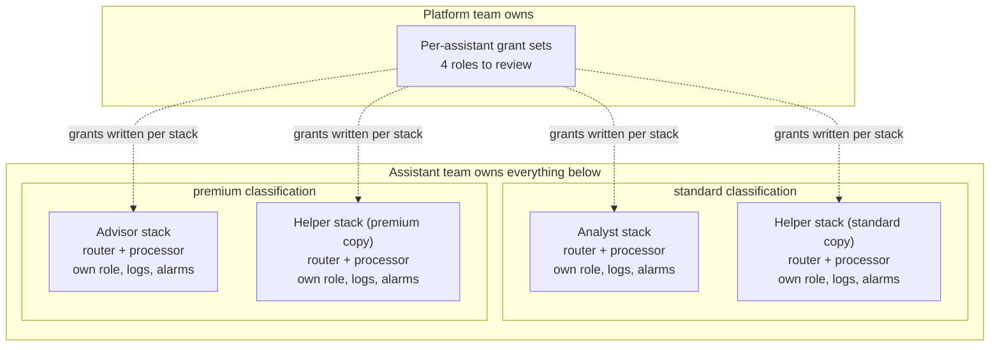
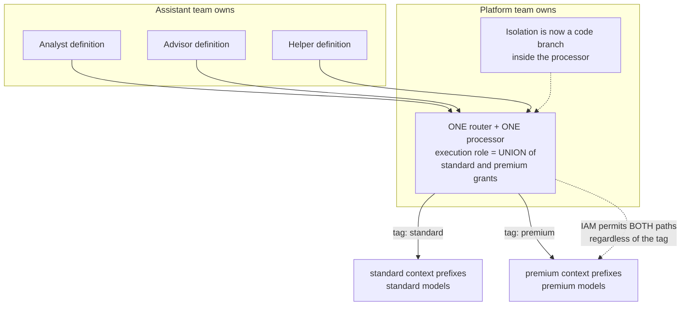
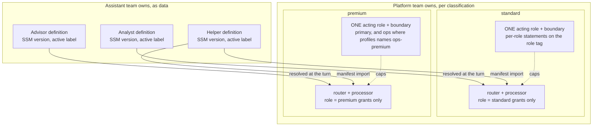
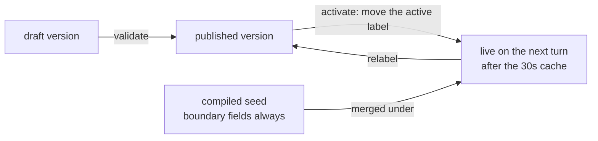

# ADR-054: Compute is per classification, reach is per role, and an assistant is data

## Status

**Accepted (2026-10-03).** The shape recorded here is the shape in the tree, and every claim below is cited to the file that implements it. Two parts are not built, are called out in "What is not built", and must not be read as behavior.

## The question

Granularity, asked of the two pieces of compute a turn runs through. The question names them the classifier and the asynchronous process; in the tree the first is the router and handler Lambda, which classifies in-process rather than in a function of its own (`backend/lambda/src/router-agent-handler.ts` imports `classifyIntent` from `backend/lambda/src/lib/intent-classifier.ts:126`), so it is named that way below. Two candidates:

- One set per **(assistant, classification)** pair, so each assistant has its own router and its own processor.
- One set **shared across classifications**, tagged so each classification's turns are identifiable within it.

The question asks whether the first is overkill and whether the second breaks the security boundary argument. Both answers are yes, for unrelated reasons, and neither candidate is the one the platform runs.

## The answer

**Compute and its execution role are per classification. Reach is per `(classification, role)`. Behavior is per assistant, as versioned data.** Three axes, three different change mechanisms, and no two of them need to move together.

That is not a compromise between the two candidates. It is what falls out of putting each concern on the axis that can enforce it: IAM can enforce a classification, a principal tag can distinguish a role inside one boundary, and a principal tag also distinguishes one assistant from another inside the same role - the `assistant` and `bot` tags on the session the vend mints per turn, with the bearer resolved from `bot` ([DESIGN-SEPARATE-ASSISTANTS-AND-DELEGATION](../../specs/interaction/assistants/DESIGN-SEPARATE-ASSISTANTS-AND-DELEGATION.md), Phase 1b).

## Why shared across classifications is a boundary killer

A Lambda's execution role is **ambient for the whole invocation**. There is no per-request narrowing of it, and code inside the function cannot drop a grant it holds. So a single processor serving every classification has to hold the **union** of every classification's grants, because any invocation might be the one that needs the widest.

The grants in question are derived from the classification by name, which is what makes the union concrete rather than theoretical:

- `contextPrefixesAllowedFor(classification)` (`backend/lib/stacks/agent-classification-common.ts:99`) produces the S3 prefixes the processor may read, and `assistant-profile-stack.ts:334` and `:352` turn them into the `s3:ListBucket` condition and the `s3:GetObject` resource list.
- `modelArnsForClassification(classification, catalog)` (`agent-classification-common.ts:1287`) produces the `bedrock:InvokeModel` resource list, called at `assistant-profile-stack.ts:234` and granted in the statement at `:327`. The list is that call concatenated with the external-routing model ARNs a classification whose topology sets `contextRouting` also reaches (`:240`), so the per-classification list is already two sources wide before any sharing.

Share the function across classifications and both lists become the union. At that point the only thing standing between a `basic` turn and a `premium` model, or between a `basic` turn and a `premium` context prefix, is a correct branch in the function's own code. Tenet P4 names exactly that trade and rejects it: access is "enforced by AWS IAM and resource policies before a request runs", `classification` is "the only closed axis IAM evaluates", and isolation is "provable with a deny-test rather than a code review".

A tag does not recover it. A tag on the function, or a classification carried in the event, is an input to code. The deny-test that today asks IAM whether a principal may read a prefix, and gets a refusal, would become a test that asserts a branch was taken, which is a unit test of the thing under suspicion. The second enforcement layer tenet D3 requires, the one that makes "one missed check is not a breach" true, is the layer that disappears.

So the shared-and-tagged candidate is not merely weaker. It converts the platform's primary isolation claim into a code review, which is the specific exchange the tenets exist to refuse.

## Why per-assistant compute is overkill

Two assistants in one classification doing the same job reach the same data by construction, so there is nothing for a second execution role to express.

Where two assistants genuinely must reach different things, ADR-048 already answers where that difference lives: scope belongs to the **role**, not to the assistant, and a difference between two jobs is a second role. The shipped example is `ops` on `premium`, which reads the deployment's own CloudWatch metrics and logs while the premium primary is denied the same reads. That difference is carried by the acting role's per-role statements (`assistantActingRole`, `roleContextStatements` and `observabilityRoles` in `agent-classification-common.ts`), each conditioned on `StringEquals` of `aws:PrincipalTag/role`, and the session that stamps that tag is minted by the vend (`assistant-vend.ts`). One boundary per classification holds every role's reach and still hands each role only its own. Per-assistant narrowing inside a role is decided and **NOT BUILT**; see [DESIGN-SEPARATE-ASSISTANTS-AND-DELEGATION](../../specs/interaction/assistants/DESIGN-SEPARATE-ASSISTANTS-AND-DELEGATION.md), Phase 1b.

The cost of the per-assistant candidate is also not small, and it is paid per assistant forever rather than once:

| Per assistant, if compute were per assistant | What it is today |
|---|---|
| A router Lambda and an asynchronous processor, each with its own role, log group, reserved concurrency and alarm set | One of each per classification, shared by every assistant it hosts |
| A CloudFormation stack to own them, and a place in `backend/bin/backend.ts` | A `topology` field in each classification's registry entry (`backend/lib/config/profiles.ts`), from which `bin/backend.ts` creates the classification's stack |
| A deploy to change a model, a persona or an intent pack | A data write: a profile version activated through SSM (`active-profile.ts`) |

The third row is the one that matters most, because it is where the maintenance pain in the original question actually comes from. If compute is per assistant, every behavioral change is a deploy of that assistant's stack. If compute is per classification and behavior is data, a behavioral change is a parameter write that converges within the resolver's 30-second cache TTL (`active-profile.ts:1334`) and needs no deploy at all.

## The three axes

### 1. Compute and execution role: per classification

One router and handler Lambda, which classifies in-process, and one asynchronous processor per classification, built once by `AssistantsStack` and parametrized by the `topology` each classification declares in the profile registry. The same stack owns the rest of the classification's compute, which is not on the turn path and is not per assistant either: turn recovery, the task service, the three provisioning custom resources and, where the topology asks for them, the context-source alarm, conversation split and typed-conversation-from-event functions. The descriptor makes model selection, sizing, response limit, streaming and rich-processor capability **data**, and image generation follows the model catalog (a classification is wired for it exactly when the catalog allows it an image model), which is what replaced the former three near-duplicate stacks.

The execution role is where the classification lives, and it is derived from the classification name rather than written per stack, so a classification cannot be added with its grants left unwritten.

### 2. Reach: per `(classification, role)`

`assistantActingRole` (`agent-classification-common.ts`) builds, per classification, one acting role and one permissions boundary, for every **enabled** role. Enabled rather than declared is the distinction that decides what a deployment actually holds, and it is the context flag in "What is not built". The acting role's trust accepts a session only for an enabled role, and each role's own statements are conditioned on the role tag. The bearer is narrower than the boundary that caps it: the boundary permits any bot of the classification because it must cover every assistant the classification could hold, and the bearer statement names exactly the bot the session was minted for. The mechanism is described in [DESIGN-SEPARATE-ASSISTANTS-AND-DELEGATION](../../specs/interaction/assistants/DESIGN-SEPARATE-ASSISTANTS-AND-DELEGATION.md), Phase 1b.

Unconditioned denies make a session a leaf: `iam:*`, `sts:AssumeRole`, `sts:TagSession`, `chime:TagResource` and `chime:UntagResource` (`AnAssistantNeverEditsIdentityOrChains`). So an assistant cannot edit its own identity and cannot chain into another role, and either of those would turn a narrowed grant back into an open one.

Nothing at runtime creates or edits a role, and no turn-path principal holds any `iam:` action (deploy-time custom resources hold `iam:PassRole` and `iam:CreateServiceLinkedRole`, and no turn invokes them): the assistant is a session tag, so assigning one is writing its assignment record. A permissions boundary caps what a created role may hold and says nothing about who may assume it, and IAM has no condition key for a trust document. The grant that creates an assistant identity is `runtimeAssistantProvisioningAllow`, Amazon Chime SDK bot and Amazon Lex actions on what carries `provisioner = runtime`, with no `iam:` action beyond passing a Lex runtime role to Amazon Lex.

### 3. Behavior: per assistant, as a versioned artifact

`active-profile.ts` resolves an assistant's behavior at the turn from the **active version** of `{SSM_ROOT}/assistant/<assistantName>/definition`, merged over the compiled seed. A version carries the model bundle, the tool allowlist, the guardrail selection, the persona, the intent pack, the copy, the onboarding intake and the context selection.

The cut that makes this safe is stated in that file and is the load-bearing sentence of this whole record: **a version changes what the assistant does, never who it is or what it may do.** Boundary fields are always taken from the seed and never from SSM, so a tampered or hostile version cannot widen scope, because the widest thing it can express is ignored at resolution. Resolution is fail-closed: an absent, unreadable, malformed or invalid version falls back to the compiled seed, never to no profile at all.

The same cut is what makes an assistant **portable across classifications without the instance crossing one**. `profile-manifest.ts` exports the versioned body, the inlined persona, the context contracts and a content hash, and import lands it as a draft after checking the target's model, guardrail and context catalogs. Handler and processor IAM roles never travel, and import creates no IAM, widens no scope and adds no model. So an assistant team reuses its assistant's **definition** in a second classification by importing the manifest there, while ADR-042 keeps each running instance acting in exactly one classification. The artifact is the reusable thing; the principal is not.

## What this answers about the three questions it followed

**Custom intents that need determinism across roles.** The intent pack is a versioned field, per assistant, so a role's own taxonomy is a data write. What a role may not decide for itself is a global workflow, which stays global (HOW-TO-ADD-OR-MANAGE-A-PROFILE.md §2.9). Determinism comes from the pack naming a declared machine rather than from each assistant carrying its own copy of one.

**A new tool call that must be available across classifications, such as meetings.** The tool is selected in the versioned `tools` allowlist, which is per assistant and needs no deploy. Whether the tool can actually act is the grant behind it, which is per classification or per role and does need one. The two halves move independently and in that order: the grant exists first, and selecting the tool is what exercises it. A grant with no tool is a reach nobody uses; a tool with no grant fails closed, and it is worth being exact about how. Three things make it closed rather than broken: a tool whose purpose is a per-role grant is not offered at all when no assistant identity was assumed (`async-processor-core.ts:2405`), the shipped role-scoped tool returns a shape rather than throwing when it has no assumed identity and no scope, and it reads `AccessDenied` as an entitlement answer and hands the model wording to use (`deployment-health.ts:203`). The third of those is hand-written in that tool rather than a framework guarantee, so a new tool that does not catch it falls back to the generic in-loop error payload, which the model can read but which carries no designed wording. An assistant that holds a role is also not a grant: a primary whose version selects the tool is offered it and degrades at the call.

**Maintenance cost of shared infrastructure serving several assistants.** It is real, it is already recorded, and it concentrates in one rule: an environment variable is the right carrier for what a function is and the wrong one for anything a turn is. One runtime serves every role a classification declares, so any per-turn fact read from the environment reports the primary's value. That has bitten five times, on the bot's name, the Amazon Lex alias, which profile resolved the turn, which assistant analytics attributed the turn to, and the welcome. Two of the five are genuinely per-turn from the assistant the turn acts as and are the pattern to copy: the profile that resolves the turn and the analytics attribution, both from the assistant the turn acts as, which the vend resolves from the assignment records (`adoptTurnIdentity` in `assistant-async-processor.ts`). The bot name and the Amazon Lex alias are instead fixed per role at deploy, which answers the same question a different way, by giving each role its own resource. The fifth is the welcome, where two assistants introduced themselves identically and the ops assistant described itself as the business advisor; the fix moved the welcome onto the versioned body rather than onto the assignment record, and the measurement is recorded at `active-profile.ts:1300`. They are the four sub-items of the first of the four "Role traps" in HOW-TO-ADD-OR-MANAGE-A-PROFILE.md §5b ("Env is per function"), which counts its own four differently - the environment-versus-turn rule, the shared Amazon Lex bot, a custom resource that re-runs only on a property change, and `GetParametersByPath` authorizing against the path itself. They are a consequence of sharing compute and they are cheaper than the alternative, but they are latent for exactly as long as a classification hosts one assistant, which is why they are listed before a role is added rather than after.

## Where an artifact lives, and why the key carries the boundary rather than the bucket

A shared component that produces an artifact raises the same question one level down, and it is not answered by saying the artifact belongs to the conversation. `SPEC-ASSISTANT-MEETINGS` says a meeting transcript "is an attachment in the conversation, so its retention and classification are the conversation's and need no new answer", which is true about ownership and misleading about storage, because the store it names is shared four ways.

**One bucket, four key families, and only one of them puts the boundary where IAM can read it.**

| Key family | Keyed by | Provenance | What isolates it |
|---|---|---|---|
| `context/{classification}/` | **classification** | platform-seeded corpus | IAM, and `tests/e2e/classification-context.spec.ts` deny-tests it |
| `platform-knowledge/{classification}/` | **classification** (amended 2026-10-14, below) | platform self-knowledge | IAM, by the classification's grants, on the acting role and on the vended session |
| `attachments/<conversationId>/<senderSub>/` | conversation and member | member-uploaded, "may carry PII" | code: `senderOwnsAttachmentKey` |
| `generated-docs/<channelId>/` | conversation | assistant deliverable | code, plus the credential exchange narrowing per request |

> **Amended 2026-10-14.** `platform-knowledge/` is keyed by classification, so two of the four families put the boundary where IAM can read it. The platform's documentation is internal material, and an unscoped prefix grounded the external classification, `basic`, in it. `backend/scripts/sync-project-knowledge.mjs` writes `platform-knowledge/basic/agentechelon-about.json`, a public overview (project, license, author, repository, purpose, overview) with no document index, and `platform-knowledge/standard/agentechelon-about.json`, the full index. The acting role's `ContextS3Read` (`platformGrantedPrefixes` in `assistant-profile-stack.ts`) and the vended session's `platform` edge (`PLATFORM_PREFIXES` in `agent-classification-common.ts`) grant `platform-knowledge/{c}/*` for each classification `c` that `ProfileRegistry.grantsFor` returns, and `loadPlatformInfo` (`company-context.ts`) asks only for those prefixes. The RAG copy of the documentation is ingested at `standard` for the same reason ([RAG.md](../../guides/developer/RAG.md#seeded-corpora)). Verified by: `backend/test/lib/a-role-reads-only-its-own-context.test.ts`, `backend/test/the-platform-knows-its-own-provenance.test.ts`.

Sharing the bucket is right and stays. Prefix plus IAM is the deny-testable pattern, the credential exchange already narrows a vended session to one channel's keys, and a second bucket would add infrastructure without adding a boundary. What does not follow is that any artifact may be dropped into any family.

**A platform-written artifact cannot live in the member-upload family, and this is mechanical rather than stylistic.** The only access control inside `attachments/` is `senderOwnsAttachmentKey`, which requires the key's third segment to equal the reading member's own `sub`, and it exists because the file key arrives on user-controlled message `Metadata`. A transcript has no owning member, so it cannot satisfy that check, and giving it a key that could would mean minting one that impersonates a member. The platform already draws this line where it is enforceable: the admin exchange separates `attachment-read` from `attachment-read-uploads` so that, in the words of `conversations-stack.ts`, "the generated-vs-uploaded split is IAM-enforceable".

> **Amended 2026-10-17:** "own sub" in this record means the reading member's AppInstanceUser id, which `senderOwnsAttachmentKey` reads from the sender ARN (`backend/lambda/src/lib/attachment-bytes.ts:24-27`); it is never the Cognito `sub`.

**Ownership is the part the shared bucket actually breaks, and the lifecycle rule is the proof.** `SPEC-PER-PROFILE-OWNERSHIP` promises that a team owns its classification "end to end" and ships it "without read or write access to their resources", meaning other classifications'. For artifacts, three things contradict that:

- **Retention is not ownable.** The bucket carries one lifecycle rule, `DeleteOldAttachments`, `Expiration: 90 days`. Read back from the deployed bucket, its filter is `Prefix: ""`, so a rule named for one key family governs all four. The seeded company corpus and the platform's own self-knowledge are on a 90-day expiry nobody chose for them. It has not fired: the oldest `context/` object on the deployment is eight days old, and re-seeding during `validate` keeps resetting the clock, so the rule is defused by accident rather than by design.
- **Write scope is not ownable.** The processor holds `s3:PutObject` on `generated-docs/*`, the whole family, so one classification's processor is permitted to write under another classification's conversation key. Nothing but code stops it, which is the second-enforcement-layer argument from the top of this record applied to storage.
- **Deletion does not cascade, and one conversation's content now has three lifetimes.** The bucket is `RETAIN` with `autoDeleteObjects: false`, a conversation type's `expiration` has no reach into S3, and an embedding has no TTL at all by the explicit decision in ADR-008 ("Embedding cost and TTL policy for transcripts and growing corpora", which decided no TTL and deferred per-source-type expiry). So a conversation can expire at thirty days while its deliverables persist to ninety and its vectors persist indefinitely.

**The rule that follows, and it is the general form of this whole record.** A bucket is a technology and cannot express ownership; a key can. So an artifact's key names its owner and its boundary, which makes retention expressible per prefix, write grants narrowable to the owner's prefix, and the crossing case deny-testable with the same simulation the context prefixes already use. Concretely, a classified artifact belongs at `generated-docs/{classification}/{conversationId}/...` rather than `generated-docs/{conversationId}/...`, because the first can be granted with `contextPrefixesAllowedFor` and refused by IAM and the second can only be refused by a branch. Key layout is also the one decision here that cannot be revised cheaply once keys exist, so it is a build-time decision and not a later phase.

**NOT BUILT.** No artifact key carries a classification today, the lifecycle rule is unscoped, and no deny-test covers `generated-docs/`. Transcription is not implemented, which is the reason this is still a decision rather than a migration.

## Decision

1. The router and handler Lambda and the asynchronous processor are **per classification**, with the classification's grants on their execution roles, derived from the classification name.
2. A classification declares **roles**, and a role's extra reach is expressed on the classification's acting role, conditioned on `aws:PrincipalTag/role`, under its single permissions boundary. A boundary per `(classification, role)` is not created.
3. An assistant is **behavior plus an identity**, and its behavior is a versioned artifact resolved at the turn. Nothing an assistant carries may widen what it may reach.
4. An assistant definition is **portable across classifications**; a running assistant instance is not. Reuse happens by manifest import into the target classification.
5. No compute is created per assistant, and no compute is shared across classifications.
6. An artifact's **key** names its owner and its boundary. A bucket may be shared; a key family may not be reused across provenances; a lifecycle rule is scoped to the prefix it is named for; and a write grant is narrowed to the owner's prefix rather than the family.
7. A **derived** copy of an artifact - an embedding, a summary, a projection row - declares its own expiry, because it outlives the thing that classified it and nothing else will expire it.
8. A conversation's **`audience` tag** separates the deployment's own people from outside ones, and the member side of the platform never adds a member to an outside conversation. Every member-side role that may add a channel member or moderator (`chime:CreateChannelMembership`, `chime:BatchCreateChannelMembership`, `chime:CreateChannelModerator`) is denied it where `aws:ResourceTag/audience` is `outside` or absent (`neverAnOutsideConversation` in `agent-classification-common.ts`; `CONVERSATION_MANAGEMENT_ADDS` in `conversations-stack.ts` for conversation management). Leaving, archiving and the console's own paths are not adds, so they are unaffected. A missing tag is refused rather than assumed to be a member conversation, so an untagged channel fails closed. The admin plane carries no audience condition, because administrators span every classification, outside ones included. Proven at synth in both directions by `backend/test/a-member-side-role-never-reaches-an-outside-conversation.test.ts`, and against AWS by the expectation lines in `backend/scripts/deny-test-assistant-membership.mjs`, which have not run against a deployment.
9. **A classification's compute, grants and models are in its own stack, and nothing outside it names the set.** A shared grant names a tag, never a list of classifications; each classification's stack publishes its row of the runtime registry; and every handler reads the set from those rows. Adding or removing a classification deploys or deletes that one stack ([ADR-057](./057-assistant-stacks-come-from-the-registry.md)).

## What proves it, and what does not

The decision rests on one claim that has to be checked against AWS rather than against the tree: that a per-classification execution role is denied the classifications it does not serve. Four e2e specs ask AWS that question with `iam simulate-principal-policy`, which evaluates the **deployed** role and returns AWS's own decision, and each asserts the positive case in the same loop so that a boundary narrowed into uselessness fails rather than passing.

| Axis | What is proven, by denial | Where |
|---|---|---|
| Compute and execution role, per classification | Each classification's asynchronous processor role is allowed `s3:GetObject` on its own context prefix and **denied** every prefix it does not grant, followed by a behavioral negative: a classification cannot name a figure held only in a corpus it is not granted | `tests/e2e/classification-context.spec.ts` |
| The model list, per classification, text and image alike | Each classification is allowed every catalog model it selects and **denied** every ARN of every model it does not; the Bedrock image models are in the same selection | `tests/e2e/a-classification-is-denied-a-model-it-does-not-declare.spec.ts` (against AWS); `backend/test/image-gen-iam-parity.test.ts` (every synthesized grant, image guardrail and session-policy edge against the catalog) |
| The acting boundary | Each assistant is allowed `chime:SendChannelMessage` on a channel tagged with its own classification and **denied** on every other tag | `tests/e2e/assistant-classification-boundary.spec.ts` |
| Reach, per `(classification, role)` | The role-tagged `ops` session is allowed the observability reads its boundary grants, the primary is **denied** the same reads, an untagged session is **denied**, and the boundary grants no write | `tests/e2e/an-assistant-boundary-refuses-cloudwatch.spec.ts`, `tests/e2e/an-ops-role-reaches-only-its-own-classification.spec.ts` |
| Behavior cannot widen reach | A version carrying deployment-time or boundary fields has them dropped on read, edit and export rather than honored | `backend/test/versioned-profile-omits-deploy-time-fields.test.ts` |

The first row is the direct refutation of the shared-and-tagged candidate. Under one shared role that simulation returns `allowed` for every prefix, and there is no second question to ask: the test would have to assert that a branch was taken instead, and a branch is the thing under suspicion.

**One rule covers every model** (`backend/lib/config/model-availability.ts`): the platform allows, the classification selects, and the profile uses. The model catalog lists every model the instance allows and names no classification; each classification selects from it (`models: { selected, default }` on its registry entry); and a classification may use a model exactly when its selection names it, and a model serves only uses its output fits (an image model an intent that needs an image, a text model everything else). The text grant (`modelArnsForClassification`), the image grant (`imageModelArnsForClassification`), the image guardrail, the session-policy edges, the external adapter's key and `produces: image` all derive from the selection inside the classification's own stack, so no stack sets an image flag of its own and adding a classification changes no other stack's grants. Where the rule is applied: the profile write path and experiment validation apply the whole check (`modelFits`: allowed for the classification, and the output fits the use); the text model resolvers apply the availability half, so a text model the classification does not select is served on the classification's own resolution instead; the image resolver applies both halves, so an image model serves only an image-generation turn; and the classifier replay checks both candidates with `modelFits` when a run is requested, opened and executed, on a role granted only that classification's models.

The model list is proven the same way, by `tests/e2e/a-classification-is-denied-a-model-it-does-not-declare.spec.ts`, which derives each classification's declared set from its selection (`ProfileRegistry.selectsModel`), the same selection `modelArnsForClassification` and `imageModelArnsForClassification` read to build the grant, so the test and the policy cannot disagree, and then asks AWS per ARN. The recorded text run predates `deepseek_r1` in the catalog: `basic` was denied all six models it did not declare, `standard` was denied `opus` and `gpt_oss_120b`, and `premium` declared every catalog model, so it contributed a positive control and no denial, which the spec says rather than counting as a pass. With `deepseek_r1` in the catalog the spec expects `basic` to be denied seven text models and `premium` to be denied `deepseek_r1`; that run and the image half have not run against a deployment, and the image half expects `basic` and `standard` to be denied every Bedrock image model.

**A trap that spec had to find first, recorded because it would have made the file decorative.** Passing several `--resource-arns` for one action does not return one result per resource: IAM collapses them into a single `EvaluationResult` whose `EvalResourceName` is a template, carrying one aggregate decision. Four sonnet ARNs came back as one result reading `allowed`. A batched spec reading results by index would have reported `allowed` for every ARN in the batch, including the denied ones, and printed a pass. The spec simulates one resource per call and refuses to read a decision whose resource name is not the one it asked about.

## What is not built

**An assistant's identity is the provisioner's, and is data.** Amended 2026-10-23 ([ADR-048](./048-an-assistant-is-not-a-classification.md), amendment of that date): no stack creates an assistant identity. A deployment's `profiles` declares its assistants, and each classification's stack holds a seed that asks the provisioner for them once; the console creates further ones in a deployed role with no deploy. Every one is an `AppInstanceBot` and an Amazon Lex bot stamped `provisioner = runtime`, an assignment record and a directory entry, and the console renames, owns and retires every one the same way. A role is still a deploy, because a role is reach. This was the gap this section named; it is closed, and the paragraphs below are about what remains.

**The per-deployment fallback parameters are keyed by classification, not by assistant, and the inheritance that caused is now refused.** `assistant-profile-stack.ts` writes and grants `{SSM_ROOT}/assistant/{classification}/assistant-system-prompt`, `.../assistant-intent-pack`, `.../onboarding-intake` and `.../welcome-orientation`. Those are the fallback seam for an assistant whose active version does not carry the field, so two assistants in one classification shared one fallback.

`deployment-copy-scope.ts` now states the rule once - the classification's copy belongs to the assistant the classification names - and the welcome and the persona ask it before falling back. A second assistant with no field of its own gets the platform default, and the refusal is logged with the assistant, the field and what it got instead, so a generic welcome does not read as a bug. Guarded by `backend/test/lib/a-second-assistant-does-not-inherit-the-primarys-copy.test.ts`, which also asserts the premise against the shipped config: a classification really does declare a second role, or the rule would guard a case that cannot arise.

The trap worth recording is how the first version of that fix failed. It resolved the primary with `profiles.classificationFor(assistant)`, which finds the classification whose `profile` field NAMES that assistant - `premium` for `advisor`, and **undefined** for `ops-premium`, because an additional role's assistant is declared as a profile and named by no classification. The gate therefore read "primary unknown, allow the copy" for precisely the assistant it was written to refuse. The classification is passed in from the channel tag instead.

**Two of the four parameters are deliberately unchanged, for different reasons.** The onboarding intake is resolved per CLASSIFICATION on purpose: one resolution serves two call sites, the welcome that starts an intake and the later turn that checks an answer against it, and resolving them per assistant would strand a person mid-intake with their answers checked against a different field list. Making it per assistant means solving that first, so it is a design question rather than a defect. The intent pack is the same shape as the welcome and is latent rather than active - `ops-premium`'s active version carries its own `intentPackRef` - and closing it means threading the turn's assistant into module state the hydration path holds container-wide, which is a larger change than the two that were measurably wrong. **OPEN.** A version's own field wins, so this is harmless while every assistant carries one, and a quiet surprise the first time one does not: the second assistant inherits the first's value rather than anything scoped to itself. It is already measured rather than predicted: `active-profile.ts:1300` records the welcome doing exactly this, with the ops assistant describing itself as the business advisor.

**And the gate that closes it is INERT today, which was established by testing it rather than by reasoning.** A fresh event-opened ops conversation was created on the deployment after the gate shipped, and both assistants still posted the identical sentence. The cause is a different and deliberate mechanism: `composeWelcome` computes `isSpawned` from `priorSubject` or `priorMessage`, an event-opened conversation carries `priorSubject`, and a spawned welcome suppresses the lead AND the access blurb, examples and platform note - because the person was just told who the assistant is in the thread they came from. So no orientation renders in such a room at all, and an orientation-inheritance gate cannot change what is printed there. The gate bites only where a NON-PRIMARY assistant renders orientation, and the only rooms holding two assistants are event-opened ones, so no path reaches it until something can add an assistant to an ordinary conversation. The duplicate identical welcome is therefore NOT this defect, and the fix for it is per-role copy on the conversation type rendered from the event context. Of the four parameters, the persona is the one instance that cannot occur today: it is written only when the topology sets `systemPromptParam`, and premium, the only classification declaring a second role, sets it false. The reachable ones are the intent pack, the onboarding intake and the welcome orientation. The parameter path for a **version** is already per assistant (`definitionParamName` yields `{SSM_ROOT}/assistant/{profileName}/definition`), so this is an inconsistency between two seams rather than a missing mechanism. **OPEN.**

**The assistant's identity is on the turn path for what needs it, and the ambient identity is still the fallback for the rest.** `actAsAssistant` assumes the assistant's identity at the top of a turn and publishes its credentials, and `async-processor-core.ts:2410` offers the deployment-health tool only when `actingCredentials()` is non-null, so a turn with no assumed identity is not offered the tool rather than failing on it. What is not finished is the other direction: anything sending before `actAsAssistant`, or on a path that never declares an identity, still goes out on the shared Lambda role, and the security property does not hold until the ambient `/bot/*` grant is removed. The file says so at the mechanism, and the removal is still open. So the role axis is live for the grant that distinguishes a role, and the bearer axis is partly ambient. **OPEN.**

**One role ships, and a deployment declares it.** `ASSISTANT_ROLES` is `['primary']` as a constant, with `assistantRolesFor(classification)` reading the per-classification declaration, and `observabilityRoles` returns `ops` alone. The axis is built and exercised by one additional role; it is not exercised broadly. And the additional role is the deployment's declaration: the shipped catalog OFFERS `ops` on premium, and a selection deploys it only when it names the role's assistant (`ops-premium` in `profiles`, `shippedProfilesSelection` in `profiles.ts`). A declared role is deployed (`deployedRoles`, `assistant-profile-stack.ts`), so a deploy that does not name it builds premium's acting role for `primary` alone, and no `ops` bot. That keeps anything from appearing in a deployment that did not ask for it, and it is recorded here because every statement in this document about a second assistant is a statement about a deployment that declares the role.

## Consequences

**A classification is the deploy unit, and that is the unit a platform team owns.** Adding or changing a classification is a CloudFormation change to shared machinery. Adding or changing an assistant's behavior is not.

**A role is the smallest thing that can hold a different reach.** An assistant team that wants its assistant to reach something its sibling must not is asking for a role, and a role costs a platform deploy. That is the correct price: it is a change to what IAM permits, and it is verified by denial rather than by reading the policy.

**Sharing compute means per-turn facts must come from the turn's assistant.** Any new per-turn fact added to a processor has to be resolved from the bot the turn arrived on, not from the environment. This is the standing tax of the decision and the one that has actually cost debugging time.

**A behavioral regression is a data rollback, not a deploy.** Profile versions carry an `active` label, so reverting is relabeling, which is what makes a live behavioral change acceptable to make at all.

## Rejected alternatives

| Alternative | Why not |
|---|---|
| One processor shared across classifications, with the classification as a tag or an event field | Its execution role holds the union of every classification's S3 prefixes and model ARNs, so isolation becomes a code branch and the deny-test loses its subject. Rejected by tenet P4. |
| A processor per `(assistant, classification)` | Nothing for the extra role to express when two assistants do the same job, and where they do not, ADR-048 says the difference is a second role. Costs a stack, a bot, two turn-path Lambdas and an alarm set per assistant, and makes every behavioral change a deploy. |
| A permissions boundary per `(classification, role)` | Multiplies managed policies and breaks the stable name a deny-test resolves. The role tag condition achieves the same separation inside one boundary. |
| Per-assistant grants in the versioned profile | A version is runtime-editable and portable, so a grant in it is a grant an operator or an imported manifest could widen. The behavior and principal cut exists to make that impossible. |
| An assistant instance that serves more than one classification | ADR-042, built and deployed. The acting boundary is one classification. Reuse is the manifest, not the instance. |
| A separate bucket per classification or per assistant for artifacts | Adds infrastructure without adding a boundary: the prefix plus an IAM condition already expresses it, and the credential exchange already narrows a vended session to one conversation's keys. Per-assistant buckets are the storage form of the per-assistant compute this record rejects. |
| A transcript written into `attachments/` because "a transcript is an attachment" | That family's only control requires the key's third segment to equal the reading member's own sub. A platform-written artifact cannot satisfy it, and a key that could would impersonate a member. |

---

## Appendix A: the three shapes under a two-team split

The organization this question comes from has two teams and one constraint:

- **A platform team** owns classification infrastructure. It owns what a classification may reach, and it is the only team that changes IAM.
- **An assistant team** owns its own assistants and wants them usable in more than one classification.
- **Neither team wants orchestration cost.** No per-assistant pipeline, no cross-team deploy sequencing, no release train that couples the two teams.

Each shape below is given as the infrastructure it implies, the onboarding process for one new assistant, and the ongoing maintenance for a representative set of changes. The three diagrams use the same deployment: two classifications (`standard`, `premium`), three assistants, one of which the assistant team wants in both classifications.

### A.1 Shape 1: compute per (assistant, classification)

Figure A.1: every assistant is its own compute and its own grant set, so the platform team reviews four grant sets for three assistants and the shared assistant exists as two unrelated copies.

**Onboarding one assistant.** Nine steps, of which four are platform-team work: write a new stack, wire it into `backend/bin/backend.ts`, get a grant set written and reviewed, add a synth test, create the bot and the Amazon Lex bot, seed the behavior, deploy, verify, and repeat the whole sequence per classification the assistant serves.

**Maintenance.**

| Change | Who | Cost |
|---|---|---|
| Change the assistant's model or persona | Assistant team | A deploy of that assistant's stack, per classification it serves |
| Add an intent | Assistant team | A deploy, per classification |
| Add a tool that needs a new grant | Both teams | A platform grant review per assistant stack, then a deploy per stack |
| Tighten a classification's reach | Platform team | Edit every assistant stack in that classification, because the boundary is not one object |
| Add an assistant | Both teams | A full stack per classification served |

**Why it fails the constraint.** The orchestration cost it avoids at the platform layer reappears as release coupling: a classification-wide tightening is an N-stack change, and N grows with every assistant. The platform team's review surface grows linearly with the assistant team's roadmap, which is precisely the coupling both teams wanted to avoid.

### A.2 Shape 2: one compute set shared across classifications, tagged

Figure A.2: one execution role reaches both classifications, so the dotted edge is the one IAM cannot refuse. The tag steers the code, not the permission.

**Onboarding one assistant.** Two steps, both assistant-team work: seed the behavior, assign it. This is the cheapest onboarding of the three, and it is why the shape is tempting.

**Maintenance.**

| Change | Who | Cost |
|---|---|---|
| Change the assistant's model or persona | Assistant team | A data write |
| Add an intent | Assistant team | A data write |
| Add a tool that needs a new grant | Platform team | One grant, added to the shared role, and therefore granted to every classification at once |
| Tighten a classification's reach | Platform team | One edit, plus a code review of every branch that reads the tag |
| Add an assistant | Assistant team | A data write |

**Why it fails the constraint.** Read the third and fourth rows together. Every grant added for one classification is held while serving every other, and the only thing that keeps a `standard` turn out of a `premium` prefix is a branch. The deny-test that today names a principal and a resource has nothing left to assert against, so each release the platform team ships has to be justified by reading the processor rather than by querying IAM. The operational cost moved from CloudFormation into code review, where it is both larger and invisible on a diagram. Tenet P4 rules this out.

### A.3 Shape 3: compute per classification, assistant as data (the decision)

Figure A.3: the Helper definition reaches both classifications as an artifact, while each running instance sits inside exactly one classification's role. No compute is duplicated per assistant and no role spans a classification.

Figure A.4: the behavior change path the assistant team owns end to end. Boundary fields enter from the seed and never from the version, which is what lets the assistant team publish without a platform review.

**Onboarding one assistant.** Four steps today, split cleanly by team:

| Step | Team | Deploy? |
|---|---|---|
| 1. Declare the role on the classification in `profiles.ts` and declare its assistant as a profile, named so it cannot be mistaken for a classification value (`ops-premium`, not `premium`) | Platform | Yes, the classification stack, which publishes the classification's row of the runtime registry (its profiles included); every handler reads the rows at runtime. |
| 2. If it has its own reach, write the role's statements in `agent-classification-common.ts` (`roleContextStatements`, `observabilityRoles`), conditioned on the role tag, and a tool that uses them | Platform | Yes, the classification stack |
| 3. Declare the role in the deployment (`ops-premium` in `profiles` in `deploy.config.json`) and deploy the classification stack (`npm run add-assistant-role` does both). A later deploy without the name is not a no-op: the stack builds the declared roles only (`deployedRoles`, `assistant-profile-stack.ts`), so the deploy succeeds and removes the assignment record, the bot and the Amazon Lex bot | Platform | Yes |
| 4. Author the behavior: persona, intent pack, tool selection, model bundle, copy | Assistant | No, a profile version |
| 5. Verify by denial, not by reading the policy (`an-assistant-boundary-refuses-cloudwatch.spec.ts` is the pattern) | Platform | No |

Steps 1 to 3 are one deploy of one stack, because every IAM and identity artifact a role adds belongs to the classification stack, which is also what makes omitting the context flag a clean rollback rather than a half-built role. Step 1 reaches the rest of the deployment through the classification's registry row, which the channel flow reads the rate limit from at runtime (`loadProfileRegistry`), so no other stack deploys for it. Step 4 is the step that happens repeatedly and it never touches the platform team.

**There is no path to an additional assistant that is not a role.** A classification names one `profile` plus its `roles`, and a role's assistant name is composed as `{role}-{classification}` at the stack, so a second assistant in an existing classification is the procedure above whether or not it needs a reach its sibling lacks. "A role" and "an additional assistant" are the same act, and only the boundary statements in step 2 are optional.

**Serving the same assistant in a second classification** is steps 1 to 3 in the target classification, then an export from the source and an import into the target under the target's own profile name, because the name is composed from the role and the classification and so cannot be the source's. Import binds to a profile the target already provisions and refuses one it does not, lands a draft, and rejects a model the target does not provision, a guardrail key it cannot resolve, an unpublished context key or a mismatched context contract, so the assistant team cannot accidentally carry a reach the target does not have. The export and import routes are deployed and covered end to end by `tests/e2e/portable-profile-lifecycle.spec.ts`, which round-trips into the same profile; the cross-classification case itself is covered by unit tests over the manifest and not yet by an e2e. **OPEN.**

**Maintenance.**

| Change | Who | Cost | Needs the other team? |
|---|---|---|---|
| Change the model, persona, copy, guardrail selection, context selection or intent pack | Assistant team | Activate a version. Live on the next turn after the resolver's 30-second cache. | No |
| Roll a behavioral regression back | Assistant team | Move the `active` label | No |
| Select a tool the classification already grants | Assistant team | A data write | No |
| Add a tool that needs a grant the classification does not hold | Platform team first, then assistant team | One boundary edit and one deploy; then the tool selection is a data write | Yes, once, in that order |
| Change sizing or the processor timeout (the classification's `topology`) | Platform team | A deploy of that classification's stack | Yes |
| Change classifier mode, rate limit or attachment readability | Platform team | A registry edit, so a deploy of every stack whose Lambdas compile the registry, not only the classification stack. The rate limit is read on the flow path as well as the turn path | Yes |
| Tighten a classification's reach | Platform team | One edit to `contextPrefixesAllowedFor` or the model catalog, one deploy, and one deny-test | No |
| Give one assistant a reach its sibling must not have | Platform team | Declare a role, write its statements, deploy, deny-test | Yes |
| Add an assistant, with or without a new reach | Platform team for identity, assistant team for behavior | The five steps above, then data. There is no smaller path: an additional assistant is a role | Yes, once |

**Why it meets the constraint.** The two teams meet in exactly two places: a classification's grant set and an assistant's identity. Everything the assistant team does repeatedly, which is behavior, is a data write with no platform involvement and no deploy. Everything the platform team does repeatedly, which is tightening and verifying reach, is a single object per classification rather than one per assistant. There is no pipeline between them and nothing to sequence, because a version activation and a stack deploy are independent in the direction that matters: a version cannot widen reach. The converse is weaker and worth stating rather than rounding off, because the fields a version does not carry still come from the compiled seed - a deploy that edits a seed `modelKey` changes the effective model of any version that pinned none (`active-profile.ts:1450`), and `classifierMode`, `timeoutSeconds`, `taskSupport`, `rateLimitPerHour` and `battleEligible` are never taken from a version at all (`:1451`). So a deploy can change behavior a version left unpinned, which is the same list the maintenance table already assigns to the platform team.

**What the assistant team gives up.** A reach that its sibling does not have costs a platform deploy, and so does the assistant's identity until ADR-048 is built. Those are the two places the shape is not self-service, and both are places where IAM changes, which is where a review belongs.

### A.4 The three shapes side by side

| | Shape 1: per assistant | Shape 2: shared and tagged | Shape 3: per classification (decided) |
|---|---|---|---|
| Turn-path compute objects for 3 assistants over 2 classifications | 4 stacks, 8 turn-path Lambdas | 1 set, 2 turn-path Lambdas | 2 sets, 4 turn-path Lambdas |
| Grant sets the platform team reviews | 4, growing per assistant | 1, holding the union | 2, one per classification |
| Isolation proven by | Per-stack IAM, duplicated | A code branch | A deny-test per classification |
| Behavior change | A deploy, per classification served | A data write | A data write |
| Classification-wide tightening | Edit N stacks | 1 edit plus a code audit | 1 edit, 1 deny-test |
| Cross-classification reuse of an assistant | Two unrelated copies | Implicit and unbounded | A manifest import, validated against the target |
| Cross-team coupling | Grows with the assistant roadmap | Grows with the branch count | Two fixed meeting points |
| Verdict | Overkill, and it moves coupling rather than removing it | Refused by tenet P4 | Decided |
