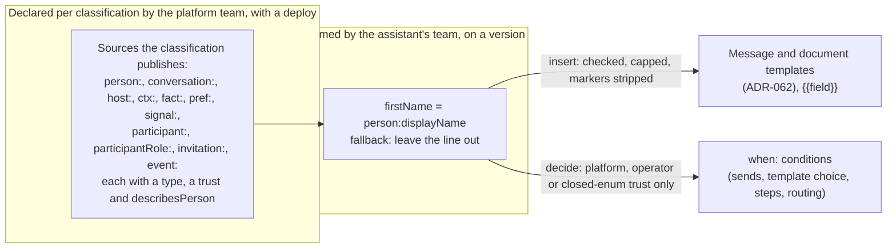

# ADR-060: A variable is declared once, and its trust decides what it may do

## Status

**Accepted (2026-10-25). Built and deployed to dev; the two deployed proofs ("What proves it") are written and NOT VERIFIED, with no run recorded.**

All five slices are built and deployed to dev ("What is built"): slice 1a, declarations and conditions; slice 1b, version variables; slice 1c, the migration of the four mechanisms below onto the declarations; slice 1d, gating of workflow steps and edges, task moves, template choice and routing; and slice 1e, the console's variable picker and condition editors, and a `ctx:` condition checked against the classification's catalog wherever one is stored. Each migration is held to what it replaced by an equivalence test, so the four mechanisms say what they said; the table below describes them as they were before 1c. The sources whose records do not exist yet are refused with their reason ("What is not built").

The platform reads named values in four places, each declared its own way and usable in one place only:

| Mechanism | What it declares | Where it is used | Source |
|---|---|---|---|
| Context-source catalog, per classification | key, fields with types, `trust` (platform, operator, member), `availability`, `maxBytes` | the model prompt on a turn, as fenced context | `context-sources.ts`, `context-sources-runtime.ts` |
| Notice variables | name, type (`text`, `longText`, `arn`, `id`) and a cap, per notice kind, in code | notice copy and the email it carries | `NOTICE_VARS`, `checkNoticeVars` in `assistant-notice.ts` |
| Welcome tokens | a fixed set: the conversation's fields, `{role}`, `{examples}` | the welcome only | `renderWelcomeTemplate` in `welcome-orientation.ts` |
| Step bindings | `requirement:`, `detail:`, `tool:`, `literal:` | a document template's fields and a step action's arguments | `step-bindings.ts` |

Before slice 1c none resolved a value outside the call site that owned it, and every reader returned strings. Before slice 1d no value gated behavior: a workflow transition was taken by the model along declared edges (`advance_task_state`) or by the runtime on a step action's outcome (`onSuccess`, `onFailure`). The routing context's `signals` bag (`resolve-model-plan.ts`) is declared and read by no rule; the one context rule reads `userLanguage` and `segment.country` directly, and a version's routing rules (slice 1d) read the turn's deciding values.

**Amended (2026-10-27).** A conversation type's participant roles (DESIGN-CONVERSATION-TYPES section 6.1) are a platform-trust source: the participant roles a person holds (`participant:role`) and a participant role's holders as a person-list (`participantRole:<name>`). The role a creating application asserts for a member is a separate, member-trust source (`host:role`). ADR-061's amended events add sources for the invitation and the event that started a run, and an event's field is platform trust only when the platform computed or resolved it. A message the room reads may mention a member by display name (decision 7).

## Context

An assistant's team wants to say "greet a returning person differently", "put the person's first name in this line" and "open this form only in an ops room", without code. Each needs a value with a known source, and today each such need adds another one-off.

The tenets settle most of the shape:

- **D11:** no decision depends on recognizing a phrase. Text a person or an outside application wrote may be shown, but it may not steer behavior unless a model resolved it into declared data (an enum, a number) at the point it was established.
- **D12, P4 and ADR-042:** a source is read by the classification it belongs to, under that classification's role, and never by one principal on behalf of several.
- **D3:** a rule that keeps a value out of a decision, or out of the room, is enforced twice.
- **D2:** a classification is a set, not a ladder, so no condition orders classifications.
- **D7:** one source per question; current state is read where it lives, never from a copy.

## Decision 1: sources are declared per classification, and an assistant names what it uses

**The platform team declares the sources each classification publishes**, each with a type, a trust and whether it describes a person, beside the context-source catalog it extends. A source is read under that classification's role. A version that names a source its classification does not publish is refused at validation, and the read itself is refused by IAM (D3, D12).

Every source uses the step-binding grammar `<kind>:<key>`, which gains new kinds:

| Source | Type | Trust | Describes a person | Its one source |
|---|---|---|---|---|
| `person:onboarded` | boolean | platform | yes | the user-profile store (`user-profile-client.ts`) |
| `person:displayName` | string | member (free text from the identity provider) | yes; the one person value a room message may carry, as a mention of a member (decision 7) | the directory (`membership-source.ts`) |
| `person:clearance` | set | platform | yes | the clearance resolution (`user-clearance.ts`) |
| `conversation:classification` | enum | platform | no | the conversation's immutable classification tag |
| `conversation:type` | enum | platform | no | the channel-context row (ADR-053), never the `conversationType` tag |
| `conversation:participants` | person-list | platform | yes | the participant shape recorded at creation (`participant-shape.ts`) |
| `conversation:title` | string | member | no | the channel's name, from the Amazon Chime SDK |
| `conversation:topic` | string | member | no | the channel-context row |
| `host:userName`, `host:participantProfile` | string | member: the creating application asserts it | yes | the channel-context row written at creation |
| `ctx:<source>.<field>` | the field's type | the catalog entry's trust | as the entry declares; an entry that does not declare it describes a person | the classification's context-source catalog |
| `fact:<key>` | string | member | yes | onboarding answers |
| `pref:<key>` | enum | closed enum | yes | the reply-preferences registry |
| `signal:userLanguage` | enum of the languages the deployment declares (`backend/lib/config/languages.ts`) | platform | no | the routing context on the channel-context row |
| `person:preferredLanguage` | enum of the languages the deployment declares | closed enum: the person chose it among the declared languages | yes | the user-profile store's preferences (`preferredLanguage`), set by the person (`language-preference-api.ts`); used only where one person reads the message (ADR-062, decision 4) |

**NOT BUILT as sources:**

- `meeting:expected` and `task:assignees`: person-lists of platform trust, for ADR-061's `{ people: <variable> }` audience on a `send` step.
- `participant:role` (amended 2026-10-27): a set of the participant role names the person holds in this conversation, platform trust. A participant role is a function a person holds in one conversation, declared on its conversation type; it is not an assistant role (ADR-048) and not an IAM role. Its one source is the participant-role holdings the conversation type's declaration resolved from a platform-trust source and recorded in the `participantRoles` field of the server-only channel-context row (DESIGN-CONVERSATION-TYPES section 6.1), never channel Metadata: a `participantRoles` field written into Metadata is ignored by the resolver, the audience and moderator conferral. It may decide (`has`). It does not describe a person in decision 7's sense: which member leads, organizes or is on call is the room's own shape, as membership is, and a room message may say it, within the mixed-trust rule of decision 7. **OPEN:** whether a type may declare a participant role whose holding is private to its holder, which would make that role person-describing.
- `participantRole:<name>` (amended 2026-10-27): a person-list of platform trust, the members who hold that participant role in this conversation, from the same record. It is what ADR-061's `{ participantRole: '<name>' }` audience resolves, and it may also be named as `{ people: participantRole:<name> }`, as a room message's `email.people`, or in a `mention:` binding. A name the types a workflow declares (ADR-061 decision 1) do not declare is refused at validation and resolves to nobody at run time.
- `host:role` (amended 2026-10-27): the role a creating application asserted for a member when it created or added them (`memberIdentities[].role` on the channel-context row, written by a host's context create and the add-member path), a string of member trust. It is inserted only into a message addressed to that member and never decides: the router reads it for a send addressed to one person when the template binds it, and validation refuses a condition on it. A type that declares a participant role with a `host` source (DESIGN-CONVERSATION-TYPES section 6.1) makes the members whose asserted role names it that role's holders, read over `memberIdentities[].role` when the holdings are read and never stored; those holders are addressed (`{ participantRole: '<name>' }`) and mentioned, and the router keeps them out of everything a condition reads (`decidingRoles`), so the assertion confers nothing and selects no template or brief. A participant role that must decide names a platform-trust source. Built (`FIXED_SOURCES`, `variables.ts`; `hostRoleHoldings`, `withHostHoldings`, `participant-roles.ts`).
- `invitation:inviter` and `invitation:invitee` (amended 2026-10-27): person-lists of one, platform trust, from the invitation's `Tokens` record, at `invitation-sent` and `invitation-unredeemed` only. Built at both (ADR-061), read by the router from the record it verifies, at `invitation-unredeemed` again when its deadline fires (`FIXED_SOURCES`, `variables.ts`).
- `invitation:reason` (amended 2026-10-27): the one line the inviter gave for inviting the person, a string of member trust from the invitation record: inserted into a message addressed to that person, never deciding. The participant role the invitation records is resolved into a declared name when the invitation is made (DESIGN-CONVERSATION-TYPES section 6.1), so `participant:role` is the value that decides and the reason is the value that is said. The reason is built: the invitations API records it, and the router reads it at `invitation-sent`. A participant role on an invitation is built: the API records a `role` the conversation's type declares `invitable` as `participantRole` on the invitation, refusing any other (`ROLE_NOT_DECLARED`), and the router reads it at `invitation-sent` as `invitation:role`, a closed enum of the names some type declares invitable, and as the invitee's `participant:role`.
- `event:<field>` (amended 2026-10-27): a field the event's one source declares, at that event only. Its trust depends on who produced the value. A value the platform computed or resolved is platform trust and may decide: a person resolved to an AppInstanceUser (`event:person`), `event:rejoin` at `meeting-joined`, and `event:absent`, the expected attendees the roster shows have not joined at `expected-attendee-absent`, a person-list. At `alarm-state-changed`, `event:alarmName` and `event:alarmState` (`ALARM`, `OK` or `INSUFFICIENT_DATA`) are platform trust because the router reads the alarm's state back from CloudWatch before anything runs (built, `EVENT_FIELDS`, `variables.ts`). Free text carried from an event's payload (`event:label`, an alarm's description, a field of a vendor's partner event) is member trust: inserted as delimited data, stripped and capped, never deciding. Validation refuses a `when` on a free-text `event:` field.
- `person:firstSeen`: no stored field holds it; the archive is its source.
- Structured host fields such as a company or a position: the row holds free-text `participantProfile` only.

**An assistant's team names the variables it uses**, on its version, each as a source and a fallback: `firstName = person:displayName`, fallback "leave the line out". A version names only sources its classification publishes. It cannot declare a source, change a trust or clear `describesPerson`.

## Decision 2: a variable's trust decides whether it may insert, decide, or both

| Trust | Insert into text | Decide |
|---|---|---|
| platform | yes | yes |
| operator | yes | yes |
| closed enum, including a value a model resolved into a declared enum or number where it was established (D11) | yes | yes |
| member free text (a person, an outside application, or an identity provider's free-text attribute) | yes, capped and stripped | **no** |

## Decision 3: every rule here is enforced twice

**First layer, validation**, when a version or a template is stored. It refuses:

- a condition on a member-trust variable, a free-text `event:` field included;
- a person-describing variable inserted into, or used in a condition that selects, a message the room reads, except `person:displayName` inserted through a `mention:` binding (decision 7);
- a source the classification does not publish;
- `gt` or `lt` on anything but a number;
- `person:clearance` in an email section (ADR-062, decision 5).

**Second layer, the resolver**, at run time:

- a condition on a member-trust variable does not hold;
- a condition on a person-describing variable does not hold where the message has no single addressee, and such a variable renders empty there, except a mention of a member;
- a mention renders empty for a person who is not a member of the conversation when the message is rendered, except at `assistant-joined` for a person in the participant shape's `humans` (decision 7), and in an email to a person who is not a member;
- `person:clearance` renders empty in an email section.

Each refusal is logged by variable name, never by value. A version written around validation, or stored before a rule existed, is held by the second layer (D3).

## Decision 4: one resolver, as a library in each classification's functions

The resolver is a library that runs inside each classification's router and processor, under the grants they already hold for reading values: the router already reads the directory, the participant shape, the clearance and the user-profile store. Resolving adds no IAM grant and no shared principal (D12). Rendering a message template does add one read grant, which ADR-062 decision 2 states.

It returns typed values: string, number, boolean, enum, set and person-list.

Each call site states what is settled there, as `CallSiteCapabilities` (`context-sources-runtime.ts`) does for context sources. It gains `subjectSettled`, true at `WelcomeIntent` when the participant shape names a single subject, because the shape is written before the channel exists.

A value that is not settled at a call site is never awaited. It inserts its fallback, and a condition on it does not hold.

## Decision 5: one syntax and one strip

- **`{{field}}` everywhere a value is inserted**, the syntax document templates already use: messages, emails and documents. The welcome's `{token}` and the notice `{var}` forms are migrated.
- **Every inserted member-trust value passes through `stripMessageMarkers`** (`message-markers.ts`), the strip the chat client's parser mirrors, with removal of a partial marker and the per-type caps, the rule notice variables follow today.
- **A fallback applies to insertion only.** A condition never reads a fallback.
- **An empty field depends on the template's kind.** In a message, a line whose field is empty and has no fallback is left out. A document's platform fill keeps refusing an unbound field rather than shipping a gap (SPEC-DOCUMENT-TEMPLATES FR9).

## Decision 6: conditions are data with a closed set of operators, and workflow steps gate on them

A condition is `when: { <variable>: <value> }` or `when: { <variable>: { op, value } }`. Several keys are joined by AND. An ordered list of alternatives gives OR. There is no expression language.

| Operator | Applies to |
|---|---|
| `eq`, `ne`, `in` | string, enum, boolean, number |
| `has` | set: a person's clearance has `premium` |
| `exists` | any |
| `gt`, `lt` | number only; refused on an enum, a set or a classification (D2) |

**An unresolved variable makes every operator false**, `ne` and `exists` included, so a failed read never selects a path written for a value.

**Workflow steps gate on variables (owner, 2026-10-25).** A step's entry and each of its edges may carry a `when`, evaluated by the runtime before the model's `advance_task_state` request or a step action's outcome is applied. A `when` that does not hold refuses the move with a reason that names no value, as an undeclared edge is refused today (`authorizeTransition`, `task-state-machines.ts`). ADR-031's check that a requirement was recorded runs beside it.

First consumers, in order: the edges of event-started workflows such as the welcome (ADR-061), the choice of message template (ADR-062), the edges of intent-selected workflows, and routing rules over the `signals` bag. A routing condition selects only among models the classification already grants: the platform allows, the classification selects, the version uses, and IAM remains the second layer (D3).

## Decision 7: a person's facts reach only that person, and clearance shapes behavior without being the access control

**A variable that describes a person** is inserted only into a message addressed to that person (a targeted send, ADR-061 decision 3), and a condition on one selects only such a message. A message the room reads, and the choice of which room message is posted, use conversation, signal and operator variables only, because every member reads the room's history. A step refused on a person-describing condition says so only to the person who asked.

**Amended (2026-10-27): a room message may mention members by display name.**

- **What a mention is.** `person:displayName` inserted into a message the room reads through a `mention:` binding (ADR-061 decision 2), for a person resolved from the participant shape, from the event (`event:person`, `event:absent`), or from a participant role the conversation type declares (`participantRole:<name>`), and for no one a version names directly.
- **Restricted to members.** The resolver checks the person against the conversation's live membership when the message is rendered (tenet D7), and a person who is not a member renders empty, so the line drops (decision 5). The one exception is `assistant-joined`: live membership has not converged when the assistant joins, so a person in the participant shape's `humans`, written before the channel existed, counts as a member there. A person the event is admitting counts only once admission against the conversation's classification and the type's issuer list has let them in, and is then a member. In an email sent to a person who is not a member, every mention renders empty.
- **Rendered inert.** The name is inserted with every address token, `@` handle, marker syntax and link neutralized, so a display name such as "@ops-assistant" addresses no assistant and carries no link.
- **Still member trust.** A display name is inserted stripped and capped, and never decides (decision 2): no condition reads it, in a room message or anywhere else.
- **Every other fact stays targeted.** Clearance, `person:onboarded`, `person:preferredLanguage`, `fact:`, `pref:`, `invitation:reason`, `host:role` and the other `host:` facts are inserted only into a message addressed to the person they describe, and a condition on any of them selects only such a message.
- **A participant role is the room's shape, not a fact about the person.** A room message may say who holds a participant role ("the lead is Priya") and a condition may select a room message on `participant:role` or `participantRole:<name>`, because the room is meant to know who leads, organizes or is on call, as it knows who is a member. On a type that admits an external or guest issuer (SPEC-CONVERSATION-SECURITY Layer 7), a holding is said in a room message only when the participant role declares `visibleToGuests: true`; otherwise it is said in a targeted message (DESIGN-CONVERSATION-TYPES section 6.1).
- **A mention invokes nobody.** A mention by an assistant names a person to the room; it does not address, target or summon anyone, and it starts no assistant's turn (ADR-061, decision 6).
- **Why.** SPEC-WELCOME-AND-CONTEXT FR10's no-name rule exists because the sender is not known when `WelcomeIntent` fires, a race the participant shape removes. A member's display name is already visible to every member of the conversation. The privacy rule is about the facts a room learns about a person, not about the name the room already sees.

**A person's clearance may gate (owner, 2026-10-25).** `person:clearance` is platform trust, a set, read through the existing clearance resolution.

- An unknown clearance (absent, or a resolution not from the issuer) is unresolved, so no condition on it holds. Sign-in evidence is never read as a clearance.
- It is inserted only into a message addressed to that person and never into an email, matching SPEC-CAPABILITY-REFUSAL FR17, where access lines reach the person alone and in the conversation.

**A clearance gate shapes the experience; it is never the access control.** Data and actions that only some people may reach belong in a conversation of the classification that grants them, which IAM enforces (P4). A `when` on clearance is never the only check in front of data or an action. The same holds for a participant role (amended 2026-10-27): `participant:role` selects a brief, a template or a step, and grants nothing, because a participant role is declared on a conversation type and a type decides experience while the classification decides reach (tenets P4 and D2).

## What it reuses

| Need | Reused |
|---|---|
| Source declarations with type, trust and availability | the context-source catalog, per classification (`context-sources.ts`) |
| What is settled at a call site | `CallSiteCapabilities` (`context-sources-runtime.ts`), with one new flag |
| Source syntax | the step-binding grammar (`step-bindings.ts`), with new kinds |
| Insertion syntax and rendering | `{{field}}` and the platform fill of document templates (ADR-062) |
| Strip and caps | `stripMessageMarkers` and the notice caps |
| Who the conversation is for | the participant shape (`participant-shape.ts`) |
| Who holds which participant role in the conversation | the conversation type's participant roles and the `participantRoles` holdings recorded on the channel-context row (DESIGN-CONVERSATION-TYPES section 6.1, built with ADR-061 slice 3) |
| The role a creating application asserted | `memberIdentities[].role` on the channel-context row (`channel-context-client.ts`), read as `host:role` |
| Whether a mentioned person is a member | live membership from the Amazon Chime SDK, the authority for who is in the conversation |
| A safe deciding value from a person | the reply-preferences registry's closed enums |
| Refusing a move | `authorizeTransition` (`task-state-machines.ts`) |

## Options considered

- **One shared resolver function serving every classification.** One principal would hold every classification's sources at once, which D12 refuses.
- **Trust declared by the assistant's team.** A team could raise a value's trust and let member text decide, which D11 forbids.
- **An expression language for conditions.** More power than any consumer needs, harder to validate, and harder to show in the console.
- **No name in any room message.** It keeps out a value every member already sees, and leaves a room message unable to say who joined or who leads. Replaced by the mention rule.
- **A participant role resolved from a person's free-text title or from how they write.** A participant role decides which brief and template a person receives, so it is resolved from records, never from member text (D11). The role a creating application asserts is recorded and said, as `host:role`, and never decides.
- **Every `event:` field at platform trust.** An alarm's description or a vendor's field is text an outside system wrote; letting it decide would let that system steer a workflow (D11).
- **A person's language used everywhere, including shared rooms.** A room would need a version per member's language, which is SPEC-BILINGUAL-CONVERSATIONS FR9 (dual delivery, optional and not built) and outside this decision.

## Consequences

- The four mechanisms converge: the welcome's fixed tokens and notice variables become declared variables, and step bindings keep their task-scoped kinds and gain the new ones.
- A new kind of value is a source declaration reviewed with a deploy, not a code change at each call site.
- Every value that decides behavior is data the platform, an operator or a model-resolved enum supplied.
- A participant role is one more platform-trust source: a workflow gates on it and addresses its holders without a feature reading the type's declaration itself.
- A room message can name members, and validation and the resolver hold every other person fact to targeted messages, as before.

## What is built

Slice 1a, declarations and conditions, built (2026-10-28) and deployed to dev, verified by `backend/test/lib/a-variable-is-declared-once.test.ts` and `backend/test/lib/context-sources-runtime.test.ts`. It is a pure library in `backend/lambda/src/lib/variables.ts`: every value is handed in by the call site that read it, so it adds no principal and no IAM grant (decision 4, tenet D12).

| Piece | Code | As built |
|---|---|---|
| The source table (decision 1) | `FIXED_SOURCES`, `buildSourceTable`, `lookupSource`, `sourceLookup`, `NOT_BUILT_SOURCES` (`variables.ts`); `describesPerson` on a catalog entry (`context-sources.ts`) | The fixed kinds of decision 1's table, each with its type, trust, `describesPerson`, availability and one source. One `ctx:<key>.<field>` per field of every entry the classification's published catalog carries, with the entry's trust; a catalog `string[]` field is a set, an entry that does not declare `describesPerson` describes a person, and the shipped `company-docs` entry declares `describesPerson: false`. A new catalog entry is a new source with no code change. One `pref:<key>` per reply preference, a closed enum of the registry's values; `fact:<key>` as member text about the person; `event:<field>` from the event-field declarations (`EVENT_FIELDS`), platform trust only when the platform computed the value: `event:person` at `conversation-opened` today. A source that is not built is refused naming what is missing |
| Trust decides (decision 2) | `mayDecide`, `mayInsert` | Platform, operator and closed-enum values decide; member text is inserted and never decides |
| Conditions (decision 6) | `evaluateWhen`, `testHolds`, `whenKeys`, `WHEN_OPERATORS`, `isUnresolved` | `{ <variable>: <value> }` (a bare value is `eq`) or `{ <variable>: { op, value } }`, keys joined by AND, a list of alternatives joined by OR. Unresolved is absent, null, blank text or a number that is not finite (an empty set is a resolved set), and makes every operator false, `ne` and `exists` included. A value of the wrong shape is false rather than coerced, and an empty or malformed condition never holds |
| Validation (decision 3, first layer) | `whenErrors`, `insertionErrors` | Every reason at once. A condition is refused on a key the classification does not publish, on member text (a free-text `event:` field named as such), with an operator outside the closed set or on a type it does not apply to (`gt` and `lt` on a number only, `has` on a set or person-list only, `eq`, `ne` and `in` on a scalar only), with a value that does not fit the variable (an enum's value outside its declared set), on an `event:` field at an event that does not carry it, and on a person-describing variable selecting a room message. An insertion is refused for a source not published, a person-describing variable in a message the room reads except `person:displayName` through a `mention:` binding, a mention bound to anything but a display name, and `person:clearance` in an email section |
| The resolver (decision 3, second layer) | `decidingValue`, `conditionHolds`, `insertValue`, `mentionRenders`, `sourceSettled` | A condition reads each key through `decidingValue`, which holds back a source not published, member text, a value not settled at the call site and a person fact where the message has no single addressee, so a condition stored around validation does not hold. `insertValue` returns nothing (the call site inserts its fallback) for a source not published, a value not settled, clearance in an email and a person fact in a room message; a mention renders through `inertMention` only for a live member, for a person in the participant shape's `humans` at `assistant-joined`, and never in an email to a non-member. Every inserted value is stripped and capped by `cleanMessageValue`, and a member value also loses any `<template-data>` or `<context>` delimiter it carries. Each held value is logged by variable name and rule, never by value |
| What a call site settles (decision 4) | `subjectSettled` on `CallSiteCapabilities`, `turnCallSite`, `welcomeCallSite` (`context-sources-runtime.ts`) | `welcomeCallSite` sets `subjectSettled` when the participant shape names one subject (`onboardingApplies`), so a `person:` source, and a person-describing `ctx:` source that waits on identity, is readable at the welcome for that one person and unresolved in a group. The processor's turn states its call site through `turnCallSite`. The catalog's own `isAvailable` reads the same rule since slice 1c |

Slice 1b, version variables, built (2026-10-28) and deployed to dev, verified by `backend/test/lib/a-version-names-its-variables.test.ts`.

| Piece | Code | As built |
|---|---|---|
| A version names its variables (decision 1) | `variables` on `ProfileDefinitionBody`, `RUNTIME_EDITABLE_KEYS`, `bodyFrom`, `resolveFromDefinition` (`active-profile.ts`); `VersionVariable`, `VARIABLE_NAME`, `MAX_VERSION_VARIABLES`, `versionVariablesShapeErrors` (`variables.ts`); `patchShapeErrors` (`profile-copy-fields.ts`); `PROFILE_FIELD_DECISIONS.variables` (`profile-field-decisions.ts`) | A variable's name to `{ source, fallback? }`, at most 32. A name has no colon, so it never reads as a source. The body whitelist keeps the field, the served version carries it, and it is hashed into `configId`, so a changed source or fallback is a new version. A draft patch is refused for a malformed name, a source outside the `<kind>:<key>` grammar, a field other than `source` and `fallback` (a version cannot set a trust), or a fallback that is not text, a number, a boolean or a list of text. The console names it as JSON with a draft patch and lists it in the variable picker beside the published sources (slice 1e) |
| Checked against what the classification publishes (decisions 1 and 3) | `versionVariablesErrors`, `catalogEntryForVariables`, `intakeFactKeys` (`variables.ts`); `versionVariableErrors` in `validateDraft`, `activateDraft` and `publishVariantVersion` (`profile-lifecycle.ts`) | The table is built from the classification's published catalog with each entry's trust (`contextSourceCatalogFor` in `manage-profiles.ts` now carries trust, `describesPerson` and availability; an entry that does not say its trust is member trust), the deployment's declared classifications and, for a `fact:` variable, the declared intake fields. Refused: a source the table does not hold, naming what is not built; a fallback that does not fit the source's type (a number, a boolean, an enum's declared value, a set's declared members, no fallback at all for a person-list, and a fallback its insertion check would change). An unreadable catalog or intake refuses the version |
| A member-trust variable never decides (decision 2) | `versionLookup`, `versionVariableSources` (`variables.ts`) | A version's names are read through `sourceLookup`, so `whenErrors` refuses a condition on a variable whose source is member text, by the variable's name, and `conditionHolds` does not hold one stored anyway |
| Clearance and classification are a set of what the deployment declares (decision 7, ADR-046) | `buildSourceTable({ classifications })`, `whenErrors` (`variables.ts`) | Given the declared classifications, `person:clearance` is a set of them and `conversation:classification` an enum of them: `has` and `eq` naming any other value are refused, and `gt` and `lt` stay refused |
| `fact:<key>` names a declared intake field | `buildSourceTable({ facts })`, `lookupSource`, `intakeFactKeys` (`variables.ts`); `deploymentIntakeOf` (`profile-lifecycle.ts`) | The declared list is every field that stores a fact, never one that sets a reply preference, of the version's own `onboarding` and its classification's `<root>/assistant/<classification>/onboarding-intake`. A `fact:` key outside it is refused, naming the declared ones |
| Export and import (SPEC-PORTABLE-PROFILES) | `exportManifest`, `importManifest` step 3f, `TargetContextSource` (`profile-manifest.ts`) | Export carries the body's variables as source names and fallbacks, never a resource. Import checks them in the target classification and refuses a source the target does not publish, or publishes at a type the fallback does not fit |

Slice 1c, the migrations, built (2026-10-28) and deployed to dev, verified by `backend/test/lib/each-mechanism-reads-the-one-declaration.test.ts`, which holds each migration to a frozen copy of the code it replaced, and by the suites of the modules it touches (`an-assistants-welcome-knows-its-room`, `welcome-orientation`, `a-notice-takes-only-declared-variables`, `a-step-runs-its-declared-action`, `an-event-starts-a-workflow`, `a-variable-is-declared-once`, `context-sources-runtime`, and the console's `WelcomeEditorGuide.test.tsx`).

| Piece | Code | As built |
|---|---|---|
| Welcome tokens are `{{field}}` variables (decision 5) | `WELCOME_FIELDS`, `WELCOME_TOKENS`, `welcomeTemplateFields`, `renderWelcomeTemplate`, `composeOpening` (`welcome-orientation.ts`); the `conversation:priorSubject`, `conversation:priorMessage`, `conversation:parentRef`, `conversation:eventSummary` and `conversation:visitSummary` sources (`FIXED_SOURCES`, `variables.ts`); `WelcomeEditorGuide.tsx` | Each field the opening may name is declared once as a source, member trust and the room's own story (`describesPerson: false`), with the welcome's cap; `role` and `examples` are the call site's own. A field is read through `insertValue`, and a stored `{token}` reads as `{{token}}`, so every opening already saved renders word for word as before (content, contributed and missing fields over every shipped composition, the line-drop rule and the selection by conversation type included, which since ADR-061's 2026-10-29 amendment selects a welcome workflow). The console inserts `{{field}}` |
| Notice variables are declarations (decision 1) | `NOTICE_VARIABLES`, `NOTICE_AUDIENCE`, `NOTICE_VARS` (`notice-copy.ts`); `checkNoticeVars`, `noticeUse` (`assistant-notice.ts`); `noticeFieldBinding` (`shipped-message-templates.ts`) | Each notice variable is a binding in the one grammar: `value:<type>`, `assistant:displayName`, or the source it carries (`person:displayName`, `conversation:title`). `NOTICE_VARS` is derived from it and equals the table it replaced, and every shipped notice is said word for word. A person's name in a notice the room reads (`memberJoined`, `conversationArchived`) is declared a mention and renders through `inertMention` |
| Step bindings hold the variable kinds | `TASK_BINDING_KINDS`, `VARIABLE_BINDING_KINDS`, `BINDING_KINDS`, `isVariableBinding`, `isResolverBinding`, `VARIABLE_NAME`, `resolveBinding` (`step-bindings.ts`); `SOURCE_KINDS` (`variables.ts`); `messageFieldType` (`document-template.ts`) | The variable table's kinds are the step-binding grammar's, one list. Every task binding parses and resolves as before; a variable binding resolves only from the values the resolver hands in, never from a task's details. A message template's field may bind a variable source or a version's variable by name, which the resolver reads and checks (`resolveTemplateFields`) |
| The catalog is read through the resolver (decision 4) | `catalogAvailability`, `sourceSettled` (`variables.ts`); `isAvailable` (`context-sources-runtime.ts`); `context-source-shapes.ts` | A section and a `ctx:` variable are settled by one rule. `isAvailable` answers every turn call site as before, and where `subjectSettled` holds, a source that waits on identity and describes a person is readable for that one person |
| A field's own trust (decision 2) | `ContextSourceField.trust`, `validateContextSourceCatalog` (`context-sources.ts`); `lowerTrust`, `fieldTrust`, `entryFenceTrust` (`context-source-trust.ts`); `renderSourceSection`; the shipped `user-profile` entry (`context-sources.example.ts`) | A field may lower its entry's trust and never raise it. The shipped `user-profile` fields are member trust, so `ctx:user-profile.<field>` never decides: a `when` on an onboarding answer is refused, by its source or through a version variable. The prompt fences an entry at the lowest trust inside it, so the `user-profile` block is labelled `member` with the participant-supplied instruction, and every entry whose fields declare no trust renders byte for byte as before |
| A template learns its audience (decision 3, first layer) | `TemplateUse`, `templateUseMisfit`, `selectMessageTemplate`, `loadNamedTemplate` (`message-template-selection.ts`); `storedTemplateMisfit`, `chooseMessageTemplate` (`message-template.ts`); `eventWorkflowErrors` (`event-workflow.ts`) | A notice and a workflow send state who reads them, and a stored template whose insertions that audience may not read is passed over for the next family. A workflow is refused when a send's template carries a person's fact into a room message or mentions anything but a display name; the shipped `ops-room-opening` and `workflow-subject-welcome` bind their mention fields to `person:displayName`. A step's `when` is run through `whenErrors` and the step is refused while gating is not built. A template stored with the `value:<type>` binding a notice carried before still fits |
| Version variables at run time (slice 1b) | `resolveTemplateFields`, `withUnreadCatalog` (`variables.ts`); `routerVariables`, `sayNotice`, `sayWorkflowSend`, the `WelcomeIntent` opening (`router-agent-handler.ts`) | The welcome, a notice and a workflow send read their template's fields through the served version's `versionLookup`: a value the router holds (`conversation:classification`, `conversation:type`, the welcome's conversation fields), else the variable's fallback, else the line is left out |

**Differs, as slice 1c left them** (slice 1d resolves the ones marked so, below):

- **What the router holds.** A version variable resolves at the router from `conversation:classification`, `conversation:type` and, at the welcome, the conversation's fields. Every other source inserts its fallback there, and the router does not read the classification's catalog, so a `ctx:` binding is checked as the catalog's least-permitting entry (`withUnreadCatalog`). Slice 1d keeps this at the router and resolves the processor's half.
- **A notice's mention is not checked against live membership.** Resolved in slice 1d.
- **The synchronous template set checks fit, not audience.** `loadMessageTemplateSet` and `templateLine` serve lines whose call sites state no audience, so a stored template there is checked against the shipped one's fields only. Since slice 1d a resolver-bound field in such a line is read as the room reads it, so a fact about a person renders empty there.
- **A workflow is checked against the shipped template a send names.** A template the version's own family holds under that name is checked against its audience where it is selected (`loadNamedTemplate`).
- **A step action does not read a variable.** Resolved in slice 1d.
- **No call site sets `subjectSettled` when it reads the catalog.** Resolved in slice 1d.
- **The welcome strips more than its tokens did.** A conversation field loses a `<context>` or `<template-data>` delimiter, a bare navigation prefix and half a comment marker (`insertValue`), where the token renderer removed only whole markers. Every value without one renders as before.

**Resolved by ADR-062 slice 3:** `signal:userLanguage` had no closed value set, because the creating application writes any language tag up to 8 characters (`create-conversation-at-classification.ts`). It is now an enum of the languages the deployment declares (`buildSourceTable`'s `languages`, from `deploymentLanguages()`): a condition naming any other tag is refused, and a stored tag is read as a declared one, exactly, case-folded or by its primary subtag (`resolveLanguageTag`), else is unresolved and decides nothing (`turnValues`). `person:preferredLanguage` is built the same way, from the person's own setting.

**Differs from decision 1, recorded for later slices:** a `fact:` variable is checked against the version's own intake and its classification's deployment intake only, so a fact another assistant's version collects is not declared to this one.

**Resolved in slice 1c:** a catalog entry declared one trust for all its fields, so the shipped `user-profile` entry's onboarding answers read as platform trust and a condition on `ctx:user-profile.company` passed validation. A field now declares its own trust, the shipped answers are member trust, and the condition is refused.

Slice 1d, gating, built (2026-10-28) and deployed to dev, verified by `backend/test/lib/a-variable-gates-what-runs.test.ts` and by the suites of the modules it touches (`an-event-starts-a-workflow`, `each-mechanism-reads-the-one-declaration`, `a-step-runs-its-declared-action`, `a-pack-machine-keeps-its-flags`, `task-transitions`, `resolve-model-plan`, `a-message-is-a-template`, `a-notice-takes-only-declared-variables`, and the console's `EventWorkflowEditor.test.tsx`).

| Piece | Code | As built |
|---|---|---|
| Event workflow steps and edges gate (decision 6, ADR-061 decision 2) | `EventStepDef.when`, `EventEdge`, `ConditionedEdge`, `chooseEdge`, `edgeAudience`, `nextStep`, `gateHolds`, `EventGate`, `eventWorkflowErrors` (`event-workflow.ts`); `whenHolds`, `decidingValues` (`variables.ts`) | An outcome edge is a step name or an ordered list of `{ to, when }` whose last alternative alone carries no `when`; the runner takes the first whose condition holds, else the unconditioned one. A step whose own `when` does not hold posts nothing, claims nothing, is recorded `gated`, and the run takes its `onSuccess`, as a send to nobody does. Each condition is read through `decidingValue`, so a failed read, a value not settled at the call site, member text, and a person fact where the choice reaches the room all hold no condition. An edge's choice reaches the room when any of its alternatives posts there (`edgeAudience`), so a fact about a person is refused there at validation and does not hold at run time. Validation refuses an undeclared target, a misplaced unconditioned alternative, a `when` on a terminal step and a cycle through any alternative |
| What the router decides on (decision 4) | `routerGate`, `runWorkflowFor`, `handleEventContinuation` (`router-agent-handler.ts`); `conditionSources`, `workflowConditions` (`event-workflow.ts`) | The values the router holds (`conversation:classification`, `conversation:type`, `event:person`) and, only when a condition names it and the participant shape names one subject (`welcomeCallSite`), the subject's onboarded flag (the read the intake gate makes) and clearance. A `ctx:` condition is unresolved at the router, which reads no catalog |
| A task move gates (decision 6) | `TaskStateDef.when`, `TaskStateDef.edgeWhen`, `authorizeTransition`, `machineConditions`, `validateStepConditions` (`task-state-machines.ts`); `turnConditionValues`, `TurnVariables` (`task-tools.ts`); `advanceTaskStateTo` (`task-tracking.ts`), `advanceTask` (`task-service.ts`); `runStepActions` (`state-actions.ts`); `coerceMachinesConfig` (`intent-pack.ts`) | A state's `when` gates entering it and `edgeWhen` gates one of its edges, whoever asks for the move, the model or a step action's outcome. The turn reads the deciding values its machine names through the resolver's second layer, addressed to the person whose turn it is, and carries them to the task service as data. `authorizeTransition` refuses a declared edge whose condition does not hold as `condition_not_met`, naming no value, and echoes the legal set the conditions admit. With no values a condition does not hold. A pack carries both fields as written, and validation refuses member text, an operator on a type it does not apply to and an `edgeWhen` on a target that is not a transition |
| A step action argument bound to a variable | `validateStepAction` (`task-state-machines.ts`); `bindActionArgs`, `actionVariableValues` (`task-tools.ts`) | An argument may bind a source the platform publishes. The processor inserts it from the turn's resolver through `insertValue`, so a value not settled at the call site, or refused by its type, leaves the argument unbound and the action is refused as `action_unbound_arg`, never run on a gap |
| Clearance as a set (decision 7) | `clearanceSet` (`variables.ts`); the processor's `turnValues` call; `routerGate` | `person:clearance` is the set the person's holder token grants (`grantsFor`), read where the call site settled the person. No token is unresolved, so `has`, `ne` and `exists` are all false, and sign-in evidence is never read as a clearance |
| Template choice by `when` (decision 6, ADR-062 decision 3) | `ParsedTemplate.when` (`document-template.ts`); `MessageChoice`, `MessageEntry`, `VersionMessages`, `chooseMessageName`, `templateWhenHolds`, `chooseMessageTemplate` (`message-template.ts`); `TemplateUse.holds`, `templateUseMisfit`, `selectMessageTemplate`, `loadNamedTemplate` (`message-template-selection.ts`); `messageTemplateChoice`, `lineHolds` (`message-lines.ts`); `messagesShapeErrors` (`profile-copy-fields.ts`), `messageTemplateErrors` (`profile-lifecycle.ts`) | A stored message template may carry a `when`. It is said only where its condition holds, else the next family answers, and its condition is held to the audience it is said to. A version's `messages` entry may be an ordered list of `{ template, when }` with one unconditioned; the first whose condition holds is said, else the unconditioned one. A prompt or a document carries no `when` |
| Routing rules over the signals (decision 6) | `RoutingRule`, `resolveModelPlan` (`resolve-model-plan.ts`); `ProfileModels.routing`, `routingRuleErrors`, `confineModelsToClassification` (`active-profile.ts`); the processor's `versionRules` | A version's `models.routing` lists `{ when, model }`. After an experiment override and before the built-in context rules, the first rule whose condition holds and whose model the classification selects serves the turn. A rule naming any other model is passed over at run time and dropped where the version is confined. A condition is read as the room reads the reply, so no fact about a person routes a turn |
| The processor's resolver (decision 4) | `eventStepCallSite`, `turnCallSite` (`context-sources-runtime.ts`); `catalogValues`, `turnValues` (`variables.ts`); `MessageTemplateSet.resolver`, `resolverValues` (`message-lines.ts`); `noticeLine` (`assistant-notice.ts`); `buildAssignmentNotice` (`task-notify.ts`); the processor's `turnVariables` and agent-step fallback; `conversationType` on the host grounding (`host-grounding.ts`) | One resolver per turn from what the turn already read: the classification, the conversation's type and language signal, the sender's clearance, reply preferences and name on a person's turn, and the typed `ctx:` values of the sources the turn resolved, under the grant the turn already used. Every line, notice, agent-step fallback and task-assigned notice the processor says reads its resolver-bound fields through it. An event workflow's agent step settles its subject only when its output is addressed to that subject, and a source about a person is read for the person its call site settled |
| A notice's mention checked against live membership (decision 7) | `NoticeRequest.people`, `noticeMentionsForMembers` (`assistant-notice.ts`); `sayNotice` (`router-agent-handler.ts`); `postArchiveNotice` and the add-member path (`conversation-management.ts`) | The caller names the person each mention field is for. The router reads live membership, the read the join recap makes, and leaves out the name of a person who is not a member, so its line drops, and a notice with nothing left posts nothing |

IAM: **no statement is added.** The router reads no context-source catalog: its role holds no grant on the catalog parameter or its sources, and the speak session it posts on carries messaging only, so a `ctx:` value is unresolved there and inserts its fallback. The processor's `ctx:` values are the ones its turn already resolved, on the acting role that has always held the catalog read. The test synthesizes a classification's stack and asserts that one statement grants the catalog read, to the acting role, and that neither the router's role nor the processor's own holds it.

**Differs, as slice 1d left them** (slice 1e resolves the ones marked so, below):

- **A `ctx:` condition was refused where a machine or a version's rules are stored without the catalog.** Resolved in slice 1e.
- **The router decides on what it holds, by design.** A `ctx:`, `pref:` or `fact:` condition at the router is unresolved, because the router reads no catalog and no preference at an event (its role holds no grant on either, and adding one would put a read on the speak path that every welcome waits on), so the run takes the unconditioned edge. The console does not offer those sources in an event workflow's conditions, and says why.
- **A `messages` entry's audience at validation is the notice's declared one.** A message that is not a notice is checked as the room reads it (`messageAudience`); the second layer applies the call site's own audience when it is said.
- **The console showed a conditioned edge and did not edit it.** Resolved in slice 1e.

Slice 1e, the console and the validation closure, built (2026-10-28) and deployed to dev, verified by `backend/test/lib/a-condition-on-a-context-source-is-checked-where-the-catalog-is-read.test.ts`, `backend/test/a-turn-role-is-refused-another-classifications-context-source.test.ts` and `frontend/packages/admin/src/components/admin/VariablePicker.test.tsx`, and by the suites of the modules it touches (`a-variable-gates-what-runs`, `a-version-names-its-variables`, `profile-lifecycle`, `profile-manifest`, `manage-profiles-page-fields`, `profile-field-decisions`, and the console's `EventWorkflowEditor.test.tsx`, `MessageTemplatesEditor.test.tsx`, `DraftWelcome.test.tsx` and `ProfilesTab.fields.test.tsx`).

| Piece | Code | As built |
|---|---|---|
| The console receives the source table (decision 1) | `publishedVariables`, `tableFromPublished`, `PickableSource` (`variables.ts`); `variables` on `ClassificationCatalog` (`classification-catalog.ts`) | The classification catalog the profile listing already serves on its signed route carries every source the classification publishes, with its type, its trust, whether it describes a person, its declared values, its one source and whether it may decide, built by `buildSourceTable` from the same catalog parameter and declared classifications validation reads, and the `fact:` keys of the classification's intake. No route and no grant is added: the console role already reads `/assistant/*`. Its `ctx:` sources are absent when the catalog cannot be read, and the picker says so |
| One variable picker (decisions 2 and 7) | `VariablePicker`, `pickRefusal`, `pickerRows`, `consoleLookup` (`VariablePicker.tsx`) | One component, used by the template editor, the welcome editor, the event workflow editor, the message choices and the routing rules. It lists the version's variables first, then every published source, each with its type, its trust and whether it may decide. A source is not offered for a condition when it is member text, and not offered for a condition or an insertion when the room reads the message and it describes a person, except a display name, which it says a workflow send mentions. The welcome inserts a version's variable by name and says how to name one |
| A condition builder (decision 6) | `ConditionBuilder`, `operatorsFor`, `rowsOf`, `whenOf` (`ConditionBuilder.tsx`) | A condition is built from picked variables: keys joined by AND, alternatives by OR, each with only the operators its type takes (`has` on a set, `gt` and `lt` on a number) and a value control from its declared values. Every reason the server would refuse it is shown under it, from the server's own `whenErrors` over the served table |
| Conditioned edges and a step's `when`, in the console (ADR-061 decision 2) | `EventWorkflowEditor.tsx`, `retarget`, `routerReads` | An outcome edge is a step or a list of `{ to, when }` alternatives whose last carries no condition, each held to the audience the choice reaches (`edgeAudience`); a step's `when` is held to the step's own audience. Only what the router reads at an event is offered. Renaming or removing a step follows it into a conditioned edge |
| A version's `messages` in the console (ADR-062 decision 3) | `MessageChoicesEditor`, `choicesOf`, `entryOf` (`MessageChoicesEditor.tsx`); `messageAudience` (`shipped-message-templates.ts`); `PROFILE_FIELD_DECISIONS.messages` (`profile-field-decisions.ts`) | A message's choice is a template of the assistant's own family, or an ordered list of `{ template, when }`. A condition is held to who reads the message, by the one rule validation also reads (`messageAudience`). `messages` is now a control; `profileService` types it as the backend's `MessageEntry` |
| Routing rules in the console | `RoutingRulesEditor.tsx`; `routing` on the console's `ProfileModels` (`profileService.ts`); `ProfilesTab.tsx` | An ordered list of `{ when, model }`, sent with the models bundle. Only the models the classification selects are offered, and a condition is read as the room reads the reply |
| A template field reads a variable | `withFieldBinding`, `fieldNameFor` (`MessageTemplatesEditor.tsx`) | The picker binds a field in the template's front matter to a published source or a version's variable and inserts `{{field}}`; where the template is said, its insertions are held to its audience |
| A `ctx:` condition checked against the catalog (decision 3, first layer) | `whenErrors` option `catalog`, `keyReadsCatalog`, `whenReadsCatalog`, `withUnreadCatalog(lookup, variables)` (`variables.ts`); `versionConditionErrors` (`profile-lifecycle.ts`), called by `validateDraft`, `activateDraft`, `publishVariantVersion` and import step 3g (`profile-manifest.ts`); `routingRuleErrors` (`active-profile.ts`); `messageTemplateErrors` (`profile-lifecycle.ts`); `machineCatalogConditionErrors`, `validateStepConditions` (`task-state-machines.ts`); the classification's synth (`assistant-profile-stack.ts`) | A routing rule, a `messages` entry and a task machine may decide on a `ctx:` field, by name or through a version's variable. A check made without the catalog leaves those keys to the one that reads it, and that one holds only them, so no reason is said twice. A version's conditions are read against its classification's catalog at validate, activate, a variant and import, through the catalog reader `versionVariableErrors` already uses, and only when a condition names one; an unreadable catalog refuses the version. A machine is a global workflow deployed with its classification's pack, so its conditions are read against the classification's catalog at that classification's synth, which fails naming the machine and state |
| A refused move names no value (decision 6) | `handleAdvanceTaskStateTool` (`task-tools.ts`) | The tool result the asking turn receives names the step it asked for and the legal moves, never the value that decided |

IAM: **no statement is added.** The console's catalog read is the profile listing's, under `/assistant/*`, which the console role already reads; the version's catalog check reads through the reader validation already uses; synth reads the catalog it publishes. A synth deny-test (`a-turn-role-is-refused-another-classifications-context-source.test.ts`) gives one classification a context source no other publishes and proves that no role, policy or boundary of another classification names its resource, and that validation in the other classification refuses a condition naming it; the deployed half asks IAM's simulator (`tests/e2e/a-turn-role-is-refused-another-classifications-context-source.spec.ts`).

## What is not built

The `person:firstSeen`, `meeting:` and `task:` sources, each refused with its reason (`NOT_BUILT_SOURCES`). A condition on `person:` at `person-joined` and `invitation-sent` is built: the router reads the onboarded flag and clearance of the person the event names, and validation lets it select only a step addressed to that person (ADR-061, "What is built"). The task machines are not edited in the console: a machine is a global workflow, declared in its classification's pack and deployed (`PROFILE_FIELD_DECISIONS.machines`), so its `when` and `edgeWhen` are edited in the pack. A version's `variables` are named as JSON with a draft patch; the console lists them in the picker and links the guide. **NOT BUILT.**

## What proves it

| Claim | Proven by |
|---|---|
| Validation refuses a condition on a member-trust variable, and the resolver treats one stored anyway as not holding | `a-variable-is-declared-once` ("a condition on a member-trust variable", "a condition on member text stored around validation does not hold"); `a-variable-gates-what-runs` ("a member-trust variable never gates, even stored around validation"); the console's `VariablePicker.test.tsx` ("refuses member text for a condition") |
| Validation refuses a person-describing variable inserted into, or selecting, a room message, and the resolver renders it empty and the condition false there; a display name through a `mention:` binding is accepted, renders empty for a non-member, renders at `assistant-joined` for a person in `humans`, and renders inert | `a-variable-is-declared-once` (decision 3, both layers: "a person-describing value inserted into a room message, except a display name through a mention", "a person fact renders empty in a room message", "a mention renders inert for a member, and empty for a person who is not one", "a mention renders at assistant-joined for a person in the shape"); `a-variable-gates-what-runs` ("a notice's mention renders only for a member") |
| Validation refuses a `when` on `event:label` or another free-text `event:` field, and accepts one on `event:rejoin` | `a-variable-is-declared-once` ("a condition on a free-text event field, and accepts one on a field the platform computed"), over declared event fields. The live events that carry `event:label` and `event:rejoin` are meeting-sourced and deferred until the meetings code lands on main, so no deployment carries them |
| Validation refuses a `participant:role` the declared types do not declare, and the resolver reads holdings only from the channel-context row | `backend/test/lib/a-participant-role-is-declared-held-and-addressed.test.ts`: "refuses a condition on a participant role the workflow's declared types do not declare" (`rolesOfTypes` narrows `participant:role` to the types' role names and drops a `participantRole:<name>` they do not declare), and "the router reads the holdings from the context row alone" (`participantRolesForRun` reads `participantRoles` from `getChannelContext` and the live roster, and no reader takes a participant role from channel Metadata) |
| `host:role` is refused in a room message and in a condition, and renders in a message targeted to its member | `backend/test/lib/a-host-asserted-role-addresses-and-never-decides.test.ts`: "is published, inserts for the person it describes, and no condition reads it", "a member holds what the host asserted for them, read through Identities, and only a member", and "the router reads a host's holdings for addresses and mentions, keeps them out of conditions, and resolves host:role for one reader" |
| Validation refuses `gt` or `lt` on clearance, and `person:clearance` in an email section; the resolver renders it empty there | `a-variable-is-declared-once` ("gt or lt on anything but a number", "a person's clearance in an email", "clearance renders empty in an email section"); `a-message-is-a-template` ("a person's clearance renders empty in an email part") |
| `signal:userLanguage` and `person:preferredLanguage` decide only over the declared languages, and a person's language holds only where that person reads the message | `a-message-reaches-a-person-in-their-language` ("signal:userLanguage is the declared set", "person:preferredLanguage: a closed enum about the person"); the setting's role, deny-tested at synth: `a-person-sets-their-own-language` |
| An unresolved variable, an unknown clearance included, makes `eq`, `ne`, `has` and `exists` all false | `a-variable-is-declared-once` ("an unknown clearance is unresolved, so eq, ne, has and exists are all false", "ne on an unresolved value is false"); `a-variable-gates-what-runs` ("clearance decides as the set its holder token grants") |
| A value carrying `NAVIGATE_CHANNEL:` or half a comment marker is inserted without it | `a-variable-is-declared-once` ("member text is inserted stripped and capped, with no marker, half marker or delimiter left") |
| Each call site resolves an unsettled source to its fallback without waiting | `a-variable-is-declared-once` ("an unsettled value is not awaited"); `each-mechanism-reads-the-one-declaration` ("a variable with no value and no fallback drops its line, never awaited"); `a-variable-gates-what-runs` ("each call site settles what it may read") |
| In a message an empty field drops its line, and in a document the same template refuses | `each-mechanism-reads-the-one-declaration` ("keeps the line-drop rule"); `a-message-is-a-template` ("an optional span is left out of its line when a field in it is empty"); `a-template-is-filled-by-the-platform` ("refuses a field with nothing recorded, naming it, rather than shipping a gap", SPEC-DOCUMENT-TEMPLATES FR9) |
| A step `when` that does not hold refuses the move with a reason naming no value, said only to the person who asked | `a-variable-gates-what-runs` ("false: refused as condition_not_met, naming no value"); `a-condition-on-a-context-source-is-checked-where-the-catalog-is-read` ("the advance tool returns condition_not_met to the asking turn, with the legal moves and without the value"). The refusal is the tool result of the asking person's own turn |
| A deny test in which classification A's turn role is refused a `ctx:` source only classification B publishes | Synth: `a-turn-role-is-refused-another-classifications-context-source.test.ts`. Deployed: `tests/e2e/a-turn-role-is-refused-another-classifications-context-source.spec.ts` (IAM's simulator on each deployed acting role, with the positive control), in the `variables` phase; it runs after a deploy |
| An e2e in which one version variable fills a targeted welcome and a message template from the same declaration | `tests/e2e/a-version-variable-fills-a-welcome-and-a-template.spec.ts`, in the `variables` phase, gated by `E2E_VERSION_VARIABLES=1` because it activates a version of the premium primary for its run. It needs a deployment of this branch, so it has not run; the unit halves are `each-mechanism-reads-the-one-declaration` ("inserts a variable from the value the welcome holds, else its fallback") and `a-variable-gates-what-runs` |
