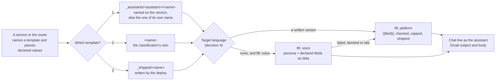

# ADR-062: A message is a template, stored and versioned like a document

## Status

**Accepted (2026-10-28). All three slices built (2026-10-27 and 2026-10-28) and deployed to dev; the language e2e passed on dev on 2026-10-29 ("What proves it").** What each slice builds is in "What is built", and what remains, with its reason, in "What is not built".

Two systems put words in front of a person, and only one of them is built to be owned, versioned and localized:

| | Document templates (built) | Messages (built) |
|---|---|---|
| Format | Markdown with a front-matter block declaring each `{{field}}` and its binding (`requirement:`, `detail:`, `tool:`) | A string with `{var}`, its variables declared per notice kind in code (`NOTICE_VARS`) |
| An undeclared field | Refused when the template is stored (`parseTemplate`) | Refused when the notice is sent (`checkNoticeVars`) |
| Store | `templates/<classification>/<name>/<sha256>.md`, content-addressed, never overwritten | A field on the assistant's version (`copy`), or a literal in code |
| Version in use | A pointer per name; activate and roll back with no deploy | Moves with the whole version |
| Isolation | IAM scopes a read to the classification's prefix, and the reader checks the key and the hash (two layers) | Whatever the version holds |
| Shipped defaults | Written by the deploy (`default-template-writer.ts`) | Inline English; 26 keyed lines show no shipped text in the console |
| Language | One template per name | One language per version (before slice 3) |

The message side also has lines that are no template at all, listed in decision 6.

**Amended (2026-10-27).** A second new kind, `prompt`, holds the instructions an ADR-061 `agent` step and a `prompt` welcome run from (decision 1). A participant role names a template that decision 3's order resolves, a room section may carry a member's display name as an inert mention, and an `agent` step's fallback is a `platform` template (decision 5). A version's retired `copy` fields were read as the assistant's own templates until it saved one; that read is removed by the amendment of 2026-10-29. The work is built in three slices, and the language and voice of decision 4 are the third ("Build order").

**Amended (2026-10-29).** An assistant has one place to edit what it says: its message templates. The read of a version's `copy` as the assistant's own template is removed from selection, a draft refuses a `copy` line, and `npm run migrate-legacy-copy` writes each line a stored version holds as its assistant's own template, once (decision 3). A version's `messages` may pick a family as well as one of the assistant's own templates (`@classification`, `@shipped`), and the draft's What it says card in the console (the Message templates editor) is where each message's template is edited and picked.

## Context

Tenet **P5** gives the builder the decision over what the experience says, and **D11** holds the person's language as a variable the platform never fixes. A line that is a literal in code breaks both: it speaks in the platform's voice inside an assistant's conversation, and it stays English in a conversation that is not.

`memberWelcome` is a copy key because a notice was introduced as a rewordable line on the version. It carries one safety rule that matters and is kept here: a service names a notice and can never hand an assistant text of its own to say (`assistant-notice.ts`). The message side has none of what makes a document template sound (declared fields, an immutable store, a pointer, isolation per classification, shipped defaults written by the deploy), or has a second, weaker copy of it.



## Decision 1: a message is a template of kind `message`, and an instruction to a model is a template of kind `prompt`, in the document template format

A message template is the same Markdown-with-front-matter file a document template is, with `kind: message`. Its `fields` bind each `{{field}}` to a source, in the one grammar of ADR-060: the binding kinds documents already use, plus ADR-060's variable sources. Its sections are the places it appears, so one file holds a line and its email together:

```markdown
---
{ "kind": "message", "name": "member-welcome", "description": "Tells a person they were added", "language": "en", "fill": "platform", "fields": { "name": "person:displayName", "recap": "conversation:title" } }
---
# chat
Welcome, {{name}}. You have been added to {{recap}}.
# email.subject
You have been added to {{recap}}
# email.body
{{name}}, you have been added to {{recap}}. Open the conversation to catch up.
```

- `parseTemplate` gains `kind` (`document`, the default, `message` or `prompt`) and `language` (a tag from the closed language set).
- **Sections.** A message has a `chat` section, an email pair, or both. **Every email template carries `email.subject` and `email.body`**, and the parse refuses one with either missing; the subject is reduced to one line. The notification bridge's wrapper is the one template with further named sections (decision 6).
- For a message, an absent `fill` means `platform`. A message's `fill` is `platform` or `voice` (decision 4); `voice` replaces the `generated` mode of the retired `WelcomeConfig`.
- **A `prompt` template is what a model is asked, never what a person reads.** It has one `prompt` section and no `chat` or `email.*` section, and no `fill`. Its declared fields are passed to the model as delimited data, never as instructions (decision 5). It is the `prompt` of an ADR-061 `agent` step, the instructions of a `prompt` welcome (ADR-061 decision 9), and the request a join recap answers (`joinRecapRequest`, `join-recap.ts`, becomes the shipped `join-recap` prompt). A participant role's `confers.brief` names one (DESIGN-CONVERSATION-TYPES section 6.1).
- An undeclared field is refused when the template is stored, as it is for a platform-filled document, so a rewording can neither drop a declared field silently nor add one the call site does not supply.
- Message templates replace the version's `copy` strings, the email copy keys (`email-copy.ts`) and the welcome's own text field, whose text becomes the template of the welcome's opening (ADR-061 decision 9).

## Decision 2: messages and prompts use the document template store and tools, with a prefix per owner

A message or prompt template is a body at `.../<name>/<sha256>.md` with a pointer per name, written and activated by `backend/scripts/template.mjs`, and it has the document template's guarantees with no new mechanism: immutable bodies, activate and roll back with no deploy, and the reader's key and hash check as the second layer behind IAM (tenets P4, D13, D15). There is no separate message store.

**Each owner has its own prefix** under the classification, so a key names its owner (D15):

| Family | Key prefix | Written by |
|---|---|---|
| An assistant's own | `templates/<classification>/_assistants/<assistant>/<name>/` | that assistant's team: the operator's script (`--assistant`), and the console (`manage-message-templates.ts`) |
| The classification's | `templates/<classification>/<name>/` | the deployment's operators, as document templates are today |
| Shipped | `templates/<classification>/_shipped/<name>/` | the deploy's template writer, from `default-templates.ts` |

- The underscore prefixes cannot collide with a template name, because `TEMPLATE_NAME` starts with a letter or digit.
- Each writer's grant is scoped to its own prefix, so an assistant's team cannot write the classification's or the shipped family, and the deploy cannot write an assistant's.
- The deploy writer updates the `_shipped` family, so shipped text that changes in a release reaches every deployment. The classification family stays create-only for the deploy, so an operator's wording is never overwritten.
- **A new read grant.** The router and the processor read their own classification's `templates/<classification>/` prefix. Today the turn boundary admits that read only when a workflow the classification serves declares a template (`BoundaryItsOwnTemplates`, `agent-classification-common.ts`); messages make it unconditional, read-only, and still the classification's own prefix alone. The notification bridge, which renders the email wrapper, reads the same prefix of the classification whose conversation it is notifying, and no other.

## Decision 3: which template is used follows the order every other selection follows

1. **The assistant's own.** The assistant's version names a template for the message, as its workflows already name document templates (`templates` on a workflow state, `task-state-machines.ts`): `messages: { memberWelcome: "advisor-member-welcome" }`, read from the assistant's family. A message the version does not map is looked up by its own name in that family.
2. Otherwise the classification's template of that name.
3. Otherwise the shipped template.

Each assistant keeps its own voice, a deployment sets one line for every assistant in a classification, and the platform's text is the last resort.

**A version's retired `copy` lines become the assistant's own templates once, by a migration.** Selection reads no `copy`. A `copy` line on a stored version that maps to a message (`memberWelcome` to `member-welcome`, `joinRecapRequest` to `join-recap`, each email copy key to its section of the template it moved into, and each keyed line of decision 6 to its template) is written by `npm run migrate-legacy-copy` as the assistant's own template, through the template store and active at once: `{var}` becomes an optional `{{field}}` span and each line is checked against the shipped template's declared fields, so a line that does not fit is refused and reported, and the rest of its template is written. `email.language` becomes the `notification-email` template's `language`. The migration is idempotent: an assistant that already holds its own template for the message (of its name, or one its version's `messages` names) keeps it. A draft refuses a `copy` line, naming the migration, and validate and activate refuse a draft that still carries one (`retiredCopyErrors`); `copy: null` clears what a cloned version carried. A first draft copied from another assistant does not carry its `copy`, as it does not carry its templates.

**A version picks which template a message is said from.** `messages` maps a message to one of the assistant's own templates, or to a family: `@classification` says it from the classification's template of its name, else the shipped one, and `@shipped` from the shipped one. An entry may be a list of `{ template, when }` alternatives (ADR-060 decision 6). With no entry, the order above answers.

**A participant role names a template, and the order above resolves it.** A conversation type's participant role may name the template its holders are greeted with and the prompt they are briefed from (`confers.template`, `confers.brief`, DESIGN-CONVERSATION-TYPES section 6.1), and a workflow binds to it explicitly (`template: { fromRole: template, else: ops-lead-welcome }`, ADR-061). The type names which message; this order decides whose words: an assistant whose family holds a template of that name speaks in its own voice, and the classification's and the shipped templates follow. So the type never puts an assistant's words on the room, the objection ADR-061 records against `WelcomeConfig`.

## Decision 4: a message reaches a person in the assistant's voice and in a language that person reads

Built in slice 3 of the build order ("What is built"). The shipped templates are English (`language: "en"`); an assistant's own and a classification's templates carry any language the deployment speaks.

**The target language** depends on who reads the message, and always resolves to the closed language set with a default that never blocks:

| Message | Target language, in order |
|---|---|
| A targeted message | the person's preferred language (`person:preferredLanguage`, ADR-060); then the conversation's language; then the deployment's language; then the template's own `language` |
| A message the room reads | the conversation's language; then the deployment's language; then the template's own `language` |

- **The closed language set is the deployment's.** A deployment declares the languages it speaks (`languages` in `deploy.config.json`, `backend/lib/config/languages.ts`), each a tag the platform's language catalog names, its own language first; synth refuses any other tag. Every candidate in the order is read against that list, exactly, case-folded or by its primary subtag, so a tag outside it is skipped rather than interpolated, and the deployment's language and the template's own close the order.

- The conversation's language is `userLanguage` on the server-only channel-context row, never member-writable Metadata (SPEC-BILINGUAL-CONVERSATIONS FR2).
- A one-person conversation is created in that person's preferred language, so its later room messages follow it with no per-message lookup.
- A shared room speaks one language. A version per member's language is SPEC-BILINGUAL-CONVERSATIONS FR9 (dual delivery, optional, not built) and outside this decision.
- A tag is never put into a prompt raw; it selects a language name from a closed map (FR3). The reply-language map in `async-processor-core.ts` held two languages and interpolated any other tag raw; it is now the deployment's declared list (`replyLanguageInstruction`), and FR3 says so.

**A template declares how it is rendered**, as a document template declares its fill:

| `fill` | What happens | Used for |
|---|---|---|
| `platform` (default) | The variant written for the target language is filled; with none, the template's own language is. No model call, so it is instant (FR8). | notices on the reply path, the room welcome, placeholders, refusals, an `agent` step's fallback |
| `voice` | The template's sections are what to say, not the words. A model call renders them in the assistant's persona and the target language. | a targeted welcome, a meeting's email, a task assignment, a briefing |

**A written variant always wins** where one exists. `voice` covers the languages nobody wrote a variant for, in the assistant's own manner, the way an assistant answers today: the persona and the reply-language instruction make the model write natively in the person's language rather than translating its output.

**A `voice` render is bounded:**

- It runs on the classification's own assistant session, through the model catalog and resilience layer (FR6).
- Its input is the persona and the template's declared fields only, with no conversation history. The fields are passed as data inside delimiters, never as instructions (FR7).
- Its output passes `stripMessageMarkers` and the per-type caps, the email subject is reduced to one line, and the output guardrail is applied.
- A guardrail block, a failed call or a missed deadline posts the `platform` fill in the template's language instead.
- It is metered as ADR-061 meters every turn no person asked for (`machineWritten` against the global budget, SPEC-ABUSE-CONTROLS), and recorded on the ledger as a named, timed turn.
- The rendered text is posted once as the message and stored as it; it is not cached separately.

**And from a language.** A person writing in a language other than the assistant's working language is handled by SPEC-BILINGUAL-CONVERSATIONS FR5: translate in, infer, translate back only where the two differ, with no call where they match. That inbound half is decided there. Message templates add nothing to it.

**Written variants and plurals.** A template may carry a written variant per language. A count-dependent line has one form per CLDR plural category of the target language, chosen by `Intl.PluralRules` from a count field, never by English string building ("N item(s)" is removed). The English shipped templates of slice 1 already carry their count-dependent lines as `one` and `other` forms, so slice 3 adds languages rather than reshaping templates.

**Decided (slice 3): one file, a section per language.** A variant is the template's sections marked `@<tag>` (`# chat@es`, `# email.subject@es`, `# chat.few@pl`), every section family the template's own language has, so a message is never half in one language; its own plural forms are its own. A separate name per language would put one message under several pointers that activate and roll back apart, and a `messages` choice or a `when` would have to name each.

## Decision 5: rendering is one function, and the safety rule is kept

- **One render function, on the server and in the console's preview.** `renderMessageTemplate` (`message-template.ts`) is a backend library module the router and the processor call (the notification bridge reading it is slice 1 work NOT BUILT, see "What is built"), and the console's editor imports the same module for its preview (`MessageTemplatesEditor.tsx`), as `WelcomeEditorGuide.tsx` imports `welcome-orientation.ts`. What the editor shows for a sample is what the runtime posts, and the line-drop rule has one implementation.
- **A service names a template and passes declared values; it never passes text.** The rule `checkNoticeVars` enforces stays, applied to the template's declared fields.
- **Every value is checked, capped and stripped** by type, as notice variables are, including `stripMessageMarkers` and the removal of a partial marker. An email subject's values are reduced to one line.
- **`{{field}}` everywhere**, the platform fill documents already use. In a message, a line whose field is empty and has no fallback is left out; a document keeps refusing an unbound field (SPEC-DOCUMENT-TEMPLATES FR9). Today's `noticeLine` prints an unfilled `{placeholder}` as written; that changes safely, because an undeclared field is refused at storage, so an empty field is a value the caller did not have.
- **A prompt's fields are data.** A `prompt` template's fields are passed inside delimiters after its instructions, never spliced into them, so a member-trust value in a prompt cannot become an instruction (FR7).
- **Clearance never reaches an email.** A template naming `person:clearance` in an `email.*` section is refused when stored, and the value renders empty there at run time (ADR-060, decision 7).
- **The guardrail and refusal templates declare no field** that could carry the blocked or refused text.
- **A mention in a room section.** A `chat` section of a message the room reads may carry `person:displayName` only through a field the sending step binds with `mention:` (ADR-061 decision 2), as a mention of a member (ADR-060, decision 7): it renders as the name with every address token, `@` handle, marker syntax and link neutralized, never as an addressing handle, and renders empty, dropping its line, for a person who is not a member when it is rendered, except at `assistant-joined`, where a person in the participant shape's `humans` counts as a member because live membership has not converged (ADR-061 decision 6). In an email to a person who is not a member, every mention renders empty. Every other person field stays refused in a room section.
- **An `agent` step's fallback is a `platform` template.** ADR-061 decision 8 requires each `agent` step to declare a fallback `send`, and validation refuses one whose template is `fill: voice`, because the fallback is what is posted when the model did not deliver.

## Decision 6: every line a person reads becomes a message template

**Notification templates.** Each email the platform sends is a message template with `email.subject` and `email.body`, shipped in English and reworded per assistant or per classification:

| Template | Replaces | Sent by |
|---|---|---|
| `notification-email`, the wrapper every notice email is sent in: its greeting, sign-off, conversation button, reply hint, manage-email line and default subject, each a named section | the email copy keys (`email-copy.ts`) | the notification bridge |
| `email-preferences`, the preference page | the preference page copy in `email-copy.ts` | the notification bridge's preference page |
| `member-welcome` | the `memberWelcome` copy key, the member-added email subject and its fallbacks (`conversation-management.ts`) | the add-member path and the event creator, then ADR-061's `person-joined` workflow |
| `invitation` | `invitationSubject`, `invitationBody`, the open button, the link line and the single-use line | the invitations function, then ADR-061's `invitation-sent` workflow |
| `claim` | the registration claim copy | the upgrade path |
| `briefing` | `briefingSubject`, `briefingBody` | the proactive briefing |
| `task-assigned` | the assignment notice and its email subject (`task-notify.ts`) | the task notifications |

The share lines (`sharedSubject`, `sharedHeading`, `sharedBody`) are retired rather than moved: a share posts `member-welcome`, whose email the bridge sends with the posted line as its body and `member-welcome`'s `email.subject`, and nothing read them. The task reminders are not templates: no requirement specifies a sender of them, and the due-date sweep that would select them has no caller (DESIGN-TASK-ACCESS-AND-QUEUE-PROCESSING, "What asserting the boundary found"). A reminder template ships with the requirement that sends one.

**Lines that are literals in code:**

| Line | Where |
|---|---|
| Handover receipts: "That one is X's - I have passed it along" (`handed-to-roommate`) and "Thanks - that answers work X is handling" | `backend/lambda/src/router-agent-handler.ts` |
| "More than one assistant here can help with that" | `router-agent-handler.ts` |
| "This came to me but I could not pick up the question" | `router-agent-handler.ts` |
| Task placeholders ("Understanding your report needs...", "Working on that...", "One moment...") | `backend/lambda/src/lib/delivery-options.ts` |
| Quick replies, and the choice between them | `delivery-options.ts` (decision 7) |
| The drift offer, its acceptance and redirect labels, and the refusal during a battle | `backend/lambda/src/analytics-aurora/drift-detection.ts`, `backend/lambda/src/lib/live-drift-flow.ts` |
| The input-guardrail fallback, used when the guardrail returns no message of its own | `backend/lambda/src/lib/async-processor-core.ts` |
| Onboarding scaffolding ("No problem - let's redo it", "That one is required") | `backend/lambda/src/lib/onboarding-intake.ts` |
| The budget-exhausted reply, set per deployment by the `budgetCannedResponse` context (`BUDGET_CANNED_RESPONSE`) | `backend/lambda/src/lib/abuse-controls.ts`; it becomes the `budget-exhausted` template |
| The capability refusal: what this conversation does not do, who has access to a conversation that does, and the output nouns (`DEFAULT_REFUSAL_COPY`) | `backend/lambda/src/lib/capability-refusal.ts`; it becomes the `capability-refusal` template |
| The queue stage labels (the `queueStatus` copy group) | `backend/lambda/src/lib/turn-queue-status.ts`; it becomes the `queue-status` template, whose words are sent beside the stage token only when the assistant or the classification chose them |

**Keyed lines with no shipped text in the console (26):** `queuedOne`, `queuedMany`, `queuedOverflow`, `queueSettled`, `queueWriteFailed`, `stopMustBePublic`, `stopAmbiguous`, `stopCancelFailed`, `stopNothingToStop`, `stopped`, `stopCancelledButNotAsked`, `stopLeftCancelled`, `handoverOwnerUnavailable`, `splitRefused`, `topicMoved`, `taskRefNotFound`, `taskRefNothingOpen`, `taskRefHint`, `taskStillOpen`, `answeredPrivately`, `addressingPrivately`, `privateFollowUp`, `resumedChainAnswered`, `resumedChainAsked`, `joinRecapRequest`, `attachmentTooLargeToRead`. `triageUnclear` has shipped text, and `async-processor-core.ts` carries a different inline fallback that is removed. `joinRecapRequest` becomes the `join-recap` prompt template (decision 1); the other 25 become message templates.

Each keyed line and each literal becomes a shipped template, so the console shows the shipped text beside every line an assistant can reword. Two need a seam rather than a template only:

- **Drift** is composed in the data plane, which holds no assistant's templates, so drift detection returns a template name and its values and the router renders it.
- **A workflow step's placeholder** is the step's declared `placeholder` (parsed from the intent pack and never read today, as SPEC-TASK-STATE-TRANSITIONS section 4 specifies), then the assistant's message template, then the shipped one.

## Decision 7: a reply is chosen by intent, never by matching what a person typed

Quick replies are gated on the classifier's `greeting` and `acknowledgment` intents, and then the line, and whether a direct reply is sent at all, is chosen by matching English phrases (`getQuickResponse`), which D11 forbids. The reply becomes the intent's message template (`quick-greeting`, `quick-acknowledgment`), chosen by the intent the classifier returned. Whether acknowledgment keeps separate thanks and farewell lines is a value the classifier returns, not a phrase list.

Two phrase matches remain on the reply path and are recorded D11 exceptions until each has its own decision: the onboarding skip (`SKIP_RE`, `onboarding-intake.ts`) and the drift acceptance ("yes", `live-drift-flow.ts`).

## Build order

Each slice ships its own tests and leaves the later slices **NOT BUILT**.

1. **Slice 1: the kinds, the store, selection, rendering and the notices.** `kind: message` and `kind: prompt` in `parseTemplate`, with the section rules of decision 1; the owner prefixes and their grants in the existing store (decision 2); selection assistant, then classification, then shipped (decision 3; the read of a version's `copy` it first carried is removed by the amendment of 2026-10-29); `renderMessageTemplate`, shared by the server and the console's preview (decision 5); the notification templates of decision 6 (the bridge's wrapper and preference page, share, member-added, invitation, claim, briefing and the task notifications) and the notice templates the router says, each with its legacy read; the prompt templates ADR-061's first slice needs (`join-recap`, `welcome-greeting` for a `prompt` welcome, and the ops room's first look); and the console editor, which writes an assistant's own templates. English shipped text, `platform` fill only.
2. **Slice 2: the code literals and quick replies.** The literals and the 26 keyed lines of decision 6 become shipped templates, with the drift and placeholder seams, and quick replies are chosen by intent (decision 7). `backend/test/tenets-are-enforced.test.ts` gains the check that keeps them out of code.
3. **Slice 3: language and voice.** Decision 4: written language variants, the target-language order, the closed reply-language map, the `voice` fill and its bounds, and plural forms beyond English.

## What it reuses

| Need | Reused |
|---|---|
| Format, declared fields, refusing an undeclared field | `parseTemplate` and `fields` in `document-template.ts` |
| Bindings | `step-bindings.ts`, extended by ADR-060's sources |
| Store, pointer, activate, rollback, isolation | `template-store.ts`, `backend/scripts/template.mjs` |
| Shipped defaults | `default-templates.ts` and `default-template-writer.ts` |
| Safety: a service never supplies text | `checkNoticeVars`, applied to declared fields |
| Strip and caps | `stripMessageMarkers` and the notice caps |
| One render function for the runtime and the console's preview | the welcome's precedent: `WelcomeEditorGuide.tsx` importing `welcome-orientation.ts` |
| Delivery as the assistant, and email | the notice path (`sayThroughRouter`) and the notification bridge |
| Selection by the assistant | the way a workflow state names its templates |
| An assistant's existing wording | the version's retired `copy` fields, written as its own templates by `npm run migrate-legacy-copy` |
| A `voice` render | the persona, the reply-language instruction and its closed map, the model catalog, the output guardrail, and the `machineWritten` metering of SPEC-ABUSE-CONTROLS |
| Editing | the workflow editor, which edits a `send` step's template (ADR-061, decision 7) |

New: `kind: message`, `kind: prompt`, `language`, the `voice` fill, written language variants (which documents also gain), the owner prefixes, the version's `messages` map, and `renderMessageTemplate`.

## Options considered

- **Keep copy keys and add language variants to them.** Smallest change, but it keeps two template systems with different stores, versioning, isolation and syntax, which is the duplication this decision removes.
- **A separate message-template store.** Would duplicate the document store's pointer, history, IAM and hash checks for no difference in requirement.
- **One prefix for every owner, with the owner in the name.** A key would not name its owner (D15), and no IAM grant could keep one assistant's team from writing another's template.
- **Read `copy` as the assistant's own template until it is saved, with no migration.** Built in slice 1 and removed on 2026-10-29: it needs no job and no window, but it kept a second place to edit a line, and the console showed the version's lines, its message choices and its templates as three overlapping sections. The migration is one idempotent pass run after the deploy that removes the read; a line is said from the shipped template between that deploy and the run.
- **Prompts as text on the workflow step.** An instruction to a model would then be unversioned, unshared between assistants and outside the store's isolation; a `prompt` kind has all three.
- **Written variants only, no model rendering.** Instant and exact, but a deployment would write every line in every language a person might prefer, and the gap would fall back to the template's language, which is how the welcome and email subjects stay English today.
- **Model rendering for every message.** Every notice would wait on a model call, including those on the reply path. Kept for the messages that declare `fill: voice`.
- **A machine-translation service (Amazon Translate).** A second provider outside the model catalog and its boundary, more costly at chat sizes, and it does not carry the assistant's voice (SPEC-BILINGUAL-CONVERSATIONS, Options).

## Consequences

- One system says everything a person reads: a report, a notice, an email and a welcome are each a template with declared fields, versioned, isolated per classification and, from slice 3, localizable.
- One system holds what a model is asked on the platform's own behalf: a join recap, an `agent` step and a `prompt` welcome each run from a `prompt` template.
- An assistant's voice reaches every line, and its team rewords any of them without a deploy.
- The version's `copy` strings and the email copy keys are retired as a store; `npm run migrate-legacy-copy` writes existing wording as each assistant's own template, and is run once after the deploy that removes the read.
- The `budgetCannedResponse` deploy context becomes the classification's `budget-exhausted` template.
- An assistant's team rewords a message, and picks which template each message is said from, on the draft's one What it says card in the console (Assistants → New version → What it says), or rewords one with the operator's script (`npm run template -- put <classification> <file> --assistant <name> --activate`).
- A message read costs one cached pointer read and a body read cached for good, as a document does. A `voice` render costs a model call, counted by the global budget.
- **Tech debt carried until it lands:** the two recorded D11 phrase matches (decision 7). The legacy `copy` read is closed (removed 2026-10-29, with `npm run migrate-legacy-copy`), and the open reply-language map is closed (slice 3).

## What is built

**Slice 1, built 2026-10-27 and deployed to dev.** Each piece names its code and the test that verifies it.

| Piece | Code | Verified by |
|---|---|---|
| `kind: message` and `kind: prompt` with `language`; a message's sections (`chat`, `email.subject`, `email.body`, named `email.*`, `page.*` and `label.*` parts); a prompt's one `prompt` section; an undeclared field, `person:clearance` in an `email.*` section, a link outside an email or a page, a field spliced into a prompt's instructions and `fill: voice` refused when parsed | `parseMessageTemplate` in `backend/lambda/src/lib/document-template.ts` | `backend/test/lib/a-message-is-a-template.test.ts` ("the parse") |
| One render: an empty field drops its line, an optional span `[[...]]` drops from its line, every value checked, capped and stripped by its declared type, an email subject reduced to one line, clearance empty in every email part, a prompt's fields as delimited data after its instructions | `renderMessageTemplate`, `renderPromptTemplate`, `cleanMessageValue` in `backend/lambda/src/lib/message-template.ts`; `checkNoticeVars` (`assistant-notice.ts`) uses the same value check | `a-message-is-a-template.test.ts` ("the render", "a prompt's fields are data"); `backend/test/lib/a-notice-takes-only-declared-variables.test.ts` |
| Owner families `_assistants/<assistant>/`, the classification's and `_shipped/` under `templates/<classification>/`, with pointers beside them; a workflow's document reference never loads a message | `TemplateOwner`, `templateKey`, `templatePointerName`, `loadTemplate` in `backend/lambda/src/lib/template-store.ts` | `backend/test/lib/an-assistants-own-template-is-said-first.test.ts` ("each owner has its own key family") |
| Selection: the template the version's `messages` names for the message (one of the assistant's own, or `@classification` or `@shipped`), else the assistant's own of the message's name, then the classification's, then a deployment-wide line, then the shipped; a stored template that does not fit its call site is passed over; no step reads a version's `copy` | `chooseMessageTemplate`, `messageFamilies` (`message-template.ts`), `selectMessageTemplate` (`message-template-selection.ts`), `messageTemplateChoice` (`message-lines.ts`) | `an-assistants-own-template-is-said-first.test.ts` ("selection", "SELECTION HAS NO LEGACY STEP", "A VERSION MAY PICK A FAMILY", "a version names which of its own templates") |
| A version's retired `copy` lines become its assistant's own templates: `npm run migrate-legacy-copy` reads each assistant's active version, writes each mapped line as its own template through the store, `{var}` as `{{field}}` and checked against the shipped template, refuses and reports a line that does not fit, and keeps a template the assistant already holds | `legacyCopyPlan`, `migrateLegacyCopy` (`backend/lambda/src/lib/legacy-copy-migration.ts`); `backend/scripts/migrate-legacy-copy.mjs` | `backend/test/lib/a-versions-legacy-copy-becomes-its-assistants-templates.test.ts` (maps, converts, is idempotent, refuses a misfit line) |
| A draft refuses a `copy` line, naming `npm run migrate-legacy-copy`, and validate and activate refuse a draft that carries one; `copy: null` clears it; a copied first draft leaves the source's `copy` behind; no turn reads a version's `copy` (the resolved profile carries none) | `retiredCopyErrors`, `patchShapeErrors` (`profile-copy-fields.ts`); `validateDraft`, `activateDraft`, `copyFirstDraft` (`profile-lifecycle.ts`); `resolveFromDefinition` (`active-profile.ts`) | `backend/test/profile-field-decisions.test.ts` ("the draft refuses a `copy` line"); `backend/test/manage-profiles-page-fields.test.ts`; `backend/test/lib/profile-version-lookup.test.ts` |
| The version's `messages` map: the draft refuses a key that is not a shipped message or a value that is not a template name; validate and activate refuse a named template that is not active in the assistant's family or does not fit; `manage-profiles` reads template bodies for the check and writes none | `messages` (`active-profile.ts`), `messagesShapeErrors` (`profile-copy-fields.ts`), `messageTemplateErrors` (`profile-lifecycle.ts`), `ReadTheTemplatesAVersionNames` (`admin-assistant-administration.ts`) | `an-assistants-own-template-is-said-first.test.ts` ("a version names which of its own templates"); `backend/test/profile-field-decisions.test.ts` |
| The shipped templates: `notification-email`, `email-preferences`, `member-welcome`, `invitation`, `claim`, `briefing`, `task-assigned`, the `join-recap` prompt, and one message per router notice (`notice-copy.ts`), each word for word what was said before | `backend/lambda/src/lib/shipped-message-templates.ts`; `DEFAULT_EMAIL_COPY` (`email-copy.ts`) is read from them | `a-message-is-a-template.test.ts` ("the shipped templates say what the platform said before", "the notification templates say what the emails said before", against `backend/test/fixtures/email-copy-before-templates.json`) |
| Where a selected template is said: the router's notices and its rate and budget refusals (`sayNotice`, `noticeSelection`, `router-agent-handler.ts`), the member-added email subject (`noticeMetadata`, `assistant-notice.ts`), the join recap (`joinRecapRequestFor`, `join-recap.ts`), the processor's task assignment notice (`postTaskHandoffNotice`, `async-processor-core.ts`), and every email: the wrapper, the preference page lines, the invitation, the claim and the briefing, selected for the room's primary and its classification (`emailTemplatesFor`, `emailVoiceForRoom`) and each templated line rendered by `emailLine` (`email-copy.ts`) | as named | `an-assistants-own-template-is-said-first.test.ts`; `backend/test/an-email-is-worded-from-its-rooms-templates.test.ts`; `backend/test/lib/a-join-recap-is-the-room-assistants-turn.test.ts`; `backend/test/a-notice-is-said-by-the-assistant-it-concerns.test.ts` |
| Read grants: the router reads its own classification's prefix and pointers; every classification's acting role and boundary read its own templates, unconditionally; the document template writer reaches only the names it writes; the Notifications functions that mail about a conversation read `templates/*` and template pointers, read-only, and which classification's they read is the room's | `RouterMessageTemplatesRead` (`assistant-profile-stack.ts`), `boundaryS3Statements` (`agent-classification-common.ts`), `DefaultTemplateWriter`, `ReadTheMessageTemplates` (`grantEmailConsent`, `directory-access.ts`) | `backend/test/a-classification-reads-only-its-own-templates.test.ts`; `backend/test/an-email-is-worded-from-its-rooms-templates.test.ts` (deny) |
| The console's writer: `GET /admin/templates`, `POST /admin/templates/save` and `/rollback`, and their `/admin/assistants/{assistant}/templates` team forms. It writes only `templates/*/_assistants/*` and its pointers, `manage-profiles` is refused every template pointer, a team route cannot write another assistant's, and a source is stored only when it names a shipped template, parses and fits its call site | `backend/lambda/src/manage-message-templates.ts`; `ManageMessageTemplatesFunction` (`admin-assistant-administration.ts`); the routes in `view-profiles` and `activate-profiles` (`admin-capabilities.ts`) | `backend/test/an-assistants-team-writes-only-its-own-templates.test.ts` (deny); `an-assistants-own-template-is-said-first.test.ts` ("the console's writer") |
| The console's one Message templates section: the shipped, the classification's and the assistant's own side by side, which one is in use by `chooseMessageTemplate`, a preview through `renderMessageTemplate`, save and rollback, and per message which template this version uses (the shipped one, the classification's, or one of the assistant's own, with conditions), which writes the draft's `messages`; a draft's retired `copy` lines are explained and cleared, never edited | `frontend/packages/admin/src/components/admin/MessageTemplatesEditor.tsx`, `MessageChoicesEditor.tsx` (part of it), `DraftAreaFields.tsx` (`MessagesFields`, the What it says card) | `frontend/packages/admin/src/components/admin/MessageTemplatesEditor.test.tsx` (the preview equals `noticeLine` for the same template and values, "PICKING THE TEMPLATE A MESSAGE IS SAID FROM WRITES THE DRAFT'S messages"); `ProfilesTab.fields.test.tsx` ("WHAT THE ASSISTANT SAYS HAS ONE SECTION") |

**How slice 1 builds what the decisions leave open:**

- **Decided: the shipped family is the bundled catalog.** Every function that says a message carries `shipped-message-templates.ts`, and selection reads it as its last step, so a release reaches every deployment with its code and no store read. The deploy does not write `_shipped/` for messages, because the store's writer is a custom resource per body and one per pointer (`default-template-writer.ts`): the catalog's templates in every `Assistants-<classification>` stack would add well over a hundred resources to each, against CloudFormation's per-stack limit of 500, to hold text the function already carries. The `_shipped` key family stays reserved (`TemplateOwner`), and nothing writes it.
- **An email's body may be the chat line it carries.** A notice the bridge emails (`member-welcome`, the task notices) sends the posted line as its body, so its template has `chat` and `email.subject`. The parse requires `email.subject` with an `email.body` or a `chat` section, and `email.body` with an `email.subject`. The wrapper (`notification-email`) and the preference page (`email-preferences`, `page.*` parts) send nothing of their own and carry neither.
- **A field binds to a type.** A field is `value:<type>` (`text`, `longText`, `id`, `arn`, `link`, `count`) or one of ADR-060's sources typed here (`person:displayName`, `person:clearance`, `conversation:title`, `assistant:displayName`). In slice 1 the call site supplies every value by the field's name.
- **The line-drop rule applies inside a line** through an optional span, `[[ by {{dueBy}}]]`, which the task templates use so a task with no due date reads as it did.

**Slice 1, left for later slices and built since:**

- ADR-061's ops room first look prompt is the shipped `ops-first-look` prompt template (`shipped-message-templates.ts`), run by the `ops-room` workflow's agent step (`event-workflow.ts`, `backend/test/lib/an-event-starts-a-workflow.test.ts`).
- The mention rule of decision 5 is `mentionRenders` and `inertMention` behind `insertValue` (`variables.ts`) and `noticeMentionsForMembers` (`assistant-notice.ts`), verified in ADR-060 slices 1c and 1d; an `agent` step's fallback is a platform template posted by `runAgentStep` (`event-agent-step.ts`), and a `voice` fallback is refused at validation (slice 3).

**Slice 2, built 2026-10-27 and deployed to dev.**

| Piece | Code | Verified by |
|---|---|---|
| The 25 keyed lines of decision 6 that were not yet templates are shipped templates, each word for word, each the home of a retired `copy` key the migration writes to; `triageUnclear`'s second inline fallback is removed and the `triage-unclear` template answers | `SLICE_2` (`shipped-message-templates.ts`); the readers `turn-queue-notice.ts`, `task-reference.ts`, `resumed-chain-delivery.ts`, `attachment-budget.ts`, `turn-private-followup.ts`, `channel-creation.ts`, `async-processor-core.ts`, `router-agent-handler.ts` | `backend/test/lib/every-line-a-person-reads-is-a-template.test.ts` ("the keyed lines are templates", "each line says word for word") |
| The code literals are shipped templates: the handover receipts (`handover-receipt`, `handed-to-roommate`), the roommate question (`roommates-ambiguous`), the unresolved handover, the turn already owed and the turn error, the placeholders (`task-placeholder`), the input guardrail's fallback, the onboarding scaffolding (`onboarding-intake`) and the drift lines | as above, `delivery-options.ts`, `onboarding-intake.ts`, `live-drift-flow.ts` | `every-line-a-person-reads-is-a-template.test.ts` |
| A count chooses a section's CLDR plural form by the template's language (`Intl.PluralRules`), with `none` where zero is its own case; a call site that knows its case names a form; a list's conjunction is a label of the template | `templateLine`, `sectionFor`, `pluralCategory` (`message-lines.ts`) | `every-line-a-person-reads-is-a-template.test.ts` ("a count chooses the form", a Polish template's `few` and `many`) |
| Every line reaches a template saved for the assistant or the classification: a turn reads its set once (`loadMessageTemplateSet`, one list per family per TTL), and the turn's words object carries it to every line said from it (`withMessageTemplates`), carrying nothing else; the router and the acting role list only their own classification's template prefix | `message-template-selection.ts`, `message-lines.ts`; `wordsOf` (`router-agent-handler.ts`); `versionCopy` (`assistant-async-processor.ts`); the `s3:ListBucket` grants in `assistant-profile-stack.ts` and `BoundaryListingItsOwnPrefixes` | `every-line-a-person-reads-is-a-template.test.ts` ("the stored templates reach every line, and a version's retired copy reaches none"); `backend/test/a-classification-reads-only-its-own-templates.test.ts` |
| The placeholder seam: a workflow state's declared `placeholder` comes first, then the assistant's `task-placeholder` template, then the shipped one | `getTaskPlaceholder` (`delivery-options.ts`), `placeholderWords` (`router-agent-handler.ts`) | `every-line-a-person-reads-is-a-template.test.ts` |
| The drift seam: drift detection names the offer's template (`suggestionTemplate` is `drift-offer` or `drift-redirect-offer`) and the router renders it, choosing by the detection's action | `drift-detection.ts`, `runLiveDriftFlow` (`live-drift-flow.ts`) | `backend/test/analytics-aurora/drift-detection.test.ts`; `backend/test/lib/live-drift-flow.test.ts` |
| Decision 7: the classifier records which acknowledgment it is (`acknowledgment`: `thanks`, `farewell` or `confirmation`), and the quick reply is the intent's template in that form; `delivery-options.ts` reads nothing the person typed | `IntentClassification.acknowledgment` (`intent-classifier.ts`), `quickReply` (`delivery-options.ts`) | `every-line-a-person-reads-is-a-template.test.ts` ("a quick reply is chosen by intent"); `backend/test/delivery-options.test.ts` |
| The tenet check: the router and the processor post no prose literal as the content of a post or a Lex reply, and `delivery-options.ts` holds no phrase list | the D11 block of `backend/test/tenets-are-enforced.test.ts` | itself, with a calibration case that finds a fixed line |
| The capability refusal and the queue stage labels are templates (`capability-refusal`, `queue-status`), word for word, each the home of the retired keys that once worded it; the tenet check also refuses a prose literal in each library that composes a person's lines | `capability-refusal.ts`, `turn-queue-status.ts`; the library block of `tenets-are-enforced.test.ts` | `every-line-a-person-reads-is-a-template.test.ts` ("the capability refusal and the queue stages"); `backend/test/lib/capability-refusal.test.ts`; `backend/test/tenets-are-enforced.test.ts` |

**What decision 7 changes.** A greeting or an acknowledgment the classifier recognizes is always answered from its template, so a message the model classifies as one ("hey there!") gets the quick reply where it used to fall through to a model turn because its words were not on a list. The classifier's own fast path still recognizes a few exact messages before asking the model; it is the one component that decides what a message is, and it records the kind as data.

**Slice 3, built 2026-10-28 and deployed to dev.**

| Piece | Code | Verified by |
|---|---|---|
| Written language variants: one file, a section per language (`# <section>@<tag>`), each variant whole; a variant on a prompt, the template's own language marked as a variant, and a variant missing or adding a section family refused when parsed | `VARIANT_SECTION`, `sectionFamily`, `ParsedTemplate.variants`, `parseMessageTemplate` (`document-template.ts`) | `backend/test/lib/a-message-reaches-a-person-in-their-language.test.ts` ("written variants are one file, a section per language, each whole") |
| The target-language order from data: a targeted message takes the person's preferred language, then the conversation's, then the deployment's, then the template's own; a room message skips the person; the first written language in that order is said, and the choice is settled so a later render cannot choose again | `languageOrder`, `chooseLanguage`, `inLanguage`, `writtenLanguages` (`message-language.ts`); `localizedTemplate` (`message-lines.ts`) in `templateLine` and `noticeLine` (`assistant-notice.ts`); the router's notices and workflow sends (`sayNotice`, `sayWorkflowSend`, `sendLanguages`, `router-agent-handler.ts`); an agent step's fallback (`assistant-async-processor.ts`) | `a-message-reaches-a-person-in-their-language.test.ts` ("the target-language order, from data", and the wiring, as source text) |
| The deployment's closed language list: declared once, refused at synth for a tag the catalog does not name, told to every function by one aspect when it is not the default; the reply-language instruction names a declared language and gives any other tag a generic phrasing that carries none of it; `signal:userLanguage` and `person:preferredLanguage` are enums of it | `LANGUAGE_CATALOG`, `resolveDeploymentLanguages`, `deploymentLanguages`, `resolveLanguageTag`, `languageName` (`backend/lib/config/languages.ts`); `DeploymentLanguagesEnv` (`backend/lib/constructs/deployment-languages-env.ts`, `bin/backend.ts`); `replyLanguageInstruction` (`async-processor-core.ts`); `buildSourceTable`, `turnValues` (`variables.ts`) | `a-message-reaches-a-person-in-their-language.test.ts` ("the closed reply-language map"); `backend/test/a-person-sets-their-own-language.test.ts` ("every function is told the languages the deployment declares"); `backend/test/lib/context-framework.test.ts` |
| A person's own language: `GET` and `POST /me/language`, a choice among the declared languages stored as the declared tag under `preferences.preferredLanguage` on the person's profile row; the person is the caller the edge resolved; its role reads only a row's `preferences` and writes only `preferences` and `updatedAt`, and is denied every item whose key carries a `#`. The router forwards the sender's language with the reply preferences and reads the one reader's for a targeted send; the chat app's Account settings offer it | `language-preference-api.ts`; `LanguagePreferenceFunction` (`conversations-stack.ts`); `PREFERRED_LANGUAGE_KEY` (`variables.ts`); `LanguagePreference.tsx`, `languagePreferenceService.ts` (`frontend/packages/chat`) | `a-message-reaches-a-person-in-their-language.test.ts` ("a person sets only their own language"); `a-person-sets-their-own-language.test.ts` (**deny-test**, synth); `frontend/packages/chat/src/components/LanguagePreference.test.tsx` |
| The `voice` fill: `fill: voice` with `voice: { maxChars, deadlineMs }`, each at most 1500 characters and 15000 milliseconds; where the reader's language has no written variant, the router hands a targeted send to the processor, which says the written text in the persona and that language by one model call (the persona alone as the system prompt, no tools, no conversation, the written text as data in delimiters), metered `machineWritten`; a target outside the declared list, a refused meter, a missed deadline, a failed call, a guardrail intervention, an answer that is not the declared object, a missing section, an overlong one, and a figure, link or handle the written text does not carry each post the written text; the outcome rides the message as `voiceFill` | `renderVoice`, `voicePrompt` (`voice-fill.ts`); `dispatchVoiceSend` (`router-agent-handler.ts`); the processor's `voiceSend` (`assistant-async-processor.ts`) | `a-message-reaches-a-person-in-their-language.test.ts` ("the voice fill is bounded, and each bound falls back to the written text") |
| `voice` only where a model may be awaited: a shipped message declares `voiceable` (the targeted workflow welcomes), the console's writer refuses `fill: voice` on any other, and an event workflow refuses a `voice` template as its opening or an agent step's fallback; a fallback send is said with no model call at run time | `voiceAllowed`, `ShippedMessageEntry.voiceable` (`shipped-message-templates.ts`); `saveRefusal` (`manage-message-templates.ts`); `agentErrors`, `eventWorkflowErrors` (`event-workflow.ts`) | `a-message-reaches-a-person-in-their-language.test.ts` ("a voice template is said only where a model call may be awaited") |
| Plural forms in each language variant, by `Intl.PluralRules` of the variant's language | `sectionFor`, `pluralCategory` (`message-lines.ts`), reading the variant's `language` | `a-message-reaches-a-person-in-their-language.test.ts` (Polish `few` and `many`, Arabic `zero`, `two`, `few` and `many`, Japanese `other` only) |
| The console: one tab per declared language with the preview in it, what a reader in an unwritten language gets, a whole variant added to write, the voice and its bounds where the message allows it, and the deployment's language list with where it is set | `MessageTemplatesEditor.tsx` (`withLanguageVariant`, `withVoice`, `previewMessageTemplate`); the listing's `languages` (`manage-message-templates.ts`) | `frontend/packages/admin/src/components/admin/MessageTemplatesEditor.test.tsx` |
| The admin channel's operator notices are the admin assistant's templates: a turn that did not start, an assistant error, the membership audit's two findings, an unrevoked connector grant, a guest outage, an alarm and a de-identified copy run, each word for word what its emitter composed; an emitter names the template, its values and the labels that fill a field by case; the poster says it from the admin assistant's own template, `templates/admin/_assistants/admin-agent/<name>/`, else the shipped one, and its role reads that one family and its pointers and no other | `admin-notice-templates.ts`; `adminNotice` (`admin-notice.ts`); `wordedNotice`, `postAlert` (`admin-alert-poster.ts`); the emitters in `router-agent-handler.ts`, `async-processor-core.ts`, `membership-audit.ts`, `connector-grant-revoker.ts`, `guest-session.ts`, `alarm-to-admin-channel.ts`, `clean-copy-batch.ts`; `ReadTheAdminAgentsNoticeTemplates` (`admin-services-stack.ts`) | `backend/test/the-operator-notices-are-the-admin-agents-templates.test.ts` (word for word against the frozen compositions, selection, and **deny**, synth); the emitters' own suites (`an-admin-notice-is-delivered-as-every-other-is`, `admin-error-alert`, `membership-audit`, `the-de-identify-batch-says-how-it-ended`, `the-guest-session-fails-closed`, `a-connector-grant-is-revoked-before-it-is-deleted`) |

**How slice 3 builds what the decisions leave open:**

- **The admin plane's family sits under its own classification.** The admin assistant serves the admin plane, which is a classification of its own (`admin`, `adminPlane: true`), so its templates are an assistant family as every other is, `templates/admin/_assistants/admin-agent/`, written by the operator's script (`npm run template -- put admin <file> --assistant admin-agent --activate`). Selection is the admin assistant's own, then the shipped one: the admin plane has no classification-wide wording of its own to sit between them.
- **A field whose words depend on a case is a label.** An alarm or a recovery, which way a revoke went: the emitter names the label (`label.recovered`) and the template supplies its words, so a rewording of a label reaches the notice and a service still passes no text.
- **The emitter carries the shipped wording.** An `ae.alert` carries the shipped rendering as its `content` and `subject` beside the template's name and values, which the CloudWatch line, the alarm's own email to its recipients and a deployment without the admin capability read, and which the poster posts when the admin assistant's template cannot be read or cannot say it.
- **The voice of a send is rendered by the processor.** The router posts every send that waits on no model; a `voice` send with no variant for its reader is handed to the processor, which holds the assistant's persona, its session and the guardrail. The run's next step does not wait on the render.
- **The order closes on the deployment's language, then the template's.** The deployment's own language stands between the conversation's and the template's, so a deployment whose own language is not the template's says its written variant before falling back to the template's.

## What is not built

- **An email's language beyond the line it carries.** A notice the bridge emails carries the posted line as its body, so that body is in the language the line was said in. The wrapper every notice email is sent in (`notification-email`) and the stand-alone emails (an invitation, a claim, a briefing, the preference page) are said in their template's own language, because the Notifications functions that render them read neither the conversation's channel-context row nor a recipient's profile row: choosing a variant there is two new read grants in another stack, each with its deny-test, and is not built.
- **A welcome's opening text in several languages.** The text of a welcome's template step (`opening.text`, ADR-061 decision 9) is one field of the version's welcome workflow, not a message template, so it has no language variants; a welcome's sends are templates and follow the order. An opening step is said in the language it was written in.
- **A `voice` render anywhere but a targeted workflow send.** The shipped messages that may be `voice` are the two targeted workflow welcomes (`voiceable`); a task assignment and a briefing, which decision 4 names as uses, are not marked `voiceable`: the assignment notice is said inside a person's turn and the briefing by the Notifications stack, and neither call site hands a render to the processor today, so both are said from written text.

## What proves it

Built in slice 1 (each test is named in "What is built"):

- the template parse test refuses a message template with an undeclared field, an email template missing `email.subject` or `email.body`, and `person:clearance` in an `email.*` section, refuses a `prompt` template with a `chat` or `email.*` section, and accepts the example in decision 1;
- in a message an empty field drops its line, and the same field in a document still refuses (SPEC-DOCUMENT-TEMPLATES FR9);
- selection is assistant family, then classification, then shipped, with no step that reads a version's `copy`; a version's retired lines become the assistant's own templates by `npm run migrate-legacy-copy`, which maps, converts, keeps what the assistant already holds and refuses a misfit line; a draft refuses a `copy` line, naming the migration;
- the console's preview and the router render the same sample to the same text, through `renderMessageTemplate`;
- each notification email (member-added, invitation, claim, briefing and task assignment) renders its subject and body from its template, and an assistant's reworded template reaches the email;
- a `prompt` template's fields reach the model inside delimiters after its instructions;
- a targeted message's language is the person's preference, then the conversation's, then the deployment's, then the template's; a room message's is the conversation's, then the deployment's, then the template's (slice 3, `a-message-reaches-a-person-in-their-language`);
- a written variant is used before a `voice` render, and a failed, blocked, late, overlong or embellished render posts the `platform` fill (slice 3, the same suite);
- a room section's mention of a person who is not a member renders empty and drops its line, a display name carrying `@`, a marker or a link renders inert, and an `agent` step's fallback naming a `voice` template is refused;
- a field inside a `voice` render is passed as delimited data, the render receives no history, and its output is stripped and capped (slice 3);
- an unknown language tag never reaches a prompt raw (slice 3);
- plural forms follow `Intl.PluralRules` for a language with more than two categories, and Japanese takes one form (slice 3);
- each operator notice says word for word what its emitter composed, and the admin assistant's own template answers before the shipped one (slice 3, `the-operator-notices-are-the-admin-agents-templates`);
- the notice-variable strip tests run against message templates;
- `backend/test/tenets-are-enforced.test.ts`'s D11 block refuses a string literal as the content of a channel post or `formatLexResponse` in the router and processor, and a phrase list in `delivery-options.ts`;
- **deny tests:** a person's language setting reads and writes only a profile row's preferences (`a-person-sets-their-own-language`); the admin alert poster reads only the admin assistant's notice family (`the-operator-notices-are-the-admin-agents-templates`); a classification's turn role reads only its own classification's templates; the console's writer holds no write on the classification and `_shipped` families, a team route cannot write another assistant's, and `manage-profiles` is refused every template pointer; the deploy writer reaches only the names it writes, never an assistant's family.
- an e2e in which a person who chose a language receives a targeted workflow welcome in it, from a written variant (`tests/e2e/a-person-who-joins-is-welcomed-once-in-their-language.spec.ts`, 3/3) and from the assistant's voice, where a render that holds carries `voiceFill` with `outcome: voice` in the reader's language and adds no link or handle, and a render past its deadline posts the written text with `outcome: fallback:deadline` (`tests/e2e/a-welcome-is-said-in-the-assistants-voice.spec.ts`, 2/2); verified on dev 2026-10-29 with `cd backend && node scripts/validate.mjs --only=welcome-workflows`.

Not yet proven:

- an e2e in which an assistant's reworded `member-welcome` template reaches the person in chat and by email (it needs a deploy);
- an e2e in which an operator notice is said from the admin assistant's own template (written, not yet run: `tests/e2e/an-operator-notice-is-worded-by-the-admin-agent.spec.ts`, phase `notifications`).
