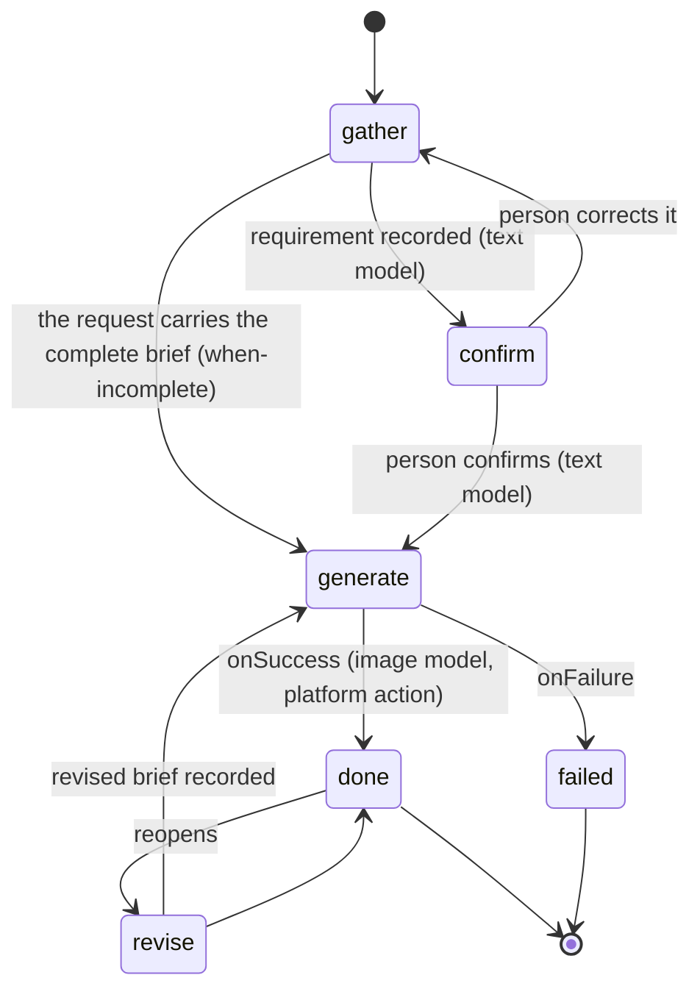
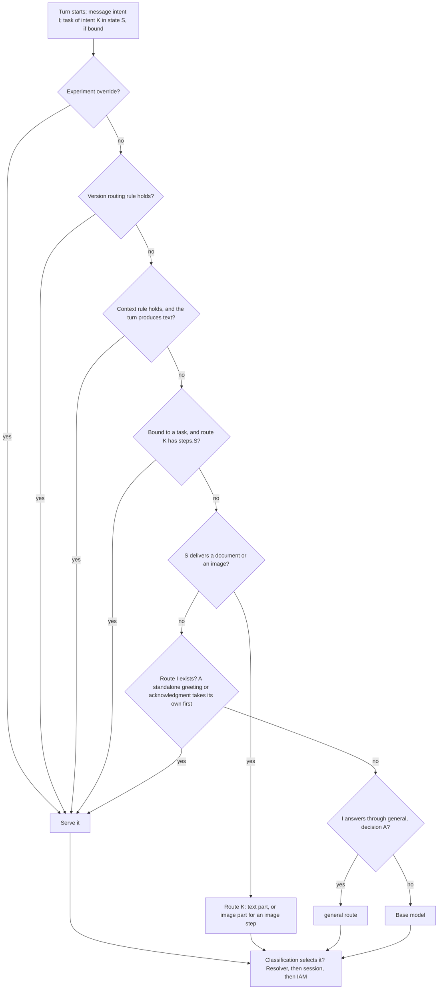

# ADR-064: A turn takes its model from the intent and the step it runs

## Status

**Accepted (2026-10-29).** The owner settled every open question ("Decisions taken"). "What is built today" records where the code stood when this record was proposed, with the file and line, so no gap reads as a choice; "What is built" and "What is not built" record where it stands now.

## Context

Tenet P3 says the reasoning model is a replaceable function call "pulled in per step and per experience as the builder needs." Today a model is pulled in per turn, from the classified intent of the message that started the turn. A workflow that needs a text model to ask questions and an image model to draw cannot say so, and a task whose next message is classified as something else answers on that other intent's route.

### What is built today

| Question | Answer today | Where |
|---|---|---|
| What keys a route? | A route key, which is the intent key except for a rename table: eight intents (`general`, `greeting`, `acknowledgment`, `conversation_summary`, `set_preference`, `show_preferences`, `off_topic`, `platform_question`) map to `general_qa`, `guided_troubleshooting` to `workflow_actions`, `data_extraction` to `document_extraction`; every other key is its own route | `backend/lambda/src/lib/model-resolver.ts:55`, `intentTypeToRouteKey` at `backend/lambda/src/lib/model-resolver.ts:82` |
| What does an unrouted intent get? | The version's base model (the classification default). A standalone greeting or acknowledgment takes its own route first when the version has one | `backend/lambda/src/lib/model-resolver.ts:237`, `backend/lambda/src/lib/model-resolver.ts:249` |
| Which intent picks a task turn's model? | The classified intent of the current message (`intent: classification.intent`), not the task's type. Being bound to a task only turns off the greeting shortcut (`continuesActiveWork`). A report task whose next message is classified `acknowledgment` answers on the `general_qa` route | `backend/lambda/src/router-agent-handler.ts:9408`, `backend/lambda/src/assistant-async-processor.ts:1469`, `backend/lambda/src/assistant-async-processor.ts:1470` |
| Can a model change inside a turn? | No. One model serves the whole Converse loop (`steps[].modelId = config.model`), even when the turn advances the task through several states or a step action moves it | `backend/lambda/src/lib/async-processor-core.ts:2858`, `runStepActions` at `backend/lambda/src/lib/state-actions.ts:102` |
| Does a task state name a model? | No. `TaskStateDef` declares `tools` (FR28), `action` (FR29), `delivers`, `presented`, `requires` and conditions, and no model | `backend/lambda/src/lib/task-state-machines.ts:55` |
| How is an image model chosen? | A route is either a text route or an image route, decided by its primary's kind; an image route's fallback is the same kind. An intent that needs an image and has no image route takes the `image_generation` route, then the legacy `models.image` | `imageRouteFor` at `backend/lambda/src/lib/image-route.ts:48`, `routeKindError` at `backend/lambda/src/lib/image-route.ts:96`, `resolveTurnImageRoute` at `backend/lambda/src/lib/async-processor-core.ts:7292` |
| Which turns must produce an image? | Every turn of an intent whose `needs` is `image` (`image_generation` by platform default), per intent. Such a turn with no image model fails, naming why | `turnNeedsImage` at `backend/lambda/src/lib/intent-pack.ts:1240`, `backend/lambda/src/assistant-async-processor.ts:2199` |
| What does an image turn send the image model? | The person's raw message, with no text model call before it | `backend/lambda/src/assistant-async-processor.ts:2303` |
| Is `image_generation` multi-step? | No. It is `PLACEHOLDER_UPDATE`, one turn, and no platform machine is keyed `image_generation` | `backend/lambda/src/lib/intent-pack.ts:267`, `DEFAULT_TASK_STATE_MACHINES` at `backend/lambda/src/lib/task-state-machines.ts:663` |
| Does an event-workflow `agent` step choose a model? | No. The dispatch carries no intent, so the turn resolves to the version's base model | `dispatchEventAgentStep` at `backend/lambda/src/router-agent-handler.ts:3531`, `backend/lambda/src/lib/model-resolver.ts:237` |
| Can a step require a tool call? | No. `tools` narrows and refuses an undeclared tool (`tool_not_in_step`), `action` runs a tool with no model call, and `advance_task_state` refuses only an unknown state, an undeclared edge (`illegal_transition`), `presented`, `requires`, a missing document, templates, an action argument that binds nothing (`action_unbound_arg`) and conditions | `backend/lambda/src/lib/task-tools.ts:1106`, the refusal set at `backend/lambda/src/lib/task-tools.ts:701` |
| Is there one resolver? | Yes when context routing or version routing rules apply (`resolveModelPlan`, rule order: experiment, version rules, context rules, intent route, default); otherwise the processor calls `resolveModelForIntent` directly | `backend/lambda/src/lib/resolve-model-plan.ts:136`, `backend/lambda/src/assistant-async-processor.ts:1867` |
| What does the archive record per turn? | One model (`bedrockModel`), the classifier intent (never the route key), the task id, status, state after the turn and transition, `turnKind`, tokens, latency, and per Converse iteration `steps[]` with `modelId` and `estCostUsd` inside the metadata JSON. Image turns record no `steps[]`. The task type is in metadata only. No turn-level cost | `backend/lambda/src/lib/async-processor-core.ts:5124`, `makeConverseStep` in `backend/lambda/src/lib/analytics-metadata.ts:279`, `backend/lambda/src/analytics-aurora/kinesis-archival.ts:924` |
| Which stores hold it? | Aurora `messages` and `exchanges` columns (`exchanges.intent VARCHAR(32)`); the Athena `conversations` table is one JSON `line` column partitioned by classification and date | `backend/lambda/src/analytics-aurora/schema/001-initial.sql:131`, `backend/lib/constructs/conversation-archive.ts:160` |
| How does Effectiveness group? | By `exchanges.intent`, with `dominant_model` and a model mix per intent; an image intent is priced as `dominant_model` times the average image count, so a mixed text and image intent is mispriced where an image model is the mode and priced null where a text model is | `backend/lambda/src/analytics-aurora/analytics-query.ts:6848`, `resolveReplyCostUsd` at `backend/lambda/src/analytics-aurora/analytics-query.ts:6529` |
| What does a card's Effectiveness link filter? | `?intent=<card key>`. A card keyed by a route such as `general_qa` matches no row, because rows hold `general` | `frontend/packages/admin/src/components/admin/assistantLinks.ts:35`, `intentCards` at `frontend/packages/admin/src/components/admin/assistantSections.ts:105` |
| What holds a route key besides versions? | Stored experiments (`exp.intent`, matched by route key or raw intent), the battle briefing (`briefingIntent` on the battle config row, `PROMPT_STEERING`), battle picks (`BattleOutcome.intent`) and the console's experiment intent options | `backend/lambda/src/lib/experiment-manager.ts:697`, `backend/lambda/src/channel-battle.ts:556`, `backend/lambda/src/lib/battle-outcome.ts:68`, `frontend/packages/admin/src/components/admin/ExperimentsTab.tsx:310` |
| What does an experiment arm vary, and how long does it hold? | One of route primary (`intent`), base model, classifier or whole version, plus an optional image model (`imageGenModelKey`, written as the image route's primary) and persona addendum (`variantDeltaOf` at `backend/lambda/src/manage-profiles.ts:521`); the arm is pinned to the conversation by a hash of the channel and the experiment, and released once the experiment leaves `active`. A task records no arm, and an `intent` experiment counts a turn by its classified intent | `assignVariant` at `backend/lambda/src/lib/experiment-manager.ts:616`, `enrollmentHolds` at `backend/lambda/src/lib/experiment-manager.ts:455`, `countsTowardExperiment` at `backend/lambda/src/lib/experiment-manager.ts:521` |
| What does a battle side's version decide? | Every model of the side, through its routes, per turn (DESIGN-BATTLE section 1a). Round 1 of a task-shaped side runs the whole chain (ADR-026); round 2 is one text turn. The image check only warns | `backend/lambda/src/lib/battle-turn.ts:215` |
| How does the console edit models? | Each intent card has one route, a primary and a fallback; picking an image model makes it an image route. Task machines are read-only and show no model; the wizard sets the classifier and default model only; route errors are a flat list, not anchored to a card | `frontend/packages/admin/src/components/admin/AssistantPage.tsx:781`, `frontend/packages/admin/src/components/admin/IntentRouteModels.tsx:81`, `frontend/packages/admin/src/components/admin/AssistantPage.tsx:690` |

## Decisions taken

The owner settled the open questions on 2026-10-29. B was changed from the recommendation, J was restated when it was built (2026-10-29), and G was amended on 2026-10-30; the rest were accepted as recommended.

| Letter | Question | Chosen |
|---|---|---|
| A | Which intents answer through the `general` route when they have no route of their own | **(a)** The eight that mapped to `general_qa` (`general`, `greeting`, `acknowledgment`, `conversation_summary`, `set_preference`, `show_preferences`, `off_topic`, `platform_question`), declared beside the platform intents and shown in the console |
| B | What picks a task turn's model | **Changed.** The message's classified intent, except: (1) where the version's route sets a model for the task's current step (`models.byIntent[<task intent>].steps[<state>]`, decision D), that model; (2) otherwise a step that delivers the intent's work (a document, `produces: 'document'`, or an image, `produces: 'image'`) runs on the task intent's route, its image part for an image step; (3) every other turn on the message's intent, so a confirmation, a question or "looks good" runs on the general or default model. The turn is still attributed to the task's intent and workflow (I). A platform machine (`queued_request`, `queue_drain`, `approval`, `acknowledgement`, `work_still_wanted`, `place_item`, `action_item`, `incident_first_look`) is not an intent: its task intent is the intent of the request that opened it, else the classified intent. **The document is written on the delivering step's model.** A move into a step that produces a document, made from a turn running on a model other than that step's, is accepted without the document; the turn continues on the step's model, which writes the document and declares it with `deliver_document`. Where the two models are the same, the document rides the move, as before |
| C | How a route carries an image model | **(a)** One route per intent, `{ primary, fallback?, image?: { primary, fallback? }, steps? }`. For a multi-step intent the route configures that intent's task workflow: text steps on the text part, the image step on the image part, `steps` overrides; the console shows each step and its model on the intent card |
| D | Where a per-step model override lives | **(a)** `models.byIntent[<intent>].steps[<state>]` |
| E | How the image step runs after the person confirms | **(a)** As the step's platform action on entry, in the confirming turn, its prompt bound to the recorded brief |
| F | Whether an event-workflow `agent` step chooses its model | **(a)** No, it stays on the base model |
| G | Whether the multi-step `image_generation` is the platform default | **Amended (2026-10-30).** Yes, with `confirm` presented `when-incomplete`: a request that already carries the complete brief (the subject, the style and the composition, the step's declared `brief`) goes from `gather` straight to `generate` in its own turn, with no question and no confirmation; any other request, one whose brief is completed over later turns, and one that asks to see the brief first are confirmed before a billable image is drawn. A version sets `always` per workflow (`confirmBrief`). A drawn image finishes the task, and a change the person asks for reopens it into `revise` |
| H | Whether to add `requiresTool` | **(a)** Yes (decision 3) |
| I | How a task turn is counted in Effectiveness | **(a)** Under the task's type (`COALESCE(task_type, intent)`); `intent` stays the classified intent; `exchanges.original_intent` is dropped |
| J | Whether a task keeps its experiment arm when the experiment stops | **Restated.** While the experiment runs, a task stays on the arm it was opened under, whatever the conversation's enrollment resolves to that turn. Once the experiment stops (completed, paused or past its end date), its losing version is dropped from the platform, so a task in flight carries on with the live version from its next turn; a task whose arm is the version that became live is already on it. A turn is attributed to the experiment only while the arm is served |
| K | Whether a battle compares one step on a shared brief | **(a)** Not now; a battle runs whole chains |

Two settled points apply across the decisions. Nothing stored is migrated: dev is torn down and deployed fresh, seeds and shipped defaults are written in the new keys, validation refuses an old route key naming the new one, and the only equivalence test covers the shipped and seeded routes. External image egress is recorded, not blocked: whether an external image model may be used, and by which classifications, is the admin's choice through the classification's model selection.

## Decision 1 (settled): a route is keyed by the intent's own key

The rename table goes. `general_qa` becomes `general`, `workflow_actions` becomes `guided_troubleshooting`, `document_extraction` becomes `data_extraction`; `RouteKey` in `backend/lib/config/model-strategy.ts:24` becomes the intent key. `intentTypeToRouteKey` is deleted rather than reduced to identity, so no caller keeps a second vocabulary.

- **Fallback.** An intent with no route of its own is answered through the `general` route when it is one of the intents that answer as general (decision A), else on the base model. A standalone greeting or acknowledgment still takes its own route first when the version has one (`isTrivialTurn`, `backend/lambda/src/lib/model-resolver.ts:139`). This keeps every intent on the model it resolves to today.
- **Nothing stored is migrated.** No stored version, stored experiment or archive row is rewritten, and no script ships. Dev is torn down and deployed fresh where it holds the old keys. The shipped strategy (`backend/lib/config/model-strategy.ts:353`), the seeds, the shipped defaults, the battle briefing table (`PROMPT_STEERING` in `backend/lambda/src/channel-battle.ts:289` and its chat mirror), the console's experiment intent options (`frontend/packages/admin/src/components/admin/ExperimentsTab.tsx:310`) and the shared strategy mirror are written in the new keys.
- **Every caller of `intentTypeToRouteKey` changes with it:** `active-profile.ts` (the reachability check), `profile-lifecycle.ts`, `manage-profiles.ts` (`recipeRouteKey`), `experiment-image-route.ts`, `experiment-manager.ts`, `battle-turn.ts`, `async-processor-core.ts`, `router-agent-handler.ts`, and `routesAsServedByTheFloor` in `model-resolver.ts`. The route migration script is deleted, and no script takes its place. The docs that name the old keys (SPEC-CONFIGURABLE-INTENT-PACK, DESIGN-EXPERIMENTS-BATTLE-DECISION-LOOP, MODEL_STRATEGY, ARCHITECTURE, HOW-TO-ADD-OR-MANAGE-A-PROFILE, GUIDE-ASSISTANT-CONTEXT, DESIGN-CAPABILITY-REFUSAL) are rewritten, and `backend/test/docs-drift-guard.test.ts` bans `general_qa`, `workflow_actions` and `document_extraction`.
- **Equivalence, where it protects shipped behavior.** A test resolves every intent of the shipped pack plus the universal intents against every shipped and seeded route set, under the old resolver (a frozen copy of today's table held in the test only) and under the new keys, and requires the same primary and fallback, text and image.
- **Validation.** A version or experiment naming `general_qa`, `workflow_actions` or `document_extraction`, hand-written or imported, is refused with the new key: "`models.byIntent['general_qa']` is a retired route key; the route is keyed by the intent, `general`." There is no dual read.
- **Readers use the new keys only.** Analytics rows hold the classifier intent already (`backend/lambda/src/analytics-aurora/analytics-query.ts:8584` says so), so Effectiveness and Performance need no change for the rename, and no reader maps an old route key in a battle config row (`briefingIntent`), a battle pick (`BattleOutcome.intent`) or an experiment.

## Security posture: a step or image model stays inside the classification

No grant is added. Every model a route's `image` part or a `steps` override names is held to the classification's selection by the same three layers that hold a route today: the write path drops it (`confineModelsToClassification`, `backend/lambda/src/lib/active-profile.ts:1439`, extended to walk `image` and `steps`), the resolver serves it only where the classification selects it (`backend/lambda/src/lib/model-resolver.ts:262`), and the vended session is narrowed to the version's declared models (`grantEdgesFor`, `backend/lambda/src/lib/assistant-grant.ts:134`, whose `imageModelKeysOf` and `declaredModelKeys` walk both fields) inside the classification's `AssistantGrant-models-*` and `image-*` edges. Proven by denial: `backend/test/lib/a-model-is-used-only-where-allowed-and-for-its-use.test.ts` and `backend/test/image-gen-iam-parity.test.ts` gain a step override and an `image` part naming a model the classification does not select, and `tests/e2e/a-classification-is-denied-a-model-it-does-not-declare.spec.ts` gains the step case.

The image prompt is the recorded brief, not the raw message, so it may carry a passage retrieved from the classification's corpus. The image guardrail runs on the brief. Whether an external image model may be used, and by which classifications, is the admin's decision, made through the existing classification model selection; the platform does not block the brief. It records the egress: each image call to a provider outside AWS records the provider, the model, and whether the brief carried a `context`-sourced requirement, on the turn's archive record. That flow is recorded where provider data processing is documented.

## Decision 2: a step declares what it produces, and the route carries a text model and an image model

- **The step's output.** `TaskStateDef` gains `produces: 'text' | 'image' | 'document'`, absent meaning `text`. `delivers: true` is replaced by `produces: 'document'` in every shipped machine, with a test that each shipped machine delivers from the same states as before, and a machine that still says `delivers` is refused naming `produces`, so the two fields do not coexist (tenet D9).
- **`turnNeedsImage` binds per step.** A turn needs an image when the step it runs produces one. An intent with no machine has one implicit step, whose output is its `needs`, so today's single-turn image intents keep their behavior. A text step of an image intent (asking what to draw) runs on a text model and is never refused for lacking an image model.
- **The route.** `models.byIntent[<intent>]` becomes `{ primary, fallback?, image?: { primary, fallback? }, steps? }`: the text model, the image model and per-step overrides (decision C). Shipped routes are written in this shape: the shipped `image_generation` route names its image model under `image` and no text model of its own, so its text steps take the `general` route or the base model as decision 1 says. A version naming an image model as a route's `primary` is refused, naming `image.primary`. `routeKindError` keeps its rule inside each half. The legacy `models.image` is retired with it (dev is deployed fresh): a version that names it is refused, naming `models.byIntent['image_generation'].image.primary`, so an image model is chosen in one place (tenet D9).
- **Per-step override.** `steps: { <state>: { primary, fallback? } }` on the route, the kind checked against the step's `produces` (decision D).
- **Resolution order** (decision B): experiment override, version routing rules, context rules, then, for a turn bound to a task, the step override for the state the task is in when the turn starts (`byIntent[<task intent>].steps[<state>]`), then, where that state delivers (`produces: 'document'` or `'image'`), the task intent's route (its `image` part for an image step); every other turn takes the message's intent's route (a standalone greeting or acknowledgment its own route first), then the general route where decision A applies, then the base model. The task's type and step are signals on `RoutingContext` and the rule lives in `resolveModelPlan`, so no new call site (SPEC-CONTEXT-AWARE-MODEL-ROUTING FR1). The processor routes every turn through `resolveModelPlan`, retiring the direct call at `backend/lambda/src/assistant-async-processor.ts:1470`. Context and external-provider rules apply to text steps only; a step that produces an image is never re-routed by them. The plan records which rule chose the model (`model_from`), and the turn is attributed to the task's intent and step whichever rule chose it (decision 4).
- **A step that produces an image runs as the platform's act** (decision E). Image generation is not a registered tool today, so it becomes a platform action beside `deliver_document` (`generate_image`, `backend/lambda/src/lib/state-actions.ts`), and SPEC-TASK-STATE-TRANSITIONS FR29 names it. Entering the step runs it, with its prompt bound to a sourced requirement (`requirement:what to draw`, declared by `requires` on `gather`; `advance_task_state` writes only `details.requirements` and `details.collectedRequirements`, `backend/lambda/src/lib/task-tools.ts:809`) rather than the raw message, under the existing guardrail, attachments and fallback (`backend/lambda/src/assistant-async-processor.ts:2300`), and takes `onSuccess` or `onFailure`. The delivery gate admits the image attachment from a `produces: 'image'` step. The turn that confirmed the brief, or the turn whose request carried the complete brief, returns the image; no second message is needed.
- **Event-workflow `agent` steps** keep the base model unless decision F says otherwise.

### The shipped `image_generation` machine

`image_generation` is `TASK_MULTI_STEP` with a platform machine, the platform default (decision G):

| State | Awaits | Produces | Model | Declares |
|---|---|---|---|---|
| `gather` (initial) | requester | text | route text model | `requires: [what to draw]`; transitions `confirm` and `generate`, the second only for a request that carries the complete brief |
| `confirm` | requester | text | route text model | `presented`, `confirm: when-incomplete`, `brief: [the subject, the style, the composition]`; confirmed by writing, so the generation runs in that turn (a card choice advances with no turn, `advanceAsAssignee`) |
| `generate` | nobody | image | route image model | `action: generate_image` with `prompt: requirement:what to draw`, a declared `placeholder`, `onSuccess: done`, `onFailure: failed` |
| `revise` | requester | text | route text model | entered by the reopen from `done`; transitions `generate` (the advance records the revised `what to draw`), `done` |
| `done` | | | | terminal, success; `reopens: [revise]`, so a duel side that drew has finished its round |
| `failed` | | | | terminal, failure, says what was unconfigured as the fail-fast does today |

### A complete brief goes past `confirm`

Decision G as amended: when the request already carries the complete brief, the turn goes straight to generation, with no gather question and no confirmation.

- **The judgement is the model's, made once and recorded as data** (tenet D11). On the opening turn the model records the brief it was given in `advance_task_state`'s `collected` (each need with its value, source and evidence: `what to draw` and each need of `confirm.brief`) and advances `gather -> generate`. The step prompt names that move and the brief it needs, read from the machine (`pastAConfirmedStep` in `backend/lambda/src/lib/task-step-prompt.ts`).
- **The runtime checks it in code, from the recorded data.** `confirm` declares `confirm: 'when-incomplete'` and `brief`. A move that goes past a step declaring `confirm` (`confirmStepPassed`: a state moving into it and also straight to one of its targets) is allowed only from a step the task entered on this turn, so the request itself carried the brief (`brief_not_in_request` otherwise), and only where every need of `brief` is recorded on the task (`brief_incomplete` otherwise, naming the missing needs). `directEdgeRefusal` in `backend/lambda/src/lib/task-state-machines.ts` decides both; `handleAdvanceTaskStateTool` applies it and `advanceTaskStateTo` applies the record check again, so the store holds the line on its own. Nothing reads what the person or the model wrote.
- **An incomplete request is unchanged.** It gathers, then confirms. A brief completed over later turns is confirmed too, and so is a request that asks to see the brief first: the model advances to `confirm`.
- **`always` confirms every request.** Under `always` the move past the step is not a legal transition (`legalTransitionsFrom` leaves it out), so it is neither offered in the prompt nor authorized. A machine declares the value on its `confirm` step; a version overrides it per workflow with `confirmBrief` (`{ "image_generation": "always" }`), applied to the turn's machines once, where the processor resolves them (`withConfirmBrief`), and validated on write (`confirmBriefErrors`). The console shows the setting on the assistant's Workflows section with its edit command.
- **A drawn image finishes the task.** `generate` takes `onSuccess: done`, and `done` reopens into `revise` for a change, as a delivered report does. A duel side that drew from a complete brief has therefore finished its round 1 and does not park on the person (ADR-026); a side whose request was incomplete parks at `gather` or `confirm` until the person answers it.
- **Unchanged on the direct path.** The image guardrail, the `steps[]` entry with the image model and its cost, `imageEgress`, the experiment arm and the turn's records (`model_kind`, `model_from`, `task_step`, `task_state`) are the `generate` action's and the turn's, whichever move entered `generate`.

### The resolution order

### The document of a delivering step entered mid-turn

The document is written on the delivering step's model (decision B). Whether a move writes its document there is one rule, `documentWrittenOnStep`: the step produces a document, it has a model of its own (`enteredStepModel`), and that model is not the one the turn is running on. Such a move is accepted without the document (`document_required` is not raised), a document passed with it anyway is not declared, and the result says so positively (`writes_document: true`, with the next call named). The turn's loop moves onto the step's model, which writes the document and declares it with `deliver_document`; the turn's tool bound allows the one extra call. A platform-filled template is still rendered on the move, since no model writes it. Where the models are the same, the move carries the document as before, so the common path costs no extra call. The model that makes the move is told which contract applies before it moves: the advance tool's description names a step that writes its own document apart from one whose document rides the move, `deliver_document` is offered from the turn's first call, and the step's section of the prompt is rendered again once the turn's model is chosen, saying which delivering step writes its own document. The delivering contract names `deliver_document` as the declaration for a document the move left to the step. Every input is structural (the machine's `produces` and the resolved model ids); no phrase is matched.

A turn that enters such a step and ends without declaring the document leaves the task in the step. That entry is new, unworked and undelivered, so the assistant takes it up when it is idle (ADR-063 decision 5), and the pickup turn starts in the delivering step, runs on its model and declares the document there. A step delivered from in its current entry is not taken up again (`delivered-this-entry` in `pickupReadiness`): a delivery attached to a file closes the task, and a document posted inline is recorded on the task as a delivery whether or not the step declares a template, so a pickup never writes a delivered document a second time.

The model a step runs on is read from the version the turn serves. On an ordinary turn of a task opened under an experiment arm, the router serves the arm's version while the experiment holds it (decision J), and the step's model comes from that version's routes. A pickup turn serves the same arm (`pickupArmFields`, through `resolveTaskArm`), carrying the version, what it reaches for the routing record, and the experiment's attribution where the experiment counts the task's work. A duel side does not move models mid-turn, so its moves carry their documents.

## Decision 3: a step may require a tool before the task leaves it

`requiresTool: [name]` on a state: `advance_task_state` out of it is refused with `required_tool_not_run`, naming the tool, until each listed tool returned success since the task last entered the state (counted per entry, as step actions are). Each name must be in the step's `tools` and the allowlists; a state that declares `action` may not declare it (the platform already runs that tool). The refusal joins the workflow refusals at `backend/lambda/src/lib/task-tools.ts:701`, so the tool-error rate does not count it. It covers the case `action` cannot: a tool whose arguments need the model's judgment (a search, a lookup by what the person described). Each success is recorded on the task row at `details.toolRuns[<state>#<entry>]` by a conditional write, so it survives the turns a step spans. A version whose tool allowlist omits a tool a selected machine requires is refused at validate and activate, naming both; at runtime an unreachable required tool takes the state's `onFailure` rather than leaving the task with no exit. Decision H.

## Decision 4: analytics attribute a turn to its intent, its step and the model that served it

Added to the per-turn record and promoted to Aurora columns on `messages` and `exchanges` (as `task_state` is, `backend/lambda/src/analytics-aurora/schema/010-task-state-machine.sql`): `task_type VARCHAR(64)`, `task_step VARCHAR(32)` (the state the turn started in, which chose the model; `task_state` stays the state after), `model_kind VARCHAR(8)` (`text` or `image`) and `model_from VARCHAR(16)` (`experiment`, `version_rule`, `context_rule`, `step`, `route`, `general`, `base`). `model_from` is the signal SPEC-CONTEXT-AWARE-MODEL-ROUTING FR10 asks for on the turn record. `intent` keeps the classifier's intent on every row; Effectiveness groups a task turn under `COALESCE(task_type, intent)` at query time, so no column changes meaning (tenet D7). The route is the intent itself once decision 1 lands, so no route column is needed. An image step and a step action each append a `steps[]` entry with `modelId` and `estCostUsd`, so a turn's cost is the sum of its steps, text and image alike.

**A turn whose task enters a step with a model of its own mid-turn** (decision B) records the model that wrote its reply: `bedrock_model` names the entered step's model and `model_from` the rule that chose it for that step (`step` or `route`), while `task_step` stays the step the turn started in and `task_state` names the step it ended in. The calls that follow the loop in that turn (a correction before delivery) run on the same model and its fallback. Every model call of the turn, the follow-on calls included, is a `steps[]` entry priced on the model it ran on, and the turn's tokens are the sum of them, so a turn that asked on one model and wrote the document on another is priced as both rather than at the one model its row names. The turns list (`flow_turns`, `flow_turn`) prices a turn from its summed `steps[]` where every step recorded a cost, and from its tokens on its row's model otherwise.

The Athena line carries the same fields in its JSON. Migrations are additive (`backend/lambda/src/analytics-aurora/schema/`), auto-applied, and backfill nothing.

**Effectiveness.** The L1 intent row keeps one row per intent (a task turn counts under its task's type, decision B), and gains a per-step breakdown and a per-model breakdown, with cost from the summed `steps[]` rather than `dominant_model` times images, and latency per step. The per-step breakdown lists the steps each turn recorded, for every intent: each `steps[]` entry grouped by what it is (a model call by its model, a tool by its name, a platform action or a correction by its label), with its turns, calls, average and p95 time per call and the sum of each entry's own `estCostUsd`. For an intent with a workflow those steps sit under the task step the turn started in; a turn bound to no task has no task step, so a single-turn intent reads its model calls and tools rather than one row with no step. A task step whose turns recorded no steps still shows its turns, latency and cost. A turn that draws its answer on an image model records that call as its step (`image-gen`, the model, the span and the price per image), as a declared `generate_image` action does. The L3 task timeline shows the model per turn. **Performance** links (`?intent=`) take the intent key, which is now the card key, so the links that find nothing today find their rows; a step filter (`?step=`) is added. Decision I settles how a task turn whose message was classified as another intent is counted.

## Decision 5: the console shows an intent's models where its steps are

- **Intent card** (FR60): "Text model" and fallback, and "Image model" and fallback when any step of the intent's machine produces an image (or the intent `needs` one); the card's key is the intent key, so a renamed route no longer appears as a second card.
- **Steps**: the card's machine view lists each step with what it produces and the model it uses, "the route's text model" or "the route's image model" by default, with an override select in the draft offering only models of the step's kind that the classification selects. A step that requires a tool shows it beside its tools.
- **Platform intents**: a read-only group listing the universal intents with "Answers through the general route" or its own route, so an operator can see why `greeting` costs what `general` costs.
- **Wizard**: the "Scope and models" step is the same editor; nothing new is asked in "Starting point and models".
- **Validation messages**, anchored to the card or step they name by a structured `{ code, path }` the server returns, never by reading the message text (tenet D11), and rendered through the console's message keys: the retired key message (decision 1); "`steps['gather']` names a state the `image_generation` workflow does not declare; its steps are gather, confirm, generate, revise"; "`generate` produces an image and `image_generation` names no image model this classification selects"; "`steps['generate']` names the text model `sonnet` on a step that produces an image"; "`requiresTool` names `search_kb`, which `gather` does not offer".

## Decision 6: an experiment varies one model of one intent, and a task stays on its arm while it runs

- An `intent` experiment names a target: the intent, and optionally the model kind (`text` or `image`) or one step. The recipe (`variantDeltaOf`) changes only that model; the one-variable rule of DESIGN-EXPERIMENTS-BATTLE-DECISION-LOOP section 3.5 holds. The target replaces `imageGenModelKey`, so an image model is varied one way (tenet D9); this amends the recipe table of DESIGN-EXPERIMENTS-BATTLE-DECISION-LOOP section 3.5 and DESIGN-BATTLE (the `intent` recipe row and the `imageGenModelKey` row).
- A turn bound to a task counts toward an `intent` experiment by the task's type, so a task's steps are attributed to the arm whatever each message was classified as (today they are served the arm's version and not counted).
- A task records the `experimentId`, `variantId` and `configId` it was opened under (`Task.experimentArm`, a field only the router writes) and is served that version while the experiment runs; once the experiment stops, the task carries on with the live version (decision J).

## Decision 7: a battle runs the whole task, and the image step compares the images

Round 1 of a task-shaped side already runs the chain (ADR-026), and decision 2 makes the image step part of it, so a battle of `image_generation` is two chains each ending with an image. The scorecard sums a side's `steps[]` across the task (time, cost, tokens) beside the pick, never blended. The image check at `backend/lambda/src/lib/battle-turn.ts:215` moves to arming: a battle whose intent has a step that produces an image is refused unless both pinned versions name an image model for it. Round 2 stays one text turn over the rival's final output; in an image duel that is the rival's recorded brief and the image's description, and a side whose model is vision-capable also receives the image. Decision K settles whether a battle may also compare one step on a shared brief.

## The questions and their options

The chosen answer to each is in "Decisions taken"; the options are kept as the owner weighed them.

**A. Which intents answer through the `general` route when they have no route of their own?**
- (a) The eight that map to `general_qa` today, declared beside the platform intents (`PLATFORM_INTENT_NEEDS`), shown in the console. Exact equivalence, no route written.
- (b) Every unrouted intent. One rule, but unrouted pack intents move from the base model to the general route, so the shipped-routes equivalence test fails unless the seeds write a base-model route for each.
- **Recommend (a).**

**B. What picks a task turn's model: the task or the message?**
- (a) The task's type and its current step, for every turn bound to a task whose type is an intent the pack declares. A platform machine (`queued_request`, `queue_drain`, `approval`, `acknowledgement`, `work_still_wanted`, `place_item`, `action_item`, `incident_first_look`) is not an intent; its turns route by the intent of the request that opened it, else the classified intent, as today, so an event `agent` step that opens `incident_first_look` stays where decision F puts it. The workflow's author decides, and analytics count the turn under the task.
- (b) The message's classified intent, as today. A "looks good" inside a report runs on the general route.
- **Recommend (a).** It changes the model some continuation turns get today, so it ships with its own e2e rather than under decision 1's equivalence test.

**C. How does a route carry an image model?**
- (a) One route per intent with an `image` part: `{ primary, fallback, image: { primary, fallback }, steps }`.
- (b) Two routes, the intent's text route and a separate image route key (`<intent>:image`). Two keys per intent, and experiments and cards must pair them.
- **Recommend (a).**

**D. Where does a per-step model override live?**
- (a) On the version's route, `models.byIntent[<intent>].steps[<state>]`. Models stay in `models`, so classification checks, experiment recipes and the console's model editor apply unchanged.
- (b) On the machine state, `model:`. Couples a workflow to models; a machine is shared by versions and a pack's machines are not read from a version.
- (c) A version routing rule over `task:state` (ADR-060 decision 6). Needs the `task:` variable kind, which validation refuses as NOT BUILT, and hides a step's model in a rule list.
- **Recommend (a).**

**E. How does the image step run after the person confirms?**
- (a) As the step's platform action on entry, in the confirming turn, with the prompt bound to the recorded brief.
- (b) On the next turn: the confirming turn ends at `generate` and the person has to write again.
- (c) Switching models mid-loop in the same Converse turn. A second model path inside the loop for one case.
- **Recommend (a).**

**F. Does an event-workflow `agent` step choose its model?**
- (a) No, it stays on the base model.
- (b) It names an intent whose route it takes (`route: general`), reusing routes.
- (c) The event workflow gets `steps` overrides like a task machine, under `models.byWorkflow[<workflow>]`.
- **Recommend (a) now**, (c) when a workflow needs it, so no unused field ships.

**G. Is the multi-step `image_generation` the platform default?**
- (a) Yes, with `confirm` presented: every image costs one confirmation exchange, and no billable image is generated from a misread request.
- (b) Shipped, not selected by default; single-turn stays the default and a version selects the machine (ADR-047 gate).
- (c) Default, with `confirm` not presented: the model judges when to generate.
- (d) Default, with `confirm` presented only when the request is incomplete: the model records the brief it was given, and the runtime lets a request whose recorded brief is complete go straight to `generate`. Chosen on 2026-10-30.
- **Recommend (a).**

**H. Add `requiresTool`?**
- (a) Yes, as decision 3: refused advance until the tool succeeded this entry.
- (b) No: anything that must run is an `action`, and `requires` with a sourced need covers the rest.
- **Recommend (a).** `action` cannot cover a tool whose arguments need judgment, and `requires` checks a source, not a call.

**I. How is a task turn counted in Effectiveness when its message was classified as another intent?**
- (a) Under the task's type, by the query (`COALESCE(task_type, intent)`); `intent` stays the classified intent. `exchanges.original_intent` exists with no writer and is dropped.
- (b) Under the classified intent, as today.
- **Recommend (a)**, consistent with B.

**J. Does a task keep its experiment arm when the experiment stops?**
- (a) Yes: the task finishes on the version it started on, then the conversation is released.
- (b) No: the conversation is released at once (today's `enrollmentHolds`), and a task in flight changes version mid-chain.
- **Recommend (a).** A chain served by two versions is attributable to neither.

**K. Can a battle compare one step on a shared brief?**
- (a) Not now: a battle runs whole chains (ADR-026), and the scorecard is summed per task.
- (b) Yes: both sides run only the `generate` step from one confirmed brief, a like-for-like image comparison.
- **Recommend (a) now**, (b) as a later slice; ADR-026 already says a task-shaped duel is not like-for-like.

## Build order

Each slice ships with its e2e on dev, run after the deploy at the end of the merge.

1. **Intent-keyed routes.** Delete the rename table, write the strategy, seeds, battle briefing and console options in the new keys, the shipped-routes equivalence test, the refusal of retired keys. E2E: on a fresh dev deploy a general question and a `data_extraction` request answer on the models the shipped routes name, and the `general` card's Effectiveness link opens rows.
2. **The step picks the model where it overrides or delivers.** `RoutingContext` gains the task type and step, `resolveModelPlan` serves every turn, `steps` overrides on routes, the delivering-step rule, the analytics fields and columns. The three model walkers of the security posture section, and their deny-tests. E2E: on a draft version whose `report_generation` and `general` routes name different models (the shipped routes serve both on the base model), a "looks good" turn in a report task's confirming step runs on the general route, the generating step runs on the report route, a step override wins over both, and each turn's row carries `task_type`, `task_step` and `model_from`; a step override naming a model the classification does not select is refused at write.
3. **Text and image in one intent.** `produces` in place of `delivers`, per-step `turnNeedsImage`, the route's `image` part, the `generate_image` step action with its `steps[]` entry and its egress record, the `image_generation` machine. E2E, as premium (the only classification that selects an image model) on a Bedrock image model with a guardrail in its region: gather, confirm, generate and revise on dev; the rows show a text model on three steps and an image model on one, each with a cost.
4. **`requiresTool`.** E2E: a step requiring a lookup refuses `advance_task_state` until the lookup ran, and the refusal is not counted as a tool error.
5. **Console and Effectiveness.** Cards, the step model view and editor, the Platform intents group, anchored validation messages, per-step and per-model Effectiveness, `?step=`. E2E: editing the image model and one step's override in a draft, validating and activating, and reading the step breakdown.
6. **Experiments.** The experiment target, attribution by task type, the task's recorded arm. E2E, as premium: an image-model experiment on `image_generation` attributes every step of both arms' tasks to their arm.
7. **Battles.** Arming refuses a side with no image model, the per-task scorecard. E2E, as premium: an `image_generation` battle runs both chains to an image and shows each side's summed cost.

Each NOT BUILT item a slice leaves is recorded in this record, and in the governing spec's requirements row. The rows are SPEC-TASK-STATE-TRANSITIONS FR29 and new rows for `produces`, the per-step model and `requiresTool`; SPEC-CONTEXT-AWARE-MODEL-ROUTING FR1 and FR10; the `models` table of SPEC-ASSISTANT-CONFIG; SPEC-ADMIN-CONSOLE FR60 (`delivers` becomes `produces`); new SPEC-ADMIN-CONSOLE-EFFECTIVENESS rows for the per-step and per-model breakdowns and `?step=`, Aurora only; and the recipe tables of DESIGN-EXPERIMENTS-BATTLE-DECISION-LOOP section 3.5 and DESIGN-BATTLE. Each new row carries a Priority.

## Options considered

- **Keep one model per intent and make image work a separate intent.** The person asking for a picture would be answered by two intents, and the classifier would have to tell a clarifying answer apart from a request.
- **Switch models inside the Converse loop.** Rejected in decision E; the image model is not a Converse model, and a step action already runs the platform's work on entry.
- **Map old route keys at read in the resolver, or migrate stored data.** Rejected by decision 1: a dual read keeps both vocabularies alive, and dev is deployed fresh rather than migrated.
- **Force the tool call with Converse `toolChoice`.** Rejected as the only mechanism for decision 3: not every catalog model honors a named tool choice, and it forces a call rather than proving the call succeeded. Usable alongside `requiresTool`.

## Consequences

- A workflow's author chooses a model per step, and the cost of a mixed workflow is readable per step.
- A task's delivering step, and any step the route overrides, run on the task intent's model, while confirmations and questions inside a task stay on the message's intent's model (decision B); the delivering turn moving to the task's route is a behavior change and is tested as one.
- An `image_generation` request that carries the complete brief costs no extra exchange; an incomplete one costs one confirmation exchange.
- The rename removes three vocabulary mismatches the console and the experiment matcher work around today.
- A step's model is chosen when a turn starts in it, so a `presented` step is first put to the person by the previous step's model.
- An image brief may leave AWS where an admin selected an external image model for the classification; each such call is recorded on the turn's archive record, not blocked.
- The `acknowledgement` task type and the `acknowledgment` intent differ by one letter; once a task's type picks its route, validation refuses an intent key that differs from a platform task type only in spelling.

## What is built

Built and deployed to dev. Each slice e2e is written and registered in the `model-routes` phase of `backend/scripts/validate.mjs`; no pass on dev is recorded here, so each is NOT VERIFIED.

| Slice | What | Code | Verified by |
|---|---|---|---|
| 1 | Routes keyed by the intent; the rename table and the route migration script deleted; `ANSWERS_THROUGH_GENERAL` (decision A); a retired key refused in a version and an experiment, naming the new key; the shipped strategy, seeds, battle briefing, chat mirror, console experiment options and shared strategy mirror in intent keys | `resolveModelForIntent`, `ANSWERS_THROUGH_GENERAL`, `retiredRouteKeyError` in `backend/lambda/src/lib/model-resolver.ts`; `experimentIntentMatches` in `backend/lambda/src/lib/experiment-manager.ts`; `INTENT_ROUTE_STRATEGY` in `backend/lib/config/model-strategy.ts` | `backend/test/lib/a-route-is-keyed-by-its-intent.test.ts` (the shipped and seeded routes resolve as they did under a frozen copy of the retired table), `backend/test/model-resolver.test.ts`, the retired-key check in `backend/test/docs-drift-guard.test.ts`; e2e `tests/e2e/a-route-is-keyed-by-its-intent.spec.ts` |
| 2 | The step picks the model where the version overrides it or the step delivers (decision B): the task's type and step on `RoutingContext`, every turn resolved once through `resolveModelPlan`, `steps` overrides on routes refused where they name an undeclared state or the wrong kind of model, a task entering such a step mid-turn moving the rest of the loop onto its model, and the turn recording `task_type`, `task_step`, `model_kind` and `model_from` (Aurora columns on `messages` and `exchanges`, migration 092, which drops the unwritten `exchanges.original_intent`). The three model walkers (`confineModelsToClassification`, `imageModelKeysOf` and `textRouteModelKeysOf` under `grantEdgesFor`, the write path's model checks) walk `steps` and `image` | `routedModel`, `resolveModelPlan` in `backend/lambda/src/lib/resolve-model-plan.ts`; `stepRouteErrors`, `taskIntentOf` in `backend/lambda/src/lib/step-models.ts`; `stepModel` and the model the loop ends on (`enteredStep`) in `backend/lambda/src/lib/async-processor-core.ts`; `enteredStepModel`, `modelTheTurnEndedOn`, `documentWrittenOnStep` in `backend/lambda/src/lib/step-models.ts`; the move into a step that writes its own document (`documentWrittenOnStep` in `handleAdvanceTaskStateTool`, `taskToolSpecsFor`, `declarationForReplayedAdvance`) in `backend/lambda/src/lib/task-tools.ts`, the step prompt that names it (`notADeliveringStep` in `backend/lambda/src/lib/task-step-prompt.ts`, rendered again as `renderTaskStep` in `backend/lambda/src/assistant-async-processor.ts`) and `deliveringContract` in `backend/lambda/src/lib/task-tracking.ts`; `deliveredThisEntry` and the `delivered-this-entry` hold in `pickupReadiness`, `backend/lambda/src/lib/workflow-task.ts`; `pickupArmFields` in `backend/lambda/src/router-agent-handler.ts`; `flowTurnCost` in `backend/lambda/src/analytics-aurora/analytics-query.ts`; `stepModelErrorDetails` in `backend/lambda/src/lib/profile-lifecycle.ts`; `backend/lambda/src/analytics-aurora/schema/092-a-turn-records-what-chose-its-model.sql` | `backend/test/lib/a-step-picks-the-model-where-it-overrides-or-delivers.test.ts`, `backend/test/lib/a-turn-that-enters-a-delivering-step-ends-on-its-model.test.ts` (the document written on the step's model where the models differ and on the move where they are the same, a turn that ends without it leaving the task to the pickup, no second generation, and the arm's version deciding), `backend/test/task-tools.test.ts` and `backend/test/lib/a-template-is-filled-by-the-platform.test.ts` (the move accepted without the document, the platform fill on it, and the replayed move); deny-tests in `backend/test/lib/a-model-is-used-only-where-allowed-and-for-its-use.test.ts` and `backend/test/image-gen-iam-parity.test.ts`; e2e `tests/e2e/a-step-picks-the-model-where-it-overrides-or-delivers.spec.ts` and the step case of `tests/e2e/a-classification-is-denied-a-model-it-does-not-declare.spec.ts` |
| 3 | Text and image in one intent: `produces` in place of `delivers` (refused by name, every shipped machine delivering from the same states), a turn bound to a workflow needing an image only in a step that produces one, the route's `image` part (an image model named as a text primary and the legacy `models.image` refused naming it; the seed writes the default image model there), the `generate_image` step action drawing the recorded brief on the route's image model under the image guardrail with its `steps[]` entry carrying the model and cost, the turn's `imageEgress` record for a provider outside AWS, and the `image_generation` machine (gather, confirm presented, generate, revise, done, failed) as the platform default | `produces`, `deliversDocument`, `GENERATE_IMAGE_ACTION`, `image_generation` in `backend/lambda/src/lib/task-state-machines.ts`; the `generate_image` branch and `stepActionStep` in `backend/lambda/src/lib/state-actions.ts`; `imageRouteFor`, `routeKindError` in `backend/lambda/src/lib/image-route.ts`; `generateImage` and `imageOptionsFor` in `backend/lambda/src/assistant-async-processor.ts` | `backend/test/lib/an-image-intent-asks-on-text-and-draws-on-an-image-model.test.ts`, `backend/test/lib/image-generation-is-an-intent-route.test.ts`, `backend/test/task-state-machines.test.ts`; e2e `tests/e2e/an-image-is-asked-for-confirmed-drawn-and-revised.spec.ts` |
| 4 | `requiresTool` (decision 3, H): the declaration validated against the step's `tools` and the registry and refused beside an `action`; each success recorded once per entry under `tool:<name>:` on the task's `actionRuns` by the step-action claim's conditional write, rather than a separate `details.toolRuns` map, so one write path records every per-entry fact; the advance refused with `required_tool_not_run`, a workflow refusal; a version whose tools omit a required tool refused at validate and activate | `requiresTool` and `validateStepAction` in `backend/lambda/src/lib/task-state-machines.ts`; `requiredToolsNotRun`, `claimStateAction` in `backend/lambda/src/lib/task-tracking.ts`; `recordToolRun` in `backend/lambda/src/lib/task-store.ts`; `requiredToolErrors` in `backend/lambda/src/lib/profile-lifecycle.ts`; the demo's premium `account_brief` workflow, whose `researching` step requires `load_company_context` before `drafting` (`ACCOUNT_BRIEF_WORKFLOW` in `backend/demo/intent-packs.ts`) | `backend/test/lib/a-step-may-require-a-tool-before-the-task-leaves-it.test.ts`, `backend/test/the-demo-account-brief-requires-its-lookup.test.ts` (the demo pack stores, validates and offers the required tool); e2e `tests/e2e/a-step-requires-its-lookup-before-the-task-moves-on.spec.ts`, which reads the step from premium's deployed pack and asserts on its own conversation's task row and turn records: no advance recorded as a tool error, an early advance refused as `workflow_refusal` with `required_tool_not_run` when the model attempts one (a model that follows its step looks up first, and the run then records the refusal as not exercised; the unit test proves it), the lookup recorded on `actionRuns` for the entry, and the task leaving the step after the lookup in the turn's `steps[]` order and its `stateHistory` |
| 5 | Console and Effectiveness (decisions 4, 5 and I): each intent card's Text model and fallback, its Image model and fallback where a step of its workflow produces an image or the intent needs one, and each step with what it produces and the model it runs on (the route's by default), a draft override per step offering only models of the step's kind and removed when cleared, the required tools beside a step, nothing writing `models.image` or an image model as a text model; a read-only Platform intents group served from `ANSWERS_THROUGH_GENERAL`; Validate returning `errorDetails` (`{ code, path, params, message }`) beside `errors`, each placed under its card or step and worded through the console's message keys; a route that only overrides a step accepted; Effectiveness counting a task turn under `COALESCE(task_type, intent)` on the intent row, its lists and its vote scope, an intent's step and model breakdown priced from the summed `steps[]` with latency per step, `?step=` beside `?intent=`, and the L3 timeline naming each turn's model, step and `model_from` | `IntentModels`, `PlatformIntents` in `frontend/packages/admin/src/components/admin/AssistantPage.tsx`; `offersImageModel`, `withStepModel`, `refusalsFor` in `frontend/packages/admin/src/components/admin/IntentRouteModels.tsx`; `platformIntents` in `backend/lambda/src/lib/classification-catalog.ts`; `routeErrorDetails`, `requiredToolErrorDetails`, `validateDraft` in `backend/lambda/src/lib/profile-lifecycle.ts`; `routeKindErrorDetail` in `backend/lambda/src/lib/image-route.ts`; `WORK_INTENT_SQL`, `getIntentSteps` in `backend/lambda/src/analytics-aurora/analytics-query.ts`; `frontend/packages/admin/src/components/admin/IntentStepBreakdown.tsx`; `stepFromUrl` in `frontend/packages/admin/src/components/admin/assistantLinks.ts` | `backend/test/lib/a-route-refusal-names-its-card-and-step.test.ts`, `backend/test/analytics-aurora/an-intent-reads-its-steps-and-the-models-that-served-them.test.ts`, `frontend/packages/admin/src/components/admin/IntentRouteModels.test.tsx`, `frontend/packages/admin/src/components/admin/ProfilesTab.fields.test.tsx`, `frontend/packages/admin/src/components/admin/EffectivenessTab.steps.test.tsx`; e2e `tests/e2e/a-console-edits-an-intents-image-and-step-models.spec.ts` |
| 6 | Experiments: an `intent` experiment's `target` (`kind: 'text' | 'image'`, `step`) names the one model its recipe changes (the route's text model, image part or step override), validated and compared against the live model it names; a turn bound to a task counts by the task's type; the router records the arm a task was opened under on the task (moved to its own field, `experimentArm`, by slice 9, which also serves it) | `experimentTargetError`, `countsTowardExperiment`, `experimentArmOf` in `backend/lambda/src/lib/experiment-manager.ts`; `variantDeltaOf`, `controlMismatch` in `backend/lambda/src/manage-profiles.ts`; the task creation in `backend/lambda/src/router-agent-handler.ts` | `backend/test/lib/an-experiment-varies-one-model-of-one-intent.test.ts`, `backend/test/manage-profiles.test.ts`; e2e `tests/e2e/an-image-experiment-attributes-every-step-to-its-arm.spec.ts` |
| 7 | Battles: arming refuses a battle whose intent draws an image unless both pinned versions name an image model for it (the per-turn warning removed), and a side's scorecard cost is its steps summed, text and image alike | `battleImageRefusal` in `backend/lambda/src/manage-profiles.ts`; `summedStepCostUsd` in `backend/lambda/src/lib/analytics-metadata.ts` and the battle marker in `backend/lambda/src/lib/async-processor-core.ts` | `backend/test/lib/a-battle-runs-the-whole-task-and-sums-its-steps.test.ts`, `backend/test/lib/experiment-manager.battle.test.ts`; e2e `tests/e2e/an-image-duel-runs-both-chains-to-an-image.battle.spec.ts` |
| 8 | A task records the intent that opened it (decision B): every task opened for a classified request records `openingIntent` on its row and its copy, written only by the platform (the router's ordinary and duel tasks and the queue drain it opens, a reading's `queued_request` and `queued_clarification` under the intent each queued message was classified as, a combination question under its earliest message's and the request merged from it); a platform machine's steps route under it (`taskIntentOf`), and its turns record it as `task_type` with the machine beside it in the turn's metadata (`taskMachine`), so Effectiveness counts the turn under the work it carries (decision I, migration 093); an `intent` experiment counts a task turn by it. A task no classified request opened (an event step's, a workflow step's, a person's own) records none and routes by each turn's message | `taskIntentOf` in `backend/lambda/src/lib/step-models.ts`; `openingIntent` in `createTask` and `putMirrorRow` in `backend/lambda/src/lib/task-tracking.ts`; `turnTaskOpeningIntent` and `modelChoice` in `backend/lambda/src/assistant-async-processor.ts`; `createTasksFromProposal` in `backend/lambda/src/lib/turn-triage-proposal.ts`; `openDrainTask`, `openCombinationQuestion`, `mergeCombinedRequests` in `backend/lambda/src/lib/queue-drain-task.ts`; `backend/lambda/src/analytics-aurora/schema/093-a-task-turn-is-attributed-to-the-intent-that-opened-it.sql` | `backend/test/lib/a-task-records-the-intent-that-opened-it.test.ts`, `backend/test/lib/a-step-picks-the-model-where-it-overrides-or-delivers.test.ts`; e2e: the task's `openingIntent` in `tests/e2e/a-step-picks-the-model-where-it-overrides-or-delivers.spec.ts` and each `queued_request`'s in `tests/e2e/turn-queue.spec.ts` |
| 9 | A task stays on its arm while the experiment runs (decision J as restated): the arm is a field on the task and its copy (`experimentArm`), never `details`, which a person's own task may carry; the router serves a resumed task its recorded arm where the conversation's enrollment resolves to another arm or to none, and only while the experiment holds it (`taskArmServes`: active, inside its window, the arm still declared, and not left `active` since the task opened); once the experiment stops the arm is not served and the task carries on with the live version | `experimentArmOf`, `taskArmServes`, `resolveTaskArm` in `backend/lambda/src/lib/experiment-manager.ts`; the task's arm, resolved ahead of the experiment attribution, in `backend/lambda/src/router-agent-handler.ts` | `backend/test/lib/an-experiment-varies-one-model-of-one-intent.test.ts`; e2e `tests/e2e/an-image-experiment-attributes-every-step-to-its-arm.spec.ts` (the arm on the task row, and no experiment on the turn after a pause) |
| 10 | A folded queued message keeps its own intent (decision B): the router enqueues a message with the intent it was classified as (`queuedIntents` on the turn record, bounded); the fold carries each folded message's intent beside its id across folds and the router hop (`foldedIntents`, `AE.turn.foldedIntents`, each pair checked on both sides); the answer declares them out of band (`answeredQueuedIntents`); and the queue-fold pass writes each folded exchange with its own intent and the `task_type`, `task_step`, `model_kind` and `model_from` of the turn that completed it, falling back to that turn's work and then its intent only where no declaration reached the answer | `enqueueMessage`, `queuedIntentsById`, `readTurnState` in `backend/lambda/src/lib/turn-lock.ts`; the fold in `backend/lambda/src/lib/async-processor-core.ts`; `dispatchAmendedTurn` in `backend/lambda/src/lib/turn-triage.ts`; `encodeFoldedIntents`, `decodeFoldedIntents` in `backend/lambda/src/router-agent-handler.ts`; `createQueuedExchanges` in `backend/lambda/src/analytics-aurora/kinesis-archival.ts` | `backend/test/analytics-aurora/a-folded-message-keeps-its-own-intent.test.ts`; e2e: the queued message's recorded intent in `tests/e2e/turn-queue.spec.ts` |
| 11 | A complete brief goes past `confirm` (decision G as amended, 2026-10-30): `confirm` and `brief` on a presented step, validated; the move past it allowed only from a step entered this turn and only where every need of the brief is recorded, in the turn and again in the store; `always` taking the move out of the graph; the version's `confirmBrief`, validated on write, applied to the turn's machines, and shown in the console's Workflows section; `generate` finishing the task and `done` reopening into `revise`; a reopen target counted reachable | `confirm`, `brief`, `confirmStepPassed`, `directEdgeRefusal`, `withConfirmBrief`, `confirmBriefErrors`, `legalTransitionsFrom`, `image_generation` in `backend/lambda/src/lib/task-state-machines.ts`; the brief refusals in `handleAdvanceTaskStateTool`, `backend/lambda/src/lib/task-tools.ts`, and in `advanceTaskStateTo`, `backend/lambda/src/lib/task-tracking.ts`; `pastAConfirmedStep` in `backend/lambda/src/lib/task-step-prompt.ts`; `confirmBrief` in `backend/lambda/src/lib/active-profile.ts` and `backend/lambda/src/lib/profile-field-decisions.ts`; `versionConfirmBriefErrors` in `backend/lambda/src/lib/profile-lifecycle.ts`; the turn's machines in `backend/lambda/src/assistant-async-processor.ts`; the `field-confirm-brief` row in `frontend/packages/admin/src/components/admin/AssistantPage.tsx` | `backend/test/lib/a-complete-image-brief-draws-in-one-turn.test.ts` (a complete brief draws in one turn; an incomplete one gathers and confirms; `always` confirms a complete one; a duel side with a complete brief finishes and does not park; the code refuses the move when a need is missing), `backend/test/lib/an-image-intent-asks-on-text-and-draws-on-an-image-model.test.ts`; e2e: the direct case of `tests/e2e/an-image-is-asked-for-confirmed-drawn-and-revised.spec.ts`, `tests/e2e/an-image-duel-runs-both-chains-to-an-image.battle.spec.ts` (a complete brief on both sides, no confirmation), and the generation-out case of `tests/e2e/battle.spec.ts` (a side asked to show its brief first, confirmed) |

## What is not built

**NOT BUILT:** the items below.

- **An unreachable required tool does not take `onFailure` at runtime.** A version whose tools omit a required tool is refused at write; a tool unreachable for another reason (a precondition that does not hold this turn) leaves the task in the step until it can run.
- **`imageGenModelKey` is not retired.** Decision 6 has the target replace it; `target: { kind: 'image' }` writes the same image part, and `imageGenModelKey` is still read by battle arming, the router's per-turn grant and the orchestrator, so it is kept and documented as the older form. The console's experiment form sets an image model through it and offers no step target; a step target is set through the API.
- **A task's turn is classified by the conversation's version.** The router classifies a turn with the version the conversation's enrollment serves before it reads the conversation's tasks, so where a task's recorded arm differs from that enrollment, the turn is classified by the conversation's version and served by the task's.
- **No console view lists a folded exchange.** The folded rows carry their own intent and the completing turn's attribution, and `queued_as = 'folded'` keeps them out of the latency population the turn list reads; Effectiveness counts them under `COALESCE(task_type, intent)` and no drill lists them apart.
- **The scorecard sums one turn's steps.** A chain that spans several turns is priced per turn; a per-task sum across turns is not built.
- **An image duel's round 2 does not receive the rival's recorded brief.** A vision-capable side sees the rival's image from the conversation, as before.
- **The step and model breakdown, `?step=` and the task-type grouping are Aurora only.** The Athena line is one JSON column and the Effectiveness drill is served in Aurora mode only (SPEC-ADMIN-CONSOLE-EFFECTIVENESS FR38 to FR42); Athena mode answers `intent_steps` as unsupported and the console says so.
- **A step override sets a primary only.** The card's step select writes `steps[<state>].primary` and keeps a fallback only where the stored version already names one; a step fallback is written by JSON.
- **An image step whose intent names no image model is not refused at validate.** `image_generation` is the platform default workflow, so refusing it would refuse every version of a classification that selects no image model; the turn fails naming why, as before.
- **Only the route and step refusals are anchored.** `errorDetails` covers a retired key, the retired `models.image`, a route that mixes kinds, a step override and a required tool; a route naming a key no intent reaches and a model the classification does not select are still in the flat list only.
- **A pack intent that needs an image and runs no workflow stays single-turn.** Its one implicit step produces an image, so it draws from the raw message as before (the route's image part); only a workflow's `generate` step draws from a recorded brief. A pack that wants a confirmed brief declares a machine for its intent.

## What proves it

Each slice names its tests and its e2e when it lands; decision 1's shipped-routes equivalence test and the `image_generation` e2e of slice 3 are the two that prove the whole, and the deny-tests the security posture section names prove that no step or image model leaves the classification's selection.

| Slice | Test | Fails without the change because |
|---|---|---|
| 2 (the document on the step's model) | `backend/test/lib/a-turn-that-enters-a-delivering-step-ends-on-its-model.test.ts` | the move into the delivering step is refused without the document, so the model the turn started on writes it, and a pickup takes up a step whose document was posted inline and writes it again |
| 8 | `backend/test/lib/a-task-records-the-intent-that-opened-it.test.ts` | a `queued_request` turn's delivering step routes on the message's own route, and no task row carries `openingIntent` |
| 9 | `backend/test/lib/an-experiment-varies-one-model-of-one-intent.test.ts` | the arm is read off `details`, no rule decides whether it is still served, and the router never serves a task its arm |
| 10 | `backend/test/analytics-aurora/a-folded-message-keeps-its-own-intent.test.ts` | the enqueue records no intent, and the queue-fold pass writes the answer's intent and no model attribution |
