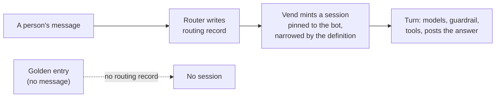
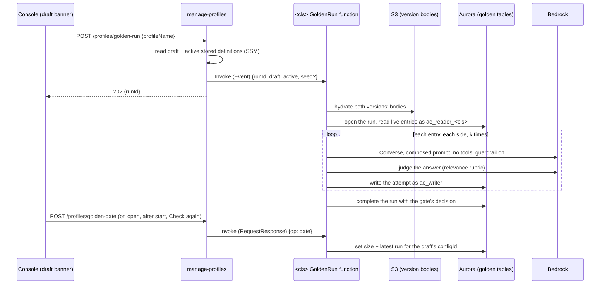
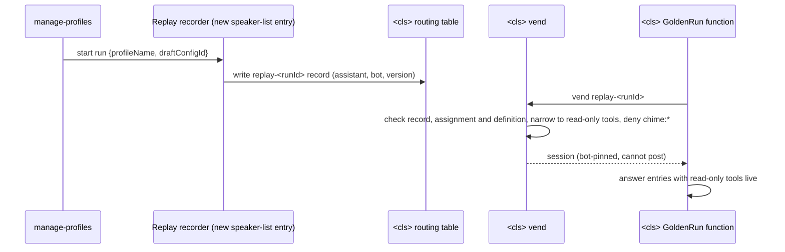
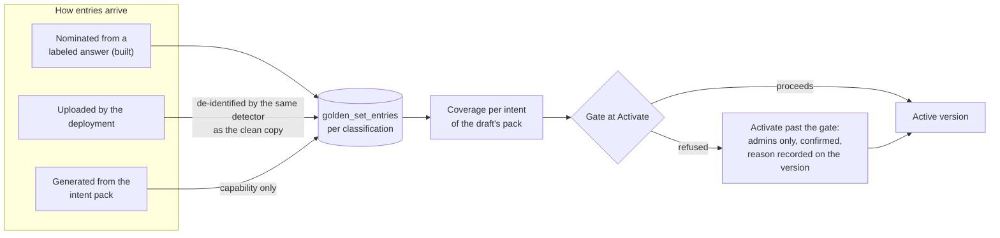

# ADR-065: A draft answers the golden set before it is activated

## Status

**Accepted (2026-10-31).** Option A is built: a text-only run on each classification's own GoldenRun function, beside its classifier replay, with k = 3. A run is required before Activate when the assistant's set holds a live regression entry, and starting one needs `edit-profiles`. Option C stays a later, separate decision for tool-using entries. Built, unit-tested, and verified on dev on 2026-10-31 (see "What proves it"). Decisions 5 to 8 ("Before the set is adequate") are taken. Decision 5 is built and verified on dev on 2026-11-01: an administrator may activate past the gate on a separate IAM capability. Decisions 6 to 8 are **NOT BUILT**: the gate reports coverage per intent against a minimum the active version may declare, a deployment may upload its own entries, and entries may be generated from the draft's intent pack.

## Context

A team edits an assistant as a draft and activates it (SPEC-PORTABLE-PROFILES). Validate checks that a draft is well formed: every model is in the catalog and allowed for the classification, every workflow, template, variable and context source exists. Nothing checked that the draft still answers well. The golden set exists for that: answers people judged good, which a new version must keep answering, and answers the assistant should learn to give (SPEC-EVALUATION FR16, FR17).

Before this record the set filled and nothing read it. A person could label, nominate and curate entries and never see them used.

### What was built before this record

| Piece | Where | State |
|---|---|---|
| Label from the answer, the label queue | `GoldenSetPanel.tsx`, `label_queue` in `analytics-query.ts` | Built, unit-tested, deployed to dev 2026-10-27, **NOT VERIFIED** on a deployment |
| The golden set: de-identified, per classification under row-level security, `regression` or `capability` | `golden_set_entries`, migration 089; the bounded-table policies in `classification-boundary-sql.ts` | Same |
| The deny check: the narrowest reader cannot read the widest classification's entry | `golden:low-reader-cannot-see-high-entry` in `classification-boundary-verify.ts` | Same |
| The decision rule: pass^k on regression entries blocks; the judged paired difference, with its interval and the smallest detectable difference, informs; capability entries passed on every attempt are ready to promote | `lib/promotion-gate.ts` (`GateAttempt`, `GateEntry`, `GateResult`) | Built, unit-tested |
| Serving a version exactly | `getDraft`, `resolveFromDefinition` (`profile-lifecycle.ts`, `active-profile.ts`) | Built |
| A model call that never posts | `invokeBedrockWithFallback` | Built |
| A per-classification batch function in the archive's VPC whose role invokes only that classification's models | the classifier replay (`classification-archive-functions.ts`, `REPLAY_CLASSIFICATION`; `classifier-replay.ts`) | Built and deployed |

### Why it needed a decision: the identity

Every step of a turn acts on a session the vend mints (`assistant-vend.ts`). The vend mints one only for a routing record the router wrote for a person's message, for this classification, naming an assistant of it, and narrows the session by the assistant's definition (`assistant-grant.ts`). The session is pinned to the assistant's bot, so it can speak; only the components on the declared speaker list (`backend/lib/config/speakers.ts`) can write a routing record or obtain a session, which `test/only-declared-speakers-can-speak.test.ts` and `tests/e2e/no-platform-role-speaks-as-an-assistant.spec.ts` enforce.

A run against the golden set has no person's message, so it has no routing record and no session. What it needs is narrower than a turn: invoke the draft's models, apply its guardrail, and, for an entry whose answer used a tool, read what the assistant may read. It never needs to post. The options differ in how much of a turn they reproduce and what identity they reproduce it under.

### Shared by every option

1. **One prompt composer.** `composeAnswerPrompt` (`lib/answer-prompt.ts`) composes the system prompt for the live turn and for the run: the persona and the version's addendum with the host's sections as the cacheable prefix, then the intent's answer prompt, the greeting, the identity, the reply preferences, the held question, the speaker-label convention and who is here. Everything about the person or the conversation is an input. A run passes `goldenRunContext`: the entry's recorded reply preferences, and every per-person section neutral (no greeting, no name, no roster, no held question). A source guard pins that the processor composes through it.
2. **An entry carries what its answer was given** (migration 094). At nomination the entry copies, beside the de-identified request and reference: `used_tools`, the tools the source answer called, from its recorded tool calls; `reply_preferences`, the reply-preference keys it was answered under, registry values only, which the processor now records on each turn's analytics; and `preceding_turns`, up to six turns before the request from the same de-identified copy. They are copied rather than joined because `source_exchange_id` goes NULL when the exchange is deleted. An entry nominated before 094 has none and is answered as a first turn with no preferences.
3. **What one attempt records,** whatever the option: whether it produced an answer, whether the answer was empty, whether the output guardrail blocked it (a policy whose action is BLOCKED; a mask that anonymizes a detail is not a block), the rule ids it breached that the platform checks without a judge (the intent's required answer shape, `answer-shape.<kind>`), and the judge's relevance score when judged (the live relevance rubric, `judgeRelevance`). That is `GateAttempt`, recorded in `golden_run_attempts`.
4. **Both sides, same entries.** Each entry is answered k times by the draft and k times by the active version (the compiled seed where nothing is published), because the same request does not give the same answer twice. The paired difference needs both.
5. **A run record per classification.** `golden_runs` and `golden_run_attempts` are bounded tables like `golden_set_entries` (`BOUNDED_TABLES`), keyed by the draft's `configId`. Reads go through the classification's reader role; writes go through the single write role, `ae_writer`, and are stamped with the classification the function is pinned to. The boundary on writes is the function's pinning, not row-level security.
6. **The gate reads the record, not a re-run** (`lib/golden-gate.ts`). Activate refuses when the assistant's set holds a live regression entry and the latest run for the draft's current `configId` is missing, still running, failed, or refused, or when a live regression entry has no attempt in that run (nominated after it, `GOLDEN_RUN_OUTDATED`). A draft edited after its run has a new `configId` and needs a new run, and `activateDraft` is held to the `configId` the gate checked, so a draft saved between the check and the write is refused rather than activated unrun. With no regression entry, Activate proceeds and says the set is empty; a run that could exercise no regression entry refuses nothing and is reported as unmeasured, never as passed. The refusal carries a code and its values, which the console words from the locale file.
7. **Only a draft's activation passes the gate.** A rollback (`activateExistingVersion`) moves the label onto a version that already served; an experiment's promotion (`promoteCandidate`) activates a candidate its experiment measured. Neither is gated.
8. **Aurora mode only (tenet D7).** The set and the run live in Aurora. A deployment in Athena mode has neither, publishes no GoldenRun function, and there the gate reads as unavailable and Activate proceeds. The run records are a projection of nothing in the archive: they are generated evidence for one decision, not facts about a conversation.
9. **No timer anywhere (tenet D6).** The console reads the gate when a draft opens, after starting a run, when the run it started ends, and when the person presses **Check again**. The end is pushed: the GoldenRun function's async destination sends each Event invocation's end to EventBridge, delivered by the Lambda service so the VPC needs no route; a rule hands it to a publisher outside the VPC (`console-events-publisher.ts`), which publishes `{ id, kind, status }` on the AppSync Event API channel `/console/batch/<id>` (`consoleEvents` in `admin-services-stack.ts`). The console subscribes to the one channel of the run or batch it started with its own console credentials (`followBatch`), reads the result once when told, and once when the subscription stands in case it ended first. The event carries no result, only that the work ended; the namespace's subscribe handler refuses anything but one batch's exact channel, so a session follows only work whose id it was given.

## Options

### Option A. A text-only run on the classification's own function (accepted, built)

**Design.** Each classification's stack deploys, beside its classifier replay in the archive's VPC, a GoldenRun function on a role built the same way and pinned to the classification by `GOLDEN_RUN_CLASSIFICATION` (`classification-archive-functions.ts`). `manage-profiles` finds it by its published key, as the replay starter finds the replays.

The archive's VPC has no NAT and no SSM endpoint (its endpoints are Kinesis, S3, DynamoDB, Secrets Manager and Bedrock Runtime), so the function cannot read a version from SSM. `manage-profiles`, outside the VPC, reads both versions' stored definitions (`storedRunSides`) and sends them in the invoke payload; the function follows their body pointers in S3 through the gateway endpoint. A console-created assistant's seed rides the payload too, since its directory record is in SSM.

- **Identity.** The function's own role: `bedrock:InvokeModel` on the classification's models and the utility model the judge runs on, `bedrock:ApplyGuardrail` on the classification's provisioned guardrails, `s3:GetObject` on `profiles/*`, and an IAM-auth database user that assumes the classification's reader role and the write role. No Amazon Chime SDK permission, no Lambda invoke (so no vend), no DynamoDB (so no routing table), no SSM. It is not a speaker and is not on the speaker list.
- **Tools.** None are offered. An entry whose `used_tools` names any tool is recorded `notExercised: tools` without being answered, since the gate sets it aside; the result counts and names those entries and they never pass, fail or enter the paired difference. On premium most answers that state a figure fetch company documents with `load_company_context`, so a large share of premium's entries may be not exercised. That count is what decides whether Option C is worth building.
- **What it measures.** The persona and its addendum, the intent's instructions under the entry's recorded intent, the model the version's routes choose for that intent and its fallback, the guardrail, and the intent's required answer shape. The classifier's choice of intent is measured by the classifier replay gate, not here.
- **What it does not supply.** Catalog context sources (they are read for a person, and a run has none), host sections, and anything about the asker beyond the reply preferences. A version without its own intent pack answers against the deployment's taxonomy, which the starter reads and sends, because the function's compiled default is not this deployment's. A version without its own persona answers with the classification's declared persona. All of it is the same on both sides, so the paired difference compares versions.
- **Workflows.** Not exercised: a single text run cannot walk a multi-step task. Whether a workflow still reaches its success state is read on live traffic (SPEC-EVALUATION C2).
- **Cost.** k x entries x 2 answers, plus one judge call per unblocked answer. With 20 entries and k = 3: 120 answers and up to 120 judge calls. The console states the estimate beside the button.
- **Failure.** A model or guardrail error is an attempt with `ok: false`, a deterministic failure of that entry. A run that cannot finish is recorded `failed` with its reason, and Activate refuses it as such. The function is invoked with no async retry, so a failed run is never silently repeated. The function stops at 15 minutes and cannot record that it did, so a run still `running` 16 minutes after it started is read as failed (`RUN_DEADLINE_MS`) and never holds Activate shut. An entry's 2k attempts run at once and 3 entries at a time, so a run's length is about one answer and one judge call per 3 entries; a set of about 100 exercised entries fits, measured on no deployment yet. Splitting a larger set across invocations is **NOT BUILT**. A second run of the same draft is refused while one is going (`409 GOLDEN_RUN_RUNNING`).
- **Limits.** Tool use is not measured. A draft that changes only its tool list gets no signal from the set. The live turn repairs a missing answer shape with a second call; the run does not, so a draft whose answers routinely miss their required shape is refused here before a person sees the repair cost.

### Option B. Option A, with tool calls answered from what the original turn recorded

**Design.** Everything in A, plus a tool stub. Evaluation increment C3 records each tool call's name, arguments and a capped excerpt of its result on the turn. At nomination, the entry would copy that record. In the run, a tool call the draft makes would be answered from the copy when its name and arguments match a recorded call, and recorded `notExercised: tool-mismatch` when they do not.

- **Identity.** Same as A. Nothing live is read, so no new reach.
- **What it adds.** Whether the draft calls the same tools with the same arguments, and how it uses their results.
- **The condition.** A golden entry is de-identified; recorded tool results are not. Copying them as recorded would bring personal data into a set designed to hold none. B therefore requires the tool excerpts to pass through the same de-identification as the conversation copy at nomination, and a nomination to be refused when that copy does not exist, as it is for the text.
- **Limits.** Excerpts are capped, so a draft that reads further into a result than the excerpt holds is answered from less than it would see live. A draft that calls a different tool gets no signal.
- **Cost.** As A; the stub adds no model call.

### Option C. A replay session that cannot speak, minted by the vend

**Design.** The vend already mints sessions of different kinds, chosen by the routing record's prefix: a turn's, the router's own (`route-`), and a speaking service's (`speak-`), each narrowed by grant edges (`assistant-grant.ts`). Option C adds a fourth kind, `replay-`, which the vend narrows to the definition's model, guardrail and read-only tool edges. Sending a message is allowed by the acting role itself, which is bearer-pinned, not by a grant edge, so removing edges does not take it away: the session policy carries an explicit deny on `chime:*`.

- **Identity.** A real assistant session, pinned to the assistant's bot and narrowed by its definition, with every Amazon Chime SDK action explicitly denied. The session reads company context exactly as the assistant's role may.
- **The new boundary.** Something must write the `replay-` routing record. Writing a routing record is a speaker capability, so that writer becomes a new entry on the declared speaker list with a reason a reviewer can disagree with, and the vend must refuse a `replay-` record from any other writer. The session is a new way to obtain an assistant's reach without a person's message. That is the decision this option asks for.
- **What it measures.** A, plus live read-only tool use against current data.
- **Limits.** Tools that change state (create a task, send a notice) are excluded; their edges are never on a replay session. A live read means the answer depends on today's data rather than the entry's, so a regression entry can fail because the data changed; the result must say which entries read live data.
- **Tests.** The speaker-list test gains the entry; a new e2e proves a `replay-` session is refused every `chime:*` call and a `replay-` record written by any other role is refused at the vend; the existing classification deny checks apply unchanged.
- **Cost.** A, plus the tool calls; the vend adds one STS call per run.

### Option D. An evaluation room

**Design.** The run opens a private conversation owned by the service user, adds the classification's alt assistant carrying the draft as an unlabeled candidate version (the battle path, ADR-050), and posts each entry as a message so the ordinary router, vend and processor answer it.

- **Identity.** No new kind: the alt assistant answers as in a battle.
- **Why it is not chosen.** It posts, which FR17 says the run must not. Each prompt needs a sender: the service user is not a speaker and does not send turns, and a person sending them would be impersonated by the run. Its turns land in the archive and every analytics view, and each would need excluding. It is the slowest and most expensive option and the one most exposed to unrelated failures of the live path.
- **What it would measure.** Everything, including workflows across turns.

### Option E. Battles on golden prompts, by hand

**Design.** No build. An operator opens a battle-enabled conversation and runs `/battle` with golden requests; people pick.

- **What it gives.** A human comparison of two complete versions on the set's requests, recorded in the experiment's battle results.
- **Why it does not decide FR17.** It cannot block an activation, it depends on someone doing it, and it posts. It remains useful as a demonstration and as a check alongside A.

### The options side by side

| | Identity | Posts | Tools | New boundary | Decides FR17 | Effort |
|---|---|---|---|---|---|---|
| **A** | Per-classification run role, no Amazon Chime SDK | No | Not exercised, counted | None | Yes, for text | Small (built) |
| **B** | Same as A | No | From recordings, de-identified | None, given de-identified excerpts | Yes, more of it | Medium |
| **C** | Vended assistant session, `chime:*` denied | No | Read-only, live | Yes: a new speaker-list writer and session kind | Yes, most of it | Large |
| **D** | Alt assistant in a real room | Yes | All, live | No, but a sender problem | Contradicts FR17 | Large |
| **E** | People | Yes | All, live | None | No | None |

## Security posture

- **Inside the classification.** The run's role reaches one classification's models, guardrails and the version bodies, and its database user reads the set as that classification's reader and writes as `ae_writer` with the classification stamped from the function's own environment. A function refuses a run of any other classification (`assertOwnClassification`). No reader crosses classifications: `golden:low-reader-cannot-see-high-run` in the boundary verifier proves it for the run table as `golden:low-reader-cannot-see-high-entry` does for the set.
- **Nothing speaks.** The run's role holds no Amazon Chime SDK, Lambda, DynamoDB, SSM or STS action, proven from the synthesized template (`test/a-golden-run-role-cannot-speak.test.ts`), not by review.
- **No personal data enters.** Entries are de-identified at nomination, and what 094 adds is tool names, registry preference keys and turns from the same de-identified copy. A run record holds answers generated from de-identified requests and is bounded like the set.
- **A billable run is an editor's act.** Starting a run spends k x entries x 2 model calls, so it is under `edit-profiles` (`admin/profiles/golden-run`); reading the result is under `view-profiles` (`admin/profiles/golden-gate`), and the refusal is enforced at Activate under `activate-profiles`.
- **The decision stays a person's.** Only deterministic failures of regression entries refuse an activation. A judged difference is shown with its interval and never refuses.
- **Passing the gate is a separate grant.** `activate-past-golden-gate` is held by the admin groups only, refused at the gateway for any other principal and re-checked against the caller's groups in the handler, and every use is recorded on the version it activated and announced in the admin notification channel.
- **An upload is de-identified like a nomination.** The classification's GoldenRun function applies the clean copy's detector (its role is granted that guardrail, `test/a-golden-run-role-cannot-speak.test.ts`), the stored text is the detector's output, and a line it cannot process is refused and named rather than stored raw. A generated request passes through the same detector.
- **Adding entries is its own grant.** Uploading is `import-golden-set`, a capability apart from editing, because what it writes is the set every draft is measured against; generating spends a model call per intent, so it is `edit-profiles`. A team member reaches either only for the assistant in the route's path.

## Decisions taken

1. **Option A**, built. C is a separate decision, taken only if the "not exercised: tools" count shows tool-using entries matter; B only with de-identified tool excerpts.
2. **k = 3** (`GOLDEN_RUN_K`). The spec fixes the rule (pass^k), not k. Larger k catches rarer failures and multiplies cost.
3. **A run is required before Activate** when the assistant's set holds at least one live regression entry; it belongs to the draft's `configId`. With no regression entries, Activate proceeds.
4. **Starting a run needs `edit-profiles`**; reading it needs `view-profiles`.
5. **Activating past the gate** is a separate route and IAM capability held by the deployment's admin groups only, confirmed against the refusal that stands, with a required reason recorded on the activated version and announced in the admin notification channel. Built and verified on dev on 2026-11-01.
6. **Coverage per intent** is reported against the draft's pack, and the active version may declare a minimum of regression entries per intent, refused as `GOLDEN_SET_THIN`. Built and verified on dev on 2026-11-01.
7. **A deployment may upload entries**, as JSON Lines or CSV, de-identified by the same detector as the clean copy, under `import-golden-set`; they enter as capability. Built and verified on dev on 2026-11-01.
8. **Entries may be generated from the draft's intent pack**, as capability entries marked generated, never regression until the active version passes them and a person promotes them. Built and verified on dev on 2026-11-01.
9. **Retention.** A run record is kept while its draft is the one under edit and for the version it activated; older runs of a superseded draft may be deleted, with a period the deployment chooses (**NOT BUILT**: no sweep deletes them yet). Offboarding has nothing to erase in either table: their inputs are de-identified.

## Before the set is adequate

A set fills one label at a time, from the answers people happened to review, so it is thin exactly when an assistant is new and its owners most need to change it: a new assistant or a new intent has no traffic to label, and a deployment's own test cases sit outside the platform. Four additions cover that period. All four are built and verified on dev.

### Coverage per intent

The gate reads, for every intent of the draft's pack, how many live regression, capability and uploaded entries the set holds for it and how many regression entries the latest run exercised (`coverageOf` in `golden-run.ts`), and lists entries whose intent the draft's pack no longer declares, counted apart and never toward a minimum (**OPEN**: whether the run answers those under the deployment's taxonomy, as it does today, or sets them aside). The console shows that table on the draft banner's golden-set row, and a passing result names the intents it exercised nothing for (`unchecked`), so "passed" never stands for an intent the set does not reach.

`manage-profiles` sends the GoldenRun function the draft's intents and adds the minimum from the active version itself, so the run function never decides the bar. An intent with no counts read is counted as none, so a read that could not count refuses rather than passes. `GOLDEN_SET_THIN` is checked first, because no run cures it.

**A minimum is the active version's to declare.** A version may declare `goldenSet.minRegressionPerIntent`, refused where the version is checked when the minimum times the intents it serves passes the set's 100 (`goldenSetReachErrors`) (default none, so a deployment that declares nothing is gated exactly as today). The gate reads the minimum from the **active** version, never from the draft, so a draft cannot lower the bar it is measured against: a lower minimum takes effect once the version that declares it is active, by an activation that is itself gated. Where the active minimum across the draft's intents is more than the set can hold, it is held at the most it can (`effectiveMinimum`) and the banner says so, since a draft that adds intents could otherwise never be activated. A console read that cannot reach the active version says so and shows the rest; Activate refuses instead. When a minimum applies, Activate is refused with `GOLDEN_SET_THIN`, naming each intent of the draft's pack below it, until the set reaches it or an administrator activates past the gate. The minimum rides the version because it is a statement about what this assistant must be measured on, and it changes through the same draft, validate and activate cycle as everything else the assistant does (tenet P5: the builder decides).

### Entries a deployment uploads

A deployment's own cases enter the same table as nominated ones, through `POST /admin/profiles/golden-set-import` (and `/admin/assistants/{assistant}/profiles/golden-set-import` for a team), under a new capability, `import-golden-set`, held by `admins` and, scoped to their assistants, by `team-members`. The route is on `manage-profiles` rather than the analytics query, because that is where the assistant's classification and the intents it serves are known: the file is read and every line checked there (`lib/golden-upload.ts`), an intent the assistant's active version and draft do not serve is refused, and only then is the file sent to the classification's GoldenRun function, which de-identifies and writes it. One bad line refuses the file, naming each bad line; nothing is half-stored. An upload is a JSON Lines file, one entry per line, or a CSV file with the same columns, naming intents of the pack (the ones coverage counts): `intent`, `request`, optional `reference`, optional `precedingTurns` and `replyPreferences` (registry keys only).

- **The set still holds no personal data.** Every text in an upload passes through the same detector as the clean copy (`lib/de-identify.ts`, the deployment's guardrail detector), and the stored text is the detector's output. A line the detector cannot process is refused and named; the upload never falls back to the raw text, as a nomination never does.
- **Inside the boundary.** The assistant named by the route fixes the classification; entries are written as `ae_writer` stamped with it, like a nomination, and read only through that classification's reader role.
- **Recorded as uploaded.** Each entry carries `source = 'uploaded'` (migration 095), the uploader as `nominated_by` and the upload's id as `upload_id`, so a result can say which of its entries came from the deployment's file and which from labeled traffic, and a whole upload is retired at once (`POST .../profiles/golden-set-retire-upload`, under the same capability). Retiring a batch retires its capability entries only: an entry a person promoted to regression is retired one at a time under the golden set's own grant.
- **In the background, with its own report.** The route checks the file at once (a bad line is refused before anything starts) and answers `202` with the batch's id; the classification's GoldenRun function runs the batch as an Event under a row of `golden_batches` (migration 095, bounded like the set), opened when it starts and closed with how it ended: what was written, or the refusal's code and values (`GOLDEN_SET_FULL`, `DETECTOR_BUSY`, `DETECTOR_FAILED` with its lines), or the error. `POST .../profiles/golden-set-batch` (`view-profiles`) reads it. The console is told when it ends (decision 9).
- **The text is handed over as an object, never in the event.** An async invocation's request is repeated in the record its destination sends to EventBridge, and an upload has not been de-identified yet, so `manage-profiles` writes the checked entries to `golden-uploads/<classification>/<assistant>/<uploadId>.json` and the event names the key and version. A run's input (both versions' definitions, a runtime assistant's seed, the deployment pack) is handed over the same way, under `.../runs/<runId>.json`, so the record the destination sends stays small and carries no definition. The GoldenRun role reads and removes that version under its own classification's prefix only, and a lifecycle rule removes anything left, with its versions, within a day.
- **A retry writes nothing twice.** An upload's id is derived from its assistant and content, so the same file sent again is the same batch: while it runs a second start does nothing (the route reads the batch first, and its row is claimed once), and the start answer names when it started, so the console never takes an earlier run of the same file for this one; and once written, a batch whose capability entries are live writes nothing again. A request the set already holds live for the same intent is never added twice. A throttled detector is retried with backoff and, still throttled, reported as busy rather than as bad lines; any other detector or model error is logged with its cause.
- **An upload enters as capability.** It becomes regression after a run in which the active version passed every attempt at it, offered for promotion as today, so a regression entry is always a case the active version passes and an uploaded case it already fails never refuses every draft. The judge does not read `reference` today; grading an answer against its reference is **OPEN**.
- **Bounded by what a run can answer.** One upload holds at most 100 entries and 1 MB, and an assistant's set at most 100 live entries (`GOLDEN_SET_CAPACITY`), the run's capacity at k = 3 (Option A, "Failure"). An upload past it is refused as `GOLDEN_SET_FULL`, naming the count, checked again under a lock on the assistant's set in the transaction that writes. A larger set waits on a split run (**NOT BUILT**).
- **In the console.** The assistant's Versions section offers **Add golden entries** to a session holding `import-golden-set`: a `.jsonl` or `.csv` file, sent whole, with a refusal naming each bad line in the locale's words. The Ground Truth tab's golden set shows each entry's source, and **Retire its upload** on an uploaded or generated entry. Sample files for the demo `analyst` are in `backend/demo/golden-set/`. An entry written by hand in the Ground Truth tab is **NOT BUILT**; a file of one line does it.

### Entries generated from the intent pack

A new assistant or a new intent has no traffic and may have no file to upload. An editor may generate entries from the draft's intent pack (`POST .../profiles/golden-set-generate`, with optional `intents` and `perIntent`, 1 to 5, default 3): for each intent, at most 12 in one call (with none named, the intents the set holds the fewest live entries for, as many as the set has room for), requests written by the utility model from the intent's description, summary and keywords (`lib/golden-generate.ts`), on the classification's GoldenRun function, under `edit-profiles` because it spends a model call per intent. The model's answer is read strictly, the first JSON array of strings in it, and an intent it gave nothing usable for refuses the whole generation as `GENERATION_FAILED`, naming it, with nothing stored. A generation carries an id in `upload_id`, so it is retired at once, on its own route under `edit-profiles` (`.../golden-set-retire-generation`): whoever may generate a batch may retire it. Generated text is about no person, and still passes through the detector like an upload. Each entry carries `source = 'generated'` and enters as capability; it becomes regression only as an uploaded entry does, after the active version passes it and a person promotes it. A generated set measures whether the assistant answers what its intents describe, not the gaps between them, so the coverage table counts generated entries apart from labeled and uploaded ones.

### Activating past the gate

An administrator can activate a draft the gate refuses, after confirming the refusal and stating why. It is not a flag on Activate: it is a separate route and a separate IAM capability, so the decision to allow it is an IAM decision, and a role that can activate cannot reach it.

- **Route and capability.** `POST /admin/profiles/activate-past-golden-gate`, under the capability `activate-past-golden-gate`, held by the deployment's admin groups only. It has no team route, so no `team-members` session can name it. The gateway refuses any other principal (layer one). The handler then resolves the caller's person, reads their groups through the directory as `lib/assistant-scope.ts` does, and refuses a caller in none of the deployment's admin groups (`ADMIN_GROUP_NAMES`), rather than trusting the signed call as `callerCanManageProfiles` does (layer two, tenet D3).
- **What the caller confirms.** The request names the draft's `configId`, the refusal the caller was shown (its `code`, the `params` it was worded with, and the `runId` it was read from, where a run exists), and a `reason` of 10 to 500 characters, kept on one line so it cannot read as a line of the admin notice (`pastGateDecision` in `lib/golden-gate.ts`). The handler re-reads the gate: a draft saved since, or a refusal that has changed (a run finished, an entry added), is refused with `GATE_CHANGED` and the current refusal, so the caller confirms the refusal that actually stands. A gate that no longer refuses is refused with `GATE_NOT_REFUSING`: Activate is the route for it.
- **Everything else still applies.** Only the golden gate is passed. Every validation `activateDraft` runs, and its hold on the confirmed `configId`, are unchanged.
- **Recorded where the version is read.** The activated version's stored definition carries `activatedPastGate: { code, params, reason, actor, at, runId }`, immutable like `promotedFrom`, so the version history shows which version went live past the gate, why and by whom (the actor is the person's AppInstanceUser id, as on every other audit line). The manage-profiles audit line records the call with the same fields.
- **Announced.** Every activation past the gate posts to the admin notification channel: the assistant, the version, the refusal, the actor and the reason, so an override by one administrator is seen by the others rather than only recorded.
- **In the console.** The refusal on the draft banner offers **Activate anyway** to a session that holds the capability, and to no other. It opens a confirmation naming the refusal, each failed entry and the intents without coverage, with a required reason field; the action is enabled once the reason is long enough. The button, the confirmation and the codes `GOLDEN_SET_THIN`, `GATE_CHANGED` and `GATE_NOT_REFUSING` are worded from the locale file, like the gate's existing refusals. The version list marks a version activated past the gate.
- **Every refusal code can be passed**, `GOLDEN_SET_THIN` included, because each is a case for it: no run yet on a deployment that must ship a fix, a failed run, a failed entry the administrator judges wrong. The record says which.

## How it reads in the console

- **Validate stays fast.** The existing checks return at once. Beside them the draft banner shows the **Golden set** row (`GoldenRunPanel.tsx`): with entries, **Run golden set (N entries x 3)** for an editor, with the estimated model calls, and **Check again**.
- **While a run is going** the row reads "Running: n of N entries answered." from the run record, read when the page opens and on **Check again**, never on a timer. A failed run shows its reason.
- **The result**: "14 entries, 3 attempts each. 0 blocked. 2 not exercised (used tools)." then "Quality, draft minus active: +2.1 (95% interval -1.0 to +5.2). The set can detect a difference of 4 points or more." Each failed regression entry and attempt is named with its reason.
- **Activate** is refused while the run for the draft is missing, running, failed or refused, with the same named reasons in the banner.
- **Capability entries** the draft passed on every attempt are listed as ready to promote to regression, beside the Ground Truth tab's existing **Promote to regression** action.
- **The Ground Truth tab's golden set** shows, per entry, its last run and outcome, and names the tools an entry uses that a run does not exercise.

## Build

| Step | Where | State |
|---|---|---|
| 1. The prompt composer; the processor calls it; a source guard pins the single path | `lib/answer-prompt.ts`, `assistant-async-processor.ts` | Built, unit-tested |
| 2. The entry's new columns, the run tables (bounded like 089) and their boundary-verifier check; the turn records its reply-preference keys | migration 094, `classification-boundary-sql.ts`, `classification-boundary-verify.ts`, `async-processor-core.ts`, nomination in `analytics-query.ts` | Built, unit-tested |
| 3. The per-classification GoldenRun function and role; its synth test | `classification-archive-functions.ts`, `golden-run.ts`, `golden-run-handler.ts` | Built, synth-tested |
| 4. `POST /profiles/golden-run` and `/golden-gate` on `manage-profiles`, under the capabilities in decision 4 | `manage-profiles.ts`, `admin-capabilities.ts`, `admin-assistant-administration.ts` | Built |
| 5. The refusal at Activate, reading the latest run for the draft's `configId` | `lib/golden-gate.ts`, `manage-profiles.ts` | Built, unit-tested |
| 6. The console: the banner row, the result, the refusal, the per-entry last run | `GoldenRunPanel.tsx`, `ProfilesTab.tsx`, `GoldenSetPanel.tsx` | Built, unit-tested |
| 7. The e2e in "What proves it" | `tests/e2e/a-draft-answers-the-golden-set-before-it-is-activated.spec.ts`, validate phase `golden-set` | Passed on dev 2026-10-31 |
| 8. Coverage per intent in the gate read and the banner; `goldenSet.minRegressionPerIntent` and `GOLDEN_SET_THIN` | `lib/golden-gate.ts`, `golden-run.ts`, `active-profile.ts` (`goldenSetErrors`), `manage-profiles.ts`, `GoldenRunPanel.tsx` | Built, unit-tested, verified on dev 2026-11-01 |
| 9. Upload: `import-golden-set`, the JSON Lines and CSV import through the detector, `source` and upload id on the entry | `admin-capabilities.ts` and the SPEC-ADMIN-CONSOLE role table, `lib/golden-upload.ts`, `manage-profiles.ts`, `golden-run.ts`, migration 095, the detector's grant in `classification-archive-functions.ts`, `GoldenUploadPanel.tsx`, `GoldenSetPanel.tsx` | Built, unit-tested, verified on dev 2026-11-01 |
| 10. Activate past the gate: `activate-past-golden-gate`, the route, the handler's group re-check, `activatedPastGate` on the version, the confirmation | `admin-capabilities.ts` and the SPEC-ADMIN-CONSOLE role table, `admin-assistant-administration.ts`, `manage-profiles.ts`, `profile-lifecycle.ts`, the admin notification channel, `GoldenRunPanel.tsx`, `ProfilesTab.tsx` | Built, unit-tested, verified on dev 2026-11-01 |
| 11. Entries generated from the intent pack, `source = 'generated'` | `lib/golden-generate.ts`, `golden-run.ts` (`generate`), `manage-profiles.ts`, `GoldenUploadPanel.tsx` | Built, unit-tested, verified on dev 2026-11-01 |

## Consequences

- A team's labels and nominations are used, and a draft that loses a case people judged good is stopped before it serves anyone.
- Activation gains a step that costs model calls once the set holds a regression entry; the estimate is shown before it is spent. Any caller that activates the assistant, an automated one included, needs a run first.
- Tool use and workflows are still measured on live traffic, not by the gate, until C or C2 cover them. The result says so in its "not exercised" count.
- Until the set covers an assistant's intents, the gate checks part of what the assistant serves; the coverage table says which part, and an administrator can activate past the gate on the record rather than retiring an entry to get a fix out.
- SPEC-BATTLE FR13 (a candidate answering archived exchanges before live traffic) can reuse the same run with a different source of requests.

## What proves it

- **Unit:** `test/lib/a-draft-answers-the-golden-set-before-it-is-activated.test.ts` (the one composer, what an entry carries, the gate's outcomes including an outdated run, not-exercised entries, the run's classification refusal); `test/analytics-aurora/a-golden-entry-is-de-identified-and-classified.test.ts` (nomination copies tools, preference keys and preceding turns; the run tables are bounded); `test/lib/a-draft-is-refused-only-on-deterministic-failures.test.ts`; `GoldenRunPanel.test.tsx` (no timer).
- **Synth:** `test/a-golden-run-role-cannot-speak.test.ts`: one GoldenRun per conversational classification, no Amazon Chime SDK, Lambda, DynamoDB, SSM or STS action, exactly the classification's models and the utility model, and only `profiles/*` in S3.
- **Unit, decision 5:** `test/lib/an-administrator-activates-past-the-golden-gate.test.ts` (the confirmation rule: reason bounds and one line, the refusal's code, values and run must stand, nothing to pass where the gate does not refuse; the route: an admin group activates, the version records the refusal and reason, the notice is sent; DENIED a caller whose directory groups hold no admin group and a team route; the grant held by the admin role alone with no team route); `GoldenRunPanel.test.tsx` (Activate anyway offered only with the capability and only on a refusal, the confirmation and reason, a refusal of it worded and the gate read again only when it moved).
- **Unit, decisions 6 to 8:** `test/lib/the-golden-gate-reads-coverage-per-intent.test.ts` (every intent of the pack counted, entries outside it apart; `GOLDEN_SET_THIN` before a run is asked for, an intent with no counts read counted as none, the intents a pass checked nothing for; the field's bounds; the minimum read from the active version, so a draft lowering it is still refused); `test/lib/a-deployment-uploads-its-own-golden-entries.test.ts` (each bad line named and nothing stored; de-identified before it is written, never the raw text; capacity under a lock; the route checks intents before the classification is reached; a team route only for its assistant; the sample files read as their README says; generation tells the model only the intent's own words, reads its answer strictly and refuses the whole generation for an intent with nothing usable); `GoldenUploadPanel.test.tsx`, `GoldenRunPanel.test.tsx` (coverage, `GOLDEN_SET_THIN`, unchecked intents).
- **Synth:** the run role applies the clean copy's detector (`test/a-golden-run-role-cannot-speak.test.ts`).
- **Live:** the boundary verifier's `golden:low-reader-cannot-see-high-run`.
- **E2E:** `tests/e2e/a-draft-answers-the-golden-set-before-it-is-activated.spec.ts` nominates a labeled answer as a regression entry, asserts Activate is refused before a run, runs the draft and asserts the record's configId, k and decision match the gate Activate reads, asserts an edit after the run needs a new run, and retires the entry. It takes an entry whose answer used no tool, so the run reaches a model. **Passed on dev 2026-10-31** (`node scripts/validate.mjs --only=golden-set`, commit 6ccd45b3 deployed): 4 of 4 tests executed and passed; the premium GoldenRun answered its regression entry in 24 s inside the archive's VPC (`[golden-run] run 6c4571d6-... finished { status: 'complete', entries: 1, refused: false }`), with at least one regression entry exercised. An earlier attempt the same day ran an entry whose answer used `load_company_context`: it completed in under a second with no model call and the gate read unmeasured, as designed. SPEC-EVALUATION FR17 stays Partly because tool-using entries are not exercised. **Decision 5 verified on dev on 2026-11-01** (`node scripts/validate.mjs --only=golden-set`, commit f760b3d8 deployed): 5 of 5 tests executed and passed. The fifth refused a confirmation naming a refusal that was not the one standing (`GATE_CHANGED`) with the active version unmoved, then activated the edited `analyst` draft past `GOLDEN_RUN_REQUIRED` (version 20, `activatedPastGate` read back from the version listing with the reason), and rolled back to the version that served before. The manage-profiles audit line recorded `action: activate-past-golden-gate` with the refusal and reason, and the admin alert poster logged `posted activated-past-golden-gate to the admin channel`.
- **E2E, decisions 6 to 8:** `tests/e2e/a-deployment-brings-its-own-golden-entries.spec.ts`, in the same validate phase: the invalid sample is refused naming lines 2 to 9 with nothing stored, the valid sample enters as seven uploaded capability entries with the email address removed, coverage counts the uploaded entries under their intent, a version declaring a minimum is activated and a draft lowering it is refused as `GOLDEN_SET_THIN` (rolled back in a `finally`), and two generated entries are stored as generated; every entry added is retired. Each upload and generation is followed on its console events channel, subscribed before it starts, and the spec also proves a wildcard subscription is refused. **Passed on dev on 2026-11-01** (`node scripts/validate.mjs --only=golden-set`, commit eaceb8b3 deployed): 9 of 9 tests executed and passed across both specs. The upload batch `ee152ecb-...` and the generation `683562d6-...` each logged `complete` on the standard GoldenRun function and announced their end on `/console/batch/<id>`, which the spec received before reading the batch. The runs before it found and fixed, on dev: the console roles' permissions boundary refusing `appsync:EventConnect` (the boundary now admits connect and subscribe, and a test checks every console grant fits it), an insert Postgres refused for a reused parameter, generation sent through the person-facing input guardrail, and a run's failures on an entry retired since still refusing the draft.
