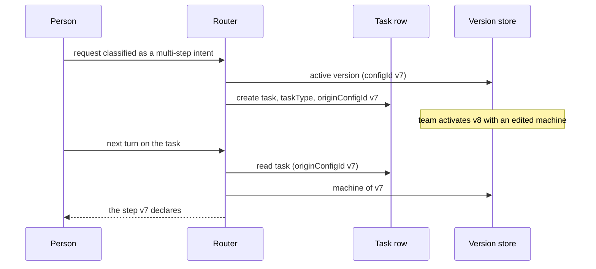
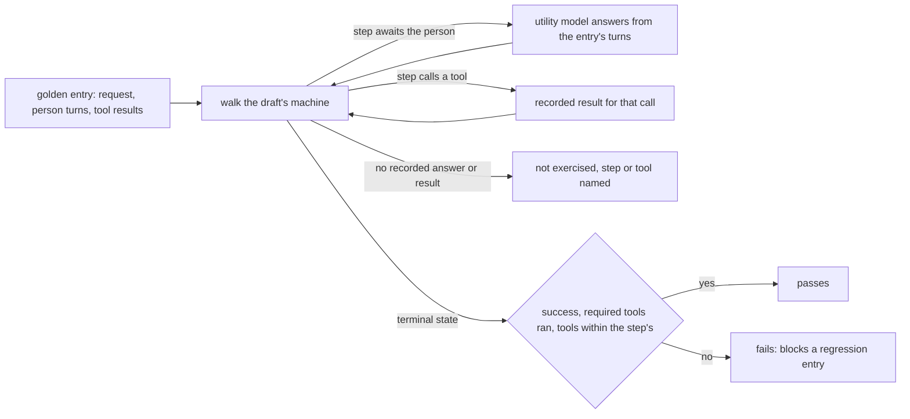

# ADR-066: An intent's workflow rides the assistant's version

## Status

Status for workflows and tasks lives in [SPEC-WORKFLOWS-AND-TASKS](../../specs/interaction/conversation/SPEC-WORKFLOWS-AND-TASKS.md) (this record's parts: WT51, WT57 to WT59, WT97); the status below is kept for the record of when each part landed.

Accepted 2026-11-04. Decisions 1, 2, 5, 6, 7 and 8 are built and unit-tested; decisions 3 and 4 (the console) are **NOT BUILT**; no e2e spec exists, so nothing here is proven on a deployment. Amends ADR-063 decision 1 on where a task machine is declared: an intent's machine is declared on the assistant's version, as the welcome and every event workflow already are (ADR-061), and the platform's own machines stay the platform's. Amends ADR-065 decision on workflows (its "Workflows. Not exercised"): a golden run walks a multi-step task in a sandbox (decision 7).

## Context

An assistant's team owns the assistant end to end: its persona, tools, models, welcome, event workflows and message templates are fields of its version, drafted, validated, activated and rolled back together (SPEC-PORTABLE-PROFILES), and each is an AWS-resourced, classification-scoped piece of the one control plane. The multi-step work an intent runs is the exception.

| Question | As built |
|---|---|
| Where is an intent's machine declared? | In the platform's set (`DEFAULT_TASK_STATE_MACHINES`, `task-state-machines.ts`) and the classification's intent pack parameter (`/assistant/<classification>/assistant-intent-pack`), merged by `taskStateMachines` (`intent-pack.ts`). A version may not declare one: `editDraft` refuses `machines` (`profile-lifecycle.ts`) and validation refuses `intentPack.machines` (`active-profile.ts`), both naming machines "global workflows". |
| What may a version do with machines? | Select which ones open, with `workflows` (`mayOpen`, `router-agent-handler.ts`). |
| Which machine does a running task follow? | The one named by its `taskType`, resolved from the global set on every read (`taskStateMachines()` at the router's task sites and the processor's `turnMachines`). A task does not record which definition it started on. |
| What does the console show? | Each intent's purpose and instructions read-only, its models editable, and its machine's steps read-only behind **View steps** (`AssistantPage.tsx`, Scope and models). |
| What may a version say about an intent? | Its own intent pack (`intentPack`, edited as JSON through export and import), with `extends: 'default'` inheriting the platform intents. |

A team that wants its report to ask one more question before drafting has to change the classification's parameter, which every assistant in the classification serves and which only a deploy writes. That is the gap.

## Decisions

### 1. An intent's machine is part of the version

A version's intent pack may declare `machines`, keyed by intent, and those are the machines its intents run. The classification's intent pack and the platform's intent machines (`report_generation`, `data_extraction`, `image_generation` and the other intent-keyed entries of `DEFAULT_TASK_STATE_MACHINES`) become starting points: a draft is created with them copied in, the way the console copies a platform event workflow (`withPlatformCopy`), so a version says what it runs. The classification's parameter is read when a draft is made, never at runtime: an active version runs the machines it carries.

### 2. The platform's machines are fixed and cannot be overridden

A platform machine is one every assistant uses to interact, whatever its intents: the owner's rule is "any that all assistants use to interact like queue". The set is:

| Group | Machines | Why every assistant uses it |
|---|---|---|
| The turn queue | `queue_drain`, `queued_request`, `queued_clarification`, `queued_combination`, `work_still_wanted` (`PLATFORM_TASK_MACHINE_KEYS`) | One turn at a time, and the work a person queued behind it (ADR-033) |
| Work items | `action_item`, `place_item` | The to-do and the plan item any assistant opens for a person, kept by every pack today (`taskStateMachines`, `intent-pack.ts`) |
| Asking a person | `approval`, `acknowledgement` | What a workflow `task` step opens to have a person decide or confirm (ADR-063 decision 1, `event-task.ts`) |

A version that declares a machine under a platform key is refused by name at draft, validate, activate and import; the builder shows the platform machines read-only; and the runtime resolves a platform key only from the platform set, never from a version. The set is one exported list (`PLATFORM_MACHINE_KEYS`, beside `PLATFORM_TASK_MACHINE_KEYS`, which stays the queue's own subset for what only the queue may open), so the refusal, the builder and the runtime read one declaration (tenet D9).

### 3. Each intent keeps its response type, and a multi-step intent gets an editable workflow

An intent's `delivery` stays the choice it is today: `DIRECT`, `PLACEHOLDER_UPDATE` or `TASK_MULTI_STEP` (`IntentDeliveryClass`, `intent-pack-taxonomy.ts`). Choosing `TASK_MULTI_STEP` gives the intent a workflow; the console creates one from the starting point (decision 1) when the version has none, and changing the intent to another response type keeps the workflow in the draft, marked on the card as not used while the response type is not multi-step, until the editor removes it, so a toggle loses nothing. Its `instructions`, `summary`, `description`, `tools` and `needs` are edited on the intent's card, and its models stay where they are edited today (ADR-064).

### 4. The editor is the event-workflow builder, and the two match

The intent's workflow is edited in the same builder as event workflows (`WorkflowBuilder.tsx`, `EventWorkflowEditor.tsx`), opened from the intent's card. What is shared is shared by construction, and what differs is the step:

| | Event workflow (ADR-061) | Intent workflow (this ADR) |
|---|---|---|
| Lives on | the version, `eventWorkflows` | the version, `intentPack.machines` |
| Starts on | an event | a person's request classified as the intent |
| Canvas, list view, palette, edges, Start here, unreachable flags, layout saved with the draft | yes | yes, the same components |
| Inline validation | `versionEventWorkflowsErrors` | the machine validator `taskStateMachines` already runs, called the same way |
| Step settings | send, agent, prompt, opening, intake, task, condition | a state: its prompt, `requires`, `requiresTool`, `produces`, `presented`, `action`, who it awaits, its deadline |
| Variables and conditions | the version's, through `routerHeldVariables` | the version's, through the processor's turn lookup |
| Platform entries | listed read-only with "Runs by default" or "Runs only once copied" | listed read-only, never copyable over a platform key |
| Preview | Preview run, through the runtime's own run | a walk of the machine through `machineSteps`, the reader **View steps** already uses |

### 5. A running task stays on the machine it started on

A task records the version (`configId`) whose machine it started on, and every reader of its machine resolves the machine from that version, not from the one active now: the router's task sites, the processor's `turnMachines`, the task service client, and a workflow `task` step's machine (`event-task.ts`, `machinesAStepMayOpen`). An edit or a rollback therefore never strands a task in a state the new machine lacks; a task started after activation runs the new machine. A task started on an experiment's arm records that arm's `configId`, which is how it stays on its arm while the experiment runs (ADR-064 decision J). A versioned row may hold provenance (tenet D9): the `configId` is where the task came from, not what it is now.

### 6. It is a version change, so every version gate applies

A draft carrying machines is validated with the version (shape, reachability, the step's tools within the version's `tools`, models within the classification's), activated through the golden-set gate, exported and imported with the version, and rolled back with it. The gate walks an intent's machine (decision 7), so an edited machine is checked before it serves.

### 7. A golden run walks a multi-step task in a sandbox

The field's bar for assistants that run multi-step work is trajectory evaluation: replay the exchange, with a simulated person answering each step, and check the task reached its end by the path it should. A golden run today answers one text turn and sets a tool-using entry aside (ADR-065 option A). It walks a task as follows, and stays a run that changes nothing:

- **What an entry carries.** Beside its request, an entry of a multi-step intent carries the exchange its source task held, de-identified like the request: each person turn, and each tool call with its result. Nomination copies them from the archive, as it copies `used_tools` today (migration 094).
- **The person is simulated.** A step that awaits the requester is answered by the utility model playing the person from the entry's own turns, given as data, never as instructions; a step it cannot answer from them ends the walk as **not exercised** with the step named.
- **Tools are replayed, never called.** Every tool call returns the recorded result for that tool and arguments; a call with no recorded result ends the walk as **not exercised**, naming the tool. No tool reaches a system, a channel or a task row: the walk holds the task in memory and the run role still grants no Amazon Chime SDK and no task-table write (ADR-065's run role).
- **The walk runs the draft's machine and models** through the same step resolution the processor uses (`routedModel`, the step's `requires`, `requiresTool`, `presented`), each attempt bounded by the machine's step count and the run's deadline.
- **What blocks, without a judge.** A regression entry fails when the walk ends anywhere but a success terminal state, leaves a step before a required tool returned, calls a tool outside the step's or the version's tools, or errors, is empty or is blocked, as a text entry does. Judged quality of the delivered answer is the paired difference with its interval, informing only, as today.
- **Reported as today.** The result counts entries walked, passed, failed and not exercised (with the step or tool that stopped each), per intent, in the coverage table the panel already shows.

### 8. A workflow change is measured as its own edition

Analytics already slices every turn by its intent and by the version that served it. With an intent's machine on the version, a version is no longer a measure of its workflow: a change to the persona makes a new version and leaves the workflow as it was. So a task records, beside the version it started on, the content hash of the machine it started on (`originMachineHash`, the canonical hash the version's `configId` is computed with, taken over the one machine), and every turn bound to the task carries both on its archive record, the system of record (tenet D7), and on the Aurora projection. Effectiveness then compares one edition of an intent's workflow with another, per intent and per step, the way an experiment compares versions, and a version edit that leaves the machine unchanged keeps its edition. **NOT BUILT** (owner, 2026-11-04: "Intents in analytics. Will need to link to versioned workflows so workflow changes can be properly measured").

## Security posture

- **The classification boundary does not move.** A machine is data on a version, and a version acts in exactly one classification (ADR-042). A step's tools and models are checked against what the classification and the version's role allow, as event workflow steps are, so a team cannot reach further by writing a machine. IAM stays the enforcement (tenets D1, D3): the validator stops offering, the session still refuses.
- **The platform's machines cannot be shadowed.** The queue's machines run the platform's own guarantee of one turn at a time (ADR-033). A workflow `task` step already may not open one (`machinesAStepMayOpen`); decision 2's refusal of a version declaring one is the first layer, and the runtime resolving those keys only from the platform set, never from a version, is the second.
- **A golden walk is still a run that changes nothing.** Tools are replayed from recorded results and never called, the task lives in memory, and the run role grants no Amazon Chime SDK and no task-table write, so a walk of a draft cannot act for anybody (tenet D1); the simulated person reads the entry's de-identified turns as data.
- **Who may change it** is who may edit a draft (`edit-profiles`), and who makes it live is who may activate (`activate-profiles`), as for every other version field.

## Options considered

| Option | Why not |
|---|---|
| Keep machines on the classification's pack, edited in the console | One edit changes every assistant in the classification, so it is an admin action, and the team that owns the assistant still cannot own its work. It also keeps two homes for workflows. |
| Let a version override any machine, the platform's included | A version could replace the queue or a task's ownership rules, which are platform guarantees, not a team's behavior. |
| Resolve a running task's machine from the active version | An edit that removes a state strands every task in it; the person sees work that cannot move. |
| Walk a task with real tools in a golden run | A draft's run would act on systems and people before anyone activated it. |
| Keep multi-step work out of the gate, measured on live traffic only | Below the field's bar: an edited machine would serve before any check walked it. |

## Consequences

- The classification's intent pack parameter is a starting point read when a draft is made, no longer a runtime source an active version reads behind its back.
- `editDraft`'s and validation's refusals of `machines` become refusals of a platform key only.
- The task row gains its origin version, and the task service and router read the machine through it: the change with the widest reach, built first and alone.
- The console's Scope and models section edits an intent's text and opens its workflow; **View steps** becomes the read-only view of a platform machine.

## Build order

1. The origin version on a task, and machine resolution through it, behind the existing machines (no behavior change while every version declares none).
2. Machines on a version: the validator, the platform-key refusal, the starting-point copy, export and import.
3. The console: the intent card's editable fields, and the builder's intent-workflow mode.
4. The golden walk: the entry's exchange at nomination, the replayed tools, the simulated person, the walk and its result.
5. A task turn's archive record and projection carry `originConfigId` and `originMachineHash` (decision 8), recorded with step 1; the Effectiveness edition filter after it.
6. The e2e phase for an edited machine, a task surviving an edit, a refused platform key, and a golden walk that passes and one that blocks.

## What is built

Every item below is built and asserted by the backend Jest tests it names. None is proven on a deployment: the e2e phase (build step 6) is not written.

- **Decisions 1, 2, 5 and 6, machines on a version and a task on its origin** (build steps 1 and 2).
  - **The platform's machines.** `PLATFORM_MACHINE_KEYS` and `isPlatformMachineKey` (`task-state-machines.ts`): `PLATFORM_TASK_MACHINE_KEYS` plus `action_item`, `place_item`, `approval`, `acknowledgement`. `machinesAStepMayOpen` still excludes only the queue's subset.
  - **What a version runs.** `machinesForVersion` (`lib/version-machines.ts`): `taskStateMachines()` exactly when the version's pack declares no machines; otherwise its own machines over that set, with every platform key taken from `DEFAULT_TASK_STATE_MACHINES` last, so no version shadows one at runtime. Cached per `configId`; `resolveFromDefinition` (`active-profile.ts`) records every version a container resolves.
  - **A task on its origin.** `Task.originConfigId` (and the mirror's), written once at creation by `createTask` (`task-tracking.ts`) from `originTaskFields` in `router-agent-handler.ts` on the ordinary and the duel door: the served version's `configId` (the arm's version where the turn is on one; never `seed`), with the machine the version declares for the type, so the task service starts it in that machine's initial state (`openTask` in `task-service.ts` drops a platform key it is sent). Readers resolve through `machinesForTask` and `resolveTaskMachines`, which reads an origin the container has not served from the body store (`readStoredVersionPack`) and otherwise leaves the task on the turn's version; a row with no origin follows `taskStateMachines()`. The readers: the processor's `turnMachines` (`assistant-async-processor.ts`), the completion, trajectory and ending in `finalizePlaceholderResponse` (`turnTaskMachines`, `async-processor-core.ts`), and the router's pickup (`handleTaskReady`, `handleTaskPickup`, `dispatchTaskPickup`), settlement and deadline, applied answers, awaited-party, stalled-step, reopen and decline reads (`taskMachinesOf`), and `queue-drain-task.ts`.
  - **The version's machines checked.** `versionMachineErrors` (`active-profile.ts`, inside `validateDefinitionBody`, so at draft, validate, activate and import): a platform key refused by name, the rest through `versionMachinesErrors` (`intent-pack.ts`, the classification pack's coercion and graph validation), and each state's `tools` and `requiresTool` within the version's `tools`. `versionTaskMachines` (`profile-lifecycle.ts`) gives the step-override, `confirmBrief`, required-tool and `workflows` checks the machines the version runs; `versionConditionErrors` holds a version machine's `ctx:` conditions to the classification's catalog. The legacy top-level `machines` is refused on a patch, naming `intentPack.machines`, and dropped by `bodyFrom`; `intentPack.machines` survives `bodyFrom`, export and import.
  - **Starting point.** `withStartingMachines` (`profile-lifecycle.ts`), applied by `createDraft` and `seedFirstDraft` where `startsWithMachines` holds: the machine of each `TASK_MULTI_STEP` intent of the draft's pack, from the classification's and platform's set, no platform key, only where the pack declares none, the deployment has a body store, and the copy stays within `MAX_INTENT_PACK_BYTES`.
  - **Tests:** `backend/test/lib/an-intents-workflow-rides-the-version.test.ts` (the platform set; a version with no machines runs the global set; a version's own machine; a platform key never resolved from a version; a task resolves its origin's machine after a newer version declares another, from the body store when unserved; an old row follows the global set; a platform key refused by name at draft, validate, activate and import; a step tool outside the version's tools refused; machines survive export and import; a new draft carries the starting machines), `backend/test/lib/a-task-records-the-version-it-started-on.test.ts` (the row and its copy carry the origin; the declared machine's initial state; `details` cannot set it).
- **Decision 8, intents in analytics** (with build step 1). `Task.originMachineHash` is `machineHashOf` (`lib/version-machines.ts`): `contentHash12` (`lib/canonical-json.ts`), the canonical JSON and hash `profileDefinitionConfigId` uses, over the machine the task starts on, recorded by `originTaskFields`. A turn bound to a task carries `taskOriginConfigId` and `taskOriginMachineHash` on its analytics (`finalizePlaceholderResponse`, `buildAnalyticsMetadata`), the archive record carries `task_origin_config_id` and `task_origin_machine_hash` (`transformToMessageRecord`, `kinesis-archival.ts`, an assistant's turn only), and `messages` projects both (migration `097-a-task-turn-records-the-version-and-machine-its-task-started-on.sql`). **Tests:** `backend/test/analytics-aurora/a-task-turn-records-the-machine-its-task-started-on.test.ts` (a persona-only edit keeps the hash, a machine edit changes it; the archive record carries both, a person's message neither; the projection's columns).
- **Decision 7, the golden walk** (build step 4).
  - **What an entry carries.** Nominating an answer whose exchange records a task copies the task's exchange into `golden_set_entries.walk_exchange` (migration `096-a-golden-run-walks-a-multi-step-task.sql`): each person turn from the conversation's de-identified copy, and each recorded tool call (`toolCalls`) with its arguments and result passed through the clean copy's detector (`taskExchangeOf` in `analytics-query.ts`, `walkExchangeOf` in `lib/golden-entry.ts`, `deIdentifyTexts` in `lib/de-identify.ts`). A turn with no de-identified copy, or no detector, refuses the nomination rather than store raw text. The analytics query's role applies the detector (`admin-analytics.ts`).
  - **The walk.** `walkTask` in `lib/golden-walk.ts`, called per attempt by `walkAttempt` in `golden-run.ts` for an entry with an exchange whose intent the draft delivers as `TASK_MULTI_STEP`. It starts at the machine's initial state, renders each step with `buildTaskSystemPrompt`, offers the step's tools through `toolsForStep`, runs each step on `routedModel`, authorizes moves with `authorizeTransition`, and refuses leaving a `presented` step on the turn it was entered or a step before its `requiresTool` returned, as the runtime does. A side's machines are its own `intentPack.machines` merged over the platform's, with its `confirmBrief` applied (`sideMachines`). Each attempt is bounded by the machine's state count times `WALK_STEP_FACTOR` (3) and by `WALK_DEADLINE_MS` from the run's start.
  - **Tools replayed.** `replayExecutor` answers a call with the recorded call of the same tool whose arguments are equal once normalized (keys sorted, null values dropped, whitespace collapsed), else the earliest unused recorded call of that tool; each recorded call answers once, and a call none answers ends the walk not exercised naming the tool. A step action runs through the same executor.
  - **The person simulated.** The utility model reads the entry's person turns inside delimiters, told they are data and never instructions, and answers as one JSON object (`personPrompt`, `personAnswerOf`); `{"answer": null}` ends the walk not exercised naming the step.
  - **What blocks.** A walk fails, as a breach `walk.<reason>`, on a terminal that is not a success (`non-success-terminal`), no terminal within the bound (`no-terminal`), a call to a tool outside the step's and the version's tools (`tool-outside-step`), or leaving a step before a tool the active version's machine requires there returned success, including routing around that step when the source task ran the tool (`left-before-required-tool`); an error or an empty delivered answer fails as for a text entry, and a delivered answer passes through the guardrail, the answer-shape check and the judge as a text answer does.
  - **Reported.** Each attempt records its walk (`golden_run_attempts.walk`) and `not_exercised` as `step` or `tool`; the result (`GateResult.walks`, `walksOf` in `lib/promotion-gate.ts`) counts walked, passed, failed and not exercised per entry, with the step or tool, and per intent. An entry without an exchange runs as a text entry, unchanged.
  - **Cannot act.** The GoldenRun role holds no Amazon Chime SDK action, no DynamoDB write and no Lambda invoke, so no task row and no task service is reachable.
  - **Tests:** `backend/test/lib/a-golden-run-walks-a-multi-step-task.test.ts` (a walk passes on an unchanged machine; fails when the draft lets a step be left before its required tool, routes around it, ends on a failure terminal, or calls a tool outside the step; an unmatched call and an unanswerable step are not exercised with the tool or step named; the replay's matching rule; a run's attempt reaches no live tool handler and no task store; the gate's walk counts; a text entry runs as before), `backend/test/analytics-aurora/a-golden-entry-is-de-identified-and-classified.test.ts` (nomination copies a de-identified exchange and refuses without the copy or the detector), `backend/test/a-golden-walk-cannot-act.test.ts` (synthesized run role: no `chime:*`, no task-table write, no Lambda invoke).

- **Decisions 3 and 4, the console** (build step 3): **NOT BUILT**. The intent card stays read-only and the builder has no intent-workflow mode; a version's `intentPack.machines` is edited as JSON through export and import.

## What proves it

Backend Jest, passing: `backend/test/lib/an-intents-workflow-rides-the-version.test.ts`, `backend/test/lib/a-task-records-the-version-it-started-on.test.ts`, `backend/test/analytics-aurora/a-task-turn-records-the-machine-its-task-started-on.test.ts`, `backend/test/lib/a-golden-run-walks-a-multi-step-task.test.ts`, `backend/test/analytics-aurora/a-golden-entry-is-de-identified-and-classified.test.ts`, and `backend/test/a-golden-walk-cannot-act.test.ts` (synthesized deny test on the run role).

**Unproven on a deployment: no e2e spec exists** (build step 6). It would show: a draft that edits an intent's machine activates and a new request runs the edited machine; a task started before the edit finishes on the machine it started on; a draft that declares a platform machine key is refused by name at draft, validate, activate and import; a machine step naming a tool outside the version's tools is refused; the builder shows a platform machine read-only and offers no copy over its key; a golden walk of a regression entry passes on a draft that keeps the machine and blocks a draft whose machine skips a required tool, with no tool called and no task row written (deny-test on the run role).

## OPEN

- **OPEN:** a key a version does not declare still falls through to the classification's and the platform's machines at runtime (`machinesForVersion`), so decision 1's "never at runtime" holds only for the keys a version declares. Closing it means every version carries every intent machine it runs.
- **OPEN:** a task a workflow `task` step opens records no origin version: those machines are the platform's or the classification's, which the task service resolves itself, so decision 5 holds for a task a person's request opens.
- **OPEN:** the task service reads no version from the body store, so its own reads (a card choice, a deadline's cancellation, ready tasks) use the classification's and platform's machines or what a caller passes; giving it the version read needs an IAM change.
- **OPEN:** an entry nominated before decision 7 carries no exchange; it stays a text entry until re-nominated from a task the archive still holds.
