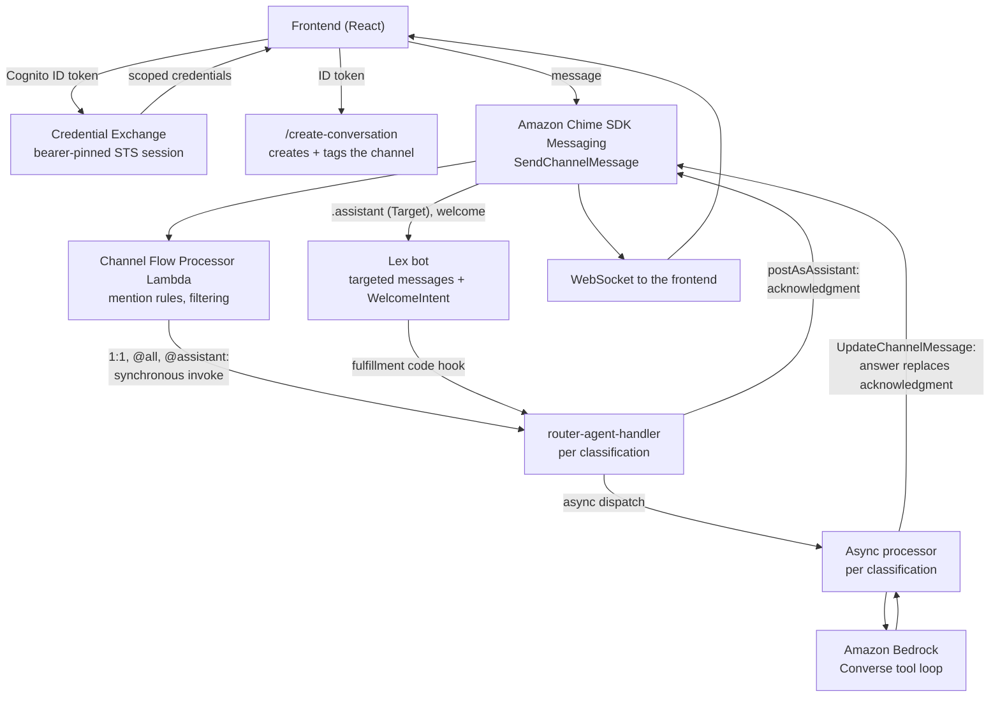

# Amazon Chime SDK Integration

## Overview

The frontend talks to AWS through Amazon Chime SDK Messaging. A user authenticates with Cognito, exchanges the ID token at the backend **Credential Exchange** for short-lived, bearer-pinned AWS credentials, and uses those credentials to send messages, list conversations and receive real-time updates. Conversations are created by the backend (`/create-conversation`), not by the browser. Assistant responses are generated by Amazon Bedrock and delivered back into the channel as persistent messages.

## Components

### SDK dependencies

- `@aws-sdk/client-chime-sdk-messaging` - channel/message operations (`chat`, `admin`, `shared` and `widget` packages)
- `amazon-chime-sdk-js` - the messaging WebSocket session (`chat` and `widget` packages)

No frontend package depends on `@aws-sdk/client-chime-sdk-identity`: identities are created and managed by the backend (below).

### Credential exchange

The browser never holds a wildcard Amazon Chime SDK grant. `ChimeService.initialize` in `frontend/packages/chat/src/services/chimeService.ts` builds its messaging client on `exchangeCredentialsProvider` (`frontend/packages/shared/src/services/credentialExchange.ts`), which POSTs the ID token to `POST /exchange-credentials` on the person API, `VITE_PERSON_API_URL`.

The backend (`backend/lambda/src/credential-exchange.ts`) takes identity from the edge authorizer's context (the registry issuer, the subject and the verified claims), never from the request body. It `AssumeRole`s the caller's per-classification exchange role with a `person` session tag carrying the caller's AppInstanceUser id, so the role's policy pins the `ChimeBearer` to `…/user/${aws:PrincipalTag/person}`: the caller can act only as their own `AppInstanceUser`. The classification is the IAM-evaluated boundary on that session. The same call creates the caller's `AppInstanceUser` on first sign-in (`mintOrResolvePerson` in `backend/lambda/src/lib/person-identity.ts`), then tags it with their classification in a separate best-effort `TagResource` call that repeats on every exchange (`classifyIdentity` and `tagIdentity` in `backend/lambda/src/lib/vend.ts`; the admin credential exchange uses `ensureAppInstanceUser` from the same file for an admin-plane identity). The person identity is therefore the one exception to the tag-in-the-create-call rule below: `CreateAppInstanceUser` with `Tags` also requires `chime:TagResource`, so coupling them would turn a missing tag permission into a failed exchange. A failed tag is logged and non-fatal, and the identity stays untagged until a later exchange tags it successfully (**OPEN**).

There is no other credential path: the backend creates no Identity Pool (`identity-stack.ts`), so `VITE_PERSON_API_URL` is required.

Full design: [SPEC-CREDENTIAL-EXCHANGE](../../specs/interaction/governance/SPEC-CREDENTIAL-EXCHANGE.md).

### Classification tags on the resources you create

Three kinds of Amazon Chime SDK resource carry a `classification` tag, and the access boundary is keyed on it. **If you add a call site that creates any of them, it tags - in the create call.**

| You create | Tag it with | Example |
|---|---|---|
| a channel (`CreateChannel`) | the conversation's classification | `Key=classification,Value=premium` |
| an assistant (`CreateAppInstanceBot`) | the classification it is assigned | `Key=classification,Value=premium` |
| a person (`CreateAppInstanceUser`) | the classification that person's groups resolve to | `Key=classification,Value=standard` |

The value is always one the deployment declares in `backend/lib/config/profiles.ts`. Resolve it - `defaultProfileRegistry.clearanceForGroups(groups)` for a person, the stack's own classification for an assistant - and never write a literal or infer one from a name or an ARN.

Three rules:

- **Tag in the create call, not in a `TagResource` after it.** A provision that dies between the two leaves a resource that is permanently unclassified. Use `TagResource` only to REPAIR resources that already exist - `AppInstanceBot`s and channels are RETAINed and never recreated, so the repair path is how an existing one gets classified.
- **Never infer a classification.** If you cannot resolve one, leave the tag off. An untagged resource is one every reader fails closed on; a wrongly-tagged one reads as authority it does not have. `AppInstanceBot` ARNs are UUIDs and carry no classification, so nothing about a resource's name or ARN is a source.
- **Read the tag, do not re-derive it.** `lib/channel-classification.ts` is the single fail-closed reader for channels; `list-tags-for-resource` is the read for an identity. One source per question: a per-consumer derivation from Cognito groups, an SSM path or an env var gives the same question several answers.

New call sites are ratcheted: `backend/test/single-entry-point.test.ts` fails CI on a new channel-creation or membership path until it is registered with a reason, and `backend/test/lib/an-assistant-is-assigned-one-classification.test.ts` pins where each classification value comes from. The `identity-classification` e2e phase then checks the live deployment, because a tag is either on the resource or it is not.

Full schema, IAM conditions and the fail-closed rules: [SPEC-CONVERSATION-SECURITY](../../specs/interaction/governance/SPEC-CONVERSATION-SECURITY.md). These are **not** the cost-allocation tags (`Project`, `Instance`, …), which are applied once at the app root - see [TAGGING.md](../admin/TAGGING.md).

### Environment configuration

Each frontend package has its own generated `.env`: `node scripts/gen-frontend-env.mjs` (run from `backend/`, and run by `npm run deploy`) writes `frontend/packages/chat/.env` and `frontend/packages/admin/.env` from the CDK stack outputs - App Instance ARN, User Pool ID and Client ID, and the API URLs. There is no Identity Pool ID and no separate exchange URL: the Credential Exchange is `POST /exchange-credentials` on `VITE_PERSON_API_URL`. See `frontend/packages/chat/.env.example` and `frontend/packages/admin/.env.example` for the full lists. There is no root `frontend/.env`.

### Amazon Chime SDK service layer

`frontend/packages/chat/src/services/chimeService.ts` wraps the SDK:

- **Initialize** - builds the messaging client on Credential Exchange credentials and takes the caller's `AppInstanceUser` ARN from the `userArn` the exchange returns
- **Create Conversation** - POSTs to `POST /create-conversation` on the person API (`VITE_PERSON_API_URL`) with the ID token; the backend creates and tags the channel and adds the assistant in the same request
- **List Conversations** - fetches the user's channels
- **Send Message** - posts messages to channels
- **List Messages** - retrieves channel message history
- **Members and moderation** - lists members and moderators, renames, marks read, removes members

The frontend does not create `AppInstanceUser`s. The Credential Exchange creates a person's identity on first sign-in, and the admin user-management API (`backend/lambda/src/user-management.ts`) manages it afterwards.

### Auth integration

`AuthProvider.tsx` (`frontend/packages/shared/src/providers/`) exposes the Cognito `idToken` on its context. The token is retrieved on login, cleared on logout, and consumed by the client/messaging providers to initialize the Amazon Chime SDK.

### Conversation & messaging providers

The provider hierarchy is `AuthProvider → AwsClientProvider → MessagingProvider → ConversationProvider`. `MessagingProvider` owns the Amazon Chime SDK WebSocket session; `ConversationProvider` handles conversation and message state. When a conversation is created, `createConversation` in `ConversationProvider.chime.tsx` sends the classification the person chose in `NewConversationModal.tsx` as `modelTier`, never inferred from the model id; the options are the deployment's declared classifications the person may create (`deploymentClassifications`, `creatableClassifications`), and `/create-conversation` refuses a missing `modelTier` and a classification the caller is not cleared for.

## Real-time messaging

New messages arrive over an Amazon Chime SDK Messaging WebSocket session managed by `MessagingProvider`. On visibility-stale reconnects the provider refreshes credentials before re-opening the socket so the handshake uses fresh credentials.

## Architecture

The ordinary turn, simplified. [MESSAGE-FLOW.md](MESSAGE-FLOW.md) is the authority for every branch, payload and ordering detail.



- The **channel flow** sees every message first. For a 1:1 message, or `@all` / `@<assistant>` in a group, it invokes the classification's agent handler synchronously with the message id declared.
- **Amazon Lex** is a trigger only: under `StandardMessages: NONE` it runs for a message `Target`-ed at the assistant and for `WelcomeIntent`. Its fulfillment code hook invokes the same `router-agent-handler.ts`.
- The **agent handler** classifies the request, dispatches the asynchronous processor, then posts the acknowledgment as the assistant.
- The **asynchronous processor** runs the self-hosted Converse tool loop on Bedrock (no Bedrock Agent) and replaces the acknowledgment in place with `UpdateChannelMessage`; long replies split into linked continuation messages.

## Aurora Analytics Mode (optional)

The default analytics pipeline uses Kinesis → Firehose → S3 → Athena. For advanced features, an optional Aurora PostgreSQL mode provides:

- **Multi-turn flow evaluation** - Groups exchanges by task ID, scores holistically across 5 weighted dimensions
- **Drift detection** - Detects when conversations shift from their stated purpose using LLM + SQL comparison
- **Cross-conversation context** - Finds related prior conversations for a user via topic matching / pgvector
- **Flagged response review** - Admin review queue with approve/reject workflow
- **Ground truth calibration** - Human scoring alongside automated evaluation, with MAE and agreement metrics
- **Task completion tracking** - Lifecycle metrics per task type (completion rate, duration, abandonment)
- **Conversation summaries** - Auto-generated purpose, topics, key points with versioning

Choose it on the first deploy by setting `analyticsMode` to `aurora` in the gitignored `backend/deploy.config.json` (see `backend/deploy.config.example.json`), then:

```bash
cd backend && npm run deploy
```

An existing deployment cannot switch modes: `npm run deploy` refuses a deploy that asks for the other mode, so changing modes means a teardown and a fresh deploy (see [Switching modes](../admin/AURORA-MODE-GUIDE.md#switching-modes)).

Live drift and Aurora RAG additionally need `enableLiveDrift: true` in the same file.

The admin dashboard shows the Aurora-only tabs (Effectiveness, Flagged, Ground Truth, Alerts; `AURORA_TAB_IDS` in `frontend/packages/admin/src/components/admin/AdminDashboard.tsx`) when Aurora mode is detected, and hides the Athena-only Evaluations tab. Battles are read on their experiment's page under Experiments, whose results and battles are queried from Aurora (`experiment_results`, `battle_results`), so they need Aurora mode. Multi-turn flow scoring and per-step tool detail are folded into the Effectiveness drill-down rather than standalone tabs. See [SPEC-AURORA-VPC-MODE.md](../../specs/foundations/SPEC-AURORA-VPC-MODE.md) for full architecture details.

## Resources

- **Amazon Chime SDK Messaging Docs**: https://docs.aws.amazon.com/chime-sdk/latest/dg/using-the-messaging-sdk.html
- **AWS SDK for JavaScript v3**: https://docs.aws.amazon.com/AWSJavaScriptSDK/v3/latest/
- **Bedrock Runtime API**: https://docs.aws.amazon.com/bedrock/latest/APIReference/welcome.html
- **Message flow**: [MESSAGE-FLOW.md](MESSAGE-FLOW.md) for every step a message passes through
- **Credential Exchange**: [SPEC-CREDENTIAL-EXCHANGE.md](../../specs/interaction/governance/SPEC-CREDENTIAL-EXCHANGE.md)
- **Aurora Mode Spec**: [SPEC-AURORA-VPC-MODE.md](../../specs/foundations/SPEC-AURORA-VPC-MODE.md) for VPC, Aurora cluster, drift detection, evaluation pipeline
- **Architecture**: [ARCHITECTURE.md](../../overview/ARCHITECTURE.md) for all flows end-to-end and stack dependencies

## Support

For issues or questions:
1. Check backend CloudWatch logs for Lambda errors
2. Review browser console for frontend errors
3. Verify the generated per-package `.env` files are present and current
4. Confirm AWS resources are deployed successfully
