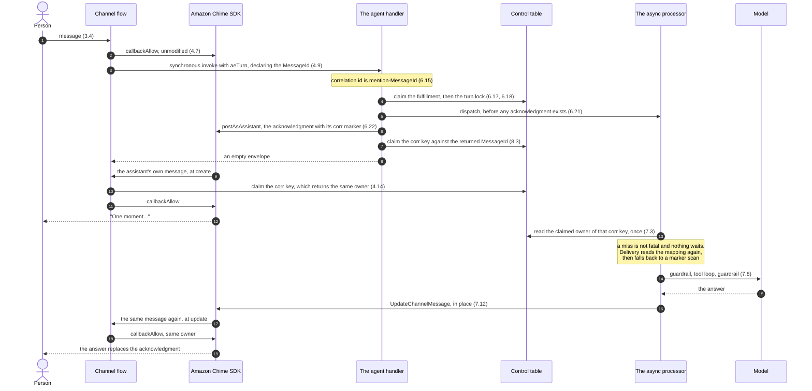
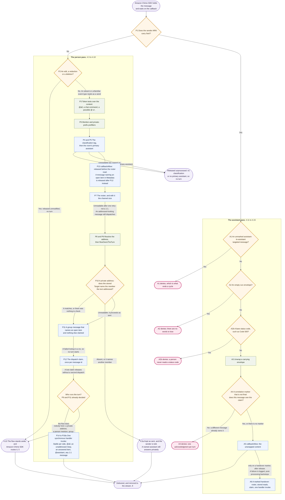
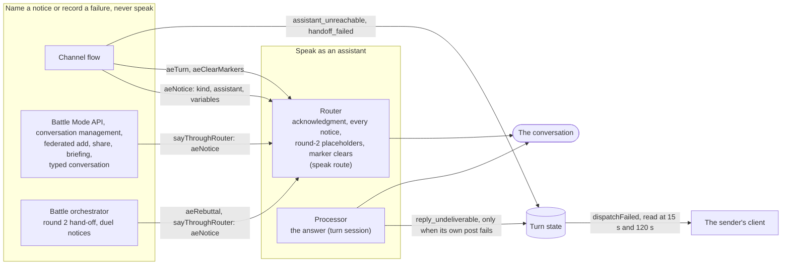
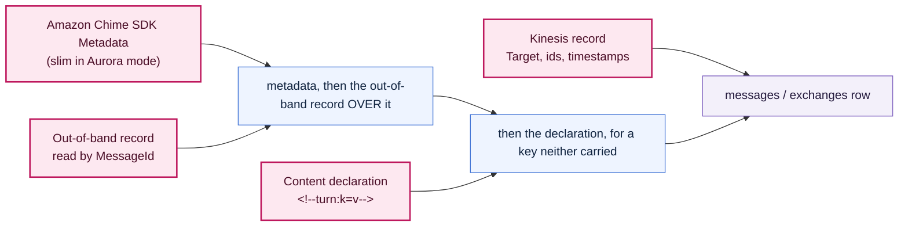
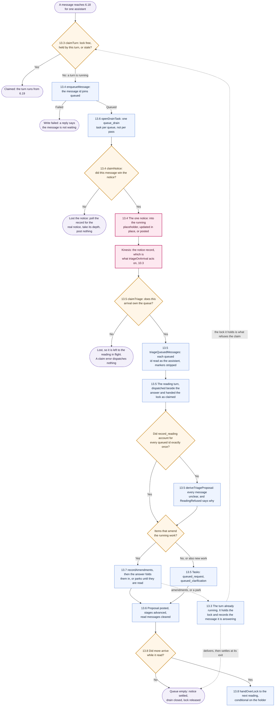
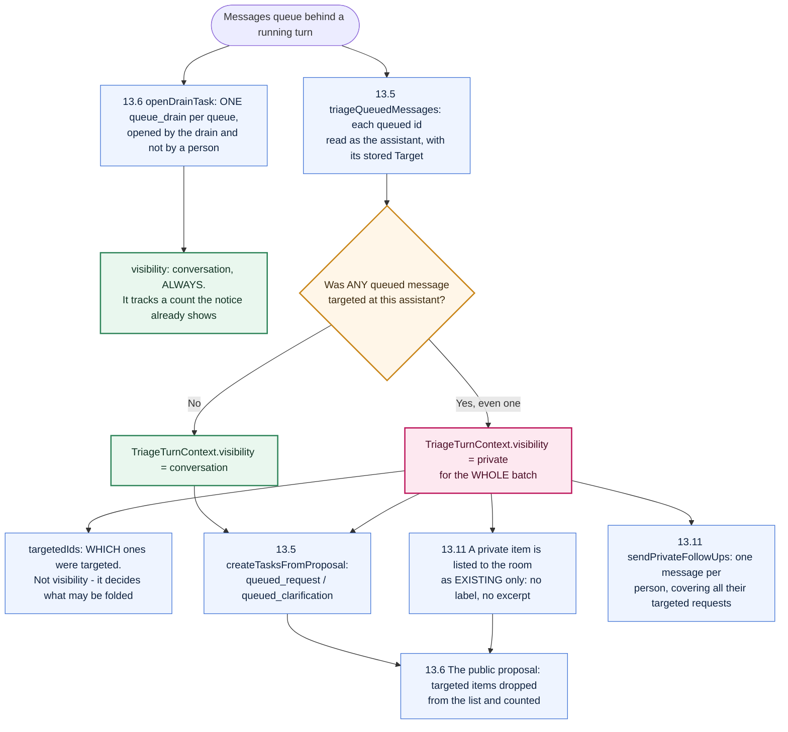
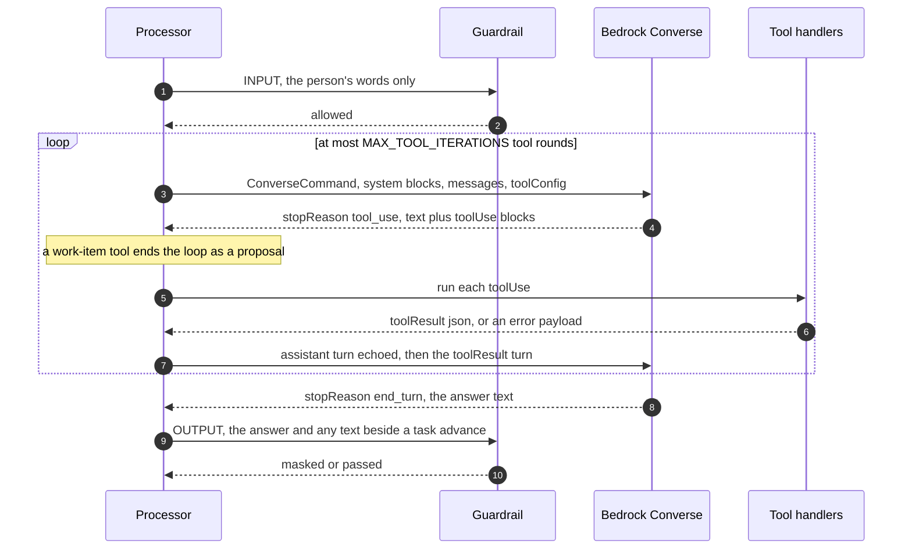

# Message flow

> **The interaction-layer / harness reference.** This traces a message from the composer to the moment an assistant's reply lands back in the conversation, and on into the stream, post-processing and the archive. Section 2 draws the whole path and lists every flow a message can take. Sections 3 to 11 then document each numbered step, one component at a time, and say *why* each step sits where it does. Section 12 maps control and measurement onto the path. Two sections then cut across it: §13 follows a message that arrives while an assistant is answering (the turn lock, the queue, the reading, `/stop`), and §14 opens the async processor to show exactly what reaches the Bedrock Converse call and how the tool loop runs. For how a reply is sized and chunked onto Amazon Chime SDK, see [`MESSAGE-DELIVERY-GUIDE.md`](MESSAGE-DELIVERY-GUIDE.md); for the security layers named here, [`IDENTITY-AND-ACCESS-MODEL.md`](../../specs/interaction/governance/IDENTITY-AND-ACCESS-MODEL.md) §6b; for model selection, [`SPEC-CONTEXT-AWARE-MODEL-ROUTING.md`](../../specs/interaction/assistants/SPEC-CONTEXT-AWARE-MODEL-ROUTING.md).

AgentEchelon is a **multiparty** substrate: people and assistants share Amazon Chime SDK channels. The path below is what lets a channel be a plain human-to-human room, a 1:1 conversation with an assistant, or a mixed room where an assistant answers only when addressed, all with the same primitives and differing only in assistant configuration and in who is addressed. The path does not rely on the web client to ensure messages follow the routing rules: every routing decision that matters is re-made server-side, so other ingresses (email, SMS) follow the same path.

**The addressing model** - what `@` means, what `.` means, and which component routes each - is decided in [ADR-034](../../design/decisions/034-addressing-a-message-is-not-making-it-private.md) and is implemented on all three sides: the composer resolves both tokens and sets a `Target` for `.` only (§3.3), the channel flow resolves every `@` against the conversation's members and routes it (§4.5, §4.9), and the agent handler stays silent for exactly the messages the flow answers (§6.2). Unit tests cover both sides of that seam (`flow-bypass.test.ts`, `a-flow-entry-profile-owns-its-one-to-one-turn.test.ts`). Items not built are marked **NOT BUILT**, planned ones **ROADMAP** and known gaps **OPEN**.

---

## 1. Assumptions

> **Specs and decisions:** [ADR-036](../../design/decisions/036-why-turns-enter-through-amazon-lex.md) (why a turn enters through Amazon Lex, and which turns do not), [ADR-011](../../design/decisions/011-agent-routing-mechanism.md) (Amazon Chime SDK Messaging as the fixed transport), [HOW-TO-ADD-OR-MANAGE-A-PROFILE](HOW-TO-ADD-OR-MANAGE-A-PROFILE.md)

An assistant is not a special channel feature. Assistants are first-party members of the channel, using the `AppInstanceBot` feature of Amazon Chime SDK. AgentEchelon uses that service's routing to trigger assistant turns through Lex (where Lex is a passthrough), and adds its own routes that reach the AgentEchelon turn directly.

**Supported configuration.** Everything below describes it, with the channel flow as the entry for every standard message:

- `StandardMessages: NONE` and `TargetedMessages: ALL` on every assistant's `AppInstanceBot`, as an unconditional project invariant (`assistantBotConfiguration` in `lib/assistant-identity.ts`, used by the provisioner's one build path, `buildIdentity` in `lib/assistant-provisioner.ts`). Amazon Chime SDK turns **no** untargeted message into an Amazon Lex turn, so the channel flow starts every one of them (§4), and Amazon Lex carries only a targeted message and the welcome (§5). There is no per-profile setting that selects another entry; [Appendix C](#appendix-c-why-standardmessages-is-none) says why.

  `StandardMessages` also takes `ALL`, `MENTIONS` and `AUTO`, and `TargetedMessages` also takes `NONE`; each changes which messages reach Amazon Lex. **Both cannot be `NONE` at once**: `CreateAppInstanceBot` refuses an all-`NONE` `InvokedBy` with `BadRequestException: Either RespondsTo or InvokedBy must be set`, with and without a `WelcomeIntent`, so the service reads it as absent (measured across eight combinations, [ADR-041](../../design/decisions/041-simplifying-how-a-message-reaches-an-assistant.md)). Nothing in the SDK types, the botocore service model or the public API reference expresses this. `WelcomeIntent` still fires under `StandardMessages: NONE`, and the deployed assistants carry `NONE`/`ALL` (both verified 2026-10-11 on the default instance, [ADR-036, Recorded evidence](../../design/decisions/036-why-turns-enter-through-amazon-lex.md#recorded-evidence)).
- A classification-matched assistant is bound at channel creation, and the channel's `primaryAssistant` tag names the room's PRIMARY assistant (`primaryAssistantOf`, `lib/conversation-primary.ts`). It is not the only one that can be there: a duel adds alt assistants, so "which assistants are in this room" is a per-channel fact and not a property of the classification.
- The assistant's Lex bot has a `WelcomeIntent` (fires on join) and a `FallbackIntent` (carries every targeted user turn), both with a fulfillment code hook pointing at that classification's agent handler.

**Out of scope.** How assistants are configured lives in [`HOW-TO-ADD-OR-MANAGE-A-PROFILE.md`](HOW-TO-ADD-OR-MANAGE-A-PROFILE.md): the wiring layers, the `InvokedBy` switch, the ordering rule when adding an assistant to a channel, and per-use-case configurations.

**Component names.** One name per component, and it is the name in the code. Every canonical name is greppable: it matches the file, and where the deployed construct differs, that is named too.

| Component               | File                                                                                                                                                                | Also called, in code and logs                                                                                                                                                                                                                                     |
| ----------------------- | ------------------------------------------------------------------------------------------------------------------------------------------------------------------- | ----------------------------------------------------------------------------------------------------------------------------------------------------------------------------------------------------------------------------------------------------------------- |
| **the client**          | `frontend/packages/chat` (`MessageInput.tsx`, `ConversationProvider.chime.tsx`, `services/chimeService.ts`)                                                         | "the composer" for the send half                                                                                                                                                                                                                                  |
| **the channel flow**    | `channel-flow-processor.ts`, deployed by `channel-flow-stack.ts`                                                                                                    | "Channel Flow Processor" is the Amazon Chime SDK concept; "the flow" in running prose                                                                                                                                                                             |
| **the agent handler**   | `router-agent-handler.ts`, deployed as the CDK construct `AgentHandler`                                                                                             | "router", "fulfillment handler", "Lex dialog code hook". Each describes one ENTRY into it rather than the component: it routes, but it also classifies, claims and dispatches. **The agent handler decides that a turn happens; the async processor answers it.** |
| **the async processor** | `assistant-async-processor.ts`, `lib/async-processor-core.ts`                                                                                                       | "the worker", which survives in test helpers and in the admin console's "Worker compute" card                                                                                                                                                                     |
| **post-processing**     | `message-post-processing.ts`, deployed by `post-processing-stack.ts`                                                                                                | the stream consumer that acts where delivery did not route, and that carries the out-of-band transports                                                                                                                                                           |
| **archival**            | `analytics-aurora/kinesis-archival.ts` (Aurora projection), the Firehose archive (`archive-stack.ts`, or `lib/constructs/conversation-archive.ts` in Aurora mode) | "the projection", "the archive"                                                                                                                                                                                                                                   |

**How to read the step numbers.** A step's number is the section that documents it: step 4.7 is §4.7. A letter marks an outcome of that step, so 6.16a is what happens when the check in 6.16 matches. The diagram in §2.1 carries the same numbers.

---

## 2. The message flow

> **Specs and decisions:** [ADR-022](../../design/decisions/022-message-identity-is-established-at-the-channel-flow.md), [ADR-025](../../design/decisions/025-who-posts-the-placeholder.md), [ADR-034](../../design/decisions/034-addressing-a-message-is-not-making-it-private.md), [ADR-036](../../design/decisions/036-why-turns-enter-through-amazon-lex.md)

### 2.1 The full flow

Every message, whoever sends it, crosses the same stages in the same order: the client sends it (§3), the channel flow gates it (§4), Amazon Chime SDK delivers and routes it (§5), and it is mirrored to the stream (§9), where post-processing (§10) and archival (§11) read it. A message that becomes an assistant turn additionally passes through the agent handler (§6) and the async processor (§7), and the messages the turn produces go around the loop again as assistant-authored messages (§8).

```mermaid
flowchart TD
    classDef client fill:#f0f4ec,stroke:#5a7a3a,stroke-width:1px,color:#1d2a12
    classDef ae fill:#eef4ff,stroke:#3b6fd4,stroke-width:1px,color:#10233f
    classDef decide fill:#fff6e8,stroke:#c98518,stroke-width:2px,color:#3f2c10
    classDef svc fill:#f2f7f2,stroke:#6b8f6b,stroke-width:1px,color:#1e2e1e
    classDef svcdecide fill:#eaf7ee,stroke:#2e8b52,stroke-width:2px,color:#0f2e1c
    classDef msg fill:#fde8f0,stroke:#be185d,stroke-width:2px,color:#4a0d26
    classDef outcome fill:#f3f0fa,stroke:#7a5bbd,stroke-width:1px,color:#241a3d

    %% ACYCLIC ON PURPOSE. Every loop back to an earlier stage is drawn as a terminal node that names
    %% the step it re-enters at, because a real back-edge makes the layout rank later stages above
    %% earlier ones and the picture stops reading top to bottom.

    P(["<b>A PERSON SENDS A MESSAGE</b><br/>an assistant's own messages: see 8"])

    subgraph CL["<b>3. The client</b>"]
      direction TB
      C1["3.1 Upload any attachment"]
      C2["3.2 Resolve tokens: /md, @, ., @all"]
      C3["3.3 Choose addressing:<br/>Target for . only, mentions for @"]
      C4["3.4 SendChannelMessage<br/>IAM checks the channel's classification tag"]
    end

    subgraph FL["<b>4. The channel flow</b> - synchronous, before delivery"]
      direction TB
      F3{"4.3 An edit, redaction<br/>or deletion?"}
      F4["4.4 Detect tokens, read the classification tag<br/>and the primary assistant"]
      F7["4.7 callbackAllow: released, before the roster read<br/>(after 4.6 when Metadata names an item)"]
      F5["4.4 and 4.5 Read the roster, resolve the address:<br/>does the flow answer, or leave it to a targeted Lex entry?"]
      F6["4.6 Bypass claim,<br/>only for a dispatching shape"]
      SH{"Who answers, from 4.5"}
      F8["4.8 /battle: gates, abuse gate,<br/>one handler invoke per assistant"]
      F9["4.9 Any 1:1 message, or in a group @all,<br/>@assistant or unaddressed /stop:<br/>invoke the agent handler"]
      F10["4.10 No dispatch from the flow:<br/>.member, @person, group chatter"]
    end

    subgraph RT["<b>5. Amazon Chime SDK routing</b> - after release"]
      direction TB
      R1{"5.1 Sent by an<br/>AppInstanceBot?"}
      R2{"5.2 Target names<br/>this assistant?"}
      R5["5.5 Lex fulfillment"]
    end
    R4(["5.4 No assistant turn here.<br/>Delivered and streamed"])

    subgraph AH["<b>6. The agent handler</b> - router-agent-handler.ts"]
      direction TB
      H1["6.1 Entry: Lex, flow bypass,<br/>handover, repair, reading"]
      H2{"6.2 Lex entry, but the flow<br/>is already answering?"}
      H3["6.3 to 6.9 Identity, classification, welcome,<br/>prepare the message, profile, classify"]
      H10{"6.10 Answers work another<br/>assistant owns?"}
      H12{"6.12 Drifted?"}
      H16{"6.16 A quick response?"}
      H17{"6.17 Fulfillment<br/>claim won?"}
      H18{"6.18 Turn lock free?"}
      H19{"6.19 Abuse gate:<br/>within rate and budget?"}
      H21["6.20 and 6.21 Prepare and<br/>dispatch the async processor"]
      ACK["6.22 <b>Message sent</b>: the acknowledgment.<br/>Ends TTFF"]
    end

    STAND(["6.2a Stay silent, so the message<br/>is not answered twice"])
    HAND(["6.10a Receipt, then the owning assistant's<br/>handler runs the turn from 6.1"])
    DRIFT["6.12a <b>Message sent</b>: drift suggestion"]
    DIRECT["6.16a <b>Message sent</b>: the direct answer, final"]
    REPLAY(["6.17a Replay the same acknowledgment,<br/>no work done"])
    NOTICE["6.18a <b>Message sent or updated</b>:<br/>queued, one deferral notice"]
    REFUSE["6.19a <b>Message sent</b>: refusal, nothing dispatched"]

    subgraph AP["<b>7. The async processor</b> - dispatched before 6.22, runs in parallel"]
      direction TB
      A1["7.1 to 7.3 Dedup claim, task in progress,<br/>find the acknowledgment"]
      A4["7.4 to 7.7 History, system prompt,<br/>model, task tools"]
      A8["7.8 Input guardrail, tool loop,<br/>output guardrail"]
      A9{"7.9 Acknowledgment<br/>resolved?"}
      A10["7.10 and 7.11 Plan delivery, post chunks,<br/>write the analytics record"]
      UPD["7.12 <b>Message updated</b>: the answer replaces<br/>the acknowledgment. Ends E2E"]
      AFTER["7.13 Task status, release or hand over the lock"]
    end
    FAIL(["7.9a Task failed, nothing posted"])

    RE["<b>8. Every message a turn sends or updates</b><br/>re-enters the flow's assistant pass, 4.11 to 4.15:<br/>loop guard, empty-envelope and status-code deny,<br/>unwrap, placeholder claim, release.<br/>Then 5.1, which invokes nothing"]

    K["<b>9. Kinesis stream</b><br/>every Channel and ChannelMessage event"]
    PP["10.1 Post-processing"]
    REP(["10.2 Task-answer repair:<br/>a turn nobody routed, from 6.1"])
    TRI(["10.3 Triage on arrival:<br/>a reading turn, from 6.1"])
    AUR["11.1 Aurora projection<br/>Aurora mode only"]
    S3A["11.2 Conversation archive, S3<br/>the system of record"]

    P --> C1
    C1 --> C2
    C2 --> C3
    C3 --> C4
    C4 --> F3
    F3 -->|"No"| F4
    F3 -->|"Yes: released unmodified, no turn"| R1
    F4 --> F7
    F7 --> F5
    F5 --> F6
    F6 --> SH
    SH -->|"/battle, any size"| F8
    SH -->|"a 1:1, or @all, @assistant, unaddressed /stop in a group"| F9
    SH -->|"anything else"| F10
    F10 --> R1
    F8 --> H1
    F9 --> H1
    R1 -->|"Yes: invokes nothing, always"| R4
    R1 -->|"No"| R2
    R2 -->|"Yes: TargetedMessages ALL"| R5
    R2 -->|"No: StandardMessages NONE"| R4
    R5 --> H1

    H1 --> H2
    H2 -->|"Yes"| STAND
    H2 -->|"No"| H3
    H3 --> H10
    H10 -->|"Yes"| HAND
    H10 -->|"No"| H12
    H12 -->|"Yes, not suppressed"| DRIFT
    H12 -->|"No"| H16
    H16 -->|"Yes"| DIRECT
    H16 -->|"No"| H17
    H17 -->|"No"| REPLAY
    H17 -->|"Yes"| H18
    H18 -->|"No: a turn is running"| NOTICE
    H18 -->|"Yes"| H19
    H19 -->|"No"| REFUSE
    H19 -->|"Yes"| H21
    H21 --> ACK
    H21 -.->|"dispatched FIRST"| A1

    A1 --> A4
    A4 --> A8
    A8 --> A9
    A9 -->|"No"| FAIL
    A9 -->|"Yes"| A10
    A10 --> UPD
    UPD --> AFTER

    ACK --> RE
    DIRECT --> RE
    DRIFT --> RE
    NOTICE --> RE
    REFUSE --> RE
    UPD --> RE

    RE --> K
    R4 --> K
    K --> PP
    PP --> REP
    PP --> TRI
    K --> AUR
    K --> S3A

    class C1,C2,C3,C4 client
    class F4,F5,F6,F7,F8,F9,F10,H1,H3,H21,A1,A4,A8,A10,AFTER,RE,PP,AUR,S3A ae
    class F3,SH,H2,H10,H12,H16,H17,H18,H19,A9 decide
    class R5,K svc
    class R1,R2 svcdecide
    class ACK,DIRECT,DRIFT,NOTICE,REFUSE,UPD msg
    class P,R4,STAND,HAND,REPLAY,FAIL,REP,TRI outcome
```



**What the diagram shows.**

- **Release first.** Every message is released before anything routes it. The flow calls `callbackAllow` at 4.7 and only then dispatches (4.8, 4.9), so a bypass decides who RUNS the turn, never whether the message reaches the conversation. The released message also goes through Amazon Chime SDK's own routing (5.1 to 5.5) like any other; for an untargeted message that routing invokes nothing, and for a targeted one the flow stands aside and the Lex entry answers.
- **Second pass.** Every message a turn produces goes back through the flow. The acknowledgment, the answer, a notice, a suggestion: each is an assistant-authored channel message, so each crosses the flow's assistant pass (4.11 to 4.15), reaches 5.1 (which invokes nothing for an assistant's message), and is mirrored to the stream. The diagram draws that return as one node (8) rather than as edges back to the top, and draws each loop back into the handler (6.10a, 10.2, 10.3) as a node naming the step it re-enters at, so the picture reads top to bottom. The stream is not an ending: post-processing can start a turn that routing did not.
- **Dispatch before acknowledgment.** The async processor is dispatched before the acknowledgment exists (6.21 before 6.22), which is why the answer has to find its message by correlation (§8) rather than being handed a message id.

### 2.2 Flows by step

Each row is one flow, written as the steps it passes through. Steps in parentheses are skipped or pass through without effect on that flow. §8 applies to every flow that produces a message; §9 to §11 apply to every message.

| Flow | Trigger | Steps |
|---|---|---|
| **Ordinary 1:1 turn** | a person writes in a conversation with one assistant | 3.1-3.4, 4.1-4.7, 4.9 (the flow dispatches it to the primary assistant), 6.1-6.21, 6.22 (the handler posts the acknowledgment as the assistant, `postAsAssistant`), 7.1-7.13, then 4.11-4.15 twice (create, then update) |
| **Direct answer** | a 1:1 greeting or acknowledgment on the quick-response list | as above to 6.16, then 6.16a. No claim, no lock, no processor, no update |
| **`@<assistant>` in a group** | `@Atlas what is ...` in a room with two or more other members | 3.1-3.4 (no `Target`), 4.1-4.7, 4.9, 6.1, (6.2 silences any Lex entry for the same message), 6.3-6.21, 6.22 (the handler posts as the assistant), 7.1-7.13 |
| **`@all` in a group** | `@all ...` with two or more other members | as `@<assistant>`, dispatched to the classification's handler (4.9) |
| **`@all` in a 1:1** | typed by hand; the composer does not offer it | 4.5 rule 3 claims it, because nothing else is invoked at that size; the flow dispatches and no Amazon Lex leg runs |
| **`/battle`** | `/battle <prompt>` at the start of a message | 3.1-3.4, 4.1-4.8 (one handler invoke per assistant member, each declaring a battle context), then each side runs 6.1-6.22 and 7.1-7.13 as its own turn. Round 2 is fired later by `battle-orchestrator.ts` straight to the processor (§6.1) |
| **`/stop` in a group** | `/stop` as the whole message, unaddressed or `@<assistant> /stop`, sent to the room | 3.1-3.4, 4.1-4.7, 4.9 (a flow-owned room command in `CHAT_COMMANDS`, dispatched to the primary assistant, or to the assistant it names), 6.1, 6.3-6.11. The stop is acknowledged to the room and a stop-evaluation turn asks how to proceed (§13.10) |
| **`/stop` in a 1:1** | `/stop` as the whole message | 3.1-3.4, 4.1-4.7, 4.9 (the flow claims it: `/stop` is size-branched, so the unconditional 1:1 return above it applies), 6.1-6.11 |
| **`/stop` sent privately in a group** | `/stop` with a `Target` | 3.3 sets `Target`, 4.1-4.7 (a copy the flow dispatches stands down on reading the stored `Target`), 5.2, 5.5, 6.1-6.11, where it is refused with `stopMustBePublic`, sent only to the sender, and nothing is stopped (§13.10) |
| **`.<member>` to an assistant** | `.Atlas ...`, private | 3.3 sets `Target`, 4.1-4.7, 4.10, 5.2, 5.5, 6.1-6.22 (6.7 strips the address before the model sees it), 7.1-7.13 |
| **`.<member>` to a person, or unaddressed chatter in a group** | a private word, or a message nobody addressed | 3.1-3.4, 4.1-4.7, 4.10, 5.1-5.4. No turn |
| **`@<person>`** | naming a person in a group | 3.3 puts the person in `CHIME.mentions`, which is how they are notified; 4.9 resolves a person, logs, and dispatches nothing. No turn |
| **Answering a work item** | a reply the composer ties to an open item | 3.3 sets `Target` (private item) or the mention attribute (shared item) and `Metadata.task.id`. A private item is routed at 5.2; a shared one is dispatched by the flow (4.9: the open-item check in a group, the ordinary turn in a 1:1). If nothing routed it, it is repaired at 10.2 and re-entered at 6.1 |
| **Answering work another assistant owns** | the reply reaches assistant A, the task belongs to B | 6.1-6.10, 6.10a (receipt from A), then B's handler from 6.1 with `trigger: 'handover'` |
| **A turn already running** | a second message before the first is answered | 6.1-6.17, 6.18a (enqueue, one deferral notice). The notice reaches the stream, 10.3 dispatches a reading turn, which runs 6.1-6.21 and 7.1-7.13 as a reading and turns queued messages into tasks (10.4) |
| **Drift** | the message changes subject, with no work in flight | 6.1-6.12, 6.12a |
| **Over limit** | rate or spend budget exhausted | 6.1-6.18, 6.19a |
| **Assistant added to a channel** | `WelcomeIntent` | 5.5, 6.1-6.5 (the welcome, or the once-per-user onboarding intake), then the welcome re-enters as an assistant message |
| **An edit** | a person edits a sent message | 4.3 releases it unmodified; no turn |
| **An assistant's own message** | any message the deployment posts | 4.11-4.15, 5.1 (invokes nothing), §9-§11 |

### 2.3 The ordinary turn

The common case, a 1:1 message, with the two things a reader most often gets wrong drawn explicitly: the async processor is dispatched **before** the acknowledgment exists, and the channel flow is invoked twice for the same assistant message, once at create and once at update.



### 2.4 What the person sees

Most of the path is invisible to the person: a claim, a dispatch, a resolution. The diagram marks the only nodes that change the transcript as **Message sent** or **Message updated**, and a turn produces one or two of them.

| Moment | What appears | The measurement it ends |
|---|---|---|
| The acknowledgment is materialized (6.22) | "One moment..." in the transcript | **TTFF** - the only signal before the answer, since nothing streams |
| The answer replaces it (7.12) | the same message, rewritten in place under the same id, which is why a reply appears to change rather than arrive | **E2E** - the person's whole wait |
| A direct answer is materialized (6.16a) | one message, and no second event | TTFF and E2E are the same instant |
| A notice or a drift suggestion is posted (6.12a, 6.18a, 6.19a) | a message that is not an answer: the queue's deferral notice, updated in place, a refusal, or a drift offer | neither. A deferral is measured by when the queue was acknowledged |

**Tasks.** A task is not one of them, and it has no stream event either. Work items are created without anything appearing in the transcript: they show in the person's work-item list and as a chip on the message that opened them. The stream carries `Channel` and `ChannelMessage` events, and a task is a row in its own store, so nothing about its creation reaches Kinesis. A queued burst can produce real, owned work whose only in-conversation trace is the single deferral notice, which is why that notice exists and why it is updated rather than repeated.

### 2.5 Endings and numbers

| Ending | Second event | Telemetry lands on | Pairs into an exchange |
|---|---|---|---|
| answer over an acknowledgment | yes, an update | the update row, folded onto the create row (§11.3) | yes, and it declares its target |
| direct answer | none | the create row, which declares its own completion | yes, on the target it declares |
| drift suggestion | none | the create row, which declares its kind | no, and it says so rather than being excluded by an absence |
| deferral notice | updated in place | queue analytics, not the exchange population | yes when it is the answering turn's own displaced acknowledgment, no otherwise. See below |
| answer moved to a new message | the acknowledgment is closed out, the answer lands in a message of its own | the answer's update row for the compute, the acknowledgment's latest update for the attribution | yes, against the ACKNOWLEDGMENT, which is the earlier message and the one whose instant is the person's first feedback |

**Moved answers.** Three branches post the answer as a new message rather than writing it over the acknowledgment: a broadcast answer to a privately placed placeholder, a private answer to a public one, and an answer displaced to the end because its placeholder became the queue notice. In all three the acknowledgment is the earlier assistant message, so it is the one both pairers take. The close-out (`closeOutAcknowledgement`, or `settleQueueNotice` for the notice branch) carries `closeOutAttribution` onto it: the message this turn answers, the intent and its confidence, the delivery option, and the task id, so the receipt keeps the pairing and the attribution.

**Compute stays put.** Tokens, cost, model and the latency split stay on the message the answer landed in. A turn in this shape produces two assistant CREATE rows, and every token and cost figure is summed per message row, so stamping the compute twice would double it for exactly the turns that were queued or answered privately. The task TRANSITION and a terminal task status are excluded for the same reason in the ledger's terms: they are what `task_opened`, `task_transition` and `task_terminal` are read from, and a second copy would count one task movement twice.

### 2.6 Payloads

The shapes below are what actually crosses each boundary, written as JSON with illustrative values. Each names the TypeScript type that defines it, so the authoritative field list is one click away; optional fields that most turns do not carry are left out.

**1. The channel flow's callback event** - `ChannelFlowEvent` in [`channel-flow-processor.ts`](../../../backend/lambda/src/channel-flow-processor.ts). What Amazon Chime SDK hands the flow for every message, before delivery. It carries no `Target` (§4.1).

```json
{
  "CallbackId": "a1b2c3d4-...",
  "EventType": "CREATE_CHANNEL_MESSAGE",
  "ChannelMessage": {
    "MessageId": "7f3e9c1a-...",
    "Content": "%40Atlas%20what%20is%20the%20deploy%20order%3F",
    "Metadata": "{\"attachment\":{\"fileKey\":\"uploads/u1/plan.pdf\",\"contentType\":\"application/pdf\"}}",
    "Sender": { "Arn": "arn:aws:chime:us-east-1:111122223333:app-instance/abc/user/alice", "Name": "Alice" },
    "ChannelArn": "arn:aws:chime:us-east-1:111122223333:app-instance/abc/channel/c1"
  }
}
```

**2a. The agent handler, entered by Lex** - `LexEvent` in [`router-agent-handler.ts`](../../../backend/lambda/src/router-agent-handler.ts). Lex supplies the transcript (percent-encoded), its own session, and exactly three request attributes: no message id, no `Metadata`, no attachment.

```json
{
  "inputTranscript": "what%20is%20the%20deploy%20order%3F",
  "sessionId": "...",
  "sessionState": { "intent": { "name": "FallbackIntent" }, "sessionAttributes": {} },
  "requestAttributes": {
    "CHIME.channel.arn": "arn:aws:chime:us-east-1:111122223333:app-instance/abc/channel/c1",
    "CHIME.sender.arn": "arn:aws:chime:us-east-1:111122223333:app-instance/abc/user/alice",
    "x-amz-lex:channels:platform": "Amazon Chime SDK Messaging"
  }
}
```

**2b. The agent handler, entered by the channel flow** - `BypassTurnEvent` and `TurnRequest` in [`router-agent-handler.ts`](../../../backend/lambda/src/router-agent-handler.ts), sent by `invokeRouterTurn` in [`channel-flow-processor.ts`](../../../backend/lambda/src/channel-flow-processor.ts). The flow sends what Lex cannot: the inbound message id, whether the request was sent privately, and the attachment. The token is already stripped from the text.

```json
{
  "aeTurn": {
    "channelArn": "arn:aws:chime:us-east-1:111122223333:app-instance/abc/channel/c1",
    "senderArn": "arn:aws:chime:us-east-1:111122223333:app-instance/abc/user/alice",
    "userMessage": "what is the deploy order?",
    "userMessageId": "7f3e9c1a-...",
    "targeted": false,
    "attachment": { "fileKey": "uploads/u1/plan.pdf", "contentType": "application/pdf" }
  }
}
```

A `/battle` side adds `botArn`, `correlationId`, `trigger` and a `battleContext` (`BattleTurnContext`); a handover adds `trigger: "handover"` and `handedOverFrom`; a repair adds `trigger: "repair"` and `triggerAtMs`. `targeted` is `true` only for a message the person sent as targeted (`requestWasPrivate` in `channel-flow-processor.ts`), and the flow sends `false` on every other turn rather than omitting it, because an absent value reads as private (`task-visibility.ts`). It decides the visibility of the task the turn opens.

**2c. The same bypass, after the handler's first step** - `bypassToLexEvent` in [`router-agent-handler.ts`](../../../backend/lambda/src/router-agent-handler.ts). The payload is rewritten into the shape of 2a, with the extra fields as `AE.*` request attributes (`targeted` as `AE.turn.targeted`, the string `'1'` or `'0'`, so an absent value stays distinct from false), so the rest of the turn reads one shape whichever way it arrived (§6.1). There is no Lex session to carry: it is empty, and nothing the turn needs lives in one.

```json
{
  "inputTranscript": "what%20is%20the%20deploy%20order%3F",
  "sessionState": { "intent": { "name": "FallbackIntent" }, "sessionAttributes": {} },
  "requestAttributes": {
    "CHIME.channel.arn": "arn:aws:chime:us-east-1:111122223333:app-instance/abc/channel/c1",
    "CHIME.sender.arn": "arn:aws:chime:us-east-1:111122223333:app-instance/abc/user/alice",
    "AE.entry": "channel-flow",
    "AE.message.id": "7f3e9c1a-...",
    "AE.turn.targeted": "0",
    "AE.attachment": "{\"fileKey\":\"uploads/u1/plan.pdf\",\"contentType\":\"application/pdf\"}"
  }
}
```

**3. What the handler returns** - `LexResponse` in [`router-agent-handler.ts`](../../../backend/lambda/src/router-agent-handler.ts) (`formatLexResponse`). On the Lex path the acknowledgment is in `messages`, and Amazon Chime SDK materializes it as the assistant's message:

```json
{
  "sessionState": {
    "dialogAction": { "type": "Close" },
    "intent": { "name": "FallbackIntent", "state": "Fulfilled" },
    "sessionAttributes": {}
  },
  "messages": [{ "contentType": "PlainText", "content": "One moment... <!--corr:mention-7f3e9c1a-->" }]
}
```

On the flow path the handler has already posted the acknowledgment itself (`postAsAssistant`), so it returns the same envelope with `"messages": []`. A non-empty `messages` on that path means the post failed; the flow logs it and posts nothing, and the processor posts the answer as a new message (§8.1).

**4. The dispatch to the async processor** - `AsyncProcessorEvent` in [`async-processor-core.ts`](../../../backend/lambda/src/lib/async-processor-core.ts), sent as an `Event` invoke by `invokeAsync` in [`router-agent-handler.ts`](../../../backend/lambda/src/router-agent-handler.ts). An ordinary `PLACEHOLDER_UPDATE` turn:

```json
{
  "channelArn": "arn:aws:chime:us-east-1:111122223333:app-instance/abc/channel/c1",
  "correlationId": "mention-7f3e9c1a",
  "userMessage": "what is the deploy order?",
  "classification": "standard",
  "botArn": "arn:aws:chime:us-east-1:111122223333:app-instance/abc/bot/standard",
  "senderArn": "arn:aws:chime:us-east-1:111122223333:app-instance/abc/user/alice",
  "senderDisplayName": "Alice",
  "intent": "general",
  "intentConfidence": "high",
  "classifierMs": 412,
  "routerMs": 690,
  "deliveryOption": "PLACEHOLDER_UPDATE",
  "resolvedModel": "...",
  "intentPackVersion": "...",
  "attachment": { "fileKey": "uploads/u1/plan.pdf", "contentType": "application/pdf" }
}
```

A task-shaped turn adds `taskId`, `taskType`, `taskCreated` and `isTaskContinuation`; experiments add `experimentId` and `variantId`; a reading adds `triage`; a duel side adds its battle fields. The payload carries no reply visibility: the processor reads it back off the acknowledgment (§7.10).

**Lex versus bypass.** The two entries differ in what arrives and in who posts the acknowledgment. They do not differ in the turn: after 2c both run the same code and send the processor the same shape of payload.

| | Lex entry | Flow entry |
|---|---|---|
| Arrives as | `LexEvent` (2a) | `{ aeTurn: TurnRequest }` (2b), rewritten to 2c |
| Message id | none; the correlation id is derived (§8.2) | `AE.message.id`; the correlation id is `mention-<MessageId>` |
| Attachment | none: `Metadata` never reaches Lex | `AE.attachment` |
| The item the turn answers | none; read from the text, or ranked (§6.10-ref) | `AE.turn.answersTask`, when the message named it in `Metadata` (§4.9) |
| Acknowledgment | returned in `messages`; Amazon Chime SDK posts it | posted by the handler as the assistant; `messages` is empty |
| Dispatch to the processor | `AsyncProcessorEvent` (4) | the same |

---

## 3. The client

> **Code:** [`MessageInput.tsx`](../../../frontend/packages/chat/src/components/MessageInput.tsx) (`handleSubmit`), [`mentionParser.ts`](../../../frontend/packages/chat/src/utils/mentionParser.ts) (`parseMentions`), [`ConversationProvider.chime.tsx`](../../../frontend/packages/chat/src/providers/ConversationProvider.chime.tsx) (`sendMessage`), [`chimeService.ts`](../../../frontend/packages/chat/src/services/chimeService.ts) (`sendMessage`), [`messageLatencyTracker.ts`](../../../frontend/packages/chat/src/services/messageLatencyTracker.ts), [`credentialExchange.ts`](../../../frontend/packages/shared/src/services/credentialExchange.ts), [`credential-exchange.ts`](../../../backend/lambda/src/credential-exchange.ts)  
> **Specs and decisions:** [ADR-034](../../design/decisions/034-addressing-a-message-is-not-making-it-private.md), [SPEC-CHAT-APP](../../specs/interface/SPEC-CHAT-APP.md), [SPEC-CREDENTIAL-EXCHANGE](../../specs/interaction/governance/SPEC-CREDENTIAL-EXCHANGE.md)

The web client is one ingress, not the enforcement point. It resolves what a person typed into the fields Amazon Chime SDK understands, and every decision that matters is re-made server-side: the flow re-resolves `@` (§4.5), the handler re-resolves `.` (§6.7), and IAM decides whether the send is allowed at all (§3.4).

### 3.1 Upload any attachment

`MessageInput.tsx` `handleSubmit` uploads a staged file **first**, before any token is parsed (`services/attachmentService.ts`): a size and type check, a POST to the presign endpoint with the person's Cognito id token, then an S3 upload. The resulting reference rides the message's `Metadata`, which Lex never receives, so a bypass entry (§6.1) is the primary route by which a file reaches a turn.

### 3.2 Resolve tokens

In order: a `/md` prefix is lifted off, so it cannot distort routing, and put back on the sent text in its canonical spelling (the client decides Markdown rendering from it). It is not stripped server-side, so the model sees it; only `channel-title.ts` drops it, for naming; the sticky prefix from the last addressed member is added when the person has not typed their own `@`, `/` or `.`; then `parseMentions` (`utils/mentionParser.ts`) resolves the text against every channel member except the sender.

- **`@<name>`** matches any member by name, person or assistant, with a token boundary on both sides that mirrors the backend's `lib/flow-bypass.ts`. `@assistant` is only the default name.
- **`@all`** (or `@everyone`) addresses the room. The composer offers it only when the conversation has two or more human members.
- **`.Name`** followed by a space, or the bracketed `.<Full Name>` for a name with spaces, addresses one member privately, and applies only when it names a member **in full**. A token that resolves to nobody is ordinary public text, not an error. A token that resolves sets the `Target`. A message that resolves on the server but whose stored `Target` is absent, or names a different member, is kept, and the channel flow tells the sender (4.5a).
- **Validation errors block the send** and show inline: `@all` with a member, more than one person, more than one assistant, or a private prefix combined with an `@`.
- **`/stop`.** It is sent as ordinary text, and the client offers it nowhere. The composer neither completes it nor hints at it; the only trace of it in the frontend is a comment in `hooks/useTurnState.ts` explaining why the composer is never disabled (disabling it would remove the only way to send a stop). `/battle` has a composer hint in the members panel (`components/ChannelMembersPanel.tsx`) and `/stop` has no equivalent, so a person finds it only by being told. Everything that gives it meaning is server-side: the `CHAT_COMMANDS` registry recognizes it as the whole message (§4.4), the flow or the Lex entry routes it by conversation size and targeting (§4.5, §13.10), and the handler parses and runs it (§6.11).

A battle side waiting on this person bypasses all of this: the raw text is sent targeted at the waiting assistant, so the reply resumes the duel (§6.10).

### 3.3 Choose the addressing

This is the step that decides which router the message will meet: the flow's (§4.9) or Amazon Chime SDK's (§5.2).

| What the person wrote | `Target` | `CHIME.mentions` attribute | `Metadata` |
|---|---|---|---|
| `@<member>` | **none** | every mentioned member | attachment, if any |
| `@all` | none | none | attachment, if any |
| `.<member>` | **that member** | none | attachment, if any |
| a reply to a **private** work item | the assistant that asked | none | `task.id` |
| a reply to a **shared** work item | none | the assistant that asked | `task.id` |
| a reply to a waiting battle side | the waiting assistant | none | attachment, if any |
| nothing | none | none | attachment, if any |

**Addressing versus privacy.** They are separate acts, and the character says which ([ADR-034](../../design/decisions/034-addressing-a-message-is-not-making-it-private.md)). `Target` is a delivery instruction Amazon Chime SDK enforces before delivery: only the sender and the named member can read the message. A mention attribute is public text with no effect on visibility. So an `@` addresses in public and a `.` addresses privately.

A work-item reply is addressed only in a conversation of more than two members, and only when the person did not address anybody themselves. A shared item deliberately sends the mention attribute without a `Target`, so answering work the room can see does not conceal the exchange.

**Mention attributes.** Under `StandardMessages: NONE` a `CHIME.mentions` attribute invokes no Amazon Lex entry: only a `Target` does. The attribute is how a named person is notified, and the routing of an `@` is the flow's (§4.9). The shared work-item reply therefore reaches its assistant through the flow, which reads the item id in `Metadata` (§4.9), with the repair on the stream as the backstop (§10.2). A `Target` addresses too, and additionally makes the message private.

### 3.4 Send the message

`ConversationProvider.chime.tsx` builds the `Metadata` and `services/chimeService.ts` calls `SendChannelMessage` (`STANDARD`, `PERSISTENT`), with `ChimeBearer` set to the person's own `AppInstanceUser` ARN.

**First layer.** The credentials are the first enforcement layer. They are vended by the credential exchange (`shared/src/services/credentialExchange.ts`, backend `credential-exchange.ts`): a role chosen by the person's clearance, assumed with a `person` session tag that pins `ChimeBearer` to their own user ARN. That ARN is the person's AppInstanceUser, and its id is the person key every downstream record carries, read from the sender ARN on the message path. The id is opaque and created once by the exchange whichever identity provider signed the person in (`lib/person-identity.ts`). The role's channel actions carry an `aws:ResourceTag/classification` condition (`classificationChannelScopedAllow`, `agent-classification-common.ts`), so a person can send only into a channel whose `classification` tag is among the grants their clearance declares (`grantsFor`, `backend/lib/profile-registry.ts`), fail-closed. A message that arrives anywhere downstream has already passed that check, which is what lets the handler take the channel's classification as the effective one (§6.6).

An assistant sends the same way, under its own `AppInstanceBot` bearer, on a session of its classification's acting role that can act as that one `AppInstanceBot` only (`.../bot/${aws:PrincipalTag/bot}`, `assistantActingRole` in `agent-classification-common.ts`). The session is minted per turn by the classification's vend (`assistant-vend.ts`) from the routing record the router wrote for the turn (`lib/turn-routing.ts`), so whichever component performs a send - the router or the processor - it sends as the assistant the turn or notice was routed to, never on its own role. The channel flow and the battle orchestrator send nothing: they name their lines to the router. The processor makes no Amazon Chime SDK send on its own role. An admin error alert is an `ae.alert` event on the account's default bus: the processor's role holds `events:PutEvents` for that source only (`errAlert.grant(processorRole)`, `alertEmitterWiring` in `agent-classification-common.ts`), and one rule in the `AdminServices` stack (`AdminAlertRule` in `admin-services-stack.ts`) posts it into the admin notification channel as an admin-plane-tagged `AppInstanceBot`. Without the `admin` capability the event is delivered nowhere and the log line is the record. See [SPEC-CREDENTIAL-EXCHANGE](../../specs/interaction/governance/SPEC-CREDENTIAL-EXCHANGE.md), the assistant pin.

### 3.5 Render and receive

**Render timing.** The person's message is added to the transcript after `SendChannelMessage` returns, not before, and the latency clock (`markMessageSent`, `services/messageLatencyTracker.ts`) starts at that moment, so the client's TTFF excludes the upload and the send round trip.

The reply arrives over one app-wide messaging session (`MessagingProvider.tsx`), not a per-channel subscription, and only events for the active conversation render.

- **A create** from an assistant that carries a `<!--corr:` marker and no `phase=final` declaration is an acknowledgment: it stops the TTFF clock (`client_ttff_ms`). One that declares `phase=final` is a direct answer and stops both clocks. A deferral notice (`respPhase: 'notice'`) stops neither.
- **An update** replaces the message in place by id and stops the round-trip clock (`message_round_trip_ms`). Both measurements are reported through `trackPerformance`.
- **Internal markers are stripped** from everything rendered (`shared/src/utils/messageParser.ts`): `corr`, `turn`, `ACTIVE_TASK`, the battle markers and navigation directives.
- **Composer.** It is never disabled because a turn is busy. A person can keep sending; the turn-state read (`hooks/useTurnState.ts`) marks queued messages as waiting, and is re-read when the notice or the transcript changes rather than on a timer.
- **A turn that never answers.** A turn that cannot start, or an answer that cannot be delivered, posts nothing, so no message event would trigger a read. While no assistant message has arrived after the person's newest send, the hook reads turn state once more at each of two deadlines after it: 15 s, when the acknowledgment should have arrived (`FIRST_RESPONSE_DEADLINE_MS`), and 120 s, when a started turn should have answered (`TURN_DEADLINE_MS`). An assistant message cancels both. A recorded failure (`dispatchFailed`: `assistant_unreachable`, `handoff_failed` or `reply_undeliverable`, §8.1) is shown to that person only, in their own client.

---

## 4. The channel flow

> **Code:** [`channel-flow-processor.ts`](../../../backend/lambda/src/channel-flow-processor.ts) (`handler`, `handleBattleMessage`, `handOffTurnToRouter`, `invokeRouterTurn`), [`flow-bypass.ts`](../../../backend/lambda/src/lib/flow-bypass.ts) (`flowOwnsTheTurn`), [`channel-size.ts`](../../../backend/lambda/src/lib/channel-size.ts), [`private-prefix.ts`](../../../backend/lambda/src/lib/private-prefix.ts), [`private-command.ts`](../../../backend/lambda/src/lib/private-command.ts) (`enforcePrivateAddressTarget`), [`lex-envelope.ts`](../../../backend/lambda/src/lib/lex-envelope.ts), [`bot-coordination.ts`](../../../backend/lambda/src/lib/bot-coordination.ts), [`abuse-controls.ts`](../../../backend/lambda/src/lib/abuse-controls.ts) (`claimPlaceholderMapping`, `evaluateAbuseGate`), [`channel-classification.ts`](../../../backend/lambda/src/lib/channel-classification.ts), [`conversation-primary.ts`](../../../backend/lambda/src/lib/conversation-primary.ts) (`primaryAssistantOf`), [`battle-state.ts`](../../../backend/lambda/src/lib/battle-state.ts), [`channel-moderator.ts`](../../../backend/lambda/src/lib/channel-moderator.ts), [`task-reference.ts`](../../../backend/lambda/src/lib/task-reference.ts), [`router-arn.ts`](../../../backend/lambda/src/lib/router-arn.ts), [`channel-flow-stack.ts`](../../../backend/lib/stacks/channel-flow-stack.ts)  
> **Specs and decisions:** [ADR-022](../../design/decisions/022-message-identity-is-established-at-the-channel-flow.md), [ADR-025](../../design/decisions/025-who-posts-the-placeholder.md), [ADR-032](../../design/decisions/032-where-a-rule-runs.md), [ADR-034](../../design/decisions/034-addressing-a-message-is-not-making-it-private.md), [DESIGN-BATTLE](../../specs/interaction/quality/DESIGN-BATTLE.md)

The channel flow is Amazon Chime SDK's synchronous message interceptor. It runs on **every** message, human-to-human included, *before* delivery, and it must call `ChannelFlowCallback` to release (`callbackAllow`) or drop (`callbackDeny`, which deletes the message) each one. A dropped message is never persisted, never delivered and never routed to an assistant.

The section states the same path three ways. The diagram immediately below is its shape: the order of the checks, which of them are free, and where the reads enter. Sections 4.1 to 4.15 are the path as a reader walks it. [§4.17](#417-check-ledger) states it as a ledger: every check in the order the code runs it, what data it needs, which store that data lives in, the call that reads it, whether it is cached, and which way it fails. [§4.18](#418-per-message-cost) totals that into what one message costs. Read those two before adding a check here, because this function is synchronous with Amazon Chime SDK waiting on it and every conversation pays for whatever is added.

### Decision shape

The same path as a picture, so the order and the cost are visible without reading the ledger. Each node carries the ledger's own number, so a node here and a row in [§4.17](#417-check-ledger) are the same check: `P1` to `P20` on the person pass, `A1` to `A6` on the assistant pass. What each check reads, from which store, through which call and with what caching stays in that table rather than being repeated in a label.



**What the picture shows.**

- **Sender decides the pass.** `P1` is a string test on an ARN the event always carries, so it is the first thing and it costs nothing. Everything below it happens on one side or the other, never both; the two passes share no step.
- **Three reads.** Every created person message pays three. `P2`, `P3` and `P6` are an event-type comparison and a set of regexes over the content. After them the flow resolves the classification tag and the primary assistant (`P4`, `P5`) and reads the roster (`P7`) for every created message a person sends, because the flow starts every untargeted turn and cannot tell a 1:1 from a group without the roster. The tag read is memoized per channel and the primary assistant is cached, so the roster is the read most messages pay for; [§4.18](#418-per-message-cost) totals it. The prefilters decide which token-specific branch below is worth trying, not whether the reads happen.
- **Release before decision.** `P13` sits above the roster read for almost every message, so the person sees their own words before the flow decides anything, and `P14` to `P18a` sit below it, so a dispatch decides who RUNS the turn, never whether the message reaches the conversation. The exception is a message whose `Metadata` names an open item: it is released after the dispatch claim (`P12`), so the repair on the stream (§10.2) finds the flow's claim already written when it competes for the same message.
- **Failure directions.** The four pink endings are the only places the flow refuses a message, and all four are on messages the deployment itself wrote. The handover routing after `A5` (`A6`) refuses nothing: the message is already released, and a handover it cannot route is logged and left to the post-processing backstop (`handover-backstop.ts`). On the person pass the edge labels name the direction instead: an unreadable classification tag releases the message unprocessed and dispatches nothing ([ADR-045](../../design/decisions/045-a-refusal-from-the-classification-boundary-ends-the-turn.md)), the roster fails toward the group shape while an addressed-looking message is still dispatched to the primary assistant, the dispatch claim and the private-address read fail open, and a missing primary assistant releases rather than waits. Which way a given check fails is the last column of [§4.17](#417-check-ledger).

### 4.1 Invocation

The flow is invoked for created, updated, redacted and deleted messages, including every message Amazon Chime SDK materializes from a Lex return. It is associated with the channel at creation (`lib/channel-creation.ts`), and the flow itself is defined with `FallbackAction: CONTINUE` (`channel-flow-stack.ts`), so a flow failure releases rather than strands a message.

**Visibility.** The callback event carries `Content`, `Metadata`, `Sender`, `MessageId`, `ChannelArn`, `CreatedTimestamp`, `Persistence`, `Type`, `PushNotification` and `EventType`. It **does not carry `Target`**, and the callback cannot set one (Appendix B). So the flow can read what a message says and what it was tagged with, and cannot read how it was addressed.

**Message identity.** The flow is the only component that sees a stable `MessageId` for every message while it is still in flight: Lex fulfillment receives three request attributes and no message id, and the async processor runs after the handler has already returned ([ADR-022](../../design/decisions/022-message-identity-is-established-at-the-channel-flow.md)). Anything that has to answer "which message is this?" anchors here.

### 4.2 Branch on the sender

A sender ARN containing `/bot/` takes the assistant pass (4.11 to 4.15). Everything else takes the person pass (4.3 to 4.10). The two passes share no steps: the placeholder claim reads markers only from assistant messages, because a person can type a marker, and token routing runs only on person messages, because an assistant's message never starts a turn this way (§5.1).

### 4.3 Edits and deletions

A person's `UPDATE_`, `REDACT_` or `DELETE_CHANNEL_MESSAGE` event is released unmodified and starts no turn (`isMessageEdit`). Without this, an edited `@all` would dispatch a second turn on the edited text under a new correlation id, with no trace that it was an edit. Any other `EventType`, or none, is treated as a create.

### 4.4 Tokens and roster

The content is decoded and tested for `@all`, a chat command from the `CHAT_COMMANDS` registry (`/battle` at the start of the message, or `/stop` as the whole message), a possible `@` mention and a possible `.` prefix, using the same token definitions the handler uses (`lib/flow-bypass.ts`, `lib/private-prefix.ts`).

Then, for every created message a person sends, the flow resolves the channel's classification from its immutable tag (`getChannelClassification`, memoized per channel) and the room's primary assistant (`primaryAssistantOf`, `lib/conversation-primary.ts`), releases the message (4.7), and reads the roster (`resolveChannelSize`, `lib/channel-size.ts`). The roster is read on every message because the flow starts every untargeted turn and cannot know whether this one is its own without knowing the conversation's size. The size test is total memberships: a conversation of two members is a 1:1. A failed read is retried once (a refusal from the classification boundary is not retried); a read that still fails reports the size as unknown and not 1:1.

> **Declined: a stored routing context in place of this read.** [ADR-044](../../design/decisions/044-the-flow-routes-optimistically-from-a-stored-bit-and-a-token.md) proposed replacing the roster read with a stored larger-than-one-to-one bit written from membership events. It is declined: the stored read saves about 32 ms at p50, which does not justify a second source for who is in the room, so the flow reads the live roster on every message and no stored routing context exists.

### 4.5 Who answers

A mention resolves against the roster: an assistant named anywhere in the message wins, otherwise the earliest-named member. A `.` prefix is resolved too: privacy rides on `Target`, which Amazon Chime SDK enforces, so the flow has nothing to route for it, and a resolved private address is left to the targeted Lex entry (rule 2 below), unless the stored message carries no `Target` and the address names an assistant (4.5a). The flow also checks that the message really carries a `Target`, and that it names the member the text addressed (4.5a).

`flowOwnsTheTurn` (`lib/flow-bypass.ts`) decides whether the flow answers the message itself or leaves it to Amazon Chime SDK's routing, in order:

1. **A command the flow owns at every size** (`sizeBranched: false` in `CHAT_COMMANDS`, which is `/battle`) - the flow answers. Lex cannot run a duel.
2. **A private message** - the flow stands aside, whatever `@` or command it also carries, and the targeted Lex entry answers. A flow-dispatched turn answers untargeted, so taking `.Atlas @Atlas ...` or `.Alice @Atlas ...` would put the answer to a message two people can read in front of the whole room. The web composer refuses that combination, and the flow does not rely on one client: Amazon Chime SDK routes the message from its `Target`, and the reply inherits it. A private `/stop` is refused by the handler (§13.10).
3. **A 1:1** - the flow answers it, whatever it says. Every assistant carries `StandardMessages: NONE`, so nothing else is invoked and standing down would answer nobody, silently. A size-branched command (`/stop`) follows the same rule, because it sits below this check. `/battle` does not: it is `sizeBranched: false` and returned at rule 1, above.
4. **A group** - the flow handles `@all`, any resolved `@<member>` and a size-branched room command (`/stop`) itself. It answers `@all`, `@<assistant>` and an unaddressed `/stop` (dispatched to the conversation's primary assistant, `dispatch: 'primary'`), because no Lex entry is invoked for an untargeted message (§5.4) and nobody else would. A named person gets no assistant answer at all (§4.9). A command that reaches the Lex entry in a group was sent with a `Target`, so that entry answers it and any copy the flow dispatched stands down (§6.2, §13.10).

**Rule order.** The private check sits ABOVE the size check because `TargetedMessages: ALL` makes a targeted message reach Amazon Lex at EVERY size, so the flow must not claim it at any size. Putting the size check first would let a one-to-one claim a private message and answer it untargeted, and the person would get two answers.

The handler reads the same shared member count and the same token definitions to make the exact complement of this decision (§6.2). Both inputs must be resolved to the same values for one message: `flow-bypass.ts` states this in capitals, because a disagreement is silent and its failure is that nobody answers.

#### 4.5a Mismatched private address

A message whose `.` prefix resolves to a member other than the sender claims to be private to THAT member, and only its `Target` makes it so. The callback does not carry `Target`, and a message the flow is still holding cannot be read either (measured: `GetChannelMessage` during the callback fails for a targeted and an untargeted message alike). The message is therefore released first - normally by the early release before the roster read (4.7), otherwise by the check itself - and the flow then reads the stored form back with `GetChannelMessage` as the conversation's primary assistant (`enforcePrivateAddressTarget`, [`private-command.ts`](../../../backend/lambda/src/lib/private-command.ts)). When the address names an assistant, an unreadable first read is retried once after 250 ms; when it names a person, one read is made, because an unreadable read there is the expected answer (see Unreadable reads, below). Ordinary traffic pays nothing: the read happens only for a resolved private address.

**Comparison, not existence.** The `Target` has to name the member the text addressed, and that member is already resolved from the roster this turn read, so the comparison is an ARN equality test with no lookup of its own. Checking existence alone would let a client write `.Alice` and set the `Target` to Bob: the message would read as properly private, Bob would receive words written for Alice, and Alice would receive nothing.

| What the read finds | What the flow does |
|---|---|
| The `Target` names the member the text addressed | Proceeds unchanged, left to Amazon Chime SDK's routing |
| The stored message carries **no** `Target` | **Keeps it.** Tells the sender, copy key `privateMessageNotPrivate`; when the address named an **assistant**, routes the turn to that assistant and answers the sender privately, copy key `privateMessageNotPrivateAnswering` |
| The `Target` names a **different** member | **Keeps it.** Tells the sender, copy key `privateMessageWrongTarget`. A separate line, because the room cannot see this one and being told it can gives a sender with a buggy client nothing to change. No turn starts: the text addressed a member who received nothing |
| The message is not readable | Proceeds unchanged, and the read is logged. A read failure never drops a message |

**No deletion.** Neither disagreement deletes the message. Release happens first, so by the time the read comes back whoever the message reached has had it: a delete would only shorten the window on a disclosure that already happened, while destroying the sender's own words to fix their client's defect, and on the untargeted branch it would also cost them their turn. So the message stays either way, the choice to delete it belongs to whoever wrote it, and an assistant that was addressed still answers. The flow's role holds no `chime:DeleteChannelMessage` grant (`channel-flow-stack.ts`), and that absence is the enforcement.

**Notice wording.** The two disclosures are different, so the notices are too. No `Target` means the message is in front of the WHOLE ROOM, from release onward and permanently unless the sender removes it. The wrong `Target` means it is in front of exactly ONE member who should not have it, and the person named received nothing - so re-sending is the remedy there and is not the remedy on the other branch, where it would simply put the message in the room again. Refusing to deliver either is not available: the decision needs the stored `Target`, and the stored message is unreadable until the flow lets it go.

**Private answer.** The answer to a routed message is targeted at the sender, which is the half of the exchange that can still be kept private. The flow dispatches it with `requestWasPrivate` (§4.5b), so the acknowledgment carries a `Target` naming the sender and the answer inherits it (§6.1). The question is already public and cannot be unsaid; the answer is the longer and more revealing half.

**What the check sees.** A targeted message is readable by its sender and its target and by nobody else, the app-instance admin included, and the flow reads as the assistant. So the wrong targets it can catch are the ones naming THE ASSISTANT, which is where a misdirected private message lands. One targeted at a third person reads as unreadable, exactly as a correctly targeted one does, and no bearer can tell those apart. Guessing from an unreadable read would report correctly targeted private messages as defects, so the flow does not guess; the counter is what tells an operator the defect is happening.

**Notices and metrics.** Every branch that acts sends a notice **to the sender only** (a `Target` naming them) in the deployment's configured words, with a neutral fallback: `privateMessageNotPrivate` or `privateMessageNotPrivateAnswering` when no `Target` was set, `privateMessageWrongTarget` when one named another member. Each acting branch takes the dispatch claim first (`flowDeliveryKey`), so a redelivered message does not tell the sender twice. The flow logs `[PrivateAddress][ClientDefect]` as a structured warning (channel ARN, message id, whether the addressee is an assistant, and the `Disposition`, which says who the address named), never the content, and counts it in the `AgentEchelon/ChannelFlow` namespace with a dimensionless series for alarming and a `Disposition` series. There are two metrics, one per defect: `private_message_without_target` for a message that went to the room, `private_message_target_mismatch` for one that went to a single wrong member. They want different alarms and point at different client code, so a single series would hide the sharper one inside the noisier one. The web composer always sets the `Target` that matches a resolved dot, so either count is a client defect signal.

**Unreadable reads.** A message the assistant cannot read is the expected shape of a correctly targeted one when the address names a person. An assistant reads a message only as its sender or its target, so a message targeted at another person is unreadable to it, and to the app-instance admin as well (measured), while an untargeted message is readable by every member and reads as untargeted. When the address names the ASSISTANT, a targeted message reads as targeted, so unreadable there is a genuine read failure and is logged as a warning. Both proceed.

#### 4.5b What makes it private

**Private by address only.** A message and its answer are private only when the person addressed them that way. A targeted message carries a `.` token in the text and a `Target` in its attributes, and deliberately NO mention attribute: the composer withholds it on a private message (§3.3), because a targeted assistant with a mention as well has a second way in, which is the duplicate-responder shape. Everything else is an ordinary message of the conversation, **including every message in a 1:1**.

That matters because a 1:1 has no third party to withhold from. Targeting there conceals nothing: the same two participants see the message either way. What it does do is record the exchange as private, and then the platform tells the person it replied privately in a conversation of two.

**One flag.** `requestWasPrivate` decides all three halves. It is set at exactly one dispatch, the `.<assistant>` address (4.5); a handover forwards the original request's privacy (`privateToPerson`). It carries through to:

| | A targeted request | Anything else, 1:1 included |
|---|---|---|
| The task it opens | `private` (`TurnRequest.targeted`, read by `inboundTaskFields`) | `conversation` |
| The acknowledgment | targeted at the sender, and stamped `targetedSender` | untargeted, visible to the conversation |
| The answer | inherits the acknowledgment's `Target` | untargeted |
| A notice the flow names (said by the assistant, §4 "Flow-posted messages") | targeted at the sender | untargeted |

**Always declared.** Visibility is declared, never inferred, and declared `false` as deliberately as `true`. An absent visibility READS as private ([`task-visibility.ts`](../../../backend/lambda/src/lib/task-visibility.ts)), so a path that says nothing is not neutral - it reaches the private outcome by omission. Every dispatch therefore states which it is.

**Private acknowledgment.** A private request starts with a private acknowledgment, so the answer simply updates it: `placeholderIsTargeted` is true, and no receipt announces that the person was answered privately (§7.10). The ordinary 1:1 turn passes no privacy flag at all, so a public request in a 1:1 opens a `conversation` task and gets an untargeted answer.

**`@` is not privacy.** An `@<assistant>` mention sets no `Target` ([ADR-034](../../design/decisions/034-addressing-a-message-is-not-making-it-private.md), §3.3), so an `@`-addressed burst is `conversation`-visible throughout, and so is the work it opens. Addressing says who should answer; only a `.` says who may read.

> **Verified by** [`only-a-private-request-makes-a-private-task.test.ts`](../../../backend/test/lib/only-a-private-request-makes-a-private-task.test.ts), which pins each half of the table and fails if a second dispatch claims a private request.

### 4.6 Bypass claim

When the flow is about to dispatch a turn (`/battle`, any 1:1 message, or in a group `@all`, `@<assistant>`, an unaddressed `/stop` or an answerable open item) or to act on a mismatched private address (4.5a), it claims `flow-<MessageId>` first (`claimCorrelation`, `flowDeliveryKey`). A redelivered message loses the claim and is released without a second dispatch, so an at-least-once delivery cannot fan out twice. The claim fails open: a claim-store fault releases the message and dispatches rather than dropping a person's turn. A mention of a person and an `@` that names nobody take no claim, because they dispatch nothing.

### 4.7 Release the message

`callbackAllow` releases the person's message with its original `Content`. For almost every message the release comes right after the classification and primary-assistant reads and before the roster read (`releasedEarly`), so the person sees their own words before the flow decides anything ([ADR-041](../../design/decisions/041-simplifying-how-a-message-reaches-an-assistant.md) rule 4). A message whose `Metadata` names an open item (`mightBeRepaired`) is released after the dispatch claim (4.6) instead, so the stream-side repair (§10.2), which competes for the same claim, finds it already written. Either way the release comes **before** any dispatch, so steps 4.8 and 4.9 decide who runs the turn, never whether the message reaches the conversation. The flow denies no person's message, including a private address whose stored `Target` is absent or names another member: that message is kept and the sender is told (4.5a). A redelivery that loses the claim is still released if it was not already, so the service is never left holding it.

### 4.8 `/battle`

`handleBattleMessage` is the most expensive dispatch in the system, so it is the one the flow will not release on trust. The gates run cheapest first:

1. The sender is attributable to an initiator.
2. The conversation's classification is battle-capable and battle is turned on for it, and battle is enabled on the channel.
3. The experiment backing the duel is still live.
4. No other duel is active; a stale one is ended first.
5. The membership read succeeds, and there are at least two assistant members. Below two there is no duel to run, and the message falls back to the `@all` path (4.9).
6. A handler is wired for the classification.
7. **The abuse gate** (`evaluateAbuseGate`), after every cheap rejection and before the fan-out claim, so an over-budget duel consumes no claim and spends nothing.
8. `tryClaimRound1Fanout(battleId)`, then `setActiveBattle`.
9. For each assistant member, one synchronous agent-handler invoke declaring a correlation id and a `battleContext`. A reply the router hands back is logged, and that side's processor posts the answer itself (§8.1).

**One meter per duel.** The flow gates the duel as a whole, not once per side, and the handler skips its own gate only for a flow-declared `battleContext` (§6.19). One `/battle` is one user action that becomes two or more turns, and a refusal landing between the sides would leave one answer with nothing to compare it against. `/battle end` is handled here too, because it is a command in a message and commands are recognized at the flow.

Every refusal above is a notice the flow names and the assistant says to the sender (see "Flow-posted messages").

### 4.9 Handler dispatch

For every turn the flow owns except a duel - any 1:1 message, and in a group `@all`, `@<assistant>`, an unaddressed room command or an answered open item - the flow strips its own address token and invokes the classification's agent handler **synchronously** (`RequestResponse`, `handOffTurnToRouter`, `invokeRouterTurn`) with `{ aeTurn: { channelArn, senderArn, userMessage, userMessageId, attachment } }`. It declares the inbound `MessageId`, so the turn's correlation id is exact rather than derived (§8.2), and it carries the attachment, which Lex never sees. The handler posts the acknowledgment itself, as the assistant (`postAsAssistant`, §6.1).

- **Synchronous invoke.** The acknowledgment comes back from the turn, so if the flow timed out first, the handler would dispatch a worker for an acknowledgment nobody posts. The flow's timeout (35 s, `channel-flow-stack.ts`) exceeds the handler's (30 s, `assistant-profile-stack.ts`) by at least five seconds, pinned by `channel-flow-outlasts-router.test.ts`.
- **No flow-side gate.** The handler meters these like any ordinary turn (§6.19); gating on both sides of a handoff would charge one person twice for one turn, because the gate both counts the rate and consumes budget.
- **A 1:1 message** that carries no token is dispatched to the room's primary assistant as an ordinary, untargeted turn (`claimedWithoutAToken`): rule 3 of §4.5 claims it and nothing else is invoked for it. A task id in its `Metadata` rides along as `answersTaskId`, a hint the processor resolves against what this sender may answer and ignores otherwise. The same dispatch carries an addressed-looking message when the roster could not be read (`rosterUnreadableAndAddressed`), so a person who named an assistant during a roster outage is answered by the primary assistant rather than ignored; a message that looks unaddressed is left alone in that case.
- **A group message that answers an open item** and addresses nobody is dispatched the same way, but only after the task service of the conversation's classification confirms an open item whose step awaits the sender or that the sender owns (`resolveReferenceTarget`). Anything else, including a failed lookup or an unreadable roster, is released without a dispatch, so a member cannot start a turn in a room by naming an item. A 1:1 does not take this path: its ordinary turn carries the item as a hint, above. The lookup runs after the roster read, and only for a message that names an item.

  **Two ways to name an item.** A client that is showing the item names it by id in the message `Metadata` (`{"task":{"id":"..."}}`, read by `extractTaskAnswerHint`, asked as `answerableTaskById`). A person on a channel that carries nothing but text types a reference (`#2 EMEA only`, [ADR-035](../../design/decisions/035-a-reply-names-the-work-it-answers.md), asked as `answerableTaskByRef`), and the reference is left in the text. The metadata is read in preference to the text. Both selectors reach one permission check (`answerableBy`, `lib/task-tracking.ts`) and accept the same task statuses, so naming an item by id reaches nothing naming it by reference could not; the id read is keyed by `(taskId, channelArn)`, so another conversation's id misses rather than matching.

  **Declared onward.** Only the metadata form is declared to the turn, as `answersTaskId` (§6.1). A typed reference is still in the text the turn re-reads, and declaring it as well would record the turn as client-named and suppress the line that tells a text-only correspondent which reference to type (§6.10-ref).
- **An unaddressed room command** (`/stop`, `dispatch: 'primary'` in `CHAT_COMMANDS`) in a group is dispatched the same way to the conversation's primary assistant, with the content left unstripped because the handler's own parser reads the command (§6.11). When the message is privately addressed the flow does not dispatch it and the Lex entry answers (§13.10). In a 1:1 the flow claims the command by rule 3 of §4.5, and the code logs reaching the deferral branch in a 1:1 as an invariant violation (`[ChannelFlow][Invariant] deferring a 1:1 command, which nothing else will answer`).
- **A mention that resolves to a person** is logged and dispatches nothing: it must not claim the conversation's turn or enqueue, or an assistant would sit blocked behind a message nobody addressed to it. The person is notified by the composer, which puts every resolved member in `CHIME.mentions` (§3.3); the flow sends nothing, because a second notification would repeat what the room already surfaces. A bare mention with no text dispatches nothing either.

### 4.10 No flow dispatch

Everything else - a `.<member>` message, a group message that addresses nobody and names no item its sender may answer (§4.9), a person-mention - is released at 4.7 and left to Amazon Chime SDK's routing (§5). "No dispatch from the flow" does not mean "no turn": a `.<assistant>` message is routed at 5.2, and a work-item reply that reached nobody can still be repaired off the stream (§10.2).

### 4.11 Loop guard

First on every assistant-authored message, before any I/O: `evaluateBotToBot` (`lib/bot-coordination.ts`) denies an unmarked assistant-to-assistant targeted message. It keys on the message's `Target`, which the flow never receives, so in practice it allows every message. It is defense in depth against a cycle that Amazon Chime SDK's own routing already prevents (§5.1).

### 4.12 Empty envelope

An assistant message whose content is an empty `{"Messages":[]}` envelope is denied (`isEmptyLexEnvelope`, `lib/lex-envelope.ts`). Denial is the flow's one exclusive power, and a message with nothing in it has to be stopped before delivery because a released message cannot be un-released. See [Appendix A](#appendix-a-the-empty-lex-envelope).

**A join that posts nothing.** Where a workflow run greets the room (ADR-061 decision 5), the `WelcomeIntent` returns one message carrying only `NOTHING_TO_POST`, and the flow denies it (`isNothingToPost`, `lib/lex-envelope.ts`). A `WelcomeIntent` cannot close with no message: Amazon Chime SDK then posts `{"Code":500}` as the assistant, and that message does not pass through the flow (measured 2026-10-29: no flow invocation for it), so the status-artifact check below never sees it.

**Status artifact.** A message whose whole content is a bare Amazon Chime SDK status object such as `{"Code":500}` or `{"Code":429}` is denied the same way (`chimeStatusArtifactCode`, `lib/lex-envelope.ts`): it carries no `Messages` key, so the envelope test cannot catch it. It is logged at error level rather than dropped quietly, because the code is the only outward sign of a fulfillment that had nothing to say or a handler that timed out.

### 4.13 Envelope unwrap

A Lex envelope that carries text is unwrapped (`unwrapLexEnvelopeForChannel`), so the channel stores the text itself. The stored content is what every later reader sees; unwrapping afterward would mean each reader doing it, differently.

### 4.14 Placeholder claim

An assistant message carrying a `<!--corr:{id}-->` marker is an acknowledgment, unless it declares `phase=final` (a direct answer, §11.3). The flow claims `corr#<id> -> MessageId` write-once (`claimPlaceholderMapping`, `lib/abuse-controls.ts`). On a bypass the handler that posted the acknowledgment has already claimed the same id against the same message (§8.3), so this claim returns that owner, matches, and passes; on the Lex path it is the first and only write. A *different* message holding the same correlation id is a duplicate acknowledgment and is **denied**, which keeps one visible acknowledgment per turn. The same message arriving again - the answer's update - finds itself as the owner and passes.

**Delivery depends on it.** The claim is written while the message is still in flight, before it is visible to `ListChannelMessages`, and it is how the async processor finds the message to update on the Lex path (§8.3). Deleting it as a "redundant duplicate check" would remove the only guard that denies a second acknowledgment, and leave every Lex-path turn resolving by marker scan or not at all.

### 4.15 Assistant release

`callbackAllow` releases the (unwrapped) content and `Metadata`.

**Handover routing.** Only after the release, and only when `Metadata` carries a handover marker (`parseHandover`, `lib/assistant-handover.ts`), the flow routes the person's message to the assistant the handover names (`routeHandover`, `lib/handover-routing.ts`): it reads the roster, confirms the stored `Target` names the receiver and that the referenced message was sent by a person, takes a delivery claim and invokes the receiver's handler. A handover it cannot route is logged and the message stays delivered; post-processing can still deliver the handover from the stream, where the record carries the `Target` (`handover-backstop.ts`).

### 4.17 Check ledger

The same path again, as a ledger rather than a narrative. Each row is one decision point in the order [`channel-flow-processor.ts`](../../../backend/lambda/src/channel-flow-processor.ts) runs it, with the data it needs, the store that data lives in, the call that reads it, whether the answer is cached, whether it is on the path of every message or only a branch, and which way it fails. The flow is synchronous with Amazon Chime SDK waiting on it, so a check that is cheap to add is not cheap to run: this is the table that says what a new check would cost and which read it could share. Rows are in code order, so the numbers are not sequential where the code reads before it decides.

"Free" means the data is already in the invocation: a field of the callback event, an environment variable, or a value a previous check resolved and passed down. Nothing marked free is a network call. Code is cited by symbol in `channel-flow-processor.ts` unless another file is named.

**The person pass** (a message whose sender ARN carries no `/bot/`).

| # | Check | What it decides | Data, and where it lives | How it is read, and whether it is cached | Every message? | Fails |
|---|---|---|---|---|---|---|
| P1 | Sender kind (`isBotMessage` in `handler`) | Person pass or assistant pass | `ChannelMessage.Sender.Arn`, stamped by Amazon Chime SDK on the callback event | Free (string test for `/bot/`) | Yes | n/a, the ARN is always present |
| P2 | Edit, redaction or deletion (`isMessageEdit`) | Release unmodified and start no turn | `EventType` on the callback event | Free (set membership) | Yes | Open: an absent or unfamiliar `EventType` is treated as a send |
| P3 | Token detection (`matchesAtAll`, `matchesBattleCommand`, `matchCommand`) | Whether this message carries `@all`, `/battle`, or any command in the registry | Message `Content`, plus the `CHAT_COMMANDS` registry compiled into the bundle ([`flow-bypass.ts`](../../../backend/lambda/src/lib/flow-bypass.ts)) | Free (regexes over the decoded and the raw form, both) | Yes | Neither form matching means no token, and the router does not stand down either (`flowBypassToken`, `lib/flow-bypass.ts`) |
| P6 | Mention and private-prefix prefilters (`mightMentionSomeone`, `lib/flow-bypass.ts`; `mightAddressPrivately`, `lib/private-prefix.ts`) | Whether the message looks addressed, which decides what an unreadable roster still dispatches (P7) | Message `Content` | Free | Yes | Open by over-matching: on an unreadable roster, a yes dispatches to the primary assistant |
| P4 | Channel classification (`getChannelClassification`, over `readChannelClassificationTag` in [`channel-classification.ts`](../../../backend/lambda/src/lib/channel-classification.ts)) | Which classification's assistant, router and task service act, and whether a duel is eligible | The channel's immutable `classification` **resource tag** | `chime:ListTagsForResource` through `memoTagReader`, memoized per channel per warm container behind a 1000-entry FIFO bound (`CLASSIFICATION_MEMO_LIMIT`), and shared with P5. A failed or invalid read is deliberately **not** memoized | Yes, every created person message | Released unprocessed: an unreadable tag yields no classification, so nothing is dispatched and `[ChannelFlow][SecurityEvent]` is logged ([ADR-045](../../design/decisions/045-a-refusal-from-the-classification-boundary-ends-the-turn.md)) |
| P5 | The room's primary assistant (`resolvePrimaryBearer`, over `primaryAssistantOf` in [`conversation-primary.ts`](../../../backend/lambda/src/lib/conversation-primary.ts)) | The bearer for every read the flow makes here, and the assistant its notices name | The channel's `primaryAssistant` tag (the same tag read as P4), resolved against the live assistants in the classification's assignment records (SSM, under `assistant-assignments/<classification>/`) | The tag read is P4's. `ssm:GetParametersByPath` over the assignment records (`liveAssistantsByHandleOrThrow`, cached 60 s per classification); the resolved primary is cached 60 s per channel | Yes, and a network call only when those caches miss | A missing or not-live tag falls back to the classification's primary assistant and logs `[PrimaryAssistantFault]`. No primary assistant, or a primary of another classification, releases the message unprocessed with the reason logged. See the note below |
| P13 | Release (`callbackAllow`) | The message reaches the conversation | `CallbackId`, `Content`, `Metadata` from the event | `chime:ChannelFlowCallback` | Yes, once per message: here, before the roster read (`releasedEarly`), unless `Metadata` names an open item, in which case after P12 | An already-resolved callback is treated as success (`isAlreadyResolvedCallback`); any other error throws |
| P7 | Roster and channel size (`resolveChannelSize`, [`channel-size.ts`](../../../backend/lambda/src/lib/channel-size.ts)) | Whether this is a 1:1, and who is in the room | Amazon Chime SDK channel membership, live | `chime:ListChannelMemberships`, up to 10 pages of 50 (`MEMBERSHIP_PAGE_LIMIT`), bearer is P5. **Not cached.** One retry on a failure, none on a refusal | Yes, on every created message a person sends | Toward the group shape: an unreadable roster reports `unknown` and `isOneToOne: false`. An addressed-looking message (P6) is still dispatched to the primary assistant (`rosterUnreadableAndAddressed`); an unaddressed message in a real 1:1 gets no turn while the roster is unreadable |
| P8 | Address resolution (`resolveMentionedAssistant`, `resolveMentionedMember`, `resolvePrivateTarget`) | Which member, if any, this message names, and which it addresses privately | The roster from P7, plus `Content` | Free (in memory, over the decoded and raw forms) | Yes | Null resolves to nobody, and the flow claims no turn |
| P9 | Turn ownership (`flowOwnsTheTurn`, `lib/flow-bypass.ts`) | Whether the flow answers or leaves the message to Amazon Chime SDK's routing | `Content`, the roster from P7, and `isOneToOne` from P7 | Free, called twice, on the decoded and the raw form | Yes | False when the roster is unreadable; `rosterUnreadableAndAddressed` carries an addressed message through |
| P10 | A private address carries its `Target` (`enforcePrivateAddressTarget`, `readStoredTarget` in [`private-command.ts`](../../../backend/lambda/src/lib/private-command.ts)) | Whether the sender is told their message was not private, and whether a named assistant answers privately | The **stored** message's `Target`, which the callback event does not carry | `chime:GetChannelMessage` as P5: twice at most with a 250 ms pause when the address names an assistant, once when it names a person. On a mismatch, the notice, whose words come from the active profile (`resolveActiveProfile`, an SSM read plus an optional S3 body read, cached 30 s per container, [`active-profile.ts`](../../../backend/lambda/src/lib/active-profile.ts)) | Only when P8 resolved a `.` address naming somebody other than the sender | Open: an unreadable message proceeds as sent. Nothing is deleted on any branch |
| P11 | An answerable open item (`resolveReferenceTarget`) | Whether a group message that addresses nobody starts a turn, and which assistant owns the item | The task id in `Metadata` (free, `extractTaskAnswerHint`, [`task-answer-metadata.ts`](../../../backend/lambda/src/lib/task-answer-metadata.ts)) or the leading reference in `Content` (free, `parseTaskReference`, [`task-reference.ts`](../../../backend/lambda/src/lib/task-reference.ts)), the classification's task-service ARN (environment variable), the roster from P7, and the task row itself | `lambda:InvokeFunction` `RequestResponse` with `op: 'answerableTaskById'` or `op: 'answerableTaskByRef'`. The task table is never read by the flow directly. It takes P4 and P5 as accessors, which return the memoized values, so the invoke is its only new call | Only when nothing else claimed the message, it names an item, and the conversation is a group | Null, so the message is delivered and no turn starts. A failed lookup is null too |
| P12 | Duplicate delivery (`claimCorrelation`, `flowDeliveryKey`) | Whether this at-least-once delivery has already been handled | `dedup#flow-<MessageId>` in the abuse-controls DynamoDB table (`ABUSE_CONTROLS_TABLE`) | Conditional `PutItem` on `attribute_not_exists(pk)`, row TTL 300 s (`DEDUP_TTL_SECONDS`, [`abuse-controls.ts`](../../../backend/lambda/src/lib/abuse-controls.ts)) | Only when a branch is about to dispatch a turn or act on a private address | Open: an unset or erroring table claims successfully, so the worst case is a duplicate rather than a lost turn |
| P14 | `/battle` (`handleBattleMessage`, `handleBattleEnd`) | A duel, a `/battle end`, or a hint | See the duel table below | See below | Branch only | Every refusal is a notice targeted at the sender |
| P15 | `@all` (the `mentionsAll` branch) | Whether the flow hands the turn over or leaves a private `@all` to the Lex entry | P9, plus `Metadata` for an attachment reference (free, `extractAttachment`, [`battle-attachment.ts`](../../../backend/lambda/src/lib/battle-attachment.ts)) | `lambda:InvokeFunction` `RequestResponse` to the classification's router (`handOffTurnToRouter`, `invokeRouterTurn`), whose ARN is an environment variable (`routerArnForClassification`, [`router-arn.ts`](../../../backend/lambda/src/lib/router-arn.ts)) | Branch only | Never silent, and never a message: an unwired router records `assistant_unreachable` and an invoke failure records `handoff_failed` for the sender (`recordDispatchFailure`, §8.1) |
| P16 | An unaddressed room command (the `dispatch === 'primary'` branch) | Whether `/stop` reaches the primary assistant or the Lex entry | P9 and the registry entry's `dispatch` field | Same router invoke as P15, content unstripped | Branch only | Not owned means a private command, which the Lex entry answers |
| P17 | A reference dispatch (the `referenceTarget` branch) | The turn runs as the item's owning assistant | P11's answer | Same router invoke as P15 | Branch only | n/a, P11 already decided |
| P18 | `@<member>` (the `ownsTheTurn && mentioned` branch) | An assistant answers, or a person was addressed and no turn starts | P8's answer and its `isBot` flag | Same router invoke as P15 when the name is an assistant. A person-mention does nothing and spends nothing | Branch only | A bare mention with no text dispatches nothing |
| P18a | A turn with no token (`claimedWithoutAToken`, `rosterUnreadableAndAddressed`) | Any 1:1 message without a token, and an addressed-looking message on an unreadable roster, run as a turn of the primary assistant | P9, P6, and `Metadata` for an attachment and a task-id hint | Same router invoke as P15 | Branch only | n/a |
| P19 | An `@` that named nobody | Nothing. It is a record | P6, P8 and P7's `isOneToOne` | Free, a warning line | Branch only, in a group | Silent by design, which is why the line exists |
| P20 | Fall through | No dispatch from the flow | n/a | n/a | The ordinary outcome in a group | n/a |

**Classification memo.** The memo does not memoize a failure, and that asymmetry is the whole of the care in it. A single throttled tag read would otherwise pin every later message in the conversation to "unreadable" for the life of the container. Only a tag that was actually read, and that the registry recognizes, is kept.

**Release, not timeout.** P5 has one degradation. When the room has no resolvable primary assistant, `resolvePrimaryBearer` catches it, releases the message unprocessed, starts no turn, and logs an error naming the channel and the classification. The choice is narrow because every remaining action on that path is taken **as the assistant**: the roster read and the private-address read-back bear the assistant's `AppInstanceBot` on the flow's own read grant (which is not limited to that assistant: see Flow-posted messages, below), the notices are named for that assistant and said by the router, and the dispatch names it, so with no assistant there is nothing to be. The alternative is the same outcome 35 seconds later, when a message still unresolved at the flow's deadline is delivered unprocessed under `FallbackAction: CONTINUE` ([`channel-flow-stack.ts`](../../../backend/lib/stacks/channel-flow-stack.ts)). Releasing now resolves the callback instead of leaving the service holding the message, and it says in one line why the conversation went quiet. Denying is never the answer here: a missing deployment record is not a reason to take somebody's words out of their conversation.

**The duel sub-gates** (P14, `handleBattleMessage`), cheapest first, and each refusal is a targeted notice.

| # | Gate | Data, and where it lives | How it is read, and whether it is cached | Fails |
|---|---|---|---|---|
| B1 | The sender is attributable | `Sender.Arn` from the event | Free | Refuses. An unattributable duel has no ownership rules at all |
| B2 | Battle may run here (`canRunBattle`, `lib/battle-enablement.ts`) | The classification's `battleCapable` (compiled registry) AND the runtime per-classification setting (SSM, 30 s TTL) | One SSM read per classification per 30 s, and none at all when not capable | Closed: an unreadable setting means battle is OFF |
| B3 | Battle Mode is enabled (`loadChannelBattleConfig`, [`battle-state.ts`](../../../backend/lambda/src/lib/battle-state.ts)) | The `ChannelBattleConfig` row keyed by `channelArn` in `CHANNEL_BATTLE_CONFIG_TABLE` | `GetItem`, cached per container for 60 s positive and 2 s negative so a moderator's toggle converges | Open: a failed read caches null for 2 s and reads as not enabled |
| B4 | The bound experiment is still live (`battleIsRunnableConfirmed`, `lib/battle-state.ts`) | The experiments table (`EXPERIMENTS_TABLE`) | A full DynamoDB `Scan` (`listExperiments`) behind a 60 s per-container memo (`listExperimentsCached`, [`experiment-manager.ts`](../../../backend/lambda/src/lib/experiment-manager.ts)). A refusal is re-checked against a fresh read before the notice is sent; the decision itself is pure (`battleIsRunnable`) | An unset table returns no experiments, and a config with a bound id then reads as not runnable. A failed `Scan` caches nothing and throws to the caller (see the **OPEN** item below) |
| B5 | No other duel is active (`resolveActiveBattleId`, `readBattleRows`, `resolveActiveBattle`) | The `activeBattleId` pointer on the same config row, plus the per-assistant rows in `BATTLE_STATE_TABLE` | The pointer comes from B3's cached row, the rows from a `Query`. The duel's id is derived in memory from `channelArn` plus `MessageId` (`deriveBattleId`) | A stale pointer with no live rows falls through, and the superseded duel is ended first (`endBattle`) |
| B6 | At least two assistant members | Amazon Chime SDK channel membership, live | Free, from the roster P7 already read: it is passed in on `HandleBattleParams.size` and filtered in memory on the `isBot` flag every member carries | An unreadable roster arrives as `unknown` and is a notice to the sender. Below two assistants the message falls back to the `@all` path |
| B7 | A router is wired (`routerArnForClassification`, `lib/router-arn.ts`) | Environment variables, through the one routing table | Free | An unwired router is a notice. Each declared classification resolves only to its own router, `{CLASSIFICATION}_ROUTER_ARN`, which the stacks set for every conversational classification in the registry. An unset variable, an admin-plane classification or an undeclared value resolves to nothing: the turn is declined, and a `[SecurityEvent]` line naming the classification is logged once per container per reason. No classification is answered on another classification's router (tenet P4, ADR-046) |
| B8 | Rate and budget (`enforceAbuseGate`, over `evaluateAbuseGate`) | `ratelimit#<personId>#<hour>`, `budget#global#<hour>` and `budget#user#<personId>#<hour>` in `ABUSE_CONTROLS_TABLE` (`<personId>` is the sender's AppInstanceUser id); the limit is the live side's own `rateLimitPerHour`, from the assignment record of the assistant the flow acts as (`turnAssistantProfileForBot`, `lib/turn-assistant.ts`) | Atomic `UpdateItem` per counter, which both counts and consumes (`checkRateLimit`, `checkAndConsumeBudget`, `lib/abuse-controls.ts`). Metered at the channel's classification, never at the caller's clearance. A live side whose assistant cannot be named refuses the duel with no reply and a `[SecurityEvent]` line | The rate limit, the per-user budget and the global budget each fail **closed** on a store error or an unset table, so a table outage cannot become unbounded requests or spend |
| B9 | The round-1 fan-out claim (`tryClaimRound1Fanout`) | A sentinel row in `BATTLE_STATE_TABLE` | Conditional `PutItem` | Only the first delivery proceeds |
| B10 | The channel pointer (`setActiveBattle`) | The config row again | Conditional `UpdateItem` plus a cache bust (`invalidateChannelBattleConfigCache`) | Non-fatal by contract, and never blocks the fan-out |
| B11 | Per side (`initBotState`, `invokeRouterTurn`) | n/a | One conditional `PutItem` for the side's state row, then one `lambda:InvokeFunction` `RequestResponse` to the router, both sides concurrently | A failed invoke names `battleSideStartFailed`, which the router says as that side; the rival still runs |

**Experiment staleness.** B4's memo is a minute wide. For up to a minute after an operator ends an experiment, a channel bound to it can still start a duel, and that duel records its outcome against the ended experiment. The other half of the same decision, the bound id on the config row, comes from a 60 s cache too, so the pair is never fresher than a minute on both halves at once, and the TTL is deliberately the same number (`EXPERIMENTS_CACHE_TTL_MS`). The scan is cached rather than moved further down the chain because the gate below it can call `endBattle` on a superseded duel: moving the experiment check later would end a running duel and then refuse the new one.

**OPEN: an experiments outage on `/battle`.** `listExperiments` throws on a `Scan` failure and nothing between it and the flow handler catches it. The message is already released by then, so a table outage on the `/battle` path ends the invocation with an error after the person's message is visible: no duel starts and no notice says why.

`/battle end` (`handleBattleEnd`) reads the same pointer, then authorizes. Authority is the duel's initiator, taken from the pointer row that has a single writer, or a channel moderator, read live with `chime:ListChannelModerators` and fail-closed (`callerIsChannelModerator`, [`channel-moderator.ts`](../../../backend/lambda/src/lib/channel-moderator.ts)). The gate runs before any branch that writes, including the one whose message sounds read-only.

**The assistant pass** (a message whose sender ARN carries `/bot/`).

| # | Check | What it decides | Data, and where it lives | How it is read, and whether it is cached | Every assistant message? | Fails |
|---|---|---|---|---|---|---|
| A1 | Assistant-to-assistant loop guard (`evaluateBotToBot`, [`bot-coordination.ts`](../../../backend/lambda/src/lib/bot-coordination.ts)) | Deny an unmarked assistant-to-assistant targeted message | Sender ARN, the message's `Target`, and `Content` | Free. `Target` is declared on the event type and measured absent, so in practice the guard allows every message | Yes, first, before any call | Default-deny on an unmarked assistant-to-assistant message, which is what terminates a cycle |
| A2 | Empty Lex envelope (`isEmptyLexEnvelope`, [`lex-envelope.ts`](../../../backend/lambda/src/lib/lex-envelope.ts)) | Deny a message with nothing in it | `Content` | Free | Yes | Denial is safe here: there are no words to lose |
| A2a | A join that posts nothing (`isNothingToPost`, `lib/lex-envelope.ts`) | Deny the one message a `WelcomeIntent` returns where a workflow run greets the room (`NOTHING_TO_POST`, ADR-061 decision 5) | `Content` (the marker alone, raw, decoded or carried by a Lex envelope) | Free | Yes | Denial is the point: a join that closes with no message makes Amazon Chime SDK post `{"Code":500}` past the flow, so the join returns this marker for the flow to drop instead |
| A2b | Status artifact (`chimeStatusArtifactCode`, `lib/lex-envelope.ts`) | Deny a bare Amazon Chime SDK status object such as `{"Code":500}` in place of a reply | `Content` (a top-level object whose only key is a numeric `Code`, raw or decoded) | Free | Yes | Denied and logged at error level, so the defect behind the code stays visible. A message that merely contains such an object is untouched |
| A3 | Unwrap a carrying envelope (`unwrapLexEnvelopeForChannel`, `lib/lex-envelope.ts`) | What the channel stores | `Content` | Free. A no-op on plain text | Yes | The original content is stored unchanged |
| A4 | Placeholder claim (`claimPlaceholderMapping`, `lib/abuse-controls.ts`) | One visible acknowledgment per turn, and where the answer will be written | The `<!--corr:-->` marker in the unwrapped content (free, `correlationMarkerOf`, [`correlation.ts`](../../../backend/lambda/src/lib/correlation.ts)), the `phase=final` declaration (free, `declaresFinalAnswer`, [`turn-declaration.ts`](../../../backend/lambda/src/lib/turn-declaration.ts)), and `corr#<id>` in `ABUSE_CONTROLS_TABLE` | Conditional `PutItem`, then a `GetItem` for the owner only when the condition fails, row TTL 300 s (`CORR_MAP_TTL_SECONDS`) | Only when the content carries a marker and does not declare itself final | Open: an unset or erroring table returns this message as the owner, so a reply is never wrongly denied |
| A5 | Release (`callbackAllow`) | The message reaches the conversation | The unwrapped content and `Metadata` | `chime:ChannelFlowCallback` | Yes, unless A1, A2, A2b or A4 denied | As P13 |
| A6 | Handover routing (`parseHandover`, [`assistant-handover.ts`](../../../backend/lambda/src/lib/assistant-handover.ts); `routeHandover`, [`handover-routing.ts`](../../../backend/lambda/src/lib/handover-routing.ts); deps in `flowHandoverDeps`) | Which assistant, if any, runs the person's message an assistant handed over | The handover marker in `Metadata` (free), the roster, the stored handover message's `Target`, the referenced person message's sender and `Target`, the `dedup#deliver-<personMessageId>-<receiver>` claim in `ABUSE_CONTROLS_TABLE`, the receiver's classification tag | After A5. `chime:ListChannelMemberships` (1 to 10 pages, not cached), 2 `chime:GetChannelMessage` reads as the sending assistant (each retried once after 250 ms), a conditional `PutItem` claim (`deliveryClaimKey`), the memoized tag read, and one `lambda:InvokeFunction` `RequestResponse` to the receiver's router (`handOffTurnToRouter`, with the person message's privacy as `requestWasPrivate`) | Only when `Metadata` carries a handover marker | Refuses nothing, because the message is already released. An unroutable handover (no token, receiver not an assistant here, `Target` mismatch or unreadable, a non-person referent, claim lost) is logged as `[Handover] not delivered`; a thrown error is logged; the post-processing backstop (`handover-backstop.ts`) can still deliver it |

### 4.18 Per-message cost

Read this before adding a check here. The question it answers is "what does it cost the flow to look at one message", without reading the code.

| What | Reads it makes | When |
|---|---|---|
| **Any message at all** | 1 `chime:ChannelFlowCallback` | Always, allow or deny |
| **A person's message, edited, redacted or deleted** | nothing beyond the callback | P2 returns first |
| **A person's message, created** | plus 1 `chime:ListTagsForResource` shared by P4 and P5 (memoized per channel per container), `ssm:GetParametersByPath` over the classification's assignment records (P5, cached 60 s per classification, and the resolved primary 60 s per channel), and 1 to 10 `chime:ListChannelMemberships` pages (P7, not cached, one retry on a failure) | Every created person message. The flow starts every untargeted turn, so it needs the conversation size for a message carrying no token at all. [ADR-044](../../design/decisions/044-the-flow-routes-optimistically-from-a-stored-bit-and-a-token.md) (Declined) proposed replacing the roster read with one `GetItem` against a stored routing context; the flow keeps the live roster read |
| **A resolved `.` address** | plus 1 to 2 `chime:GetChannelMessage` (P10); on a mismatch, the assistant's cached message templates read and a `chime:SendChannelMessage` notice, and on an untargeted address naming an assistant, the router invoke below | Only on a `.` naming somebody other than the sender |
| **A message naming an open item in a group** (a `Metadata` task id, or a bare `#<n>`) | plus 1 `lambda:InvokeFunction` to the task service (P11) | Only when the message names an item and nothing else claimed it. P4, P5 and P7 are already paid |
| **Any message the flow dispatches** | plus 1 conditional DynamoDB `PutItem` (P12) and 1 `lambda:InvokeFunction` `RequestResponse` to the router (P15 to P18a) | any 1:1 message, `@all`, `@<assistant>`, an unaddressed room command, a reference |
| **`/battle`** | plus 1 DynamoDB `GetItem` (cached 60 s), 1 DynamoDB `Scan` (cached 60 s), 1 `Query`, 2 to 3 counter `UpdateItem`s, 2 conditional `PutItem`s, 1 `UpdateItem`, and 1 `PutItem` plus 1 `lambda:InvokeFunction` per side | The most expensive dispatch in the system, which is why B1 to B8 run before B9. The assistant members come from the roster every created message already paid for |
| **An assistant's message** | 1 conditional DynamoDB `PutItem` (A4) | Only when it carries a correlation marker and is not final |
| **An assistant's marked handover** | plus 1 to 10 `chime:ListChannelMemberships` pages, up to 4 `chime:GetChannelMessage` (two reads, each retried once), 1 conditional DynamoDB `PutItem`, the memoized tag read, and 1 `lambda:InvokeFunction` `RequestResponse` to the receiver's router (A6) | Only when `Metadata` carries a handover marker, and after the release, so none of it delays delivery. A refusal at any step stops the remaining calls |
| **An assistant message carrying a `notify` directive** | nothing beyond the callback | The fan-out it triggers runs on the stream (§10.5), so the reads and the SES send are off this path entirely |

**Minimum cost.** A created person message costs one `ChannelFlowCallback`, one memoized tag read, one cached assignment lookup and a live roster read, in every conversation, including a room where people are talking to each other and nobody addressed an assistant. The tag and assignment reads are network calls only when their caches miss; the roster read is paid every time. Only an edit, a redaction, a deletion, or an assistant's message without a marker costs the callback alone. Everything else is on a branch.

**Silent fulfillments.** The table prices what the flow spends looking at a message a person sent, and the platform generates flow work of its own. A turn that fulfills silently on the Amazon Lex entry returns `formatLexSilentResponse`, an empty `messages` array ([`router-agent-handler.ts`](../../../backend/lambda/src/router-agent-handler.ts)). Amazon Chime SDK materializes a channel message from that fulfillment anyway, the flow is invoked for the message it materialized, and A2 spends a `callbackDeny` on it. So one silent fulfillment costs a message send, a flow invocation and a deny call, and produces nothing any person sees. Two things bound it. It happens only on the Amazon Lex entry, which carries only targeted messages and the welcome: a turn entered from the flow returns its silence as a Lambda return value and posts anything it has to post directly, so nothing is materialized from it. And it reaches no analytics figure, because the message is denied before release and is therefore never mirrored to the stream (§9). How often it happens, and what it costs against a service quota, is not measured here (**OPEN**).

**Repeated reads.**

- **Roster once.** The roster is read once for a `/battle`. P7 reads it, and B6 filters the assistant members out of that same roster in memory, from the `isBot` flag every member carries ([`flow-bypass.ts`](../../../backend/lambda/src/lib/flow-bypass.ts), `BypassMember`). One read also means one pagination, so a duel in a room past 50 members asks both questions of the same roster.
- **Address twice.** The address is resolved twice in memory. P8 resolves the mention and the private target, and P9 then calls `flowOwnsTheTurn` twice, which internally re-runs `matchCommand`, `resolvePrivateTarget` and the mention resolution over the same roster. No network call, so the cost is CPU on a 256 MB function, and the duplication is deliberate: both sides of the handoff ask one function so they cannot drift (§4.5). It is listed because it is the largest in-memory repetition on the path, not because it is wrong.
- **Battle config.** It is asked for up to four times and read once. B3, B5 and `/battle end` all call `loadChannelBattleConfig`, and the 60 s per-container cache collapses them. The collapse is the cache's doing rather than the call sites', so a change to that TTL changes the read count of three unrelated gates.
- **Channel tag.** It is read at most once and passed down, which is the pattern the other reads are measured against: P4 and P5 share one `ListTagsForResource` through `memoTagReader`, and `handOffTurnToRouter` and `handleBattleMessage` take the classification as a parameter rather than re-reading the tag.

**No member-writable trust inputs.** Channel `Metadata` is writable by any member holding the owner rename capability, so it can never back a decision here: the classification comes from the immutable `classification` resource tag (P4), the primary assistant from the `primaryAssistant` tag, which members cannot change (P5), and moderator authority for `/battle end` is read live from Amazon Chime SDK rather than from any copy. The one member-supplied input the flow does forward is the attachment reference in **message** `Metadata` (P15 to P18a), and it is a pointer, not a grant: what the turn may actually read is bounded by the processor's own classification-scoped IAM, not by what the pointer says.

**Checks that live elsewhere.** The archived-conversation refusal is IAM on the channel's `archived` tag and denies the send before a message exists, so no flow check implements it ([`conversation-management.ts`](../../../backend/lambda/src/conversation-management.ts)). The turn queue, its lock and its deferral notice belong to the agent handler (§6.18, §13.3), not here; the flow holds no turn-state read and no lock. The ordinary turn's rate and budget gate is the handler's too (§6.19), and the flow runs one only for the duel fan-out, which genuinely bypasses the handler's (B8). Adding any of them here would put a second implementation of a decision on the path of every message, which is the line §4 draws and Appendix B explains.

### Flow-posted messages

The flow authors no turn's acknowledgment and composes no notice, and its own role holds no `SendChannelMessage` or `UpdateChannelMessage` at all (`channel-flow-stack.ts`). Its reads - the roster, the stored message, the classification tag - stay on its own role, which holds `ListChannelMemberships`, `ListChannelModerators`, `GetChannelMessage` and `ListTagsForResource` on `${appInstanceArn}/*` with no condition, so it can read bearing any `AppInstanceBot` or user of any classification (**NOT BUILT**: narrowing those reads to the turn's assistant).

**A notice is said by the assistant it concerns.** When the flow decides a notice is due, it names the notice's kind and hands it to the conversation's router (`sayNotice` in `channel-flow-processor.ts`, an `aeNotice` invoke). The router checks the kind, that the conversation carries its classification and that the bot is one of its assistants, resolves the assistant from the bot's assignment record, and posts the line from that assistant's message template (the one its version picks, else its own, else the classification's, else the shipped) on a speak session, under its name, with its attribution and the notice's `turnKind` (`sayNotice` in `router-agent-handler.ts`, `lib/assistant-notice.ts`). A bot whose assistant cannot be named is declined with a `[SecurityEvent]` and no reply. Every line falls back to shipped English per key; the keys are listed in the profile guide's copy table. The notices are:

- **The private-address notices** on 4.5a, to the sender: `privateMessageNotPrivate` when the message carried no `Target` and named a person, `privateMessageNotPrivateAnswering` when it named an assistant and the turn is being answered privately, and `privateMessageWrongTarget` when its `Target` named another member.
- **The `/battle` notices**, to the sender: the refusals in 4.8 (`battleStarterUnknown`, `battleUnavailable`, `battleNotEnabled`, `battleExperimentEnded`, `battleAlreadyRunningYours`, `battleAlreadyRunningTheirs`, `battleStartFailed`, `battleNotConfigured`), the empty-`/battle` hint (`battleNeedsPrompt`) and the `/battle end` replies (`battleNoneRunning`, `battleNotYours`, `battleAlreadyDone`, `battleEnded`, `battleEndedReplyInFlight`).
- **The duel's spend refusal**, to the sender: `rateLimited` (`{minutes}`) or `budgetExhausted`, which falls back to the deployment's `budgetCannedResponse` before the shipped English. The handler's own gate (§6.19) composes the same keys from the answering assistant's copy.
- **A duel side that could not start**, to the room, said by that side: `battleSideStartFailed`.

**The flow posts nothing itself, a handed-back reply included.** It holds no vend invoke, no routing-table write and no speak session; its invoke grant names the classification routers and task services by ARN (`channel-flow-stack.ts`). When a turn could not post its own acknowledgment and returns the text instead, the flow logs that (`noteHandedBackMessage`) and the processor that answers the turn posts the answer as a new message (§8.1). A turn the flow could not start is recorded as turn state for the sender, never posted: `assistant_unreachable` when no router is wired, `handoff_failed` when the router invoke fails (`recordDispatchFailure`). A duel's waiting markers are named to the router of the conversation's classification (`aeClearMarkers`, `lib/battle-marker-clear.ts`), which checks each against the battle state and clears it as that side's assistant on a speak route of its own (`clearDuelMarkers`), not by the flow.

**Other services name notices the same way.** Battle Mode administration (on, off, the experiment brief), conversation management (the archive line, said before the `archived` tag would refuse it), federated member add and conversation share (`memberJoined`, `memberWelcome`), the proactive briefing and the typed-conversation creator each name a notice kind, the assistant it concerns and its variables to the router of the conversation's classification (`sayThroughRouter`, `lib/say-through-router.ts`, an awaited `aeNotice` invoke). The router refuses an undeclared variable, a value of the wrong type, or a URL, ARN or id over its cap, and shortens text over its cap (`NOTICE_VARS`, `checkNoticeVars`), builds the kind's metadata itself (`noticeMetadata`, `lib/assistant-notice.ts`), and posts on a speak session. Those services hold the router invoke and the room-primary reads only (`sayThroughRouterWiring`), so none can make an assistant say text of its own. The battle orchestrator is one of them: it hands each rebuttal round to the duel classification's router, which validates the round against the battle state and posts the side's round-2 placeholder before it records and dispatches the round (`aeRebuttal`), and it names the "did not finish in time" and nobody-finished lines as notices (`battleSideDidNotFinish`, `battleSideDidNotFinishUnnamed`, `battleNoneFinished`). It holds no vend, no routing-table write and no Amazon Chime SDK send. The recap a new member gets on a share is not a notice: it is an ordinary turn by the room's assistant with trigger `join_recap`, targeted at the new member (`lib/join-recap.ts`).



The components allowed to speak as an assistant are one declared list (`backend/lib/config/speakers.ts`); a synth test fails on any role outside it that can invoke a vend, write a routing record or send bearing a bot (`only-declared-speakers-can-speak.test.ts`), and the deployed check enumerates every prefixed role (`tests/e2e/no-platform-role-speaks-as-an-assistant.spec.ts`).

### Why the flow

The flow is synchronous with Amazon Chime SDK waiting on it, so every rule added here is paid for by every conversation. Its only exclusive power is **denial**; everything else it does is a latency choice, because the stream can do the same thing afterward, including dispatching a turn. It is the only entry for an untargeted turn, because every assistant carries `StandardMessages: NONE`, and it holds the addressing decisions Amazon Chime SDK's routing cannot express (`@` in public, `@all`, `/battle`) because it holds the roster and the inbound `MessageId` at the moment the message is sent. It does not classify, target, choose a delivery option or decide what a turn is. Where a new rule belongs is [Appendix B](#appendix-b-where-a-rule-goes).

---

## 5. Amazon Chime SDK routing

> **Scope.** With `StandardMessages: NONE` the only messages Amazon Chime SDK turns into an Amazon Lex turn are a TARGETED message and the welcome; every untargeted turn was already started by the channel flow (§4) before this point. Why the other `StandardMessages` values are not used is [Appendix C](#appendix-c-why-standardmessages-is-none).

> **Code:** none on the decision itself: it is the service's behavior under the `AppInstanceBot`'s `InvokedBy` configuration, set by the provisioner's one build path for every assistant ([`assistant-provisioner.ts`](../../../backend/lambda/src/lib/assistant-provisioner.ts), [`assistant-identity.ts`](../../../backend/lambda/src/lib/assistant-identity.ts))  
> **Specs and decisions:** [ADR-023](../../design/decisions/023-battle-round-coordination.md) (assistant-authored messages never invoke an assistant, measured), [ADR-022](../../design/decisions/022-message-identity-is-established-at-the-channel-flow.md) (the three request attributes Lex carries, measured), [ADR-036](../../design/decisions/036-why-turns-enter-through-amazon-lex.md) (why Lex is on the turn path at all), [ADR-030](../../design/decisions/030-a-message-is-answered-by-the-assistant-whose-work-it-answers.md), [CHIME_SDK_INTEGRATION](CHIME_SDK_INTEGRATION.md), [HOW-TO-ADD-OR-MANAGE-A-PROFILE](HOW-TO-ADD-OR-MANAGE-A-PROFILE.md)

Once released, the message is delivered to the channel's members and mirrored to the stream (§9), and Amazon Chime SDK decides, per `AppInstanceBot` member, whether to invoke that assistant's Lex bot. **None of these tests is in this codebase**; they are the service's behavior under the `InvokedBy` configuration, and no application code runs before them. They are drawn in the order that makes each outcome unambiguous.

### 5.1 Assistant-sent messages

**No assistant-to-assistant invocation.** A message authored by an `AppInstanceBot` never invokes another `AppInstanceBot`, whatever its `Target` or mentions. Verified against a live deployment with a control: a targeted message from one `AppInstanceBot` to another produced zero handler invocations, while the identical message from a user principal produced one; the assistant-sent message carried a valid `Target`, was `SENT`, and reached the channel flow, so it was delivered and simply triggered nothing. This is platform-level loop prevention ([ADR-023](../../design/decisions/023-battle-round-coordination.md)).

**Other routes.** "Invokes nothing" is a statement about this routing, not about the message. The message is still delivered, still seen by the flow, and still streamed and archived. Reaching another assistant is arranged by other routes:

- **A battle's round 2, by direct invoke** (§6.1), because this routing will not carry it. It is a bounded, sanctioned hop.
- **Handover.** It travels as a targeted message the channel flow routes. An assistant handing a person's message to another posts a message targeted at it, led by its delimited address token (`.<Ops|id>`) and marked `aeHandover` in `Metadata`, carrying a reference rather than a capability question. After the release, the flow's assistant branch routes a marked message only: it resolves the token against the roster, reads the stored `Target` back as the sender, confirms a person sent the referenced message, claims the delivery and dispatches the receiver's turn with `trigger: 'handover'`. A person's own `.Ops` message never reaches this branch, because Amazon Chime SDK stamps the sender. The receiving router reads the handover back as its own bearer and refuses a turn the conversation does not back. Post-processing is the backstop on the stream: a marked handover with no token, or whose token and `Target` disagree, is delivered to the assistant actually targeted. The receiver answers the person, never the sender, and only a person's message may be handed over, so the route cannot loop. The design, its bounds and its open question are in [DESIGN-SEPARATE-ASSISTANTS-AND-DELEGATION §3.4](../../specs/interaction/assistants/DESIGN-SEPARATE-ASSISTANTS-AND-DELEGATION.md). Post-processing is the backstop, not the route ([ADR-023](../../design/decisions/023-battle-round-coordination.md), [ADR-030](../../design/decisions/030-a-message-is-answered-by-the-assistant-whose-work-it-answers.md)). A second `AppInstanceUser` identity per assistant (B-proxy) is not the chosen route.

### 5.2 Targeted messages

With `TargetedMessages: ALL`, a message targeted at the assistant invokes its Lex bot. This is how a `.<assistant>` message, a private work-item reply and a battle clarification reach an assistant. The reply the turn produces inherits the inbound's targeting on the Lex path, so a private question gets a private acknowledgment (§8.1 covers the one case where that inheritance is overridden).

### 5.2a Mentions

A `CHIME.mentions` attribute invokes no Lex bot under `StandardMessages: NONE`; only `StandardMessages: MENTIONS`, `ALL` or `AUTO` would make a mention invoke one. A mention is therefore addressing without privacy and without a service-side route: the message stays readable by the room, and the channel flow routes it (§4.9). An assistant-authored message is the exception in the other direction as well: one `Target`-ed at another assistant does not invoke that assistant's Lex bot (measured, [ADR-023](../../design/decisions/023-battle-round-coordination.md)).

### 5.3 Member count

Under `StandardMessages: NONE` no member-count test applies: the service invokes no Lex bot for an untargeted message at any size, and the flow answers the 1:1 itself (§4.5 rule 3), so there is no second entry to collide with. The test `AUTO` would apply is member COUNT, not "is this a 1:1": it counts other non-hidden members from the assistant's perspective, and **assistants count**, so a second assistant in a two-person room flips the first from answering every message to answering only when addressed. A hidden membership does not avoid it, because a hidden member cannot send messages and an assistant has to. That trap is one reason the project does not use `AUTO` ([Appendix C](#appendix-c-why-standardmessages-is-none)).

### 5.4 No turn

A person's message that does not target the assistant invokes no Lex bot, in a 1:1 or a group, mentioned or not. It is still delivered and still mirrored to the stream, so "no turn here" is a pass-through rather than an ending: the flow may already have dispatched it (4.8, 4.9), and post-processing can still dispatch a turn that routing did not (§10.2).

### 5.5 Lex fulfillment

Lex invokes the classification's agent handler through its fulfillment code hook: `WelcomeIntent` when the assistant joins the channel, `FallbackIntent` for every targeted user turn. **Lex is only the trigger.** Its own NLU is used as the "someone said something" signal; AgentEchelon classifies the request itself (§6.9), so the taxonomy evolves without retraining Lex. ("Intent" in AgentEchelon means that request category, not the Lex intent.)

Lex gives the handler exactly three request attributes: `CHIME.channel.arn`, `CHIME.sender.arn` and `x-amz-lex:channels:platform`. **No message id and no `Metadata`.** Every consequence of that - a derived correlation id, an attachment read back from the channel, a classification read rather than passed - is a step in §6.

### Why AgentEchelon routes `@` and `/battle` itself

Amazon Chime SDK's routing has one vocabulary for "this message is for that assistant": `Target`. `Target` also makes a message private. So the service can express "a private word with the assistant" and cannot express "ask the assistant in front of everyone", which is the ordinary thing to do in a shared room. `@all` is not a service concept at all, and one `/battle` message has to produce several answers. Those three shapes are therefore routed by the flow (§4.8, §4.9), and so is every other untargeted turn, because `StandardMessages: NONE` leaves the service routing only targeted messages. The same person's intent is routed natively in one case and by AgentEchelon in the other; the difference is the vocabulary, not the semantics.

---

## 6. The agent handler

> **Code:** [`router-agent-handler.ts`](../../../backend/lambda/src/router-agent-handler.ts) (`handler`, `bypassToLexEvent`, `runTurn`, `handOverToOwningAssistant`, `formatLexResponse`), [`correlation.ts`](../../../backend/lambda/src/lib/correlation.ts) (`turnCorrelationId`), [`turn-lock.ts`](../../../backend/lambda/src/lib/turn-lock.ts) (`claimTurn`), [`live-drift-flow.ts`](../../../backend/lambda/src/lib/live-drift-flow.ts) (`runLiveDriftFlow`), [`intent-classifier.ts`](../../../backend/lambda/src/lib/intent-classifier.ts), [`delivery-options.ts`](../../../backend/lambda/src/lib/delivery-options.ts) (`selectDeliveryOption`), [`task-tracking.ts`](../../../backend/lambda/src/lib/task-tracking.ts) (`applyUserResponseToTask`), [`onboarding-intake.ts`](../../../backend/lambda/src/lib/onboarding-intake.ts), [`stop-evaluation.ts`](../../../backend/lambda/src/lib/stop-evaluation.ts)  
> **Specs and decisions:** [ADR-022](../../design/decisions/022-message-identity-is-established-at-the-channel-flow.md), [ADR-030](../../design/decisions/030-a-message-is-answered-by-the-assistant-whose-work-it-answers.md), [ADR-033](../../design/decisions/033-a-conversation-answers-one-turn-at-a-time.md), [SPEC-DRIFT-CONVERGENCE](../../specs/interaction/assistants/SPEC-DRIFT-CONVERGENCE.md), [SPEC-CONTEXT-AWARE-MODEL-ROUTING](../../specs/interaction/assistants/SPEC-CONTEXT-AWARE-MODEL-ROUTING.md), [SPEC-USER-PROFILE-AND-ONBOARDING](../../specs/interaction/conversation/SPEC-USER-PROFILE-AND-ONBOARDING.md), [SPEC-ABUSE-CONTROLS](../../specs/interaction/governance/SPEC-ABUSE-CONTROLS.md)

`router-agent-handler.ts`, one Lambda per classification. The handler decides whether a turn happens, what it is, and where it goes; it does not write the answer. Every entry runs the same `runTurn`, so the steps below are the same code whether Lex, the flow, another assistant or the stream arrived.

### 6.1 Entry

| Entry | Invoked by | What it declares |
|---|---|---|
| Lex fulfillment (a targeted message or the welcome) | Amazon Chime SDK routing (§5.5) | nothing: three request attributes |
| Any 1:1 message; in a group `@all`, `@<assistant>`, an unaddressed command or an answered item | the channel flow, synchronously (§4.9) | the inbound `MessageId`, the attachment |
| `/battle` round 1 | the channel flow, once per side (§4.8) | a correlation id, the side's assistant identity, a `battleContext` |
| Handover | another assistant's handler, asynchronously (§6.10) | `trigger: 'handover'`, the owning assistant's identity |
| Task-answer repair | post-processing (§10.2) | `trigger: 'repair'`, the message's send time |
| Reading and amendment fold | post-processing and the turn handover (`lib/turn-triage.ts`, §10.3) | the queued turn to read |
| Stop evaluation | `lib/stop-evaluation.ts` | the stop to evaluate |

**Two ways in, one turn.**

- **A targeted message or the welcome** arrives through Lex: Amazon Chime SDK routes it to the assistant's Lex bot, and Lex calls the handler with its normal event. Every assistant has a Lex bot of its own, a duel's alt included, and the handler resolves the addressed assistant from the Lex bot id (`event.bot.id`) against the assignment records; a reply targeted at a duel side that is waiting on the person resumes that side, found by the addressed assistant's bot ARN.
- **Every other turn** is one the flow owns, and it does not go through Lex. The flow calls the handler directly with its own payload (`{ aeTurn }`), which carries what Lex never supplies, such as the message id and the attachment. The handler's first step translates that payload into the same event format Lex sends (`bypassToLexEvent`, `router-agent-handler.ts`), with the extra fields as `AE.*` request attributes.

After that first step the handler cannot tell which way the turn arrived, which is the point: both ways in run the same turn code.

**One turn path.** Bypassing Lex is the only sanctioned difference between entries. The flow decides *who responds*; everything after that - classification, profile and experiment resolution, model selection, the tool loop - is the handler's, from the same code an ordinary turn runs. A bypass that re-implemented any of it would be a decision that can diverge silently from the ordinary path: the turn still answers, so nothing errors. `flow-does-not-run-the-turn.test.ts` pins each turn-path symbol per entry path, ratchets the counts so they only fall, and asserts the path list is complete.

**Bypass context.** What a bypass passes that the handler cannot derive is coordination context, not turn logic: the inbound `MessageId` (so a redelivery collapses), the attachment (Lex never sees `Metadata`), and on a duel the `battleContext` (which side, which round, which rival).

**Round 2.** Battle round 2 is the one path that does not enter here. `battle-orchestrator.ts` invokes the async processor directly and resolves its own intent and variants. It cannot be fixed by having one assistant message the other (§5.1); routing it through this entry is [ADR-023](../../design/decisions/023-battle-round-coordination.md) A-prime. Round 2 therefore has no user message to measure from, so its TTFF is null, not zero. It is still measured: the orchestrator declares the rival side's completion instant as the turn's cause (`trigger: 'rebuttal'` with `triggerAtMs`), which is what `ack_ms` is taken from ([LATENCY-TARGETS](LATENCY-TARGETS.md)).

**Acknowledgment post.** After `runTurn` returns, a bypass entry posts the acknowledgment itself, as the assistant (`postAsAssistant`), and returns an empty envelope; if the post fails, it hands the text back to the caller, which logs it and posts nothing, and the processor posts the answer as a new message (§8.1). The post goes out on a speak session for the `AppInstanceBot` the turn validated (`speakAsRoutedAssistant`, `lib/assistant-session.ts`): once the handler knows which assistant answers, it records a routing decision on a speak route (`speak-router-<uuid>`) and adopts that assistant's session, which the vend narrows to the `speak` edge (`SPEAK_ACTIONS`, `lib/assistant-grant.ts`), so the router never holds a turn's session. A session the vend refuses is a turn that does not start: the router records `assistant_unreachable` for the sender, has the primary say `assistantUnavailable` where it can, and alerts an administrator (`reportTurnNotStarted`). After adoption every Amazon Chime SDK messaging call it makes, reads included, goes out on the assistant's session. Its DynamoDB and SSM reads, the drift scope search (`live-drift-flow.ts`, on a plain client) and channel creation stay on its own role. That role holds a `/bot/*` bearer conditioned on the classification tag for describe, list and get; `chime:SearchChannels` on `/bot/*` and `/user/*` with no condition; and, with drift on, `CreateChannel`, create and delete channel membership and moderator on `${appInstanceArn}/*`, `AssociateChannelFlow` and `PutChannelExpirationSettings` (`assistant-profile-stack.ts`, `agent-classification-common.ts`). It holds no send or update as an `AppInstanceBot`: the drift link message goes out on the session.

### 6.2 Lex stand-down

First, and on the Lex entry only, which carries only a TARGETED message and the welcome: when the transcript carries `/battle`, a possible `@` or another bypass token, the handler asks the same question the flow asked at §4.5 - does the flow answer this message? - using the same member count (`resolveChannelSize`) and the same `flowOwnsTheTurn`. When the flow is answering, this Lex entry must stay silent, or the person gets two answers. Otherwise this entry is the one that answers. Both sides ask one function, so they cannot both act or both decline.

- **6.2a Stay silent** for `/battle` at every size (no roster read needed), and for a group `@all`, `@<assistant>` or `@<person>`: the flow is answering the first two, and a message addressed to a person is not one an assistant answers. If the channel size cannot be read after one retry, the handler stays silent when the message carries `@all` or `/battle` (the flow answers those even when it cannot read the size) and answers otherwise, including `/stop`, whose registry entry declares `answeredWhenRosterUnreadable`.
- **Private commands.** A chat command in a group that reached this Lex entry is answered here (`lexEntryAnswersCommand`, `lib/private-command.ts`): an unaddressed `/stop` reaches Lex in a group only when it was sent with a `Target`, and the flow's dispatched copy stands down on reading that `Target` (§13.10). The handler then refuses it at 6.11.
- **Normalized to the bypass shape.** When this entry answers a message that carries a bypass token or names a member of the roster, it recovers any attachment by reading the stored message back from the channel: `ListChannelMessages` (newest 20), matched on the sender and the exact transcript, because Lex carries no message id. The attachment comes from that message's `Metadata`, and an unreadable read degrades to a text turn. It then strips `@all` and the resolved mention from the transcript, so the model sees the text a flow-dispatched turn would.
- Otherwise this entry runs the turn.

This is the exact complement of §4.5, so exactly one entry runs at any channel size.

### 6.3 Assistant identity

The handler answers as its classification's assistant. A requested identity (`AE.bot.arn`, from a duel side or a handover) is used only if `isSanctionedBattleBot` accepts it against the alt roster; anything else falls back to the classification's assistant and logs a `SecurityEvent`. A caller cannot make the handler speak as an arbitrary assistant.

### 6.4 Channel classification

On a per-classification deployment the handler's own `STATIC_CLASSIFICATION` is the channel classification, because that handler is only ever invoked for channels of its classification. Otherwise it is read from the channel's immutable `classification` TAG, never from a request attribute or channel metadata, where a caller could shape it.

**Turn assistant.** Every per-assistant setting of the turn (classifier mode and model, rate limit, onboarding intake, welcome, copy, attribution) comes from one resolution of the answering bot's assignment record, `turnAssistantProfile` in [`turn-assistant.ts`](../../../backend/lambda/src/lib/turn-assistant.ts): the assistant that record names. A duel's alt runs on its own profile (`alt-{role}-{classification}`), published through its experiment. The turn is declined with no reply and a `[SecurityEvent]` line when the assistant cannot be named: the handler has no `CLASSIFICATION`, the record names an assistant the deployment does not declare, the records cannot be read and the classification has more than one assistant, or the bot has no record and is not the classification's own bot. A classification that has one assistant answers when its records cannot be read, because its primary is that assistant.

### 6.5 `WelcomeIntent`

Only when there is no transcript. The handler reads the channel's context, and then either starts the once-per-user onboarding intake (when configured, for a single-person conversation, for a person who has never onboarded) or composes the welcome. When the channel was spawned by a drift split, the welcome **is** the acknowledgment: the handler dispatches the async processor for the prior message and returns the welcome with its correlation marker, and the answer updates it in place (§8.1). A `WelcomeIntent` never greets on a real user turn.

### 6.6 Effective classification

**Channel classification.** The effective classification is the channel's classification. A message arriving here is itself proof that IAM permitted this person to send into this channel at this classification (§3.4), so one conversation is answered at one classification for every member: one model allowlist, one context scope. The person's clearance is still resolved, for the admin rate-limit exemption and as a signal: when it disagrees with the channel, the handler logs a `[SecurityEvent] Classification mismatch`, which means either a tagging gap or a clearance lookup that failed. A federated sender (`fed_`) takes the channel's classification directly, because they exist only in the channel they were provisioned into.

### 6.7 Prepare the message

The async processor's ARN is resolved, the message is capped, and the inbound text is kept as sent for later matching. Then:

- **A `.` address is stripped** when it names a member of this conversation in full (`resolvePrivateTarget`, `stripPrivatePrefix`), so the model answers the request rather than its own name. The privacy itself was already applied by `Target` (§3.3).
- **The declared attachment** is read from a bypass payload.
- **An onboarding intake in progress** intercepts the message here, before classification, when the conversation's channel context row holds an unfinished intake naming this sender. No stored intake means no intake: nothing about it is read from the Lex session.

### 6.8 Classifier experiment

The intent pack is hydrated from SSM. Then a **classifier experiment** is resolved (`resolveClassificationExperiment`) **before** the classifier runs, because its variant names the model that will *do* the classifying; resolving it later would have no effect. Only when no classifier experiment applies does the handler read the active profile version for its configured classifier model. A failure falls back to the deployment-default classifier rather than failing the turn.

### 6.9 Classify the intent

The profile's `classifierMode` selects `classifyIntent` (the LLM classifier, every shipped profile) or `classifyIntentByKeyword` (opt-in); they are alternatives, not a chain. Before either, `fastPathIntent` short-circuits an empty or very short message, or an exact greeting or acknowledgment token. A turn carrying an attachment that classifies as a greeting or acknowledgment is relabeled general, because a file is not a pleasantry.

**Label scope.** The label describes the message, not the work the reply must do. A new consumer of it has to ask which of the two it actually wants.

### 6.10 Answered work

A person's message may be an answer to something already in flight, and this step finds out. A duel side looks up its own task (`getActiveTaskForOwner`), because the task is owned by the **assistant**, not the requester, and querying by requester finds the wrong side of a duel. Otherwise the handler reads the person's open and recently ended tasks in this channel, ranks the referent candidates, and picks what the message answers.

- **6.10-ref A reply that names its item** ([ADR-035](../../design/decisions/035-a-reply-names-the-work-it-answers.md)). A message that starts with a reference (`#2`, after any leading mentions and an optional `re`), or a turn arriving with `answersTaskId` declared by the flow (§4.9), is resolved first, against the items this sender may answer here: those whose step awaits them and those they own with this assistant. A declared id is intersected with that same set rather than trusted, so a stale or forged one narrows to nothing; an id that names nothing answerable falls through to ranking rather than refusing, because the item closed between the client reading it and the turn running and the person's words still answer something. A match fixes the item: no candidates are ranked or sent to the model, and `taskResolution` records which way it was named, `reference` or `id` (otherwise `ranked` when something was waiting).

  **Hint suppression.** A turn named by `id` suppresses the `#<n>` hint line. That line exists to tell a person which reference to type; a client that named the item has an Answer action and shows what is being answered, so the line teaches a syntax that person never types (`taskRefHintLine`, `namedByClient`). It is kept for every channel that carries nothing but text. A reference that names none of them draws a reply only the sender sees, listing the items they may answer by reference (`taskRefNotFound`), and the turn ends; a sender with nothing open here is answered as ordinary conversation. A private item referenced from a public message is answered privately, like any turn on private work (§7.9). A referenced item owned by another assistant takes the handover below.

- **6.10a Handover.** If the answered task belongs to a different assistant, and this turn did not itself arrive by handover, `handOverToOwningAssistant` validates the owning assistant with `isSanctionedBattleBot`, invokes its handler asynchronously with `trigger: 'handover'`, posts a receipt targeted at the sender naming where the work went, and returns silence. Routing follows the task ([ADR-030](../../design/decisions/030-a-message-is-answered-by-the-assistant-whose-work-it-answers.md)): whether the person addressed nobody or the wrong assistant is the same case. Only a turn that did not arrive by handover may create one, so the hop is bounded at one structurally rather than by a counter. **A handover that cannot be made** (the invoke throws, the owning assistant is not sanctioned, the handler cannot name itself) does not answer and does not apply the reply to the chain: the turn ends with a reply saying the owning assistant could not be reached (copy `handoverOwnerUnavailable`), and the chain stays with its owner. Nothing is marked, so sending the message again retries the handover.
- **Applying the answer** (`applyUserResponseToTask`) hands the work back to the assistant. It does not judge whether the reply completes the step: "make it 45 minutes" and "yes, go ahead" are both one reply to a one-exit step, and only their content separates them. The machine advances in exactly one place, the model's `advance_task_state` tool (§7.8), on the turn that has the text and the model.
- **A waiting duel side** is resumed here (`resumeDuelSideIfWaiting`), on the targeted Lex path, with a new acknowledgment rather than an update to the question ([ADR-029](../../design/decisions/029-clarification-is-public-and-answers-get-their-own-placeholder.md)).
- **The relabel.** A short acknowledgment ("ok") that actually resumed waiting work is relabeled general, **only when something was resumed**. Classified on its words alone, "ok" is an acknowledgment: the quick-response path would answer "Let me know if you have other questions" and dispatch nothing, so the chain that was just answered gets no turn. A person with nothing waiting keeps their greeting, their canned reply and their unspent model call.

The step ends by resolving task continuity: whether this turn continues a live task, or one ended within the confirmation window.

### 6.11 `/stop`

A `/stop` is parsed (tolerant of a leading mention). **A stop sent privately in a group is refused** before anything is stopped, with copy `stopMustBePublic` sent only to the sender: a stop pauses the assistant for everyone, so it must be sent to the whole conversation. Private means it reached the handler through Lex in a room (a public stop in a room, unaddressed or naming an assistant, arrives through the channel flow, §4.9); a 1:1 stop, or one in a room whose size cannot be read, proceeds. Then its target is resolved (an ambiguous target asks), the stoppable tasks selected, the stop recorded, and the selected work in progress canceled by id through the task service (completed work is never selected). When something was canceled, the handler posts the acknowledgment itself and only then dispatches a stop-evaluation turn to ask how to proceed, so the acknowledgment always precedes the question without a wait; the question is recorded for the person asked. The acknowledgment is posted to the whole conversation, since a stop that gets this far was sent there. If the evaluation cannot be dispatched, the acknowledgment is edited to `stopCancelledButNotAsked`. When the post itself fails, the acknowledgment falls back to the Lex reply and the order is no longer guaranteed. The turn ends here.

- **6.11a The stop question owns its follow-up.** On a later message from the person who was asked, the router reads that message against the recorded question after resolving the inbound message and before drift, the declining guard, the quick reply and task routing. One classifier-model reading decides: `leave` replies with copy `stopLeftCancelled` and ends the turn; `again` replaces the message with the original request text followed by the person's words and re-classifies it, so it routes as the request it restarts (a private request is restored only when the follow-up is itself private); `other` routes the message as sent. Any reading clears the question; a failed reading leaves it for the next message.

### 6.12 Drift

The drift check runs through the data-plane Lambda (`detectDrift`), because the handler is not VPC-attached and the embedding and pgvector work is. It is gated by the feature flag, an Aurora hookup and the conversation type's `driftEnabled`, and skipped for machine-written turns (a reading or a stop evaluation).

**Open offers.** An open offer is answered first. The flow reads the open drift offer for this person from Aurora (`conversation_creation_tasks`) on every drift turn. Only a message sent after the offer answers it: a redelivery of the message that made the offer, or one sent before the offer was opened, leaves it open. A yes acts on it. Anything else keeps the subject here, which declines the offer and adopts its subject as a topic of the conversation (`conversation_topic_embeddings`), and detection then runs on the message.

**Detection versus offer.** Drift detected is not drift offered. A detected change of subject produces no suggestion when the turn continues work (a live task, or one within the recently-ended window) - cosine distance misreads an answer to the assistant's own question as a change of subject, so the check is suppressed on exactly the turns most likely to be misjudged. And a message near a topic the conversation already holds, such as a subject the person declined to split out, is not drift (the nearest-anchor comparison in [SPEC-DRIFT-CONVERGENCE](../../specs/interaction/assistants/SPEC-DRIFT-CONVERGENCE.md) step 6).

- **6.12a** Otherwise, the turn ends with the drift response: a suggestion, or the confirm or navigate step of one already offered.

### 6.13 Assistant-owed step

If the active task is waiting on nobody - the assistant owes the next step, not the person - the turn replies that the work is still in progress and ends, rather than starting a second model turn over the same work.

### 6.14 Response-model experiment

A duel side's variant comes from its battle context. Otherwise a **response-model experiment** is resolved (`resolveExperimentModel`, skipped for greetings and acknowledgments), after classification because the intent is an input to which model answers.

**Mutual exclusion.** Experiments are resolved twice, and the two cannot both apply. Changing the classifier changes which intent a turn is given, and the intent feeds response-model selection, so running both on one classification would confound them. That exclusion lets both attribute to the same `experimentId` and `variantId` fields; where only a classifier experiment ran, the turn is attributed to it. A classifier experiment is attributed only when its classifier actually ran: a greeting answered by the fast path was never labeled by the variant.

### 6.15 Correlation id

In precedence order: a declared `AE.corr`; `mention-<MessageId>` from a declared inbound message id; otherwise `turnCorrelationId(channel, sender, message, 90 s bucket)` (`lib/correlation.ts`). One id per responding assistant per turn; §8.2 is the full table and the rule it follows.

### 6.16 Direct answer

For a greeting or acknowledgment outside a duel, `quickReply` (`delivery-options.ts`) answers from the intent's message template in the assistant's words: `quick-greeting`, or `quick-acknowledgment` in the form for the kind the classifier recorded (`thanks`, `farewell` or any other confirmation; [ADR-062](../../design/decisions/062-a-message-is-a-template-stored-and-versioned-like-a-document.md) decision 7). Nothing reads the person's words to choose the line.

- **6.16a** The handler resolves the inbound message id (declared, or from the channel read it already made), re-derives the correlation as `mention-<id>`, appends the declaration `answers=<id>;delivery=DIRECT;phase=final` (`withTurnDeclaration`, §11.3), and returns the reply. No fulfillment claim, no turn lock and no async processor.

**No turn claim.** A direct answer never claims the turn. A "hi" arriving in the middle of a burst of real work is answered immediately rather than waiting its place; the burst that gets queued is the burst of work.

### 6.17 Fulfillment claim

`dedup#fulfil-<corr>` (with an attempt suffix on a re-dispatched pass or fold). A second fulfillment of the same turn - the rare at-least-once shape of Lex delivery - derives the same correlation id and loses.

- **6.17a** The loser **replays the identical acknowledgment**, same `<!--corr:-->` marker, and does no work. It does not go silent: Amazon Chime SDK materializes one message per turn from the LAST fulfillment response, so returning nothing would suppress the only message that reaches the channel. If the winner was refused by the abuse gate, the loser returns silence instead.

### 6.18 Turn lock

**One turn at a time.** A conversation answers one turn at a time ([ADR-033](../../design/decisions/033-a-conversation-answers-one-turn-at-a-time.md)). `claimTurn` (`turn-lock.ts`) is one conditional write on one row per (conversation, responding assistant). Reading and stop-evaluation turns do not claim; they run beside the turn they concern.

- **6.18a** When the lock is held, the message is enqueued, a drain task is opened, and the handler posts **one** deferral notice per episode, updated in place on each later arrival rather than repeated. The turn ends. The queue is not processed here: the notice itself is what post-processing reacts to (§10.3). The first notice is written into the running turn's own acknowledgment when that can be resolved; the full mechanism, including failures, is §13.

A lock taken here is released in the turn's `finally` if nothing was dispatched, so a turn that fails between 6.18 and 6.21 does not strand the conversation.

### 6.19 The abuse gate

`evaluateAbuseGate`, shared with the flow so the rule is written once: the addressed assistant's `rateLimitPerHour` (from the turn's assistant profile, `turnAssistantProfile`) and a spend budget. Skipped only for a flow-declared `battleContext` (`meteredUpstream`), which the flow already metered (§4.8); a duel side resumed mid-turn synthesizes its battle context here, was gated by nobody upstream, and pays.

- **6.19a** Over limit or budget: a notice is sent, a `fulfil-blocked-` marker is written so a duplicate fulfillment stays silent, and nothing is dispatched.

**Late refusal.** The gate refuses late, and that placement is the point. What it protects is the answer model call, so it runs after the turn is claimed and immediately before dispatch. Refusing earlier would refuse turns that were never going to reach the answer model: a greeting answers at 6.16a before the gate is consulted.

**Classifier cost.** The classifier call is not behind the gate. Classification (6.9) is itself an LLM call, and it runs before this gate, so a sender over the rate limit or the spend budget is still classified on every message, and that call is not counted. Only a message `fastPathIntent` short-circuits (empty, very short, or an exact greeting or acknowledgment token) skips it. What an over-limit sender is refused is the answer: the processor's model and its tools.

### 6.20 Dispatch preparation

Host grounding is refreshed and assembled (`assembleHostGrounding`), response settings and the intent pack version are resolved, and the worker's common fields are built. `selectDeliveryOption` then chooses, taking task presence as a first-class argument beside the intent:

| Delivery option | When | What happens |
|---|---|---|
| `PLACEHOLDER_UPDATE` | an ordinary question, with no task in flight - the common case | an acknowledgment, a model turn, the answer in its place, no durable work created |
| `TASK_MULTI_STEP` | the intent pack declares the intent task-shaped, or a task is already in flight (unless this turn just answered its question) | the task is continued or created first (owner = the assistant; visibility is a property of the request, written at creation), then dispatch |
| `DIRECT` | answered at 6.16a | no dispatch |

A duel side's option comes from its battle side. `TASK_UPDATE_IN_PLACE` is declared in the enum and no selector returns it.

### 6.21 Processor dispatch

An asynchronous invoke of the classification's async processor, carrying the correlation id, the task, the host grounding and the declared context. **It is dispatched before the acknowledgment exists**, so it cannot be handed the id of the message it will update (§8.3). If the invoke fails, the turn still returns its acknowledgment text, and the failure is visible as an acknowledgment that is never answered rather than as silence.

- **6.21a Who names the room.** The room's primary assistant manages the channel, including its name: the canonical creator names a room once at creation, and every later rename is made as the room's primary, the one assistant that moderates it, on its own session and bearer. A conversation still carrying the placeholder name is named from a person's message by that primary. A turn answered by the primary names the room itself, alongside the model run (`maybeDeriveAndRenameChannel`, `channel-title.ts`). A turn answered by any other assistant (a duel's alt, a member assistant addressed by name, on `@all` as on any turn, since the channel flow hands every turn to the handler) carries `namesConversation: false`, so it derives no title for a rename Amazon Chime SDK would refuse, and the handler asks the primary to name the room from that message instead, started beside the answering dispatch so it adds nothing to the turn's latency and never fails it (`room-naming.ts`). Only a message that can name the room asks (`namingSeed`: not an empty message, and not a slash command other than `/battle` and `/md`). The ask claims the room's naming on its channel-context row (`claimRoomNaming`) and dispatches a naming run (`nameRoom`) to the processor as the primary, on the primary's own routed session. The claim holds for longer than any run can last (`ROOM_NAMING_LEASE_MS`), so one derivation is in flight per room; a run that could not be started gives its claim back (`releaseRoomNaming`), a run that named nothing lets it lapse so a later message retries, and a claim taken over after a lapse reads the name first and records a named room on the row (`markRoomNamed`). The handler reads that record, and what its own container already learned, before it reads the Amazon Chime SDK, so a named room costs a later turn nothing. The run renames the room only while it still carries the placeholder, and answers nothing. A duel's first round whose other side is the primary is left to that side, which names the room from the prompt. No assistant other than the primary is granted `UpdateChannel`, and no other principal's code path sets a name (`a-room-is-named-from-what-opened-it`). The full order a conversation is named in is [SPEC-CONVERSATION-TYPES](../../specs/interaction/conversation/SPEC-CONVERSATION-TYPES.md) FR32.

### 6.22 The acknowledgment

The turn's words come from the profile version it loaded (`quickReply`, `getTaskPlaceholder`, each a message template in the assistant's words), carrying `<!--corr:{id}-->`. On the Lex entry the handler returns them and Amazon Chime SDK materializes the message; on a bypass the entry wrapper posts them as the assistant (§6.1). Either way the message re-enters the flow (4.11 to 4.15), where its correlation is claimed. A turn that arrived by handover suppresses its acknowledgment, because the receiving assistant already posted the receipt.

### Handler scope

| Phase | The question it answers | It may decide | It must not decide |
|---|---|---|---|
| Agent handler | Where does this turn go: which model, which delivery, which task | route, model, delivery, task identity, the turn lock | what the message means for the work |
| Async processor | What is the answer, and what is the task's next state | the reply, tool calls, the machine's next state | where the turn should have gone |

The common design error on this path is answering a processing question in the handler, because the handler is where the data happens to be in hand. Context selection is the live example: see [GUIDE-ASSISTANT-CONTEXT.md](GUIDE-ASSISTANT-CONTEXT.md).

---

## 7. The async processor

> **Code:** [`assistant-async-processor.ts`](../../../backend/lambda/src/assistant-async-processor.ts) (`handler`), [`async-processor-core.ts`](../../../backend/lambda/src/lib/async-processor-core.ts) (`runSharedPipeline`, `loadChannelHistory`, `invokeBedrock`, `finalizePlaceholderResponse`, `handleLongResponse`, `handleProcessingError`), [`turn-grounding.ts`](../../../backend/lambda/src/lib/turn-grounding.ts), [`turn-handover.ts`](../../../backend/lambda/src/lib/turn-handover.ts) (`settleTurnLockAtExit`), [`message-analytics.ts`](../../../backend/lambda/src/lib/message-analytics.ts)  
> **Specs and decisions:** [ADR-016](../../design/decisions/016-message-metadata-encoding.md), [ADR-025](../../design/decisions/025-who-posts-the-placeholder.md), [MESSAGE-DELIVERY-GUIDE](MESSAGE-DELIVERY-GUIDE.md), [GUIDE-ASSISTANT-CONTEXT](GUIDE-ASSISTANT-CONTEXT.md), [SPEC-MESSAGE-METADATA-CODEBOOK](../../specs/communication/SPEC-MESSAGE-METADATA-CODEBOOK.md)

`assistant-async-processor.ts` with `lib/async-processor-core.ts`, one instance per classification profile. The processor is stateless: it rebuilds the conversation from the channel on every turn, because Amazon Chime SDK Messaging is the authoritative record of current conversation state.

### 7.1 Grounding and claim

Two reads start immediately and are not awaited: the turn's grounding (RAG retrieval and the conversation summary, through the VPC-attached data-plane Lambda, `lib/turn-grounding.ts`), and the record of what this turn is answering. Then `runSharedPipeline` claims `dedup#<corr>` (with pass, fold and attempt suffixes for re-dispatched work), so a retry of the asynchronous invoke does not make a second model call. The claim fails open. Winning it marks the run **admitted**, and only an admitted run settles the turn lock at 7.13.

### 7.2 Task in progress

When the turn carries a task, its status is set to `in_progress` before anything else is read.

### 7.3 Message to update

`resolvePlaceholderTarget` (`lib/placeholder-target.ts`) is fed one read of the `corr#` owner (`readPlaceholderMapping`, §4.14, §8.3). On a flow-dispatched turn the handler claimed that key when it posted the acknowledgment (`postAsAssistant`), so it is normally there on this read. On the Lex path the processor is dispatched before Amazon Chime SDK has materialized the acknowledgment, so a miss is normal. **Nothing waits here:** the single read is the whole attempt, and an unresolved target is not fatal, because delivery reads the mapping once more (`resolveDeliveryMessageId`) and then falls back to a marker scan (7.9). A reading skips the read entirely, because it opens no placeholder.

**No wait before inference.** The id is not needed before delivery; between here and delivery it is only logged and passed along. A wait at this point would charge latency ahead of the model call to save, at most, one point read later, and the turns whose mapping is still absent at delivery are the ones whose mapping is never written, which no amount of re-reading the same key fixes (tenet D6).

**Keyed on the correlation id.** Every step of that resolution keys on the correlation id, never on what the person wrote. Delivery re-reads the same `corr#` key, and the scan matches the literal `<!--corr:{id}-->` marker in message content rather than the message's text. Since the id hashes the sender (§8.2), two people sending byte-identical targeted messages in the same window hold different ids, so no resolution step can carry one person's answer onto another's acknowledgment. The full resolution order is §8.3.

### 7.4 Conversation history

`loadChannelHistory` rebuilds the conversation, and five properties of that rebuild are load-bearing. Each fails silently when wrong: the turn still answers, fluently, from a context that is missing something.

- **Private messages stay private.** A reply or recap whose audience is wider than a targeted message's target is given nothing said privately: history keeps a targeted message only when the turn's own message is targeted, was sent by the person the turn answers, the answer is not posted publicly, and that person sent the message or is among its targets (`privateReaderOf`, `backend/lambda/src/lib/async-processor-core.ts:1154`). A stop evaluation, a reading and a join recap have no message of their own, and a resumed chain and a duel answer the room (`answeredInPublic`, `backend/lambda/src/lib/async-processor-core.ts:3603`), so each is given no targeted message.
- **Cut at the turn.** History ends at the message this turn answers. The read lists the newest messages in the channel, which includes anything sent after this turn's message: messages queued behind it and the queue notice announcing them. So the history is cut at the turn's own message (by its id when known, otherwise the newest message from the same sender with the same text), and ids the turn-state record holds as queued or amending are excluded too. Without the cut, a turn answers the queue behind it out of order while the queue still holds those messages, and the reading then proposes work that is already done.
- **Marker exclusion.** Acknowledgments are excluded by their marker, never by their wording. An unanswered "One moment..." must not be fed back as an assistant turn. Every acknowledgment carries `<!--corr:{id}-->` and the answer's update does not, so the marker identifies exactly the unanswered ones. Matching on the copy fails, because every acknowledgment ends in an ellipsis and so does ordinary prose.
- **Roles are perspective-based.** Only this assistant's own prior turns are `assistant`; every other participant, including another assistant, is on the `user` side, which is what lets another assistant's image ride a valid `user` turn.
- **Promotion.** A leading run of assistant turns is promoted into `priorAgentContext`, a system-prompt instruction not to repeat itself. The welcome is the usual occupant.
- **Consolidation.** The current turn is consolidated with the history, not appended after it. Bedrock requires alternating roles, and a history that ends on a user turn (routine when the trailing assistant message is an unanswered acknowledgment) would otherwise produce two adjacent user turns.

The load logs the role shape alongside the count, because the count alone cannot diagnose a context complaint. See [TROUBLESHOOTING §20](../user/TROUBLESHOOTING.md).

### 7.5 System prompt

The profile is resolved (the variant's profile on a duel side, else the active one), then the prompt is assembled in order: persona and host grounding, first-turn greeting, the person's identity, the transcript convention, catalog context sources, the task prompt and context, conversation-task and referent hints, clarification recall, cross-channel tasks, **RAG and the summary** (awaited here), prior agent context, the reading contract on a reading turn, a split offer, and on a duel side the variant addendum and rebuttal. The company-context digest is appended last, inside `invokeBedrock`. A stop evaluation's instructions travel as its user message, not in the system prompt. The full order, with conditions, is §14.3.

### 7.6 Model

`resolveModelForIntent`: the classification default, then the intent's model, bounded by the classification's model allowlist. A response-model experiment's model (`resolvedModel`, allowlist-checked in the handler) overrides it, and a duel side's variant model wins over both (§14.2). Context routing (`resolveModelPlan`) applies when enabled and never on a duel turn.

### 7.7 Tools and attachments

`buildTaskLoopContext` registers the task tools, including `advance_task_state`. An inbound attachment is prepared, image generation is planned, and a round-2 rebuttal gets the rival's image.

### 7.8 Model run

On the default path, `invokeBedrockWithFallback` calls `invokeBedrock`, which applies the **input guardrail** (`source: 'INPUT'`: prompt attack and content filters, before any token is spent; skipped on a round-2 rebuttal), runs the **self-hosted tool loop** (reason, call tools, observe, answer), and applies the **output guardrail** (`source: 'OUTPUT'`: PII, content filters, internal-marker masking). A retry or model fallback repeats all three. The external-provider path applies the same two guardrails explicitly, and image generation uses the image model's guardrail.

**`advance_task_state`.** It runs inside the loop, between the two guardrails: it is the one place a task's machine advances (§6.10).

**`open_work_summary`.** It answers "what do you still need from me?" for every open item in the conversation, not only the one the turn is on. It is offered on an ordinary turn (not a reading or a duel side) and is read-only: the processor builds its result before the loop from the conversation read and the turn's own task (`lib/open-work-summary.ts`), so calling it costs no store read. Each item carries its reference, kind, step, who it waits on, and for a step waiting on someone the machine's declared `requires` less what the turn's own task already collected (named, never quoted). A private item is listed as existing and described no further, even to its requester, because the reply can be visible to the room. Like every tool, a profile's `tools` allowlist can withhold it.

### 7.9 After the model

Reasoning tags are stripped, split-offer answers handled, the task's stall counter updated, and a document requested by the turn is generated, uploaded and recorded, which can close its task on delivery. If the message to update is still unknown, the deferred marker scan (`scanForPlaceholderMessage`) runs now, once; `ListChannelMessages` is billed, so it runs at answer time or not at all.

- **7.9a When nothing resolves**, the task is set to failed and the turn returns. Posting a replacement would duplicate the answer and strand the original acknowledgment, so nothing is posted; the condition is logged as named in [TROUBLESHOOTING §19](../user/TROUBLESHOOTING.md).

### 7.10 Delivery plan

`finalizePlaceholderResponse`, in order:

1. **Read the acknowledgment's real `Target`** (`GetChannelMessage`). Reply visibility is never passed as a parameter: whoever posted the acknowledgment decided it, and everything after inherits it. A targeted reply marks its task private.
2. Check whether the work was stopped since dispatch, and whether an amendment should fold into it (which can re-dispatch). When a reading still holds the claim over a non-empty queue, the finished answer parks instead: its finalize inputs are stored on the turn-state record, the lock moves to the reader, and the reader resumes it once its follow-ups are recorded, so the resumed run folds them or delivers ([ADR-033](../../design/decisions/033-a-conversation-answers-one-turn-at-a-time.md), "Follow-ups are rolled into the answer before it is sent").
3. **The reply goes where the work lives** (`planResumedChainDelivery`). Shared work answered from a public message is answered in that public reply, and nothing else is sent: in a group a public message reaches an assistant only when it names one (`@`) or names the item (`#n`, or an id in `Metadata`), so the answer lands under it. A private message is answered privately, in the placeholder already targeted at the person. Private work's details go only in messages targeted at the person: from a public message the answer is posted to them privately and the public placeholder is closed out with `answeredPrivately`, and if that private message cannot be posted the turn fails with the ordinary failure line rather than answering in public. A duel side answered privately is the one exception: its answer is posted to the room, because a duel is a comparison, and the private placeholder becomes the person's receipt.
4. **Chunk a long reply** (`handleLongResponse`): chunks 2 to N are sent as new messages now; chunk 1 is what the update will carry. Sizing is [MESSAGE-DELIVERY-GUIDE](MESSAGE-DELIVERY-GUIDE.md).

### 7.11 Analytics record

The full per-turn record - model, tokens, per-step cost and latency, guardrail action, configuration fingerprint, experiment attribution, tool outcomes - is written once to `MESSAGE_ANALYTICS_TABLE`, keyed by message id (`writeMessageAnalytics`). It is **awaited before the update**, because archival joins it when the update reaches the stream (§11.1), and its errors are swallowed, so measurement never fails a reply. "Fails open" is not "free": its latency sits inside the person's wait. In Athena mode there is no out-of-band store, and the blob rides the message's `Metadata` under `METADATA_SHED_ORDER`.

### 7.12 Message update

`UpdateChannelMessage` replaces the acknowledgment in place with the answer, under the same id. The update carries `answersMessageId`, `trigger` and the compact fields the client renders (`pickFrontendMetadata`). The update re-enters the flow (4.11 to 4.15), finds itself the owner of its correlation and is released. **The person sees the answer, and E2E ends.**

A reading turn, a round-1 battle clarification and a stopped turn each post their own update from their own branch of 7.10 and return.

### 7.13 Close-out

The task's status is set (completed, or still in progress for a multi-step chain), the battle waiting marker and orchestrator are handled, and a summary is seeded. In `finally`, `settleTurnLockAtExit` (`turn-handover.ts`) settles the turn lock, and the lock is **handed over, not released into a gap**: if messages arrived while the turn ran and no reading picked them up, `handOverToFollowUpTriage` passes the lock to a new reading in one conditional write; otherwise the lock is released.

**Only the admitted run settles it** (7.1). The release is conditional on the holder being this correlation id, and a duplicate delivery of the same dispatch carries the same id, so a duplicate that lost the dedup claim would otherwise pass the condition and free the lock while the admitted run is still answering. A run the platform kills outright is released by the async-invoke failure destination (`turn-lock-release-on-failure.ts`) once its retries are spent.

**A thrown error** goes to `handleProcessingError`: it finds the message (broadcast id, mapping, scan), updates it with an error phase, fails the task and raises the admin alert, so a failure degrades to a visible message rather than a stranded acknowledgment.

---

## 8. Delivery and correlation

> **Code:** [`correlation.ts`](../../../backend/lambda/src/lib/correlation.ts), [`abuse-controls.ts`](../../../backend/lambda/src/lib/abuse-controls.ts) (`claimCorrelation`, `claimPlaceholderMapping`, `readPlaceholderMapping`), [`placeholder-target.ts`](../../../backend/lambda/src/lib/placeholder-target.ts) (`resolvePlaceholderTarget`), [`battle-turn.ts`](../../../backend/lambda/src/lib/battle-turn.ts), [`battle-orchestrator.ts`](../../../backend/lambda/src/battle-orchestrator.ts)  
> **Specs and decisions:** [ADR-022](../../design/decisions/022-message-identity-is-established-at-the-channel-flow.md), [ADR-025](../../design/decisions/025-who-posts-the-placeholder.md), [ADR-029](../../design/decisions/029-clarification-is-public-and-answers-get-their-own-placeholder.md), [LATENCY-TARGETS](LATENCY-TARGETS.md)

Every entry has to answer the same three questions: who sends the first visible message, at what point in the turn, and what identifier ties that message back to the work that will replace it. The decisions behind the answers are [ADR-022](../../design/decisions/022-message-identity-is-established-at-the-channel-flow.md) (which identifier) and [ADR-025](../../design/decisions/025-who-posts-the-placeholder.md) (who sends).

### 8.1 Acknowledgment sender

**The four rules.**

1. **Composer sends.** The component that composed the words performs the send. The acknowledgment is resolved from the profile version the turn loaded, so the turn speaks it. On the Lex path Amazon Chime SDK performs the send instead, because a fulfillment return is materialized whether or not it carries a message, and suppressing that would leave a stray empty envelope on every Lex turn.
2. **One acknowledgment.** One visible acknowledgment per responding assistant per turn, enforced in the channel by the flow's write-once claim (4.14), not by trusting each entry to send once.
3. **Dispatch first.** Nothing posts before it dispatches, and no component hands over an id it obtained by posting. The processor finds the message by correlation instead (§8.3).
4. **Flow posts nothing.** The channel flow does not author or post a turn's acknowledgment, a notice or a handed-back reply; every notice is said by the assistant it concerns (§4, "Flow-posted messages"), and a handed-back reply is logged (see "Hand-back and failure" below).

| Shape | Who performs the send | When, relative to the dispatch |
|---|---|---|
| Lex turn (a targeted message) | Amazon Chime SDK, from the fulfillment return | after: the handler dispatches, returns, and the service materializes |
| drift-spawned welcome | Amazon Chime SDK; the welcome IS the acknowledgment, and the answer updates it under `messagePrefix` so the orientation copy survives | after |
| flow-dispatched turn (any 1:1 message, `@all`, `@<assistant>`, a command, an answered item) | the agent handler, as the assistant (`postAsAssistant`), on that assistant's speak session | after |
| `/battle` round 1 | the agent handler, once per side, each on its own side's speak session | after |
| battle continuation | the turn, on a NEW acknowledgment; the question message keeps its place and only loses its waiting marker | after. It arrives on the targeted Lex path |
| handover | the receiving assistant posts a receipt; the owning assistant's turn posts only the answer | after |
| round 2 | the duel classification's router, as the side, on a speak route of its own, when the battle orchestrator hands it the round (`aeRebuttal`); the orchestrator holds no vend and no Amazon Chime SDK grant | before: the router posts, returns the id to the orchestrator, then records the round under its correlation id and invokes the processor |

**Sender difference.** The sender is the one legitimate difference between entries. A bypass has no Lex return to materialize, so somebody has to call `SendChannelMessage`. That is harmless to the TTFF INSTANT: it is acknowledgment timestamp minus user message timestamp on the Amazon Chime SDK clock, which does not care which component wrote it. It is **not** harmless to the POPULATION: a bypass hands over `AE.message.id`, so its turn declares what it answers and pairs `declared`, while an Amazon Lex turn declares nothing and is excluded from the headline average whenever it is slow ([LATENCY-TARGETS](LATENCY-TARGETS.md), "Measured and reconstructed"). So the sender difference decides whether a turn appears in `avg_ttff_ms` at all, and it does so in a way that correlates with latency.

**Reply visibility.** It follows the acknowledgment. The flow sets no `Target` on anything, because it posts nothing; a private request's acknowledgment is targeted at the sender by the router (§4.5b), and the processor reads visibility back off the acknowledgment (7.10), so whoever posts it decides what everything after it inherits.

**Hand-back and failure.** A turn can fail to reach the person in five ways, and the channel flow posts none of them.

| What happened | Who notices | What is written | What the sender sees |
|---|---|---|---|
| No router is wired for the classification | the flow | `assistant_unreachable` (`recordDispatchFailure`, `lib/turn-lock.ts`) | the recorded reason, in their own client |
| The router invoke fails | the flow | `handoff_failed` | the recorded reason |
| The vend refuses the routed assistant, or the classification boundary refuses the turn | the router (`reportTurnNotStarted`) | `assistant_unreachable`, an admin alert, and where the classification's own assistant can speak, its `assistantUnavailable` notice to the sender | the primary's notice, or the recorded reason |
| The router's acknowledgment post fails | the router hands the text back; the flow logs it (`noteHandedBackMessage`) | nothing yet | the answer, posted by the processor as a new message |
| No acknowledgment exists and the processor's own post of the answer fails | the processor | `reply_undeliverable`, and the task is marked failed | the recorded reason |

A recorded failure is keyed by the conversation, the sender and the assistant, and is read back only by that sender (`turn-state-api.ts`, `dispatchFailed`), for 10 minutes after it is written (`DISPATCH_FAILURE_FRESH_MS`). Nothing posts it into the conversation, so the client reads it at two deadlines after the send (§3.5). Recording at the hand-back is refused by design: a send that timed out client-side can still have landed, and the processor then updates a real acknowledgment.

### 8.2 Which identifier

One `correlationId` per **responding assistant** per turn, so a two-sided duel has two. It does four jobs at once, which is why there is one of it: it labels the assistant's message as `<!--corr:{id}-->`, keys the fulfillment and execution claims, keys the `corr# -> MessageId` mapping, and joins the turn's task, analytics and archive records.

**Replay-stable.** The id is derived from evidence a redelivery provably replays. A random id per delivery gives each attempt its own label, which is how one user message becomes two acknowledgments and two answers.

| Path | Derivation | Minted by | Replays identically? |
|---|---|---|---|
| Lex turn | `turnCorrelationId(channelArn, senderArn, message, 90 s bucket)`, 16 hex | the handler | yes |
| `DIRECT` Lex turn | `mention-<resolved MessageId>`; the derivation above when nothing resolves | the handler | yes |
| drift-spawned welcome | the Lex derivation, over the **spawning** message | the handler | yes |
| flow-dispatched turn | `mention-<inbound MessageId>` | the handler, from the id the flow declares | yes |
| `/battle` round 1 | `battle-r1-<bot>-<timestamp>-<random>` | the channel flow | **no** |
| battle continuation | the Lex derivation, because it arrives through Lex | the handler | yes |
| stop evaluation | `stop-<bot>-<timestamp>` | the handler | **no** |
| round 2 | `battle-r2-<bot>-<timestamp>-<random>` | the orchestrator | **no** |

**Lex derivation.** The Lex path derives rather than declares because the inbound `MessageId` never reaches it. Measured live across every classification, a Lex fulfillment's request attributes are exactly `CHIME.channel.arn`, `CHIME.sender.arn` and `x-amz-lex:channels:platform`; `CHIME.message.id` is not among them (`lib/correlation.ts`). So a Lex turn cannot name the message it is answering, and identifies the **turn** instead - channel, sender, words, 90 s window. That is deterministic and scoped to one person: the sender ARN is an input, so two people sending identical text at the same moment derive different ids. What it deliberately cannot separate is one person sending identical text twice inside the window, which is how a retried fulfillment is collapsed into a single turn.

`resolveOriginatingMessageId` exists for the same reason: where a Lex turn needs the id, it reads it back off the channel afterward rather than receiving it. A turn the channel flow dispatched is never in that position: the flow hands the router the inbound `MessageId` (`AE.message.id`) and whether it was private (`AE.turn.targeted`), and the resolver answers from those without reading the channel ([ADR-043](../../design/decisions/043-a-turn-carries-what-it-answers.md)). A `DIRECT` turn is the exception, because it resolves the inbound `MessageId` by content match in order to name the message it answers, and a resolved id is better evidence than a window: a person who sends the same pleasantry twice inside a minute is answered twice, while a retried fulfillment resolves the same id and still collapses.

**Marker on every reply.** Every reply carries the marker, including one answered inline. A `DIRECT` answer is marked like any other turn, so it is paired rather than found by adjacency, and it says it is not an acknowledgment with `phase=final` (§11.3). A reader that treats a marker alone as proof of an acknowledgment is wrong for every direct answer.

**Battle id.** The correlation id is not the battle id. `deriveBattleId(channelArn, userMessageId)` identifies the DUEL and is deterministic; the per-side correlation ids identify each side's turn within it.

### 8.3 Finding the acknowledgment

**Recorded by the creator.** Whoever creates the acknowledgment records where it is, and that is a different component on each entry.

On a **bypass** (every flow-dispatched turn, including the ordinary 1:1 turn and `/battle` round 1) the assistant posts its own acknowledgment ([ADR-025](../../design/decisions/025-who-posts-the-placeholder.md)), so `SendChannelMessage` hands the handler the `MessageId` and it claims `corr#<id> -> MessageId` there (`postAsAssistant`, `router-agent-handler.ts`). On the **Lex path** Amazon Chime SDK materializes the acknowledgment from the fulfillment return, so no AgentEchelon component holds that id until the message crosses the flow, and the flow's claim is the only writer (4.14).

The flow claims on both, and on a bypass it is normally a confirm rather than a first write: the claim is write-once and returns the owner, so the same message re-claiming matches and passes, while a *different* message holding the same id is denied. That denial is the flow's exclusive power and is why its claim stays on every path.

**Why the sender claims.** Without it, the id travels from the send back to the processor the long way - Amazon Chime SDK send, message event, flow invocation, table write - and a read at dispatch time finds it late. With the sender claiming, a flow-dispatched turn's mapping normally exists by the time the processor reads it.

**Read, not poll.** Resolution is a READ at dispatch (7.3) and, if that misses, a read at delivery; a miss there falls to the marker scan, which asks the system that actually holds the message rather than asking the absent key again on a timer. A Lex turn's mapping lands shortly after dispatch (measured at about 150 ms), long before any answer is ready, so the delivery read finds it; the turns that still miss at delivery are those whose mapping is never written.

What no component has on any path is the id *before the message exists*, which is why the dispatch carries no acknowledgment id and the processor resolves in this order (`resolvePlaceholderTarget`, `lib/placeholder-target.ts`):

1. **The claimed owner of `corr#<id>`**, read from the control table once at 7.3 and once more at delivery when the first read missed (`resolveDeliveryMessageId`). This is the normal path on every shape, and it wins over a handed id deliberately: the flow's guard and the processor's claim pick their winners independently, and when they disagree the answer must land on the message the flow kept, not on one it denied. On a bypass the owner is usually present on the first read, because the sender wrote it.
2. **A handed `placeholderMessageId`.** No entry produces one ([ADR-029](../../design/decisions/029-clarification-is-public-and-answers-get-their-own-placeholder.md)); the field (`TurnRequest.placeholderMessageId`) and this branch are unreachable, and remain only until their removal is done deliberately with tests.
3. **A deferred marker scan** at answer time (`scanForPlaceholderMessage`, 7.9).

When nothing resolves, the turn is reported failed rather than repaired (7.9a).

### 8.4 Claims

Three namespaces on the shared control table, one correlation id at three moments. The acknowledgment's `MessageId` is what the mapping RETURNS, never what a claim is keyed on, because two of the three claims are taken before any acknowledgment exists.

| Key | Written by | At the moment | Collapses |
|---|---|---|---|
| `dedup#fulfil-<corr>` | the handler (6.17) | before dispatch: only the turn exists | a duplicate fulfillment of one turn, and lets the loser return the IDENTICAL acknowledgment |
| `dedup#<corr>` | the async processor (7.1) | entering execution: usually no acknowledgment yet | two executions of one dispatch |
| `corr#<corr>` | **on a bypass, the handler that posted it** (`postAsAssistant`), then the flow confirming; **on the Lex path, the channel flow alone** (4.14) | at the send, from the `SendChannelMessage` response; or, when Amazon Chime SDK materialized it, as it crosses the flow | two acknowledgments for one turn, and stores the id the answer lands on. Read only from a `/bot/` sender, because a person can type a marker |

`corr#` is doing two jobs with one record: a **resolution index** (where the answer is written) and a **mutual-exclusion claim** (only one acknowledgment per turn). The sender can supply the index; only the flow can enforce the exclusion, because only the flow can deny. That is why a bypass writes it twice and neither write is redundant.

**Three claims, not one.** Drop the handler's claim and the processor's still collapses a duplicate, but only after both fulfillments dispatched, and by then the loser has composed an acknowledgment it cannot make identical. Drop the processor's claim and a retried asynchronous invoke is unguarded, which the handler cannot see because it has already returned. Drop the flow's claim and nothing resolves the answer onto a message.

The battle paths carry their own claims in the battle state table - `tryClaimRound1Fanout`, `resumeBotFromWaiting` and `tryClaimOrchestratorFire` - keyed on the deterministic `battleId`, which is what makes a duel idempotent although its correlation ids are not.

### 8.5 Second fulfillments

Rarely. Two entries for one message is prevented at the root by the private-first check in `flowOwnsTheTurn` (§4.5, §6.2): a targeted message is never the flow's turn, so the flow and the Lex entry never both run one message. Two fulfillments of one entry remains: it is what at-least-once delivery looks like, nothing in this codebase invokes the handler twice (Lex does), and it is not a response-time retry. The organic rate is roughly one turn in a thousand over four days (`lib/correlation.ts`). Over a measured seven-day window the flow logged **0** duplicate-placeholder denials across 736 invocations. So the `dedup#fulfil-` claim is insurance against a rare platform behavior, not a control the ordinary path leans on.

### 8.6 Known limits

- **Unstable ids.** The battle and stop correlation ids are not replay-stable, so `corr#` cannot collapse two acknowledgments on those paths. The battle-state claims are what prevent it for a duel. Deriving those ids from evidence (the `battleId` plus the side) would put every path under one guard.
- **`previousBucket` has no production call site.** A retried Lex fulfillment that straddles a 90 second bucket boundary derives a different id and is not collapsed.
- **`placeholderMessageId` has no producer** (§8.3), so the processor's handed-id branch and the handler's `BYPASS_PLACEHOLDER_ATTR` branch are unreachable.
- **Several sites compose the `<!--corr:` marker** (the handler's branches and `lib/battle-turn.ts`), so a change to the marker format is a multi-site edit. The declaration marker beside it has one composer, `withTurnDeclaration`.

---

## 9. The Kinesis stream

> **Code:** [`archive-stack.ts`](../../../backend/lib/stacks/archive-stack.ts) (Athena mode), [`archive-stack-aurora.ts`](../../../backend/lib/stacks/archive-stack-aurora.ts) (Aurora mode), [`post-processing-stack.ts`](../../../backend/lib/stacks/post-processing-stack.ts), [`membership-audit.ts`](../../../backend/lib/constructs/membership-audit.ts)  
> **Specs and decisions:** [SPEC-CONVERSATION-SECURITY](../../specs/interaction/governance/SPEC-CONVERSATION-SECURITY.md), [ARCHITECTURE](../../overview/ARCHITECTURE.md)

### 9.1 Streaming configuration

A messaging streaming configuration on the app instance mirrors every `Channel` and `ChannelMessage` event to **one** Kinesis stream, and **Amazon Chime SDK writes it**: no component here publishes to that stream, which is why nothing on the turn path can opt out of being recorded. The Messaging stack creates both the stream and the configuration (`${STACK_PREFIX}Messaging`, `messaging-stack.ts`), in either archive mode; the archive (`${STACK_PREFIX}Archive`: `archive-stack.ts` in Athena mode, the default, or `archive-stack-aurora.ts` in Aurora mode), post-processing and the email bridge consume it by reference.

**Stream visibility.** The stream sees what the flow cannot. Its records carry `Target` and `Metadata` intact, so any rule that reasons about how a message was addressed can only run on the stream (Appendix B).

### 9.2 Consumers

Each reader receives every record directly from the stream. None is downstream of another: post-processing hands nothing to archival, and if one stalls the others are unaffected.

| Consumer | Mode | Settings | Job |
|---|---|---|---|
| `message-post-processing.ts` | both | batch 10, no batching window, 2 retries | acts on a message delivery did not route, and fans out the out-of-band transports (§10) |
| `analytics-aurora/kinesis-archival.ts` | Aurora only | batch 100, 5 s window, 3 retries, bisect on error | the Aurora projection (§11.1) |
| Firehose to S3 (a delivery stream, not a Lambda) | both | buffers 300 s or 64 MB | the conversation archive, the system of record (§11.2) |
| `membership-audit.ts` | both, when a user pool is wired | batch 100, 5 s window | acts on who is in a conversation; belongs to [SPEC-CONVERSATION-SECURITY](../../specs/interaction/governance/SPEC-CONVERSATION-SECURITY.md) |

**Consumer cost.** What more consumers cost is throughput, not money. A standard consumer is not billed per reader, but every consumer shares each shard's 2 MB/s and five `GetRecords` calls per second. The symptom of running out is not an error anybody sees: iterator age climbs and archival falls behind, which reads as the data being slow rather than the stream being full. Post-processing's small batch and absent window are deliberate: it is the consumer whose latency a person can feel.

---

## 10. Post-processing

> **Code:** [`message-post-processing.ts`](../../../backend/lambda/src/message-post-processing.ts) (`RULES`), [`task-answer-repair.ts`](../../../backend/lambda/src/lib/task-answer-repair.ts) (`decideRepair`), [`triage-on-arrival.ts`](../../../backend/lambda/src/lib/triage-on-arrival.ts), [`turn-triage.ts`](../../../backend/lambda/src/lib/turn-triage.ts) (`dispatchTriageTurn`), [`turn-triage-proposal.ts`](../../../backend/lambda/src/lib/turn-triage-proposal.ts), [`notify-on-delivery.ts`](../../../backend/lambda/src/lib/notify-on-delivery.ts) (`decideNotify`), [`channel-notify.ts`](../../../backend/lambda/src/lib/channel-notify.ts), [`message-stream-event.ts`](../../../backend/lambda/src/lib/message-stream-event.ts)  
> **Specs and decisions:** [ADR-032](../../design/decisions/032-where-a-rule-runs.md), [ADR-033](../../design/decisions/033-a-conversation-answers-one-turn-at-a-time.md), [SPEC-TURN-QUEUE](../../specs/interaction/conversation/SPEC-TURN-QUEUE.md), [DESIGN-TASK-ACCESS-AND-QUEUE-PROCESSING](../../specs/interaction/conversation/DESIGN-TASK-ACCESS-AND-QUEUE-PROCESSING.md)

`message-post-processing.ts`, deployed as `${STACK_PREFIX}PostProcessing`. Two shapes of rule, and the only stream consumer that re-enters the turn path. Rules that act on a message **delivery did not route**, the platform's own after-the-fact correction of who should be acting on what (§10.2, §10.3); and **out-of-band side effects of a message delivery did route**, which is the notification fan-out (§10.5).

### 10.1 Rules

`RULES = [repairTaskAnswer, triageOnArrival, notifyOnDelivery]`. Each record is parsed (an unreadable one is skipped) and handed to each rule in turn, sequentially, so one broken conversation cannot dispatch a burst of turns at once. Each rule decides for itself whether it applies.

**Never throws.** Every rule holds this contract. A Lambda that throws on a Kinesis stream stalls its shard until retries are exhausted, which turns a defect affecting one message into a stop for every message behind it. A rule that fails logs, counts where it can, and returns.

### 10.2 Task-answer repair

A person answers a work item without addressing anyone, so no assistant was invoked. `decideRepair` (`lib/task-answer-repair.ts`) applies the free checks first: a create event, a human sender, a task reference in `Metadata`, no `Target`, no mentions, no bypass token, and no `#<n>` at the start of the text (the channel flow routes those, §4.9).

**Shared claim.** Then it competes for the channel flow's own claim, `flow-<MessageId>`, and standing down on a loss is the point of it. The free checks above read the message; none of them can see what the flow decided. That gap is load-bearing because the flow routes on the task id in `Metadata`: such a message carries no reference in its text, so every content check passes it through as unaddressed while the flow has already dispatched a turn for it. The flow takes this claim before releasing a message whose `Metadata` names an item (4.7), and a message reaches this stream only after release, so the claim either exists by now or never will; losing it means the flow owns this turn. Winning it means nothing dispatched, which is the condition this component exists for. It is taken before the repair's own claim, so a stand-down does not burn `repair-<MessageId>` on a repair that never happened. The key has one definition (`flowDeliveryKey`, `abuse-controls.ts`), because two components depend on it meaning the same thing.

Then a durable `repair-<MessageId>` claim, then the reads: the task (it must have an assistant, and the speaker must hold it), the channel size (a 1:1 is skipped, because the flow owns every 1:1 turn), the classification tag and the handler ARN. The repair invokes the classification's agent handler with `trigger: 'repair'` and the message's send time, and the turn resolves the chain from the task (§6.10) like any other ([ADR-030](../../design/decisions/030-a-message-is-answered-by-the-assistant-whose-work-it-answers.md)).

**Counted repairs.** A repair is counted, or it becomes the design. It emits `Repairs`, `Unresolved{Reason}` and `Failures` under `AgentEchelon/TaskAnswerRepair`, with an alarm on `Repairs` (`post-processing-stack.ts`). The client is responsible for addressing the reply (§3.3); the count says how often it failed to, so the repair cannot quietly become the primary path ([ADR-032](../../design/decisions/032-where-a-rule-runs.md)).

### 10.3 Triage on arrival

**Trigger.** It is the assistant's deferral notice, not the person's message. `lib/triage-on-arrival.ts` acts on an assistant message with `respPhase: 'notice'`, a queue depth above zero and no settled `queueStatus` (6.18a). It reads the turn state and needs a non-empty queue, takes a triage claim, and reads the queued messages. If every queued message is empty, it clears the queue and settles the notice without dispatching. Otherwise `dispatchTriageTurn` (`lib/turn-triage.ts`) invokes the classification's agent handler with the queued turn, and the handler dispatches it to the async processor as a **reading**. The claim is released only if nothing was dispatched. This rule logs and emits no metric.

**Queue processing.** That is where the queue is actually processed. Not in the handler, which enqueues and posts the notice and stops. The notice is delivered and mirrored to the stream like any other message, and post-processing is what dispatches the reading that drains it, which is also why a reading runs **beside** the answer rather than after it.

### 10.4 The reading

The reading runs 6.1 to 6.21 and 7.1 to 7.13 as an ordinary turn with the reading contract in its prompt (`turn-triage-proposal.ts`: `buildTriagePrompt`, the `record_reading` tool, parsing that fails closed, at most three passes). Each queued message becomes a durable, owned task (`createTasksFromProposal`) - a row, not a message, so it has no stream event (§2.4).

- **Beside the answer.** The reading runs beside the answer, not after it. That is what makes an amendment possible at all: work can only be changed while it is still running.
- **A drain never waits on a person.** It asks, records what it found, and clears, because a queue that lives until somebody answers makes everybody else's message wait too. The waiting lives on the tasks it opens, each owned by the person who can answer it.
- **Unclear messages.** A message the reading could not make out becomes a question, not a proposal. `queued_clarification` says "I have this and cannot tell what it asks"; `queued_request` says "here is the work I propose to do".
- **Privacy is carried per message.** A batch's visibility is `private` when any message in it was targeted, a private request is never merged with a public one, and an amendment addressed privately is never folded into an untargeted answer. Because an `@` sets no `Target` (§3.3), an ordinary `@<assistant>` burst is `conversation`-visible: readings and tasks addressed in public are visible to the room.
- **Clean handoff.** The queue clears, the notice settles, and the conversation is handed to whatever reads what arrived next (7.13), never released into a gap.

The full behavior is [SPEC-TURN-QUEUE](../../specs/interaction/conversation/SPEC-TURN-QUEUE.md); the mechanism is [DESIGN-TASK-ACCESS-AND-QUEUE-PROCESSING](../../specs/interaction/conversation/DESIGN-TASK-ACCESS-AND-QUEUE-PROCESSING.md) §2 and [ADR-033](../../design/decisions/033-a-conversation-answers-one-turn-at-a-time.md).

### 10.5 Notification fan-out

An assistant's message whose `Metadata` carries a `notify` directive reaches the conversation's members on a transport they are not watching: email, with SMS and voice on the same fan-out **ROADMAP** ([SPEC-NOTIFICATION-BRIDGE](../../specs/communication/SPEC-NOTIFICATION-BRIDGE.md)). `decideNotify` (`lib/notify-on-delivery.ts`) applies the free checks first: a create event, a sender, a person's message only when it mentions somebody, and a parsable directive in `Metadata`. Then `fanOutChannelNotification` (`lib/channel-notify.ts`) decides who: an assistant message's explicit `targets`, else the live members the message mentions (never the sender), else the whole live membership. A person's message reaches only the members it mentions, and a membership-wide email is sent only in the admin notification conversation (the channel's immutable `aeChannelKind` tag); an addressed email (explicit targets or mentioned members) is sent in any conversation. Each recipient's contact is resolved at send time through `Identities` and that person's issuer directory (`Directory.contactFor` in `lib/membership-source.ts`), so a person of any trusted issuer is reached the same way, and the email goes out over SES.

**Why the stream.** Nobody in the room is waiting on it. These transports exist to reach somebody who is not present, so a path that makes anybody wait for them spends a synchronous budget on a capability whose whole premise is that it is asynchronous ([ADR-041](../../design/decisions/041-simplifying-how-a-message-reaches-an-assistant.md) decision 7). In the channel flow's assistant pass, a tag read, a paginated membership read, a serial `AdminGetUser` per recipient and a serial SES send per recipient would sit between an assistant's message being ready and the people in the room seeing it, and a fan-out slow enough to carry the flow past its 35 second deadline would leave the message to `FallbackAction: CONTINUE`, which delivers it unprocessed.

**Cost.** What it costs is the stream's delivery time, which is seconds, and which is the right trade for a message to somebody who is not in the room.

**Live recipients.** The recipient list is not carried on the trigger. Membership is current conversation state, so it is read live at send time rather than stamped onto the message that triggers the fan-out (tenet D7); the directive carries the transports, the subject and any explicit targets, and nothing that could be stale.

**Counted notifications.** The fan-out collects its send failures rather than throwing, so nothing else reports a failed notification. It emits `Emailed`, `Skipped` and `Failed` under `AgentEchelon/Notifications`, with an alarm on `Failed` (`post-processing-stack.ts`).

---

## 11. Archival

> **Code:** [`kinesis-archival.ts`](../../../backend/lambda/src/analytics-aurora/kinesis-archival.ts) (`createExchangesFromRecords`, `createExchangesFromDatabase`, `backfillFromUpdateEvents`), [`conversation-archive.ts`](../../../backend/lib/constructs/conversation-archive.ts), [`turn-declaration.ts`](../../../backend/lambda/src/lib/turn-declaration.ts) (`withTurnDeclaration`)  
> **Specs and decisions:** [ADR-016](../../design/decisions/016-message-metadata-encoding.md), [ADR-028](../../design/decisions/028-vector-store-classification-boundary.md), [SPEC-MESSAGE-METADATA-CODEBOOK](../../specs/communication/SPEC-MESSAGE-METADATA-CODEBOOK.md), [LATENCY-TARGETS](LATENCY-TARGETS.md), [ARCHITECTURE](../../overview/ARCHITECTURE.md)

Every message is written to more than one place, because each store answers a different question: the Amazon Chime SDK channel is the operational plane, the Kinesis stream is the transport, the S3 archive is the immutable **system of record**, and Aurora, the per-message analytics table and the operational DynamoDB tables are **projections optimized for one consumer** each. The archive is always on in both analytics modes; choosing Aurora selects the query engine, not whether events are archived. The storage shape is architecture rather than message flow, and [ARCHITECTURE.md](../../overview/ARCHITECTURE.md) gives the reasons the roles cannot collapse into one store.

### 11.1 The Aurora projection

Aurora mode only. `kinesis-archival.ts` parses each record into a message row: each update event becomes a row of its own, `<createId>-UPD-<hash>` keyed by the event (§11.3), and the out-of-band analytics record (7.11) is merged in, which is why that record is written before the update. Then, in one transaction: insert the rows, ensure the conversations, pair exchanges within the batch and by sweep, process drift and context updates, fold update columns onto create rows, and sync membership and the channel registry. **Unlike post-processing, it throws** once retries are exhausted: a projection that silently skipped a batch would be wrong without saying so, and the archive behind it is what makes it rebuildable.

### 11.2 The conversation archive

Firehose delivers the stream to S3, read by Athena. It is append-only, survives channel deletion, and holds the full event sequence, including what a message said before it was edited or redacted. It is the only store that outlives the channel, for as long as its S3 lifecycle rule keeps it. Retention per store is [ARCHITECTURE.md, "Data Processing & Retention"](../../overview/ARCHITECTURE.md#data-processing--retention); on the path itself, the stream holds records for 24 hours (`archive-stack.ts`) and the per-message analytics record has a 7-day TTL (§7.11).

### 11.3 Telemetry rows and pairing

**Update row.** For an answer delivered over an acknowledgment, the telemetry is on the UPDATE row, not the CREATE row. The acknowledgment is born before the turn knows anything about itself, so everything measured arrives with the update.

- **One row per update event.** A message is updated more than once: a placeholder becomes the queue notice, then the receipt of an answer that moved, or the answer itself. Each UPDATE event is its own row, `<createId>-UPD-<12 hex>`, the hex an MD5 prefix of the event's `LastUpdatedTimestamp`, `Content` and `Metadata`, so a redelivery lands on the row it already wrote and a second update is never dropped. Every row of a message carries `base_message_id` (the CREATE's id) and the event's own `last_updated_at` (migration 084, `update-events.ts`). A redaction and a deletion keep the fixed `-RED` and `-DEL` suffixes: each is a terminal fact, and a reader asks only whether it happened.
- A query that counts message rows counts every such reply **more than once** unless it constrains `event_type = 'CREATE_CHANNEL_MESSAGE'`.
- A query that reads message **metadata** reads the message's **latest** update first and falls back to the CREATE row, because the CREATE row's metadata predates the answer and the latest update is what the message declared last (a notice closed out as a receipt reads as the receipt). `updateJoinSql` is that join: latest by `last_updated_at`, a row archived before 084 (one fixed `<createId>-UPD` row, no instant) ordered as the earliest. A metric defined by the first answer takes the first instead; `agent_final_at` is frozen at the first final by the fold.
- Columns are folded; metadata is not. `backfillFromUpdateEvents` copies the model, tokens, latencies and task fields onto the CREATE row, and `updated_content` holds the text of the latest update by its own instant, whatever order the events arrive in. JSON fields live on the update rows alone.

A `DIRECT` answer has no update, and a Lex fulfillment return carries no message metadata, so what it hands forward is its own content: the declaration below.

**Declared exchanges.** An exchange is declared by the turn that answered, not reconstructed afterward. A turn delivered through the processor stamps `answersMessageId` onto the update beside `trigger`; a turn answered by the handler declares the same fact in its content. Both pairing paths read the declaration first. Where a turn declares nothing, an inference applies: a correlation marker in the reply, the reply within the reply bound of the prompt, and no intervening user message. `createExchangesFromRecords` pairs within one Kinesis batch and `createExchangesFromDatabase` sweeps the last 24 hours for halves that landed in different batches; both apply the same rule from one definition of the reply bound.

**Pairing method.** Each exchange records how it was paired. `exchanges.paired_by` is `declared`, `in_batch` or `swept`. A swept inference searches up to the reply bound for a plausible answer, so its `response_latency_ms` must not vote in a TTFF average; `latency_metrics` partitions on this column.

**Turn kinds.** A turn that is not an answer says which kind it is. A reading declares `turnKind: 'reading'` with the queue depth and pass, and belongs to queue analytics. A drift suggestion names the message it responds to and declares `kind=drift`, and stays out of the population that measures answering. The kind vocabulary is closed, and the admin Latency tab's **Turn kinds** panel counts them.

**Folded answers.** An answer that folded in queued messages names them, and each gets an exchange of its own. A turn that rolls follow-ups into its reply stamps `answeredQueued` with their ids; archival folds that to `messages.answered_queued`, and `createQueuedExchanges` expands it into one exchange per id against that answer, labeled `exchanges.queued_as = 'folded'`. Where one reply addresses three queued messages, all three get a row pointing at it. The mapping is the reading's declaration, never an inference from ordering: the reading produces one entry per queued message and the fold records which of them it took. A queued message the reading marked `new` or `unclear` gets no row here, because it became a task and is measured as task resolution.

**Population labels.** The label keeps the two populations readable apart. `response_latency_ms` on a labeled row includes a wait the platform chose to impose, so it is not a time to first feedback and must not be averaged beside a 1:1 turn's. `v_queued_exchange` publishes that population with the wait, the answer, how many messages that one answer addressed, and the `ack_ms` the queued message already had from `v_queue_acknowledgement`. `v_turn_latency` skips a labeled exchange when it anchors a turn, so a folded answer's own measurement is never taken from a message it was not answering.

**Turn declaration.** What a turn declares about itself (`lib/turn-declaration.ts`), for the delivery option that has no access to message metadata:

```
Hey, what can I help you with? <!--corr:{id}--><!--turn:answers={MessageId};delivery=DIRECT;phase=final-->
```

| Key | What it states |
|---|---|
| `answers` | the `MessageId` this turn answers |
| `delivery` | the delivery option this turn took |
| `kind` | `reading` or `drift`; absent means an ordinary answer |
| `phase` | the response phase, in the vocabulary `respPhase` uses. `final` says this message is the whole answer |

Keys and values are bounded and character-classed like `<!--corr:-->`, an existing declaration is removed before a new one is appended, and a declaration is read only from a message an `AppInstanceBot` sent, so a person who types one or a model that echoes one asserts nothing. Archival folds either carrier into `messages.answers_message_id`, `messages.turn_kind` and `messages.delivery_option`; metadata wins where both exist.

**`phase`.** It keeps a handler-answered turn from reading as an unfinished one. Five readers treat an assistant message with a correlation marker as an acknowledgment something else will close: the history filter (7.4), the evaluation runner's pairing, the client's latency clock (3.5), the turn ledger, and the end-to-end harness. Each asks for the declaration before falling back to the marker.

**Known limit: `delivery_option`.** It is stamped from the classified intent, not from the delivery performed. A greeting the quick-response list does not match is classified `DIRECT` and then delivered over an acknowledgment, still carrying `DIRECT`. `paired_by` and the presence of an update row separate the two; the column alone does not.

Not covered: an assistant answering another assistant. Pairing joins an assistant reply to a *user* message, so a duel rebuttal produces no exchange.

---

## 12. Control and measurement

> **Specs and decisions:** [ADR-011](../../design/decisions/011-agent-routing-mechanism.md) (per-classification context isolation and the out-of-band guardrail), [ADR-016](../../design/decisions/016-message-metadata-encoding.md) (reply telemetry out of band, keyed by message id), [ADR-032](../../design/decisions/032-where-a-rule-runs.md) (a repair is counted), [ADR-033](../../design/decisions/033-a-conversation-answers-one-turn-at-a-time.md) (what queueing does to the latency metrics), [IDENTITY-AND-ACCESS-MODEL](../../specs/interaction/governance/IDENTITY-AND-ACCESS-MODEL.md), [SPEC-ABUSE-CONTROLS](../../specs/interaction/governance/SPEC-ABUSE-CONTROLS.md), [LATENCY-TARGETS](LATENCY-TARGETS.md)

The same path is both **enforced** and **instrumented** at every step: control decides what may happen; measurement records what did. That pairing is the harness, and because both ride the same path, every enforced decision is also a recorded, queryable event.

### 12.1 Control

Mapped onto the defense-in-depth layers of [IDENTITY-AND-ACCESS-MODEL §6b](../../specs/interaction/governance/IDENTITY-AND-ACCESS-MODEL.md#6b-defense-in-depth--guardrails-are-one-layer-not-the-boundary):

| Step | Layer that acts | What it enforces |
|---|---|---|
| 3.4 the person's `SendChannelMessage` | **IAM + `classification` tag**, on exchange-vended, bearer-pinned credentials | a person can send only into a channel whose classification their clearance's declared grants include (`grantsFor`); fail-closed |
| 4.1 to 4.15 the channel flow, every message | **the channel flow** | release or deny; bypass idempotency; one acknowledgment per turn; the `/battle` gates and abuse gate. Runs whether or not an assistant is involved |
| 5.1 Amazon Chime SDK routing | **the service** | an assistant-authored message never invokes an assistant |
| 6.3 and 6.4 the agent handler | **sanctioned identity; classification from the deployment or the channel TAG** | a caller cannot choose the answering identity or widen the classification |
| 6.19 the abuse gate | **rate and spend budget** | over limit, the answer model is not called; the 6.9 classifier call has already run, uncounted |
| 7.8 before the model call | **guardrail `source: 'INPUT'`** | prompt attack and input content filters, before tokens are spent |
| 7.5 to 7.8 the model and its context | **per-classification S3 IAM** (`context/{classification}/`) | the assistant reads only its own classification's context and the sender's own attachment |
| 7.8 after the model call | **guardrail `source: 'OUTPUT'`** | PII, content filters, internal-marker masking |
| 6.22, 7.12 the assistant's send and update | **IAM + `classification` tag**, `AppInstanceBot` bearer from the session's `bot` tag | the assistant can post only into its own classification, and only as the assistant the turn was routed to |
| §9 to §11 the stream | **archival and proactive analysis** | catches classification mismatches, drift and violations after the fact |

The guardrails act only on an assistant's turn; every other row applies regardless.

### 12.2 Measurement

| Step | What is measured | Where it lands |
|---|---|---|
| 3.5 the client | send-to-acknowledgment and send-to-answer, UI events, web vitals | `trackPerformance` and `client_events` |
| 4.x, 5.5 routing | which entry, which shape | logs, the dispatch payload, and the reply's `deliveryOption`; the raw events ride the stream |
| 6.x the agent handler | classification, intent, model, experiment assignment, `router_ms` and `classifier_ms`, the step ledger | the dispatch payload, folded into the processor's single record. The handler writes no analytics row of its own |
| 6.6 a clearance mismatch | `[SecurityEvent] Classification mismatch` | logs and the security-event trail |
| 7.8 each tool-loop step | model, tokens, step latency, estimated cost, structured per-tool outcomes (no payloads) | accumulated in memory, written once with the reply |
| 7.11 the reply | totals, guardrail action, configuration fingerprint, latency ledger | `MESSAGE_ANALYTICS_TABLE`, keyed by message id, 7-day TTL: the flow's only analytics write site |
| 10.2 repair | repairs, unresolved reasons, failures | `AgentEchelon/TaskAnswerRepair` |
| 6.18a, 10.3, 10.4 the queue | depth, overflow, wait, takeovers, refused readings, tasks created; the notice's acknowledgment | `AgentEchelon/TurnQueue` and the ledger's `notice_posted` row (§13.14) |
| every channel event | the full event stream | Kinesis to the archive and the projection |

**Trigger effects.** Some triggers bend what a reply row's durations mean. The row is written the same way; what differs is the instant the wait began, which the dispatcher declares as `triggerAtMs` and the ledger reports as `ack_ms`. That is why instants are recorded with an explicit `clock` rather than pre-computed durations ([LATENCY-TARGETS.md](LATENCY-TARGETS.md)).

| Trigger | Measurement consequence |
|---|---|
| Battle round 2 | no user message and no classifier: `classifier_ms` is absent, the intent is inherited, and the wait began when round two was triggered: the duel's last round-1 terminal state, which is also where its own `e2e_ms` starts |
| Handover (6.10a) | two handler invocations, and the reply row records only the owning one |
| Task-answer repair (10.2) | the wait began at the send, but the path starts when post-processing notices, so the inbound hop includes the whole stream and detection delay |
| A reading (10.3) | it answers a burst rather than a message, declares `turnKind: 'reading'`, and belongs to queue analytics |

### 12.3 Fact carriers

[§12.2](#122-measurement) says what each step MEASURES. This says how a measured fact travels from the component that knows it to the row that reports it, because they are rarely the same place and the journey is where dimensions go missing.

**One write site.** Nothing in the flow or the handler writes an analytics row. The channel flow writes none, though it does emit counters of its own (§4.5a, the `AgentEchelon/ChannelFlow` namespace), and the agent handler folds what it knows into the dispatch payload (§6.21). One analytics write happens, at 7.11, and everything else is a carrier.

#### Carriers

| Carrier | What rides it | What it survives | What it does not |
|---|---|---|---|
| **The Amazon Chime SDK message `Metadata`** | in Aurora mode, only `FRONTEND_METADATA_KEYS`: `bedrockModel`, `intent`, `experimentId`, `variantId`, `assignmentMode`, `battleId`, `battleRound`, `activeTask`, `imageCount`, `classification`. A message an assistant sends ALSO stamps its own attribution flat - `agentType`, `assistantRole`, `profileVersion`, `profileConfigId`, `classification`, `turnKind` - which is the shape `botMessageMetadata` composes and is where an acknowledgment's attribution comes from, rather than from the 7.11 split | anything the platform posts itself | a `DIRECT` answer materialized by Amazon Chime SDK from a Lex fulfillment, which carries **no metadata at all**; and the ~1KB cap, which is why the list is short |
| **The out-of-band record** (`MESSAGE_ANALYTICS_TABLE`) | the FULL analytics blob, plus the step ledger, `modelMs`, `toolMs`, `coldStart` and `processorEntryMs` | the cap: it is keyed by the message's own `MessageId` and read back by it | being unset (Athena mode) or failing - it is **fail-open** by design, so a miss is silent, and the 7-day TTL bounds replay rather than retention |
| **The content declaration** (`<!--turn:k=v-->`) | `answers`, `delivery`, `kind`, `phase`, `entry` | everything above: it is in the message body, so it arrives whenever the message does | the model, which sees content - so every key is bounded and character-classed, and values are checked against their known set |

**Last-resort carrier.** The declaration is the carrier of last resort, and which facts ride it is not arbitrary. A key is there because it must survive a turn whose metadata never arrives. `delivery` and `phase` are there because a `DIRECT` answer has no metadata and would otherwise be an unclosed turn in every latency population. `entry` is there for the same reason: without it, such a turn carries a delivery option and no entry.

#### Capture points

| Point | What becomes knowable there | How it travels |
|---|---|---|
| 3.5 the client | the send instant, UI events | its own `client_events` path, never the message |
| 4.x the channel flow | how the message was addressed, and the classification tag | the dispatch payload (`AE.*` attributes). The flow writes no analytics |
| 6.15 the handler | the correlation id, the intent and its confidence, the model, the experiment assignment, the router step ledger, **how the turn entered** | the dispatch payload, plus the declaration it writes onto its own acknowledgment |
| 7.8 each tool-loop step | model, tokens, step latency, per-tool outcome | accumulated in memory; written once at 7.11 |
| 7.11 finalize | the totals, the guardrail action, the configuration fingerprint, the latency ledger, **who answered and in which role and version** | `buildAnalyticsMetadata` produces one blob, which then SPLITS: the slim projection onto the message, the full record out of band |
| 9 the stream | `Target`, which no bearer can read back | Kinesis carries it in full; archival writes `messages.targeted_to` |
| 11 archival | - | merges the carriers and writes the row |

#### Reassembly



**Out-of-band wins over inline**, because it is the complete copy and the inline one is a projection of it. **The declaration is consulted last**, as a fallback for a key neither carried: metadata was written by the processor about the message it lands on, while content travels through a guardrail and a channel flow that may both rewrite it. **A declaration is read off assistant records only** - read off a person's message it would let anyone who can type assert who answered what.

#### Missing dimensions

1. **Slimmed and unwritten.** The key is not in `FRONTEND_METADATA_KEYS` and the out-of-band write did not land. The commonest shape, and it is silent by design: the write is fail-open. `classification` is on that list because it is a partition key: slimmed out, every record would land in `user_type=unknown`. `a-partition-key-survives-the-slimming.test.ts` keeps it there.
2. **The turn had no metadata at all.** A `DIRECT` answer from a Lex fulfillment. Only the declaration reaches archival for those.
3. **Nothing ever declared it.** A field absent at the source is NULL in the row, and the archive does not guess: an inference from the sender ARN would make every miss land as an "unknown" row that looks like a measurement.
4. **The dimension predates the column.** An honest NULL, and distinguishable from the others only by date.

**Discriminator.** `classification` survives slimming and most analytics keys do not, so a row carrying a classification and missing a slimmed key is the message metadata arriving while the out-of-band record did not - which separates case 1 from case 3 without a log.

---

## 13. Queueing

> **Code:** [`turn-lock.ts`](../../../backend/lambda/src/lib/turn-lock.ts) (`claimTurn`, `enqueueMessage`, `claimNotice`, `releaseLock`, `handOverLock`, `clearQueue`, `recordAmendments`, `recordStop`), [`turn-queue-notice.ts`](../../../backend/lambda/src/lib/turn-queue-notice.ts) (`findHolderPlaceholder`, `showQueueNotice`, `advanceQueueNotice`, `settleQueueNotice`, `writeProposalIntoNotice`), [`queue-drain-task.ts`](../../../backend/lambda/src/lib/queue-drain-task.ts) (`openDrainTask`, `settleDrainTask`), [`turn-queue-status.ts`](../../../backend/lambda/src/lib/turn-queue-status.ts), [`triage-on-arrival.ts`](../../../backend/lambda/src/lib/triage-on-arrival.ts), [`turn-triage.ts`](../../../backend/lambda/src/lib/turn-triage.ts) (`triageQueuedMessages`, `dispatchTriageTurn`, `dispatchAmendedTurn`), [`turn-triage-proposal.ts`](../../../backend/lambda/src/lib/turn-triage-proposal.ts) (`buildTriagePrompt`, `readingToolSpec`, `deriveTriageProposal`, `createTasksFromProposal`, `topicsForOffer`), [`parked-turn.ts`](../../../backend/lambda/src/lib/parked-turn.ts), [`turn-handover.ts`](../../../backend/lambda/src/lib/turn-handover.ts) (`settleTurnLockAtExit`, `handOverToFollowUpTriage`), [`turn-private-followup.ts`](../../../backend/lambda/src/lib/turn-private-followup.ts), [`turn-topic-split.ts`](../../../backend/lambda/src/lib/turn-topic-split.ts), [`conversation-split.ts`](../../../backend/lambda/src/conversation-split.ts), [`stop-evaluation.ts`](../../../backend/lambda/src/lib/stop-evaluation.ts), [`stop-target.ts`](../../../backend/lambda/src/lib/stop-target.ts), [`private-command.ts`](../../../backend/lambda/src/lib/private-command.ts), [`turn-lock-release-on-failure.ts`](../../../backend/lambda/src/turn-lock-release-on-failure.ts), [`turn-queue-metrics.ts`](../../../backend/lambda/src/lib/turn-queue-metrics.ts), [`turn-state-api.ts`](../../../backend/lambda/src/turn-state-api.ts), [`useTurnState.ts`](../../../frontend/packages/chat/src/hooks/useTurnState.ts)  
> **Specs and decisions:** [ADR-033](../../design/decisions/033-a-conversation-answers-one-turn-at-a-time.md), [SPEC-TURN-QUEUE](../../specs/interaction/conversation/SPEC-TURN-QUEUE.md), [DESIGN-TASK-ACCESS-AND-QUEUE-PROCESSING](../../specs/interaction/conversation/DESIGN-TASK-ACCESS-AND-QUEUE-PROCESSING.md) §2, [SPEC-TASK-STATE-TRANSITIONS](../../specs/interaction/conversation/SPEC-TASK-STATE-TRANSITIONS.md), [ADR-034](../../design/decisions/034-addressing-a-message-is-not-making-it-private.md), [LATENCY-TARGETS](LATENCY-TARGETS.md)

Steps 6.11, 6.18a, 7.10, 7.13, 10.3 and 10.4 each touch the queue from their own component. This section follows one queued message across all of them, names the record they coordinate through, and states what happens when each step fails. The reasoning behind the design is [ADR-033](../../design/decisions/033-a-conversation-answers-one-turn-at-a-time.md) and [DESIGN-TASK-ACCESS-AND-QUEUE-PROCESSING §2](../../specs/interaction/conversation/DESIGN-TASK-ACCESS-AND-QUEUE-PROCESSING.md); the requirements and what is verified end to end are [SPEC-TURN-QUEUE](../../specs/interaction/conversation/SPEC-TURN-QUEUE.md) (status: Partial). This section describes the code.

**Off by default.** Queueing is off unless a deployment turns it on. `turnQueueEnabled()` (`turn-lock.ts`) requires `TURN_QUEUE_ENABLED=1` and a `TURN_STATE_TABLE`; without both, `claimTurn` reports every turn as claimed and nothing is ever queued. The stop marker needs only the table (`turnStopEnabled()`), so `/stop` works with queueing off.

### 13.1 Queued message path



Four properties the picture is drawn to show.

- **Beside the answer.** The reading runs beside the answer, not after it, because an amendment can only change work that is still running. The dotted edges are the running answer: its lock is what refuses the claim at the top, the amendments reach it, and it settles at its own exit.
- **One notice.** There is one notice for a queue, not one per message. `claimNotice` is a decision with a losing branch, and the loser polls for the notice the winner posted rather than posting a second one. A burst of six messages draws one notice, updated six times.
- **Reading floor.** The judged reading has a floor under it. When the model does not account for every queued id exactly once, the reading still produces a proposal, from `deriveTriageProposal`, and the drain continues. The queue is never left unread because the output was unusable.
- **Handed lock.** The lock is handed, never released into a gap, so a message arriving between two turns cannot start a second answer. Both handoffs, `handOverLock` and the triage claim, are conditional writes on the record in [§13.2](#132-turn-state-record).

### 13.1a Queue-created tasks

[§13.1](#131-queued-message-path) follows the message. This follows the WORK, because a queue is the one path where a turn opens tasks nobody typed a request for, and their visibility is decided somewhere other than where the request was made.



**Three visibility rules.** Three places decide a task's visibility, and they do not use the same rule.

| Where | What opens the task | How visibility is decided |
|---|---|---|
| An ordinary turn (§6.10) | the person's own request | `requestWasPrivate` (§4.5b): a `.` address, per message, and nothing else |
| The reading (13.5) | `createTasksFromProposal`, one task per queued message | **one answer for the whole batch**: `messages.some((m) => m.targeted) ? 'private' : 'conversation'` ([`turn-triage.ts`](../../../backend/lambda/src/lib/turn-triage.ts)) |
| The drain (13.6) | `openDrainTask`, one per queue | always `conversation` |

**OPEN: mixed queues.** A mixed queue makes every task in it private, and that is over-broad. One `.`-addressed message among five public ones and all six tasks are `private`: a question the person asked in the open becomes work the room is told exists and nothing more. It is the safe direction of the two - the alternative publishes a request somebody sent privately - but it is not the rule §4.5b applies to an ordinary turn, and a reader who assumes it is will be wrong about what the queue produced.

**Intended rule.** The intended behavior is per message. A queue is public even when it holds private work: each queued message opens a task at its OWN visibility, and a private one appears in the public proposal as a generic item carrying no details - which is what the item-level rule in [§13.11](#1311-private-queued-messages) already describes. The batch aggregate is the part that over-reaches.

**`targetedIds`.** It is not the per-task fix for that. It says WHICH of the batch were targeted, and it exists for a different decision: a targeted message opens its own task and is never folded into work in flight without its sender confirming (DESIGN 2.4.1). Visibility still comes from the aggregate.

**Public drain task.** The drain task is deliberately public. It is bookkeeping for the notice - how many are waiting, how many are read - and the notice is untargeted by design (13.11). A private drain task would conceal a number already on screen while making the queue's own progress unauditable.

**Absent is not neutral here either.** A task written with no visibility READS as private (§4.5b), so the reading carries an explicit value with the dispatch rather than letting one be inferred later. It travels as part of `TriageTurnContext` and not as its own attribute, because a partial parse that recovered which messages to read but not who may see the work is exactly the failure that publishes a private request - so the three fields are one value or none.

**Room view.** What the room sees of a private queued item is the table at [§13.11](#1311-private-queued-messages): it exists, and nothing further.

### 13.2 Turn-state record

The components share no memory. They read and write one DynamoDB row in `TurnStateTable` (`conversations-stack.ts`), and every handoff is a conditional write on a field of it. That row carries no `ttl`: nothing expires a queue a person was told is waiting ([ADR-033](../../design/decisions/033-a-conversation-answers-one-turn-at-a-time.md), "There is no expiry on the record"). The table's TTL reclaims only the stop records, which name a person and expire once no turn they could apply to is still running (`STOP_MARKER_TTL_SECONDS`, `turn-lock.ts`).

| Key | What it holds |
|---|---|
| `turn#{channelArn}#{responderId}` (`lockKey`) | the lock and the queue for one assistant in one conversation. `responderId` is the assistant's `AppInstanceBot` principal id |
| `stop#{channelArn}#{personSub}#{responderId}` (`stopKey`) | `stoppedAt`: when this person last stopped this assistant here |

| Field on the turn row | Meaning | Written by | Cleared by |
|---|---|---|---|
| `holder`, `holderAt` | the correlation id of the turn executing, and when it took or was handed the lock. "Busy" is `!!holder` | `claimTurn`, `handOverLock`, `parkTurnForReading` | `releaseLock`, conditional on `holder` being the caller |
| `holderMessageId` | the message the holder is answering, so a reading can name the work in flight | the processor (`rememberHolderMessage`, when dispatched with `rememberHolder`) | the next claim |
| `queued` | message ids waiting, in arrival order. Never content | `enqueueMessage` | `clearQueue`, by the reading that read them |
| `noticeId` | the one deferral notice, or a `pending:` claim marker while it is being posted | `claimNotice`, then the notice post | `clearQueue` on an empty queue, `forgetSettledNotice` |
| `triagedBy`, `triageAt` | the reading that has claimed this queue | `claimTriage` | `clearQueue`, `releaseTriage`, or staleness after 300 s (`TRIAGE_CLAIM_TTL_SECONDS`) |
| `queueStatus` | the drain stage a person is shown (13.6) | `advanceQueueStatus`, conditional on a legal predecessor | `clearQueue` |
| `drainTaskId` | the drain task's id | `claimDrainTask`, first message to queue wins | `clearQueue`, only when the queue empties |
| `amendments` | ids the reading judged to amend the running work | `recordAmendments` | the fold, or `returnAmendmentsToQueue` |
| `parkedTurn` | a finished answer waiting for a reading (13.7) | `parkTurnForReading` | `takeParkedTurn` |
| `pendingSplit` | an unanswered split offer and who it was put to (13.9) | `savePendingSplit` | `clearPendingSplit` |
| `pendingStop` | the stop question and the requests it canceled (13.10) | `rememberStopDecision` | `clearStopDecision` |

`awaitingPerson` is a single-person form of `pendingSplit.offeredTo` that a record may carry; `claimTurn` reads both.

### 13.3 The lock

**Claim (6.18).** `claimTurn` is one `UpdateCommand` that sets `holder` and `holderAt`, conditional on any of:

| Clause | Meaning |
|---|---|
| `attribute_not_exists(holder)` | nothing is running |
| `holder = :me` | a redelivery of this same turn |
| `holderAt < :stale` | the holder is older than `STALE_AFTER_MS` (default 300 000 ms, env `TURN_STALE_AFTER_MS`, floor 60 s). The takeover is logged and counted as `LockTakeover` |
| the sender is named in `pendingSplit.offeredTo` or `awaitingPerson`, **and** nothing holds the lock | the person a question was put to may speak; the claim reports `answeredTheQuestion` (counted as `AwaitedAnswer`) |

A reading turn and a stop-evaluation turn do not claim: they are handed `claimed: true` because each describes the turn still running. A lost condition reads the holder back and returns `claimed: false, heldBy`. **Any other error fails open** and the turn runs: a duplicate answer during a table fault is recoverable by the person, and a silenced conversation is not. The claim is timed by the router step `turn_claimed`.

**Hold.** After dispatch the processor records `holderMessageId` (`recordWhatThisTurnIsAnswering`, `assistant-async-processor.ts`), outside the claim so the channel read it costs is not inside TTFF. A message queued in the few hundred milliseconds before that write is read against an unnamed in-flight turn.

**Release.** The lock is released by something that happened, never by a timer.

| Ending | Who releases |
|---|---|
| The handler claimed and did not dispatch (abuse gate, missing processor ARN, any thrown error) | the handler's `finally` (`lockToRelease`), set after the claim and cleared once `invokeAsync` succeeds |
| The processor finished, answered or failed | `settleTurnLockAtExit` in the processor's `finally`, only for the **admitted** run (7.1): release, or hand over (13.8) |
| A pass, fold or park re-dispatched the work | nobody yet: `redispatchedPass` leaves the lock with the work that continues |
| The platform killed the invocation | `turn-lock-release-on-failure.ts`, the async invoke's failure destination: it re-invokes with `turnAttempt + 1` while fewer than `TURN_MAX_ATTEMPTS` (default 2) have run, then once more with `announceFailure` (a turn that posts only the `turnFailed` copy and releases in its own `finally`), and releases directly if that fails too |
| None of the above happened | the next arriving message, through the stale clause, counted as `LockTakeover`. The `${stackName}-stranded-locks` alarm (`conversations-stack.ts`) fires on any takeover in an hour and has no action attached |

### 13.4 Deferral

When the claim is refused, the handler (`router-agent-handler.ts`, the `!turnClaim.claimed` branch):

1. **Resolves the message id.** A flow entry declares it; a Lex entry reads it back from the channel by matching the text (`inboundMessage`), because Lex carries no message id. The correlation id is the last resort, and a queue entry under it cannot be read later.
2. **Enqueues it.** `enqueueMessage` appends the id with `list_append`. Above `TURN_QUEUE_MAX` (default 5) a conditional trim drops the **oldest** and the notice says so (`queuedOverflow`, metric `OverflowDrop`). Every enqueue emits `MessageQueued` with the depth.
3. **Fails loudly if the write failed.** The turn replies with copy `queueWriteFailed` ("...it is not waiting... Please send it again.") and does nothing else, because no drain will ever read a message that is not there.
4. **Opens the drain task** (`openDrainTask`, 13.6).
5. **Claims the notice** (`claimNotice`: `SET noticeId = pending:<corr>` if absent), so a burst of simultaneous messages draws one notice rather than one each.
6. **Shows the notice** (`showQueueNotice`, `turn-queue-notice.ts`), in the first place that applies:

| Where the notice goes | When |
|---|---|
| **Into the running turn's acknowledgment** (`findHolderPlaceholder`, metadata `inPlaceholder: true`) | the first notice, when the holder's placeholder resolves, was sent by this assistant, is untargeted, still carries its `<!--corr:` marker, and is neither a final answer nor already a notice |
| **Updated in place** | a notice already exists |
| **Posted as a new, untargeted message** | otherwise: the running turn answers a private request, its placeholder is not resolvable yet, or the holder is a reading, which has no placeholder |

The notice carries `respPhase: 'notice'`, `queueDepth` and `acknowledges` (the queued message id, so each queued send has its own acknowledgment instant). Its words come from copy `queuedOne`, `queuedMany` or `queuedOverflow`. It is never deleted.

**Displaced answer.** When the acknowledgment became the notice, the answer moves to the end. At delivery the processor sees `respPhase: 'notice'` on its own placeholder (`placeholderIsNotice`, `async-processor-core.ts`) and posts the answer as a new message after the follow-ups, rather than updating a message that now sits above them. A reading, a broadcast answer and a targeted delivery keep their own delivery rules (§7.10).

| Failure | What happens |
|---|---|
| Another turn won the notice | this turn posts nothing, polls the record every 250 ms for up to 3 s for the real `noticeId`, and updates the depth from the record. Lex returns silence. This is a bounded wait on a peer's write that has no event to subscribe to, not a schedule (tenet D6); giving up costs an undercounted notice the next queued send corrects |
| The post failed after this turn claimed the notice | `releaseNoticeClaim` releases the claim, and the notice text is returned through Lex (`noticeText`) rather than going quiet |
| Updating an existing notice failed | a fresh notice is posted |

**What the step records.** `MessageQueued` and `OverflowDrop` under `AgentEchelon/TurnQueue`. The notice reaches the ledger as `notice_posted` with `acknowledges` (`analytics-aurora/turn-events-live.ts`), which is what `v_queue_acknowledgement` measures queued-message TTFF from ([SPEC-TURN-QUEUE](../../specs/interaction/conversation/SPEC-TURN-QUEUE.md) AR1). The handler has no log line for a successful enqueue beyond `a turn is already running here; queueing` and `queue notice decision`.

### 13.5 Triage and reading

**Trigger.** It is the notice, not the person's message. `triageOnArrival` (`triage-on-arrival.ts`, a post-processing rule, §10.3) acts on an assistant message with `respPhase: 'notice'`, `queueDepth > 0` and no `queueStatus`, so a stage update does not re-trigger it. In order:

1. `readTurnState`; an empty queue ends it.
2. **Claim the queue**: `claimTriage` under `arrivalTriageCorrelationId` (`arrival-<messageId>-<depth>`). A second arrival builds a different key, loses, and is left to the reading in flight. The claim **fails closed**: a claim error dispatches nothing, and the next notice update tries again.
3. **Read the messages** (`triageQueuedMessages`, `turn-triage.ts`): `GetChannelMessage` per id as the assistant, markers stripped, `Target` noted per message, attachment extracted. An unreadable id stays queued. `QueueWaitMs` is emitted per readable message.
4. **Every queued message empty or deleted**: clear them, settle the notice (`settleQueueNotice`) and the drain (`settleDrainTask`), dispatch nothing. This settle runs in post-processing, outside any turn, on the session triage adopted before step 3 (`adoptSessionAsAssistant`, minted by the classification's vend for the assistant whose queue this is); post-processing's own role holds no Amazon Chime SDK bearer grant, and a refused session reads and settles nothing. The notice and the drain are settled only when the record, re-read after the clear, holds nothing still queued, so a message whose read failed keeps the notice open.
5. **Name the work in flight** (`inFlightDescription`): the holder's message text, flattened and cut to 300 characters, or `the work already in progress` when `holderMessageId` is not recorded yet.
6. **Dispatch the reading** (`dispatchTriageTurn`): an asynchronous invoke of the classification's handler with `aeTurn.userMessage = buildTriagePrompt(...)` and a `triage` context (`TriageTurnContext`: the ids, the people's own words as `userContent`, `targetedIds`, `sendersById`, `visibility`, the in-flight label, the pass). The handler carries it as `AE.triage.queued`, skips the claim, drift, onboarding and the stop-question read, and dispatches the processor. The claim is released only if nothing was dispatched.

**The reading.** The processor adds the reading contract (`triageContractDirective`) to the system prompt and offers one tool, `record_reading` (`readingToolSpec`), which is outside the profile tool allowlist because it is the output contract rather than a capability. Its fields are closed sets: `items[]` of `message_id` (an enum of this queue's ids), `intent` (`amends`, `new`, `unclear`), `priority` (`high`, `normal`, `low`) and `label`; optional `topics[]` and `in_flight_unclear`. Every task-changing tool is withheld (§14.7). The input guardrail screens the queued messages as people wrote them, not the contract around them (§14.6).

| Tier | Used when | Result |
|---|---|---|
| The tool call (`proposalFromReadingTool`) | it accounts for every queued id exactly once with legal values | the judged reading |
| The text form (`TRIAGE:`, `TOPIC:`, `IN_FLIGHT_UNCLEAR`, `ANOTHER_PASS:`, parsed only before `PROPOSAL:`) | no usable tool call | the judged reading, from a provider that cannot enforce a schema |
| The derived floor (`deriveTriageProposal`) | neither parsed | one `unclear` item per message at `normal` priority, labeled from the message; `ReadingRefused` is emitted with a reason (`channel-unreadable`, `no-machine-lines`, `unknown-id`, `count-mismatch`, `field-rejected`) |

**Text literals.** They belong to the text channel. `buildTriagePrompt` asks for `TRIAGE:`, `PROPOSAL:`, `ANOTHER_PASS:` and `IN_FLIGHT_UNCLEAR` only when the reading is not recorded by the tool (`viaTool`). On the tool channel the in-flight question travels as the `in_flight_unclear` field, and the another-pass escape hatch is stated once, by `triageContractDirective`.

**No markers.** What the person reads carries no marker. On the tool channel the whole reply is the spoken proposal, so `spokenFromReply` takes it whole and removes any line that is one of the runtime markers, markdown forms included (`**PROPOSAL:**`, `## PROPOSAL:`, `> PROPOSAL:`, `` `PROPOSAL:` ``). A decorated marker is removed only when the entire line is the token, so a heading with real content after it survives whole.

**The tasks it creates** (`createTasksFromProposal`). A task is opened for each `new` or `unclear` item, for every item when nothing is in flight, and for every targeted item even when it amends. `unclear` opens a `queued_clarification`; anything else opens a `queued_request` in `proposed`, awaiting its sender. Visibility is per message: a targeted item is `private`, the rest take the batch visibility. The task carries the queued message id as `userMessageId`, never its text. Writes that fail are listed as lost, and the reading then asks (13.6).

**What the person sees.** A reading opens no placeholder of its own. It posts a **fresh** message with the proposal (phase `interim`), so the proposal lands after the messages it read; when every item only amends the running work, the proposal note is written into the notice instead (`writeProposalIntoNotice`).

**Passes.** A reading is bounded at `TRIAGE_MAX_PASSES = 3`. When messages arrived after its dispatch, or the model asked for `ANOTHER_PASS`, it re-dispatches itself under the same correlation id with a new delivery key (`<corr>.p2`, `deliveryCorrelationId`), so the processor's duplicate guard does not drop it. When passes are spent, it posts copy `triageUnclear` and leaves the queue for the next notice. When the channel cannot be read at all, it posts `triageUnreadable` and does not clear.

### 13.6 Drain task

**One drain per queue, not per pass.** `openDrainTask` runs on every enqueue; `claimDrainTask` writes `drainTaskId` only if absent, so exactly one enqueue creates a `queue_drain` task, owned by the assistant, visibility `conversation`, carrying the first queued message id and no text. It is best-effort: a failed create leaves the queue working without a task.

**Stage and state.** The stage a person is shown and the task state move together. `advanceQueueStatus` writes `queueStatus` conditional on a legal predecessor from the `queue_drain` machine (`task-state-machines.ts`); only when the record accepts does the task advance (`drainStageRecorder`). A refused advance logs `could not show the queue stage` and the drain continues.

| Stage (`QueueStatus`) | Default label (copy `queueStatus`) | Shown when | Legal next |
|---|---|---|---|
| `waiting` | Waiting | the task opens | `reviewing`, `settled` |
| `reviewing` | Reviewing what arrived | the reading has passed its pass checks | `clarifying`, `addressing_private`, `clearing` |
| `clarifying` | Checking what you meant | something genuinely awaits an answer: a split was offered, the in-flight work is ambiguous, or a task write was lost | `addressing_private`, `clearing` |
| `addressing_private` | Addressing private requests | the queue held targeted requests (13.11) | `clearing` |
| `clearing` | Clearing the queue | immediately before `clearQueue` | `settled` |
| `settled` | Done | the notice settles (`settleQueueNotice`, copy `queueSettled`) | terminal |

The client receives the stage token and an optional `queueStatusLabel` on the notice's metadata. No stage declares an `awaits`: **a drain never waits on a person**. A question it raises becomes a task that does, owned by whoever can answer it: `queued_request` and `queued_clarification` (13.5), `work_still_wanted` when the reading could not tell whether the running work is still wanted (`openInFlightQuestion`), and `queued_combination` when one topic holds messages from more than one sender (`openCombinationQuestion`).

**Clear and close.** `clearQueue` removes exactly the ids the reading read, conditional on `triagedBy` still being this reading (a displaced reader writes nothing):

| The queue after the clear | What is removed |
|---|---|
| empty | `queued`, `noticeId`, `triagedBy`, `triageAt`, `queueStatus`, `drainTaskId`; the notice is settled and `settleDrainTask` completes the task |
| a remainder that arrived during the reading | `triagedBy`, `triageAt`, `queueStatus` only. `drainTaskId` and `noticeId` stay: it is the same queue, and the next pass continues the same task |

When the answer is still coming because amendments are being folded into it, the notice is kept (`keepNotice`) and settled by the answering turn's exit instead (`settleNoticeAfterAnswer`, `turn-handover.ts`).

### 13.7 Amendments, folds and parking

**Recording.** An `amends` item is honored only while the work it amends is running: the processor re-reads the record, and when no other turn holds the lock and nothing is parked, it relabels the item `new`. Otherwise `recordAmendments` appends the ids to `amendments`, conditional on the queue not having moved.

**Folding, at the answering turn's delivery** (`finalizePlaceholderResponse`, §7.10, step 2), unless the turn was stopped or is itself a reading:

1. The pending `amendments` are re-read from the channel. **A targeted amendment is never folded into an untargeted answer**; it stays queued.
2. `dispatchAmendedTurn` (`turn-triage.ts`) re-invokes the handler with the original request followed by the amendments ("While you were working on that..."), the same correlation id, and `amendedFold` incremented, carried as `AE.turn.amendedFold` and keyed for deduplication as `.f<n>` (processor) and `#f<n>` (handler). The answer is regenerated with the amendments included.
3. On a successful dispatch the amendments are cleared and taken off the queue, and the lock carries over. At `AMENDMENT_FOLD_LIMIT = 2`, or when the dispatch fails, the answer is delivered unamended.

**Fold record.** A fold is where the mapping from a queued message to its answer becomes a fact, so it is written down. The dispatch carries `foldedMessageIds`, accumulated across folds and checked against the declarable-value pattern on both sides of the router hop (`AE.turn.foldedIds`). The answering turn stamps them as `answeredQueued`, archival folds that to `messages.answered_queued`, and one exchange is minted per id against that answer, labeled `queued_as = 'folded'` (§11.3). Each folded message is therefore tracked as the response it received, and the label keeps it separable from a 1:1 exchange.

**Parking.** When the answer is ready while a **reading** still holds the queue claim over a non-empty queue, the answer does not deliver past follow-ups that are still being read. `parkTurnForReading` stores the finalize inputs on `parkedTurn` (at most `MAX_PARKED_PARAMS_BYTES = 300 000`) and moves `holder` to the reader in one conditional write. After recording its amendments, and again at its own exit, the reading calls `resumeParkedTurnIfAny`, which moves the lock back and self-invokes the processor with a `ResumeParkedEvent`; the resumed run folds the amendments or delivers. An answer parks at most once (`parkedOnce`), and a stop evaluation or a duel side never parks.

| Failure | What happens |
|---|---|
| Parked inputs too large, or the park condition fails | the answer delivers now |
| The resume invoke fails | `abandonResumeParkedTurn` returns the lock to the reader; the reader's exit tries again |
| The answering turn ended before the reading recorded its amendments | at the reading's exit, `returnAmendmentsToQueue` puts them back on the queue, where the next reading takes them as ordinary work ([DESIGN §2.0](../../specs/interaction/conversation/DESIGN-TASK-ACCESS-AND-QUEUE-PROCESSING.md), "WHICH handover returns an amendment") |

### 13.8 Handover

`settleTurnLockAtExit` (`turn-handover.ts`) runs in every processor `finally`. It does nothing for a run that lost the execution claim or re-dispatched itself. Otherwise a reading first resumes any parked answer, and then `handOverToFollowUpTriage` decides:

| Condition, checked in order | Result |
|---|---|
| a reading ending while another turn still holds the lock | amendments are left for that turn; otherwise orphaned amendments are returned to the queue |
| an answering turn with a notice, no reading and an empty queue | the notice is settled |
| someone is awaited on an outstanding offer and the queue is empty, or the queue is empty | release |
| the reading has used `TRIAGE_MAX_PASSES` | release |
| this turn **was** the reading | release: a reading does not chain another reading |
| a different reading already claims the queue | `handOverLock` to that reader, conditional on it still holding `triagedBy` |
| otherwise | claim the queue as `th<n>-<corr>` (`handoverCorrelationId`), `handOverLock` to it in one conditional write, and dispatch that reading. A failed dispatch releases the lock under the handed id |

The conditional write on `holder = :from` is what keeps the conversation held across the gap.

### 13.9 The split offer

When a reading names more than one topic, `topicsForOffer` builds the offer: the in-flight topic is dropped; a topic holding a targeted message is split per sender into private topics offered only to that sender, and its untargeted remainder is not offered; a topic holding a targeted message with no known sender is skipped; fewer than two remaining topics means no offer. The offer is made only when `splitOfferAvailable()` is true, which requires `CONVERSATION_SPLIT_FUNCTION_ARN` and queueing enabled. `savePendingSplit` stores it with `offeredTo` naming every sender in the queue.

**Answering.** Answering the offer is an ordinary later turn. The processor reads the offer for that speaker (shared topics plus their own private ones) and adds `splitOfferDirective` to the system prompt. After the reply it takes the selection from a `SPLIT:` line in the reply (`parseSplitSelection`) or from the person's own words (`selectionFromTheirWords`), and strips the line. A refusal clears the speaker from the offer. A selection calls `requestConversationSplit`, a synchronous invoke of `conversation-split.ts`, which checks the request against the stored offer and the parent channel's classification tag, creates each conversation through `createConversationFromDrift` (a shared topic carries the parent's human members, read live; a private topic carries only its requester), and clears the speaker from the offer whatever happened. Labels it could not create are appended with copy `splitRefused`. A reply that selects nothing leaves the offer open. The claim clause in 13.3 is what lets the person the offer was put to speak when nothing holds the lock.

### 13.10 `/stop` routing

**Routing.** `/stop` is a whole-message command in `CHAT_COMMANDS` (`flow-bypass.ts`), size-branched and dispatched to the conversation's primary assistant.

| Where and how it was sent | Which entry answers |
|---|---|
| a 1:1 | the channel flow claims it (`isOneToOne` returns true unconditionally) and dispatches to the primary assistant |
| a room, public and unaddressed | the channel flow dispatches it to the room's primary assistant (`primaryAssistantOf`, `lib/conversation-primary.ts`); no Lex entry is invoked for an untargeted message |
| a room, `@Atlas /stop` | the flow dispatches it to the assistant it names |
| a room, **private** (`Target` set) | the Lex entry answers (`lexEntryAnswersCommand`: an unaddressed command reaches Lex in a room only when targeted), and the flow-dispatched copy stands down after reading the stored message's `Target` (`inboundWasTargeted`, two reads 250 ms apart; unreadable counts as public) |

**What the handler does (6.11).** `parseStopCommand` tolerates leading mentions; `resolveStopTarget` (`stop-target.ts`) picks this assistant when the stop names it or the room holds at most one assistant, and otherwise replies `stopAmbiguous` and stops nothing. **A private stop in a room is refused before anything is stopped** (copy `stopMustBePublic`, delivered only to the sender because the Lex reply inherits the `Target`); a 1:1 stop or one in a room whose size cannot be read proceeds. Then `selectStoppableTasks` picks the person's open work with this assistant, `recordStop` writes the per-person marker, `cancelStoppedTasks` cancels it, the acknowledgment (`stopped`) is posted to the room, and `dispatchStopEvaluationTurn` asks how to proceed. The question is recorded as `pendingStop` and answered on the person's next message (6.11a).

**What a stop does not touch.** The queue, the notice, the drain task, the reading's claim and the lock. A stop ends the running work, not the messages the person sent while they waited ([ADR-033](../../design/decisions/033-a-conversation-answers-one-turn-at-a-time.md), "Editing and canceling a queued message"). The running turn finds the stop at delivery (`wasStoppedSince`, `stoppedAt` later than its start): it neither parks nor folds, rewrites its placeholder with the `stopped` copy at phase `cancelled` (recorded as `cancelled_response`), and exits through the ordinary handover, so the queue is still read. A reading that finds a stop only declines to re-read a moved queue; it still posts. The stop-evaluation turn does not claim the lock and never parks. `selectStoppableTasks` leaves the queue's own rows alone to match: it skips `queue_drain` in every state, and skips `queued_request`, `queued_clarification` and `queued_combination` while each is still in its machine's initial state, because a message that has not begun is a message the person is still waiting on. A queued request that has been accepted is work in progress, so a stop does cancel it like any other running work.

| Failure | What happens |
|---|---|
| The marker write fails | the running answer may still land |
| Cancellation fails | `stopCancelFailed`, and no question is asked |
| The evaluation cannot be dispatched | the acknowledgment is edited to `stopCancelledButNotAsked`; no `pendingStop` is written |
| The follow-up reading cannot decide | the question stays open for the next message |

### 13.11 Private queued messages

Privacy is carried per message, from the stored `Target`, all the way through. The rules are designed in [DESIGN-TASK-ACCESS-AND-QUEUE-PROCESSING §2.4](../../specs/interaction/conversation/DESIGN-TASK-ACCESS-AND-QUEUE-PROCESSING.md); as built:

| Surface | What the room sees | What the sender sees |
|---|---|---|
| The notice | always untargeted: a count, never a label or an excerpt | the same |
| The client's waiting styling | only messages the member can read (`visibleQueued`, `turn-state-api.ts`, re-reads each id as the caller) | their own queued messages |
| The proposal | targeted items dropped from the list and counted (`queuedPrivateCount`); the model's prose is refused when the batch was mixed | a private follow-up, one message per person covering all their targeted requests (`sendPrivateFollowUps`), while the room's proposal carries `addressingPrivately` |
| Tasks | a targeted item's task is `private`, listed to others as existing only | their own task in full |
| Folds | a targeted amendment is never folded into an untargeted answer | it stays queued and becomes its own item |
| The split offer | private topics are not offered | offered their own private topic, which moves into a conversation holding only them |

Because `@` sets no `Target` (§3.3), an `@<assistant>` burst in public is `conversation`-visible throughout.

### 13.12 Multi-assistant rooms

Everything above is keyed per (conversation, assistant): the lock, the queue, the notice, the drain, amendments, a parked answer, the split offer and the stop question. Two assistants in one room can each hold a turn, and a message waits only behind the assistant it was routed to. The notice's sender says which assistant is busy. `/battle` does not use this lock; a duel is guarded by its own channel-scoped battle state (§4.8). A flow-dispatched `@all` or `@<assistant>` turn runs the ordinary handler path, so it claims under the dispatched assistant's responder id and queues behind that assistant like any other message. A queued message is re-resolved when it is read, so work it answers that another assistant owns is still routed to that owner (§6.10).

### 13.13 Client display

`useTurnState` (`frontend/packages/chat/src/hooks/useTurnState.ts`) is the single source for both the transcript's waiting styling and the composer's copy. **The composer is never disabled**: it returns no `disabled`, so a person can always send, including `/stop`.

| Returned | Meaning |
|---|---|
| `readState: 'not-yet-read'` | no assistant in the conversation has answered a read. `busy` is `null`: nothing is claimed either way. A conversation switch returns here |
| `readState: 'partial'` | some assistants have answered; the rest are unknown, not empty. A newcomer to the room starts unknown |
| `readState: 'read'` | every assistant has answered at least once |
| `busy` | `true` as soon as any assistant says it is busy; `false` only in `read` with none busy; otherwise `null` |
| `queuedIds` | the union of ids any assistant reported. An absent id is a claim only in `read` |
| `unreadable` | the last read returned nothing for every assistant: what is shown is the last known state, and one retry is scheduled after 5 s (`RETRY_AFTER_MS`) |

**Reads are event-driven, not polled.** One `fetchTurnState` per assistant (`services/turnStateService.ts`, `GET /turn-state` on the person API, `VITE_PERSON_API_URL`, with the person's id token) runs on mount, on a conversation or roster change, on `refresh()`, on the single retry, and whenever `changeSignal` changes. `ConversationInterface.tsx` derives that signal (`noticeSignal`) from the notices' ids and depths and the tail of the transcript, so every notice post, update and settle triggers a re-read. Two bounded reads follow a send that no assistant message has answered yet, at 15 s and 120 s (`FIRST_RESPONSE_DEADLINE_MS`, `TURN_DEADLINE_MS`), because a turn that failed posts nothing that would trigger one (§3.5, §8.1). A read that returns out of order is discarded. The endpoint (`turn-state-api.ts`) requires the caller to be able to describe the channel, returns `{ busy, queued, noticeId }` plus `dispatchFailed` when a fresh failure is recorded for the caller, and filters `queued` to messages the caller can read; `busy` is not filtered. Without `VITE_PERSON_API_URL` the hook claims nothing.

### 13.14 Queue metrics

| Step | Metric (`AgentEchelon/TurnQueue`, dimensions `Classification` and none) or ledger row |
|---|---|
| enqueue | `MessageQueued` (property `QueueDepth`); `OverflowDrop` when the trim wrote |
| stale takeover in `claimTurn` | `LockTakeover`, alarmed as `${stackName}-stranded-locks` |
| the questioned person's claim | `AwaitedAnswer` |
| each queued message read | `QueueWaitMs`, emitted on every read of it, so a message re-read by a later pass or a fold is counted again |
| a derived reading | `ReadingRefused` (property `Reason`) |
| end of a reading | `QueueDepthAtDrain`, `TriageTasksCreated` |
| the notice | ledger `notice_posted` with `acknowledges` and `queue_status`; `v_queue_acknowledgement` reports `ack_ms` and `drained_ms` |
| a queued message the answer folded in | one exchange against that answer, `queued_as = 'folded'`, read through `v_queued_exchange` beside the `ack_ms` it already had |
| the notice an answering turn displaced | the settle carries that turn's declaration and attribution, so the exchange minted against the notice is the turn's own |
| the reading's own analytics | `turnKind: 'reading'`, `queueRead`, `queuePass`, written against the proposal message or the notice (§11.3) |
| a stopped answer | phase `cancelled`, ledger `cancelled_response` |
| the drain | the `queue_drain` task's transitions, read by task-resolution timing ([LATENCY-TARGETS](LATENCY-TARGETS.md), "Task resolution is measured separately") |

`analytics-aurora/queue-health.ts` reads these metrics for the admin console. There is no metric for a successful claim, and none for a cancellation beyond the ledger row.

### 13.15 Failure and recovery

| Step | Failure | Direction | Recovery |
|---|---|---|---|
| Claim | table error | open: the turn runs | none needed |
| Claim | a holder that died | n/a | the failure destination, then the next message after `STALE_AFTER_MS` |
| Enqueue | write error | tells the person | they resend |
| Notice | post or update error | Lex fallback text, claim released | the next queued send updates it |
| Triage claim | error | closed: nothing dispatched | the next notice update; a stale claim expires after 300 s |
| Reading | model output unusable | derived floor, every message `unclear` | the person answers the clarification tasks |
| Reading | channel unreadable | queue kept, `triageUnreadable` posted | the next message |
| Reading | displaced by another reader | its clear writes nothing | the other reader clears |
| Task creation | writes lost | listed as lost, stage `clarifying` | the person resends |
| Fold | dispatch error or limit reached | answer delivered unamended | amendments that outlive the turn return to the queue |
| Park | too large or resume error | deliver now, or lock back to the reader | the reader's exit retries the resume |
| Handover | dispatch error | lock released under the handed id | the next message claims |
| Split | function error or refusal | offer cleared for the speaker, `splitRefused` | the person asks again |
| Client | every read fails | last known state, `unreadable` | one retry after 5 s, then the next notice change |

---

## 14. Inside the turn

> **Code:** [`assistant-async-processor.ts`](../../../backend/lambda/src/assistant-async-processor.ts) (`handler`), [`async-processor-core.ts`](../../../backend/lambda/src/lib/async-processor-core.ts) (`AsyncProcessorEvent`, `runSharedPipeline`, `loadChannelHistory`, `buildConverseMessages`, `buildSystemBlocks`, `invokeBedrock`, `applyInputGuardrail`, `applyOutputGuardrail`, `finalizePlaceholderResponse`, `handleProcessingError`), [`active-profile.ts`](../../../backend/lambda/src/lib/active-profile.ts), [`model-resolver.ts`](../../../backend/lambda/src/lib/model-resolver.ts) (`resolveModelForIntent`), [`resolve-model-plan.ts`](../../../backend/lambda/src/lib/resolve-model-plan.ts), [`context-framework.ts`](../../../backend/lambda/src/lib/context-framework.ts), [`host-context-resolvers.ts`](../../../backend/lambda/src/lib/host-context-resolvers.ts), [`turn-grounding.ts`](../../../backend/lambda/src/lib/turn-grounding.ts), [`document-retrieval.ts`](../../../backend/lambda/src/analytics-aurora/document-retrieval.ts), [`company-context.ts`](../../../backend/lambda/src/lib/company-context.ts), [`context-sources-runtime.ts`](../../../backend/lambda/src/lib/context-sources-runtime.ts), [`channel-context-client.ts`](../../../backend/lambda/src/lib/channel-context-client.ts), [`onboarding-intake.ts`](../../../backend/lambda/src/lib/onboarding-intake.ts), [`welcome-orientation.ts`](../../../backend/lambda/src/lib/welcome-orientation.ts), [`task-tools.ts`](../../../backend/lambda/src/lib/task-tools.ts), [`task-state-machines.ts`](../../../backend/lambda/src/lib/task-state-machines.ts), [`tool-registry.ts`](../../../backend/lambda/src/lib/tool-registry.ts), [`bedrock-resilience.ts`](../../../backend/lambda/src/lib/bedrock-resilience.ts), [`analytics-metadata.ts`](../../../backend/lambda/src/lib/analytics-metadata.ts)  
> **Specs and decisions:** [SPEC-WELCOME-AND-CONTEXT](../../specs/interaction/assistants/SPEC-WELCOME-AND-CONTEXT.md), [SPEC-CONTEXT-SOURCES-AND-STORES](../../specs/interaction/assistants/SPEC-CONTEXT-SOURCES-AND-STORES.md), [GUIDE-ASSISTANT-CONTEXT](GUIDE-ASSISTANT-CONTEXT.md), [SPEC-CONTEXT-AWARE-MODEL-ROUTING](../../specs/interaction/assistants/SPEC-CONTEXT-AWARE-MODEL-ROUTING.md), [SPEC-TASK-STATE-TRANSITIONS](../../specs/interaction/conversation/SPEC-TASK-STATE-TRANSITIONS.md), [ADR-028](../../design/decisions/028-vector-store-classification-boundary.md), [ADR-033](../../design/decisions/033-a-conversation-answers-one-turn-at-a-time.md), [MESSAGE-DELIVERY-GUIDE](MESSAGE-DELIVERY-GUIDE.md), [LATENCY-TARGETS](LATENCY-TARGETS.md)

§7 lists the processor's steps in order. This section opens steps 7.4 to 7.12: what the model is actually sent, where each part comes from, how the tool loop runs, and how the result is marked and measured. How context sources are chosen and trusted is [GUIDE-ASSISTANT-CONTEXT](GUIDE-ASSISTANT-CONTEXT.md); where each store lives is [SPEC-CONTEXT-SOURCES-AND-STORES](../../specs/interaction/assistants/SPEC-CONTEXT-SOURCES-AND-STORES.md). How a profile is configured is [HOW-TO-ADD-OR-MANAGE-A-PROFILE](HOW-TO-ADD-OR-MANAGE-A-PROFILE.md).

### 14.1 Processor input

The dispatch is `AsyncProcessorEvent` (payload 4 in §2.6), an `Event` invoke from `invokeAsync` in the handler, to the ARN in SSM `${SSM_ROOT}/assistant/{classification}/processor-arn`. `channelArn`, `correlationId` and `botArn` are required; without them `runSharedPipeline` returns.

| Group | Fields | Set by |
|---|---|---|
| Identity | `channelArn`, `correlationId`, `userMessage`, `botArn`, `senderArn`, `senderDisplayName`, `classification` | every dispatch |
| Classification and timing | `intent`, `intentConfidence`, `deliveryOption`, `classifierMs`, `routerMs`, `routerSteps`, `trigger`, `triggerAtMs` | the handler |
| Model and shaping | `resolvedModel`, `resolvedImageModelKey`, `experimentId`, `variantId`, `variantProfile`, `responseSettings` (`maxTokens`, `verbosity`), `intentPackVersion` | the handler, from the intent pack and experiments |
| Task | `taskId`, `taskType`, `taskCreated`, `isTaskContinuation`, `referentCandidateIds`, `referentCandidates`, `taskResolution`, `openItemCount` | the handler, on `TASK_MULTI_STEP` |
| Host grounding | `domainContext`, `otherContexts`, `participants`, `userLanguage`, `participantProfile`, `segment`, `userName` | `assembleHostGrounding`, from the channel context store and live membership |
| Queue and stop | `triage`, `amendedFold`, `parkedOnce`, `stopEvaluation`, `userContent`, `rememberHolder`, `userMessageId` | a reading, a fold, a stop evaluation, a claiming turn (§13) |
| Delivery | `broadcastAnswer`, `suppressAcknowledgement`, `messagePrefix`; `placeholderMessageId` has no producer (§8.3) | a resumed chain, a handover, a drift-spawned welcome |
| Recovery | `turnAttempt`, `announceFailure` | `turn-lock-release-on-failure.ts` (13.3) |
| Duel | `battleContext` | the handler on round 1, `battle-orchestrator.ts` on round 2 |
| Attachment | `attachment` (`fileKey`, `contentType`, `name`) | a flow entry, which carries it from the message `Metadata` |

**Grounding.** It does not ride the dispatch. RAG chunks and the conversation summary are fetched by the processor itself (14.4).

**Unproduced fields.** Three fields on the type have no producer. `placeholderMessageId` is read and never set (§8.3). `conversationHistory` is read: `runSharedPipeline` takes `event.conversationHistory` and loads the channel only when it arrives empty, which every dispatch in the repository does, so the channel load is the fallback rather than the rule and a caller that supplied history would be believed. `fallbackModel` has neither a producer nor a reader outside tests.

### 14.2 Profile, model and variant

**Profile.** A duel side uses its pinned version (`resolveFromDefinition` over `variantProfile`), as does a turn an experiment variant's version serves; every other turn calls `resolveActiveProfile` (`active-profile.ts`), which reads SSM `${SSM_ROOT}/assistant/{name}/definition:active`, validates it, caches it per container for 30 s, and falls back to the compiled seed (`configId: 'seed'`) when the parameter is missing or invalid. The turn resolves it once. The persona is the profile's; without one, a primary assistant uses `resolveBaseSystemPrompt()` (SSM `ASSISTANT_SYSTEM_PROMPT_PARAM`, then env `ASSISTANT_SYSTEM_PROMPT`, then the compiled default for the classification) and any other assistant the compiled default persona for its classification (`defaultPersonaFor`).

**Text model**, in precedence order:

| Source | Applies when |
|---|---|
| a duel side's model | the base model of the side's pinned version (`variantProfile`), on every intent |
| `event.resolvedModel` | the handler resolved a response-model experiment (§6.14). Its allowlist check is in `resolveExperimentModel` (`experiment-manager.ts`), on the handler side; the processor takes the id as given |
| `resolveModelForIntent` (`model-resolver.ts`) | otherwise: the profile's intent route, checked against the classification's model selection (`models.selected`) and falling back to the classification default when it does not select the route's model; the route is served as written, with no floor. It also returns the route's `fallbackModelId` |

**Context routing** (`resolveModelPlan`) runs only when `ENABLE_CONTEXT_ROUTING=true` and the turn is not a duel. A Chinese-language or CN-segment turn goes to DeepSeek on Bedrock (chat or reasoning by intent) where the classification selects `deepseek_v3`, and otherwise to the external adapter where it selects `deepseek_api`; a classification that selects neither keeps the turn on the Bedrock baseline, and the processor logs `external provider withheld`. A reasoning turn raises `maxTokens` to at least 4000 and withholds the work-item tools. The rules are [SPEC-CONTEXT-AWARE-MODEL-ROUTING](../../specs/interaction/assistants/SPEC-CONTEXT-AWARE-MODEL-ROUTING.md).

**Image model** (`resolveTurnImageRoute`): a turn whose intent is routed to an image model in the served version's `models.byIntent`, or whose intent needs an image (which takes the `image_generation` route, or the legacy `models.image` as its primary), generates an image. Its primary is the per-turn experiment image model (`resolvedImageModelKey`) when one is assigned, else the route's primary; the route's fallback is tried once when that primary fails on the model side and the invocation has time left for it (`invokeImageGenWithFallback`). An `image_generation` turn with no registered image model fails through `handleProcessingError`.

### 14.3 System prompt order

`assistant-async-processor.ts` assembles one string. Each row is appended only when its condition holds.

| Order | Section | Built by | Condition |
|---|---|---|---|
| 1 | Persona | the profile, or `resolveBaseSystemPrompt` | always |
| 2 | Host grounding: `<work_items>` (plan items capped at 25, other contexts at 15, reply language, roster), `<participant_profile>` (600 characters) | `createHostContextRegistry` (`host-context-resolvers.ts`) through `buildSystemPrompt` (`context-framework.ts`) | the channel context store holds the fields |
| 3 | `## AVAILABLE COMPANY CONTEXT` (the company document menu, from the digest) | `buildDigestHint`, placed at the end of the cached prefix inside `invokeBedrock` (`insertIntoCacheablePrefix`) | the company-context tool is offered and `CONTEXT_BUCKET` is set |
| | **Prompt-cache boundary** | `buildSystemBlocks` inserts a Bedrock `cachePoint` here, after the menu | the prefix is at least `PROMPT_CACHE_MIN_PREFIX_CHARS` (4000) and the model supports caching |
| 4 | First-turn greeting by name | `firstTurnGreetingDirective` | the history holds no user turn and the name resolved |
| 5 | `<user_identity>` | `userIdentityDirective` | always |
| 6 | `<transcript_format>` | `transcriptConventionDirective` | some message carries a speaker label (14.4) |
| 7 | `## WHO IS HERE` (people by display name; each other assistant by name, role and what it advertises) | `renderWhoIsHere` (`who-is-here.ts`) through `createTurnContextRegistry`, from the roster the router forwarded | the router read the roster for the turn (conversations where more than one assistant could answer) and someone besides the asker is present; absent otherwise, with no extra membership read |
| 8 | `## AVAILABLE CONTEXT` menu, then one `<context source trust>` section per source | `resolveContextSources`, `renderContextMenu`, `renderSourceSection` | the profile lists `contextSources` |
| 9 | `## CURRENT TASK` with the state's declared `prompt`, the legal `advance_task_state` targets, `### THIS STEP NEEDS` | `buildTaskSystemPrompt` (`task-step-prompt.ts`), `buildTaskContextForPrompt` | the turn carries a task whose row exists |
| 10 | `## OPEN WORK IN THIS CONVERSATION` | `buildConversationTasksHint` | other open items |
| 11 | `## MORE THAN ONE PIECE OF THEIR WORK IS OPEN` | `buildReferentHint` | ranked referent candidates (at most 5) |
| 12 | The message a clarification is about | `recallClarifiedMessage` | a `queued_clarification` task |
| 13 | `## OTHER ACTIVE WORK` | `buildCrossChannelTasksHint` | open work in other conversations |
| 14 | `## RETRIEVED CONTEXT` with sources | `buildRetrievedContextHint` | retrieval returned chunks (14.4) |
| 15 | `## EARLIER IN THIS CONVERSATION (summary)` | `buildConversationSummaryHint` | a summary exists |
| 16 | "You already said the following, do not repeat it" | `priorAgentContext` | the history began with assistant messages, usually the welcome (14.4) |
| 17 | The reading contract | `triageContractDirective` | a reading (13.5) |
| 18 | The split offer | `splitOfferDirective` | an open offer to this sender, not on a reading or a fold (13.9) |
| 19 | `<persona_addendum>`, then duel awareness (round 1) or the rival's reply (round 2), then a note on the rival's image | `buildBattleAwareness`, `buildRebuttalContext`, `buildRebuttalImageNote` | a duel side |

**Not in the system prompt.**

- **A stop evaluation's instructions** are its `userMessage` (`buildStopEvaluationPrompt`, `stop-evaluation.ts`). An unanswered stop question is read by the handler before routing (6.11a), not by the processor.
- **The onboarding intake** is deterministic and runs in the handler with no model call (`onboarding-intake.ts`, 6.7). Its questions and answers are ordinary channel messages, so the model sees them only as history.
- **The welcome and its orientation** (`composeWelcome`, `welcome-orientation.ts`) are a channel message, so they reach a later turn as `priorAgentContext` (row 16). On a drift-spawned conversation the welcome is `messagePrefix`, prepended to the delivered answer and never sent to the model.
- **A classification section.** None of the sections above states the conversation's classification (a persona's own text may). The classification acts on the prompt by bounding which model is allowed (14.2), and which retrieved chunks and company documents are readable (14.4).

### 14.4 Context

**Channel history** (`loadChannelHistory`, called by `runSharedPipeline`). The properties that are load-bearing are §7.4; the numbers and mechanics:

| Aspect | As built |
|---|---|
| Read | `ListChannelMessages`, `MaxResults: 20`, newest first, reversed to chronological |
| Bound at the turn's own message | anchored on `userMessageId`, else the newest message from the sender with the same text; history is everything before it. A reading and a stop evaluation have no own message and no anchor |
| Queue exclusion | ids in the record's `queued` and `amendments` are dropped, so an answer does not answer the messages queued behind it |
| Acknowledgments | an assistant message with `<!--corr:` and no final declaration (`declaresFinalAnswer`) is dropped |
| Private messages | dropped unless the reply goes to one person who already sees the message (`privateReaderOf`): the turn's own message is targeted, from the person answered, and the answer is not public. Every other reply and every recap is given none (§7.4) |
| Kept | the last `MAX_HISTORY_PAIRS = 5` pairs (10 messages). No character cap on history content |
| Roles | this assistant's messages are `assistant`; every other participant, another assistant included, is `user`, with a speaker label when more than one other speaker appears |
| Promotion | leading assistant messages move into `priorAgentContext` |
| Consolidation | history and the current message (capped by `capUserMessage`) are consolidated together so roles alternate (`consolidateConsecutiveMessages`) |
| Failure | a read error yields empty history; the turn still answers |

**Retrieval and summary** (`resolveTurnGrounding`, `turn-grounding.ts`), started unawaited at the top of the handler and awaited at row 14. Both are gated on `ENABLE_LIVE_DRIFT=true` (the switch that wires the data-plane Lambda) and skipped for greetings and acknowledgments and for `announceFailure`.

| Part | Mechanism | Scope | Failure |
|---|---|---|---|
| RAG | data-plane op `retrieve`: the message is embedded (500 ms timeout) and searched by cosine similarity in pgvector, `topK: 6`, minimum similarity 0.35, over `wiki`, `doc`, `company` and `agentechelon` sources | `classificationScope` is `grantsFor(classification)` (`backend/lib/profile-registry.ts`): the classifications the conversation's classification declares in its grants (the shipped sample config happens to nest basic in standard in premium); the SQL filter runs as that classification's reader role and throws on a scope that does not match ([ADR-028](../../design/decisions/028-vector-store-classification-boundary.md)) | degrades to no chunks; the section is omitted |
| Summary | data-plane op `getSummary` | this channel | omitted |

**Company context** is two further mechanisms beside RAG ([GUIDE-ASSISTANT-CONTEXT](GUIDE-ASSISTANT-CONTEXT.md), "Loading company context"): the digest (row 3) and the `load_company_context` tool (14.7), which reads the `context/{classification}/` prefixes of every classification the **processor's** profile classification declares in its grants, with S3 IAM as the boundary, at most 8000 characters per document and 24 000 in total. **Catalog context sources** (row 8) resolve in parallel under a 1500 ms deadline; a source that times out, is denied or throws renders as nothing and is counted under `AgentEchelon/ContextSources`.

**The channel context store** (`channel-context-client.ts`, `CHANNEL_CONTEXT_TABLE`, keyed by channel ARN) holds the private per-conversation fields: `participantProfile`, `domainContext`, `otherContexts`, `userName`, `participants`, `userLanguage`, `segment`, `priorSubject`, `priorMessage`, `parentRef`, `memberIdentities`, `onboardingIntake`. **They are not in channel `Metadata` because `Metadata` is member-readable** (any member can call `DescribeChannel`) **and member-writable**: `chime:UpdateChannel` is one of the shared message actions vended on every role (`EXCHANGE_MSG_ACTIONS`, `identity-stack.ts`), so every member holds it, and the only thing between an arbitrary member and a write is Amazon Chime SDK's own check that the caller is a channel moderator, which the person who asked for the conversation is promoted to at creation (`channel-creation.ts`).

**Four writers.** The store has four writers, not one. The conversation-create functions write it (`channel-creation.ts`, called by `create-conversation-at-classification.ts` for a typed or a context conversation, `membershipHandler` in `conversation-management.ts` and `proactive-briefing.ts`), a host's add writes it on an existing conversation (`membershipHandler`, `putChannelContext` and `recordMemberIdentity`), the conversation-split Lambda writes it through `createConversationFromDrift`, and the handler writes it too (`router-agent-handler.ts`: `putChannelContext` starts an onboarding intake on `WelcomeIntent`, `advanceOnboardingIntake` records each answer, and `runLiveDriftFlow` reaches the same `createConversationFromDrift` when it spawns a conversation). The writer table and the IAM each writer holds are [SPEC-CONTEXT-SOURCES-AND-STORES](../../specs/interaction/assistants/SPEC-CONTEXT-SOURCES-AND-STORES.md) §3.1. Only the handler reads it (`assembleHostGrounding`, `host-grounding.ts`); reads fail soft to nothing.

**Attachments.** The current turn's attachment is fetched from `ATTACHMENTS_BUCKET` only when `senderOwnsAttachmentKey` confirms the key is under the sender's own prefix. Images (png, jpeg, gif, webp) become image blocks and documents (pdf, csv, doc, docx, xls, xlsx, html, txt, md, and json sent as txt) become document blocks, both appended to the last user message. An attachment over the model byte budget, or an image over the pixel edge, is dropped and the turn is answered without it (14.5). A fetch failure degrades to text. Earlier images in history are sent only on a round-2 rebuttal (at most 2 from the last 6 messages). Each one's key arrives on that message's own Metadata, so history keeps it only when `conversationHoldsHistoryImageKey` places it in this conversation: an upload under the posting sender's prefix, or a generated `battle-images/<conversationId>/` image. Verified 2026-10-13 against the dev deployment: the image battle in `tests/e2e/battle.spec.ts` passed, and the processor logged both round-2 rebuttals attaching the rival's images (`attached: 2`) with no fetch failure.

**Drift** is decided in the handler (6.12) and adds nothing to this prompt. The processor seeds the conversation summary after delivery early in a conversation (`seedSummary`), which is what drift detection later compares against.

#### Code shape

The four parts above reach the model as two arguments and two content blocks. The samples below are the code that builds them, trimmed to the lines that carry the shape; each one names where it lives and says where it is a reduction.

**1. System prompt.** It is one string, appended to in the order of [14.3](#143-system-prompt-order). In `handler` (`assistant-async-processor.ts`), reduced: the rows between these appends are each guarded by a condition of their own, and the comments are the table's row numbers.

```ts
const baseSystemPrompt = versionedPersona?.trim()
  || (isPrimaryAssistant ? await resolveBaseSystemPrompt() : defaultPersonaFor(CLASSIFICATION));

// Rows 1 and 2: the persona, then the host grounding sections the registry resolves.
let systemPrompt = buildSystemPrompt(baseSystemPrompt, hostContextRegistry.resolveSections(event));

// The prompt-cache boundary. Everything appended below is per-turn or per-person, so it
// falls in the uncached suffix and does not invalidate the shared prefix.
let cacheableSystemPrefixLength = systemPrompt.length;

systemPrompt += userIdentityDirective(event.senderDisplayName);                // row 5
systemPrompt += transcriptConventionDirective(bedrockMessages);                // row 6

// Row 7: the roster the router read for this turn, when it read one. No membership read here.
const whoIsHere = parseWhoIsHere(event.whoIsHere);
systemPrompt += buildSystemPrompt('', turnContextRegistry.resolveSections({ whoIsHere }));

// Retrieval and the running summary, started unawaited at the top of the handler and read here.
const grounding = await groundingPromise;
if (grounding.retrievedContext) {
  const ragHint = buildRetrievedContextHint(grounding.retrievedContext);       // row 14
  if (ragHint) systemPrompt += ragHint;
}
systemPrompt += buildConversationSummaryHint(grounding.conversationSummary);   // row 15
```

**2. System blocks.** That string becomes Converse `system` blocks, with the cache point at the captured length: `buildSystemBlocks` in `lib/async-processor-core.ts`, in full.

```ts
export function buildSystemBlocks(
  systemPrompt: string,
  cacheablePrefixLength: number | undefined,
  modelId: string,
): Array<{ text?: string; cachePoint?: { type: 'default' } }> {
  if (
    cacheablePrefixLength !== undefined &&
    cacheablePrefixLength >= PROMPT_CACHE_MIN_PREFIX_CHARS &&
    cacheablePrefixLength < systemPrompt.length &&
    modelSupportsPromptCaching(modelId)
  ) {
    return [
      { text: systemPrompt.slice(0, cacheablePrefixLength) },
      { cachePoint: { type: 'default' } },
      { text: systemPrompt.slice(cacheablePrefixLength) },
    ];
  }
  return [{ text: systemPrompt }];
}
```

**3. Messages.** The conversation is one array, and the history and the current turn are consolidated together. In `runSharedPipeline` (`lib/async-processor-core.ts`), verbatim apart from its comments. Consolidating them in one call is what keeps the roles alternating, which Converse requires.

```ts
const bedrockMessages = consolidateConsecutiveMessages([
  ...conversationHistory,
  {
    role: 'user' as const,
    content: capUserMessage(userMessage),
    ...(currentSpeaker && { speaker: currentSpeaker }),
  },
]);
```

Each entry is a `ConversationMessage` (`lib/async-processor-core.ts`, the type in full, without its doc comments). `speaker` is what survives the two-valued Converse role, and `images` is what a history message carries before its bytes are fetched.

```ts
export type ConversationMessage = {
  role: 'user' | 'assistant';
  content: string;
  images?: Array<{ fileKey: string; contentType: string; bytes?: Uint8Array }>;
  speaker?: Speaker;
  isSelf?: boolean;
};
```

**4. Attachments.** An attachment is a content block on the last user message, never a separate argument. The processor resolves the file first (in `handler`, `assistant-async-processor.ts`), and only after `attachmentFitsModelLimits` has passed it (14.5).

```ts
} else if (imgFmt) {
  imageInput = { format: imgFmt, bytes };
} else if (docFmt) {
  // Bedrock's document-name rules are stricter than a filesystem's: a dot rejects the
  // request outright. The extension is dropped rather than laundered, because `format`
  // is what tells Converse the type.
  const safeName = (event.attachment.name || 'document')
    .replace(/\.[a-zA-Z0-9]+$/, '')
    .replace(/[^a-zA-Z0-9 \-()[\]]/g, ' ')
    .replace(/\s+/g, ' ')
    .trim()
    .slice(0, 200) || 'document';
  documentInput = { format: docFmt, name: safeName, bytes };
}
```

`buildConverseMessages` (`lib/async-processor-core.ts`, reduced) then renders the blocks. It is pure, with no SDK call, which is what makes the block shaping testable on its own.

```ts
const out = messages.map(msg => {
  const content: Array<Record<string, unknown>> = [{ text: msg.content }];
  const role = msg.role as 'user' | 'assistant';
  // Bedrock permits image blocks only on user turns, so an image on an assistant turn is
  // skipped rather than sent malformed.
  if (role === 'user') {
    for (const img of msg.images ?? []) {
      const fmt = img.bytes ? imageFormatFromContentType(img.contentType) : undefined;
      if (img.bytes && fmt) content.push({ image: { format: fmt, source: { bytes: img.bytes } } });
    }
  }
  return { role, content };
});

const block = imageInput
  ? { image: { format: imageInput.format, source: { bytes: imageInput.bytes } } }
  : documentInput
    ? { document: { format: documentInput.format, name: documentInput.name, source: { bytes: documentInput.bytes } } }
    : undefined;
if (block) {
  // Onto the LAST user message. With no user message the block is dropped, not sent alone.
  for (let i = out.length - 1; i >= 0; i--) {
    if (out[i].role === 'user') { out[i].content.push(block); break; }
  }
}
```

**5. One call.** All of it crosses one call. In `handler` (`assistant-async-processor.ts`), verbatim apart from its comments. This is the default path; the duel, vision and external-provider branches call the same function with the same first three arguments.

```ts
bedrockResult = await invokeBedrockWithFallback(
  systemPrompt,
  bedrockMessages,
  bedrockInvokeConfig,
  cnFallbackModelId,
  {
    enableCompanyContextTool: true,
    enableEditTools: enableEditTools && !isTriageTurn,
    imageInput,
    documentInput,
    cacheableSystemPrefixLength,
    // A turn that is reading a queue must not be able to advance the work it is reading about.
    ...(isTriageTurn ? {} : { taskContext }),
  },
);
```

The company document menu (14.3 row 3) is the one section the caller does not append: `invokeBedrock` places it at the end of the cached prefix it was handed and moves the cache boundary past it, only when the company tool is on (`buildDigestHint` and `insertIntoCacheablePrefix`, in `lib/async-processor-core.ts`). The menu depends only on the classification and the assistant's role scope, so it is billed once and reused like the persona.

### 14.5 Size limits

| Limit | Value | Where |
|---|---|---|
| Output tokens | `min(responseSettings.maxTokens, MAX_TOKENS)`, default limit 4096; at least 4000 on a reasoning turn | `resolveMaxTokens`, `clampResponseMaxTokens` |
| The person's message | `MAX_USER_MESSAGE_LENGTH` (0 is off) | `capUserMessage`, in the handler and again in `runSharedPipeline` |
| History | 10 messages, no character cap | `loadChannelHistory` |
| Company context tool | 8000 characters per document, 24 000 total | `company-context.ts` |
| RAG | 6 chunks, no character cap on the section | `turn-grounding.ts` |
| A context source's resolved value | the source's declared `maxBytes` | the catalog entry (`lib/config/context-sources.ts`), applied by `sanitiseValue` (`context-sources-runtime.ts`) |
| Context sources per profile | at most `MAX_CONTEXT_SOURCES` (16) | profile-definition validation (`validateDefinitionBody`, `lib/active-profile.ts`). The runtime module applies no count limit, so this holds only for a list that was written through validation |
| Tool iterations | 3 tool rounds, so at most 4 Converse calls per attempt | `MAX_TOOL_ITERATIONS` |
| Attachment bytes | 3,000,000 raw bytes per image or document block | `attachmentFitsModelLimits`, `lib/attachment-budget.ts` |
| Image dimensions | 8000 px on the longest edge, read from the file header | `attachmentFitsModelLimits`, `lib/attachment-budget.ts` |
| Delivered message | chunked to the Amazon Chime SDK encoded limits | [MESSAGE-DELIVERY-GUIDE](MESSAGE-DELIVERY-GUIDE.md) |

**Truncated replies.** A reply cut off by `maxTokens` is delivered as returned. The loop reads `stopReason` only for `tool_use`; a `max_tokens` stop with text carries no marker to the person, and one with no text is logged with its stop reason and token counts.

#### Attachment limits

Amazon Bedrock enforces a per-image limit of 4 MB of base64-encoded image (its error says so; the documented figure of 5 MB is not what it enforces, measured 2026-10-15). Base64 inflates by 4/3, so the raw byte budget the code checks is 3,000,000 bytes. The check runs on the bytes read from S3, before the SDK encodes them, because measuring the 5 MB against the unencoded buffer admits a file a third over the real limit. The Claude API's direct limit is 10 MB base64; Amazon Bedrock's is lower, and Amazon Bedrock is the path this code takes. The same budget covers document blocks: a document rides the same request, the total request payload allowance on Amazon Bedrock is below the direct API's 32 MB, and no larger per-document allowance is documented.

| Vendor limit | Value | Enforced here |
|---|---|---|
| Per image | 4 MB base64 as enforced, so 3,000,000 raw bytes | yes, `attachmentFitsModelLimits` |
| Image dimensions | 8000 x 8000 px | yes, `attachmentFitsModelLimits`, from the file header |
| PDF pages per request | 100, under a 1M-token context window | no, it needs the PDF parsed |
| Image plus document blocks per request | 20, above which a stricter per-image dimension limit applies to every block in the request | a limit the code stays under, asserted by test rather than enforced at runtime |

Source: [Vision, request limits](https://platform.claude.com/docs/en/build-with-claude/vision) and [PDF support, requirements](https://platform.claude.com/docs/en/build-with-claude/pdf-support), read 2026-09-15.

**Header parsing.** The pixel edges are read from the file's own header, with no image library. Every format the Converse image block accepts writes its width and height into a fixed structure in the first few dozen bytes, so `readImageDimensions` parses them directly: PNG from the `IHDR` chunk, JPEG from the `SOFn` frame header reached by walking the segment chain (its position varies with what EXIF, JFIF and color-profile segments precede it), GIF from the logical screen descriptor, and WebP from whichever of `VP8`, `VP8L` or `VP8X` its first chunk is, each of which encodes the size differently. The format is decided by the file's magic bytes rather than by the attachment's content type, which rides user-controlled message metadata.

**Unknown headers.** A header the parser cannot read is unknown, and unknown is sent. An unrecognized signature, a truncated header, a JPEG whose segment chain reaches the scan data without a frame header, or a dimension that parses as zero all return no dimensions, and the file goes to the model. The check exists to stop a rejection the code can predict; refusing a file because a parser did not recognize it would degrade a working turn on no evidence. The byte check is the opposite and fails closed, because a byte length is always known and a pixel count is not.

**OPEN: PDF page count.** A PDF inside the byte budget but over 100 pages is sent and rejected at Amazon Bedrock. A page count needs the PDF parsed, which is a dependency of a different order from reading twenty bytes of an image header.

**Degrade, not fail.** An attachment over a limit degrades the turn; it does not fail it. The turn runs without the block and the answer carries a line above it saying the file arrived, was not read, and that what follows was written without it. That line is the profile copy key `attachmentTooLargeToRead`, resolved through `resolveActiveProfile` like every other line the assistant says that no model wrote; absent, the shipped English stands.

**History re-offers.** The same file re-offered from history is skipped in silence. `resolveHistoryImageBlocks` re-attaches recent conversation images, so without the check one image the model cannot take fails every later turn in the conversation, by weight or by pixel edge alike. Only the turn that carried the file tells the person; a later turn drops it, counts it, and says nothing.

**Upload cap.** The upload cap is deliberately higher than the model budget. The presigned upload and the composer both accept 10 MiB (`lambda/presigned-url/index.js`, `frontend/packages/chat/src/services/attachmentService.ts`), because an attachment has uses beyond being read by a model: the file is stored, downloadable by every member, and often the thing the conversation is about. The difference bites at send time, where the person is told. Lowering the upload cap means moving the frontend cap, the presigner cap, and the upload-time copy together.

**How often it fires** is the `attachment_over_budget` counter in the `AgentEchelon/Attachments` namespace, published dimensionless for an alarm, by `Classification` and `Path`, and by `Classification` and `Reason`. `Path` is `current-turn`, `history`, or `evaluation`; `Reason` is `bytes` or `dimensions`. Both limits share the one counter because "how often does a person's file go unread" is one question, and a second metric would have to be summed with this one to answer it. The pixel edges that caused a `dimensions` refusal ride the log document as `ImageWidth` and `ImageHeight` rather than as metrics, for the same reason `ByteLength` does: the emitter's unit vocabulary has no pixels, and a size published under a `Count` unit is a number an operator reads wrong.

### 14.6 Guardrails

| | Input guardrail | Output guardrail |
|---|---|---|
| Function | `applyInputGuardrail`, first thing in `invokeBedrock` | `applyOutputGuardrail`, after the loop |
| Screens | **only the person's own words**: `userTurnText`, which is a reading's or stop evaluation's `userContent`, else `event.userContent`, else `event.userMessage`; without it, the last user message with speaker labels stripped | the reply, and the text written beside a task advance (14.8) |
| Does not screen | history, the system prompt (RAG chunks, context sources, grounding), attachment bytes, tool results, the reading contract | n/a |
| On intervention | the model is not called; the masked text or the block fallback is the reply, `inputGuardBlocked` is recorded, and no document is generated | filter tokens are removed from the masked text, or the block fallback replaces it |
| Skipped | a round-2 rebuttal, whose prompt was screened on round 1 | never |

**Which guardrail.** The profile's `guardrailId` at `DRAFT`, falling back to env `GUARDRAIL_ID` and `GUARDRAIL_VERSION` on error; an error in the default fails open; nothing configured is a no-op. Enforced findings (at most 8) are recorded as `guardrail.<input|output>.<policy>.<label>`. A retry or model fallback calls `invokeBedrock` again, so both run again. The external-provider path applies the same two explicitly, and image generation refuses to run without the image model's guardrail. That guardrails are content safety, not the classification boundary, is [IDENTITY-AND-ACCESS-MODEL §6b](../../specs/interaction/governance/IDENTITY-AND-ACCESS-MODEL.md#6b-defense-in-depth--guardrails-are-one-layer-not-the-boundary).

### 14.7 Offered tools

`invokeBedrock` builds the tool list, filters it through the profile's `tools` allowlist (`filterToolSpecsByProfile`; absent means all), and sends `toolConfig` only when at least one tool survives.

| Tool | Offered when | What it does |
|---|---|---|
| `load_company_context`, `load_platform_info` | `CONTEXT_BUCKET` is set and the call enables the company tool: the default path and a reading do; the duel vision branches do not | reads named documents from the classification prefixes, or `platform-knowledge/{c}/` for each classification the caller's grants include |
| `search_corporate_travel` | `ENABLE_TRAVEL_TOOL` | the reference travel search |
| `add_item`, `update_item`, `remove_item`, `reorder_items`, `assign_item` | the conversation has a `domainContext`, and the turn is not a reasoning turn or a reading | **proposes** a plan change; it is never executed in the loop |
| `advance_task_state` | the turn carries a task with a declared machine and a stored state, and is not a reading (`buildTaskLoopContext`, `taskToolSpecsFor`) | the one place a task's machine advances. Adds a `task_id` enum when two or more candidates are open, and a required `collected[]` when the state declares `requires` |
| `open_work_summary` | not a reading and not a duel side | read-only list of the conversation's open items, built before the loop (§7.8) |
| `record_reading` | a reading only; **not** subject to the allowlist | records the reading (13.5) |

`tool-registry.ts` marks `advance_task_state` as the only tool that changes state.

### 14.8 The tool loop



**One round.** `ConverseCommand` (never a streaming call) with the system blocks, the messages and `inferenceConfig` (`maxTokens`, temperature 0.7). When `stopReason` is `tool_use` and fewer than `MAX_TOOL_ITERATIONS = 3` rounds have run, the assistant message is echoed into the conversation, each `toolUse` is executed and answered with a `toolResult` carrying a JSON payload, and the loop calls Converse again. An unknown tool returns `{ error: 'unknown tool: ...' }` and a thrown handler returns `{ error }`; the model sees both. On the fourth call a `tool_use` stop is no longer honored and whatever text came back is the answer.

**The loop, as code.** In `invokeBedrock` (`lib/async-processor-core.ts`), reduced: the per-round telemetry, the latency split, the retry replay guard and the individual tool handlers are left out, and the special cases below are marked where they sit. The bound is the module constant `MAX_TOOL_ITERATIONS` in the same file.

```ts
const MAX_TOOL_ITERATIONS = 3;   // so at most four Converse calls per attempt

for (let iter = 0; ; iter++) {
  const bedrockResponse = await bedrockClient.send(new ConverseCommand({
    modelId: config.model,
    system: buildSystemBlocks(systemPrompt, cacheableSystemPrefixLength, config.model),
    messages: convMessages,
    inferenceConfig: { maxTokens: config.maxTokens, temperature: config.temperature ?? 0.7 },
    ...(useTools ? { toolConfig } : {}),
  }));
  const outMessage = bedrockResponse.output?.message;

  // THE ONLY EXIT THAT CONTINUES THE LOOP, and the iteration count is half of it: on the
  // fourth call a tool_use stop falls through to the answer below.
  if (useTools && bedrockResponse.stopReason === 'tool_use' && iter < MAX_TOOL_ITERATIONS) {
    // A work-item tool is captured as a proposal and never run, which ends the loop here.
    // record_reading is captured too, and answered rather than executed.

    // The assistant turn goes back in carrying its own toolUse blocks, or the toolResult
    // below has nothing to refer to.
    convMessages.push(bedrockResponse.output!.message);

    const toolResults: Array<Record<string, unknown>> = [];
    for (const block of outMessage?.content ?? []) {
      const toolUse = block.toolUse;
      if (!toolUse) continue;
      let payload: Record<string, unknown>;
      try {
        // One branch per tool. An unrecognized name is an error the model can read.
        payload = { /* the named tool's result */ };
      } catch (err) {
        payload = { error: err instanceof Error ? err.message : 'tool execution failed' };
      }
      toolResults.push({
        toolResult: { toolUseId: toolUse.toolUseId, content: [{ json: payload }] },
      });
    }
    // The results ride back as a USER turn, which is the shape Converse requires.
    convMessages.push({ role: 'user', content: toolResults });
    continue;
  }

  // Any other stop reason ends it. An empty text is logged with its stop reason, and the
  // reply falls back to copy chosen by whether a tool that persists actually ran, read from
  // the structured per-tool outcomes rather than from the step label.
  const text = firstText(outMessage);
  const toolsThatRan = steps.flatMap((s) => (s.tools ?? []).filter((t) => t.ok).map((t) => t.name));
  const changed = anyToolChangedState(toolsThatRan);
  response = text || (changed
    ? (config.copy?.completedWithoutSummary || 'That is done.')
    : (config.copy?.nothingChanged || '...'));
  break;
}
```

**Special cases inside a round.**

- **A work-item tool** is not run. The reply becomes the model's text (or a default line) plus a `<!--proposal:...-->` marker carrying the proposed operation for the host widget, `place_item` moves from `collecting` to `confirming`, and the loop ends.
- **`record_reading`** is captured, not executed, and answered with `{ recorded, next }` telling the model not to call it again.
- **`advance_task_state`** is validated by `handleAdvanceTaskStateTool` (`task-tools.ts`) against the machine (`authorizeTransition`, `task-state-machines.ts`), which refuses an unknown state or an illegal edge and returns the legal ones. It also refuses, with no state change, a move the machine's declarations forbid: leaving a `presented` state on the turn it was entered (`opening_step_must_be_presented`), leaving a `requires` state with a need that has no source or evidence (`requirement_unsourced`), and a move that hands over a document without a `document` argument (`document_required`). A `task_id` that is neither the current task nor a ranked candidate is refused as `unknown_task_id`. A success updates the task and is recorded in the turn's transitions, keeps a declared `document` on the turn's task context, and returns the landed state's `guidance` (and `produces: 'document'` when it delivers); a `queued_combination` entering `merging` also merges the requests.
- **`deliver_document`** (offered only while the task's state delivers) declares a rewritten document without moving the task. Text the model writes beside either call is not kept: only the declared document is packaged, and it is output-guardrailed like the reply.

**No text at the end.** The reply falls back to copy `completedWithoutSummary` ("That is done.") when a state-changing tool succeeded, otherwise `nothingChanged`, so a turn never delivers an empty message.

**After the loop** (§7.9): reasoning tags are stripped; a split selection is read; a turn that did not transition records a stall; and a document is generated when the task declared a delivery or the request is a document request, with up to 3 correction rounds (`MAX_CORRECTION_ROUNDS`) that update the placeholder at phase `progress`, then uploaded and recorded, which can move the task to its terminal state.

**Known limit.** A throttle retry in `invokeBedrockWithFallback` runs the whole loop again, including an `advance_task_state` call whose transition was already written.

### 14.9 Delivery marking

**Nothing streams.** The person sees the acknowledgment, then the answer replacing it (§2.4); the only update between the two is a document correction round's `progress` phase. `finalizePlaceholderResponse` then runs the steps in §7.10 and updates the message with `updateMessage`, which merges `respPhase` into its metadata:

| `respPhase` | Means | Written by |
|---|---|---|
| `final` | the answer; closes the turn for every reader | an ordinary answer |
| `interim` | a reply that is not the answer: a reading's proposal, a stop evaluation's question, a clarification | a reading, a stop evaluation |
| `progress` | a mid-turn update | the document correction loop |
| `cancelled` | the work was stopped | a stopped turn (13.10) |
| `error` | the turn failed | `handleProcessingError` |
| `notice` | the queue notice | the handler (13.4) |

**Two carriers declare the same fact.** A processor-delivered answer declares itself through metadata on the update (`respPhase`, `answersMessageId`, `trigger`, and `turnKind` on a reading). A handler-answered `DIRECT` reply has no metadata to carry, so it declares itself in content with `withTurnDeclaration` (`<!--turn:answers=...;delivery=DIRECT;phase=final-->`), and `declaresFinalAnswer` is what the history filter and the other readers in §11.3 check. The processor does not write the content declaration.

### 14.10 Errors and fallbacks

| Failure | Handling |
|---|---|
| Throttling, 429, quota | `invokeBedrockWithFallback` retries twice (200 ms, 800 ms) |
| Model not ready, model timeout, model error, 5xx | one attempt on the route's `fallbackModelId` |
| Access denied, validation, anything unrecognized | thrown |
| Five failures in a row | `BedrockCircuitBreaker` opens for 60 s |
| An external provider fails | the turn falls back to the Bedrock path |
| Anything thrown in the processor | `handleProcessingError`: finds the message (broadcast id, mapping, scan), updates it with the error line at phase `error`, fails the task and raises the admin alert. The lock still settles in `finally` (13.3) |
| The invocation is killed | the failure destination retries, then posts `turnFailed` (13.3) |

The result records `modelUsed`, `wasFallback`, `fallbackReason` and `retryCount`.

### 14.11 Step records

Every Converse call appends a `ConverseStep` (`analytics-metadata.ts`) held in memory and written once with the reply (§7.11):

| Field | Content |
|---|---|
| `stepLabel` | `generate`, `tool:<name+name>`, `tool-use`, or `tool-propose:<name>` |
| `modelId`, `tokensIn`, `tokensOut`, `imageCount`, `estCostUsd` | per call |
| `startedAt`, `endedAt` | per call, from which `modelMs` (Converse time only) and `toolMs` are summed |
| `tools` | one `ToolStepOutcome` per tool: `name`, `ok`, and on failure `errorClass` (`timeout`, `not_found`, `unauthorized`, `bad_input`, `error`, `workflow_refusal`). `workflow_refusal` is a move the task workflow refused by a declared rule, set from the handler's structured `refusal` marker and carrying that platform code in `refusal`; it is not a failure and the tool-error rate excludes it. Never the payload |

Beside the steps the record carries `guardMs`, `placeholderResolveMs`, `pollMs`, `totalMs`, `coldStart`, the cause the dispatcher declared (`trigger`, and `triggerAtMs` when the producer can honestly supply the instant), the guardrail findings and action, the configuration fingerprint (`personaVersion`, `intentPackVersion`, `systemPromptHash`), the experiment attribution, the task's state and transition, and the handler's `routerSteps` (`entry`, `channel_resolved`, `profile_resolved`, `classified`, `task_resolved`, `drift_checked`, `turn_claimed`, `task_prepared`, `dispatched`). What each number means and which dashboard card shows it is [LATENCY-TARGETS](LATENCY-TARGETS.md).

---

## 15. Key files

| File | Steps |
|---|---|
| `frontend/packages/chat/src/components/MessageInput.tsx`, `utils/mentionParser.ts` | 3.1 to 3.3: the composer, token resolution, addressing |
| `frontend/packages/chat/src/services/chimeService.ts`, `ConversationProvider.chime.tsx` | 3.4, 3.5: the send and the live receive path |
| `backend/lambda/src/channel-flow-processor.ts` | 4.1 to 4.15: release and deny, `@`, `/battle` and `/stop` routing, the placeholder claim |
| `backend/lambda/src/lib/flow-bypass.ts`, `lib/channel-size.ts`, `lib/private-prefix.ts` | 4.4, 4.5, 6.2, 6.7: the shared token definitions and the member count both sides read |
| `backend/lambda/src/lib/conversation-primary.ts`, `lib/private-command.ts` | 4.4, 4.5a, 4.17: the room's primary assistant, and the private-address check |
| `backend/lambda/src/router-agent-handler.ts` | 6.1 to 6.22: the agent handler |
| `backend/lambda/src/lib/correlation.ts`, `lib/abuse-controls.ts` | 6.15, 6.17, 4.14, 7.1: correlation ids and the claims |
| `backend/lambda/src/lib/turn-lock.ts`, `turn-handover.ts` | 6.18, 7.13, 13.2, 13.3, 13.8: the turn record, the lock and its handover |
| `backend/lambda/src/lib/turn-queue-notice.ts`, `queue-drain-task.ts`, `turn-queue-status.ts`, `parked-turn.ts`, `turn-private-followup.ts`, `turn-topic-split.ts`, `turn-queue-metrics.ts` | 13.4 to 13.14: the notice, the drain task and its stages, parking, private follow-ups, the split offer, queue metrics |
| `backend/lambda/src/lib/stop-target.ts`, `stop-evaluation.ts`, `private-command.ts` | 6.11, 13.10: which assistant a stop reaches, the stop question, private-command routing |
| `backend/lambda/src/turn-lock-release-on-failure.ts`, `turn-state-api.ts`, `conversation-split.ts` | 13.3, 13.13, 13.9: recovery of a killed turn, the client's turn-state read, the split function |
| `frontend/packages/chat/src/hooks/useTurnState.ts` | 3.5, 13.13: what the client shows while messages wait |
| `backend/lambda/src/lib/turn-grounding.ts`, `company-context.ts`, `context-sources-runtime.ts`, `channel-context-client.ts`, `host-context-resolvers.ts` | 7.1, 14.3, 14.4: grounding, company context, context sources, the private per-conversation store |
| `backend/lambda/src/lib/model-resolver.ts`, `resolve-model-plan.ts`, `active-profile.ts` | 7.5, 7.6, 14.2: the profile and the model |
| `backend/lambda/src/lib/task-tools.ts`, `task-state-machines.ts`, `tool-registry.ts`, `bedrock-resilience.ts` | 7.8, 14.7, 14.8, 14.10: the tools, the machines they advance, retries and fallback |
| `backend/lambda/src/assistant-async-processor.ts`, `lib/async-processor-core.ts` | 7.1 to 7.13: the async processor, guardrails, tool loop, delivery |
| `backend/lambda/src/lib/turn-declaration.ts` | 6.16a, 11.3: what a turn declares about itself |
| `backend/lambda/src/lib/interaction-kinds.ts`, `lib/analytics-metadata.ts` | 7.11, 12.2, 14.11: what kind of interaction a turn is and when its cause happened, and the analytics record those ride on |
| `backend/lambda/src/message-post-processing.ts`, `lib/task-answer-repair.ts`, `lib/triage-on-arrival.ts`, `lib/turn-triage.ts`, `lib/notify-on-delivery.ts` | 10.1 to 10.5 |
| `backend/lambda/src/analytics-aurora/kinesis-archival.ts` | 11.1, 11.3 |
| `backend/lib/stacks/channel-flow-stack.ts`, `assistant-profile-stack.ts`, `post-processing-stack.ts`, `archive-stack.ts`, `archive-stack-aurora.ts` | the deployed wiring: flow and handler timeouts, the stream, the consumers |

---

## Appendix A. The empty Lex envelope

Kept out of the step sections deliberately: it is not part of an ordinary turn, and describing it there would make a troubleshooting artifact read like a normal step.

**What it is.** A Lex fulfillment that returns `messages: []`. Amazon Chime SDK materializes one message per turn from the last fulfillment response, so it creates a message even from an empty array, and without intervention a `{"Messages":[]}` string lands in the channel and in history.

**What the flow does with it.** Denies it at 4.12, before the placeholder claim, so it never becomes a channel message. Denying an assistant message with no words in it loses nothing.

**What still produces one.** Not an ordinary turn: Lex returns exactly one acknowledgment, and a turn with no Lex in it has no envelope to return. What is left:

- **A Lex entry standing down for the flow** (6.2a), which requires Lex to be invoked on a message the flow is also dispatching. The private-first check in `flowOwnsTheTurn` is designed to prevent that; the stand-down is a defensive complement rather than an expected path.

**Measured rate.** Over a seven-day window: 736 flow invocations, **0** empty-envelope drops, against 2 carrying-envelope unwraps in the same window and code block, so the zero means the case did not arise, not that the code was absent. **A nonzero count is a signal**: it means something upstream returned nothing when it should have returned an acknowledgment.

## Appendix B. Where a rule goes

Full reasoning in [ADR-032](../../design/decisions/032-where-a-rule-runs.md). Stated here because this is the document someone reads before adding to the flow, and the pull to add to it is constant: it is the one component that sees everything.

1. **Denial only.** The channel flow's only EXCLUSIVE power is denial. A released message cannot be un-released, so anything that must STOP a message belongs there. Everything else the flow does is a latency choice, because the stream can do it afterward, including dispatching a turn.
2. **Critical path.** Reserve it for what cannot be done later: denial, direction a later component could not reconstruct, and what the turn cannot proceed without.
3. **Corrections off-path.** A correction for a state that SHOULD NOT EXIST belongs off the critical path. If a client is responsible for something and does not do it, that is a client defect. Repairing it inline makes the correct path and the broken path indistinguishable, so nobody fixes the client.
4. **Post-processing.** It sees everything, after the fact, without blocking. Repair, detection, measurement, the out-of-band transports and archival belong on the stream (§9, §10). Post-processing and archival are separate consumers with separate jobs, and a new rule of either shape - "delivery did not route this", or an out-of-band side effect of a message it did - is a further entry in `RULES`, not a new consumer. A marked handover the channel flow could not route, because it carries no token or its token disagrees with its `Target`, is the first shape (§5.1); the notification fan-out (§10.5) is the second.
5. **Latency asymmetry.** A repair on the stream costs time only in the broken case; the same repair inline costs time on every turn that was already correct.
6. **Count repairs.** A repair must be COUNTED, or it becomes the design. A stream-side fix that silently succeeds is indistinguishable from the defect not existing.

### Flow visibility

Measured against a live deployment:

| Field | The channel flow | The Kinesis stream |
|---|---|---|
| `Content`, `Sender`, `MessageId`, `ChannelArn` | yes | yes |
| `Metadata` | yes | yes |
| **`Target`** | **NO - never delivered** | **yes** |
| Can SET `Target` | **no** - `ChannelMessageCallback` has no such field | n/a (after the fact) |

So **any rule that reasons about how a message was ADDRESSED can only run after the fact.** A design that wants the flow to notice or repair addressing is not merely expensive, it is unbuildable, and this table is the reason.

## Appendix C. Why `StandardMessages` is `NONE`

Every assistant carries `StandardMessages: NONE`, so the channel flow is the one entry for an untargeted turn and Amazon Lex carries only targeted messages and the welcome. The alternative that matters, `StandardMessages: AUTO`, makes Amazon Chime SDK invoke the assistant's Lex bot for **every** message in a conversation with exactly one other non-hidden member, whatever the flow does. It is not a supported configuration, and no per-profile setting selects it. The decision is [ADR-041](../../design/decisions/041-simplifying-how-a-message-reaches-an-assistant.md) with [ADR-036](../../design/decisions/036-why-turns-enter-through-amazon-lex.md); the reasoning below explains shapes still visible in the code - the `sizeBranched` flag, the shared `flowOwnsTheTurn` seam, the duplicate-placeholder claim.

**Two entries, two identities.** Under `AUTO`, a flow dispatch in a 1:1 would be a second entry for the same message. The flow knows the message id, so its turn is `mention-<MessageId>`; Lex is never given a message id, so the Lex turn's correlation id is derived from the channel, sender, text and time (§8.2). Every duplicate guard keys on the correlation id (§8.4), so the two run as two turns with two acknowledgments (measured: two "One moment..." acknowledgments 558 ms apart, one never answered). Avoiding that under `AUTO` needs the flow to stand aside in a 1:1, which puts two components on opposite sides of one decision.

**Routing surface.** A second entry is a multiplier on the routing surface, not one extra code path: [ADR-041](../../design/decisions/041-simplifying-how-a-message-reaches-an-assistant.md) rule 1 prices it in reachable routing cells, cells decided by two components at once, pairing labels, correlation derivations and test surface.

**Disagreement.** With two entries, both components call `flowOwnsTheTurn` with independently read inputs - the member count and the token definitions - and the shared module says in capitals that both callers must resolve the same value for one message. `resolveChannelSize` fails toward "group", which is the right direction for the flow and ambiguous for the handler, so a failed read in a real 1:1 could put both sides on the wrong side of the same question. With one entry for an untargeted message, that disagreement is unreachable rather than merely unlikely.

**Latency.** The entry comparison in ADR-041 Appendix G measured flow-dispatched turns faster than Amazon Lex-entered ones; the honest reading is a few hundred milliseconds in the flow's favor, direction consistent and magnitude uncertain, because the tightest control crosses zero.

**OPEN: flow outage.** A channel-flow failure delivers the person's words under `FallbackAction: CONTINUE` and starts no turn, with no Amazon Lex entry behind it, so an outage presents as a slow assistant rather than a broken one. [ADR-036](../../design/decisions/036-why-turns-enter-through-amazon-lex.md) records a monitoring answer for that failure mode as a precondition. The ChannelFlow stack alarms on the processor's errors, throttles and occupancy at 80% of its reserved concurrency (`ChannelFlowProcessorErrorsAlarm`, `ChannelFlowProcessorThrottlesAlarm`, `ChannelFlowProcessorOccupancyAlarm` in `channel-flow-stack.ts`, named `<prefix>-channel-flow-processor-errors`, `-throttles` and `-occupancy`). No alarm has an action attached, so nobody is told until a deployer wires a destination (**NOT BUILT**: a default alarm action).

**Test.** `backend/test/lib/a-flow-entry-profile-owns-its-one-to-one-turn.test.ts` asserts the invariant: the flow claims every 1:1 turn, and never a targeted one at any size.

## Related

- [`MESSAGE-DELIVERY-GUIDE.md`](MESSAGE-DELIVERY-GUIDE.md) - sizing and chunking a reply onto Amazon Chime SDK.
- [`SPEC-INTERACTION-LAYER.md`](../../specs/interaction/SPEC-INTERACTION-LAYER.md) - the interaction-layer feature set this flow powers.
- [`SPEC-PER-PROFILE-OWNERSHIP.md`](../../specs/interaction/assistants/SPEC-PER-PROFILE-OWNERSHIP.md) - per-classification assistants and processors.
- [`IDENTITY-AND-ACCESS-MODEL.md`](../../specs/interaction/governance/IDENTITY-AND-ACCESS-MODEL.md) §6b - the enforcement layers in §12.1.
- [`DESIGN-BATTLE.md`](../../specs/interaction/quality/DESIGN-BATTLE.md) - what a battle result may and may not claim, and how a duel is metered.
- [`ADR-034`](../../design/decisions/034-addressing-a-message-is-not-making-it-private.md) - addressing a member and making a message private are two acts.
- [`ADR-036`](../../design/decisions/036-why-turns-enter-through-amazon-lex.md) - why a turn enters through Amazon Lex, which turns do not, and what would decide changing that.
