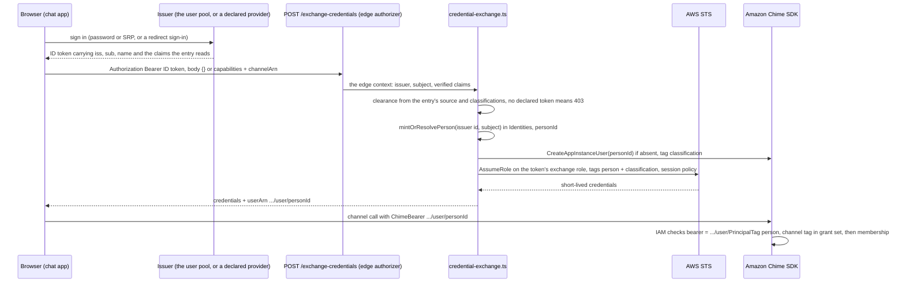
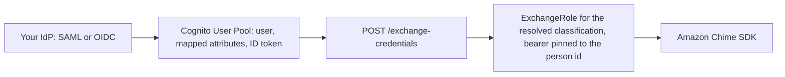

# Integrating Your Identity Provider

A deployment trusts an identity provider by declaring it once, in the trusted-issuer registry (`issuers` in `backend/deploy.config.json`, validated at synth by `backend/lib/config/issuers.ts`). This guide covers what an entry declares, the issuer kinds and what each one's people reach, and the steps for each kind: an organization's SSO over SAML or OIDC federated into the deployment's Amazon Cognito user pool, Microsoft Entra ID verified directly, a host application's own pool, a host application that signs an assertion for its own users, and the platform's own issuers for an anonymous visitor and an invitation link.

**What the identity provider supplies, and what it does not decide.** The identity provider supplies a verified identity (a stable subject and a `name`) and the claims the registry entry reads for clearance. It does not choose a role, assert a classification, or name the identity a credential may act as. The person is not the identity provider's record: a person is one `AppInstanceUser`, and the provider's record maps to it ([The person and the issuer](#the-person-and-the-issuer)). Three properties hold whatever identity provider is plugged in:

- **The bearer is pinned to the caller's own `AppInstanceUser`.** Every Amazon Chime SDK credential a person holds comes from the Credential Exchange, which assumes a role whose bearer resource is `${appInstanceArn}/user/${aws:PrincipalTag/person}`, with the `person` session tag set by the exchange to the caller's AppInstanceUser id. A credential can act as its own `AppInstanceUser` and no other.
- **Classification is evaluated by IAM from the channel tag.** The role the exchange assumes grants channel actions only on channels whose immutable `aws:ResourceTag/classification` is in that classification's declared grant set. An untagged channel matches no Allow and is refused. The sample config's `admin` role and the `restricted` role carry no classification condition; see [What each layer enforces](#what-each-layer-enforces).
- **What a claim means is the deployment's, not the provider's.** An entry's clearance source and the classifications it may grant turn the provider's claims into classifications, and the profile registry (`backend/lib/config/profiles.ts`, read through `backend/lib/profile-registry.ts`) says what each classification grants.

The mechanism is specified in [SPEC-CREDENTIAL-EXCHANGE.md](../../specs/interaction/governance/SPEC-CREDENTIAL-EXCHANGE.md) and the channel boundary in [SPEC-CONVERSATION-SECURITY.md](../../specs/interaction/governance/SPEC-CONVERSATION-SECURITY.md). Isolation is provable by deny-test: `backend/scripts/deny-test-credential-exchange.mjs` provisions a real channel and shows the same send allowed bearing the caller's own ARN and `AccessDenied` bearing another person's.

---

## The trusted-issuer registry

Each entry names its `id` (the registry id `Identities` keys a person's sign-in on), its `kind`, what its kind needs to verify a token (a pool id, a provider name, a discovery URL, pinned public keys), the audience, the declared subject, the allowed origins, the clearance source with the classifications it may grant, the `directory` adapter, `lifecycle`, `provisioning` and `admin`. Absent, the deployment trusts its own pool alone: the `deployment` entry, `pool: "self"`, its groups as clearance with no listed set, `admin: true` (`defaultIssuers`). Declared, the list is the whole set, so keep the `deployment` entry when the deployment has a pool of its own.

**Adding an issuer of an existing kind is a registry entry, not a code change.** It widens authentication, and authorization only as far as its classifications and the values it maps: the bearer pin and the channel's classification tag still decide what any session reaches, and a claim value or provider group the entry does not map reaches nothing. An issuer the registry does not declare resolves to nobody, and a token's `iss` is matched exactly to its entry (`issuerForClaims`).

### Issuer kinds

| Kind | Use it for | Declared subject | What its people reach | `provisioning` |
|---|---|---|---|---|
| `cognito-pool` | A Cognito user pool: this deployment's own (`pool: "self"`, the `deployment` entry), or a host application's pool | `sub` | Its clearance source within its declared classifications. Its own groups are AgentEchelon groups (`groups: true`); a host pool usually declares `oneChannel` ([Host app's own pool](#host-apps-own-pool)) | `on-first-sign-in` |
| `cognito-federated` | A SAML or OIDC provider federated into this deployment's pool: every SAML provider (IAM Identity Center, ADFS), and an OIDC provider where the deployment already runs a pool and wants one place to configure providers | the pool `sub` | Its provider's groups, translated into AgentEchelon groups through `custom:groups` ([Groups through the pool](#step-5-clearance)), a `mapping` of a standard claim the federated client writes, a `fixed` set, or `oneChannel`, within its declared classifications | `on-first-sign-in` |
| `oidc` | An OpenID Connect provider verified directly, with no Cognito resource: Okta, Auth0, Ping, Keycloak, Google Workspace (with `requiredClaims`) | `sub`, or the claims the entry declares as `subject` | Its provider's groups, translated into AgentEchelon groups ([Groups from your provider](#groups-from-your-provider)), a `mapping` of another claim, a `fixed` set or `oneChannel`, within its declared classifications | `on-first-sign-in` or `provisioned-only` |
| `oidc-entra` | Microsoft Entra ID verified directly: one tenant, or an allowlist of several with one token version | `tid` + `oid`, because Entra's `sub` is pairwise per app registration | Its groups by ObjectId, never display name, translated into AgentEchelon groups; app roles through a `mapping` on `roles`; a `fixed` set or `oneChannel`; within its declared classifications. An Entra group overage marker reaches nothing | `on-first-sign-in` or `provisioned-only` |
| `host-assertion` | A host application that signs a short-lived assertion for its own signed-in user, for example a Salesforce org with the assistant embedded ([Salesforce](#salesforce)) | org id + user id | A `mapping` (a permission-set claim) or a `fixed` set, within its declared classifications; never `admin` | always `provisioned-only` |
| `guest` | The platform's own issuer for an anonymous visitor ([GUEST-ISSUER](../admin/GUEST-ISSUER.md)) | the guest id | Its own conversation, at the one outside classification its `fixed` clearance names, on the guest-session role; never `admin` | `on-first-sign-in` |
| `invitation-link` | The platform's own issuer for a person who joins one conversation from a `link` invitation with no sign-in ([Invitations](#invitations)) | none: the invitation names the AppInstanceUser | The invited conversation only, for 15 minutes, at a classification in its `fixed` set and the conversation type's `linkClassifications`; never `admin` | not declared |

A deployment needs an Amazon Cognito user pool only when an entry declares `pool: "self"`. An OIDC provider can be verified directly (`oidc`, `oidc-entra`) or federated into the pool (`cognito-federated`), and the deployment chooses. Declare a provider on one path only: one person signing in through both is two people.

### Clearance and classifications

Every entry declares exactly one clearance source, and synth refuses an entry without one. A `mapping`, `fixed` or `oneChannel` source also lists the `classifications` it may grant, and synth refuses one that lists none. A `groups` source may list none: its people then reach whatever their groups clear for (`issuerClassificationsOf`, every classification of the deployment's own people, read from the runtime registry), so a classification added later is reached with no change to the entry and no redeploy of `Identity`. The admin plane is among those only for an entry declaring `admin: true`, so a foreign issuer whose group is called `admins` reaches no admin plane until its entry says its people may be admins. No group clears for an outside classification, so an issuer for outside people lists its classifications, and the outside-people rules (no visitor classification, never beside the deployment's own, never `admin: true`) apply to what an entry reaches whether it lists them or not. A list it does declare binds it like any other source's, and changing that list is issuer configuration, which redeploys every stack that carries the registry. There is no fallback reach.

- **`groups`:** the person's AgentEchelon groups, which `groupClearance` (`profiles.ts`) turns into classifications. On a `cognito-pool`, `groups: true`: the pool's own groups are AgentEchelon groups. On `oidc`, `oidc-entra` and `cognito-federated`, `groups: { "map": { "<provider group>": "<AgentEchelon group>" } }`: the provider's groups, translated ([Groups from your provider](#groups-from-your-provider)).
- **`mapping`:** a claim that is not a groups claim, and the classification each of its values maps to, for example `{ "claim": "roles", "values": { "AE.Standard": "standard" } }`. A value the mapping does not declare reaches nothing, and a mapped value outside the issuer's classifications fails synth. A mapping on a groups claim (`groups`, `cognito:groups`, `custom:groups`) is refused: groups are translated, so that their people can also be administrators and team members.
- **`fixed`:** a classification set every person from the issuer holds.
- **`oneChannel`:** the one-conversation session at a named classification, on the `restricted` role. Never a default, and refused on this deployment's own pool, which serves every person route.

A held classification whose grants reach outside the entry's classifications is dropped (`heldWithinIssuer`), so a listed set binds whatever the source says. An issuer for outside people (a customer pool) names only outside classifications in its classifications and never declares `admin: true`.

A `mapping`, and a translation of a provider's groups, decide only from the token a person presents. At every sign-in the credential exchange records what it decided on the subject's `Identities` row (`clearanceDecision`, `recordClearanceDecision` in `backend/lambda/src/lib/person-identity.ts`), and the readers that have no token (the membership audit, the group reconcile, the router) read that record as evidence, flagged stale after `recordMaxAgeDays` (default 30). Nothing grants from a record.

### Provisioning

- **`on-first-sign-in`:** the issuer is itself the gate, so the first sign-in mints the person's AppInstanceUser.
- **`provisioned-only`:** an unknown subject is refused and nothing is created. A subject is pre-assigned by `provisionSubject`, called by an administrator (`POST /users/provision`, `manage-users`) or by the connector receiver for a person a vendor names under a `provisioned-only` `personIssuer`; it writes a `pending` `Identities` row, which the exchange binds once at that subject's first sign-in. Built for every kind but `guest`, this deployment's own pool and a `oneChannel` issuer, and a `host-assertion` entry is `provisioned-only` whatever it declares.
- **`scim`:** parses and is refused at synth as **NOT BUILT**: the deployment has no SCIM receiver.

Pre-assignment by an invitation or by an already-pinned session is **NOT BUILT**. A provider that is not an identity provider, such as an incident or CRM service whose data an assistant reads, is a connector, not an issuer.

### Directory and lifecycle

`directory` names the adapter a person's name and contact are read through, live, starting from the AppInstanceUser ARN:

- **`cognito`:** the issuer's pool (`AdminGetUser`). A Cognito kind's default.
- **`claims`:** for an issuer with no directory of its own. The contact claims (`email`, `name`) of the person's last sign-in are kept under `<personId>#contact#<issuerId>` in the user-profile table, encrypted with a customer managed key that only the directory's contact lookup may decrypt, replaced at each sign-in, expired 90 days after the last one and erased with the person (`backend/lambda/src/lib/claims-directory.ts`). Refused on a Cognito kind, whose pool is read live.
- **`none`:** every other kind's default.

`identity-store`, `graph`, `scim` and `connector:<id>` are refused at synth as **NOT BUILT**.

`lifecycle` names what offboards an issuer's people: `cloudtrail-cognito` (a Cognito kind's default: the pool's disable, enable and delete events, through the platform trail) or `none`. `scim` and `connector:<id>` parse and are refused at synth as **NOT BUILT**.

### Adding an issuer

1. **Configure the provider's side:** an application for `oidc` ([Groups from your provider](#groups-from-your-provider)), an app registration for `oidc-entra` ([Microsoft Entra ID](#microsoft-entra-id)), a SAML or OIDC provider on the deployment's pool for `cognito-federated` ([Step 1](#step-1-configure-the-provider-on-the-pool)), or the host's signing key for `host-assertion`.
2. **Declare the entry** in `issuers` in `backend/deploy.config.json` (`backend/deploy.config.example.json` lists every field).
3. **Deploy** with `cd backend && npm run deploy`. Synth refuses an entry that names no clearance source or classifications, a classification the deployment does not declare, or a kind or adapter that is **NOT BUILT**, each with its reason.
4. **Check it** with `npm run doctor`, which checks each declared pool exists and each discovery URL answers and names the entry's issuer.

The edge authorizer on both HTTP APIs (`backend/lambda/src/edge-authorizer.ts`) verifies every token against its entry's audience, token type, signing algorithm and published keys (`backend/lib/config/edge-verification.ts`), and the sign-in screens offer the new entry from the registry's public projection ([Step 2](#step-2-sign-in-in-the-frontend)). The deployment's own pool takes its own app clients as its audience; any other Cognito pool declares `audience` (the app client ids its tokens are issued to), and synth refuses one that does not. This deployment's own user pool exists only when an entry declares `pool: "self"`.

A provider of a kind the registry does not know (LDAP, a custom auth server) is a new kind: one adapter and one registry entry, under the rules in [Other issuers](#other-issuers).

### Choosing a kind

| Situation | Kind |
|-----------|------|
| Your organization's SSO speaks OIDC (Okta, Auth0, Ping, Keycloak) and its people should be full members, cleared by their groups | `oidc` ([Groups from your provider](#groups-from-your-provider)); no pool is needed |
| Your organization's SSO speaks SAML only (ADFS, a SAML-only provider) | `cognito-federated` ([Federating into the pool](#federating-into-the-pool-cognito-federated)) |
| Several identity providers at once | one entry each, each with its own translation |
| Administrators and staff on IAM Identity Center | `cognito-federated`, SAML into the pool ([IAM Identity Center](#iam-identity-center)) |
| Microsoft Entra ID, one tenant or several | `oidc-entra` ([Microsoft Entra ID](#microsoft-entra-id)) |
| Google Workspace | `oidc` with `requiredClaims: { "hd": "<your domain>" }`: every Google account shares Google's `iss`, and synth refuses the entry without it |
| A host app embeds the assistant for users in the host's own Cognito pool | `cognito-pool` with `oneChannel` ([Host app's own pool](#host-apps-own-pool)) |
| Sales reps working inside Salesforce | `host-assertion` ([Salesforce](#salesforce)); the Apex signer is **NOT BUILT** |
| An anonymous visitor | `guest` ([GUEST-ISSUER](../admin/GUEST-ISSUER.md)) and the widget |
| Somebody with no account joining one conversation | `invitation-link` ([Invitations](#invitations)) |

---

## Groups from your provider

Each identity provider keeps its own groups, and the deployment keeps its own: the **AgentEchelon groups**. An issuer entry translates the provider's groups into AgentEchelon groups, and every decision about a person (their classification, whether they are an administrator, which team's assistants they manage) reads only the translated groups, within the entry's classifications. A provider group the entry does not map reaches nothing: a group an outside administrator names `admins` in their own directory is not the AgentEchelon group `admins` unless the entry maps it there. The design is [SPEC-CREDENTIAL-EXCHANGE §4b](../../specs/interaction/governance/SPEC-CREDENTIAL-EXCHANGE.md#4b-issuers-and-the-person-id) ("A person's groups").

### The access each AgentEchelon group gives

| AgentEchelon group | Declared in | What a person holding it gets |
|---|---|---|
| A key of `groupClearance` (shipped: `basic`, `standard`, `premium`) | `profiles.ts` | Clearance for the classification it names: conversations at that classification, and at each classification its grant set names ([ADR-046](../../design/decisions/046-classifications-are-a-set-not-a-ladder.md)). Several held together reach the declared classification whose grant set is their union; a combination nobody declared is refused, with no floor |
| `admins` (shipped `groupClearance` key for `admin`) | `profiles.ts`, `ADMIN_ROLE_GROUP` | The `admin` classification (admin conversations), when the entry's classifications include it; and, independently, a console session as an administrator, only when the entry declares `admin: true` |
| `team-members` | `ADMIN_ROLE_GROUP` (`lib/config/admin-capabilities.ts`) | A console session scoped to the assistants the person's teams own, when the entry declares `admin: true` and the person also holds a clearance group; it grants no classification of its own |
| `team-<name>` | the console's teams (`TEAM_NAME_PATTERN`) | Membership of team `<name>`: with `team-members`, its assistants, each only where the person's own clearance and the entry's classifications reach every classification the assistant serves |
| A key of `membershipGroups` (shipped: `ops`) | `profiles.ts` | Nothing by itself: a membership group requires the clearance it names, and is refused to a person who lacks it |

The entry's classifications bind every row: a translated group whose classification reaches outside the entry's `classifications` is dropped (`heldWithinIssuer`), and so is a team's assistant outside them. A team is named by the `ownerTeam` an assistant's profile declares, or by the console's ownership assignment, so a provider group mapped to `team-<name>` reaches that team's assistants whether or not the deployment has a pool.

### Step 1: Configure your provider

Register AgentEchelon as a single-page application at the provider: a public client (no secret) with PKCE, `<origin>/callback` as a redirect URI for each app origin (and `http://localhost:5173/callback` for development), and cross-origin requests allowed on its discovery and token endpoints. Put the person's groups in the **ID token** for the `openid email profile` scopes, because that is the token the sign-in screen presents:

- **Okta:** a SPA app integration, the app origin as a Trusted Origin (CORS), and a `groups` claim on the authorization server with a groups filter (Okta caps the claim, so filter to the groups AgentEchelon maps).
- **Auth0:** a SPA application, and an Action that adds the groups to the ID token under the claim the entry names. Set the application's ID Token Expiration to 5400 seconds or less, or declare `maxLifetimeMinutes` to match (up to 1440): Auth0's default of 10 hours is refused at the edge.
- **Microsoft Entra ID:** see [Microsoft Entra ID](#microsoft-entra-id): `<origin>/callback` under the Single-page application platform, and `groupMembershipClaims` set on the app registration.

Note each group's value exactly as the token carries it (an Entra group's ObjectId, never its display name).

### Step 2: Declare the entry

In `issuers` in `backend/deploy.config.json`, with `directory: "claims"` (a directly verified provider has no directory the deployment reads, so its people's contact is the encrypted copy of their last sign-in's claims):

```json
{
  "id": "okta",
  "kind": "oidc",
  "issuer": "https://example.okta.com/oauth2/default",
  "discoveryUrl": "https://example.okta.com/oauth2/default/.well-known/openid-configuration",
  "audience": "<the SPA client id>",
  "directory": "claims",
  "admin": true,
  "displayName": { "en": "Sign in with Okta" },
  "clearance": {
    "groups": { "map": { "AE-Standard": "standard", "AE-Premium": "premium", "AE-Admins": "admins", "Platform-Team": ["standard", "team-members", "team-platform"] } },
    "classifications": ["basic", "standard", "premium", "admin"]
  }
}
```

- `groupsClaim` names the claim the groups arrive in; the default is `groups`.
- A map value is one AgentEchelon group or a list of them. Synth refuses a value that is not an AgentEchelon group, a `mapping` on a groups claim, `adminGroups` on a translation (map a provider group to `admins` instead), and a Google entry without `requiredClaims`.
- `maxLifetimeMinutes` bounds the provider's tokens at the edge (default 90, the longest Entra randomizes an access token to); `requiredClaims` names claims a token must carry with exact values.
- Leave `admin` out, and no group from this provider reaches a console session, whatever the map says.
- A translation marks administrators with the AgentEchelon group `admins`. The deployment's own pool may name others (`adminGroups` on the `deployment` entry, which sets `ADMIN_GROUP_NAMES`); keep `admins` among them, since the handler-side admin check reads that list.
- To look before deploying, run `npm run deploy:stack -- <Stack> --diff-only` for each stack the entry changes (`Identity`, `PersonApi`, `AdminApi`, `AdminServices`, with the instance prefix); `npm run deploy` has no diff-only mode.

### Step 3: Deploy and check

`cd backend && npm run deploy`, then `npm run doctor`, which fetches the entry's discovery document and checks it names the entry's `issuer`. The sign-in screen offers the entry as a button named by its `displayName`.

### Step 4: A person signs in

A person in `AE-Standard` signs in through the button, is vended a session, and opens a `standard` conversation; they are refused a `premium` one, which nothing they hold reaches.

### Step 5: Administrators

A person in `AE-Admins` gets a console session in the admin app as an administrator. A person in `Platform-Team` gets a console session scoped to the assistants team `platform` owns, when a profile declares `ownerTeam: "platform"` and their clearance (`standard`, in the example) reaches every classification those assistants serve; with no owned assistant yet the console opens on Assistants alone, where they create one for their team, and with no team group at all it is refused (`NO_TEAM`).

### What an unmapped group reaches

Nothing. A person whose only group is one the map leaves out, including one named `admins` at the provider, is vended no session and gets no console session. The exchange answers `no credential is configured for this combination of groups`.

### Removing someone

Remove them from the provider group. The client keeps exchanging the ID token it holds until that token expires (at most `maxLifetimeMinutes`), and a session vended from it keeps its role until it expires (up to `EXCHANGE_SESSION_SECONDS`); the first token the provider issues after the removal carries the groups the person holds then, so a person in no mapped group is vended nothing. For an immediate removal, offboard the person in the console ([ADR-058](../../design/decisions/058-offboarding-runs-by-app-instance-user-for-every-issuer.md)). A directly verified provider sends the deployment no lifecycle events, and `provisioning: scim` is **NOT BUILT**.

### Verified by

**NOT RUN:** Step 4, Step 5's administrator, "What an unmapped group reaches" and "Removing someone" are each a test in `tests/e2e/a-providers-groups-give-the-access-the-guide-describes.spec.ts`, which has not yet passed against a deployment. It runs with the `TestIssuer` stack's fixture provider standing in for the organization's: a Cognito pool reached only through its OpenID discovery document, declared as this section's entry with `owner: "test-fixture"` and `groupsClaim: "cognito:groups"` (`tests/e2e/helpers/idp-fixture.ts` gives the exact entry), and signs its people in with a password at the provider rather than through the sign-in button. The registry's refusals are `backend/test/lib/a-providers-groups-are-translated-into-agentechelon-groups.test.ts`, and the edge's lifetime and required-claim checks `backend/test/lib/the-edge-refuses-a-token-it-cannot-prove.test.ts`. **NOT VERIFIED:** Step 5's team scope, which no e2e runs; a live Okta, Auth0 or Entra tenant; Step 1's provider-side settings, which are each provider's own documentation; and Step 3's doctor check, which is a unit test (`backend/test/the-doctor-checks-each-issuer.test.ts`).

---

## The person and the issuer

**A person is one `AppInstanceUser`.** Every record a person makes or owns is keyed by its id, whichever identity provider signed them in. The identity provider holds the person's email, name and credentials, and its record maps to the AppInstanceUser through one index, `Identities`: `(registry issuer id, declared subject) -> AppInstanceUser ARN`. Only the credential exchange writes it (and, for a `provisioned-only` issuer, the subject provisioners write `pending` rows), and only the exchange creates the AppInstanceUser, with an opaque UUID v7 id minted once per (registry id, declared subject) that is never the token's `sub` (`backend/lambda/src/lib/person-identity.ts`). The full model is [IDENTITY-AND-ACCESS-MODEL.md](../../specs/interaction/governance/IDENTITY-AND-ACCESS-MODEL.md) §1a.

**An email address is a delivery route, never an identity.** It may find a record inside one issuer's directory, and it never binds, merges or creates a person. A person who signs in through two issuers is one AppInstanceUser with two `Identities` rows, and the second row is added only by a session already pinned to that AppInstanceUser plus the second issuer's token.

**Linking a second issuer.** The person, signed in, calls `POST /exchange-credentials` with their own token on `Authorization` and the second issuer's token in the body, `{ "linkIssuer": { "token": "<the second issuer's token>" } }`. The exchange verifies the second token with the checks the edge applies (`LINK_ISSUERS`), writes the second subject's row naming the person, and writes an `identity_linked` record to the access log (actor, issuer id, AppInstanceUser ARN, time); it answers `{ linked: true, issuerId, userArn, created }` and vends nothing (`backend/lambda/src/lib/issuer-link.ts`). Refused: a first sign-in with no person yet (`LINK_NEEDS_A_PERSON`, 403); a second token that fails a check (401); the same issuer twice, or an issuer the person already holds (409); a second subject that already has a row or was offboarded (`SUBJECT_ALREADY_BOUND`, 409, never moved between people). A guest, a host assertion, a one-conversation issuer and any `provisioned-only` issuer are never linked this way (`LINK_NOT_SUPPORTED`); a provisioned subject is pre-assigned by `POST /users/provision`, and linking one by a pinned session is **NOT BUILT**. A screen that offers the link is **NOT BUILT** in the clients.

**A visitor becoming a person** (path A, the bind, and path B, the claim) is described in [GUEST-ISSUER.md](../admin/GUEST-ISSUER.md#becoming-a-person).

### Invitations

A member invites somebody who has no account yet into a conversation from the share dialog. The invitation names the person by an AppInstanceUser the credential exchange mints for it, with an expiration and no `Identities` row, and never by an address: the address given is where the one invitation email goes, and it is stored nowhere. The `Notifications` stack sends it; without the `notifications` capability nothing is emailed, the function logs that the capability is not deployed, and the inviter is handed the link to pass on. The email links to the landing page (`invite.html`) on the chat app's origin, where every invitation lands (`invitationLandingFor`, `backend/lib/config/app-origins.ts`); the widget's origin serves the same page as an alternative client. How it is redeemed is the conversation type's declaration (`invitations`):

- **`sign-in`**: the holder signs in, or creates an account, and that first sign-in becomes the invitee. An account that already exists is refused and nothing is bound; share the conversation with it instead. The first sign-in must be one the deployment vends a credential for: an account created on this deployment's own pool waits for an administrator's approval and a clearance group, and the holder opens the invitation's link again once it has them.
- **`link`**: the holder joins from the landing page with no sign-in, as a guest in that one conversation for 15 minutes. It needs an `invitation-link` entry in the registry:

```json
{
  "id": "invitation",
  "kind": "invitation-link",
  "clearance": { "fixed": ["basic", "standard"], "classifications": ["basic", "standard"] },
  "invitationLink": { "captcha": { "vendor": "turnstile", "siteKey": "<site key>", "secretName": "<secret name>" } }
}
```

The `fixed` set is where a link session may be vended; a conversation type's `linkClassifications` narrows it again, and synth refuses an entry no type that declares `link` could be redeemed at. A production entry declares its captcha, as a guest issuer does. The rules, refusals and live deny-test are [SPEC-CREDENTIAL-EXCHANGE.md](../../specs/interaction/governance/SPEC-CREDENTIAL-EXCHANGE.md) §4c.

---

## How credentials flow



Step by step, in `handler` in `backend/lambda/src/credential-exchange.ts`:

1. **Identity from the authorizer.** The `POST /exchange-credentials` route on `PersonApi` is behind the edge authorizer (`backend/lib/constructs/edge-authorizer.ts`), uncached, which verifies the token against the registry entry its `iss` names. The handler reads the issuer, the declared subject and the verified claims from the authorizer's context (`tokenCallerOf` in `backend/lambda/src/lib/vend.ts`). The request body can name capabilities and one `channelArn`, which only narrow the session; it is never read for identity.
2. **Clearance resolution.** The entry's clearance source names the classifications the person holds, the entry's classifications drop any that reach outside them, and `resolveHolderToken` in `profile-registry.ts` returns the declared classification whose grant set is exactly the union of what they grant. A combination the deployment has not declared resolves to no token, and the exchange returns 403 (`no credential is configured for this combination of groups`) and vends nothing. A person who holds nothing gets the same 403.
3. **The `AppInstanceUser`.** `mintOrResolvePerson` (`backend/lambda/src/lib/person-identity.ts`) resolves the person's id through `Identities`, minting a UUID v7 once per (issuer, subject), and `ensureAppInstanceUser` creates `${appInstanceArn}/user/${personId}` if it is absent (idempotent, see [Step 4](#step-4-the-appinstanceuser)), tags it with the resolved classification as a separate, non-fatal call, and refreshes its display name from the token's `name` claim.
4. **AssumeRole.** The exchange looks up the role for the token in `EXCHANGE_ROLE_ARNS_JSON` (one `ExchangeRole<Classification>` per declared classification, generated from config) and calls `sts:AssumeRole` with two session tags, `person` (the person id) and `classification`, plus a session policy scoped to the requested capabilities (default `view` + `participate`) on the requested channel or `channel/*`.
5. **Response.** Short-lived credentials (`EXCHANGE_SESSION_SECONDS`, default 3600) and the caller's own `userArn`.

**There is no Identity Pool.** `identity-stack.ts` creates none, and no group carries a role: the credential exchange is the only source of a person's AWS credentials. The frontend has no Identity Pool client: `chimeService.ts` takes Amazon Chime SDK credentials only from the credential exchange and refuses to start without `VITE_PERSON_API_URL`, and `frontend/packages/shared/src/noIdentityPool.test.ts` refuses the Identity Pool, its SDK packages and its configuration variable anywhere in the frontend.

### What each layer enforces

| Layer | What it refuses | Where |
|---|---|---|
| Identity | A request without a valid token from a declared issuer (401 at the edge authorizer or the handler); a body-supplied `sub` is ignored | `handler`, `credential-exchange.ts` |
| Trust policy | An `sts:AssumeRole` without a `person` tag, or with a `classification` tag other than the role's own; the conditions sit on the assume and on `sts:TagSession` | `makeExchangeRole`, `identity-stack.ts` |
| Bearer | Any call bearing an identity other than `.../user/${aws:PrincipalTag/person}` | `grantPinnedExchangePermissions`, `identity-stack.ts` |
| Classification | A channel action where the channel's `aws:ResourceTag/classification` is not in the role's grant set, including an untagged channel (fail-closed Allow, not a Deny) | `classificationChannelScopedAllow`, `agent-classification-common.ts` |
| Session policy | Any capability or channel the request did not name | `handler`, `credential-exchange.ts` |
| Membership | Any channel the caller is not a member of | Amazon Chime SDK |

The `admin` classification's exchange role is tag-gated like every other, to admin-plane channels only. A person holding `admin` beside a member classification is vended the member classification's role with the `adminPlane` session tag, which adds admin-plane channels to it and nothing else. Reading or moderating any other conversation is admin access, on a separate `${personId}-admin` identity, where `<personId>` is the AppInstanceUser id ([SPEC-ADMIN-IDENTITY.md](../../specs/interaction/governance/SPEC-ADMIN-IDENTITY.md) FR1). The `restricted` role (a `oneChannel` issuer) has no classification condition; it is bounded by a one-channel session policy and by membership.

The assistant side is an Allow of the same kind: each classification's assistant acting role grants channel actions only on channels tagged with its own classification, bearing only `.../bot/${aws:PrincipalTag/bot}`, so a misconfigured issuer mapping does not widen what an assistant can act on.

### Files involved

| File | Role |
|------|------|
| `backend/lambda/src/credential-exchange.ts` | The one exchange for every issuer: the token's issuer matched in the registry, its declared subject, clearance through the issuer's source and classifications, AssumeRole with `person` + `classification` tags and a session policy; a one-conversation issuer's people get `oneChannelVend` on the `restricted` role |
| `backend/lib/config/issuers.ts` | The trusted-issuer registry: kinds, clearance sources and the classifications they may grant, the synth refusals, and the runtime form each function reads as `TRUSTED_ISSUERS` (`backend/lambda/src/lib/trusted-issuers.ts`) |
| `backend/lambda/src/edge-authorizer.ts` | The edge authorizer on `PersonApi` and `AdminApi`: each token verified against its entry and resolved through `Identities` |
| `backend/lambda/src/lib/membership-source.ts` | `Directory`, built from the registry: what the deployment's issuers say about a person, asked by AppInstanceUser. It reaches the person's issuer subjects through the `Identities` `byPerson` index, then asks each subject's issuer through that issuer's seams for a name, a contact, groups, team groups (`listGroups`), admins and clearance (`clearanceOf`). No id is derived from (issuer, subject) |
| `backend/lambda/src/lib/issuer-seams.ts` | The seam factory: each registry entry's directory adapter (`cognito`, `claims`, `none`) and clearance source, chosen once per container; no adapter is constructed anywhere else in `backend/lambda` |
| `backend/lambda/src/lib/claims-directory.ts` | The `claims` adapter: the encrypted contact copy the credential exchange writes at each sign-in, read only by `Directory.contactFor` |
| `backend/lib/stacks/identity-stack.ts` | User pool, clearance groups and precedence, the exchange roles and their trust, the exchange handler and its route, and no Identity Pool. The user pool exists only when the registry declares `pool: "self"`, and the admin console's app client is on it when `admin` is declared |
| `backend/lib/stacks/agent-classification-common.ts` | `classificationChannelScopedAllow`, the fail-closed classification Allow for person and assistant roles |
| `backend/lambda/src/lib/clearance-source.ts` | One clearance source per declared clearance source (`groups`, `mapping`, `fixed`, `oneChannel`); `ClearanceSource` is the groups provider a `groups` source reads, and Cognito is its shipped adapter |
| `backend/lambda/src/lib/user-clearance.ts` | `resolveUserClearance`, the router's clearance read through that seam |
| `backend/lib/profile-registry.ts` | `resolveHolderToken`, `grantsFor`: what a set of classifications means |
| `backend/lambda/cognito-triggers/post-confirmation.js` | Native sign-up only (`PostConfirmation_ConfirmSignUp`; a password reset changes nothing): sets `custom:approved=false` and mirrors a declared `custom:tier` into one clearance group. It creates no `AppInstanceUser` |
| `backend/lambda/cognito-triggers/pre-authentication.js` | Refuses sign-in until `custom:approved` is `true` |
| `frontend/packages/shared/src/services/credentialExchange.ts` | `exchangeCredentials` and `exchangeCredentialsProvider`, the one client for the exchange |
| `frontend/packages/chat/src/services/chimeService.ts` | Builds the messaging client on the exchange's credential provider |
| `frontend/packages/shared/src/providers/AuthProvider.tsx` | Password and redirect sign-in, the `/callback` route, token storage and refresh per issuer; `user.id` is the person id and `user.userArn` the ARN the exchange returns |
| `frontend/packages/shared/src/services/redirectSignIn.ts` | The authorization code flow with PKCE: discovery, state, nonce and verifier, the callback checks, and a foreign issuer's refresh |
| `backend/scripts/lib/sign-in-issuers.cjs` | The registry's public projection into `VITE_ISSUERS`, which `gen-frontend-env.mjs` writes into both apps' `.env` |
| `backend/lambda/src/user-management.ts` | The console's User Management API, which calls Cognito User Pool admin APIs directly, and offboarding's console entry |

---

## Where the provider is read

Enforcement is identity-provider-neutral: the bearer pin and the classification Allow are IAM conditions on the assumed role and the channel tag. Resolving a caller's clearance outside a sign-in is not, because it reads what a subject holds from the issuer's directory.

Each issuer's declared clearance source is one implementation, in `clearance-source.ts`, chosen for the entry by the seam factory (`issuer-seams.ts`):

```ts
interface IssuerClearanceSource {
  readonly source: 'groups' | 'mapping' | 'fixed' | 'oneChannel';
  readonly issuerId: string;
  heldFor(subject: string): Promise<HeldBySource | null>;
}
```

A source answers in its own terms: the groups a subject holds (`groups`, read through the `ClearanceSource` provider, whose shipped adapter is `CognitoClearanceSource`), or the classifications its configuration names (`fixed`, `oneChannel`). A `mapping` decides only from the claims on a token the person presents, so read without one it answers nothing and the clearance is undetermined, never a guess.

**Through the seams.** Every reader asks `Directory` by AppInstanceUser. What an answer means stays in the registry: `Directory.clearanceOf` maps groups through the profile registry, applies each issuer's classifications (`heldWithinIssuer`) and resolves the holder token, so an adapter never decides policy. For a `mapping` member it answers undetermined and carries the exchange's record of the last sign-in as `lastSignIn`. A person whose subjects are all under an issuer the registry no longer declares resolves to no clearance.

| Reader | What it asks |
|---|---|
| `router-agent-handler.ts` (through `resolveUserClearance`) | The sender's clearance, and their name |
| `membership-audit.ts` | A member's clearance: a removed issuer's member reaches nothing and is flagged; an undetermined one is read through the record of their last sign-in (a mismatch is reported, a stale record flagged, and nothing is revoked on a record), and with no record is recorded as unaudited |
| `group-membership-reconcile.ts`, `typed-conversation-from-event.ts` | A type's group members in every directory that keeps groups, each admitted on their clearance; a record neither adds nor removes |
| `admin-conversation-sync.ts`, `admin-notification-channel-provision.ts` | The admins of every issuer declaring `admin: true`, each in its own directory and admin groups |
| `assistant-ownership.ts`, `lib/assistant-scope.ts` | Team groups (`listGroups`) and the caller's groups |
| `lib/channel-notify.ts`, `proactive-briefing.ts`, `share-conversation/index.js` | Contacts, names, and an address within one issuer's directory |

At request time the edge context already carries the verified claims, so the credential exchange, conversation creation and client events read the caller's holder token from the token itself through the same issuer entry (`holderTokenOf`, `callerHolderToken` in `backend/lambda/src/lib/auth.ts`).

**Still Cognito-specific, by design:** `post-confirmation.js` and the console's `user-management.ts` administer this deployment's own pool (they write its groups), and offboarding deletes that pool's accounts. Each reaches the pool through the factory's `poolAdapter`.

**No floor.** An unresolvable clearance is never served as the least-privileged classification. The exchange refuses with 403 and vends no role. `post-confirmation.js` leaves a sign-up with no declared `custom:tier` in no clearance group (`FAIL_CLOSED_TO = ''`). `resolveUserClearance` returns `undefined` on a lookup failure; the router does not refuse the turn on it, because IAM already admitted the send, but an unresolved clearance reaches no classification, so the router logs `[Router][SecurityEvent] sender does not reach this channel classification` and serves the turn at the channel's classification.

**One seam per lookup, for every issuer.** A new issuer adds a registry entry, and an adapter only when its kind of directory is new; no call site changes. **NOT BUILT:** the `identity-store`, `graph`, `scim` and `connector:<id>` adapters.

---

## Federating into the pool (`cognito-federated`)

Your SAML or OIDC provider is configured as an identity provider on the deployment's Cognito user pool and declared in the registry. People authenticate with your provider; the pool issues its own ID token, carrying an `identities` claim that names the provider, and that token matches the `cognito-federated` entry declaring that provider, never the pool's own entry, so a provider nobody declared reaches nothing.



### Step 1: Configure the provider on the pool

Create the provider on the deployment's pool (the `UserPoolId` output) in the Amazon Cognito console or with `aws cognito-idp create-identity-provider`: a SAML provider with its metadata URL, or an OIDC provider with its exact issuer, client id, client secret and scopes. Map `email` and `name`, and any claim the entry's clearance reads into a pool attribute. The provider's name on the pool is the entry's `providerName`.

The provider must exist before the entry is deployed: the federated app client (`FederatedWebClient`, `identity-stack.ts`) lists each `cognito-federated` entry on the deployment's own pool by provider name (`selfFederatedProviders()`), so a fresh deployment is deployed once without the entry, the provider is created on its pool, and the entry is then declared and deployed. **NOT VERIFIED** on a deployment.

**Every provider on the pool signs in through that one client.** Cognito writes a provider's mapped attributes only through a client that lists them as writable, and a client that lists one lets any holder of its access token rewrite it. So `FederatedWebClient` is the only client that lists them: it allows the authorization code flow and refresh alone, with no password, SRP or custom flow, and its tokens carry no `aws.cognito.signin.user.admin`, the scope `UpdateUserAttributes` requires. The web and admin clients offer the pool's own sign-in alone. The client id is the `UserPoolFederatedClientId` output, written as `VITE_FEDERATED_CLIENT_ID` into both apps' `.env`.

### Step 2: Sign-in in the frontend

Declare the entry:

```json
{
  "id": "corporate-sso",
  "kind": "cognito-federated",
  "pool": "self",
  "providerName": "CorporateSSO",
  "displayName": { "en": "Sign in with Corporate SSO" },
  "clearance": { "fixed": ["standard"], "classifications": ["basic", "standard"] }
}
```

The sign-in screen offers each redirect issuer the registry declares as a secondary button, named by the entry's `displayName` for the person's language, above the password form. The password form is unchanged: `AuthProvider.tsx` signs in with the raw Cognito SDK (`USER_PASSWORD_AUTH`; the web client also permits SRP) and stores the pool's ID and refresh tokens. The admin console offers only the entries with `admin: true`.

`backend/scripts/gen-frontend-env.mjs` writes the buttons into `VITE_ISSUERS` from `issuers` in `backend/deploy.config.json`, through `backend/scripts/lib/sign-in-issuers.cjs`. The projection is an allowlist of public fields, because it is baked into a bundle anyone can download: the id, the kind, the display names, the discovery URL, the exact issuer, the client id, the provider name and the admin flag. Clearance, mappings, classifications, tenants, groups and origins never reach the client. An entry the projection cannot offer is printed with the reason and left out:

| Kind | Where the button goes | Client id | Left out when |
|---|---|---|---|
| `cognito-federated`, `pool: "self"` | Cognito managed login, with `identity_provider` set to `providerName` | the federated app client (`VITE_FEDERATED_CLIENT_ID`), in both apps | the deployment's pool id is not known (no `UserPoolId` output) |
| `cognito-federated` on another pool | not offered | none | always: the registry declares no app client for that pool (**NOT BUILT**) |
| `oidc`, `oidc-entra` | the issuer's own authorization endpoint | the entry's `audience` | the entry declares more than one audience |

A button starts the authorization code flow with PKCE (`frontend/packages/shared/src/services/redirectSignIn.ts`). The endpoints come from the issuer's discovery document; for the deployment's pool that is `https://cognito-idp.<region>.amazonaws.com/<pool id>/.well-known/openid-configuration`. The issuer returns the tab to `<origin>/callback`, which the client handles before anything else on that load:

- **state:** random per sign-in and compared exactly. A callback this tab did not start is refused before any code is redeemed.
- **nonce:** random per sign-in, sent in the authorization request and required in the ID token.
- **verifier:** a random S256 verifier held only in `sessionStorage`, which is scoped to the tab, and deleted on the callback's first read whatever the outcome, so a sign-in is single-use. A sign-in older than ten minutes is refused.
- **redirect URI:** `<origin>/callback`, fixed. It is recorded at the start, must still be this origin's at the callback, and is never read from the callback URL.
- **issuer and audience:** the discovery document's `issuer` must be the entry's, and the ID token's `iss` and `aud` must be the issuer's and the client's. An Entra issuer template is matched with the token's own `tid`.

The client does not check the token signature: the token arrives over TLS straight from the token endpoint (OpenID Connect Core 3.1.3.7), and the credential exchange verifies it. The ID token then goes to the credential exchange exactly as a password sign-in's does, and the code and state are removed from the address bar. A failed callback shows a localized reason (`auth.redirect.errors` in `frontend/packages/shared/src/locales/en.json`), never the provider's own text, and a way back to the sign-in screen.

A `cognito-federated` session refreshes through Cognito on the federated client, whose refresh token it holds. A foreign session refreshes at its issuer's token endpoint, and asks for `offline_access` when the discovery document lists it. Sign-out ends a foreign session locally only.

What the deployment provides for a button to finish:

- A managed login domain on the deployment's pool. `identity-stack.ts` creates one, prefixed `<instance>-<account>`, and publishes it as the `UserPoolDomainUrl` output. **NOT VERIFIED** live.
- The provider enabled on the app client, from the registry (Step 1). A provider added outside the registry is not offered.
- The callback URLs: the web client registers `<origin>/callback` for both interface origins and `http://localhost:5173/callback`; the dedicated admin client `http://localhost:5174/callback` and the admin origin; the federated client every one of them.
- For a foreign issuer: a public client (no secret) that allows PKCE, with `<origin>/callback` registered as a redirect URI and cross-origin requests allowed on its discovery and token endpoints.

**NOT VERIFIED:** no redirect sign-in has run against a deployed pool or a real issuer. The flows are proven by component tests with stubbed endpoints (`frontend/packages/shared/src/components/SignIn.flows.test.tsx`), and the projection by a contract test through Vite (`frontend/packages/shared/src/services/viteIssuers.contract.test.ts`). A "continue as guest" link on the sign-in screen is **NOT BUILT**: a visitor starts in the widget.

What the rest of the app relies on is the contract to keep:

- an ID token from an issuer the registry declares, refreshed by `ensureFreshIdToken` (`ensureFreshToken.ts`) from the refresh token stored where `AuthProvider.tsx` stores it: through `REFRESH_TOKEN_AUTH` on the same client for the pool, at the issuer's token endpoint for a foreign issuer;
- the client's identity is the `userArn` the exchange returns, the ARN of the caller's AppInstanceUser; no client derives an ARN from the ID token. The shipped client sets `user.id` and `user.userArn` from the exchange response (`frontend/packages/shared/src/providers/AuthProvider.tsx`), and `chimeService.initialize` takes that `userArn` as its bearer. A frontend you add should do the same.

### Step 3: Credentials

No change. `chimeService.initialize` builds the `ChimeSDKMessagingClient` on `exchangeCredentialsProvider` from `credentialExchange.ts`. It is an AWS SDK credential provider: each call fetches a fresh ID token, posts `{}` to `/exchange-credentials`, and returns the credentials with their `expiration`, so the SDK re-calls it only when the session nears expiry. There is no refresh timer.

### Step 4: The `AppInstanceUser`

The exchange creates the caller's `AppInstanceUser` on their first exchange, with an opaque id, and writes the `Identities` row for (the entry's registry id, the pool `sub`) in the same operation; every exchange after resolves the same AppInstanceUser through that row and refreshes its tag and name. A federated user needs no separate provisioning hook, and end-user credentials never hold `chime:CreateAppInstanceUser`, so the client cannot create one itself.

`post-confirmation.js` creates no `AppInstanceUser`; the exchange is the only minter. **NOT VERIFIED:** whether Cognito invokes the post-confirmation trigger, or the pre-authentication approval gate in `pre-authentication.js`, on a federated first sign-in. Neither is needed for a credential: the exchange creates the identity, and the entry's clearance is what gates the vend.

### Step 5: Clearance

A `cognito-federated` entry declares a translation of its provider's groups, a `mapping` of another claim, a `fixed` set or `oneChannel`, never `groups: true`: the pool's own groups are the clearance of the pool's own entry, and a federated person holds their provider's groups, not the pool's.

- **`fixed`** gives everyone the provider signs in one classification set. It needs nothing on the pool, and the provider's own assignment of users to the application is the gate.
- **A translation of its groups** reads the pool attribute `custom:groups`, which the provider's attribute mapping writes at each federated sign-in. Map the provider's group attribute (a SAML group attribute, or an OIDC groups claim) to `custom:groups` on the provider in the pool, then declare the entry with `groups: { "map": { ... }, "emptyGroupsSent": true }`, exactly as [Groups from your provider](#groups-from-your-provider) describes for a direct provider:

  ```json
  {
    "id": "corporate-sso",
    "kind": "cognito-federated",
    "pool": "self",
    "providerName": "CorporateSSO",
    "admin": true,
    "displayName": { "en": "Sign in with Corporate SSO" },
    "clearance": { "groups": { "map": { "AE-Standard": "standard", "AE-Admins": "admins" }, "emptyGroupsSent": true }, "classifications": ["basic", "standard", "premium", "admin"] }
  }
  ```

  The value is read only from an ID token of that provider's own sign-in (its `identities` claim names the provider), never from a local account's, and is decoded from Cognito's flattened form (`[a,b]`, each value URL form-encoded), so a group keeps its spaces. `emptyGroupsSent: true` is required, and is your statement that the provider sends the attribute even when the person holds no group: Cognito keeps a mapped value the provider stops sending, and SAML providers and Entra usually omit an empty attribute, so without it a person removed from their last group would keep it. **OPEN:** which providers can send it empty; a provider that cannot belongs on the direct path. A mapped value longer than 2,048 characters fails the sign-in at Cognito, so filter the groups the provider sends.
- **`mapping`** reads a standard claim the federated client writes (`email`, `name`, `given_name`, `family_name`). The pool declares no other attribute a provider writes, so mapping a role or an org id on the pool path is **NOT BUILT**: verify such a provider directly. A mapping on `custom:groups` is refused: translate it.

**Never map clearance from `custom:tier`.** The web client lets a user write `custom:tier` (it is a requested tier at sign-up), and a mapping must name only a claim the provider controls, never one a user can edit in a self-service profile. Map `name` from the provider too: the exchange refreshes each person's `AppInstanceUser` display name from the token's `name` claim on every exchange, for that caller only. The web client's `selfWritableAttributes` keeps `name`, `custom:approved` and `custom:groups` out of what a signed-in user may write; a provider's mapped attributes are written through the federated client alone (Step 1), and never widen the web client's write list to make a mapping work.

**Timing.** The exchange decides from the token it is handed, so a change at the provider reaches the exchange with the next token the pool issues after a full federated sign-in, when the provider's attribute mapping writes `custom:groups` again. A change does not revoke credentials already vended; they carry the old role until they expire (up to `EXCHANGE_SESSION_SECONDS`). An immediate downgrade is a user disable or a membership removal.

### Step 6: Native users and groups

A person who signs up on the pool itself, with no provider, matches the pool's own `deployment` entry, whose clearance is `groups`. A clearance group is a Cognito group named in the registry's `groupClearance` map (`profiles.ts`). Each group is built with its classification (`clearanceGroups` in `backend/lib/constructs/clearance-groups.ts`): the admin plane's by `identity-stack.ts`, every other classification's by its `Assistants-<classification>` stack. An administrator assigns it in the console's User Management tab. A person's clearance is the declared classification whose grant set equals the union of what their groups grant (`resolveHolderToken`). A classification is a declared set of grants, not a ladder ([ADR-046](../../design/decisions/046-classifications-are-a-set-not-a-ladder.md)); the shipped sample config happens to nest `basic` in `standard` in `premium`. There is no default group: a person in no clearance group, or in a combination nobody declared, is refused by the exchange.

**Group precedence is declared.** Cognito requires an integer precedence per group, and each classification declares its own as `groupPrecedence` in `profiles.ts` (the shipped sample: `admin` 1, `premium` 3, `standard` 4, `basic` 5). Synth refuses a value that is not an integer from 0 to 99, one two classifications share, and 2, which the `team-members` group holds; a classification that declares none gives its groups no precedence. Membership groups such as `ops` start at 100 (`MEMBERSHIP_GROUP_PRECEDENCE_BASE`), after every clearance group. No access decision reads the numbers, and the exchange resolves the full `cognito:groups` list.

### Step 7: Group to IAM role

The resolved classification decides which exchange role a person's credentials are minted on, and so what IAM lets them reach:

- The exchange looks up the token in `EXCHANGE_ROLE_ARNS_JSON` and assumes that `ExchangeRole<Classification>` (for example `ExchangeRoleStandard`). No group carries a role, and nothing assumes one from a group.
- The role's trust policy names only the exchange Lambda's role and requires `aws:RequestTag/person` present and `aws:RequestTag/classification` equal to the role's own classification, on `sts:AssumeRole` and on `sts:TagSession`. A session cannot be minted on a role whose classification it does not assert, and an untagged assume is refused.
- The role grants channel actions only where the channel's `aws:ResourceTag/classification` is in the classification's grant set (`classificationChannelScopedAllow` with `actor: 'person'`), bearing only `.../user/${aws:PrincipalTag/person}`. This is a fail-closed Allow: an untagged channel matches nothing. The condition key is the global `aws:ResourceTag`, because the Amazon Chime SDK exposes no service-specific condition keys.
- The per-classification role ARNs are not stack outputs. Read them from the exchange Lambda's `EXCHANGE_ROLE_ARNS_JSON` environment variable or the IAM console.

### Step 8: Staff and customers

A deployment whose customers sign up for themselves keeps them out of the pool that holds its staff. The design is two pool issuers:

- **A staff pool:** no self sign-up, SAML only, with a pool domain (SAML needs the pool's `/saml2/idpresponse` endpoint). Administrators and staff sign in here through the organization's identity provider.
- **A customer pool:** self sign-up. When its people are the deployment's customers rather than its own people, its clearance is `{ "fixed": ["customer"], "classifications": ["customer"] }`: `customer` is an outside classification (`audience: 'outside'`), and synth refuses an issuer whose classifications name it beside a member classification, or that declares `admin: true`. This is the account a path B claim opens a `customer-engagement` conversation for.

Both resolve to AppInstanceUsers the same way, and admin authority comes from the issuer's `admin: true` and the admin group claim, not from which pool holds the person ([SPEC-ADMIN-IDENTITY.md](../../specs/interaction/governance/SPEC-ADMIN-IDENTITY.md)). A user pool should not require email: required attributes cannot change after the pool is created, and an enterprise SAML or Entra setup may withhold email. **NOT BUILT:** a second pool of the deployment's own; `identity-stack.ts` creates one pool, so staff and customers share it, and a customer pool is another account's or another stack's pool declared as a `cognito-pool` entry with its `audience`.

### Step 9: User Management tab

`user-management.ts`, the Lambda behind the console's User Management tab (list, approve, reject, change tier, enable, delete), calls Cognito User Pool admin APIs directly. It is the reference implementation for the bundled provider, not an abstraction over other identity providers ([ADR-021](../../design/decisions/021-user-administration-is-not-idp-abstracted.md)). Where your provider is the directory, accounts are created and disabled there.

Offboarding is not administration ([ADR-058](../../design/decisions/058-offboarding-runs-by-app-instance-user-for-every-issuer.md)): the console's delete takes the person's AppInstanceUser ARN (`personArn`) or a pool `username`, and `offboardPerson` (`backend/lambda/src/lib/offboarding.ts`) erases the person's records by AppInstanceUser for every issuer, removes the pool account only when one exists, and keeps their battle votes and feedback. A deleted pool account is offboarded from the pool's own events. A disabled one is not: the credential exchange asks the pool at every vend, so the person is refused at their next sign-in or hourly refresh, a session already vended lasts out its hour, and re-enabling the account admits them again ([SPEC-CREDENTIAL-EXCHANGE.md](../../specs/interaction/governance/SPEC-CREDENTIAL-EXCHANGE.md) §4b, "An account disabled at its issuer"). The full inventory is [SPEC-CREDENTIAL-EXCHANGE.md](../../specs/interaction/governance/SPEC-CREDENTIAL-EXCHANGE.md) §5b.

The provider is named by the trusted-issuer registry: the `IdentityProvider` stack output is `cognito` unless a `cognito-federated` entry in `issuers` names the provider that federates into the pool, when it is that entry's `displayName.en` or `providerName`. The value reaches the console at build time: the `IdentityProvider` stack output is mapped to `VITE_IDENTITY_PROVIDER` by `node scripts/gen-frontend-env.mjs` (written per package into `frontend/packages/{chat,admin}/.env`), and the frontend ships through `node scripts/deploy-frontend.mjs`; `npm run deploy` runs both. Changing the registry alone does nothing until the env is regenerated and the frontend redeployed.

Any value other than `cognito` makes `UserManagementTab.tsx` render a note that users are administered in that provider instead of the tab. It is descriptive only; authorization is unaffected.

**OPEN:** user administration is not abstracted across providers. Managing users in your own identity provider is the supported path.

### IAM Identity Center

IAM Identity Center signs people in to a third-party application over SAML 2.0, as a customer managed application. Its OAuth 2.0 customer managed applications serve trusted identity propagation to AWS services rather than a general OIDC sign-in for a third-party application, so Identity Center reaches AgentEchelon as a SAML provider on the pool (kind `cognito-federated`):

1. In Identity Center, add a customer managed SAML 2.0 application. SAML applications need an organization instance of Identity Center, not an account instance.
2. Set its assertion consumer service URL to the pool's `/saml2/idpresponse` endpoint and its audience to the pool's SAML entity id (`urn:amazon:cognito:sp:<poolId>`).
3. Map the user's email, name and group attributes in the assertion, and register the application's metadata URL on the pool as in [Step 1](#step-1-configure-the-provider-on-the-pool).
4. Assign the users or groups who should reach the deployment to the application. That assignment is the gate, which is why the issuer provisions on first sign-in and a `fixed` clearance is enough for one population.

Sign-in is initiated by the service provider by default. Enabling sign-in from the Identity Center portal tiles restricts that app client to SAML providers. **NOT VERIFIED:** the pool path's translation against a live SAML or OIDC provider: the federated sign-in passes through two managed logins and is not in the e2e suite, so its controls are proven by synthesized-template tests (`backend/test/the-pool-offers-its-declared-providers-at-managed-login.test.ts`) and unit tests of the reader. Also whether a federated user's pool `sub` survives deleting and re-creating the provider in the pool; if it does not, the declared subject should be the provider's subject from the `identities` claim.

### Salesforce outside Salesforce

Salesforce is also an OIDC provider for a page outside Salesforce. Verify it directly as an `oidc` entry with the exact issuer its tokens carry (production, sandbox or My Domain host), naming the org id and user id as its `subject`. Federating it into the pool cannot carry the org id and user id: the pool declares no attribute a provider writes beyond the standard ones and `custom:groups` (**NOT BUILT**). Salesforce's login page refuses framing, so an embedded sign-in opens a popup.

---

## Microsoft Entra ID

Entra ID is verified directly at the edge as an `oidc-entra` entry, one tenant or an allowlist of several; it can also federate into the pool like any OIDC provider ([Federating into the pool](#federating-into-the-pool-cognito-federated)). Its groups are translated by ObjectId, its app roles mapped:

```json
{
  "id": "partners",
  "kind": "oidc-entra",
  "tenants": ["11111111-2222-3333-4444-555555555555", "66666666-7777-8888-9999-000000000000"],
  "tokenVersion": 2,
  "discoveryUrl": "https://login.microsoftonline.com/organizations/v2.0/.well-known/openid-configuration",
  "audience": "<the app registration's client id>",
  "directory": "claims",
  "clearance": { "mapping": { "claim": "roles", "values": { "AE.Standard": "standard" } }, "classifications": ["basic", "standard"] }
}
```

To clear by group instead, set `groupMembershipClaims` on the app registration and translate each group's ObjectId: `"clearance": { "groups": { "map": { "<ObjectId of AE-Standard>": "standard", "<ObjectId of AE-Admins>": "admins" } }, "classifications": ["basic", "standard", "premium", "admin"] }`. A person in more groups than Entra puts in a token gets an overage marker in place of the claim, and the marker reaches nothing: assign fewer groups to the application, or clear by app role. Each tenant of an allowlist uses its own ObjectIds, so a translation names every tenant's.

The token's `iss` must be the template for its own `tid` (`https://login.microsoftonline.com/<tid>/v2.0` for version 2, `https://sts.windows.net/<tid>/` for version 1), with `tid` on the allowlist (`issuerForClaims`). The declared subject is `tid` + `oid`. Translate groups by ObjectId, never a display name, or map app roles. Its directory is `claims` or `none`, so its people's contact is the encrypted copy of their last sign-in's claims. The app registration is a public client that allows PKCE, with `<origin>/callback` as a redirect URI, so the sign-in screen offers it ([Step 2](#step-2-sign-in-in-the-frontend)). **NOT VERIFIED** against a live tenant.

---

## Host app's own pool

For a host application whose users stay in the host's own Cognito user pool, the one exchange vends bearer-pinned credentials for one conversation without migrating those users.

Declare the host pool in `issuers` with the one-conversation session, for example `{ "id": "host", "kind": "cognito-pool", "pool": "us-east-1_XXXXXXXXX", "audience": ["<the host app client id>"], "clearance": { "oneChannel": "basic", "classifications": ["basic"] } }`. `oneChannel` names the classification the host's context conversations are created at; synth refuses one that is not a conversational classification, and every `oneChannel` issuer names the same one (differing ones are **NOT BUILT**). The edge admits the host pool's people on the exchange and conversation creation only; no route of its own is added. A host's people open their context conversation through `POST /create-conversation` (create-or-get on `contextType` and `contextId`), and the host adds or removes a person through the `ConversationMembershipFunction` it invokes directly (`membershipHandler` in `backend/lambda/src/conversation-management.ts`, output `ConversationMembershipFunctionArn`). Every other route refuses a one-conversation person.

The exchange (`oneChannelVend` in `credential-exchange.ts`), for a token from an issuer declaring `oneChannel`:

1. Matches the token's `iss` to its registry entry and reads the subject the entry declares (`sub`); an undeclared issuer is a 403 and a missing subject a 401.
2. Requires `channelArn` in the body, naming exactly one channel of this app instance (no wildcard, no extra path segment); anything else is a 400. Naming a channel is not admission to it.
3. Mints or resolves the person through the one minter, `mintOrResolvePerson`, under the host pool's registry id: an opaque UUID v7 recorded in `Identities` like anyone else's, stable across sign-ins. It is both the `AppInstanceUserId` and the `person` session tag. A request for a console session, the admin plane or a capability list is refused.
4. Creates the `AppInstanceUser` if absent and assumes `ExchangeRoleRestricted` with tags `person` = the person id and `classification` = `restricted`, and a session policy allowing connect plus read and send actions on that one channel and the caller's own user ARN, for one hour.
5. Returns the credentials, `userArn`, and `tier: 'restricted'`.

**What bounds the `restricted` role.** It carries no classification tag condition, no discovery, no self-membership management and no profile writes. Its reach is the one channel named in the session policy, intersected with Amazon Chime SDK membership: a person who names someone else's conversation gets a credential the service refuses. The conversation's classification is fixed by the one create path, which creates a context conversation at the classification the issuer's `oneChannel` names. See [SPEC-FEDERATED-PARTICIPANTS.md](../../specs/interaction/governance/SPEC-FEDERATED-PARTICIPANTS.md).

---

## Salesforce

A sales team working inside Salesforce reaches the assistant without a second sign-in, through a `host-assertion` issuer. The platform side and the widget are built; the Salesforce side (the Apex signer and the Lightning component that posts into the widget) is **NOT BUILT**.

- **The assertion.** The host signs a short-lived JWT carrying `iss` (the exact issuer the entry declares), `aud` equal to the deployment id, `org` and `sub` (the org id and the user id, which together are the subject), the permission-set claim the mapping reads, a `jti` and `iat` and `exp`. **NOT BUILT:** Apex signing it with the org certificate (`Auth.JWT`, `Auth.JWS`) and posting it into the embedded assistant from the Salesforce page.
- **The entry.** The registry pins the host's public keys by `kid` (there is no discovery endpoint, so rotation is the operator's: declare the next key beside the current one, then remove the old one), and lists the host origins:

  ```json
  {
    "id": "salesforce-org",
    "kind": "host-assertion",
    "issuer": "https://example.my.salesforce.com",
    "allowedOrigins": ["https://example.lightning.force.com"],
    "hostAssertion": { "publicKeys": { "org-cert-1": "<base64 DER SubjectPublicKeyInfo>" }, "maxMinutes": 5 },
    "clearance": { "mapping": { "claim": "permsets", "values": { "AE_Sales": "standard" } }, "classifications": ["basic", "standard"] }
  }
  ```

  An RSA key of at least 2048 bits for `RS256` (the default) or a P-256 key for `ES256`; one or two keys; `maxMinutes` at most 10. The entry names no pool, discovery document or audience of its own, its clearance is a `mapping` or a `fixed` set, and synth refuses `admin: true` on it.
- **The checks.** The edge accepts an assertion on `POST /exchange-credentials` alone, on the attachment that is never answered from the authorizer cache; on any other route it is refused before anything is recorded. It verifies the signature with the pinned key the `kid` names, the header `alg`, the exact `iss`, `aud`, `exp` no further ahead than `maxMinutes` and `exp - iat` within it, and requires a `jti`. It then records the `jti` in `Tokens` (`assertion-jti#<sha256>`) with a conditional write, so the same assertion presented twice is refused the second time, and the exchange consumes that record before it vends. A permission set is an external claim and maps through the issuer's clearance source and the classifications it may grant, so an unmapped permission set reaches nothing. Each refusal is counted by check (`AssertionRefused`, namespace `AgentEchelon/HostAssertion`). The widget makes its own two checks before it sends anything: a posted assertion is accepted only from a declared host origin (`allowedOrigins`) and from `window.parent` (`frontend/packages/widget/src/session/hostAssertion.ts`).
- **Provisioning.** The issuer is `provisioned-only`: a rep's AppInstanceUser is pre-assigned before their first assertion, by an administrator (`POST /users/provision`, naming the issuer, the subject `<org id>:<user id>` and optionally the existing person it links to) or when a connector names the rep as a lead's owner by org id and user id, never by email. An unknown subject is refused and nothing is created.
- **The trust is the whole org.** Any Apex in the org, managed packages included, can sign an assertion for any user id, so the org is trusted as one issuer and its reach is bounded by its declared classifications.

**OPEN:** the Apex signing details (`Auth.JWT` and `Auth.JWS` with an org certificate), and posting into a third-party frame under Lightning Web Security. **NOT VERIFIED:** an assertion signed by a live Salesforce org; the deny-tests sign with a test-double key the registry pins (`backend/scripts/deny-test-host-assertion.mjs --generate-key`).

---

## Other issuers

Every issuer reaches the exchange through the edge authorizer, the one check every person-facing route uses: a Cognito pool, an `oidc` or `oidc-entra`, a `guest` or a `host-assertion` entry is verified against what the registry declares for it. An `invitation-link` entry has no token for the edge to verify, so the edge skips it: its redemption is an unauthenticated route on the exchange with its own controls.

**An anonymous visitor** is the registry's `guest` kind: the platform signs a short-lived guest token with its own KMS key, guest start mints the visitor's AppInstanceUser with an expiration and an `Identities` row under the guest issuer after its captcha, per-address limit and kill switch have passed, and its reach is its own conversation on the guest-session role ([GUEST-ISSUER](../admin/GUEST-ISSUER.md)). The widget that calls it is [SPEC-EMBEDDABLE-WIDGET](../../specs/interface/SPEC-EMBEDDABLE-WIDGET.md). **NOT VERIFIED** on a deployment.

**A provider of a new kind** (LDAP, a custom auth server) is one adapter and one registry entry. An integrator adding one keeps the rules the shipped kinds follow, and none of them is optional:

- **Identity from an authorizer, never the request body.** Verify the issuer's token at the edge and read the subject from the verified claims.
- **A disjoint, stable id.** The id is an opaque AppInstanceUser id from the exchange's one minter, recorded in `Identities` under the issuer, so a subject of one issuer never collides with the same subject of another.
- **A pinned classification role.** Assume an existing exchange role with a `person` session tag set to that id and a `classification` session tag equal to the role's own classification; the trust policy refuses anything else. Never vend a role whose bearer resource is `.../user/*`: that credential can act as any person in the app instance. The classification roles trust only the exchange's execution role (`CredentialExchangeRole`), which the one exchange runs on.
- **A narrowing session policy.** Scope the session to the capabilities and channel the caller needs.

---

## Common pitfalls

**A 403 from the exchange.** `no credential is configured for this combination of groups` means the caller holds nothing their issuer's clearance source maps, or a combination no declared classification's grant set equals. Assign a group at the provider, add it to the entry's `groups.map`, or declare the combination in `profiles.ts`; nothing falls back to a floor.

**A provider group with an AgentEchelon name.** A group named `admins` or `premium` at your provider means nothing until the entry maps it. Map the provider's groups by their exact values, and keep the `classifications` as narrow as the population it serves.

**A provider nobody declared.** A pool user who signed in through a provider no `cognito-federated` entry names matches no entry and reaches nothing, even though the pool issued the token.

**There is no Identity Pool to federate into.** Federate into the user pool, or declare the provider in the trusted-issuer registry, instead.

**The bearer must be the caller's own `AppInstanceUser`.** A client that bears any other ARN, including a username or an email-derived id, is refused by IAM. Use the `userArn` the exchange returns; never build the ARN from the token.

**The identity is stable only as long as the declared subject is.** The `Identities` row is keyed by the issuer's declared subject, which for a pool or a provider federated into one is the pool `sub`. Deleting a federated user from the pool and letting them sign in again creates a new `sub`, and so a new `AppInstanceUser` with none of the old memberships.

**Credential refresh is the provider's job.** Use `exchangeCredentialsProvider`; do not add a timer that re-initializes the client.

---

## Related Documentation

- [SPEC-CREDENTIAL-EXCHANGE.md](../../specs/interaction/governance/SPEC-CREDENTIAL-EXCHANGE.md) - the exchange, the vend roles, the planes, the store inventory
- [SPEC-CONVERSATION-SECURITY.md](../../specs/interaction/governance/SPEC-CONVERSATION-SECURITY.md) - the channel-join boundary and its layers
- [SPEC-FEDERATED-PARTICIPANTS.md](../../specs/interaction/governance/SPEC-FEDERATED-PARTICIPANTS.md) - external people and the `restricted` role
- [IDENTITY-AND-ACCESS-MODEL.md](../../specs/interaction/governance/IDENTITY-AND-ACCESS-MODEL.md) - who can do what, and which primitive enforces it
- [GUEST-ISSUER.md](../admin/GUEST-ISSUER.md) - the anonymous visitor and becoming a person
- [ADMIN-INTEGRATION-GUIDE.md](../admin/ADMIN-INTEGRATION-GUIDE.md) - pointing the admin plane at your own console and auth
- [ARCHITECTURE.md](../../overview/ARCHITECTURE.md) - full system architecture
- [Amazon Cognito user pool identity providers](https://docs.aws.amazon.com/cognito/latest/developerguide/cognito-user-pools-identity-federation.html)
- [AWS STS AssumeRole and session tags](https://docs.aws.amazon.com/IAM/latest/UserGuide/id_session-tags.html)
- [Integrate your Identity Provider with Amazon Chime SDK Messaging](https://aws.amazon.com/blogs/business-productivity/integrate-your-identity-provider-with-amazon-chime-sdk-messaging/) - the public token-vending pattern the exchange follows
