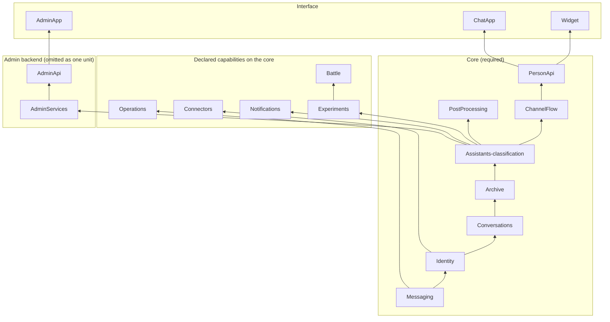

# Stacks: what each one owns, what it depends on, and what deploys when

**Audience:** anyone deploying AgentEchelon into their own AWS account, or deciding where a new resource belongs.

Every stack is prefixed with the instance name (default `AgentEchelon`), so a second instance in the same account is `MyInstanceConversations`, `MyInstanceIdentity`, and so on. The prefix is also the safety gate: `npm run deploy` refuses to run if `cdk list` returns a stack outside the expected prefix, which is what stops a `--all` deploy touching a co-tenant project in a shared account.

## The ownership rule

**A stack owns a capability, not a technology.** The question is never "does this use Cognito?" or "does this write to Aurora?" - it is "what is this FOR?". Nearly every route needs an authorizer and most features need a table; neither makes a feature part of identity or analytics.

Two corollaries that have each been violated in practice:

- **Needing an authorizer is not an identity coupling.** A feature route that authenticates its callers belongs with the feature. Otherwise every handler in the platform would live in the identity stack.
- **A route belongs to the stack that owns its handler.** Each stack declares its routes as data (`RouteSpec` in `backend/lib/constructs/http-api.ts`), and the API that serves them (`PersonApi` or `AdminApi`) decides the authorizer from the entry, so a route never borrows another stack's deploy unit, throttle or authorization posture. Grepping for an API constructor will NOT find a route - see "Auditing".

## Layers and capabilities

The platform has four layers, and every stack is one capability, labeled with one of them (decisions: [ADR-055](../design/decisions/055-stacks-are-capabilities-in-layers.md), [ADR-056](../design/decisions/056-two-http-apis-and-no-aws-waf.md) and [ADR-057](../design/decisions/057-assistant-stacks-come-from-the-registry.md); all three are Accepted):

- **Interface:** the clients (the chat app, the admin console, the embeddable widget).
- **Communication:** client connectivity - the APIs and their authorizers, the messaging WebSocket, meeting media, email.
- **Interaction:** the engine - the conversation substrate, identity and the credential exchange, conversations, meetings as conversation state, assistants, connectors, the archive.
- **Foundations:** deploying and operating - the CDK app, tags, the deploy scripts, the operations stack.

**A service is not a layer.** The Amazon Chime SDK spans three layers: the WebSocket session and meeting media are Communication, the app instance, channels, flows, AppInstanceBots and the AppInstanceUser are Interaction, and retention and streaming settings are Foundations. Cognito splits the same way: the user pool is an identity issuer (Interaction), managed login is Interface, and the token check is Communication. So stacks are cut by capability, never by which AWS service they use.

**Component rule.** The layers are labels: each target stack below carries its layer, and no per-stack layer dependency is checked. The rule is the order of the four deployable components: the **core** first; then the **chat interface** and the **admin backend** on it; then the **admin interface** on the admin backend.

- The **core** is every Required stack below. It depends on no admin or interface stack.
- The **chat interface** is `ChatApp`. It needs only the core.
- The **admin backend** is `AdminServices` plus `AdminApi`. It needs only the core, never an optional stack, and it is present or absent as one unit. It takes the admin handlers of an optional capability (experiment administration) only when that capability is declared.
- The **admin interface** is `AdminApp`. It needs the admin backend.



An arrow points from a stack to one that depends on it. The layers are the labels in the table below; the subgraphs are the components the rule binds, plus the capability stacks the core does not need. `PersonApi` is built last and takes the person routes of every stack it serves, the declared capabilities' included (`Battle`'s duel routes, `Connectors`' grant routes), so those edges are not drawn.

The admin plane is a slice across the layers: the admin console, the admin identity and IAM enforcement, and the admin-facing parts of auditing, deployed as its own backend on the core. An API stack takes handler references from the capability stacks it fronts, so a route exists exactly when its capability is declared. The configuration matrix (`backend/test/deploy-matrix/`) checks the component rule in every configuration that synthesizes, over the core under its target names. A configuration declares only built capabilities, and the matrix refuses one that declares another (`backend/test/deploy-matrix/the-matrix-covers-every-configuration.test.ts`).

**Declared capabilities.** A deployment lists what it stands up in one `capabilities` entry in `deploy.config.json`, for example `["widget", "chat", "admin", "battle", "experiments", "notifications", "connectors", "operations"]`. The CDK app creates the required core plus exactly the declared stacks, and synth refuses a capability whose prerequisite is not declared (for example `admin` with no issuer other than the guest issuer). A capability that is not declared leaves no stack, no route and no required setting behind, and every consumer learns presence at synth, never from a missing runtime parameter. A guest is an issuer, not a capability. The registry is `backend/lib/config/capabilities.ts`: each entry names its prerequisites, the stacks it stands up and the stacks it attaches to, and `bin/backend.ts` builds the required core plus each declared entry. Built: `chat` (`ChatApp`), `admin` (`AdminServices`, `AdminApi`, `AdminApp`), `notifications` (`Notifications`), `experiments` (`Experiments`), `battle` (`Battle`, requiring `experiments`), `operations` (`Operations`), `connectors` (`Connectors`) and `widget` (`Widget`). The assistant stacks are one `Assistants-<classification>` per classification the profile registry declares with a `topology` (`backend/lib/config/profiles.ts`). Synth refuses `admin` unless the trusted-issuer registry (`backend/lib/config/issuers.ts`) declares an issuer other than the guest issuer with `admin: true`, and refuses `connectors` declared without a connector in the connector registry (`connectors` in `deploy.config.json`, `backend/lib/config/connectors.ts`), or a connector declared without the capability. **NOT BUILT:** `meetings`, which synth refuses with the reason.

## Target stacks

Every stack is `${STACK_PREFIX}<Name>`, and every `<Name>` is one `backend/lib/config/stack-names.json` lists: `bin/backend.ts` names its stacks through it, the operator scripts read it to tell this instance's stacks from another's (`backend/scripts/lib/stack-lookup.cjs`), and it keeps the names earlier layouts used under `retired`, which `backend/test/retired-stack-names-are-refused.test.ts` refuses anywhere else in `backend/` and `tests/`. **Required** stacks form the core (see [The minimal set](#the-minimal-set)); the others are added by declaring their capability. The "Today" column names what `bin/backend.ts` deploys for each, and [The stacks](#the-stacks) below is the as-built list. A row whose Today column says **NOT BUILT** is target layout only.

| Layer | Stack | Holds | Today | Capability |
|---|---|---|---|---|
| Interface | `ChatApp` | Chat web app hosting (S3, CloudFront) | `ChatApp` | `chat` |
| Interface | `AdminApp` | Admin console hosting | `AdminApp` | `admin` |
| Interface | `Widget` | Embeddable assistant widget hosting (`backend/lib/stacks/widget-stack.ts`): the frame and its loader, with `frame-ancestors` generated from every issuer's `allowedOrigins` (`'none'` when none is declared), and the frame's own origin admitted by `PersonApi` CORS as `widgetUrl` | `Widget` | `widget` |
| Communication | `PersonApi` | One HTTP API (API Gateway v2) for every person-facing route, behind one edge authorizer that resolves the caller to an AppInstanceUser; route throttling, tighter on the unauthenticated routes; CORS generated from the declared origins | `PersonApi`: the person routes of the core and of each declared capability that declares any, behind the edge authorizer (cached 300 seconds; the credential exchange uncached), `GET /deployment/state` with none; a throttle per route, the person credential exchange unthrottled; CORS from `appUrl`, `adminAppUrl` and every issuer's `allowedOrigins`; with a guest issuer declared, guest start and guest refresh with no authorizer and their own tighter throttles (5 and 20 requests per second, `GUEST_START_THROTTLE` and `GUEST_REFRESH_THROTTLE`); with an invitation-link issuer declared, `link` redemption with no authorizer and its own throttle; the landing page's invitation read with none | Required |
| Communication | `AdminApi` | One HTTP API for every admin route, IAM-authorized | `AdminApi`: every route of `AdminServices` and its two nested stacks, IAM-authorized, with the console session (`POST /exchange-credentials`) behind its own edge authorizer on the admin plane; the console roles' `execute-api:Invoke` grants, from the capability catalog | `admin` |
| Communication | `IngressApi` | An HTTP API for a vendor with no Amazon EventBridge integration (Twilio, Phase 8), with route throttling and in-handler limits | **NOT BUILT.** Salesforce and PagerDuty need none: their events arrive through each vendor's EventBridge partner event source, on a rule in `Connectors` (below), and no HTTP route serves a vendor | a vendor with no EventBridge integration |
| Communication | `Notifications` | Email transport: the email bridge on the message stream (delivery email decided from the message, a shared conversation's welcome among them), the invitation and claim emails the `Conversations` functions hand over (`TransactionalMail`), the email preference page, token-addressed inbound replies; the archival alarm; the only SES send grant | `Notifications`, with the email bridge, the preference page, the archival alarm and, with `replyDomain`, the reply receipt rule and poster | `notifications` |
| Interaction | `Messaging` | The Amazon Chime SDK app instance, its service admin, retention, the message stream and its streaming configuration, and the provisioner, the one principal that builds and retires every assistant's identity and Amazon Lex bot | `Messaging` | Required |
| Interaction | `Identity` | The credential exchange (the only AppInstanceUser minter) and its roles; the `Identities` index, `(issuer, subject) -> AppInstanceUser ARN`, written by the exchange, and for a `provisioned-only` issuer pre-assigned as `pending` rows by the subject provisioners (one per caller, P-13); the trusted-issuer registry; the guest issuer (a KMS signing key); the `Directory` and `ClearanceSource` adapters; a SCIM receiver when a provider pushes groups; the platform CloudTrail trail, beside the roles whose use it records. The deployment's own user pool is an issuer added by declaration (`pool: 'self'`), not part of the minimum, and the admin console's app client is on it when `admin` is declared. No Identity Pool | `Identity`, with the guest issuer when the registry declares one (its KMS signing key, kill switch, address salt and guest-session role; [GUEST-ISSUER](../guides/admin/GUEST-ISSUER.md)) and the invitation-link issuer when it declares one (its kill switch and `link` session role, `backend/lib/constructs/invitation-link-issuer.ts`). **NOT BUILT:** the SCIM receiver, so synth refuses `provisioning: "scim"` | Required |
| Interaction | `Conversations` | Shared tables (tasks, user tasks, profile, channel context, turn state, abuse controls, feedback, and `Tokens`: one record per single-use token of every kind, keyed by token hash), the attachments bucket, and the handlers for create-conversation, membership, add-assistant, invitations, tasks, turn state, attachments, feedback and token redemption | `Conversations`, with `Tokens` and every kind (guest refresh, claim, reply, unsubscribe, invitation) and their redemption, and the invitations function | Required |
| Interaction | `ChannelFlow` | The channel flow | `ChannelFlow` | Required |
| Interaction | `Assistants-<classification>` | One per declared classification: the router, processor and task service, and the seed that asks the provisioner for its declared assistants (no assistant identity is a resource of the stack); `ImageGuardrail-<region>` derived per image-model region | `Assistants-<classification>`, one per classification the deployment declares (`profiles`), with one assistant per role it declares (`ops-premium` in `profiles` adds the premium ops assistant to `Assistants-premium`) | Required, at least one |
| Interaction | `PostProcessing` | Post-delivery repair | `PostProcessing` | Required |
| Interaction | `Archive` | The conversation archive in Athena or Aurora mode (`analyticsMode`), the data plane, the membership audit, client events; an `AnalyticsMode` output naming the mode | `Archive`, with the client-events route (`POST /events`) and, in Aurora mode with `sleepMode`, the public `GET /deployment/state` | Required |
| Interaction | `Meetings` | A meeting as conversation state: start, join and end handlers, attendee identity (`ExternalUserId` is the AppInstanceUser id), meeting events written to the archive like every other event | **NOT BUILT** | `meetings` |
| Interaction | `Battle` | Duels | `Battle` | `battle` |
| Interaction | `Experiments` | Experiments and alternate assistants | `Experiments`: the experiments table and its SSM contract; experiment administration is in `AdminServices` | `experiments` |
| Interaction | `Connectors` | The connector runtime, per-vendor service secrets, per-person grants | `Connectors`: when a connector subscribes, one EventBridge rule per subscribing connector on the partner event bus its `eventSource` names (Salesforce Event Relay, the PagerDuty EventBridge integration), pinned to that source and the subscribed events, targeting the receiver, with its replay table and dead-letter queue; the receiver may be invoked by those rules alone. When a connector takes grants: the grants key, the grants table keyed by person id, the person's grant routes (served by `PersonApi`) and the grant revoker with its daily retry. Vendors `pagerduty` and `salesforce`. Secrets are the operator's, read by name. **NOT VERIFIED** against a live vendor delivery. **NOT BUILT:** opening a conversation for a vendor event, and invitations for a person no `Identities` row names | `connectors` |
| Interaction | `AdminServices` | Every admin handler, the admin credential exchange and its roles, the admin conversations, and the admin alert channel and the seed that asks the provisioner for its assistant (the admin assistant), fed by `ae.alert` events from the account's default EventBridge bus | `AdminServices`, with two nested stacks, `AssistantAdministration` and `Analytics`; its routes are served by `AdminApi` | `admin` |
| Foundations | `Operations` | The deployment-wide dashboard only. Each stack keeps its own alarms, and the trail is in `Identity` | `Operations` | `operations` |
| Foundations | (no stack) | The CDK app, cost tags, `deploy.mjs`, `doctor`, teardown, env generation | as today | - |
| Test only | `TestInbox` | e2e inbound email | `TestInbox` | `testInboxDomain` |
| Test only | `TestIssuer` | One Cognito user pool per registry entry with `owner: "test-fixture"`: the people the e2e suite signs in as who are not in the deployment's own pool (a second pool issuer, a foreign OIDC issuer with a managed login, a one-conversation pool). A fixture is trusted once its entry names the pool this stack outputs (`backend/lib/config/test-issuers.ts`) | `TestIssuer` | an `issuers` entry with `owner: "test-fixture"`; refused in production |
| Test only | `WidgetHost` | The sample host page (`examples/widget-host/`) on an origin of its own: a private S3 bucket behind its own CloudFront distribution (`FrontendDistribution`: origin access control, HTTPS only), named in the widget's `frame-ancestors` by a reference to this stack (`backend/lib/stacks/widget-host-stack.ts`); not in `PersonApi` CORS, since the page calls no API | `WidgetHost` | the guest issuer listing `"widget-host"` in `allowedOrigins` (`WIDGET_HOST_ORIGIN`, `backend/lib/config/issuers.ts`); refused in production, on any other issuer kind and without `widget` |

## The minimal set

**The core is seven stacks plus one `Assistants-*` stack per declared classification:** `Messaging`, `Identity`, `Conversations`, `Archive`, `ChannelFlow`, `PostProcessing` and `PersonApi`, plus one `ImageGuardrail-<region>` per region hosting an active image model outside the deploy region. An empty `capabilities` list with no `profiles` deploys exactly that, with `Assistants-basic`, `Assistants-standard` and `Assistants-premium`, and the deployment's own user pool as its one issuer (the registry a deployment gets by declaring no `issuers`).

**The smallest deployment with no accounts is ten stacks:** the seven core stacks, `Assistants-guest`, `Assistants-customer` and `Widget`, with `capabilities: ["widget"]`, `profiles: ["guest", "customer"]` and a guest issuer as the only `issuers` entry. An anonymous visitor talks to the guest classification's assistant in the widget. The guest issuer needs `customer` declared beside `guest`, because the `guest-visitor` conversation type's upgrade path B opens a `customer-engagement` conversation at `customer`, and synth refuses an issuer that reaches a classification the deployment does not declare (`classificationDeclarationErrors`, `backend/lib/config/declared-classifications.ts`). Abuse control on the unauthenticated routes runs in the handler - a captcha verified server-side, a per-address limit and a kill switch, each failing closed, with no bypass in production - and HTTP API route throttling caps each route (`GUEST_START_THROTTLE`, `backend/lib/constructs/guest-issuer.ts`). There is no AWS WAF on the API.

**Verified by:** `backend/test/deploy-matrix/c1-headless.test.ts` (the core alone, its exact stack set, in both analytics modes) and `backend/test/deploy-matrix/c0-anonymous-widget.test.ts` (the ten-stack deployment above: the guest issuer as the only registry entry, `guest` and `customer` as the profiles, and `Widget`, its exact stack set in both analytics modes). A deployment with no member classification builds no invitations function, and its create-conversation API holds no creator's invoke, since it has no conversation a person opens (`backend/lib/stacks/conversations-stack.ts`).

## Additivity

**Additivity.** Adding a capability creates its own stacks and changes only the attach points above it - the two APIs' route tables and the frontends' generated settings - never a lower Interaction stack. **A classification is added and removed by its own stack alone.** Its `Assistants-<classification>` stack holds everything it adds (its compute, the Amazon Lex runtime role and log group its assistants use, acting roles, model grants, clearance groups, its part of Battle and Experiments, and the seed that asks the provisioner for its declared assistants) and publishes its row of the runtime registry, which every function reads at runtime (`loadProfileRegistry`); every grant outside it names a tag, never a list of classifications ([ADR-057](../design/decisions/057-assistant-stacks-come-from-the-registry.md)). So adding a classification deploys that one stack, and removing one deletes it, and no other stack changes, environment variables included: the issuer registry in every function's environment (`TRUSTED_ISSUERS`, `LINK_ISSUERS`) names no classification, and an issuer whose `groups` lists no set reaches what its groups clear at runtime. The matrix checks this in both directions on two pairs, `C1-custom+enterprise` and `C7-custom+research` (a battle-capable classification beside Battle, Experiments and a guest issuer), in both analytics modes, with no named exception ([HOW-TO-ADD-OR-MANAGE-A-PROFILE](../guides/developer/HOW-TO-ADD-OR-MANAGE-A-PROFILE.md#5-adding-a-classification) has the procedure and the removal runbook). Declaring an issuer is not adding a capability either, and it does change lower stacks: the issuer registry travels in every function's environment, and a pool adds the directory reads and the membership audit. The configuration matrix (`backend/test/deploy-matrix/`) synthesizes each configuration in both analytics modes. In every configuration it checks the stack set, that every SSM parameter a stack resolves at deploy is published by a stack it deploys after, the component rule over the core, and additivity against the configuration before it, which synthesizes the same registry and the same classifications (C1, which adds the deployment's pool and the member classifications to C0, and C0 + `admin`, which adds a pool for its administrators, head chains of their own); no check is an expected failure. Every configuration but C4 (meetings) synthesizes. Each declares its classifications in `profiles`, and one that declares none stands up the shipped catalog minus `guest` and `customer`; C1-custom declares a fully custom set, with none of the shipped classifications. A cross-stack export CDK adds to a core stack when a new stack reads one of its values is not a change to that stack; a removed or changed export is. A nested stack's template changes as its parent may (`owningStackOf`), so `AdminServices`'s nested stacks are add-only with it. `Battle` and `Experiments` name no classification. Each classification's part in them is its own stack's: the functions are told the tables' and the orchestrator's fixed names (`CAPABILITY_RESOURCES` in `backend/lib/stacks/agent-classification-common.ts`), and `Assistants-<classification>` grants its own acting role and router role on those names in policies of their own and, on a battle-capable classification, declares each duel's alt to its seed in a declaration of its own (`DeclaredDuelAlts`), which the provisioner builds (`attachBattle` and `attachExperiments`, `backend/lib/stacks/classification-capabilities.ts`). So declaring either capability adds resources to each `Assistants-<classification>` stack and changes none it had, and changes `ChannelFlow` in its environment alone; the two capability stacks deploy after the channel flow and attach their grant to its role. Declaring `notifications` changes `Conversations` in its environment alone (the mail sender's name on the invitation and guest-upgrade functions), and an observability role reads each declared capability's alarms through a policy of that capability's own in each `Assistants-<classification>` stack; `backend/test/the-core-names-no-undeclared-capability.test.ts` holds that the core alone names no `battle` or `notifications` resource. What `connectors` adds is checked on C5's built capabilities by `backend/test/connectors-are-additive-on-the-core.test.ts`: `Connectors` is the only stack it adds, and `PersonApi`'s grant routes and `Identity`'s revoker name are its only attach points.

## Permissions boundaries

Every role a credential is minted on, and every role on a person's request path that an issuer's token or a vendor's event reaches, carries a permissions boundary, so the boundary is the limit whatever its identity or session policy grants later (tenet D3, two layers; `backend/lib/constructs/permissions-boundary.ts`). Each row names the live deny-test that probes it; the deny-tests run against a deployed instance.

| Role | Where | Boundary | Deny-test |
|---|---|---|---|
| Guest session | `SessionRole` under the guest issuer in `Identity` (`backend/lib/constructs/guest-issuer.ts:195-206`) | A permissions boundary: one conversation, read and post (`GUEST_SESSION_ACTIONS`), as the visitor, on a channel tagged with the guest classification, plus `chime:Connect` as the visitor and the messaging session endpoint | `backend/scripts/deny-test-permission-boundaries.mjs`; `backend/scripts/deny-test-guest.mjs` (no session policy: `CreateChannel`, `CreateChannelMembership` and every other conversation refused) |
| `link` invitation session | `SessionRole` under the invitation-link issuer in `Identity` (`backend/lib/constructs/invitation-link-issuer.ts:129-140`) | A permissions boundary: the same one-conversation set, vended at the invited conversation's classification within the type's `linkClassifications` | `backend/scripts/deny-test-permission-boundaries.mjs`; `backend/scripts/deny-test-invitations.mjs` |
| Assistant acting role | `AssistantActingRole` in each `Assistants-<classification>` (`AssistantActingRole` in `backend/lib/stacks/agent-classification-common.ts`) | A permissions boundary: the services a turn uses, classification-gated channel and bot actions only at its own classification, archived conversations read-only | `backend/scripts/deny-test-permission-boundaries.mjs` |
| Person vend roles | `ExchangeRole` in each `Assistants-<classification>`, and the admin plane's and `ExchangeRoleRestricted` in `Identity`, all on the IAM path `/<instance>/exchange/` (`ExchangeRole` in `backend/lib/constructs/exchange-role.ts`); the exchange assumes a role on that path carrying the instance's `Instance` tag and finds each by the key its own stack publishes (`<SSM root>/assistant/<classification>/exchange-role-arn`) | A permissions boundary: the role's own bearer-pinned messaging set, statement for statement (`${aws:PrincipalTag/person}` as the bearer), with a classification role's channel actions tag-gated to the classifications it reaches | `backend/scripts/deny-test-permission-boundaries.mjs`; `backend/scripts/deny-test-bearer-pin.mjs`; synth: `backend/test/every-role-a-credential-is-minted-on-carries-a-boundary.test.ts` |
| `host-assertion` session | Vended on the person vend roles, within the issuer's declared classifications | The boundary of the classification role it is vended on, which the exchange picks within the issuer's classifications; bearer-pinned | `backend/scripts/deny-test-permission-boundaries.mjs` (the vend roles); `backend/scripts/deny-test-host-assertion.mjs` |
| Admin exchange roles | `ExchangeRoleAdminPlane`, `AdminConsoleRole`, `TeamConsoleRole` and `TeamAttachmentRole` in `AdminServices` (`adminExchange` in `backend/lib/stacks/admin-services-stack.ts`) | A permissions boundary each: the admin plane's own statements (view and moderation as the admin twin, the archive plane's routes, the two attachment key families); the console roles' `execute-api:Invoke` and nothing else, inside which `AdminApi` grants each route the catalog gives the role; the team attachment read's `generated-docs/*` alone | `backend/scripts/deny-test-permission-boundaries.mjs`; `backend/scripts/deny-test-admin-exchange.mjs`, `backend/scripts/deny-test-admin-capabilities.mjs`; synth: `backend/test/every-role-a-credential-is-minted-on-carries-a-boundary.test.ts` |
| Assistant provisioner session | `RuntimeAssistantProvisionerRole` in `Messaging` (`backend/lib/constructs/assistant-provisioner.ts`), assumed by the provisioner function alone, once per classification with that classification as a session tag. It is the only role in the app that holds an identity or Amazon Lex write: `manage-assistants` and every stack's seed (`DeclaredAssistantsSeed`) invoke the provisioner and hold no such grant | A permissions boundary: its own statements, every classification condition written as the session's tag (`${aws:PrincipalTag/classification}`), on runtime-provisioned identities and Amazon Lex bots alone | `backend/scripts/deny-test-permission-boundaries.mjs` (**NOT VERIFIED** against a deployment); synth: `backend/test/a-runtime-provisioner-cannot-touch-a-deployed-assistant.test.ts`, `backend/test/one-principal-builds-every-assistant.test.ts` |
| Edge authorizer | The authorizer function's role in `PersonApi` and `AdminApi` (`EdgeAuthorizer` in `backend/lib/constructs/edge-authorizer.ts`) | A permissions boundary: `GetItem` and `Query` on `Identities`, `chime:DescribeAppInstanceUser`, `kms:GetPublicKey` on the guest signing keys, and `PutItem` on `Tokens` under `assertion-jti#*` only, where a host-assertion issuer is declared; no `Identities` write | `backend/scripts/deny-test-permission-boundaries.mjs`; `backend/scripts/deny-test-edge-authorizer.mjs`, `backend/scripts/deny-test-tokens.mjs`; synth: `backend/test/the-edge-authorizer-reads-identities-and-never-writes-them.test.ts`, `backend/test/every-role-a-credential-is-minted-on-carries-a-boundary.test.ts` |
| Connector runtime | `ConnectorEventReceiverRole`, `ConnectorGrantRoutesRole` and `ConnectorGrantRevokerRole` in `Connectors` (`backend/lib/stacks/connectors-stack.ts`) | One permissions boundary: the services the runtime uses, no Amazon Chime SDK action but `DescribeAppInstanceUser` (so no conversation's channel action), no secret outside its connectors' own (`<prefix>/connector/*`), and no `Identities` write | `backend/scripts/deny-test-permission-boundaries.mjs`; `backend/scripts/deny-test-connector-boundary.mjs`; synth: `backend/test/every-role-a-credential-is-minted-on-carries-a-boundary.test.ts` |

## The stacks

What `bin/backend.ts` deploys today, listed in deployment order: the required core, plus each stack whose capability is declared (named in the Owns column). Order is derived by CDK from construct references and declared edges, not hand-maintained; what follows explains WHY each dependency exists.

| # | Stack | Owns | Depends on |
|---|---|---|---|
| 1 | `Messaging` | The Amazon Chime SDK app instance, its service admin and retention limit, the message stream, and the app instance's streaming configuration that points at it; the provisioner (`AssistantProvisionerFunction`, under a fixed name), its session role, and the one Amazon Lex runtime role and conversation log group every assistant's bot uses. The provisioner is core because every deployment has assistants and not every one declares `admin`; the app instance's own provider (from `cdk-amazon-chime-resources`) is denied every bot action | - |
| 2 | `Identity` | The user pool, with the admin plane's group and the membership groups, when the trusted-issuer registry declares one (`pool: 'self'`), with the admin console's app client (`AdminWebClient`) on it when `admin` is declared; the person credential exchange (`POST /exchange-credentials`) and the one-conversation and admin plane vend roles (each conversational classification's vend role and clearance groups are its `Assistants-<classification>` stack's), the `Identities` index, the access log, offboarding (`OffboardingRole` and `OffboardingFunction`, which the console's delete and readmit also invoke), and the platform CloudTrail trail. No Identity Pool | Messaging (app instance ARN) |
| 3 | `Conversations` | Shared always-on plane: task tables, per-user profile, channel context, turn state, abuse controls, the **user feedback** table, the attachments bucket; the conversation, create-conversation, task, turn-state, presigned-URL and user feedback (`POST /feedback`) handlers, whose routes `PersonApi` serves | Messaging, Identity (the trusted-issuer registry its handlers read the caller through; the offboarding role it grants on its own resources, by reference) |
| 4 | `Archive` | The conversation archive in Athena or Aurora mode under one name, reading Messaging's stream; the membership audit and the client-events route (`POST /events`); an `AnalyticsMode` output. Aurora mode adds the VPC, pgvector, the retrieval + drift **data-plane Lambda** and the VPC and database hooks it publishes for each classification's own turn data plane and classifier replay, which its `Assistants-<classification>` stack builds, the summary updater and, with `sleepMode`, the handler of the public `GET /deployment/state` | Messaging (the stream), Identity (pool, role boundaries), Conversations (in Aurora mode the feedback table and the attachments bucket by reference; declared in both modes, so the core deploys in one order) |
| 6b | `ImageGuardrail-{region}` | Conditional, one per region hosting an active image model outside the deploy region: the regional image-generation content guardrail (Bedrock guardrails are regional, so a cross-region image invoke needs a guardrail in the model's region) | - (the classification stacks reference its outputs cross-region) |
| 7 | `Assistants-<classification>` | One per classification the deployment declares (`profiles`, `resolveDeploymentProfiles`) with a `topology`; declared as nothing, `basic`, `standard` and `premium`, and `guest` and `customer` only where declared: router handler, async processor, the seed that asks the provisioner for its declared assistants once (`Custom::DeclaredAssistants`, ADR-048 amended 2026-10-24; no assistant identity is a resource of the stack, and the seed's role holds only the invoke of the provisioner), per-classification IAM, the classification's person vend role and clearance groups, and its conversation creator, each published under the classification's own key for the callers that find it by name; where `battle` and `experiments` are declared, its own part in them: the grants on their tables and the orchestrator on its acting role and router role, and on a battle-capable classification each duel's alt, declared to its seed (`attachBattle`, `attachExperiments`) | Messaging (the provisioner its seed asks, by name); Conversations; Archive in Aurora mode (the data planes and the message analytics table) |
| 8 | `ChannelFlow` | The Amazon Chime SDK **channel flow** processor: intercepts messages in-flight for `@all` fan-out and `/battle` dispatch. Resolves the routers, processors and task services of the deployed classifications from the SSM contract at deploy | Messaging, Conversations, the `Assistants-*` stacks; told the battle and experiments tables' names when declared, whose stacks grant on its role |
| 8b | `PostProcessing` | Unconditional, one consumer on the message stream: acts on messages delivery did not route (post-delivery correction, off the synchronous channel-flow path) | Messaging (its stream), Conversations (SSM contract), the classification stacks (router ARNs via SSM) |
| 8c | `Experiments` | `experiments`: the experiments table, under its fixed name (`CAPABILITY_RESOURCES`), its SSM contract (`ExperimentsTableName`), and the grant on it held by the channel flow's role; each classification's acting role and router role are granted it by that classification's own stack (`attachExperiments`). No routes: experiment administration is in `AdminServices` | `ChannelFlow` (the role it grants on, by name) |
| 8d | `Battle` | `battle`: battle state tables and the battle orchestrator, under their fixed names, the channel-battle and battle-outcome handlers, whose routes `PersonApi` serves; the grant on the tables held by the channel flow's role. Each battle-capable classification's alt and its grants on the tables and the orchestrator are its own `Assistants-<classification>` stack's (`attachBattle`) | Messaging, Identity (the trusted-issuer registry its handlers read the caller through), Experiments (its handlers read the experiments table) and `ChannelFlow` (its role); reads each router's `router-arn` parameter by name at call time |
| 9 | `AdminServices` | `admin`: every admin handler. The admin notification channel and admin assistant, and the one EventBridge rule that posts `ae.alert` events into the channel (`AdminAlertPosterFunction`); the console's events, an AppSync Event API (`ConsoleEvents`) with the rule and publisher that tell the console when a golden run, an upload or a generation ends (`ConsoleEventsPublisher`, ADR-065); the admin credential exchange (console sessions, the per-capability admin vends, the team attachment read and `GET /admin/access-log`), `ExchangeRoleAdminPlane`, the console roles and `TeamAttachmentRole`; user management and the admin conversation sync; the admin conversation and task handlers; the feedback summary (`GET /feedback`). It holds no API: its routes are data, served by `AdminApi`. Two nested stacks: `AssistantAdministration` (profiles, ownership, the roster and, with `experiments` declared, experiment administration) and `Analytics` (the analytics query, a VPC function in the archive's VPC in Aurora mode; queue health, classifier replay, membership-audit review and the sleep and wake routes) | Messaging, Identity (the pool, `Identities`, the access log and `OffboardingFunction`, by reference), Conversations, Archive (its VPC and cluster in Aurora mode), the `Assistants-*` stacks (task-service ARNs via SSM); Experiments and Battle when declared |
| 9b | `AdminApi` | `admin`: one HTTP API serving every admin route `AdminServices` and its nested stacks declare, IAM-authorized, with the console session behind its own edge authorizer on the admin plane, which admits only a token whose issuer declares `admin: true`; the console roles' `execute-api:Invoke` grants (`grantAdminRolesOnApi`, one managed policy per catalog surface and role); the `AdminApiUrl` and `AdminApiCapabilities` outputs | AdminServices (its handlers and console roles), Identity (`Identities`, the pool's app clients) |
| 10 | `Notifications` | `notifications`: outbound email - the briefing, the invitation and claim emails (`TransactionalMail`), the email bridge (a second consumer on the message stream that sends delivery email) and the archival alarm - the email preference page, the reply receipt rule and poster when `replyDomain` is set, and the deployment's only SES send grant | Messaging, Identity; `Notifications` also the stream, Conversations (SSM contract) and the `Assistants-*` stacks (router ARNs via SSM, for the share's recap turn) |
| 11 | `Operations` | `operations`: the deployment-wide dashboard, over the metrics the other stacks already emit. No alarm, function or grant | Messaging (the stream's metric) |
| 11b | `Connectors` | `connectors`: when a declared connector subscribes, the event receiver (`ConnectorEventReceiver`), its replay table, its dead-letter queue (`ConnectorEventsDlq`, with an alarm) and one rule per subscribing connector on its vendor's partner event bus, referenced by name (the operator associates the partner event source with its bus before the deploy); when a connector takes grants, the grants key, the grants table, the grant routes (`POST`/`DELETE /connectors/{connectorId}/grant`, served by `PersonApi`) and the grant revoker (`<instance>-connector-grant-revoker`, invoked by offboarding, with a daily retry). No role holds an Amazon Chime SDK channel action | Messaging, Identity (`Identities`, read only; the offboarding role it grants the revoker's invoke) |
| 12 | `ChatApp`, `AdminApp` | `chat` and `admin`: the two CloudFront distributions + their S3 origins | - (consume outputs at build time); `AdminApp` deploys after `AdminServices` and `AdminApi` |
| 12b | `WidgetHost` | Test only: the sample host page's bucket and distribution, with the `WidgetHostBucketName`, `WidgetHostDistributionId` and `WidgetHostUrl` outputs; published by `deploy-frontend.mjs --widget-host` with a generated `host-config.js` naming the widget's origin | - (`Widget` depends on it, for the origin its `frame-ancestors` names) |
| 13 | `PersonApi` | Required: one HTTP API serving every person route the core and the declared capabilities declare, behind the edge authorizer (`backend/lib/constructs/edge-authorizer.ts`), which verifies the token against the trusted-issuer registry and resolves it through `Identities`; `GET /deployment/state` with no authorizer; the `PersonApiUrl` and `PersonApiCapabilities` outputs. Built last | Every stack whose person routes it serves (Identity, Conversations, Archive and each declared capability that declares any), Messaging (the app instance), Identity (`Identities`, the pool's app clients) |

### Analytics mode is a choice, not two products

`-c analyticsMode=athena` (default) or `aurora`. **Athena/S3 is the system of record in both modes** - the same append-only conversation archive is written either way. Aurora adds a fast, queryable projection plus the capabilities that need pgvector (drift, RAG, evaluation). Aurora is a strict superset for QUERY, never for durability. Athena mode is the lower-cost option; testing focuses primarily on Aurora mode (see [Testing focus](../guides/admin/AURORA-MODE-GUIDE.md#testing-focus)).

**The mode is chosen at first deploy.** Both modes deploy as the one `Archive` stack, which names its mode in its `AnalyticsMode` output. Switching an existing deployment between the two is not supported: both modes create the same fixed-name resources (the conversation archive bucket, the archive Firehose, the Glue database, the Athena workgroup, the archive KMS alias), and the archive bucket is retained when the stack lets it go, so the other mode's create collides with what the first left. `npm run deploy` reads the deployed `Archive` stack's `AnalyticsMode` output and refuses a deploy whose `analyticsMode` differs from it. To change modes, tear the deployment down and deploy fresh, which starts it empty; see [Switching modes](../guides/admin/AURORA-MODE-GUIDE.md#switching-modes).

Aurora mode introduces a VPC with **isolated subnets and no NAT**. Anything VPC-attached therefore has no egress except through VPC endpoints (S3, Kinesis, bedrock-runtime, Secrets Manager, DynamoDB). This is why the reply handler stays OUT of the VPC and calls the data-plane Lambda instead of talking to Aurora directly (ADR-013). **New Aurora-side work on the request path belongs as a new `op` on that data-plane dispatch, not as a new VPC endpoint.**

## Deploy

```bash
npm run deploy          # from backend/ - the supported path
```

It does five things in order, and each exists because skipping it caused a real failure:

1. **`npm run build`** - the Lambda bundler resolves `.js` on disk, so without a fresh compile a clean exit-0 deploy can ship stale code.
2. **Safety gates** - refuses to `--all` deploy if any stack falls outside the instance prefix, or if `analyticsMode` differs from the mode the deployment was first deployed with.
3. **Backend stacks** with `appUrl` when `chat` is declared, `adminAppUrl` when `admin` is and `widgetUrl` when `widget` is, pre-resolved from the live distributions, so no CORS allowlist is ever transiently wrong. A distribution that does not exist yet gets one extra pass once it does, in the same run.
4. **Context sync + `gen-frontend-env`** - merges outputs from ALL `<prefix>*` stacks by output key into `packages/{chat,admin}/.env`. This is why moving an API between stacks needs no frontend edit: the key is found wherever it now lives.
5. **Publish the chat SPA, the admin console, then the widget**, each only when its capability (`chat`, `admin`, `widget`) is declared. `gen-frontend-env` first refuses an output a declared capability needs (the person API always, the admin API with `admin`, the pool and its managed login domain with an issuer on the pool; `backend/scripts/lib/frontend-env-requirements.cjs`). With `widget`, it also writes `frontend/packages/widget/.env` (the person API, the guest issuer's captcha site key and notice version, and the `host-assertion` hosts); `widgetUrl` is resolved from the `Widget` distribution's `WidgetDistributionUrl` output the way `appUrl` and `adminAppUrl` are (step 3). With a guest issuer listing `"widget-host"`, the sample host page is published last (`--widget-host`).

> **Do not hand-roll `cdk deploy <Stack>`.** A bare single-stack deploy forwards none of the persisted context, so every `-c`-gated flag silently reverts to its default and `appUrl` falls back to localhost, breaking CORS for the live origin. To target one stack, use `npm run deploy:stack -- <Stack>` (add `--diff-only` to look first): it builds, applies `deploy.config.json`, refuses a missing `appUrl` (or `adminAppUrl` with the admin console enabled, or `widgetUrl` with the widget), checks the name against `cdk list`, prints the diff, and deploys with `--exclusively`.

**Rollback check.** `npm run deploy` and `npm run deploy:stack` record the commit each stack was deployed from, in SSM under `/<instance>/deployed-commit/<Stack>`, and refuse to deploy a stack whose recorded commit is not an ancestor of the checkout's. A checkout older than what is live would otherwise remove live commits while CloudFormation reports success. Uncommitted changes are refused too, unless `--allow-dirty` is passed; `--allow-rollback` deploys over the check deliberately. A stack with no record is allowed and gets its first record. The Claude Code hook `.claude/hooks/deploy-through-the-guard.js` denies a raw `cdk deploy` from an assistant's shell, so these two scripts are the only way an assistant deploys.

**Votes and feedback on delete.** Offboarding a person keeps their battle votes and thumbs feedback, still carrying their AppInstanceUser id, and erases the rest of their records by that id over every store (`backend/lambda/src/lib/offboarding.ts`). Nothing finds a vote or a thumb by person, so the Battle stack has no voter index and the UserFeedback table has no index by voter. Offboarding runs in Identity on `OffboardingRole`, from the console (user management invokes `OffboardingFunction`) and from an EventBridge rule on the issuer's disable, enable and delete events, which reach EventBridge through the platform trail in the same stack; Conversations grants that role on the person's records in its tables and the attachments bucket.

Per-instance context lives in `backend/deploy.config.json` (gitignored; see `deploy.config.example.json`), forwarded as `--context key=value`.

### Options that change what gets deployed

| Context flag | Effect |
|---|---|
| `analyticsMode=athena\|aurora` | Which archive the `Archive` stack is, and whether pgvector capabilities exist. Chosen at first deploy; switching an existing deployment is not supported |
| `capabilities` | The capabilities stood up beyond the required core (`backend/lib/config/capabilities.ts`); `admin` provisions `AdminServices`, `AdminApi` and the admin console stack and publishes the console on deploy, `chat` the chat app. Required in `deploy.config.json`: an absent list deploys the core alone |
| `environment=dev\|production` | Whether a teardown keeps data. `production` retains every table, the message stream and the Aurora cluster, and protects the cluster from deletion; `dev` destroys them. Any other value is refused at synth (`backend/lib/config/environment.ts`) |
| `enableLiveDrift=true` | Opt-in live drift suggestions (Aurora only) |
| `enableRdsProxy=true` | RDS Proxy for Aurora. Off by default - it carries a standing monthly floor |
| `profiles` | The classifications and assistant profiles the deployment runs (`resolveDeploymentProfiles`, `backend/lib/config/profiles.ts`), one `Assistants-<classification>` stack each: empty is the shipped catalog minus its outside classifications (`guest`, `customer`), a list selects from the catalog, and an object is a fully custom set. The admin plane is in every set. Synth refuses an issuer, a link classifications or a served conversation type naming a classification the set does not declare, so a guest issuer needs `guest` and `customer` declared (HOW-TO-ADD-OR-MANAGE-A-PROFILE 1.5) |
| `connectors` | The connector registry (`backend/lib/config/connectors.ts`), beside the `connectors` capability: each vendor, the events it subscribes to, the classification its events concern, the issuer its user ids belong to and whether it takes per-person grants. Required in `deploy.config.json`: absent, every connector's route and grants go |
| `issuers` | The trusted-issuer registry (`backend/lib/config/issuers.ts`). Each entry declares a clearance source and the classifications it may grant; a `cognito-federated` entry makes the console point at that provider for user administration. Required in `deploy.config.json`: absent, the deployment trusts its own pool alone and every other issuer's people are refused |
| `analyticsVpcId` | Reuse an existing VPC instead of creating one |
| `adminAuthMode=ae-cognito\|service` | No authorizer: every admin route, `GET /feedback` included, is `AWS_IAM` in every deployment (an `AdminApi` route is IAM unless it declares otherwise, `authOf` in `backend/lib/constructs/http-api.ts`) and has no switch. Sets `ADMIN_AUTH_MODE` on the admin handlers; only `service` changes them, trusting any IAM-signed caller as admin. `federated` is refused at synth. A console session is vended to any registry issuer that declares `admin: true`, resolved to the AppInstanceUser at the admin plane's edge authorizer and checked again by the admin exchange ([ADR-059](../design/decisions/059-the-admin-identity-provider-is-any-registry-issuer.md)) |

## Auditing stack placement

A misplaced resource is easy to miss because the obvious check is incomplete. An API constructor finds the HTTP APIs but no route: every route is an entry in the `routes` of the stack that owns its handler, served by `PersonApi` or `AdminApi`. The generated reference ([`api-contract.md`](../reference/api-contract.md)) lists every route each API serves, with its authorizer and the construct id of its handler. A sufficient audit needs all of:

```bash
grep -rn "api: 'person'\|api: 'admin'\|adminRoute(" backend/lib/stacks/ backend/lib/constructs/  # every route, in the stack that declares it
grep -rn "apigatewayv2\|HttpApi\|WebSocketApi\|RestApi" backend/lib/stacks/ backend/lib/constructs/  # APIs by constructor
grep -rn "addFunctionUrl" backend/lib/stacks/             # Lambda URLs bypass API Gateway entirely
grep -rn "NodejsFunction" backend/lib/stacks/             # scheduled/event Lambdas own no route at all
```

The last one matters: a resource can be misplaced without being an API. Verify a move against the SYNTHESIZED template, not the source - `grep -c <Resource> cdk.out/<Stack>.template.json` in both the old and new stack proves it actually moved.

## Known problems (as-built)

| Problem | Detail |
|---|---|
| `user-management` is Cognito-coupled | Calls Cognito User Pool admin APIs directly, so it is the bundled-provider reference implementation rather than an abstraction. Offboarding is not part of it: it runs by AppInstanceUser for every issuer ([ADR-021](../design/decisions/021-user-administration-is-not-idp-abstracted.md), [ADR-058](../design/decisions/058-offboarding-runs-by-app-instance-user-for-every-issuer.md), [IDENTITY-PROVIDER-GUIDE](../guides/user/IDENTITY-PROVIDER-GUIDE.md)) |

## Teardown

`backend/scripts/teardown.mjs` tears down one instance. The target comes from `AE_INSTANCE_NAME`, and it refuses to run with none set and refuses the default instance without `--instance-is-dev`. Every target is checked against the account's other projects, `AE_TEARDOWN_PROTECT` (comma-separated regular expressions, matched case-insensitively, for example `AE_TEARDOWN_PROTECT=billing,crm-?app`), and a single match aborts the whole run. The check fails closed: a `--confirm` run with `AE_TEARDOWN_PROTECT` unset is refused before anything is deleted, `AE_TEARDOWN_PROTECT=none` declares an account that holds only this instance, and a dry run with it unset still plans and prints a warning (`otherProjectsDenylist`). It lists CloudFormation stacks named exactly `<prefix><a name stack-names.json lists>`, current or retired, in the deploy region and each region a stack is pinned to, so an instance on the earlier layout is removed whole and a longer instance name sharing the prefix is never touched. It deletes them in rounds by export dependency, then purges what they retained when its `Instance` tag names the instance, or, untagged, when its name is one the instance gives it: the user pools (the deployment's and the TestIssuer pools, and by name the staff pool, which is **NOT BUILT**), the tables (`Identities` and `Tokens` among them), buckets, the message stream, the app instance, the SSM root, and the archive KMS key, scheduled for deletion and its alias removed. No stack owns an assistant (ADR-048, amended 2026-10-24), and no seed removes one created in the console, so the teardown removes each such assistant's identity and Amazon Lex bot BEFORE it deletes any stack, and its directory entry only once both are gone (`consoleAssistantsToRetireFirst`, `removeAssistantResources`; one still standing keeps its entry and is tried again after the stacks, and the teardown then reports itself incomplete); a classification stack's seed then removes the assistants it declared as the stack is deleted, and after the stacks and before the app instance the teardown removes whatever identity the directory still records, such as one a seed could not remove (`assistantIdentitiesToRemove`, both in `backend/scripts/lib/teardown-plan.cjs`). A deployment whose assistants were created by CloudFormation, before that amendment, moves to this shape by a teardown and a fresh deploy. It never deletes a Secrets Manager secret: Twilio, image-generation and every other external API key live in secrets and outlive a teardown. It prints success only after a second listing finds nothing left. It is a dry run without `--confirm`, and `--keep-archives` keeps the archive buckets. Its decisions are tested in `backend/test/teardown-plan.test.ts`.

Data stacks use `RETAIN` on production and `DESTROY` elsewhere (one value, `environment`, read in one place: `backend/lib/config/environment.ts`), with exceptions that are `RETAIN` in every environment and survive any teardown: the conversation archive bucket (the system of record), the user pool and the attachments bucket, which keeps the content-addressed bodies stored in it, a classification's intent pack (`classification-packs/`) and its document templates (`templates/`) among them. The pointers that name the active versions are SSM parameters under the root, which the teardown purges. A retained resource with a fixed physical name blocks the next deploy of the same instance: delete the conversation archive bucket, `<prefix>-conversation-archive-<account>-<region>` (and in Aurora mode `<prefix>-aurora-archive-<account>-<region>`, also `RETAIN`), after copying out anything to keep, or the fresh deploy fails to create it because the name is taken. The fixed-name message stream in `Messaging` (Amazon Chime SDK requires a `chime-messaging-` prefix, so it cannot be auto-named) is `DESTROY` for the same reason, except on production, where it is retained and must be purged by hand or the next `ResourceExistenceCheck` fails.

Three more retained resources block or bill after a teardown:

- **Assistant SSM parameters.** A deploy that sets `assistantSystemPrompt` or `assistantIntentPack` without `assistantParamWriter` creates `/<instance>/assistant/<classification>/assistant-system-prompt` and `/<instance>/assistant/<classification>/assistant-intent-pack` as `RETAIN` parameters with fixed names (`assistant-profile-stack.ts`), where `<instance>` is `AE_INSTANCE_NAME` (default `agent-echelon`). They outlive the stack and the fresh deploy fails to create them; delete them with `aws ssm delete-parameters --names <name> <name>`.
- **The production Aurora cluster.** On `environment=production`, an Aurora deployment retains its database cluster, `<prefix>-analytics`, with deletion protection on, and the archive KMS key that encrypts it (`archive-stack-aurora.ts`). The cluster bills until it is deleted and its fixed identifier blocks a fresh Aurora deploy: export what you need, turn off deletion protection, delete the cluster, then schedule the key for deletion.
- **The Athena archive KMS key.** `RETAIN` in every environment (`archive-stack.ts`). Its alias is deleted with the stack, so it does not block a fresh deploy, but the key bills until it is scheduled for deletion.
