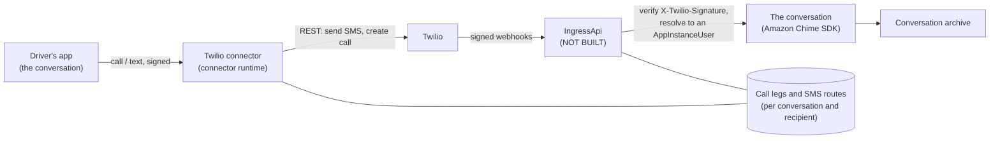
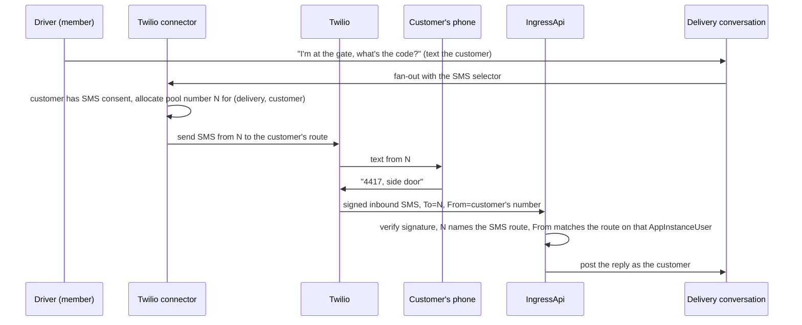
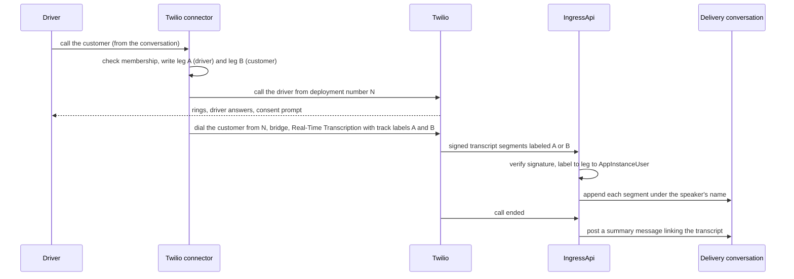
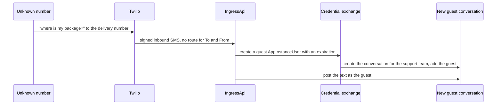

# DESIGN: Telephony and SMS over Twilio, with no Amazon Chime SDK

**Status:** Draft design (**NOT BUILT**). Nothing here is implemented; the connector registry refuses the `twilio` vendor, and `IngressApi` does not exist. This is how the requirements in [SPEC-TELEPHONY.md](./SPEC-TELEPHONY.md) would be built, worked through one delivery from start to finish.

**Coverage:** none - nothing in this document is built.

**Related:** [SPEC-TELEPHONY.md](./SPEC-TELEPHONY.md) - the requirements this implements. [SPEC-CONNECTORS.md](./SPEC-CONNECTORS.md) - the connector runtime and its per-vendor secret. [SPEC-NOTIFICATION-BRIDGE.md](./SPEC-NOTIFICATION-BRIDGE.md) - the fan-out and reply tokens SMS reuses. [DESIGN-ASSISTANT-MEETINGS.md](../interaction/assistants/DESIGN-ASSISTANT-MEETINGS.md) - the separate draft that joins a phone caller to an Amazon Chime SDK WebRTC meeting.

**Site section:** Communication layer.

---

## 1. The delivery this document follows

A customer orders a delivery. The delivery has a conversation, opened by the order event as a typed conversation ([DESIGN-CONVERSATION-TYPES.md](../interaction/conversation/DESIGN-CONVERSATION-TYPES.md)). Its members are the customer, the driver assigned to the delivery, the dispatcher, and the delivery assistant. The customer agreed to texts about the delivery when they ordered, which records SMS consent on their AppInstanceUser.

Three things happen, and each section below builds one of them:

| Moment | What happens | Section |
|---|---|---|
| The driver arrives and needs the gate code | The driver texts the customer from the conversation; the customer replies by text | 3 |
| The customer does not answer | The driver calls the customer from the conversation; the call is transcribed into it | 4 |
| An unknown number texts "where is my package?" | A new guest conversation opens for the support team | 5 |

In every one, the driver and the customer see only the deployment's numbers, never each other's, and the dispatcher reads everything in the delivery's conversation.

## 2. The parts

- **The Twilio connector** runs on the connector runtime and holds the one Twilio credential (SPEC-TELEPHONY FR12). It checks membership, writes the records below, and calls the Twilio REST API. An assistant never calls it directly: an assistant proposes a call or a text, and a person confirms (FR9).
- **IngressApi** is the signed webhook route. It verifies `X-Twilio-Signature` before reading anything (FR2), applies the limits of ADR-056 (FR11), and resolves every event to an AppInstanceUser through a record, never through the sender's number.
- **Two records** carry identity through the telephone network, which knows only numbers:
  - a **call leg**: one per party on a call, naming the conversation and the party's AppInstanceUser, written before the call is placed (FR3);
  - an **SMS route**: one per recipient in a conversation, naming the conversation, the recipient's AppInstanceUser and the deployment number allocated to that pair.

## 3. A text, both ways

**The deployment number is the reply token.** Email carries a reply token in a per-message reply address. SMS has no per-message address, so the token is the pair of numbers: the connector allocates a deployment number from a pool for each (conversation, recipient) pair, and texts that recipient only from it. An inbound text is resolved by the number it was sent **to**, which names the SMS route, and so the conversation and the AppInstanceUser. The number it came **from** is only checked against the route recorded on that AppInstanceUser; it never finds anyone.

- **One number per pair, released at the end.** The pool number stays allocated while the delivery's conversation is open and is released when it closes, so a later text to it from the same phone finds no route and is treated as section 5 describes.
- **A mismatch is refused, not rerouted.** A text to N from a number that is not the customer's recorded route is not posted into the delivery; it opens a guest conversation (FR16).
- **Opt-out.** A carrier opt-out reported on the webhook is recorded against the customer's AppInstanceUser for the SMS route, and the fan-out stops texting them (FR17).

## 4. A call, transcribed into the conversation

**A call between two members is two legs the connector joins.** The driver's tap calls the driver's own phone first, from the deployment number; when the driver answers, the connector dials the customer from the same number and bridges the two. Each leg is a record naming its party, so neither phone ever shows the other's number (FR18), and each side's speech resolves to its own AppInstanceUser.

- **Consent before transcription.** Each party hears the consent prompt before transcription starts, and a party who declines is not transcribed (FR7). Their consent is recorded against their AppInstanceUser for the voice route.
- **The track labels are leg ids.** `inboundTrackLabel` and `outboundTrackLabel` carry the leg ids, so attribution is a record lookup, never a speaker guess (FR3, FR4). A segment whose label resolves to no leg is dropped.
- **Voicemail.** If the customer does not answer, a voicemail left on leg B is posted into the delivery's conversation (FR6).

## 5. An unknown number

A text or call from a number with no SMS route or leg, or to a pool number whose route has been released, opens a **new guest conversation** with a guest AppInstanceUser that expires (FR5, FR16). The support team sees a new contact. Nothing looks the number up, in the identity provider or anywhere else.

If the sender is a customer, they reach their own history only by signing in and claiming the guest conversation through the upgrade path its type declares (FR8). The platform never decides that for them from the number.

## 6. What it needs that does not exist yet

| Piece | Why | State |
|---|---|---|
| `IngressApi` with Twilio signature verification | Every inbound event | **NOT BUILT** |
| The Twilio connector (credential, REST calls, membership check) | Every outbound call and text | **NOT BUILT** (the vendor is refused at synth) |
| Call legs and SMS routes, with the pool-number allocation | Identity through the phone network | **NOT BUILT**; the store is **OPEN** (section 7) |
| The SMS selector on the notification fan-out | Texts as conversation messages | **NOT BUILT** (email only) |
| Consent per route on the AppInstanceUser | FR7, FR17 | **NOT BUILT** for voice and SMS |
| The guest issuer and the claim path | Section 5 | Built for the web widget (`guest-session.ts`, `guest-upgrade.ts`); **NOT BUILT** for a telephony sender |

## 7. Open questions

- **OPEN:** where call legs and SMS routes live: the `Tokens` store keyed per leg and per route, or a connector-owned table keyed by conversation (tenet D13: keyed by the conversation or the principal, never by classification).
- **OPEN:** the size of the number pool and what happens when it is exhausted: queue the text, or text from a shared number that resolves only to a guest conversation.
- **OPEN:** whether the carrier's own STOP and HELP handling on a messaging service is relied on, or the connector records the opt-out itself from the webhook.
- **OPEN:** the consent prompt's wording, and whether it varies by jurisdiction.
- Joining the call to an Amazon Chime SDK meeting as a WebRTC attendee is out of scope here and designed separately ([DESIGN-ASSISTANT-MEETINGS.md](../interaction/assistants/DESIGN-ASSISTANT-MEETINGS.md) C.2).
