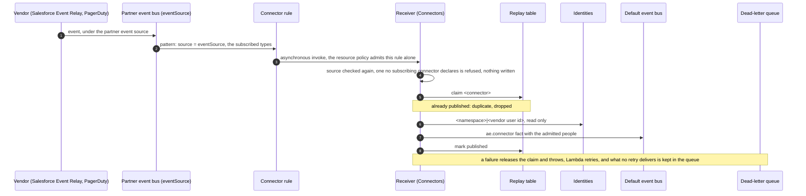

# SPEC: Connectors - integrate with the business's systems, don't replace them

**Status:** Design, with the runtime built and enabled only where a deployment declares a connector. A deployment whose `connectors` is empty has no `Connectors` stack. Built: the connector registry, the `Connectors` stack with one Amazon EventBridge rule per subscribing connector on its vendor's partner event bus, the PagerDuty and Salesforce adapters, the replay record, resolution through `Identities` and per-person grants are in code and proven by unit and synth tests. Nothing is verified against a deployment or a live vendor yet. `IngressApi` is **NOT BUILT**.

**Coverage:** none - no end-to-end spec drives a vendor delivery; the deployed refusals are the deny-tests `backend/scripts/deny-test-connector-events.mjs` and `backend/scripts/deny-test-connector-boundary.mjs`, built and not yet run, and no live PagerDuty or Salesforce account exists to send a real delivery.

**Related:** [SPEC-CONVERSATION-TYPES.md](../interaction/conversation/SPEC-CONVERSATION-TYPES.md) - where a conversation type declares the connectors an experience may use. [SPEC-CONTEXT-SOURCES-AND-STORES.md](../interaction/assistants/SPEC-CONTEXT-SOURCES-AND-STORES.md) - the catalog a connector-backed context source would have to join. [SPEC-INTERACTION-LAYER.md](../interaction/SPEC-INTERACTION-LAYER.md) - the Connectors pillar this is the contract for. [SPEC-TELEPHONY.md](./SPEC-TELEPHONY.md) - the Twilio connector, the one vendor with no EventBridge integration, which needs `IngressApi` (**NOT BUILT**).

**Site section:** Interaction layer. Connectors to systems of record are one of the Interaction layer's pillars; only a connector's transport (`provideComms`) is Communication. The file stays under `communication/` so its links hold.

---

## Overview

**A connector is one governed integration to one external vendor, declared as configuration, reading that vendor's records live rather than copying them.** A connector is **broad per vendor** rather than per capability, so one Salesforce connector may resolve a record's owner, receive the vendor's events and act for a person, and the runtime consumes those capabilities generically from the declaration. Nothing branches on the vendor outside its adapter, and adding a connector of a built vendor is one entry in `connectors` in `deploy.config.json` plus its secrets.

**The conversation is the hub every connector attaches to.** A connector links the external record by reference (`ExternalRef`) rather than by copy. A conversation **type** declares which connectors an experience may use; a conversation **instance** holds the live bindings.

### What is built

| Piece | Where | What it does |
|---|---|---|
| The registry | `backend/lib/config/connectors.ts` | Parses and validates `connectors` at synth beside the `connectors` capability, and refuses either without the other, a vendor or capability not built, an event the vendor does not send, a `subscribes` with no `eventSource` or no classification, an `eventSource` that is malformed, of another vendor or declared twice, an undeclared `personIssuer`, and a `personIssuer` whose classifications never reach the classification |
| `Connectors` stack | `backend/lib/stacks/connectors-stack.ts` | When a connector subscribes: one EventBridge rule per subscribing connector on its partner event bus, the receiver, its replay table, its dead-letter queue and an alarm on it. When a connector takes grants: the grants key, grants table, grant routes and revoker |
| The receiver | `backend/lambda/src/connector-ingest.ts` | The source checked again, then the event, the replay record, the people and the fact (below) |
| Vendor adapters | `backend/lambda/src/lib/connectors/vendors.ts` | PagerDuty and Salesforce: an EventBridge event read into a vendor event id, type, time, record and the people it names by vendor user id |
| Resolution and admission | `backend/lambda/src/lib/connector-participants.ts` | A vendor user id to an AppInstanceUser through `Identities` only, then admission at the connector's classification |
| Per-person grants | `backend/lambda/src/lib/connector-grants.ts`, `backend/lambda/src/connector-grant-routes.ts`, `backend/lambda/src/connector-grant-revoker.ts` | Link, revoke by the person, revoke at offboarding, the daily retry |

**NOT BUILT:** the Twilio, ServiceNow, AWS Support, Jira Service Management and ServiceTitan connectors (synth refuses each); `IngressApi`, an HTTP API for a vendor with no EventBridge integration (Twilio); the `syncRecord`, `fetchContext` and `provideComms` capabilities; a consumer of the `ae.connector` events, so an incident event opens no room yet; a connector issuing an invitation for a person no `Identities` row names; the screen a person links a vendor account from.

### A vendor event, end to end

**A vendor's events arrive through its Amazon EventBridge partner event source, never through an HTTP route.** Salesforce relays Platform Events and Change Data Capture events through Event Relay; PagerDuty publishes through its Amazon EventBridge integration. Each creates a partner event source in this account, and once the operator associates it with an event bus, that partner event bus carries the vendor's events and only the vendor can put events on it. A connector that `subscribes` declares that source as its `eventSource`, and the `Connectors` stack builds one rule for it on that bus, referenced by name.

**The rule.** Its pattern is `connectorEventPattern` (`backend/lib/config/connectors.ts`): the declared `source`, and the subscribed event types where the vendor puts them. For Salesforce the `detail-type` is the relayed event's API name (`LeadChangeEvent`, `Lead_Assigned__e`), so the pattern lists them as `detail-type`. For PagerDuty every event has the `detail-type` `PagerDuty Webhook` and the type is the message's `event` (`incident.trigger`, `incident.resolve`), so the pattern pins that `detail-type` and lists the types under `detail.event`. The rule's one target is the receiver, with a retry policy (eight attempts within 24 hours, for a delivery the Lambda service refuses) and the dead-letter queue. The receiver's resource policy is one statement per rule, conditioned on that rule's ARN (`SourceArn`), so nothing else may invoke it.

**The receiver, a second layer behind the rule.** It finds the connector by the event's `source`: a source no subscribing connector declares is refused as a security event and nothing is written. The adapter reads the vendor's own event id, never the envelope's when the vendor gives one: EventBridge keeps its `id` across its own retries, but the Salesforce relay, resuming after an outage, puts an event on the bus again under a new envelope id.

| Vendor | Partner event source | `detail-type` | Event type | Vendor event id | Record and people |
|---|---|---|---|---|---|
| Salesforce (Event Relay) | `aws.partner/salesforce.com/<organization id>/<event relay id>` | the relayed event's API name | the `detail-type` | `detail.id`, the event's UUID | Change Data Capture: `payload.ChangeEventHeader.recordIds[0]` and `payload.OwnerId`. Platform Event: the org's `RecordId__c` and `OwnerId__c` fields. The owner is `<organization id from the source>:<OwnerId>` |
| PagerDuty (EventBridge integration) | `aws.partner/pagerduty.com/<subdomain>-<event source name>` | `PagerDuty Webhook` | `detail.event` | `detail.id`, the message id | `detail.incident.id`, and each `incident.assignments[].assignee.id` |

**The replay record** is one item per vendor event id, `<connector>#<event id>`, kept for seven days, and an event older than that, or dated more than five minutes in the future, is refused. It is claimed with a conditional write before any work and marked `published` once the fact is on the bus. Only a `published` record makes a delivery a replay. A failure the retry can cure (the replay store, `Identities` or the bus not answering) releases the claim and throws, so Lambda retries the invocation (twice) and the retry is processed rather than dropped as a replay; an event every retry fails lands in the dead-letter queue (`ConnectorEventsDlq`, fourteen days), and the `connector-events-undelivered` alarm fires. A claim another invocation still holds is retried, not dropped; one older than its lease (60 seconds, four times the receiver's timeout) belongs to an invocation that died, and is taken over. A refusal a retry cannot cure (a foreign source, an unreadable or out-of-window event) is not retried.

**No secret receives an event.** The partner event source is the vendor's authenticated channel into this account, so there is no signing secret and no unauthenticated vendor route. The only connector secrets are the OAuth clients of the connectors that take per-person grants.

**What the vendor documents, and what is assumed.** The partner event source names, the Salesforce envelope (`detail-type` as the event's API name, `detail.id` and `detail.payload`) and the PagerDuty `detail-type` are as the sources below state. PagerDuty documents no full event example for its EventBridge integration; its integration guide and the AWS workshop filter on `detail.event` (`incident.custom`), and the AWS Incident Detection and Response guide reads `detail.incident.title`, which is the webhook message format (V2), so the adapter reads that shape. PagerDuty ended support for V2 webhooks on 2022-10-31, while its EventBridge integration still sends this format. Both are **NOT VERIFIED** against a live delivery. The Platform Event field names `RecordId__c` and `OwnerId__c` are this platform's contract with the org that defines the event.

Sources:

- [Receiving events from Salesforce in Amazon EventBridge](https://docs.aws.amazon.com/eventbridge/latest/userguide/eb-saas-salesforce.html) (AWS): Event Bus Relay, the pending partner event source, `aws.partner/salesforce.com/<orgID>/<channelID>`, the association step.
- [Streaming Salesforce Events to AWS with Event Relay and EventBridge](https://dev.to/aws-builders/streaming-salesforce-events-to-aws-with-event-relay-and-eventbridge-4ac2) (AWS Community Builders): a relayed event's envelope, `detail-type` as the event name, `detail.payload`, `detail.id`; Event Relay is available in Enterprise, Unlimited and Developer editions at no extra cost, and relayed events count against the org's daily event delivery allocation.
- [Message Durability](https://developer.salesforce.com/docs/atlas.en-us.api_streaming.meta/api_streaming/using_streaming_api_durability.htm) (Salesforce): `EventUuid` identifies an event uniquely, where `ReplayId` is a stream position.
- [Amazon EventBridge Integration Guide](https://docs.pagerduty.com/integrations/amazon-eventbridge-integration-guide) (PagerDuty): a service extension, `aws.partner/pagerduty.com/{pagerduty-subdomain}-{eventSourceName}`, the `detail-type` `PagerDuty Webhook`, and the Manager, Admin, Global Admin or Account Owner role it takes to add.
- [Create an Event Rule](https://pagerduty.awsworkshop.io/03_eventbridge/page-4-rule.html) (AWS PagerDuty Workshop): a rule pattern on `detail-type` and `detail.event`.
- [V2 Webhooks Overview](https://docs.pagerduty.com/developer/webhooks-v2-overview) (PagerDuty): the message fields `id`, `event`, `created_on`, `incident`, the event types, `incident.assignments[].assignee.id`, and the end of support.

### Setting it up (the operator, before the deploy)

1. **Salesforce.** In the org, create the channel and its members (the Platform Events and Change Data Capture events to relay), a named credential for the AWS account and region, and an Event Relay configuration. Salesforce creates a partner event source in the account, pending.
2. **PagerDuty.** On the service, add an Amazon EventBridge extension naming the AWS account, region and an event source name. PagerDuty creates `aws.partner/pagerduty.com/<subdomain>-<name>`, pending.
3. **Accept each partner source.** In the EventBridge console's partner event sources, associate each with an event bus. The bus carries the source's name.
4. **Declare and deploy.** Each connector's `eventSource` is that name, and its `subscribes` the events it relays. Deploy: synth refuses a malformed or mismatched source, and a deploy before the association fails, because the rule's bus does not exist yet.
5. **Start the relay** in Salesforce. PagerDuty sends from the moment its extension exists.

### Naming a person

**Every human authenticates through a registry issuer; a connector only resolves and reads (K1).** A vendor record naming `jane@example.com` is not proof of Jane, so no adapter reads an address and nothing in the connector runtime reaches an address lookup (K2). A person a vendor names reaches an AppInstanceUser in one of two ways, both through the `Identities` index:

- the connector's `personIssuer` is a registry issuer whose declared subject is the vendor's own user id, through the same single sign-on (a Salesforce org and user id, `<organizationId>:<userId>`, that a Salesforce-signed sign-in also carries);
- an `Identities` row under the connector's own id, `<connector id>|<vendor user id>`, that the person adds for their vendor account from a session already pinned to them. **NOT BUILT:** the flow that writes that row.

A person with no row under a `personIssuer` the registry declares `provisioned-only` (a `host-assertion` host) is pre-assigned: the receiver asks the connector subject provisioner (`provisionSubject`), which writes a `pending` row naming a new person, and the event counts them `pending`. A pre-assigned person is admitted nowhere until their first sign-in through that issuer binds the row. Otherwise the person is `unresolved`: they would be reached by an invitation (`invitations.ts`), and a connector issuing one is **NOT BUILT**, so nothing is created for them and the event counts them unresolved.

### Why an integration does not widen the access boundary

**Admission is the narrower of two limits (K4).** A connector that subscribes declares the `classification` of the conversations its events concern. A resolved person is admitted only when the classification their issuers' clearance sources give them, each within its own issuer's classifications, reaches that classification; a clearance that cannot be read admits nobody. Synth refuses a `personIssuer` whose classifications never reach the connector's classification. The `ae.connector` event names only the admitted people, and counts the rest by why, so nothing downstream can act for someone admission did not admit.

**No connector role holds an Amazon Chime SDK channel action.** The receiver reads `Identities` and the directory, writes its replay table and its dead-letter queue, reads no secret, and publishes the `ae.connector` source; the grant functions read and write the grants table and use the grants key only through DynamoDB or under the grant encryption context. None writes `Identities`.

### Acting for a person

**A connector may act for a person (K3).** Reading a vendor's records as the person, so the vendor's own sharing rules apply, takes that person's OAuth grant. A person links one with `POST /connectors/{connectorId}/grant` (`code`, `redirectUri`, `codeVerifier`, an authorization code with PKCE returned to a redirect URI the connector declares) and revokes it with `DELETE /connectors/{connectorId}/grant`, both on `PersonApi` for the caller the edge resolved and nobody else. The tokens are sealed with a customer managed KMS key, with the person and connector as the encryption context, in a table keyed by person id and encrypted with the same key.

**A grant is revoked at the vendor before it is deleted.** The revocation call (Salesforce `/services/oauth2/revoke`, PagerDuty `identity.pagerduty.com/oauth/revoke`) is retried three times with backoff; a grant the vendor does not confirm stays `revoke-failed`, and a daily retry tries it again. After fourteen retries the grant is deleted and an `ae.alert` asks an operator to revoke it at the vendor by hand. Offboarding invokes the revoker for the person's grants before their identity is erased, records the count revoked (`removed_connectorGrants`) and the count left for the retry (`connectorGrantsRevokeFailed`) in its `offboarding` event, and does not wait on a vendor.

## Business Problem

A conversation about real work almost always has to touch a system the business already runs - the CRM record, the on-call rotation, the incident - and the answer a person needs lives in that system rather than in the chat. Copying the vendor's data creates a second thing to secure and keep current, and hand-coding one integration per vendor means owning its credentials, retries and auditing forever. A connector names the vendor in configuration, receives what the vendor sends through the vendor's own channel into the account, reads live, and applies the platform's existing identity, admission and audit rules to every person it names.

## Personas

Personas are defined in [PERSONAS.md](../../overview/PERSONAS.md) and are not redefined here.

### AI developer

**Goal:** connect an experience to a system of record without embedding a copy of it.

| What they need | Requirement |
|---|---|
| Declare which vendors an experience may reach, without a handler change | FR1, FR3 |
| Read a record live at answer time rather than from a duplicate | FR4 |
| External records linked by reference from the conversation | FR5 |

### Admin / operator

**Goal:** decide which integrations are allowed and answer for what each one did.

| What they need | Requirement |
|---|---|
| Vendor credentials held per connector, never inline and never shared across connectors | FR6 |
| Every outbound action recorded | FR8 |
| Confidence that a person a connector names cannot reach past the conversation's classification | FR2 |
| Per-person vendor grants the person can revoke and offboarding removes | FR11 |
| Vendor events received only from the partner event source each connector declares, and no unauthenticated vendor route | FR12 |

### Platform developer

**Goal:** implement a vendor once, in one adapter, the same way every time.

| What they need | Requirement |
|---|---|
| A capability contract the runtime consumes generically | FR1 |
| An open vendor and capability key set | FR3 |
| Inbound events routed by the reference they carry, never by a guess | FR13 |

### End user

**Goal:** the person who can help is in the conversation, and the assistant knows what the record says.

| What they need | Requirement |
|---|---|
| The right colleague named by the vendor reached as themselves, never by an address | FR2 |
| An answer read with their own vendor permissions where it is read for them | FR4, FR11 |
| A conversation whose boundary does not widen because it gained an integration | FR2 |

## Functional Requirements and Acceptance Criteria

The statuses are `(unit, behavior)`, `(unit, source text)`, `(synth)` and `none`. No row is verified against a deployment.

| # | Requirement | Priority | Delivered | Validated by |
|---|---|---|---|---|
| FR1 | A connector is one vendor declaring a capability set, and the runtime consumes those capabilities generically: no handler branches on the vendor outside its adapter | Enabler | Yes, for PagerDuty and Salesforce: the receiver, resolution and grants read the entry; the adapter table is the one vendor switch | `backend/test/connectors-hold-only-their-own-reach.test.ts` (synth) |
| FR2 | A person a connector names is an AppInstanceUser reached through `Identities` only, admitted at the narrower of the conversation's classification and their issuer's classifications; an email a vendor returns never identifies anyone; a person with no row is reached by invitation | Gap - prioritize | Partly: resolution and admission are built, and a person under a `provisioned-only` `personIssuer` is pre-assigned and counted pending; a connector issuing an invitation is **NOT BUILT**, so any other such person is counted unresolved | `backend/test/lib/a-connector-names-a-person-only-through-identities.test.ts` (unit, behavior; unit, source text) |
| FR3 | Adding a connector or a vendor is configuration plus one adapter; a vendor or capability not built is refused at synth with the reason | Enabler | Yes | `backend/test/connectors-hold-only-their-own-reach.test.ts` (unit, behavior) |
| FR4 | A connector reads each source of truth live and never duplicates it | Differentiator | No: no read path (`fetchContext`) is built | none |
| FR5 | An external record is linked from the conversation by reference, and the connector's artifacts are posted back into it | Differentiator | Partly: each `ae.connector` event carries its `ExternalRef`; nothing posts into a conversation | none |
| FR6 | Vendor credentials are held per connector in Secrets Manager, each function reading only the secrets of its kind for the connectors it serves | Gap - prioritize | Yes: the operator's secrets, read by name, scoped per connector and kind | `backend/test/connectors-hold-only-their-own-reach.test.ts` (synth) |
| FR7 | An unknown or misdeclared connector is refused at synth with every reason, never skipped at runtime | Table stakes | Yes | `backend/test/connectors-hold-only-their-own-reach.test.ts` (unit, behavior) |
| FR8 | Every outbound action a connector takes is recorded | Gap - prioritize | Partly: each received event's outcome and each grant revocation is logged by connector and event id; no outbound vendor write exists | none |
| FR9 | Tool reach through a governed MCP server is scoped, guardrailed and audited on the same substrate as every other tool | Differentiator | No | none |
| FR10 | A conversation type declares which connectors an experience may use; a conversation instance holds the live bindings | Enabler | Partly: declared on the type; nothing reads it | none |
| FR11 | A connector may act for a person through their own grant, stored keyed by their AppInstanceUser id, encrypted, revocable by the person, and revoked at the vendor at offboarding, a failed revocation retried and recorded | Gap - prioritize | Yes, not enabled on dev (no connector declared); the linking screen is **NOT BUILT** | `backend/test/lib/a-connector-grant-is-revoked-before-it-is-deleted.test.ts` (unit, behavior) |
| FR12 | Vendor events arrive only through the vendor's EventBridge partner event source: one rule per subscribing connector, pinned to its declared source and subscribed events, the only principal that may invoke the receiver; the receiver refuses any other source, drops a replay, and retries a failure rather than losing or dropping it; no HTTP route serves a vendor | Table stakes | Yes, not enabled on dev (no connector declared, so no `Connectors` stack). `IngressApi` is **NOT BUILT** | `backend/test/lib/a-vendor-event-is-received-only-from-its-source.test.ts` (unit, behavior); `backend/test/connectors-hold-only-their-own-reach.test.ts` (synth); `backend/test/connectors-are-additive-on-the-core.test.ts` (synth) |
| FR13 | An inbound vendor event lands in the conversation its own reference names, deterministically | Table stakes | No: the event is published with its reference, and no consumer opens or finds a conversation for it | none |

**Live proof** belongs to the deploy-and-verify pass: run both deny-tests against a deployment declaring a subscribing connector, and record the result here with its date. A real Salesforce Event Relay or PagerDuty EventBridge delivery, the envelope fields the adapters read, and a real revocation are **NOT VERIFIED** until a live Salesforce org and PagerDuty account are connected.

## Non-Goals - Out of Scope

| Out of scope | Why | Where it is covered instead |
|---|---|---|
| Reimplementing a vendor's routing or assignment | The business already decides who owns a record. A connector reads whom the vendor names | FR2 |
| Duplicating a system of record | Reading each source live is the commitment (tenet P5) | FR4 |
| Identifying a person from a vendor record | An address at a vendor is not proof of identity | FR2, and Naming a person above |
| Authenticating a person through a connector | Every human signs in through a registry issuer | [IDENTITY-PROVIDER-GUIDE.md](../../guides/user/IDENTITY-PROVIDER-GUIDE.md) |
| A webhook route for a vendor with EventBridge | The partner event source is authenticated and needs no public route, signing secret or throttle | A vendor event, end to end, above |
| Telephony | Its own spec; Twilio has no EventBridge integration, so it needs `IngressApi` (**NOT BUILT**) | [SPEC-TELEPHONY.md](./SPEC-TELEPHONY.md) |
| A connector-backed context source | Context sources are per classification and connectors per conversation type, so the scoping is settled first | [SPEC-CONTEXT-SOURCES-AND-STORES.md](../interaction/assistants/SPEC-CONTEXT-SOURCES-AND-STORES.md) |

## User Experience Description and Mocks

**A connector has no surface of its own.**

1. **The AI developer meets it as configuration**: a `connectors` entry, and a conversation type's `connectors` list.
2. **The operator meets it as setup at the vendor and a record**: the Event Relay or EventBridge extension, the partner event source to accept, the OAuth client secret of a connector that takes grants, a log line per event naming the connector, the outcome and the vendor event id, and an alarm when an event lands in the dead-letter queue.
3. **The end user meets it as somebody named rightly**, and, where they act through a connector, as one consent at the vendor. **NOT BUILT:** the screen that starts that consent and lists a person's grants.

**OPEN:** this document carries no mocks; the first surface worth drawing is the person's list of linked vendor accounts.

## Related Documents

- [SPEC-CONVERSATION-TYPES.md](../interaction/conversation/SPEC-CONVERSATION-TYPES.md) - the declaration point
- [SPEC-TELEPHONY.md](./SPEC-TELEPHONY.md) - the Twilio connector, which needs `IngressApi` (**NOT BUILT**)
- [SPEC-CREDENTIAL-EXCHANGE.md](../interaction/governance/SPEC-CREDENTIAL-EXCHANGE.md) - `Identities`, and the offboarding the grants are revoked in
- [STACKS.md](../../overview/STACKS.md) - `Connectors` in the layout
- [ADR-056](../../design/decisions/056-two-http-apis-and-no-aws-waf.md) - the two HTTP APIs and the in-handler controls
- [PERSONAS.md](../../overview/PERSONAS.md) and [TENETS.md](../../overview/TENETS.md)

## Appendix A - The declared schema

`connectors` in `deploy.config.json`, one entry per connector (`ConnectorConfig`, `backend/lib/config/connectors.ts`):

| Field | Meaning |
|---|---|
| `id` | The registry id: the rule's name, the secret's name and the `Identities` namespace. Never an issuer's id |
| `vendor` | `pagerduty` or `salesforce` |
| `capabilities` | A subset of what the vendor implements (`resolveParticipant`, `ingest`, `actForPerson`); default all of them |
| `subscribes` | The vendor event types received: PagerDuty `incident.trigger`, `incident.acknowledge`, `incident.unacknowledge`, `incident.resolve`, `incident.assign`, `incident.escalate`, `incident.delegate`, `incident.annotate`; Salesforce the API names of the relayed Platform Events (`<Name>__e`) and Change Data Capture events (`<Object>ChangeEvent`) |
| `eventSource` | Required with `subscribes`: the full name of the vendor's partner event source (`aws.partner/salesforce.com/<org id>/<relay id>`, `aws.partner/pagerduty.com/<subdomain>-<name>`), one per connector |
| `classification` | Required with `subscribes`: the classification the events' conversations are at |
| `personIssuer` | A registry issuer whose subject is the vendor's user id |
| `grants` | `{ redirectUris, scopes }` for per-person grants |
| `loginUrl` | Salesforce: the org's `https://<my-domain>.my.salesforce.com` |

The runtime form travels to each function as `CONNECTORS` (`RuntimeConnector`). `ConnectorRef` (a type's reference) and `ExternalRef` (an instance's binding) are shared with `conversation-types.ts`.
