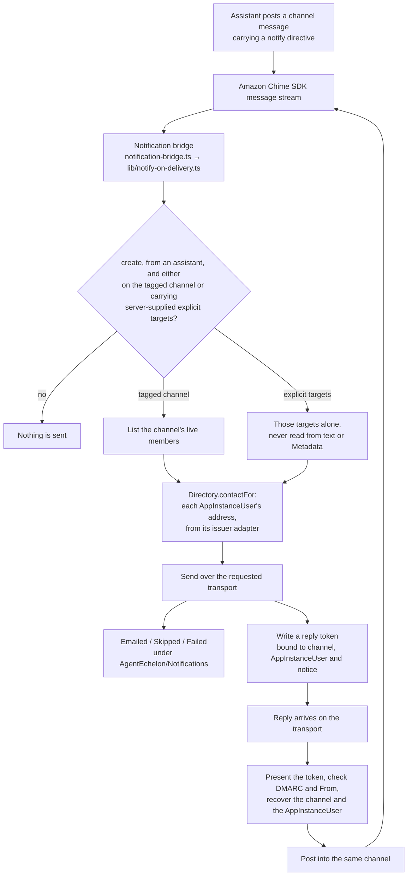

# SPEC: Conversation ↔ transport notification bridge (email now; SMS + voice/PSTN next)

**Status:** Partial (outbound email, email preferences with one-click unsubscribe, reply tokens and the email reply poster ship; SMS, voice and per-conversation email are design, and the requirements table states which is which). The reply poster and the preference page are **NOT VERIFIED** on a live deployment: the reply subdomain's MX and DMARC records are owner setup.

**Coverage:** `tests/e2e/preferences.spec.ts` reads a delivered mention from the test inbox and asserts its `List-Unsubscribe` and `List-Unsubscribe-Post` headers (and a `Reply-To` carrying a reply token where the deployment takes replies), that a `GET` of the link changes nothing, that the one-click `POST` mutes that kind on the person's own preferences item, and that the next mail of that kind is not sent. `backend/scripts/deny-test-reply-token.mjs` is the deny-test for the inbound half: mail with no token, with a token never minted, and with a valid token from an address that is not the person's each posts nothing, and the preference page and the poster each reach only their own records. Both are built and not yet run against a deployment. `tests/e2e/notification-bridge.spec.ts` - DELIVERY is read from the test inbox when the deployment has one (README, "Test inbox"): an assistant's mention and a person's mention each reach only the member named, the body shows the mention as a name with a link into the conversation, and a person's message without a mention reaches no one; with no inbox that test skips and says why. The spec also asserts what has to hold for a send to be possible at all: every deployed sender carries a real sender address rather than the placeholder (which makes `sendEmailNotifications` skip-but-report), and each sender's execution role is allowed `ses:SendEmail` on the identity SES actually resolves that address to. Senders are discovered from the deployment rather than listed, so a new one inherits the check. With `ADMIN_ALERT_E2E=1` it also drives one real fan-out: an uncleared membership alert, whose send log must name a member of the admin channel and must not name a decoy written into that channel's Metadata roster, so recipients are proven to come from live membership rather than member-writable Metadata. `tests/e2e/demo-cast-mail.spec.ts` (`validate --only=demo-cast-mail`) reads what the demo cast receives: the on-call lead shares a premium conversation with the engineering manager in the chat app, and the delivered welcome is asserted to be addressed to the manager alone, to link into that conversation on the chat app's origin, to come from the deployment's sender address in the name of the conversation's assistant and be signed by it, to greet the manager by name and to name where to stop the kind; it is built and not yet run against a deployment.

That last point is not a formality. Treating the address identity as the resource is what broke the path: SES authorizes against the verified parent DOMAIN when the address is covered by one, so every outbound notification failed with `AccessDenied` on `identity/<domain>` while the grant named `identity/<address>`. Because send failures are collected rather than thrown, the caller still succeeded and nothing surfaced. The spec simulates both identities and requires the verified one to be allowed (`lib/ses-identity.ts`).

A role holding no SES grant at all is reported as INERT rather than failed - the notify bridge is wired only when the deployment declares the notifications capability, and then resolves recipients in this deployment's own pool and the other Cognito pools the trusted-issuer registry (`issuers` in `deploy.config.json`) declares; a deployment that has not turned email on ships it configured but switched off by design. At least one sender must still be active, so the exemption cannot quietly empty the check.

**Related:** [ADR-041](../../design/decisions/041-simplifying-how-a-message-reaches-an-assistant.md) decision 7 - why the fan-out runs on the stream rather than in the channel flow. [SPEC-TASK-STATE-TRANSITIONS.md](../interaction/conversation/SPEC-TASK-STATE-TRANSITIONS.md) - the hand-off this bridge is the delivery half of. [DESIGN-ADMIN-AGENT-NOTIFICATIONS.md](../interaction/governance/DESIGN-ADMIN-AGENT-NOTIFICATIONS.md) - the one conversation that sends email today.

**Site section:** Communication layer.

---

## Overview

**The conversation channel is the hub, and every transport bridges onto it in both directions.** A notification is not a separate object with its own lifecycle: it is a MESSAGE in a conversation channel, and the bridge delivers that message to members over whatever transport reaches them. That inversion is what is unique here. The assistant never learns a transport. It posts a message carrying a `notify` directive, and email, SMS or voice is somebody else's problem.

**The return leg is the point, not a nicety.** Once the inbound half lands, a reply on any transport is routed back into the same channel and handled by the on-channel assistant as an ordinary message, so the person who answered by email gets the same assistant, the same context and the same task. This is why adding a transport is an outbound sender plus an inbound-to-channel adapter and nothing else: no assistant changes, no router changes, no task changes.

**Outbound email ships and is deliberately narrow.** Exactly one conversation sends membership-wide email today - the administrators' notification conversation, identified by an immutable `aeChannelKind` tag its provisioner stamps at creation - and its recipients are that channel's live membership, each resolved to a contact in the identity provider at send time. The one exception is a directive carrying explicit `targets` that the server supplied, such as the just-shared member the federated add-member path notifies: that sends from any channel, to those targets alone. **A mention addresses an email too:** a message whose directive asks for email and which `@`-mentions people with the composer's delimited `@<Name|id>` token emails each mentioned person who is a live member of that conversation, and nobody else. Anyone may send one, a person as well as an assistant, because the mention is visible in the room and the recipients are bounded by membership: a mention of somebody outside the conversation reaches nobody, the writer is never emailed for mentioning themselves, and a person's message never sends a membership-wide email or honors explicit `targets`, which it could otherwise write for itself. A mention without the email flag sends nothing. The event-opened conversation's link-back message uses this path to email the person the event named. The design removes that link-back post (SPEC-CONVERSATION-TYPES FR17); the person the event names is reached in the new conversation. Every other conversation sends nothing, whatever its messages request.

**Every recipient is an AppInstanceUser, and an address is only a route to one.** A recipient is named by the AppInstanceUser ARN, from channel membership or a server-supplied target, and never by an email address or a phone number. One seam, `Directory.contactFor(arn, route)`, returns a delivery address for that ARN by asking the adapter of the identity provider that signed the person in: the deployment's pool reads the address live with `AdminGetUser`, and another issuer returns the contact claim recorded against the ARN at sign-in. Every sender calls it: the fan-out, share, the proactive briefing and the archival alarm, whose recipient lists are AppInstanceUser ARNs rather than addresses. Preferences, consent and unsubscribe are keyed by the same ARN (FR19). An inbound reply reaches a conversation only through a reply token bound to the conversation, the AppInstanceUser and the outbound notice, valid for 14 days and accepted more than once, from the address that AppInstanceUser's issuer holds for them now and with DMARC passing (FR13, FR14). Each gap is stated where it applies below (FR8, FR12, FR19, Appendix C).

**The words an email is wrapped in are the conversation assistant's.** The body of a notice is a message an assistant already said. The greeting, the sign-off, the conversation button, the reply hint, the unsubscribe line and the preference page are the message templates of the assistant that speaks for the conversation (`lib/email-copy.ts`), in the language they are written in, signed with that assistant's name. The shipped English is the shipped message templates' (`notification-email`, `email-preferences`, `invitation`, `claim` and `briefing`, [ADR-062](../../design/decisions/062-a-message-is-a-template-stored-and-versioned-like-a-document.md)), word for word what it was (`backend/test/lib/a-message-is-a-template.test.ts`). Each is selected as every message is: the template the room primary's version picks for it, else its own, else the room classification's, else the shipped; the functions that mail about a conversation read the template store, read-only (`grantEmailConsent`; `backend/test/an-email-is-worded-from-its-rooms-templates.test.ts`).

**It runs off the message stream, not on the turn path.** These transports exist to reach somebody who is not watching the conversation, so nobody in the room is waiting on them and nothing on the synchronous path should be. The fan-out is the Notifications stack's own consumer on the message stream, the notification bridge, which reads the delivered message, so it sees the message as stored and can tell a create from an update.

**The inbound half is opt-in and gated on operations.** It is built when a deployment sets `replyDomain` (a subdomain used only for replies) and `replyRuleSet` (the account's ACTIVE SES receipt rule set, since a region has one): the Notifications stack adds a receipt rule for the subdomain to that set, which stores each message and invokes the reply poster (`email-reply.ts`). The subdomain's MX record, SES production access, and the senders' DMARC are a deployment's own prerequisites, which is why the outbound phase stands alone.

## Business Problem

Work does not wait for people to open a chat application. An assistant that has just been handed a task for somebody who is offline either reaches them where they are or the hand-off sits there, and a platform that cannot reach them pushes the organization toward bolting on a notifications product that lives in its own silo with its own recipients, its own templates and its own record of what was sent. Worse, the reply comes back somewhere else: the person answers an email and the answer never reaches the assistant that asked, so somebody has to copy it across. What is needed is for the conversation to be the one place the exchange happens regardless of how each participant is reached, so nobody maintains a separate integration per transport and nothing said off-channel is lost to the conversation it belongs to.

## Personas

Personas are defined in [PERSONAS.md](../../overview/PERSONAS.md) and are not redefined here. Three of them meet this capability, and they want different halves of it: one wants to be reached, one wants to be reached reliably and cheaply, and one wants never to write transport code again.

### End user

**How this relates to them:** they are the person off the application. Their experience of the bridge is that something reached them on a channel they actually read, and - once the inbound half lands - that answering it there was enough.

| What they need | Requirement |
|---|---|
| Be reached on a transport that gets to them rather than only in-app | FR1 |
| Not be reached by somebody who simply typed a directive into a message | FR5 |
| Not receive the same notice twice because a message was edited | FR6 |
| Answer where they were reached, and have the answer land in the conversation | FR13, FR14 |
| Their contact details resolved per send rather than copied into the platform | FR8, Non-Goals |
| Choose which notices reach them on which route, and unsubscribe | FR19 |

### Admin / operator

**How this relates to them:** they are the only recipients today. The administrators' notification conversation is the one conversation that sends email, so a deployment's alerting reaches them through this path, and they own whether it is switched on at all.

| What they need | Requirement |
|---|---|
| Alerts from the administrators' conversation reaching them off the application | FR1, FR4 |
| Recipients that follow live membership, so a person removed stops being emailed | FR3 |
| No other conversation quietly acquiring the ability to send mail | FR4 |
| A failed send visible as a metric with an alarm, rather than collected and lost | FR7 |
| A sender that cannot send reported as inert rather than passing silently | FR9, FR10 |
| Email in place of an in-app notice when the recipient is away | FR15 |

### Platform developer

**How this relates to them:** without this they stitch and maintain one integration per transport, and the assistant acquires a branch per transport with it. They own the seam that keeps that from happening.

| What they need | Requirement |
|---|---|
| One fan-out seam that takes the transport as a selector rather than a code path | FR1, FR16, FR17 |
| A reply resolver that is transport-agnostic, so the second transport reuses the first's plumbing | FR14 |
| Nothing on the turn path waiting on a delivery, and no stream shard stalled by a failure | FR2, FR7 |
| A recipient named by AppInstanceUser and resolved through its issuer's adapter, so a roster spanning identity providers still resolves | FR8, FR12 |
| Push left to the service that already delivers it, rather than reimplemented as a transport | FR18 |

**Also served, and an actor rather than a persona:** **the assistant** ([PERSONAS.md](../../overview/PERSONAS.md), system actors). It posts the message that triggers the fan-out and never holds a transport credential of its own - the follow-up it sends and the hand-off it announces are ordinary channel messages carrying a directive (FR1).

## Functional Requirements and Acceptance Criteria

**Priority is a keep-or-cut decision set against what the field expects.** `Table stakes` means a deployment without it is behind. `Differentiator` is worth the cost because few platforms do it. `Gap - prioritize` marks a requirement whose absence puts this below comparable systems. `Above bar - optional` is more than the field asks. `Optional - attach instead` should be bought rather than built. `Enabler` is not user-visible and is what makes another row work.

| # | Requirement | Priority | Delivered | Validated by |
|---|---|---|---|---|
| FR1 | A channel message carrying a `notify` directive fans out to the channel's members over the requested transport, with the directive naming the transports, the subject and any explicit targets | Table stakes | Partly - email only | `channel-notify` (unit, behavior) |
| FR2 | The fan-out runs on the message stream in the notification bridge, the Notifications stack's own consumer beside post-processing, so no turn and nobody in the room waits on a delivery; the channel flow neither imports nor calls it, and post-processing holds no send grant | Differentiator | Yes | `a-notification-does-not-hold-up-the-room` (unit, behavior), `the-email-bridge-is-in-notifications` (synth), `post-processing-wiring` (synth) |
| FR3 | Recipients are read from live channel membership at send time, never from a recipient list carried on the trigger and never from member-writable channel Metadata | Differentiator | Yes | `channel-notify` (unit, behavior), `notification-bridge` (e2e, behavior) |
| FR4 | Only a conversation carrying the immutable `aeChannelKind=admin-notifications` tag sends membership-wide email, and a tag that cannot be read sends nothing; an assistant's directive carrying server-supplied explicit `targets` sends to those targets from any channel; a directive asking for email on a message that mentions people sends to the mentioned live members alone, from any channel | Table stakes | Yes | `channel-notify` (unit, behavior) |
| FR5 | A person's message sends email only to the members it mentions, and only when its directive asks for email; it never sends membership-wide and its own `targets` are ignored | Table stakes | Yes | `a-notification-does-not-hold-up-the-room`, `channel-notify` (unit, behavior) |
| FR6 | An update to a message is not a second notification | Enabler | Yes | `a-notification-does-not-hold-up-the-room` (unit, behavior) |
| FR7 | A failed send fails neither the turn nor the stream shard, and every outcome is emitted as `Emailed`, `Skipped` or `Failed` with an alarm on `Failed` | Table stakes | Yes | `a-notification-does-not-hold-up-the-room` (unit, behavior) |
| FR8 | Each recipient's contact is resolved at send time through `Directory.contactFor(arn, route)`, keyed by the AppInstanceUser ARN, which asks that person's issuer adapter; a pool lookup is bounded by a trusted-pool allow-list that IAM also enforces, and an issuer with no adapter resolves to nothing and the recipient is skipped and counted | Differentiator | Partly - the seam ships as `Directory.contactFor` (`lib/membership-source.ts`), email route only, over the Cognito pool adapter and the trusted-pool allow-list; every email goes through it (`emailPeople`, `lib/channel-notify.ts`), and the share, briefing and alarm recipients are named by AppInstanceUser. **NOT BUILT:** an adapter for an issuer that is not a Cognito pool | `channel-notify` (unit, behavior), `a-person-is-asked-of-the-directory-by-person` (unit, behavior) |
| FR9 | Every deployed sender carries a real sender address, and its execution role is allowed `ses:SendEmail` on the identity SES resolves that address to - the verified parent domain where one covers the address | Table stakes | Yes | `notification-bridge` (e2e, behavior) |
| FR10 | A sender holding no SES grant reports as inert rather than as a pass, and at least one sender must be active so the exemption cannot empty the check | Enabler | Yes | `notification-bridge` (e2e, behavior) |
| FR11 | Bots are excluded from the fan-out, having no identity-provider identity to resolve | Enabler | Yes | `channel-notify` (unit, behavior) |
| FR12 | No member is skipped because of the identity provider that signed them in: a member from any issuer resolves through that issuer's adapter, from the AppInstanceUser ARN alone, and is never resolved against another issuer's directory | Table stakes | Partial - every recipient is a person by AppInstanceUser ARN, and `Directory.contactFor` (`lib/membership-source.ts`) reaches their subject through the `Identities` `byPerson` index and asks the trusted pool that holds it; no member or lead is skipped for the shape of their id. **Gap:** an issuer that is not a trusted Cognito pool has no adapter yet, so its people resolve to no contact | `lib/channel-notify` (unit, behavior: a non-pool person resolves a contact) |
| FR13 | Every outbound message that invites a reply carries a reply token: a `Tokens` record of kind `reply`, bound to the channel ARN, the recipient's AppInstanceUser ARN and the outbound notice, valid for 14 days and not single-use, carried in the transport's own reply address | Differentiator | Partly - email: every mail about a conversation carries `Reply-To: reply+<token>@<replyDomain>` when the deployment sets `replyDomain` (`lib/email-consent.ts`); the token is 256 bits in lowercase base32 and the store keeps only its SHA-256. Live delivery is **NOT VERIFIED** | `email-reply-tokens` (unit, behavior), `preferences` (e2e, behavior) |
| FR14 | A reply on any transport is accepted only on a valid reply token whose sender is also a verified route of the AppInstanceUser the token names; it is stripped of quoted and markup cruft and posted into the conversation the token names, where the on-channel assistant answers it with no transport-specific code. A reply with no valid token creates nothing and posts nothing, and the sender address alone never identifies anyone | Differentiator | Partly - email: a receipt rule on the reply subdomain stores the message and invokes `email-reply.ts`, which accepts it only when SES found no virus or spam, the recipient carries a live `reply` token, DMARC passes (SPF or DKIM aligned with the From domain), and From is the address `Directory.contactFor` holds for the token's person now; the quoted thread is removed and the text is posted as that person on their own bearer-pinned session. Anything else posts nothing and sends nothing back. Live proof is **NOT VERIFIED**. **NOT BUILT:** a rate limit on refused senders beyond SES's own | `email-reply-tokens` (unit, behavior), `deny-test-reply-token` (deny-test, behavior) |
| FR15 | A deployment can turn email on per conversation, and can choose to send only when the recipient is not connected or not in focus | Differentiator | No | none |
| FR16 | SMS is an additional transport on the same fan-out and the same reply resolver; its reply token is the deployment number allocated to the conversation and recipient ([SPEC-TELEPHONY](./SPEC-TELEPHONY.md) FR15 to FR17, [DESIGN-TELEPHONY](./DESIGN-TELEPHONY.md) section 3) | Differentiator | No | none |
| FR17 | Voice works both ways without Amazon Chime SDK PSTN Audio - an outbound call is placed from a conversation to a member through a call leg that names their AppInstanceUser before dialing, an inbound call or voicemail from a number with no leg opens a new guest conversation and is never matched to a person by phone, and speech becomes channel messages attributed through the leg | Differentiator | No | none |
| FR18 | Push reaches a device through the messaging service's own native delivery rather than through this fan-out, and per-member push preferences stay service state | Optional - attach instead | No | none |
| FR19 | Preferences and consent are keyed by the AppInstanceUser ARN, per route (email, SMS) and per kind of notice, with an unsubscribe that every sender honors; SMS consent is recorded there and checked before every SMS send | Table stakes | Partly - email: every send names its kind (`NOTICE_KINDS`, `lib/notice-preferences.ts`), among them `nudge`, the reminder of an invitation its inviter confirmed (ADR-061), and `task`, a task a workflow step assigned the person, emailed through the directive and muted apart from conversation email (ADR-063 decision C2); a kind outside the transactional set (invitation, claim, reply receipt) is sent only when the person has not muted it and only with `List-Unsubscribe` and `List-Unsubscribe-Post` (RFC 8058); a preference that cannot be read, or a link that cannot be minted, sends nothing a person could stop. The link is the preference page (`GET`/`POST /email/preferences`), authenticated by its `unsubscribe` token rather than a sign-in, live for 60 days. Past that window a genuine link still stops the one kind of email it came in, for the one person it names, until its record's `muteUntil`, 365 days after it was minted (`UNSUBSCRIBE_TOKEN_TTL_SECONDS` and `UNSUBSCRIBE_MUTE_RETENTION_SECONDS`, `lib/email-consent.ts`). **NOT BUILT:** SMS consent (no SMS sender is deployed, so every SMS send is refused); blocking one inviter's invitations | `email-preferences-and-unsubscribe` (unit, behavior), `preferences` (e2e, behavior) |
| FR20 | A person added to a conversation is emailed a link into it by that conversation's assistant, whichever path added them: a share, a member add, or an event that opened the conversation for them. The path names the `memberWelcome` notice and composes no words; the router says it as the room's primary, targeted at the person, and its directive is built from checked variables and the channel the notice is posted in, so the link always opens that conversation and no caller can point it elsewhere | Table stakes | Yes - `memberWelcome` carries `notifyConversationId` from the channel the router posts it in (`noticeMetadata`, `lib/assistant-notice.ts`), and is sent as a `conversation-shared` notice the person can mute. The typed-conversation creator names it for the person an event named and each person the type admitted, in the new room only, with the room's label as the subject (`lib/typed-conversation-notice.ts`). Built and not yet deployed for the event path | `a-notice-takes-only-declared-variables` (unit, behavior), `an-event-opened-conversation-welcomes-its-people-by-email` (unit, behavior); on a deployment, `demo-cast-mail` (e2e, behavior: the share and the ops event, read from the test inbox; the ops event half not yet run) |

**Reading the "Validated by" column.** Each entry names one test file by its own name. Unit tests live in `backend/test/` and `backend/test/lib/`; end-to-end specs live in `tests/e2e/` and are listed against their phase in [e2e-coverage-matrix.md](../../reference/e2e-coverage-matrix.md). The status in brackets is what the test does:

- **behavior** - executes the code path and asserts on the result.
- **source text** - asserts that a convention still appears in the source.
- **none** - no test exists, which is expected where `Delivered` is No.

**Known limits on the delivered rows.** FR1 is delivered for email alone; the directive's shape already carries a second transport selector and nothing consumes it. Delivery itself is not proven end to end anywhere: the end-to-end spec proves a send is POSSIBLE - a real sender address and a grant on the identity SES resolves it to - because capturing mail is outside what the suite can do. FR13 and FR14 are built for email; FR15 through FR17 build on them, since the reply path has to exist before a second transport reuses it. FR18 is a decision rather than a backlog item; see Appendix B.

## Non-Goals - Out of Scope

| Out of scope | Why | Where it is covered instead |
|---|---|---|
| **Push as a fan-out transport** | Amazon Chime SDK delivers push itself, through Amazon Pinpoint, at send time, and a recipient's push preferences are per-member service state the platform must neither cache nor mirror. Building a second delivery system beside one the service provides is the reuse failure tenet D8 exists to prevent, and mirroring the preference is the store failure tenet D7 prevents | Appendix B, which records what the service already does and what is still unestablished |
| A notifications product with its own recipients and templates | The recipient list is channel membership and the content is a channel message. A second system holding either produces two answers to "who is in this conversation" | FR1 and FR3: one hub, one membership read |
| An address book of the platform's own | A contact is resolved per send through `Directory.contactFor`. The pool adapter reads the address live; another issuer's adapter holds the contact claim recorded against the AppInstanceUser at sign-in, which stays as the issuer last asserted it until the next sign-in. No address is copied into channel Metadata, a task, a trigger payload or a notice record | FR8, and Appendix C |
| Finding a person by an address | An email address or a phone number is a delivery route recorded on an AppInstanceUser, never a way to bind, merge or create one; it may find a record inside one issuer's directory, which still resolves through `Identities` before any write. A reply is identified by its token, and a call by its leg | FR14, FR17 |
| Email from every conversation, today | A conversation that can mail its members is a capability, not a default, and the decision has to be an operator's rather than a message's | FR4 is the current boundary; FR15 is the requirement that opens it per conversation |
| Copying the issuer onto a task record | It would be a second identity-provider pointer beside the AppInstanceUser's own, free to drift from it | Appendix C: the task names the AppInstanceUser, and its issuer adapter says how to reach them |
| Inbound mail without the deployment's own domain and SES production access | Receiving is gated on DNS and on an AWS account state that code cannot grant | Appendix D, the operations prerequisites |

## User Experience Description and Mocks

This vertical is the user experience, and here most of it happens outside the application. Each journey below is what a person sees, in order.

### The end user reached off the application

Today:

1. **Something in a conversation concerns them while they are not in it.** An administrators' alert names them, or they are shared into a conversation and the server-supplied directive targets them.
2. **A message arrives on a transport they actually read.** Today that is email, and the contact it went to was resolved for their AppInstanceUser at the moment of sending rather than from anything copied into the conversation (FR8).
3. **It carries enough to act on.** It links into the conversation, in the words of that conversation's assistant, and says how to stop that kind of mail: one click in the mail client, or the preference page its footer links to (FR19).

With the return leg, where the deployment receives replies:

4. **The message carries a reply address of its own** (FR13), and says a reply answers in the conversation.
5. **They reply where they were reached**, and the reply lands in the conversation the token names as their own message, attributed to the AppInstanceUser the token is bound to rather than to whatever the sender address says. The assistant on that channel answers it, with the whole conversation in view, and its answer reaches them by email the same way, with a fresh reply address (FR14).
6. **What they never see:** a portal to log into, a second thread, or a request to repeat what they already said. The conversation is the same conversation.

### The end user inside the application

1. **Nothing changes for them.** A notification is a message in the conversation, so the in-app reading is the ordinary one, and the fan-out is what happens for the members who are not looking.
2. **A delivery that fails somewhere else does not reach them as an error** (FR7). The reply they are waiting on is already posted; the transport leg is behind it.

### The admin / operator

1. **An alert posts into the administrators' notification conversation**, which is the one conversation that mails its members (FR4).
2. **It reaches them by email**, addressed to the live members of that channel (FR3). A decoy roster written into the channel's Metadata reaches nobody, which is asserted rather than assumed.
3. **Membership is the subscription.** Adding somebody to that conversation adds them to the alerting; removing them removes them, with nothing else to reconcile.
4. **A send that fails is a metric with an alarm on it** (FR7), because the fan-out collects send failures rather than raising them and nothing else would report one.
5. **A deployment that has not configured a sender reads as inert rather than as healthy** (FR10).

### The assistant, as an actor

1. **It posts a message with a directive** - for example a task hand-off naming the assignee - and is finished. It holds no transport credential and has no transport branch (FR1).
2. **Its follow-up reaches an offline owner by email** and reaches an online one in the conversation, from the same single act of posting.

**Mocks:** none. The in-app surface is the ordinary conversation; the off-app surfaces are the transports themselves.

## Related Documents

- [ADR-041](../../design/decisions/041-simplifying-how-a-message-reaches-an-assistant.md) - decision 7, why the fan-out runs on the message stream rather than as a channel-flow step
- [SPEC-TASK-STATE-TRANSITIONS.md](../interaction/conversation/SPEC-TASK-STATE-TRANSITIONS.md) - the task hand-off whose delivery half this is
- [DESIGN-ADMIN-AGENT-NOTIFICATIONS.md](../interaction/governance/DESIGN-ADMIN-AGENT-NOTIFICATIONS.md) - the administrators' notification conversation, the only sender today
- [IDENTITY-PROVIDER-GUIDE.md](../../guides/user/IDENTITY-PROVIDER-GUIDE.md) - the identity providers whose adapters resolve a contact
- [SPEC-CONNECTORS.md](./SPEC-CONNECTORS.md) - the connectivity model a pluggable voice carrier would follow
- [PERSONAS.md](../../overview/PERSONAS.md) - the canonical definitions of the three personas above

## Appendix A - The pattern, and the seams that keep it extensible

**Outbound, as built.** `parseNotifyDirective` reads `metadata.notify` off a channel message; `fanOutChannelNotification` lists the channel's members, resolves each member's contact by person through `Directory.contactFor` and sends over SES through `emailPeople`, the one fan-out that the proactive briefing and the alarm notifier also call with the people they name. The entry point is `notifyOnDelivery` (`lib/notify-on-delivery.ts`), called for each stream record by `notification-bridge.ts`, the handler of `NotificationBridgeFunction` in the Notifications stack (`notification-stack.ts`). That function is the stack's own Kinesis consumer on the message stream (from `LATEST`, batches of 10, two retries), holds an SES send grant with the contact lookup (`grantEmailFanOut`, which the stack also gives its transactional mail, proactive briefing and archival alarm functions), and reads only the conversation's tags and memberships from the Amazon Chime SDK. It is built when some trusted issuer's directory holds contacts (`notifyBridge`, `bin/backend.ts`), and the stack holds no bridge otherwise. Post-processing (`message-post-processing.ts`) reads the same stream and holds no send grant; `membership-audit.ts` calls `postAdminNotice` (`lib/admin-notice.ts`), which posts the finding as the admin assistant into the admin notification channel with a `notify` directive, and that channel's own `notify` fan-out emails the admin roster; a host's add (`membershipHandler` in `conversation-management.ts`) and a share (`share-conversation/index.js`) each have their welcome posted with a directive naming the just-shared member by AppInstanceUser ARN, which is the explicit-targets exception of FR4. `mentionedMemberIds` reads the recipients off the text, and `readableMentions` turns each token into `@Name` for the email body. A directive naming a conversation gets a link into it, built by `conversationDeepLink` from the deployment's own `APP_URL` and the id - never a URL taken from the directive - in the shape and style the share-conversation email uses (a "View it here" line and an "Open conversation" button). `APP_URL` comes from the `appUrl` context key (or the `APP_URL` environment variable), which defaults to `http://localhost:5173` (`bin/backend.ts`), and the bridge function receives it as `APP_URL` whenever it is built. A deployment that turns email on must therefore set `appUrl`, or every link points at localhost. The link is omitted only when the conversation id fails validation (`conversationDeepLink` accepts 1 to 128 characters of `A-Z`, `a-z`, `0-9`, `_` and `-`); the email is then sent without a link rather than with a broken one. The link copy, like every word wrapping the body, is the conversation assistant's (`viewItHere` and `openConversation` in `lib/email-copy.ts`).

**Before each mail goes** (`emailPeople`): the person's address from `Directory.contactFor`, which answers nothing for a person the provider has disabled or deleted, or who is offboarded; for a kind they can stop, their preferences and a fresh `unsubscribe` token for the `List-Unsubscribe` header and the footer link; and for a mail about a conversation, a fresh `reply` token for its `Reply-To` when the deployment takes replies (`lib/email-consent.ts`). Each mail is its own SES v2 `SendEmail` request with Simple content (`lib/email-message.ts`), because these headers are per recipient: `List-Unsubscribe`, `List-Unsubscribe-Post` and `Content-Language` as its headers, the reply address as its `ReplyToAddresses`.

**Why the stream and not the channel flow.** The stream record carries `Metadata` intact and carries the message as it was stored, so the rule needs nothing the channel flow could only have handed it, and it can see whether the event was a create rather than an update. The cost is that the transport lands later by the stream's delivery time, which is seconds - and nobody in the room is waiting.

**Why failures are swallowed.** A throw on the stream stalls the shard for every message behind it. So the rule collects its own failures and reports them as metrics, which is also why the `Failed` alarm exists: nothing else would surface one.

**Transport reach.** The components below are what this work builds and later extends; the assistant, channel flow, router and task system stay unchanged per transport.

| Transport | Outbound, to the participant | Inbound, to the channel, where the assistant answers |
|---|---|---|
| In-app chat | the assistant posts a channel message | the person types in the channel |
| Email | the `notify` fan-out to SES, with a reply token | reply to SES receipt to an email processor, which consumes the token and posts into the channel it names |
| SMS | the same fan-out, with the SMS selector on the directive, sent only with recorded consent (FR19) | an inbound SMS webhook posts into the channel its reply token names |
| Voice | a call placed from the conversation through a telephony connector, with a call leg naming the member's AppInstanceUser written before dialing | a call or voicemail on a known leg posts into that leg's conversation; one from a number with no leg opens a new guest conversation and is never matched to a person by phone; a voicemail is transcribed, summarized and posted there |

Three invariants keep that extensible, and they are requirements on the seams rather than observations:

- **A meeting or call is bound to a channel.** A phone call is another way to enter a conversation, not a separate place.
- **Speech becomes channel messages**, so the assistant reasons over voice exactly as it does over chat and email.
- **Adding a transport is an outbound sender plus an inbound-to-channel adapter**, and nothing assistant-specific changes. The outbound seam takes the transport set as an argument on the directive rather than branching on it; the reply resolver takes a token and returns a channel, with no knowledge of which transport carried it; contact lookup is by transport. A seam that fails any of those makes the second transport a rewrite of the first.

## Appendix B - Push is native, and is not a fan-out transport

**Read from the Amazon Chime SDK documentation rather than measured here.** It is recorded because the fan-out above is the wrong shape for push, and a reader following "adding a transport later is the same fan-out" would build a second delivery system beside one the service already provides (tenet D8).

**Amazon Chime SDK delivers push itself, through Amazon Pinpoint, at send time.** `SendChannelMessage` takes an optional `PushNotification` attribute and the service builds the notification from it. Only a title and a body are carried, plus a type, where `VOIP` sends an APNs VoIP push.

**The channel flow can attach it, which matters because the flow is the one component that sees every message.** `ChannelMessageCallback` carries a `PushNotification` field alongside `Content`, `ContentType`, `MessageAttributes` and `Metadata`, so a push configuration can be set on a message as it passes through the flow without the sender having asked for one.

**Whether a recipient gets it is the recipient's decision, natively, at three levels.** An endpoint is registered per device and silenced entirely with `UpdateAppInstanceUserEndpoint` and `AllowMessages: NONE`. A single channel is silenced with `PutChannelMembershipPreferences`. A filter rule in the same preferences filters on the message's `MessageAttributes`, so a member can ask for some messages in a channel and not others. None of that is something this platform would build, and all of it is per-member state the platform must not cache or mirror (tenet D7).

**The payload carries no content.** It carries the title and body plus the message id and channel ARN, and the client loads the message itself over its own credentials. Readability therefore stays where it already is, enforced by Amazon Chime SDK from the message's `Target`, and a push cannot disclose what its recipient could not already read.

**OPEN:** can a message materialized from an Amazon Lex fulfillment carry a `PushNotification` at all? `ChannelMessageCallback` documents `Content`, `ContentType` and `MessageAttributes` as mapped from an Amazon Lex bot response and says nothing equivalent for `PushNotification`. That is silence rather than a statement, so it is a question for a probe. It bears on [ADR-041](../../design/decisions/041-simplifying-how-a-message-reaches-an-assistant.md): a turn the channel flow dispatches is posted by this platform's own `SendChannelMessage` and can carry a push, and a turn Amazon Lex materializes may not be able to.

**OPEN:** what does a targeted message do? Amazon Chime SDK enforces readability from `Target`, so the expectation is that only the sender and the target are notified, and no documentation page read here says so.

## Appendix C - Identity resolution across more than one identity provider

**The design.** A recipient is an AppInstanceUser ARN, whichever identity provider signed the person in, and the ARN is the only key a notify target, a roster entry or a task carries. `Directory.contactFor(arn, route)` reaches the identity provider only from that ARN: through the `Identities` index (issuer and subject to AppInstanceUser) to the issuer's adapter, which returns the address for the requested route or nothing. An issuer is never inferred from the shape of an id, and no recipient is skipped because of which issuer they came through. When an issuer changes a person's address, the pool adapter reads the new one at the next send, while another issuer's recorded contact claim updates at that person's next sign-in, and replies from the new address are refused until then (FR14).

**As built**, a notify target is `{ person }`, an AppInstanceUser ARN, built by `notifyDirective` (`lib/notify-directive.ts`). `Directory` (`lib/membership-source.ts`) finds the person's issuer subjects through the `Identities` `byPerson` index and asks each subject's issuer through its directory adapter (`lib/issuer-seams.ts`): a Cognito pool's record (`lib/cognito-pool-directory.ts`), or for an issuer declaring the `claims` directory, the contact copy of the person's last sign-in (`lib/claims-directory.ts`). The issuers are the trusted-issuer registry each function is handed (`TRUSTED_ISSUERS`). The bridge exists when some trusted issuer's directory holds contacts.

| Case | How it resolves | What happens when it cannot |
|---|---|---|
| A person of this deployment's pool | Their subject there, through `Identities`, then `AdminGetUser` | A failed read resolves to no contact; the person is counted in `skipped` |
| A person of another trusted Cognito pool | To that pool, and only if it is in the allow-list that IAM also grants `AdminGetUser` on | An untrusted issuer is never asked, and the person is skipped (FR8) |
| A person of an issuer with no adapter | Not at all: no adapter holds their subject | The person is skipped. **NOT BUILT:** a non-Cognito issuer's adapter (FR12) |
| A member seen only through membership | The same way: membership names the AppInstanceUser, and the directory does the rest | As above; nothing is inferred from the id |

IAM is the hard boundary and the allow-list is defense in depth, which is the two-layer rule (tenet D3) applied to a directory read.

**Resolving a task assignee, which carries no issuer.** A task's assignee is an AppInstanceUser, and the task never carries an issuer: copying one onto it would be a second identity-provider pointer free to drift from the first. The assignee resolves through `Directory.contactFor` like any other recipient: the hand-off notice names them by AppInstanceUser ARN when they are still in the conversation's roster (`lib/task-notify.ts`).

**Readiness.** The AppInstanceUser ARN is the key and the `Identities` index holds the issuer, so no issuer travels with a recipient. The federated create path still records each member's issuer subject with their host-supplied role (`memberIdentities`), which host grounding matches to a member through `resolvePerson` for the role alone.

## Appendix D - Phasing, operations prerequisites, and security

**Phasing.** Each phase is a decision a deployment makes, and the earlier ones stand alone.

| Phase | What it adds | What it depends on |
|---|---|---|
| Outbound notify | The fan-out and the contact lookup in the notification bridge, on `metadata.notify`. A task hand-off is already a one-way delivery on this alone | A sender identity, and nothing else |
| Reply token | A `Tokens` record of kind `reply` on the outbound path, bound to the channel ARN, the recipient's AppInstanceUser ARN and the notice, valid 14 days, so outbound mail becomes reply-addressable | The token store |
| Preferences and consent | The per-route, per-kind preference and consent record keyed by AppInstanceUser ARN, and the unsubscribe link every sender carries (FR19) | The contact seam |
| Inbound bridge | SES inbound receiving, the reply poster that verifies the token and posts into the channel, and the role assumption that posts as the person | The operations prerequisites below |
| More transports | SMS through a messaging provider, then voice both ways through a telephony connector, with no Amazon Chime SDK PSTN Audio | The seams staying transport-generic through the phases above |

**Operations prerequisites, which code cannot satisfy.** Inbound email is gated on real AWS and DNS work: the reply subdomain (`replyDomain`) verified in SES (the stack creates its domain identity unless `replyDomainVerified` is `true`) with an MX record pointed at `inbound-smtp.<region>.amazonaws.com` (the stack output `ReplyDomainMx` prints it); SES production access, out of the sandbox, to mail arbitrary recipients; the account's active receipt rule set named as `replyRuleSet`, since only one is active per region and the stack adds its rule to that set rather than activating another; and DMARC published by the domains replies come from, because the poster refuses a reply whose DMARC verdict is not a pass. A deployment's reply subdomain (for example `replies.example.com`) with DMARC `p=none` is owner setup, and the inbound path's live proof is **NOT VERIFIED**.

**Security and privacy on the inbound half.** A reply is accepted only on a valid, unexpired reply token, with DMARC passing, from the address the token's AppInstanceUser's issuer holds for them now. A reply token is not single-use, because a person replies to a thread more than once; it is accepted until it expires, 14 days after the mail it came in, and every new mail carries a new one. The store keys every record by the token's hash and never holds a usable token. A sender with no valid token creates nothing, posts nothing, receives no bounce, and is never identified by the address alone; each refusal is counted by reason (`AgentEchelon/EmailReplies`). Posting as the person is done by assuming the one-conversation role with the `person` and `classification` session tags its trust policy requires, so the bearer is pinned to the token's AppInstanceUser, under a session policy of one channel and `SendChannelMessage`; the poster's own role holds no send. The Amazon Chime SDK still requires the person to be a member, so a person removed from the conversation cannot reply into it. A reply from a person the provider has disabled or deleted, or who is offboarded, is refused, because `Directory.contactFor` answers no address for them, and offboarding deletes their `reply` and `unsubscribe` tokens with them. Untrusted inbound content is reduced to its first text part with the quoted thread removed before it enters the channel, because everything in it is somebody else's text.

**The preference page's two layers.** `GET` and `POST /email/preferences` carry no authorizer, because RFC 8058 one-click is posted by a mail client that holds no session; the `unsubscribe` token in the link is the credential. IAM: the function's role reads `unsubscribe#*` token records and nothing else in the token store, and writes only the `muted`, `personArn` and `updatedAt` attributes of `<personId>#notices` items in the user-profile table. The handler: the person and the kind come from the token's record, never from the request, an unknown, malformed or erased token changes nothing, and a `GET` never changes anything.

**An expired link still stops its own email.** A link past its live window (`expiresAt`, 60 days) performs its own mute, by one-click or by the page's single stop action, for exactly the person and the kind of notice its record names, until the record's `muteUntil` (365 days from minting). It shows no other preference, resumes nothing and stops no other kind; viewing or changing the full set needs a live link. Afterwards the page says the email is stopped and that the rest is managed after signing in, and, where the deployment knows its chat app's origin (`APP_URL`), links to the signed-in preferences screen (`?settings=email-preferences`). The record is kept for that: an unsubscribe record's TTL attribute (`reclaimAt`) is `muteUntil` plus 7 days rather than `expiresAt` plus 7 days, and offboarding still deletes it with the person. The grants are unchanged.

**The signed-in preferences screen.** The chat app's Email preferences screen, opened from the header or by that link after sign-in, lists every kind in `NOTICE_KINDS` and mutes and unmutes each stoppable kind, or every one at once; the transactional kinds are shown as always sent with no action. It reads and writes the same `<personId>#notices` item through `GET` and `POST /email/preferences/mine` (`notice-preferences-api.ts`), on `PersonApi` behind the edge authorizer with the `notifications` capability. Two layers: the person is the caller the edge resolved, never a field of the request, and the function's role reads and writes only `*#notices` items, and only their `muted`, `personArn` and `updatedAt` attributes. A transactional kind is refused, and an unreadable item is answered as unreadable, never as nothing muted.

**What exists today.** The SES send primitive and the sender identity stack; the outbound fan-out, the notification bridge that runs it, and its pools, sender and grants; the `Directory` contact seam; the email preference record, the preference page and one-click unsubscribe, and the signed-in preferences screen; the reply token; and, with `replyDomain`, the receipt rule and the reply poster. The proactive briefing is said in the conversation it creates, and its email links into that conversation, which opens only for a member who signs in; no presigned page exists. **NOT BUILT:** SMS consent and an SMS sender, voice, per-conversation email (FR15), and a receipt for an accepted reply.
