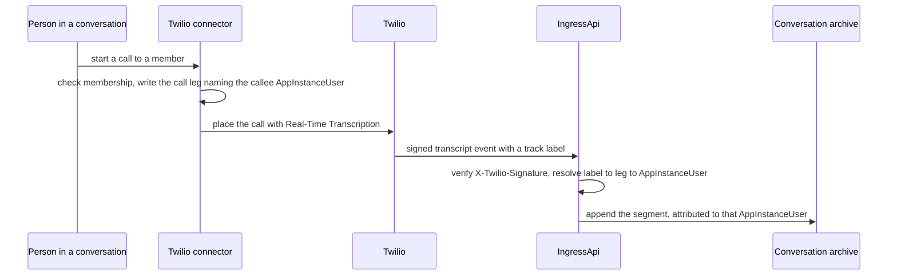
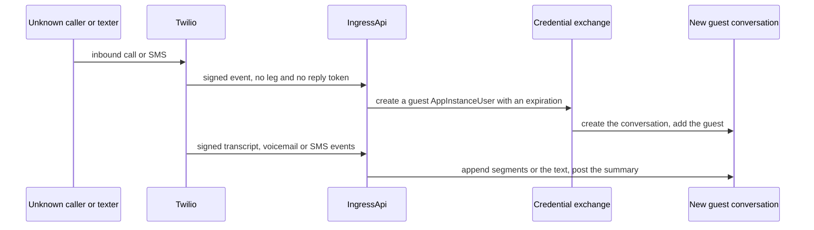

# SPEC: Telephony and SMS - a call or a text is part of a conversation, and a phone number is never an identity

**Status:** Draft design (**NOT BUILT**). No telephony or SMS code exists. The connector registry (`backend/lib/config/connectors.ts`) refuses the `twilio` vendor as NOT BUILT, and `provideComms` is a declared capability with no consumer. `IngressApi` is **NOT BUILT**: the PagerDuty and Salesforce connectors receive their events through Amazon EventBridge partner event sources, and Twilio, which has no EventBridge integration, is the first vendor that needs a signed webhook route. This document covers phone calls and SMS through Twilio with no Amazon Chime SDK in the path. Joining an Amazon Chime SDK WebRTC meeting by phone is a separate draft (see "Joining a meeting by phone").

**Coverage:** none - nothing in this document is built, so there is no call or message to drive.

**Related:** [SPEC-CONNECTORS.md](./SPEC-CONNECTORS.md) - the connector runtime the Twilio connector runs on; its `IngressApi` is **NOT BUILT**. [SPEC-NOTIFICATION-BRIDGE.md](./SPEC-NOTIFICATION-BRIDGE.md) - the transport model SMS joins (FR16, FR19). [DESIGN-ASSISTANT-MEETINGS.md](../interaction/assistants/DESIGN-ASSISTANT-MEETINGS.md) - the draft that joins a phone caller to an Amazon Chime SDK WebRTC meeting. [ADR-056](../../design/decisions/056-two-http-apis-and-no-aws-waf.md) - the in-handler abuse controls on the webhook routes.

**Site section:** Communication layer.

---

## Overview

**A phone call or a text is placed from a conversation, recorded in that conversation's archive, and attributed to the AppInstanceUser on each end.** Every signal resolves to an AppInstanceUser ARN first: a call leg names one, a transcript segment names one through its leg, an SMS names one through the reply token or leg it answers, and a voicemail or text from an unknown number names one through the guest conversation it opens. The identity provider is reached only from that ARN. A phone number is a delivery route recorded on an AppInstanceUser, and is never a way to find one.

**No Amazon Chime SDK in the path.** Amazon Chime SDK PSTN Audio entered maintenance mode on 2026-09-29, and from 2026-10-29 the service is closed to new customers; an account not already onboarded can request an AWS Support exception only for Amazon Chime SDK Meetings dial-in and dial-out or DTMF test calling, so it cannot be a dependency of a deployment that starts from a clean account. Calls and texts go through a Twilio connector instead:

- A person starts a call or sends a text from a conversation, and their membership of it is checked.
- For a call, the connector writes a **call leg** naming the callee's AppInstanceUser before it dials. Twilio Real-Time Transcription (TwiML `<Transcription>`) posts signed transcript events to `IngressApi`, and Twilio stores no transcript. Each segment is resolved through its track label to the leg, and so to an AppInstanceUser, and appended to the conversation's archive.
- For a text, the message is a message in the conversation, sent through the notification bridge's fan-out to the recipient's SMS route with their recorded consent. A reply arrives as a signed webhook and is posted into the conversation its reply token names.

**An unknown sender is a guest.** An inbound call, voicemail or text from a number with no leg and no reply token opens a new guest conversation with a guest AppInstanceUser. It is never matched to a person by phone number, and it reaches a person only through an upgrade path that person takes.

**Worked example: a delivery.** A delivery has a conversation: the customer, the driver assigned to it, the dispatcher and the delivery assistant are its members. The driver arrives and needs the gate code.
- The driver taps "text customer" in the delivery's conversation. The message is posted there and delivered to the customer's phone from the deployment's number, because the customer consented to texts when they ordered. The customer replies "4417, side door", and the reply lands in the same conversation under the customer's name.
- Nobody answers, so the driver taps "call customer". The connector writes a call leg naming the customer and calls them from the deployment's number. The driver and the customer each see only that number, never the other's. The call is transcribed into the conversation, each line under the speaker's name, and the dispatcher reads it without having been on the call.
- The next morning a number nobody knows texts the delivery number: "where is my package?". It opens a new guest conversation for the support team. It is not matched to any customer by its number, and it joins a customer's history only if that person signs in and claims it.

## Joining a meeting by phone

**A separate draft, not this document.** Bridging a phone caller into an Amazon Chime SDK meeting as a WebRTC attendee, so meeting transcription transcribes the caller like any attendee, is designed in [DESIGN-ASSISTANT-MEETINGS.md](../interaction/assistants/DESIGN-ASSISTANT-MEETINGS.md) (the telephony adapter, section C.2) against the seam in [SPEC-ASSISTANT-MEETINGS.md](../interaction/assistants/SPEC-ASSISTANT-MEETINGS.md) (FR13, FR13a, FR13b). The bridge is **NOT BUILT** in this codebase; the draft places and receives calls on a Twilio number and joins each to a meeting as its own attendee, with no Amazon Chime SDK PSTN Audio. Nothing in this document depends on it: a call and a text work with no meeting.

## Business Problem

Customers still call and text, and a team that answers in chat and on the phone ends up with two records of one relationship: the conversation in one system and the call or text in a carrier's console, with nothing joining them. The usual join is the sender's phone number, which is the wrong key, because a number is shared, reassigned and spoofable, and matching on it puts one person's call or text into another person's history. A team needs the call and the text to land in the conversation they belong to, attributed to the person who spoke or wrote, and needs one from an unknown number handled as a new contact rather than guessed into someone's account. It also needs this without depending on a telephony service that is closed to new accounts.

## Personas

Personas are defined in [PERSONAS.md](../../overview/PERSONAS.md) and are not redefined here.

### End user

**How this relates to them:** they are on the call or the text thread, as a member who started it (the driver), a member who was reached (the customer), or a sender the platform does not know. Their question is whether what they said lands in the right conversation and stays out of everyone else's, and whether their own number stays private.

| What they need | Requirement |
|---|---|
| Start a call or send a text from the conversation they are already in | FR1, FR15 |
| Reach the other party without either seeing the other's personal number | FR18 |
| Their words attributed to them, not to "Speaker 2" | FR3, FR4 |
| A call or text from their number never placed into someone else's conversation, and someone else's never placed into theirs | FR5, FR16 |
| A voicemail that becomes something a person can read and answer | FR6 |
| To be told before anything they say is transcribed, and to receive texts only with their consent | FR7, FR17 |

### Admin / operator

**How this relates to them:** they own the Twilio account, its credentials, its numbers and the cost of every call, transcript and message. Their question is what can reach the webhook routes and what each call and text cost.

| What they need | Requirement |
|---|---|
| A webhook refused unless Twilio signed it | FR2 |
| Webhook routes that refuse under load and when a limit's store is unavailable | FR11 |
| One service secret for the vendor, held by the connector and never by an assistant | FR12 |
| Every call, voicemail and text recorded | FR13 |

### Platform developer

**How this relates to them:** they build the connector. Their question is where identity enters a call or a text, and the answer has to be one place.

| What they need | Requirement |
|---|---|
| One record, the call leg, that names the AppInstanceUser for every segment | FR3 |
| An inbound text resolved by its reply token, never by its number | FR16 |
| No lookup by phone number anywhere in the path | FR5, FR14 |

### Legal

**How this relates to them:** recording and transcribing a call, and texting a person, are regulated, and the rules differ by jurisdiction. Their question is whether consent is asked, recorded and checked.

| What they need | Requirement |
|---|---|
| A consent prompt on every call before transcription starts, and every party told | FR7 |
| SMS sent only with consent recorded for that route, and an opt-out honored by every sender | FR17 |
| Consent recorded against the AppInstanceUser and checked before a send | FR7, FR14, FR17 |

## Functional Requirements and Acceptance Criteria

**Priority is a keep-or-cut decision set against what the field expects.** `Table stakes` means a deployment without it is behind. `Differentiator` is worth the cost because few platforms do it. `Gap - prioritize` marks a table-stakes capability that is not delivered. `Above bar - optional` is more than the field asks and can wait. `Optional - attach instead` should be bought rather than built. `Enabler` is not user-visible and is what makes another row affordable.

| # | Requirement | Priority | Delivered | Validated by |
|---|---|---|---|---|
| FR1 | A person places a call from a conversation through the Twilio connector, with no Amazon Chime SDK in the path. The connector checks that the caller is a member of the conversation before it dials | Differentiator | No - the connector runtime exists for PagerDuty and Salesforce, and the `twilio` vendor is refused at synth | none |
| FR2 | Every Twilio webhook (call, transcript, voicemail and SMS) arrives on `IngressApi` and is verified by its `X-Twilio-Signature` before anything is read from it. An unsigned or wrongly signed request is refused and changes nothing | Table stakes | No - `IngressApi` is **NOT BUILT** | none - owed: a deny-test that an unsigned and a wrongly signed webhook are refused |
| FR3 | **A call leg is a record naming an AppInstanceUser.** A call from a conversation to a member writes the leg with that member's AppInstanceUser ARN before dialing. The `<Transcription>` track labels (`inboundTrackLabel`, `outboundTrackLabel`) name the leg, so each side of the call resolves to one AppInstanceUser | Enabler | No | none - owed: a unit test that every segment resolves to its leg's AppInstanceUser |
| FR4 | Each transcript segment is appended to the conversation's archive, attributed to the AppInstanceUser its leg names. A speaker label is never the attribution, and a segment that resolves to no leg is not stored | Differentiator | No | none - owed: a deny-test that every stored segment carries an AppInstanceUser ARN |
| FR5 | **An unknown caller is a guest.** An inbound call from a number with no leg creates a guest AppInstanceUser for that call, with an expiration, in a new guest conversation, and writes a call leg naming that guest AppInstanceUser before transcription starts, so FR4 applies to it and its transcript is kept in the guest conversation. It is never matched to a person, a profile or a conversation by phone number | Table stakes | No | none - owed: a deny-test that a call from a member's number lands in a new guest conversation, not theirs |
| FR6 | A voicemail from a number with no leg is transcribed and summarized, and the summary and transcript are posted into a new guest conversation for that call, under the same rule as FR5. A voicemail left for a leg's callee is posted into the conversation the leg belongs to | Table stakes | No | none |
| FR7 | Every call plays a consent prompt before transcription starts, and every party is told. The consent outcome is recorded against each party's AppInstanceUser ARN, per route. A party who declines is not transcribed | Table stakes | No - no consent record exists for any route | none |
| FR8 | A guest caller or texter reaches a person only through the upgrade path the conversation type declares, by that person's own action: the guest AppInstanceUser becomes the account, or a single-use claim token seeds a new conversation for the account. Neither path matches by phone number or email | Enabler | No - the guest issuer and its bind and claim paths ship for the web widget (`guest-session.ts`, `guest-upgrade.ts`, `upgradePathsOf` in `lib/config/conversation-types.ts`); nothing creates a guest from a call or a text, which is **NOT BUILT** | none |
| FR9 | Placing an outbound call or sending a text an assistant drafted is a consequence, never initiative: an assistant proposes it and a person confirms. The assistant holds no telephony credential | Table stakes | No | none |
| FR11 | The webhook routes carry route throttling and the in-handler limits of ADR-056: a per-IP limit, a per-caller limit and a kill switch, each failing closed when its store is unavailable | Table stakes | No | none |
| FR12 | The Twilio account credential is one per-vendor service secret held by the connector in AWS Secrets Manager. No assistant, client or person holds it | Table stakes | No - no Twilio secret exists; the connector registry refuses the `twilio` vendor (`NOT_BUILT_VENDORS`, `lib/config/connectors.ts`) | none |
| FR13 | Every outbound and inbound call, every voicemail and every text writes an audit record naming the conversation, the leg or reply token, and the AppInstanceUsers involved | Gap - prioritize | No | none |
| FR14 | A phone number is a delivery route recorded on an AppInstanceUser, with its consent per route (voice, SMS). It is read only from the ARN and never used to find one | Table stakes | No | none |
| FR15 | **A text is a message in the conversation.** An outbound SMS is the notification bridge's fan-out with the SMS selector (SPEC-NOTIFICATION-BRIDGE FR16): the message is posted in the conversation first and delivered to each recipient's SMS route, carrying a reply token for that conversation and recipient | Differentiator | No - the fan-out ships for email only | none |
| FR16 | An inbound SMS is posted into the conversation its reply token names, attributed to the AppInstanceUser the token was issued to. A text with no valid token, from any number, opens a new guest conversation under the rule of FR5 and is never matched by number | Table stakes | No | none - owed: a deny-test that a text from a member's number with no token lands in a new guest conversation |
| FR17 | SMS is sent only to a route with consent recorded for it (SPEC-NOTIFICATION-BRIDGE FR19), and an opt-out the carrier reports is recorded against the AppInstanceUser and honored by every sender | Table stakes | No | none |
| FR18 | **Numbers stay private.** Every outbound call and text is placed from a deployment-owned number, and a call between two members is two legs the connector joins, so neither party's number is shown to the other or written into the conversation. A member's number is read only to dial their own leg | Table stakes | No | none - owed: a test that no message, transcript segment or caller ID carries a member's number |

**Reading the "Validated by" column.** Every entry is `none` because nothing is built. The owed tests are named so the first implementation lands with them. FR10, the media bridge into a meeting, moved to the meetings draft (see "Joining a meeting by phone").

## Non-Goals - Out of Scope

| Out of scope | Why | Where it is covered instead |
|---|---|---|
| Amazon Chime SDK PSTN Audio, a Voice Connector or a SIP media application | In maintenance mode and closed to new customers, with an exception only for Amazon Chime SDK Meetings dial-in and dial-out or DTMF test calling, so it cannot be a default dependency | [DESIGN-ASSISTANT-MEETINGS.md](../interaction/assistants/DESIGN-ASSISTANT-MEETINGS.md) C.2, the adapter table |
| Joining an Amazon Chime SDK WebRTC meeting by phone | A separate draft with its own media bridge and attendee identity | [DESIGN-ASSISTANT-MEETINGS.md](../interaction/assistants/DESIGN-ASSISTANT-MEETINGS.md) C.2 |
| Finding a person by phone number, in the identity provider or anywhere else | A number is shared, reassigned and spoofable, and a match puts one person's call or text into another's history | FR5, FR14, FR16 |
| Fuzzy routing of an inbound call or text to a likely conversation | The same failure as a phone match, one step removed. A call lands in its leg's conversation, a text in its token's, or either in a new guest conversation, and nowhere else | FR5, FR6, FR16 |
| A hard-coded carrier in core code | Twilio is a connector, configured and replaceable like every other vendor | [SPEC-CONNECTORS.md](./SPEC-CONNECTORS.md) |

## User Experience Description and Mocks

The design is in [DESIGN-TELEPHONY.md](./DESIGN-TELEPHONY.md), which follows the same delivery.

**A driver calls a customer from the delivery's conversation.** They choose "call" on the conversation and pick the member to call. The assistant may propose the call, and the member confirms it. The callee hears the consent prompt. As the call runs, transcript segments appear in the conversation's history under each speaker's name, and the call ends with a summary message linking the transcript.

**A driver texts a customer.** The message is posted in the conversation and delivered by SMS, from the deployment's number, to a customer who consented to texts. The customer's reply appears in the same conversation under their name, where the dispatcher reads it too.

**An unknown number calls or texts in.** A caller hears the consent prompt and is answered; a text is received. A new guest conversation opens, and the transcript, voicemail summary or text lands there. A team member sees it as a new contact, never as an update to an existing customer. If the sender later signs in or registers, the conversation type's upgrade path decides whether the guest conversation becomes theirs or seeds a new one.

**OPEN:**
- Whether Amazon Chime SDK Voice Connector is affected. The notice scopes the change to the PSTN Audio service and does not name Voice Connector; unconfirmed with AWS.
- The consent prompt's wording and whether it varies by jurisdiction (one-party or all-party consent).
- Where the call leg record lives: the `Tokens` store keyed per leg, or a connector-owned table.
- Whether the carrier's own opt-out handling (STOP and HELP replies on a messaging service) is relied on, or the connector records the opt-out itself from the webhook the carrier sends.

## Related Documents

- [DESIGN-TELEPHONY.md](./DESIGN-TELEPHONY.md) - how the connector, the call leg, SMS and the guest path are built, on the same delivery example
- [SPEC-CONNECTORS.md](./SPEC-CONNECTORS.md) - the connector runtime and per-vendor secrets
- [SPEC-NOTIFICATION-BRIDGE.md](./SPEC-NOTIFICATION-BRIDGE.md) - the transport model, the fan-out SMS joins, and consent per route
- [DESIGN-ASSISTANT-MEETINGS.md](../interaction/assistants/DESIGN-ASSISTANT-MEETINGS.md) - the draft that joins a phone caller to an Amazon Chime SDK WebRTC meeting
- [SPEC-ASSISTANT-MEETINGS.md](../interaction/assistants/SPEC-ASSISTANT-MEETINGS.md) - the telephony adapter seam, and outbound calls as consequence
- [ADR-027](../../design/decisions/027-speaker-attributed-transcript.md) - speaker-attributed transcripts
- [ADR-056](../../design/decisions/056-two-http-apis-and-no-aws-waf.md) - the in-handler abuse controls
- [SPEC-ABUSE-CONTROLS.md](../interaction/governance/SPEC-ABUSE-CONTROLS.md) - the limits, and failing closed
- [SPEC-USER-PROFILE-AND-ONBOARDING.md](../interaction/conversation/SPEC-USER-PROFILE-AND-ONBOARDING.md) - the guest and its upgrade
- [IDENTITY-AND-ACCESS-MODEL.md](../interaction/governance/IDENTITY-AND-ACCESS-MODEL.md) - a person is their AppInstanceUser
- [PERSONAS.md](../../overview/PERSONAS.md) - the canonical definitions of the personas above
