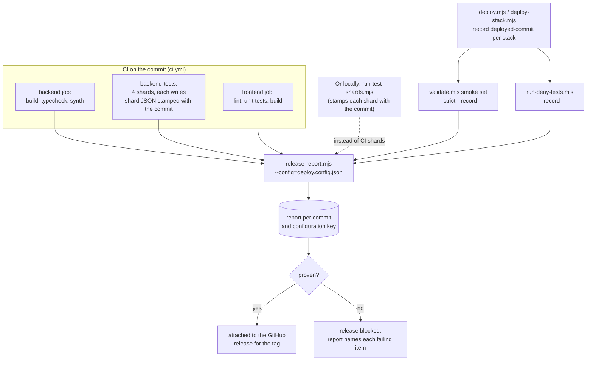
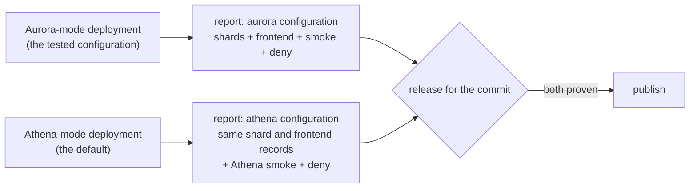

# DESIGN: Release Evidence

**Status:** Partial. Built: the commit stamp on every shard report (`run-test-shards.mjs`, `shard-<n>.meta.json`), the release record directory (`backend/scripts/lib/release-records.mjs`), the smoke set, deny set and build gates as data (`backend/scripts/lib/release-smoke.cjs`), the step runner that records them (`backend/scripts/release-steps.mjs`), `--record` on `run-deny-tests.mjs`, and the generator with its verdict (`backend/scripts/release-report.mjs`, `releaseVerdict` in `backend/scripts/lib/release-report.cjs`). **NOT BUILT:** the CI half (shard artifacts stamped with `GITHUB_SHA`, recorded CI steps), `--record` on `validate.mjs` (the step runner records each smoke item's exit instead, which `E2E_REQUIRE_ALL` makes a pass with no skip, but not per-test counts), the structured `requires` field on `DenyTestRow`, and publishing the report on a GitHub release. No report has been produced against a deployment yet, and the two smoke specs this design adds are unproven (section 10).

**Verified by:** `backend/test/a-release-is-proven-only-by-its-own-evidence.test.ts` (a complete set reads `proven`; a missing shard, a shard from another commit or with no stamp, a filtered shard, a failed suite, a failed or unrun smoke item, a crashed or unrun deny script, a stack on other code, unreadable deployed-commit records, a failed gate and a dirty checkout each read `not-proven` with the reason named; a release needs both analytics modes; an undeclared capability is not applicable).

**Coverage:** the deployed smoke set the report reads (`backend/scripts/lib/release-smoke.cjs`): `tests/e2e/signin.spec.ts` (phase `auth`), `tests/e2e/deployed-build.spec.ts`, `tests/e2e/mentions.spec.ts`, `tests/e2e/a-removed-member-is-refused.spec.ts` and `tests/e2e/a-non-member-is-refused-a-file.spec.ts` (phase `user`), `tests/e2e/admin-console-reflects-role.spec.ts` (phase `boundaries`). The report itself is proven by its unit suite, named below.

**Related:** [SPEC-AURORA-VPC-MODE.md](./SPEC-AURORA-VPC-MODE.md) - the analytics mode the deployed evidence is gathered on today. [AURORA-MODE-GUIDE.md](../../guides/admin/AURORA-MODE-GUIDE.md#testing-focus) - states that Athena mode, the default, gets less end-to-end coverage. [DEMO-AND-VALIDATION.md](../../guides/user/DEMO-AND-VALIDATION.md) - how `validate` is run by hand. [e2e-coverage-matrix.md](../../reference/e2e-coverage-matrix.md) - which spec files exist and which deny-tests are present, which is not a record that they ran. [STACKS.md](../../overview/STACKS.md) - the rollback check and its per-stack deployed-commit record.

**Site section:** Foundations layer.

---

## 1. Overview

A release is a claim that one commit, deployed in one configuration, works. Today the pieces that could support that claim exist separately and none of them names the commit it proved:

- The backend shard runner keeps durable per-shard reports but stamps none of them with a commit.
- CI runs the backend suite and the frontend gates on every push and pull request to `main`, but keeps no report.
- `validate` exercises a live deployment, but is run by hand and writes no result file.
- The deny scripts print a verdict and keep nothing.
- Nothing runs end to end against Athena mode, the default.

This design adds one record, the **release report**, generated per commit and deployment configuration from records each step writes as it finishes. A release is proven only when its reports exist and every item in them passed. An item that did not run, ran against another commit, or skipped counts as not proven.

## 2. What exists, and what it does not prove

| Mechanism | What it does | What it cannot say about a release |
|---|---|---|
| `backend/scripts/run-test-shards.mjs` | Runs Jest shards one at a time; each shard's report lands in `backend/test-results/shard-<n>.json` (`REPORT_DIR`, `collectResults`) and survives a kill, with the commit it ran against, whether the checkout was dirty and whether the run was filtered beside it in `shard-<n>.meta.json`; `--report` prints the accumulated verdict without taking the lock | `newestSourceChangeMs` still marks a report STALE by **file mtime** for the runner's own verdict; the commit stamp is what the release report reads. `test-results/` is gitignored, so a report on disk proves nothing to anyone else until it is published |
| `backend/scripts/lib/shard-verdict.cjs` (`shardVerdict`) | `proven` only when every shard has a report, none failed and none is stale; skips are counted and named ("A skip is not a pass") | Nothing beyond the machine it ran on |
| `.github/workflows/ci.yml` | `backend` (build, typecheck, Athena-mode `cdk synth`), `backend-tests` (4 Jest shards, `fail-fast: false`), `frontend` (lint, every workspace's vitest, build) on push and pull request to `main` | Keeps no report: Jest runs without `--json`, and nothing is uploaded. The `e2e` job is commented out |
| `backend/scripts/validate.mjs` | Runs registered phases (`PHASES`) against a live deployment; `--only=<phase>` (several allowed), `--spec=<name>` narrows one phase; sets `E2E_REQUIRE_ALL=1` so a gated skip fails the phase; `--strict` fails the run on an optional phase | Writes no result file (`printSummary` prints to the console). An optional phase that fails exits 0 without `--strict`. A self-skipped data phase can read "passed" |
| `tests/e2e/reporters/skip-visibility.ts` | Lists every skipped test with its reason; fails a run with skips and no passes, and any skip under `E2E_REQUIRE_ALL=1` | Prints to the console only |
| `backend/scripts/deny-test-*.mjs` via `run-deny-tests.mjs` | Each exit is read by `verdictOf` (`backend/scripts/lib/deny-test-verdict.cjs`) as `held`, `gap`, `setup-error` or `crashed`; `runExitCode` ranks them; `--record` keeps each verdict in the commit's release record | Which configurations a script applies to is prose (`DenyTestRow.configurations` in `backend/lib/docs/deny-test-inventory.ts`, e.g. "C1 and later"), so nothing can tell "not applicable" from "not run" |
| `backend/scripts/lib/deployed-commit.mjs` (`gitState`, `recordDeployedCommits`) | Records the commit each stack was deployed from in SSM under `/<instance>/deployed-commit/<Stack>` | Nothing about whether that commit was tested |
| `tests/e2e/deployed-build.spec.ts` | Fails when the deployed chat bundle's stamp definitely differs from the checkout | Runs only inside the `user` phase |

## 3. The release report

One JSON document per **(commit, configuration key)**.

| Field | Source |
|---|---|
| `commit`, `dirty` | `gitState` in `backend/scripts/lib/deployed-commit.mjs`. A dirty checkout cannot produce a report |
| `configuration.analyticsMode` | `analyticsMode` from the deploy config the deployment was made from |
| `configuration.capabilities` | `capabilities`, read through `resolveCapabilities` in `backend/lib/config/capabilities.ts` (tenet D10), sorted |
| `configuration.key` | `<analyticsMode>-<first 8 hex of sha256>` over the normalized config: underscore comment keys and deployment-specific values (URLs, VPC and subnet ids, account, region, instance name) removed, keys sorted |
| `deployedCommits` | Every stack the configuration deploys, read from `/<instance>/deployed-commit/<Stack>`; each must equal `commit` |
| `backend` | Every shard record for `commit`: shard count, per-shard `passed`, `failed`, `failedSuites`, `skipped`, and the source (local runner or CI run id) |
| `frontend` | The three CI `frontend` steps (lint, unit tests, build) and the `backend` job steps (build, typecheck, synth) for `commit` |
| `smoke` | One row per smoke item (section 5): `passed`, `failed`, `skipped`, `notApplicable`, each a count, plus the skip reasons the skip-visibility reporter printed |
| `deny` | One row per deny script: its `verdictOf` kind, or `not-applicable` with the capability that makes it so |
| `verdict` | `proven` or `not-proven`, and the list of items that made it so |

**Skips are never folded into passes.** Each row carries `passed` and `skipped` as separate counts, and `notApplicable` is a third count kept apart from both, so a reader can see that "12 passed" means 12 ran.

**The report records no account id, instance name, URL, email address or user name.** It is safe to publish beside the source.

## 4. The flow

Each step writes its own record when it finishes, stamped with the commit it ran against. The generator runs last, reads the records, and runs no test itself. Nothing waits on a timer (tenet D6).

A release requires a proven report for each analytics mode. The backend and frontend records are configuration-independent and are shared by both reports rather than re-run; the configuration matrix (`backend/test/deploy-matrix/`) inside the shards is what covers synthesis across configurations.

## 5. The deployed smoke suite

A small fixed set, each item an existing `validate.mjs` phase narrowed with `--spec`. `seed` runs first so the demo users exist. Every item runs with `--strict`, so an optional phase's failure fails it, and under `E2E_REQUIRE_ALL=1` (validate's default) so any skip fails it.

| Smoke item | Phase (`--only`) | Spec filter (`--spec`) | What it asserts | Gap |
|---|---|---|---|---|
| Setup | `seed` | - | Demo users and classification context exist | - |
| Sign-in | `auth` | `signin` | `tests/e2e/signin.spec.ts`: invalid credentials refused, a user signs in and the WebSocket connects, an administrator sees the console link, sign-out | - |
| Deployed build matches | `user` | `deployed-build` | `tests/e2e/deployed-build.spec.ts`: the served bundle is this commit's | - |
| Message and reply | `user` | `mentions` | `tests/e2e/mentions.spec.ts`: an ordinary 1:1 message is answered exactly once; a public address is seen by both members with its reply | - |
| Sharing | `user` | `mentions` | The same spec's setup shares the conversation through the Share control and the second person sees it | Sharing is asserted as setup, not as a named test |
| Removal | `user` | `a-removed-member-is-refused` | `tests/e2e/a-removed-member-is-refused.spec.ts`: a member is removed by the owner; on the chat credential and token they held before, their next send is refused by Amazon Chime SDK and their next upload and download signatures are refused `NOT_A_MEMBER`. Each action is shown admitted first | Built, unproven |
| Attachment, member | `user` | `mentions` | `mentions.spec.ts`: a person sends another person a file and they receive it | - |
| Attachment, non-member | `user` | `a-non-member-is-refused-a-file` | `tests/e2e/a-non-member-is-refused-a-file.spec.ts`: in one premium conversation the owner is signed an upload and a download; a premium non-member and a basic person are refused both through `POST /presigned-url`. Membership is read before clearance, so both are answered `NOT_A_MEMBER`; a member whose clearance no longer reaches the conversation (`NOT_CLEARED`) is held by `a-removed-or-downgraded-person-is-refused-within-the-window.spec.ts` | Built, unproven |
| Admin denial | `deny-tests` | - | `run-deny-tests.mjs admin-capabilities owner-team-tag`: every admin route is refused at the gateway to a role that does not hold it | - |
| Admin denial, console | `boundaries` | `admin-console-reflects-role` | `tests/e2e/admin-console-reflects-role.spec.ts`: a team member sees only what their role serves | - |

The two specs are in the `user` phase, which is required in a sweep, so they also run in every full `validate`. The removal is driven through `removeMember` in `tests/e2e/helpers/person-session.ts`, the helper the revocation-windows spec uses.

`--spec` accepts exactly one `--only`, so the smoke set is several `validate.mjs` invocations. The set is declared once, as data (proposed: a new `release-smoke.cjs` under `backend/scripts/lib/`), and both the generator and the runner read it, so the list in this table and the list that runs cannot diverge.

## 6. The Athena-mode smoke suite

The same items as section 5, run against an Athena-mode deployment, plus the `admin` phase (`tests/e2e/admin-dashboard.spec.ts`), which reads the dashboard from whichever store the mode serves.

`validate.mjs` already removes `knowledge-rag` and `evaluation-verdicts` only on a positive `'absent'` for the Aurora analytics stack (`auroraStackPresence`), and keeps them, to fail visibly, when the lookup could not be made. The report records each removed phase as `notApplicable` with that reason, never as skipped or passed. Any spec inside a smoke phase that applies only to Aurora must declare that by mode, so it lands in `notApplicable` rather than tripping `E2E_REQUIRE_ALL`.

This gives the default mode repeatable evidence per release instead of the "exercise it in your own environment" the Aurora guide's testing focus states today.

## 7. The deny scripts

The report runs every script under `backend/scripts/deny-test-*.mjs` that applies to the configuration, through `run-deny-tests.mjs`, and records each `verdictOf` kind. Applicability needs a structured field: `DenyTestRow` (`backend/lib/docs/deny-test-inventory.ts`) gains `requires: readonly string[]`, the capabilities the script needs, next to the existing prose `configurations`. A script whose requirements the configuration does not declare is `not-applicable`; an applicable script that did not run fails the report. This keeps the refusals proven on the deployment rather than in review (tenet P4).

## 8. Where the report is stored

| Copy | Location | Role |
|---|---|---|
| Working record | `backend/test-results/release/<commit>/` (inside the gitignored `test-results/`), one file per step plus `report-<config key>.json` | Survives a killed run, as the shard runner's reports do, and is never cleared, since each commit has its own directory |
| Release record | An asset on the GitHub release for the tag: `release-report-<short commit>-<config key>.json`, one per analytics mode | The evidence a reader of the public repository can check against the tag |
| CI shard records | A workflow artifact from `backend-tests`, each shard's Jest JSON stamped with `GITHUB_SHA` | Lets a report use CI's shards for the commit instead of a local run |

A report uses one shard source per commit, local or CI, never a blend: `run-test-shards.mjs` already clears its record on a fresh full run so two codebases cannot be totalled together, and the same rule holds across sources.

## 9. What makes a report fail

The verdict is `not-proven` when any of these holds; the report lists each one.

| Condition | Why |
|---|---|
| The checkout is dirty at any step | A dirty tree is not the commit being released |
| A shard has no record, a failed test, a failed suite, or a record stamped with another commit | Incomplete is not proven; a record about other code is not a record about this one |
| The shard count in the records disagrees with the count the run declared | A half run totals like a whole one |
| A CI `backend` or `frontend` step is missing or failed for the commit | The frontend gates are part of the release |
| A stack's `deployed-commit` record differs from the report's commit | The smoke ran against other code |
| `deployed-build.spec.ts` reports a mismatch | The served frontend is not this commit's |
| A smoke item failed, skipped, or did not run | A skip is not a pass |
| An applicable deny script returned `gap`, `setup-error` or `crashed`, or did not run | A refusal not observed on the deployment is not proven |
| No proven report exists for the other analytics mode | The default mode needs its own evidence |

Backend tests that Jest reports as skipped (`numPendingTests`, `numTodoTests`) are listed by name and counted, and do not fail the report, matching `shardVerdict`; the deployed smoke has no such allowance.

## 10. What is built, and what still needs building

| Change | Where | State |
|---|---|---|
| Stamp each shard report with `gitState().head`, `dirty` and whether the run was filtered; the report refuses a shard from another commit | `backend/scripts/run-test-shards.mjs` (`shard-<n>.meta.json`) | Built |
| The commit's record directory, one file per step | `backend/scripts/lib/release-records.mjs` | Built |
| The smoke set, the release's deny scripts and the build gates as data, each item naming the capabilities it requires | `backend/scripts/lib/release-smoke.cjs` | Built |
| A step runner that runs the gates, the smoke set and the deny set and records each result against the commit | `backend/scripts/release-steps.mjs` | Built |
| `--record` writing each `verdictOf` result | `backend/scripts/run-deny-tests.mjs` | Built |
| The generator and its verdict, with a unit suite that feeds it a missing shard, a foreign-commit shard, a smoke skip and a deny `crashed` and expects `not-proven` for each | `backend/scripts/release-report.mjs`, `releaseVerdict` in `backend/scripts/lib/release-report.cjs`, `backend/test/a-release-is-proven-only-by-its-own-evidence.test.ts` | Built |
| `--json --outputFile` on each CI shard, stamped with `GITHUB_SHA`, uploaded as an artifact; CI step results recorded | `.github/workflows/ci.yml` | **NOT BUILT** |
| `--record=<file>` writing per-phase pass, fail, skip and not-applicable counts from a Playwright JSON reporter | `backend/scripts/validate.mjs`, `tests/playwright.config.ts` | **NOT BUILT**; the step runner records each smoke item's exit |
| `requires` per deny-test row | `backend/lib/docs/deny-test-inventory.ts` | **NOT BUILT**; the release's deny set declares `requires` in `release-smoke.cjs` |
| Two e2e specs: removal refusal, non-member file refusal | `tests/e2e/a-removed-member-is-refused.spec.ts`, `tests/e2e/a-non-member-is-refused-a-file.spec.ts` | Built: both passed on dev, 2026-11-05 (`node scripts/validate.mjs --only=user` from `backend/`) |
| The report attached to the GitHub release for the tag | the release process | **NOT BUILT** |

**Producing a report.** From `backend/`, on a clean checkout of the commit being released:

1. `node scripts/run-test-shards.mjs --shards=8`: a full, unfiltered run, each shard stamped with the commit.
2. `node scripts/release-steps.mjs gates`.
3. Deploy that commit (`npm run deploy`, which records each stack's deployed commit).
4. `node scripts/release-steps.mjs smoke`, then `node scripts/release-steps.mjs deny`.
5. `node scripts/release-report.mjs`, which writes `test-results/release/<commit>/report-<configuration key>.json` and exits 0 only when it is `proven`.

## 11. Tenets applied

- **P4.** Deny scripts run on the deployment and their verdicts are recorded; "present" in the coverage matrix is not "held".
- **D6.** Each step writes its record when it finishes; the generator runs after the last step. No schedule re-derives a result.
- **D7.** The report is the one source for "is this commit proven"; it reads the records the steps already write instead of re-running them.
- **D8.** It reuses `shardVerdict`, `verdictOf`, `gitState`, the deployed-commit record, the skip-visibility reporter, `E2E_REQUIRE_ALL` and the existing `validate.mjs` phases; the only new infrastructure is a file per report.
- **D10.** The configuration is read through the capability registry, so a capability the deployment does not declare makes its deny scripts and specs not applicable rather than missing.

## 12. Open questions

1. Whether the Athena report runs the full smoke set or a subset, given that each mode needs its own deployment.
2. Whether CI's `e2e` job, once a test account exists, runs the smoke set on every push to `main` or only on a tag.
3. Whether a backend skip count that rises between releases should fail the report.
