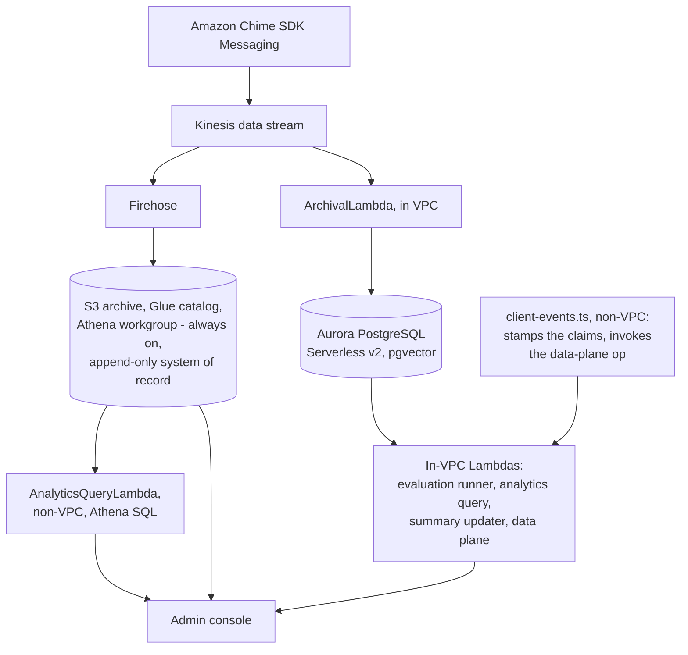
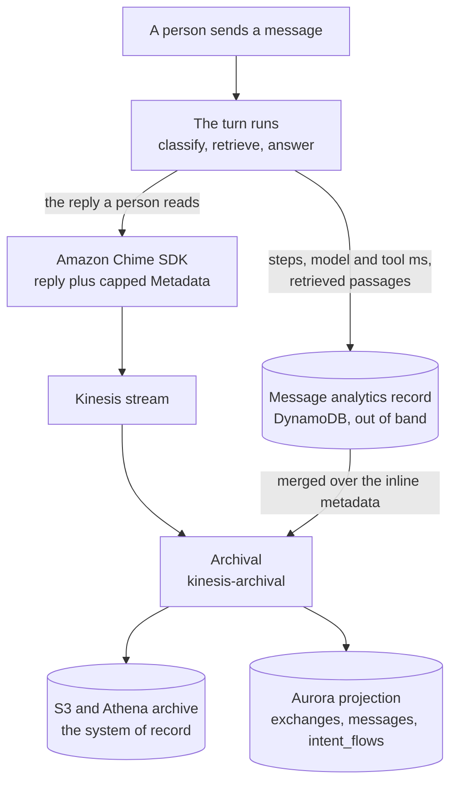
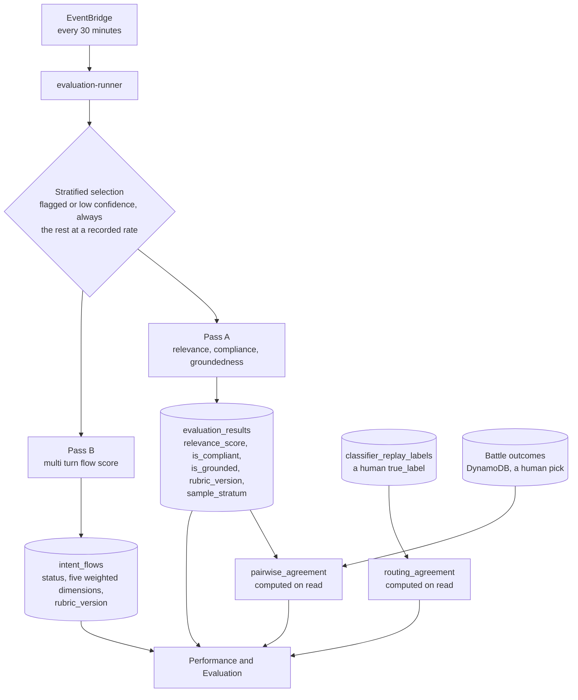

# SPEC: Optional Aurora PostgreSQL + VPC Deployment Mode

**Status:** Implemented (opt-in deployment mode).

**Coverage:** `e2e/latency.spec.ts`, `e2e/admin-dashboard.spec.ts`, `e2e/the-lex-leg-is-measured-per-turn.spec.ts`

**Verified by:** `backend/test/cdk-synth.test.ts` (the mode creates no VPC or cluster when it is off; with it on, IAM authentication is enabled, the VPC has no NAT gateways, the endpoints are created, an existing VPC is imported instead of created, `createVpcEndpoints=false` is rejected without an imported VPC, and no RDS Proxy exists by default), `backend/test/an-imported-vpc-routes-what-the-handlers-read.test.ts` (an imported VPC without endpoints is refused when its route tables or endpoint policies do not reach what the in-VPC handlers call, and both deploy scripts run the check before any stack deploys), `backend/test/analytics-aurora/an-exchange-is-declared-not-inferred.test.ts` (source text: the declaration is stamped and carried onto the archival record; the sweep pairs on it with none of the guesses attached and keeps the inference only where nothing was declared; the in-batch path obeys a declared target and skips queue work), and `backend/test/analytics-aurora/db-lambdas-apply-migrations.test.ts` (source text: every database Lambda applies pending migrations rather than assuming a schema), alongside the rest of `backend/test/analytics-aurora/`, of which `db-client.test.ts` exercises the shared client's behavior.

**Related:** [SPEC-EVALUATION.md](../interaction/quality/SPEC-EVALUATION.md) - what the evaluation this mode hosts is for. [DESIGN-EVALUATION.md](../interaction/quality/DESIGN-EVALUATION.md) - the passes and the rubrics. [SPEC-ADMIN-CONSOLE.md](../interface/SPEC-ADMIN-CONSOLE.md) - the console that reads this projection.

**Site section:** Foundations layer.

---

## Overview

**This mode adds a query engine and never a second system of record, because the three stores have different jobs and treating any of them as a cache of another produces numbers that disagree (tenet D7).** The append-only conversation event archive - Kinesis to Firehose to S3 to Glue to an Athena workgroup - is the system of record, holds the full event sequence including what a message said before it was edited or redacted, survives channel deletion, and runs in **both** modes. Live Amazon Chime SDK Messaging remains authoritative for current conversation state. What the mode selects is only the analytics and evaluation query engine: Athena SQL over the archive, or Aurora PostgreSQL over its own projection.

**The Aurora projection is deliberately lossy, and saying so is what keeps it usable.** It projects membership and moderator events as rows and keeps a current-state `channel_membership` table beside them; what it does not hold is pre-edit and pre-redaction content, so the archive remains the faithful record for what a message said before it was changed and for the audit reads. The console's conversation views and the Legal and HR reads take history and the membership timeline from the projection's event rows in this mode and from the archive in the default mode, one source per mode (tenet D7). Aurora exists so relational joins, window functions and pgvector similarity are fast, and because it is rebuildable rather than authoritative, a rebuild is a maintenance operation rather than a data-loss event.

**The data plane holds no standing network path out.** Aurora and every in-VPC Lambda sit in isolated subnets with no NAT gateway, reaching AWS APIs only through VPC endpoints, and every Lambda connects to the cluster with IAM authentication rather than a stored password - Secrets Manager is the administrative fallback rather than the runtime path. Migrations and runtime DDL run as the owning role rather than as the application role, so the identity that answers a query cannot reshape the schema behind it.

**An exchange is declared by the turn that answered it, not reconstructed afterwards.** The processor stamps `answersMessageId` onto the update it already performs, and both pairing paths obey it; the older inference applies only where a turn declares nothing, so no row changes behavior and no backfill is required. Queue work declares itself and never pairs, because a reading answers a burst rather than a message - it is excluded because it says what it is, and not because it happens to lack a correlation marker, which would also exclude a broadcast answer.

**The mode is additive and reversible in one direction only.** A deployment that does not opt in sees no VPC, no cluster, no migrations and no new cost. A deployment that switches modes starts fresh: historical data in the other engine is not migrated, which is a documented property rather than a defect, because the two engines answer from different shapes. Because the two modes differ this widely, **every requirement below states the mode it is expected in.**

## Business Problem

Most deployments start on the cheap serverless default and never need more, and it is the right choice for the majority. But when analytics and evaluation grow up, that default runs into limits a team cannot work around: interactive dashboard queries need multi-table joins, window functions and CTEs at sub-second latency; multi-turn evaluation needs to group exchanges by task and score a whole conversation transactionally; cross-conversation context and topic drift need vector similarity; and incrementally updated summaries need UPSERT semantics that a query-over-files engine does not have. The alternative to this mode is standing up and operating a VPC, a PostgreSQL cluster, IAM database authentication and a pgvector installation, and then keeping that stack alive alongside the platform. This mode is that engine behind one deploy-time flag, with the default path left untouched.

## Personas

Personas are defined in [PERSONAS.md](../../overview/PERSONAS.md) and are not redefined here. Two of them choose and live with this mode, and they choose it for different reasons: the operator owns what the deployment costs and whether it stays up, and the AI developer owns the questions the engine has to answer.

### Admin / operator

**How this mode relates to them:** they decide whether the deployment pays for the engine, they own the teardown, and they are the ones a cold start or an idle bill lands on. The mode is a cost and operations decision before it is a capability one.

| What they need | Requirement |
|---|---|
| One flag to select the engine, with the default path unchanged and no new cost when it is off | FR1, FR3 |
| One command on a fresh account, with no manual prerequisite left to remember | FR4 |
| No NAT gateway and no standing network path out of the data plane | FR5 |
| Database access by IAM rather than by a stored password | FR6 |
| Connection pooling that is opt-in, because the proxy bills a floor whatever the load | FR7 |
| Share a VPC the account already has, rather than pay for a second endpoint footprint | FR10 |
| A teardown that leaves a borrowed VPC exactly as it found it | FR11 |
| History that survives the engine choice and the channel | FR2 |
| The archive still answering the conversation and audit reads | FR2, FR16 |

### AI developer

**How this mode relates to them:** they pick this mode for the questions it can answer. Multi-turn evaluation, drift and cross-conversation context are the capabilities they came for, and the attribution they depend on is whether a turn's two halves were joined correctly.

| What they need | Requirement |
|---|---|
| Multi-turn evaluation that groups a task and scores it as one thing | FR18 |
| Vector similarity for cross-conversation context and topic drift | FR16 |
| Summaries that update incrementally rather than being recomputed | FR17 |
| An exchange paired from what the turn declared, not from a guess | FR12, FR13 |
| Per-step telemetry that lands on the row the metric reads | FR15 |
| Interactive latency on the joins the console drills through | FR22 |
| A schema that evolves additively without a manual step | FR8, FR9 |

**OPEN:** whether the platform developer is a named reader here. The VPC, the endpoint list, the cold-start cost of an in-VPC Lambda and the teardown semantics are platform-developer concerns, and [PERSONAS.md](../../overview/PERSONAS.md) puts that persona on the platform internals. Nothing in this mode is scoped to them specifically, so the question is whether they read this document as an operator or need their own row.

## Functional Requirements and Acceptance Criteria

**Priority is a keep-or-cut decision set against what the field expects, not against how interesting the work is.** `Table stakes` means a deployment without it is behind. `Differentiator` is worth the cost because few platforms do it. `Gap - prioritize` marks a requirement whose absence puts this below comparable systems. `Above bar - optional` is more than the field asks and can wait. `Optional - attach instead` should be bought rather than built. `Enabler` is not user-visible and is what makes another row affordable.

**Mode** is the mode the requirement is expected in for first release, whether or not it is delivered yet.

| # | Requirement | Priority | Mode | Delivered | Validated by |
|---|---|---|---|---|---|
| FR1 | One CDK context key (`analyticsMode`, either `athena` or `aurora`) selects the analytics and evaluation query engine, and both stacks satisfy one interface of ARNs and names so downstream stacks do not know which mode is active | Enabler | Both | Yes | `cdk-synth` (unit, behavior) |
| FR2 | The append-only conversation event archive is the system of record and runs in both modes, so the mode selects the query engine and never whether conversation history is durably archived | Table stakes | Both | Yes | `cdk-synth` (unit, behavior - Kinesis and Firehose to S3 in the default mode, the Kinesis stream in Aurora mode); `archive-membership` (e2e, behavior) covers the moderator archive control, which in Aurora mode reads the projection, and does not validate the system of record |
| FR3 | A deployment that does not opt in gets no VPC, no cluster, no schema migrations, no IAM database setup and no new cost | Table stakes | Both | Yes | `cdk-synth` (unit, behavior) |
| FR4 | Aurora mode provisions the cluster, the VPC and its endpoints, the extensions, the schema and IAM database authentication from one deploy on a fresh account, with no manual prerequisite step | Table stakes | Aurora only | Yes | `cdk-synth` (unit, behavior), `db-lambdas-apply-migrations` (unit, source text) |
| FR5 | The data plane sits in isolated subnets with no NAT gateway and reaches AWS APIs only through VPC endpoints | Differentiator | Aurora only | Yes | `cdk-synth` (unit, behavior) |
| FR6 | Every Lambda connects with IAM authentication rather than a stored password, direct to the writer endpoint, with token caching and per-instance pooling in one shared client | Table stakes | Aurora only | Yes | `cdk-synth` (unit, behavior), `db-client` (unit, behavior) |
| FR7 | Connection pooling through RDS Proxy is opt-in and off by default, because on Serverless v2 the proxy bills a fixed capacity floor whatever the load | Table stakes | Aurora only | Yes | `cdk-synth` (unit, behavior) |
| FR8 | Schema migrations apply idempotently: a first deploy creates the extensions and the schema, a later file applies at runtime on the next database Lambda's cold start, and each is tracked with its checksum in `_migrations` | Enabler | Aurora only | Yes | `db-client` (unit, behavior), `db-lambdas-apply-migrations` (unit, source text), `migration-data-steps-are-bounded` (unit, source text) |
| FR9 | Migrations and runtime DDL run as the owning role rather than as the application role, so the identity that answers a query cannot reshape the schema | Enabler | Aurora only | Yes | `migration-writer-role` (unit, source text), `runtime-ddl-runs-as-owner` (unit, source text) |
| FR10 | An existing VPC can be imported and shared, with the subnet tier selectable and endpoint creation skippable where the host already provides AWS-API egress; a newly created isolated VPC always builds its endpoints and refuses to skip them | Differentiator | Aurora only | Yes | `cdk-synth` (unit, behavior) |
| FR11 | Teardown of an imported-VPC deployment removes only the resources this stack created and leaves the borrowed VPC, its subnets and its route tables intact | Differentiator | Aurora only | Yes | `cdk-synth` (unit, behavior) |
| FR12 | An exchange is one message answered by an assistant, and which message that is, is declared by the turn that answered rather than reconstructed afterwards; the inference applies only where a turn declares nothing, and the same rule governs both pairing paths | Differentiator | Aurora only | Yes | `an-exchange-is-declared-not-inferred` (unit, source text), `a-sweep-waits-for-the-answer-it-is-pairing` (unit, source text) |
| FR13 | Queue work declares itself and never pairs, because a reading answers a burst rather than a single message, so an absent correlation marker is never read as intent | Differentiator | Aurora only | Yes | `an-exchange-is-declared-not-inferred` (unit, source text) |
| FR14 | An assistant answering another assistant produces an exchange, so a duel's second side is inside the exchange population | Gap - prioritize | Aurora only | Partly - the sweep keys on the round, so a rebuttal is minted as its own exchange with its reply clock withheld; its `user_message_id` is the person's message rather than the rival reply it answered, so the row is in the population and the answered-an-assistant fact is not on it | `turn-events-battle-round` (unit, behavior) |
| FR15 | A turn's out-of-band analytics record is merged over the size-capped inline metadata at archival, so a metric is never computed from one of the two paths alone | Table stakes | Aurora only | Yes | `the-tool-lens-reads-the-row-the-steps-landed-on` (unit, source text), `converse-step-tools` (unit, behavior) |
| FR16 | Vector similarity is available for cross-conversation context search and topic drift, over embeddings written at the dimension the embedding model produces | Table stakes | Aurora only | Yes | `cross-conversation-context` (unit, behavior), `drift-detection` (unit, behavior), `embedding-writer` (unit, behavior), `drift-detection` (e2e, behavior) |
| FR17 | Conversation summaries update incrementally with UPSERT semantics rather than being recomputed from scratch | Table stakes | Aurora only | Yes | `summary-updater` (unit, behavior) |
| FR18 | Multi-turn evaluation groups exchanges by `task_id`, reconstructs the conversation and scores the task holistically across weighted dimensions | Table stakes | Aurora only | Yes | `flow-eval` (unit, behavior), `evaluation-verdicts` (e2e, behavior) |
| FR19 | The evaluation runner is scheduled, is directly invokable with an empty payload to re-score a backlog, and is bounded per run by operator-settable limits, with image turns skipped rather than mis-scored where the attachments bucket is absent | Enabler | Aurora only | Partly - the limits are read from the runner's environment and no deploy path sets them, so they hold their defaults | `evaluation-runner-image` (unit, behavior); the 30-minute schedule is asserted by nothing |
| FR20 | The browser's own analytics events land in the same projection the console reads, through the mode's own ingestion path | Table stakes | Both | Yes | `client-events-ingest` (unit, behavior), `client-events` (unit, behavior) |
| FR21 | A named analytics window is served as named or refused, never quietly replaced by a different one, and one request names the same window in either mode | Table stakes | Both | Yes | `a-named-window-is-served-or-refused` (unit, behavior) |
| FR22 | Complex analytical queries answer at interactive latency, so a dashboard drill is a read rather than a wait | Differentiator | Aurora only | Partly - the engine and the indexes are in place; no measurement in this repository establishes the achieved figure | none for the query-latency figure; `latency` (e2e, behavior) asserts the turn-latency ledger's values, which is a different property |
| FR23 | The mode choice is documented with its capabilities, its cost and its one-way nature, so a deployer chooses deliberately rather than discovering the bill | Table stakes | Both | Yes | none - a documentation requirement, satisfied by this document and the linked guides rather than by a test |
| FR24 | **Declined.** A materialized rollup layer for the dashboards. Every figure is a live query, which is the one definition of that number (tenet D7); a rollup with its own definition would disagree with it. Migration `072-no-materialized-rollups.sql` drops the unused views | Enabler | Aurora only | Declined - no materialized view exists | `backend.test.ts` (schema files) |
| FR25 | The mode is chosen at first deploy and an existing deployment refuses a switch: both analytics stacks own the same fixed-name, retained resources (the archive bucket, Firehose, Glue database, Athena workgroup, KMS alias and the app instance's streaming configuration), so a switch collides. `npm run deploy` refuses a mode other than the one the instance was first deployed with, and changing mode is a teardown and a fresh deploy | Table stakes | Both | Yes - `checkAnalyticsModeLock` in `backend/scripts/lib/deploy-guards.cjs`, called by `deploy.mjs` | `deploy-guards` (unit, behavior) |
| FR26 | An imported VPC that brings its own endpoints (`createVpcEndpoints=false`) is checked before any stack deploys: every handler subnet's route table reaches S3 and DynamoDB through a gateway endpoint (or a NAT route), the Secrets Manager and Amazon Bedrock Runtime interface endpoints exist with private DNS and admit HTTPS from those subnets, and each endpoint's policy allows what the handlers call, the registry bucket first. A gap refuses the deploy, naming the bucket or service and the fix | Table stakes | Aurora only | Yes - `checkImportedVpc` in `backend/scripts/lib/imported-vpc-checks.cjs`, run by `deploy.mjs`, `deploy-stack.mjs`, `npm run check:vpc` and the doctor | `an-imported-vpc-routes-what-the-handlers-read` (unit, behavior) |

**Reading the "Validated by" column.** Each entry is one specific test, named by its filename without its extension. Backend unit tests live in `backend/test/` (the ones specific to this mode under `backend/test/analytics-aurora/`); end-to-end specs live in `tests/e2e/` and are listed against their phase in [e2e-coverage-matrix.md](../../reference/e2e-coverage-matrix.md). The status in brackets is what the test does, which matters more than that it is green:

- **behavior** - executes the code path and asserts on the result.
- **source text** - asserts that a convention still appears in the source. It catches the convention being dropped; it does not catch a wrong number.
- **none** - no test exists, which is expected where `Delivered` is No.

**Resolved against the code.** FR4 needs no manual pgvector step: `002-pgvector.sql` issues `CREATE EXTENSION IF NOT EXISTS vector` and the migration runner enables `uuid-ossp` before it, so both extensions come up as part of the deploy. FR7 is off by default in the stack rather than by convention. FR5's endpoint set on a created VPC is five: Kinesis, Secrets Manager and Amazon Bedrock Runtime as interface endpoints, and S3 and DynamoDB as gateway endpoints, the gateway pair being free; only the three interface endpoints carry the hourly charge the cost model names. No SSM endpoint is in the set: an in-VPC Lambda reads the classification registry from its S3 copy over the S3 gateway endpoint (`AE_PROFILE_REGISTRY_S3`, `ProfileRegistryReaders`), so an imported VPC needs an S3 route that reaches the registry bucket (`<instance>-registry-<account>-<region>`).

**OPEN:** FR22 states a property with no measurement behind it in this repository. A figure for complex-query latency should either be measured on a named window and published with the query it was measured on, or the requirement should be reworded to the shape the engine gives rather than a number.

**OPEN:** the teardown recipe. The verification steps for an imported-VPC teardown - which resources to confirm gone and which to confirm untouched - are named in this document and not written out as a command sequence anywhere. Two conditions modify it and both are recorded here: `environment=prod` sets a retain policy and deletion protection, so a production teardown orphans the cluster and it is deleted by hand; and the cross-stack edge is the data-plane ARN this stack publishes to SSM, which the non-VPC admin-conversations handler resolves at cold start, so a warm handler container can hold the ARN of a function the teardown removed until it recycles. No other stack references this stack's database-client security group.

**Acceptance criteria.** A deployer can (a) deploy the default mode and observe no VPC, no cluster and no migrations; (b) deploy with `--context analyticsMode=aurora` on a fresh account in one command and reach a working console with no manual database step; (c) read conversation history and the membership timeline from the archive in the default mode and from the projection's event rows in Aurora mode, with the audit reads and pre-redaction content from the archive in either; (d) confirm the cluster is reachable only from inside the VPC and only by IAM authentication; (e) import an existing VPC, deploy into a chosen subnet tier, skip endpoint creation, and tear down without touching the host's subnets or route tables; (f) run multi-turn evaluation, drift detection and cross-conversation context, which the default mode does not serve; (g) attempt a deploy in the other mode on an existing instance and have it refused before any stack changes, with the teardown path named.

## Non-Goals - Out of Scope

| Out of scope | Why | Where it is covered instead |
|---|---|---|
| A migration path from existing Athena data into Aurora | The two engines answer from different shapes, and a partial import would produce a projection that silently disagrees with the archive it was built from. Historical data stays queryable where it is | FR25 (the mode is chosen once); the archive remains the system of record in both modes |
| A hybrid analytics query engine, answering from both at runtime | One source per question, per mode: two surfaces answering the same question from different stores disagree and the operator cannot tell which is right (tenet D7) | [SPEC-ADMIN-CONSOLE](../interface/SPEC-ADMIN-CONSOLE.md) FR26, which detects the live mode and refuses a query the mode cannot serve rather than approximating it |
| Aurora Provisioned clusters | Serverless v2 is what makes the idle floor small enough to be an opt-in rather than a commitment | A provisioned cluster is a further extension of the same stack |
| Multi-region Aurora | Single region. Cross-region replication of a rebuildable projection buys less than cross-region durability of the archive, which S3 already provides | The archive's own durability properties |
| An application-layer RAG retriever as part of this mode | The schema and the index support it; the retrieval path is a capability of its own with its own grants | [SPEC-CONTEXT-SOURCES-AND-STORES](../interaction/assistants/SPEC-CONTEXT-SOURCES-AND-STORES.md), which owns the retrieval path and the reach of a retrieval grant |
| A second system of record | The projection is rebuildable and lossy on purpose. Treating it as authoritative is how a redaction that the archive recorded reads as never having happened | Tenet D7, and [SPEC-ACCESS-AND-CONTROLS-AUDITING](../interaction/governance/SPEC-ACCESS-AND-CONTROLS-AUDITING.md) for the audit events |
| A VPC endpoint for anything a Lambda needs from outside the data plane | A non-VPC handler reaching in goes through the existing data-plane seam by adding an operation rather than by adding infrastructure (tenet D8) | `data-plane-handler` is that seam |
| Evaluation's own scope, rubrics and calibration | Evaluation is a platform capability rather than a property of this deployment mode. Only its hosting belongs here | [SPEC-EVALUATION](../interaction/quality/SPEC-EVALUATION.md) for what it is for and what it refuses to be; [DESIGN-EVALUATION](../interaction/quality/DESIGN-EVALUATION.md) for the passes, the rubrics, selection and versioning |

## User Experience Description and Mocks

This mode has no interface of its own. It is chosen at deploy time and read through the console, so the journeys below are a deployer's and an operator's rather than a screen's.

### The admin / operator's journey

1. **Start on the default and stay there while it is enough** (FR1, FR3). Nothing about this mode is present until it is asked for, so the decision has no standing cost.
2. **Read the choice before making it** (FR23). The capability difference, the cost difference and the one-way nature of the switch are documented together, because a mode chosen on capability alone is discovered later on the bill.
3. **Deploy in one command** (FR4). The cluster, the VPC, the endpoints, the extensions, the schema and IAM database authentication come up together on a fresh account with no manual database step left to remember.
4. **Optionally borrow a VPC the account already has** (FR10). The subnet tier is selectable, and endpoint creation is skippable where the host already provides AWS-API egress. A newly created isolated VPC refuses to skip them, because it has no other path out. With endpoint creation skipped, the deploy first checks that the borrowed VPC's own endpoints route everything the in-VPC handlers call (FR26, [Appendix G](#appendix-g---imported-vpc)), and `npm run check:vpc` runs the same check on its own.
5. **Confirm the boundary rather than trust it** (FR5, FR6). No NAT gateway, isolated subnets, endpoints only, and IAM authentication rather than a stored password.
6. **Leave the proxy off unless concurrency demands it** (FR7), because on Serverless v2 it bills a capacity floor whatever the load.
7. **Read the audit trail and pre-redaction content from the archive throughout** (FR2). The mode changed which engine answers an analytical question and which store serves the console's conversation views, not where history durably lives.
8. **Tear down, and check what was borrowed** (FR11). Only what this stack created is removed. Where the environment is production, the retain policy and deletion protection mean the cluster is deleted by hand.

### The AI developer's journey

1. **Ask the questions the default cannot answer** (FR18, FR16, FR17). A task scored as one thing across its turns, similarity search for cross-conversation context and topic drift, and summaries that update incrementally.
2. **Trust the attribution before trusting the number** (FR12, FR13, FR15). An exchange is paired from what the turn declared, queue work is excluded because it says what it is, and the out-of-band telemetry is merged over the inline metadata so a metric is not computed from half the turn.
3. **Drill without waiting** (FR22). The joins the console's drill depends on are the reason for the engine.
4. **Evolve the schema additively** (FR8, FR9). A new migration file applies at runtime on the next database Lambda's cold start, idempotently, as the owning role.
5. **Know what the projection is not** (Non-Goals). It is rebuildable and lossy, so a question about what a message said before it was redacted goes to the archive.

## Related Documents

- [AURORA-MODE-GUIDE.md](../../guides/admin/AURORA-MODE-GUIDE.md) - the operator guide for running this mode
- [INFRASTRUCTURE-COST.md](../../guides/admin/INFRASTRUCTURE-COST.md) - the single source of truth for the cost model of both modes, carrying the estimates-only disclaimer
- [SPEC-COST-SLEEP-MODE.md](./SPEC-COST-SLEEP-MODE.md) - the opt-in idle auto-pause that sheds this mode's dominant idle cost
- [SPEC-EVALUATION.md](../interaction/quality/SPEC-EVALUATION.md) - what the evaluation this mode hosts is for, and what it refuses to be
- [DESIGN-EVALUATION.md](../interaction/quality/DESIGN-EVALUATION.md) - the passes, the rubrics, marker stripping, selection and rubric versioning
- [SPEC-ADMIN-CONSOLE.md](../interface/SPEC-ADMIN-CONSOLE.md) - the console that reads this projection, and the mode detection and honest-unsupported behavior
- [SPEC-ADMIN-CONSOLE-EFFECTIVENESS.md](../interface/SPEC-ADMIN-CONSOLE-EFFECTIVENESS.md) - the drill the relational joins exist for
- [SPEC-DRIFT-CONVERGENCE.md](../interaction/assistants/SPEC-DRIFT-CONVERGENCE.md) - the drift capability the vector index serves
- [SPEC-CONTEXT-SOURCES-AND-STORES.md](../interaction/assistants/SPEC-CONTEXT-SOURCES-AND-STORES.md) - retrieval over the document embeddings this schema holds
- [SPEC-ACCESS-AND-CONTROLS-AUDITING.md](../interaction/governance/SPEC-ACCESS-AND-CONTROLS-AUDITING.md) - the analytics data sources and the audit events
- [TENETS.md](../../overview/TENETS.md) - tenets D7 and D8, which the store split and the reuse-before-building rule follow from

## Appendix A - The two modes, side by side

The stream fans out to two independent sinks. The archive branch is the same in both modes and is the durable record; the Aurora branch is what this mode adds. The console reads conversation history from the archive in the default mode and from the projection's event rows in Aurora mode, and the analytical views from whichever engine is live.

| | Default mode | Aurora mode |
|---|---|---|
| Network | No VPC | Private VPC, 2 AZs, isolated subnets only, no NAT |
| VPC endpoints | None | Kinesis, Secrets Manager and Amazon Bedrock Runtime as interface endpoints; S3 and DynamoDB as gateway endpoints |
| Engine | Pay-per-query Athena over the archive | Aurora Serverless v2, PostgreSQL 15.10, 0.5 to 4 ACU, `pgvector` and `uuid-ossp` |
| Authentication | Not applicable | IAM authentication direct to the writer endpoint; Secrets Manager as the administrative fallback |
| Connection pooling | Not applicable | RDS Proxy, opt-in and off by default |
| Lambda cold start | Fast | Slower, from ENI attachment |
| Complex query latency | Seconds | Interactive, per FR22 |
| Write semantics | Append, no UPSERT, no transactions | UPSERT, transactions, window functions, CTEs |
| Schema | Glue catalog over the archive's partitions | Migration files applied idempotently and tracked in `_migrations` |

The interface between a mode and everything downstream is ARNs and names rather than construct references: passing a stream or a function handle between stacks creates a CloudFormation export and a hard dependency edge, which is what makes two stacks undeployable in either order. The archive bucket is part of that interface in both modes, because both archive to S3 and only the query layer differs. No Lambda handle is exposed, so a consumer that needs to invoke one resolves it from the SSM contract at runtime.

## Appendix B - What Aurora mode provisions

| Component | Where it lives | What it does |
|---|---|---|
| Stack | `backend/lib/stacks/archive-stack-aurora.ts` | The VPC or the import of one, the endpoints, the cluster, the optional proxy, the in-VPC Lambdas and the schedules |
| Interface | `backend/lib/interfaces/archive-stack-interface.ts` | The archive bucket and mode both modes publish, plus the proxy endpoint and VPC handles that only this mode has |
| Database client | `backend/lambda/src/analytics-aurora/db-client.ts` | The shared `pg` client: IAM token generation and caching, per-instance pooling, reconnect on an authentication error, and query helpers |
| Schema bootstrap | `backend/lambda/src/analytics-aurora/schema-init.ts` and `schema/` | Runs on stack Create only: enables the extensions, creates `_migrations`, applies the files in order and records each with its checksum. A file added later applies at runtime, on every database Lambda's cold start, through `db-client.ts` `ensureSchema`, which is why a new migration needs no deploy step |
| IAM auth setup | `backend/lambda/src/analytics-aurora/iam-auth-setup.ts` | Grants the `rds_iam` role, once on Create, so Lambdas connect with tokens rather than passwords |
| Archival | `backend/lambda/src/analytics-aurora/kinesis-archival.ts` | Consumes the stream, parses the channel events, writes `messages`, pairs exchanges in batch and by sweep, and folds the declared facts onto their own columns so no later reader parses content |
| Analytics query | `backend/lambda/src/analytics-aurora/analytics-query.ts` | The console's read surface, over both a resource-per-path GET shape and the POST `queryType` contract the console uses in both modes |
| Evaluation runner | `backend/lambda/src/analytics-aurora/evaluation-runner.ts` | The scheduled judge, in the database subnets, provisioned only in this mode |
| Summary updater | `backend/lambda/src/analytics-aurora/summary-updater.ts` | UPSERTs `conversation_summaries` with an incrementally generated purpose, name and topics |
| Client events | `backend/lambda/src/client-events.ts` (non-VPC) with `backend/lambda/src/analytics-aurora/client-events-ingest.ts` | The endpoint stamps the caller's claims and invokes the data-plane op; the in-VPC ingest writes the rows into `client_events` |
| Drift and context | `drift-detection.ts`, `cross-conversation-context.ts`, `embedding-writer.ts`, `document-ingestion.ts`, `document-retrieval.ts` | The vector-similarity capabilities the index exists for |
| Types | `frontend/packages/shared/src/types/analytics.ts` | The shapes the console reads |

**The schema is a sequence of migration files rather than a fixed set.** `001-initial.sql` creates the core tables - `conversations`, `messages`, `exchanges`, `evaluation_results`, `intent_flows`, `agent_scores`, `conversation_summaries`, `ground_truth_scores`, `client_events`, `drift_detection`, `cross_conversation_context`, `channel_membership`, `channel_registry`. `002-pgvector.sql` creates the extension, the `embeddings` table and its HNSW index. `006-drift-events-hardened.sql` replaces `drift_detection` with `drift_events`, and `088-a-table-nothing-writes-is-dropped.sql` drops `agent_scores`, which nothing writes. There are no materialized views: `072-no-materialized-rollups.sql` drops any a database still holds (FR24). Every later file is idempotent, which is what lets the runner apply only what is pending.

Three columns carry the facts this mode's attribution rests on. `exchanges.paired_by` says how a pair was made - `declared`, `in_batch` or `swept` - which is what keeps a swept inference out of a time-to-first-feedback average. `task_state` is the declared-graph machine state per turn, distinct from `task_status`, and `task_transition` is the edge applied that turn. `evaluation_results.task_id` and `flow_id` are the flow join keys Pass A stamps at write time.

### How an exchange is paired

| | Declared | Inferred, where nothing was declared |
|---|---|---|
| Pairs on | `answersMessageId` equal to the prompt's message id | A `<!--corr:` marker in the reply's content, the reply landing within an hour, and no intervening user message |
| Bounded by | The same 24-hour lookback over prompts | The same 24-hour lookback over prompts |
| Read from | The message's latest update row first, then the `CREATE` row | The `CREATE` row's content |

The declaration is read from the latest update row first for the same reason `intent` is (every update event is its own row, migration 084): a placeholder is created before the turn knows what it answered.

**The lookback applies to both.** Declaring the target removes the marker, the hour bound and the intervening-message test, because each of those exists only to guess at what the declaration states. It does not remove the sweep's 24-hour window over prompts, which decides which prompts are considered at all, so an answer arriving later than that still does not pair. Removing that bound is a separate change with its own cost on the sweep.

**The two paths use the declaration differently.** The sweep *pairs on* it, joining the reply to the message it names. The in-batch path only *refuses to mispair*: it walks forward from a prompt and skips any reply whose declaration names a different message, so it never looks the target up, and a declared reply pairs there only where the scan reaches the prompt it named. What that buys is the elimination of wrong pairings; correct pairing of a declared reply whose prompt is outside the batch is the sweep's job.

## Appendix C - How a turn becomes rows

Two paths leave a turn and they carry different things. The reply and a small metadata object ride Amazon Chime SDK, because a message is what a person sees. Everything too large for the size-capped Metadata - the per-step telemetry, the latency split, and the passages the turn retrieved - is written out of band and merged back at archival. Reading only one of the two is how a metric ends up structurally empty.

The archive is append-only and outlives the channel; Aurora is a rebuildable projection that exists so the joins are fast. Neither is a cache of the other, and a number computed from the wrong one disagrees with the same number computed from the right one.

## Appendix D - How a score is derived

Aurora mode only. The default mode's runner scores relevance alone, daily, into the archive's `evaluations/` prefix, with none of the passes, the sampling or the schedule below. Every verdict on the dashboard comes from one of four producers, and this is the answer to "where did this number come from". Three of the four are judged by a model and one is not: routing agreement and pairwise agreement are joins over facts already stored, which is why neither is scheduled.

**Read the diagram for what is not connected, too.** No arrow runs from the user signal into any judge: thumbs are never shown to a model, and the person is the only reading that can contradict a bad routing decision. No arrow runs from the classifier into Pass A, so a judge is never handed the intent it is checking.

**Where a NULL comes from.** `is_grounded` is NULL when the turn retrieved nothing, so there was no ground to check against. `is_compliant` is NULL when neither a guardrail finding nor a usable judgment could assess it. `routing_agreement` is NULL until somebody adjudicates a replay. `pairwise_agreement` is NULL until somebody picks a duel winner. In every case the absence is a fact about coverage rather than a verdict, and no reader coalesces it.

The runner's environment is where the cost levers live: `EVALUATOR_MODEL` defaulting to the utility model, an optional `VISION_EVALUATOR_MODEL`, `ARCHIVE_BUCKET`, an optional `ATTACHMENTS_BUCKET` without which image-generation turns are skipped rather than mis-scored, `EVAL_MAX_PER_RUN` (default 200), `EVAL_MAX_FLOWS_PER_RUN` (default 100) and `EVAL_SAMPLE_PERCENT` (default 100). It runs with a 15-minute timeout and 1024 MB and ships the RDS certificate bundle so it can verify the direct cluster TLS connection. The schedule fires every 30 minutes under the construct id `DailyEvaluationSchedule`; the id is kept because renaming it replaces the rule.

## Appendix E - Choosing the mode

**Reach for Aurora mode when** daily multi-turn evaluation runs and the dashboard queries have to be interactive; vector similarity is needed for retrieval or drift; exchange volume is high enough that query performance matters; or the deployment is heading for a scale where this pattern is needed eventually.

**Stay on the default when** the deployment is a prototype, volume is low, overnight batch analytics is acceptable, or cost sensitivity outweighs query latency.

The per-component cost model for both modes is in [INFRASTRUCTURE-COST.md](../../guides/admin/INFRASTRUCTURE-COST.md), which carries the estimates-only disclaimer. In summary, the default mode's at-rest baseline is the shared Kinesis pipeline with Athena query cost on top, and Aurora mode adds roughly $44 per month when importing a VPC with no interface endpoints, rising to roughly $88 on a stack-created VPC, dominated by the cluster at its capacity floor. The optional RDS Proxy adds roughly $88 per month when enabled, which is why FR7 keeps it off. This document owns the VPC, subnet and endpoint architecture that shapes those numbers, and [SPEC-COST-SLEEP-MODE](./SPEC-COST-SLEEP-MODE.md) owns the idle auto-pause that sheds the floor.

## Appendix F - Risks, and the mode choice

| Risk | Likelihood | Impact | Mitigation |
|---|:---:|:---:|---|
| The endpoint list is incomplete and a Lambda cannot reach a service | Medium | High | Deploy to a fresh account and exercise every code path; the endpoint list is stated explicitly in Appendix A and asserted in `cdk-synth` |
| In-VPC Lambda cold starts are too slow for dashboard responsiveness | Medium | Medium | Size Lambda memory higher, since cold start scales with it; consider provisioned concurrency for the query Lambdas |
| A schema migration conflicts with a deployment's own additions | Medium | Medium | `_migrations` tracks each applied file with its checksum, and a deployment's own additions go in its own migration files |
| The cluster's cost surprises a deployer | Medium | High | The default stays the cheaper mode, this mode requires an explicit opt-in, and the cost model is a linked single source of truth rather than a figure repeated here |
| Cross-account dev and production isolation is complicated by the VPC | Low | Medium | Separate VPCs per account, or peering; the import path (FR10) makes either shape deployable |
| Other Lambdas need VPC access too, and the footprint sprawls | Medium | Medium | Only the analytics Lambdas are in-VPC; a handler outside reaches in through the data-plane seam rather than by joining the VPC (tenet D8) |
| A pgvector version mismatch against the engine | Low | Medium | The engine is pinned to PostgreSQL 15.10 and the extension is created by migration rather than installed by hand |
| A deployer chooses the wrong mode | Medium | Medium | The mode is chosen once (FR25): the choice, its capabilities and its cost are documented together (FR23), and changing it is a teardown and a fresh deploy, which [AURORA-MODE-GUIDE](../../guides/admin/AURORA-MODE-GUIDE.md#switching-modes) describes with what it loses |
| An imported VPC's own endpoints do not route what the in-VPC handlers call, so every in-VPC handler hangs on its first registry read | Medium | High | The deploy refuses it before any stack deploys (FR26, [Appendix G](#appendix-g---imported-vpc)); synth cannot see an imported endpoint, so the check reads the VPC itself |
| A single secret's monthly charge | Low | Low | One secret holds the database credentials, used as the administrative fallback rather than the runtime path |

**Switching is not supported.** The mode is chosen at first deploy (FR25). Both analytics stacks own the same fixed-name, retained resources, so deploying the other mode over an existing instance collides, and `npm run deploy` refuses it. Changing mode is a teardown and a fresh deploy ([AURORA-MODE-GUIDE](../../guides/admin/AURORA-MODE-GUIDE.md#switching-modes)).

## Appendix G - Imported VPC

With `analyticsVpcId` set and `createVpcEndpoints=false`, the stack creates no endpoints and every AWS call an in-VPC handler makes goes through the borrowed VPC's own. CDK's VPC lookup reads the VPC's subnets and route tables but not its endpoints or their policies, so synth cannot tell a VPC whose S3 gateway endpoint allows only another project's buckets from one that allows everything. Both deploy cleanly. In the first, every in-VPC handler's first read of the registry copy (`AE_PROFILE_REGISTRY_S3`) hangs until the function times out.

**The check.** `backend/scripts/check-imported-vpc.mjs` reads the VPC through EC2 `DescribeSubnets`, `DescribeRouteTables`, `DescribeVpcEndpoints` and `DescribeSecurityGroups` (read-only), and the decisions are in `backend/scripts/lib/imported-vpc-checks.cjs`:

| What | Passes when | Otherwise |
|---|---|---|
| Handler subnets | at least one subnet of the `analyticsVpcSubnetType` tier, typed the way the CDK lookup types it (the `aws-cdk:subnet-type` tag, else the default route), plus the subnets already-deployed in-VPC functions run in | refused |
| S3 and DynamoDB | each handler subnet's route table carries an available gateway endpoint for the service, or a default route through a NAT gateway, transit gateway, peering connection or NAT instance (an internet gateway does not count: a Lambda ENI has no public address) | refused, naming the route table |
| Secrets Manager and Amazon Bedrock Runtime | an available interface endpoint with private DNS on, whose security groups admit tcp/443 from every handler subnet's CIDR, or a NAT route from every handler subnet | refused, naming the endpoint and its groups |
| Endpoint policies | an unconditional Allow for each call below, for a principal of `*` or the deploying account, and no Deny that matches | refused on an explicit or implicit deny; a warning when the answer turns on a `Condition` or a named principal, which the check does not evaluate |

The calls, from `inVpcRequirements`: `s3:ListBucket` and `s3:GetObject` on the registry bucket (`<instance>-registry-<account>-<region>`, every in-VPC handler); `s3:GetObject` on the archive bucket's `rag/` (DocumentIngestion) and `delivered-documents/` (the evaluation runner), and `s3:PutObject` on `delivered-documents/` (archival); `s3:GetObject` on the attachments bucket's `generated-docs/` and `battle-images/` when a deployed in-VPC function names it; `s3:GetObject` on any further bucket, and `dynamodb:GetItem` on each table, an in-VPC function of this instance names in its environment (a function is this instance's when its `AE_PROFILE_REGISTRY_S3` names this instance's registry bucket); `secretsmanager:GetSecretValue` on the database secret; `bedrock:InvokeModel` on Titan Text Embeddings v2. No RDS endpoint is required: the handlers reach the cluster inside the VPC and sign their IAM database tokens locally. No Kinesis endpoint is required: the archival function reads the stream through an event source mapping, which the Lambda service polls.

**Where it runs.** `npm run deploy` runs it as the `assertImportedVpcEgress` step, after the analytics mode lock and before any stack deploys; `npm run deploy:stack` runs it before its rollback check; `npm run doctor` prints it; `npm run check:vpc` runs it alone and exits 1 on a refusal. A deployment that creates its endpoints, or runs in Athena mode, skips it without calling AWS.

**Evidence (2026-10-23, dev account).** `AWS_PROFILE=<profile> AWS_REGION=us-east-1 node scripts/check-imported-vpc.mjs --context analyticsMode=aurora --context analyticsVpcId=<vpc-id> --context analyticsVpcSubnetType=isolated --context createVpcEndpoints=false` found 15 in-VPC functions of this instance in the two isolated subnets, the S3 gateway `<s3-gateway-endpoint>` and DynamoDB gateway `<dynamodb-gateway-endpoint>` on both subnets' route tables with the full-access policy, and the Secrets Manager (`<secrets-manager-endpoint>`) and Amazon Bedrock Runtime (`<bedrock-runtime-endpoint>`) interface endpoints admitting HTTPS, and exited 0 with every call routed.

## References

- Aurora Serverless v2: https://docs.aws.amazon.com/AmazonRDS/latest/AuroraUserGuide/aurora-serverless-v2.html
- pgvector on RDS and Aurora: https://aws.amazon.com/blogs/database/leverage-pgvector-and-amazon-aurora-postgresql-for-natural-language-processing-chatbots-and-sentiment-analysis/
