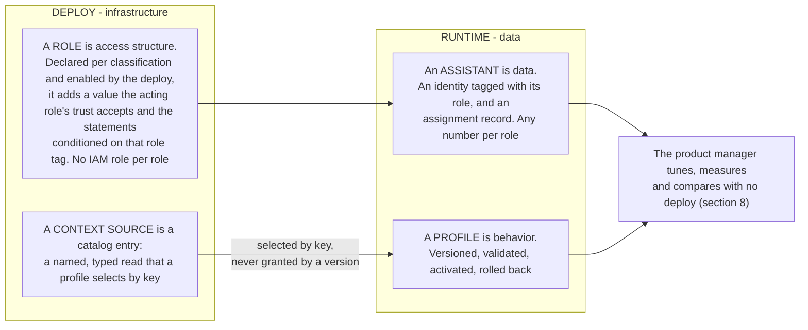
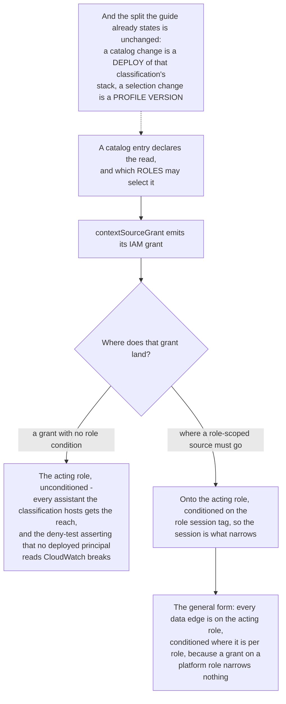
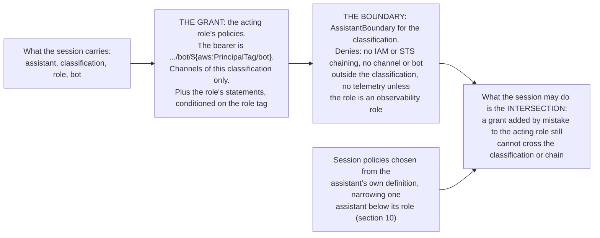
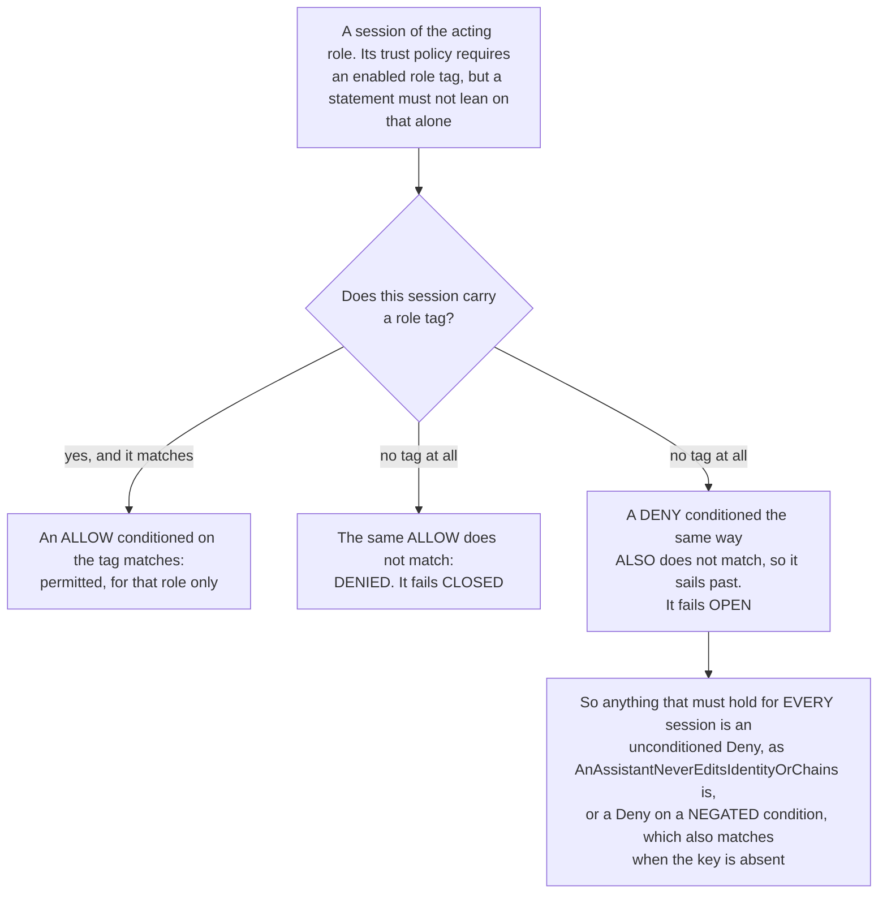
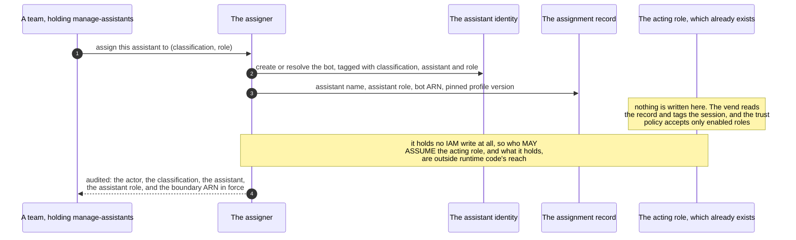
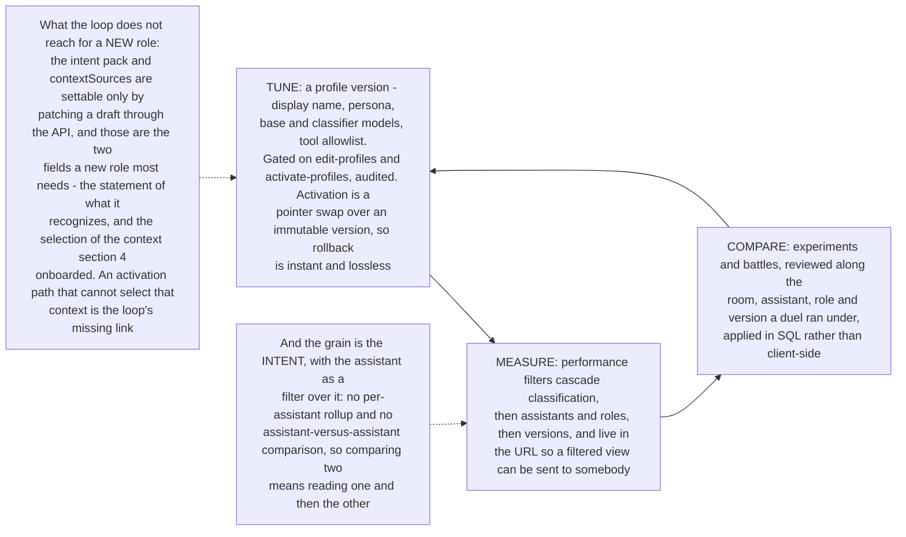
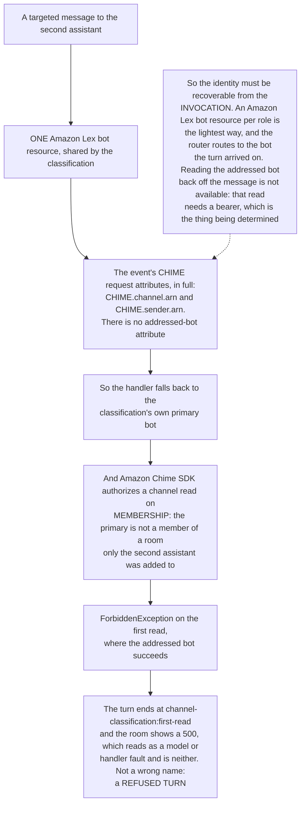
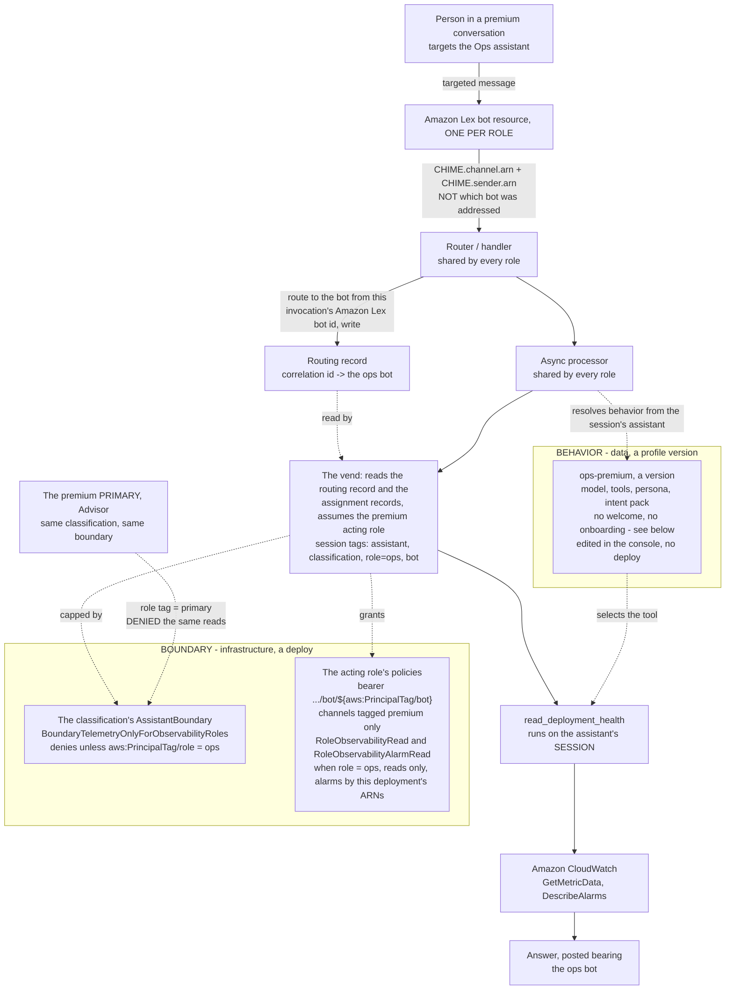
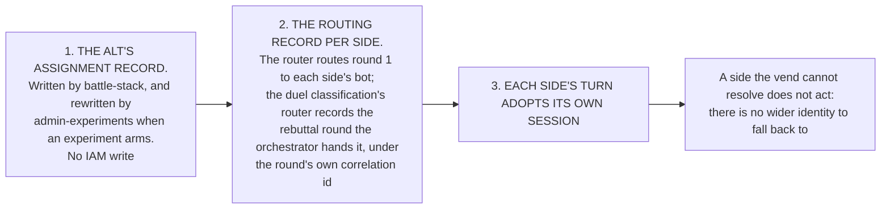

# DESIGN: Adding an assistant role, from onboarding a context to a product manager reading its results

**Status:** Partially implemented, and the worked case answers. `(premium, ops)` is built where the deployment declares it (`ops-premium` in `profiles`): it has its own identity, its own Amazon Lex bot resource, its own assistant role on the classification's acting role, its own profile and its own reach, it answers a turn in a premium conversation from live CloudWatch, and its numbers appear in the reports as their own row. The live evidence (the processor logging `acting as premium/ops/live/ops-premium`, the deny-test asserting the deployed boundary admits the ops role and refuses the primary and an untagged session, and the Latency report carrying `ops-premium` in the role `ops`) is from the deployed acting role. The acting role, the vend and the routing record are verified by `backend/test/an-assistant-acts-through-one-tagged-role.test.ts`, `backend/test/lib/a-turn-acts-as-the-assistant-it-was-routed-to.test.ts` and `backend/test/a-turn-runs-on-the-assistant-not-the-processor.test.ts`, and are deployed and live deny-tested by `tests/e2e/only-the-vend-mints-an-assistant-session.spec.ts`, `no-platform-role-speaks-as-an-assistant.spec.ts`, `an-assistant-session-is-narrowed-to-its-definition.spec.ts` and `assistant-classification-boundary.spec.ts`.

**Layer:** Core platform (governance and assistant-config). **Plane:** core.

**Coverage:** `e2e/an-assistant-boundary-refuses-cloudwatch.spec.ts` (the per-role grant shape and the classification boundary), `e2e/an-ops-role-reaches-only-its-own-classification.spec.ts` (the deny-test: the ops assistant cannot bear another classification's identity, nor its own primary's, nor act in another classification's conversations), `e2e/battle.spec.ts` (section 12).

**Verified by:** `backend/test/lib/an-assistant-reaches-only-what-it-declares.test.ts` for which session policies an assistant's approved definition selects (section 10).

**Related:** [`DESIGN-SEPARATE-ASSISTANTS-AND-DELEGATION.md`](./DESIGN-SEPARATE-ASSISTANTS-AND-DELEGATION.md) (Phase 1b, the acting role and per-assistant narrowing) · [`SPEC-CREDENTIAL-EXCHANGE.md`](../governance/SPEC-CREDENTIAL-EXCHANGE.md) (§4a, the vend) · [`HOW-TO-ADD-OR-MANAGE-A-PROFILE.md`](../../../guides/developer/HOW-TO-ADD-OR-MANAGE-A-PROFILE.md) (the procedure).

**Site section:** Interaction layer, assistants.

**Governed by:** [`DESIGN-SEPARATE-ASSISTANTS-AND-DELEGATION.md`](./DESIGN-SEPARATE-ASSISTANTS-AND-DELEGATION.md) sections 3.0, 3.6 and 3.7, which settle the structure, the provisioning mechanism and the alt. This document does not restate them; it walks one concrete case end to end and names what each step needs that does not exist yet.

**Problem and who it's for:** An engineer who wants to add an assistant that reaches a system the platform does not read today, for some but not all classifications, has no path that keeps the access boundary provable. With the classification boundary as the only place a grant can go, giving one assistant a new reach gives it to every assistant of that classification. This is for the engineer adding the role, and for the product manager who owns the assistant afterward and has to see how it performs without waiting on a deploy.

**Model:** The one cut the whole design hangs on is [`SPEC-PORTABLE-PROFILES.md`](./SPEC-PORTABLE-PROFILES.md)'s: **behavior is data, and a boundary is infrastructure.**

---

## 1. The worked case

An AI engineer adds a `reporting` role that answers questions about how the deployment is running, which means it must read CloudWatch metrics. It exists for `premium` and `standard`, and not for `basic`. After the deploy, the product manager who owns reporting tunes its persona and its intents, and reads its latency and effectiveness alongside every other assistant.

CloudWatch is the example because it is the honest hard case: it is a read the platform's own principals are asserted to be incapable of, so nothing about it can be waved through.

## 2. What the design rests on

The shape of the change is narrow and it stayed narrow: no new store, no new API surface, no second stack. What it did need is one Amazon Lex bot resource per role and four per-turn facts moved off per-function environment variables (section 10b). Section 10c is the flow all of this produces.

| Mechanism | Where |
|---|---|
| One acting role per classification, trusted only by the vend, with its permissions boundary | `agent-classification-common.ts` (`assistantActingRole`), `assistant-profile-stack.ts` |
| `assistant`, `classification`, `role` and `bot` stamped as session tags on every assume, from the routing record and the assignment records | `assistant-vend.ts`, `lib/turn-routing.ts` |
| The assignment record as the authority for which assistant a bot is and which assistant role it holds, for the live and the alt assistant | written by `assistant-profile-stack.ts` for `live` and `alt` (the alt's assistant name by `admin-experiments.ts` while an experiment holds it), read by the vend |
| A per-role contribution to the acting role, conditioned on `aws:PrincipalTag/role`: company context and observability reads | `roleContextStatements` and `observabilityRoles` in `agent-classification-common.ts` |
| Runtime assignment writing the assignment record and nothing in IAM, first used by the alt | `admin-experiments.ts` |
| Roles declared per classification, with `ASSISTANT_ROLES` as the platform default for a classification that declares none | `backend/lib/config/profiles.ts` |
| A tool that uses a role's scope, running on the assistant's session rather than the processor's own role | `lib/deployment-health.ts` (`read_deployment_health`), `actingCredentials()` in `lib/async-processor-core.ts` |
| Profile versions: draft and import under `edit-profiles`, validate and export under `view-profiles`, activate and roll back under `activate-profiles` | `lib/profile-lifecycle.ts` |
| Per-assistant attribution in the reports: `assistant` and `assistant_role`, both resolved from the assistant's session | `lib/analytics-metadata.ts`, `analytics-aurora/kinesis-archival.ts` |
| Admin filters that cascade classification, then assistant and role, then version; battles reviewed the same way | the admin package's performance and battle surfaces |

**The procedure is in the guide, not here.** [`HOW-TO-ADD-OR-MANAGE-A-PROFILE.md` §5b](../../../guides/developer/HOW-TO-ADD-OR-MANAGE-A-PROFILE.md) is the step-by-step for adding a role, including the traps; the sections below are the reasoning it rests on. What each open item blocks is section 11a.

## 3. Declaring the role (deploy)

Each classification declares the roles it instantiates in `profiles.ts`, and `ASSISTANT_ROLES` stays the default for one that declares none. The helpers already take the list as a parameter, so this is a caller change rather than a mechanism change.

**A role name is platform-wide and a role's access never is.** The platform owns the registry of role names so that `reporting` means the same thing everywhere and analytics can group on it. Access is always `(classification, role)`: a role that carried a platform-wide scope would be a classification boundary expressed in the one place that cannot see classifications, so `(premium, reporting)` and `(standard, reporting)` are different role instances on different acting roles with different scopes. ADR-042 stays intact - a shared role name never produces a shared principal.

**Declaring the role adds no IAM role.** Per classification that instantiates it, the role name joins the list the acting role's trust policy pins `aws:RequestTag/role` to: the list is the classification's declared roles (`deployedRoles`, `assistant-profile-stack.ts`), and a shipped role is declared only where the deployment names its assistant in `profiles` (`ops-premium`), so a role the catalog offers and the deployment does not declare is refused at the assume like an undeclared one; and the role's own statements (its context scope, and observability reads if it is an observability role) are added to the acting role conditioned on `aws:PrincipalTag/role` (`assistantActingRole`, `agent-classification-common.ts`). A session tagged with a role the deployment does not declare is refused at the assume. That is the existing construct with a longer list.

## 4. Documenting the context (deploy)

The new context is onboarded as a context-source catalog entry, which is the mechanism the platform already has for "a named, typed read that a profile selects by key" (tenet D8). The entry declares what the deployment is willing to expose and what protects it:

- `key`, `x-` prefixed, because it is deployment-defined rather than reserved.
- `trust: 'platform'`. Platform-written content may ground a reply and may never carry policy. A metrics read is written by the platform from an authenticated identity, so this is the correct level and not the convenient one.
- `availability`, `maxBytes`, and a `fields` contract where every field carries a description, because the assistant-visible menu lists descriptions and never values.
- A new `ContextSourceType` for the metrics read, whose grant is added to the exhaustive `contextSourceGrant` switch. The switch has a `never` guard, so a new type that declares no grant fails the build rather than shipping ungranted.

Every grant a turn uses as the assistant is on the acting role, and the processor's own role holds only its bootstrap and the processor's own records about a turn - abuse counters and the cost circuit, turn state, the message-analytics row, the triage dispatch - which no assistant session can write (`assistant-profile-stack.ts`). The one real change in this section is that a role-scoped catalog grant carries the role condition rather than landing unconditioned on the acting role, and making that enforceable rather than conventional is in section 11a.

## 5. The boundary and the floor (deploy)

Two documents decide what a `(classification, reporting)` assistant may do, and both have to name the metrics read before it is permitted.

**The boundary is one per classification rather than one per `(classification, role)`**, because there is one acting role per classification and the boundary is written as Denies that hold for every session of it whatever the identity policies grow to hold. Per-role reach is an Allow on the acting role conditioned on the role tag (`roleContextStatements`, and the observability read for an observability role), and the one per-role rule the boundary itself carries is a Deny on telemetry for any role that is not an observability role, keyed on a negated condition so a session without a role tag is denied too.

**The acting role still needs the read**, because the boundary caps and grants nothing.

**A PER-ROLE CONDITION IS FOR AN ALLOW, AND NEVER FOR A DENY.**

The two read as symmetric and are not, which is exactly the shape of mistake that ships green.

**That pairing is tenet D3's two layers, and neither is redundant.** The acting role decides what is granted and the boundary decides what the answer may contain. A reader checking whether reporting can read metrics has to find it in both places, which is the property that makes "a team may narrow and never widen" enforceable rather than intended. **The write side is asserted, not assumed:** the deny-test gains a control that the reporting boundary grants no CloudWatch write, because a read-only claim that nothing tests is a claim about intent.

## 6. The starting profile (deploy)

The deploy seeds a profile under the new assistant's own name, which must not be a classification value. It carries, as selections only:

- The **intent pack**, which is the authoritative statement of what the assistant recognizes. A pack replaces rather than inherits, every declared intent must resolve to a reachable route, and an intent's `tools` must be a subset of the profile's.
- The **tools** allowlist, drawn from the registered set.
- The **models** bundle, within the deployment's allowlisted catalog.
- **`contextSources`**, selecting the new catalog key.

**A profile grants no IAM.** The tool allowlist selects within what the deployment already permits, so naming a tool the acting role cannot invoke for this assistant role produces a runtime failure in the loop and never an escalation. That is what lets the product manager edit behavior freely in section 8 without touching a boundary.

## 7. Assignment (runtime)

Assignment is what turns an identity into a working assistant, and it is the step that generalizes: the same operation whether the assistant is a classification's seeded primary, a new reporting assistant, or a battle's challenger. **It writes no IAM.** Nothing about a particular assistant is in any policy, so assignment is an identity tagged with its classification, assistant and role, and an assignment record; the vend reads the record on the next turn routed to that bot.

IAM has no condition key for a trust document, so a runtime principal that could write one could hand a usable principal to whoever it named. With one acting role per classification and the assistant carried as a session tag, no turn-path principal needs any IAM write (deploy-time custom resources hold `iam:PassRole` and `iam:CreateServiceLinkedRole`), and the provisioner's tag writes are locked to the identity keys and its own stamp (`RUNTIME_ASSISTANT_TAG_KEYS`, `runtimeAssistantProvisioningAllow`). The audit record is what makes an assistant's reach reconstructable rather than inferred.

**Vacating is the same operation inverted:** null the assistant in the record. The vend then refuses any turn routed to that bot, because the bot resolves to no assistant of the classification. It takes effect after the vend's assignment index cache expires, up to 60 seconds (`INDEX_TTL_MS`, `assistant-vend.ts`), and a session already minted for that bot lives up to one hour, so a turn on such a session can still act until it expires.

**The capability this runs under is `manage-assistants`**, wired in the catalog for admins only (`POST /admin/roster`, `POST /admin/roster/{assistantId}/retire`, ADR-048). It is deliberately not folded into the profile capabilities (`edit-profiles`, `activate-profiles`): one changes behavior and may not touch a boundary, the other places an identity into an assistant role. Every assistant identity is the provisioner's ([ADR-048](../../../design/decisions/048-an-assistant-is-not-a-classification.md), as amended): a deploy declares a role's assistant and its stack's seed asks the provisioner for it once, and the console asks the same provisioner for further ones in a deployed role. One role builds and retires every one of them, reaching only what carries `provisioner=runtime` (`runtimeAssistantProvisioningAllow`), and once an assistant exists the console owns it however it was asked for: rename, owner and retire, with a retire that a later deploy respects. A role and the assistants filling it are separate: a role is withdrawn only once every assistant in it is retired in the console.

## 8. The product manager's loop (runtime)

The goal this design serves ends at the product manager reading results, so what the surface does not carry is named here rather than assumed.

Two smaller gaps on the tune surface: no endpoint returns a draft's body, so the editors seed from the active version and track dirtiness to compensate; and a version list does not mark an experiment-derived candidate, so one is offered as a rollback target even though rollback refuses it. Per-intent model routing is rendered in the config panel and is not editable there.

The per-intent grain is tolerable while a classification hosts one assistant and stops being tolerable at the moment this design's whole purpose is served, so a per-assistant rollup belongs with the first classification that declares a second role. All of the assistant-dimensioned surfaces are Aurora-only by design; in Athena mode they answer unsupported rather than empty. Latency reports time to first feedback, which is the placeholder bubble rather than a first token, because the platform does not stream tokens.

**What a product manager cannot do from here is widen access**, and that is structural rather than checked: a version carries selections and never references, so there is no field through which scope could travel.

## 9. What changes in the guides

| Guide | Change |
|---|---|
| `DEVELOPER-GUIDE.md` | A "Common extensions" entry for adding a role, distinct from adding a classification. |
| `HOW-TO-ADD-OR-MANAGE-A-PROFILE.md` | A section for adding a ROLE within existing classifications, parallel to the add-a-classification walkthrough and much shorter: no Cognito group, no Identity Pool role, no new stack, no frontend classification gating. |
| `GUIDE-ASSISTANT-CONTEXT.md` | The new source type, and the rule that a role-scoped source is granted into the role's boundary rather than onto the shared processor role. |
| `ADMIN-GUIDE.md` | What the Assistants section shows when a classification holds several assistants, and that the Performance filters already separate them. |

## 10. The decision this design needs

**Is scope the role's alone, or may an individual assistant be narrowed within its role?** Decided by the owner: **each assistant has its own boundary inside its classification.** The classification is the access IAM evaluates for every principal, and an assistant's own declared reach is enforced inside it by narrowing its vended session (tenet D4; [DESIGN-SEPARATE-ASSISTANTS-AND-DELEGATION](./DESIGN-SEPARATE-ASSISTANTS-AND-DELEGATION.md), Phase 1b).

**The mechanism.** The vend passes session policies chosen from the assistant's approved definition (`grantEdgesFor`, `lib/assistant-grant.ts`) out of the classification's catalog (`assistantGrantCatalog`), so the effective permission is the acting role, its boundary and those policies together, and the definition store is part of the boundary. Two assistants holding the same role may differ in whether they reach the classification's company context, platform knowledge and telemetry, and in which models they reach. A duel stays honest because each side is narrowed by the variant recorded for it, and a `profileRef` variant is derived from the live assistant's definition, so their reach matches unless an experiment declares otherwise.

Two consequences follow: `manage-assistants` authorizes narrowing as well as creating, deleting and assigning, and whoever approves a definition is approving a boundary; and the vend records the per-assistant narrowing as the edges a session carries (`grants`, logged by `[AssistantVend] vended` beside the assistant, its role and the definition version).

## 10a. MEASURED: a shared Amazon Lex bot resource cannot say which assistant was addressed

This is the constraint that decides how big the addressing work is, and it is established by measurement rather than by reading the service documentation. A targeted message to a second assistant DOES reach the platform, and the assistant DOES post under its own name. What the handler cannot learn is which assistant the turn was for.

**Two consequences worth stating plainly.** A shared Amazon Lex bot resource is not merely untidy for multi-assistant work, it is insufficient. And the membership rule means an assistant cannot answer in a room it is not a member of even if IAM would permit it, so enrolling an assistant is part of addressing it rather than a separate nicety. The alternative to an Amazon Lex bot resource per role is a handler per role, which `assistant-profile-stack.ts` already assumes in a comment and which costs a Lambda per role.

## 10b. What building it taught

Measured on the deployment: asked about Lambda health in a premium conversation the ops assistant returned 285 invocations, 42 errors, a 14.7% error rate and 622ms average duration, the processor logged `acting as premium/ops/live/ops-premium`, and the Latency report carries `ops-premium` in the role `ops` as its own row beside the primary's.

**A GRANT IS NOT A CAPABILITY, and the assistant said so before anyone noticed.** The boundary permitted CloudWatch from the moment the role shipped, and asked about errors the assistant answered "I don't have a direct connection to your AWS account or real-time Lambda metrics" - correctly, because no tool called them. A role's scope needs a tool that uses it, the tool has to run on the assistant's session rather than a platform role, and a refusal from it is an entitlement answer to be said plainly rather than an error to surface.

**THE ONE PATTERN BEHIND FOUR DEFECTS.** An environment variable is the right carrier for what a FUNCTION is and the wrong one for anything a TURN is. One runtime serves every role a classification declares, so four separate per-turn facts were being read from per-function values, and each failed as something else:

| Read from the env | Presented as |
|---|---|
| the bot's name | a second assistant named `Advisor`, unaddressable |
| the Lex alias it was wired to | a refused channel read and a 500 in the room |
| which profile served the turn | the ops assistant answering in the advisor's voice |
| which assistant analytics attributed the turn to | no `ops-premium` row in any report |

All four are latent for exactly as long as a classification hosts one assistant, which is why nothing caught them: the primary's value was always the right one. They are resolved from the assistant the turn acts as, which the vend reads from the assignment records for the bot the router routed the turn to.

**A VERSION FREEZES THE TOOL LIST, SO A TOOL REGISTERED LATER REACHES NO EXISTING PROFILE.** The seed grants every registered tool, but `createDraft` clones the active-or-seed body and MATERIALIZES that list into the version. So the ops assistant used `read_deployment_health` perfectly while it had no published version, and stopped the moment one was activated: the version carried the ten tools that existed when the body was captured, and the new one was not among them. It failed in the assistant's own voice - "I don't have a tool available in this session" - which reads as a model limitation rather than a stale allowlist. Freezing is the correct behavior for an operator's selection and should not change; what is missing is the signal, and the rollout view prints the list for exactly this reason.

**TWO GRANTS THAT HAD NEVER RUN.** `chime:CreateAppInstanceBot` was scoped to the app instance alone while Amazon Chime SDK authorizes it against `<appInstance>/bot/*`, and it now names both, because the SDK's authorization target is not documented; every identity predated the strict grant and the provisioner only calls Create when the bot is absent, so the path had not executed since it shipped. And `GetParametersByPath` authorizes against the path itself, not only its children. **An unexercised grant is not a working one.**

## 10c. The flow, as built

One turn to the `ops` assistant, from the person's message to the metric it answers from. The two shaded boxes are the two halves of the split this design rests on: the **boundary** is infrastructure and a deploy, the **behavior** is data and a profile version.

**What the diagram is claiming, and where each claim is checked.** The Amazon Lex bot resource per role is what makes the assistant recoverable, because the invocation carries no addressed-bot attribute (10a). The router records which bot answers in the routing record, and the vend resolves the assistant and its role from the assignment records rather than from an environment variable or the caller, because one runtime serves every role (10b). The tool runs on the assistant's session rather than a platform role, or the boundary would be decorative. And the dotted line from the primary is the cut itself: the same classification and the same boundary, refused the same reads. `e2e/an-ops-role-reaches-only-its-own-classification.spec.ts` asserts this in both directions against deployed documents on the deployed acting role.

## What the version carries, and the one field it does not

The diagram above says `model, tools, persona, intent pack` because that is what the deployed version holds. Read back from `{SSM_ROOT}/assistant/ops-premium/definition:active`: `configId`, `intentPackRef`, `modelKey`, `models`, `personaRef`, `profileName`, `schemaVersion`, `tools`.

**It carries no `welcome` and no `onboarding`, and that has a visible consequence.** Both fields fall back to a parameter keyed by CLASSIFICATION when a version does not carry them, so without the refusal below the ops assistant renders the premium primary's welcome copy - the same sentence `advisor` posts in the conversation an alert opens. The demo seeds persona and intent pack for this assistant and omits it from the onboarding and boundary maps, and seeds no per-assistant welcome for any assistant.

Two halves, and only one is built. `lib/deployment-copy-scope.ts` refuses the inheritance, so a second assistant with no field of its own gets the platform default rather than the primary's words, and the refusal is logged with the assistant and the field. **Giving this assistant its own opening is data and is NOT BUILT:** it is an `ops-premium` entry in the demo's onboarding and boundary maps plus a welcome on its version, which is step 5 of the procedure in [`HOW-TO-ADD-OR-MANAGE-A-PROFILE.md`](../../../guides/developer/HOW-TO-ADD-OR-MANAGE-A-PROFILE.md) §5b.

## 11. What this does not decide

- **The admin console screens for creating and managing assistants and roles.** The mechanism is an access-control question and is settled; which screens exist and how a role is presented are interface questions that belong with the console spec.
- **Whether a conversation gains a newly added assistant.** Existing conversations were created under one shape and hold work items bound to an assistant, and removing a bot from a room where it holds open work is not symmetric with adding it.
- **How a room with two assistants routes an unaddressed turn.** That is the addressing half of Phase 2, and this design stops at the boundary.
- **Cross-classification anything.** ADR-042 binds an assistant to exactly one classification.

**One consequence is NOT deferred, because people feel it.** Amazon Chime SDK `AUTO` counts the non-hidden members of a room, bots included, so a conversation that gains its second assistant stops answering everything and starts answering only what it is addressed by. The room is told when that happens. Routing between two assistants is Phase 2's and is deferred above; the notice is not, because the alternative is a room whose behavior changes with no explanation, and ADR-030 already predicts this is the notice most likely to be skipped.

## 11a. Open, and what each one blocks

Recorded here rather than answered, so that the next reader can tell a decision from an omission.

| Open | Blocks | Does not block |
|---|---|---|
| A per-assistant welcome. The ops assistant greets with the classification's configured orientation, so it introduces itself as the business advisor. Orientation is per classification; a version's persona is per assistant. | An assistant sounding like itself on turn one | Everything after the greeting |
| The `manage-assistants` capability (section 7). | Assignment as a self-serve runtime operation for anyone but the alt path | The seeded primary and the alt, whose records are written by their own stacks |
| A console editor for the intent pack and the context-source selection (section 8). | A role whose whole point is a new context being tuned without an API call | Everything the version editor already covers |
| A per-assistant effectiveness rollup (section 8). | Comparing two assistants in one view | Reading either one |
| Making the catalog-grant target enforceable rather than conventional (section 4), so a contributor cannot attach a role-scoped grant to the acting role without its role condition by following every existing branch. | A role-scoped context source | Everything else |
| A deny-test that `(premium, reporting)` cannot reach `(standard, reporting)`'s data - the same-role, different-classification pair. | Declaring the first role that exists in two classifications | The single-classification role, which `e2e/an-ops-role-reaches-only-its-own-classification.spec.ts` covers in both directions |

**Settled, and recorded here because it was the largest open item:** how an assistant and its role are carried at runtime. The router routes to the bot the turn arrived on and writes the routing record; the vend resolves the assistant and its role from the assignment records for that bot and tags the session with them. Each additional role owns an Amazon Lex bot resource so that the bot identifies the assistant. No handler per role, no IAM role per role or per assistant, and no environment variable carrying a per-turn fact.

**The battle work in section 12 is blocked by none of them**, which is why it is safe to take first: the alt is a second assistant holding the existing `primary` role (its bot tagged `alt-primary`), so it needs no new role, no new boundary statement and no IAM write.

## 12. Working back to battles, and then the demo

The battle fix is an instance of section 7 rather than a separate mechanism, which is the reason to design this first. With one acting role per classification there is no per-side policy to write: each side is an assistant the vend resolves from its assignment record, and the side's session can act only as that side's bot.

| Step | Gate |
|---|---|
| 1 | The alt record for each battle-capable classification names the alt bot, an assistant and an assistant role the acting role's trust accepts |
| 2 | A session vended for the alt can send bearing the alt bot and is denied bearing the classification's live bot (a live deny-test, **NOT YET RUN**) |
| 3 | A real duel logs each side acting as its own assistant, and both sides post (**NOT YET RUN** against the acting role) |

**Definition of done for this section:** a duel runs with each side bearing its own identity on its own vended session, proven by the three gates above rather than by a green test run.

### What B-E4 settled about waiting on a projection

`B-E4` asserts that the recommendation carries a human-pick axis, which needs BOTH variants to have archived rows. It failed on a 90-second wall-clock budget whose own header ruled out the obvious fix: "Kinesis delivery is near real time, so a row that is coming has long since arrived; a longer budget cannot turn a failure into a pass."

**The rows arrive after the window.** Read from `experiment_results`, a minted experiment carries both variants, one row each, landing after 90 seconds. The assertion therefore waits on the projection settling: patience resets whenever the archived-variant count rises, and it gives up only after the count stops moving. Its failure message tells apart a projection settled incomplete, one still behind, and variants present with no decisive pick. Lengthening the budget and triggering archival are both rejected: a test that outruns the projection measures nothing.

**A separate and real defect is visible in the same read**, and it is not what `B-E4` was failing on: three of nine battle experiments carry exactly one variant and still do. Either side can be the missing one, which rules out a systematic bias toward the alt and points at duels that did not complete rather than at attribution. Those runs were interrupted partway, so the incompleteness is expected; what is worth keeping is that **a half-archived duel is indistinguishable in the rollup from a duel where one side lost.**

The demo follows the same order as the three steps above, because a duel that cannot post is a worse demo than one that runs.
