# DESIGN-ASSISTANT: Meetings assistant

**Status:** NOT BUILT, under consideration. Draft / planning - the design is not finalized and none of the meeting itself is built; the invitation chase (FR32) is built for any conversation. The Phase 1 WebRTC meeting is **NOT BUILT** in this codebase, and [SPEC-ASSISTANT-MEETINGS.md](./SPEC-ASSISTANT-MEETINGS.md), "Phase 1 scope", states what it covers. **BLOCKED** on sub-agent identity, then the moderator role; the chain and its order are in [SPEC-ASSISTANT-MEETINGS.md](./SPEC-ASSISTANT-MEETINGS.md), "What Blocks This, In Order". Every occasion on which this assistant acts unprompted is an event of [ADR-061](../../../design/decisions/061-a-welcome-is-a-workflow-an-event-starts.md), the platform's one event model, and its reasoning steps are that ADR's `agent` steps, which are built (ADR-061); the meeting events in B.6 are **NOT BUILT**.

**The phone leg (C.2) is an optional adapter and the platform ships none**, because Amazon Chime SDK PSTN Audio is in maintenance mode and closed to new accounts from 2026-10-29.

**Coverage:** none - a draft design; nothing meeting-specific is built, and the invitation chase (FR32) is verified in SPEC-TASK-STATE-TRANSITIONS, so there is no deployed meeting behavior to drive.

**Related:** [SPEC-ASSISTANT-MEETINGS.md](./SPEC-ASSISTANT-MEETINGS.md) - what this assistant is for, its requirements, its personas and what it refuses to be. Per requirement, what is delivered is stated there, in Functional Requirements, and nowhere in this document. This is the mechanics only.

**Site section:** Interaction layer, assistants.

---

A worked exemplar of the per-assistant design pattern. Part A reuses the platform seams almost verbatim, Part B is the meetings-specific content, and Part C is the live meetings and calls infrastructure a meeting or call would run on. Parts A and B depend on nothing in Part C.

## Part A - where this assistant sits on the platform

The assistant is a persona, an intent pack and a tool set over seams the platform already owns. Nothing below is new machinery.

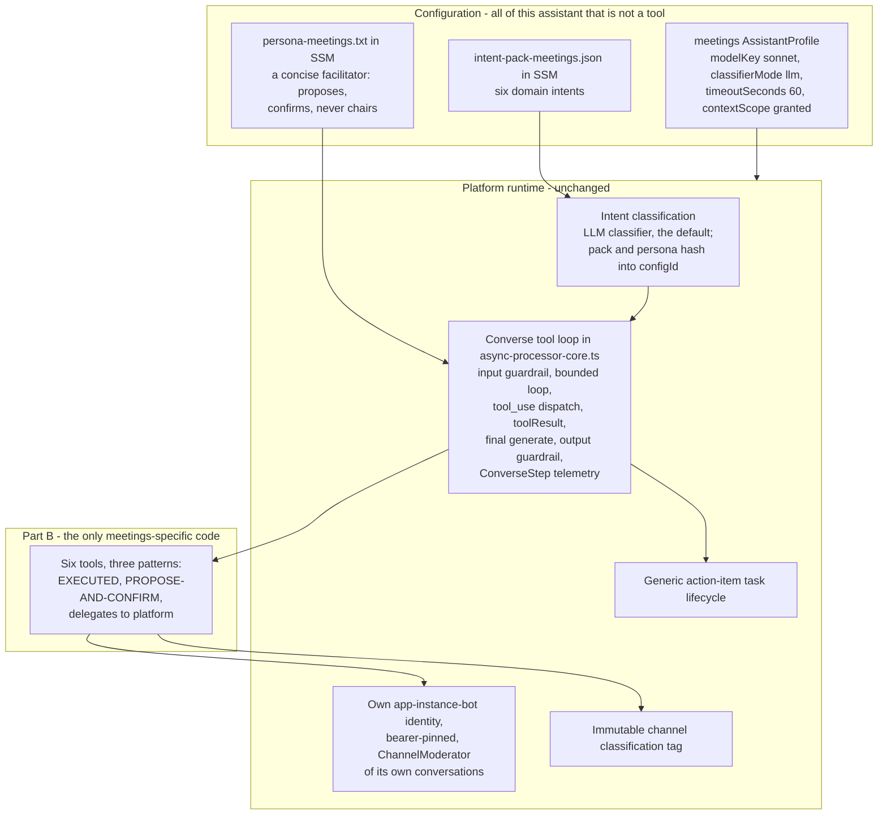

| Piece | Platform mechanism | This assistant's setting |
|---|---|---|
| **Profile and model** | `AssistantProfile` (`backend/lib/config/profiles.ts`) | A `meetings` profile: `modelKey: sonnet`, `classifierMode: 'llm'`, `timeoutSeconds: 60`, `contextScope: 'granted'`. Assigned to a conversation as that conversation's own assistant, and it runs at that conversation's classification, so a customer meeting's assistant reaches no internal content |
| **Persona** | `ASSISTANT_SYSTEM_PROMPT` in SSM, hydrated at cold start, stable prefix cached via `cachePoint` | `persona-meetings.txt`: a concise meeting facilitator - proposes, does not decide; confirms before consequential actions; never chairs |
| **Guardrail** | `applyInputGuardrail` and `applyOutputGuardrail`, out of band, failing open | The platform default: prompt-attack screening on input, PII and marker filtering on output. No meeting-specific rules |
| **Context scope** | `load_company_context` and `load_platform_info` over a classification-scoped S3 prefix, IAM-bounded | The company-context tool is off. This assistant's context is the meeting record rather than a document corpus; `load_platform_info` may stay on for "what can you do?" turns |
| **Classification** | The immutable channel `classification` tag, read live | It serves the classification of the meeting conversation. An unreadable tag is not a value, and a caller that needs one refuses rather than substituting a floor. An attendee whose classification does not reach the conversation is refused the conversation rather than capped inside it |
| **Identity** | Its own app-instance-bot, provisioned the way every assistant identity is; bearer-pinned; privileged actions through credential-exchange | The meetings bot owns and moderates the meeting conversation. It holds no standing calendar-write or membership grant - those live on the apply endpoints |
| **Converse tool loop** | `invokeBedrock` in `async-processor-core.ts`, with `MAX_TOOL_ITERATIONS` bounding the loop | Unchanged. It exposes the tools in Part B |
| **Intent classification** | The intent pack in SSM plus the universal three; the LLM classifier, which is the default for every profile, with the keyword classifier opt-in per profile, and also the failure path of the LLM classifier: a classifier call that throws is answered by the keyword pass (`intent-classifier.ts`) | `intent-pack-meetings.json`, in Config wiring below |
| **Task lifecycle** | The generic `action_item` machine: `gathering` to `options_presented` to `awaiting_completion` to `completed` | The two multi-step intents, `schedule_meeting` and `follow_up`, ride it exactly as the corporate-travel worked example does. No meeting-specific machine is added. `onboard_attendee` is multi-step but its steps are attendee greeters run by the orchestration primitive, not a task graph |

## Part B - Intents to tools

### B.1 The map

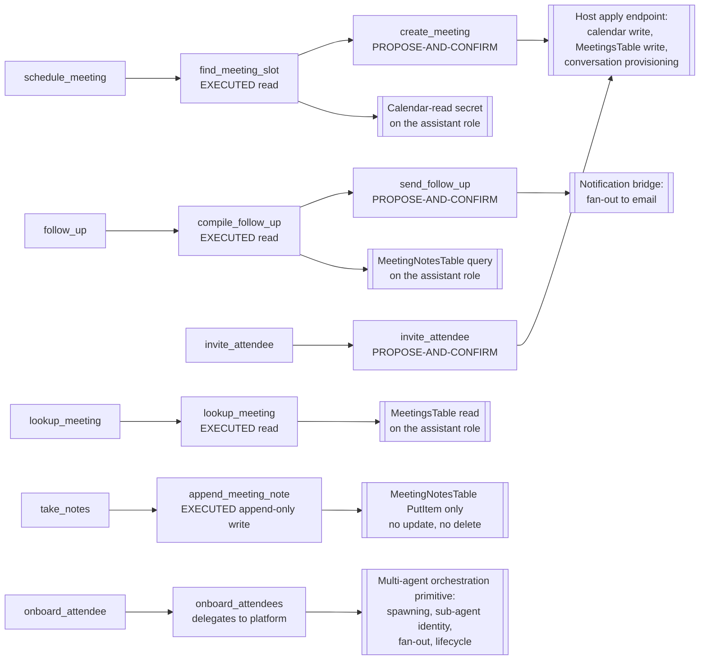

**The read-write asymmetry is the whole capability story.** Every read grant sits on the assistant's own role; every consequential write sits somewhere else. The assistant role holds `dynamodb:GetItem` and `Query` on `MeetingsTable`, `Query` and `PutItem` on `MeetingNotesTable`, and `secretsmanager:GetSecretValue` on the calendar-read secret. It holds no membership grant, no calendar write, no mail grant and no identity-creation grant.

The universal intents need no tools: `greeting` and `acknowledgment` answer directly, and `general` answers from the persona.

### B.2 The three tool patterns, as flows

**EXECUTED.** The loop runs the tool and feeds the result back.

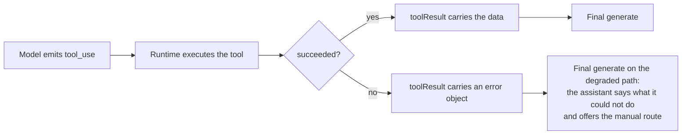

**PROPOSE-AND-CONFIRM.** The loop intercepts the tool instead of executing it, and the write happens only after a person accepts.

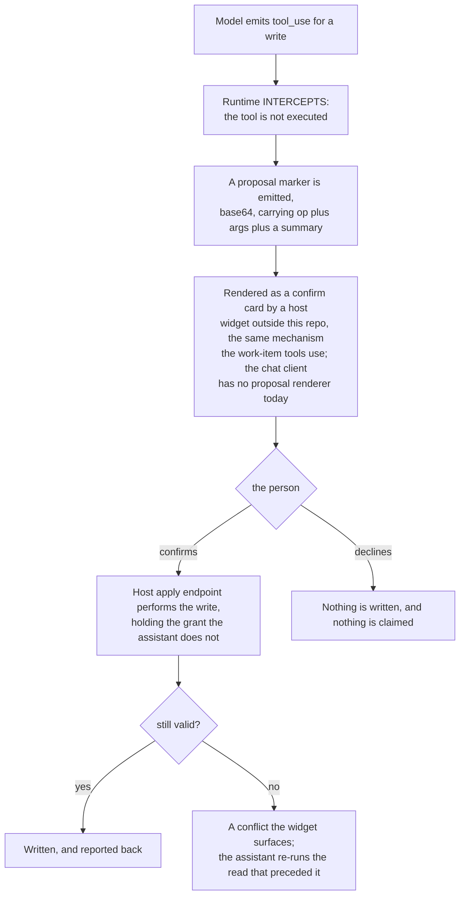

**Who may apply a proposal.** A proposal records the AppInstanceUser id of the person it is addressed to: the organizer who asked, or, for a proposal an [ADR-061](../../../design/decisions/061-a-welcome-is-a-workflow-an-event-starts.md) `agent` step drafted, the person its participant role or variable names. The apply endpoint authorizes `callerPersonId` (`backend/lambda/src/lib/auth.ts`) against that id and against the participant-role holdings on the conversation's context row at apply time, refuses a session whose bearer is an assistant, consumes the proposal with a conditional write so it applies once, and refuses it after it expires. A deny test proves that another member, and the assistant itself, are refused applying a proposal addressed to the organizer (ADR-061 decision 8, rule 8). **Built and verified on dev for the proposals an ADR-061 `agent` step offers** (`proposals-api.ts`, `backend/test/lib/a-proposal-is-applied-once-by-its-addressee.test.ts`, `tests/e2e/a-proposal-is-applied-once-by-its-addressee.spec.ts`, recorded in [SPEC-TASK-STATE-TRANSITIONS](../conversation/SPEC-TASK-STATE-TRANSITIONS.md)): a proposal addressed to an inviter or to a one-holder participant role. `create_meeting` and `invite_attendee` are **NOT BUILT**, because the meeting itself is not built.

**Why the interception rather than a confirmation sentence.** A model asked to wait for confirmation sometimes does not, and the write would already have happened. Interception makes the wait structural: the tool is never dispatched, so there is nothing to undo.

**Where the card renders.** The work-item proposal marker is emitted for a host widget that is not part of this repo, and the Apply that widget offers calls a host endpoint. A proposal an ADR-061 `agent` step offers is drawn by the chat client's own confirmation card (`ProposalCard.tsx`), from the `proposal` field of the targeted message's Metadata, and applied at `POST /proposals/apply`.

**Delegates to platform.** The tool hands a list to a platform runtime and returns a dispatch receipt. It holds no grant of its own.

### B.3 Tool detail

#### `find_meeting_slot` - EXECUTED

Serves `schedule_meeting`. Description the model sees: "Find times when the named attendees are all free for a meeting of the given length in a date window. Call this once you have the attendees, the duration, and a rough window. Returns candidate slots; it does not book anything."

```json
{
  "type": "object",
  "properties": {
    "attendeeKeys": { "type": "array", "items": { "type": "string" }, "description": "Allowlist KEYs of the attendees to check (never emails or ARNs)." },
    "durationMinutes": { "type": "number", "description": "Meeting length in minutes." },
    "windowStart": { "type": "string", "description": "Earliest date to consider, YYYY-MM-DD." },
    "windowEnd": { "type": "string", "description": "Latest date to consider, YYYY-MM-DD." }
  },
  "required": ["attendeeKeys", "durationMinutes", "windowStart"]
}
```

Output: `{ "slots": [ { "start": "ISO-8601", "end": "ISO-8601", "allFree": true } ], "note": "policy/availability note string" }`. No side effects. Capability: a scoped read-only calendar credential in Secrets Manager, its ARN granted to the assistant's Lambda role. It ships as a mock with deterministic slots and no network call, exactly as `corporate-travel-tool.ts` does, so the swap to a real calendar client is a client swap rather than a design change. Enabled only behind `ENABLE_MEETINGS_CALENDAR`, optionally with `MEETINGS_CALENDAR_API_BASE`, so the platform stays domain-neutral by default. On error the loop feeds back an error object and the assistant asks the organizer to name a time.

#### `create_meeting` - PROPOSE-AND-CONFIRM

Serves `schedule_meeting`. Description: "Propose creating the meeting once the organizer has chosen a time. Does not take effect until the organizer confirms."

```json
{
  "type": "object",
  "properties": {
    "title": { "type": "string" },
    "start": { "type": "string", "description": "ISO-8601 chosen start." },
    "durationMinutes": { "type": "number" },
    "attendeeKeys": { "type": "array", "items": { "type": "string" } },
    "agenda": { "type": "string" }
  },
  "required": ["title", "start", "durationMinutes", "attendeeKeys"]
}
```

Proposal payload: `{ op: "create_meeting", args: <input>, summary: "Create \"<title>\" at <start>" }`, emitted as a base64 proposal marker via `proposalMarker`. On apply: the calendar event (through a calendar connector), the meeting record in `MeetingsTable`, and the meeting conversation are created. The meeting conversation is its own channel, linked to the conversation it was scheduled from by a resource tag naming the parent channel, and its membership grants nothing in the parent; each attendee's invitation follows `invite_attendee`. The apply endpoint holds the calendar-write credential and the `dynamodb:PutItem`; the assistant only proposes, so nothing is written from model output. A slot taken between proposal and apply returns a conflict, and the assistant re-runs `find_meeting_slot`.

#### `lookup_meeting` - EXECUTED

Serves `lookup_meeting`. Description: "Look up a meeting's time, agenda, and attendees. Call this before answering any question about when a meeting is, who is invited, or what is on the agenda."

```json
{
  "type": "object",
  "properties": {
    "meetingId": { "type": "string", "description": "Omit to use the current channel's meeting." },
    "query": { "type": "string", "description": "What the user is asking about." }
  },
  "required": []
}
```

Output: `{ "title": "...", "start": "ISO-8601", "attendees": ["display names"], "agenda": "...", "found": true }`. Read-only, on `MeetingsTable` scoped to meetings in the assistant's app instance. **Attendees come back as display names only** - the model never receives a raw ARN, sub or address, which is the same rule the write side enforces from the other direction. An absent record returns `found: false` and the assistant offers to schedule one.

#### `invite_attendee` - PROPOSE-AND-CONFIRM

Serves `invite_attendee`. Description: "Propose adding a person to the meeting. Identify them by their allowlist KEY. Does not take effect until the organizer confirms."

```json
{
  "type": "object",
  "properties": {
    "meetingId": { "type": "string" },
    "attendeeKey": { "type": "string", "description": "Allowlist KEY of the person to add (never an email, sub, or ARN)." },
    "reason": { "type": "string", "description": "One line the greeter uses when this attendee joins." },
    "participantRole": { "type": "string", "description": "A participant role the meeting type declares invitable; the apply endpoint refuses any other." }
  },
  "required": ["attendeeKey"]
}
```

Proposal payload: `{ op: "invite_attendee", args: <input>, summary: "Invite <key>" }`. On apply the apply endpoint resolves the KEY against the deployment allowlist to an AppInstanceUser, or, for a person not yet known, has one assigned by the credential exchange; adds that AppInstanceUser as a member of the meeting conversation; writes the invitation's `Tokens` record (meeting channel ARN, invitee and issuing AppInstanceUser ARNs, redemption mode, expiry, single use, and the participant role and reason, recorded under the `invitable` and inviter rules of [DESIGN-CONVERSATION-TYPES.md](../conversation/DESIGN-CONVERSATION-TYPES.md) section 6.1); records the invitee as an expected attendee (FR20); and sends the notice and the calendar invite to the address the contact seam returns for that AppInstanceUser. The rules for redemption, binding, forwarding and revocation are in [SPEC-ASSISTANT-MEETINGS.md](./SPEC-ASSISTANT-MEETINGS.md), "Invitations". The apply endpoint holds `chime:CreateChannelMembership` scoped to the app instance plus the calendar-invite write. The key-not-ARN rule mirrors [SPEC-ADD-USER-ESCALATION.md](../governance/SPEC-ADD-USER-ESCALATION.md): no model output ever becomes an identity. An unknown key is rejected at the apply endpoint with an actionable message, and the proposal never resolves to an add.

Note the `reason` field: it is the one line this attendee's greeter delivers later, captured at the moment the organizer decides to invite them rather than reconstructed at onboarding time. It is member trust: said in the attendee's brief, never deciding; the `participantRole` decides which brief they receive.

**NOT BUILT:** the apply endpoints of `create_meeting` and `invite_attendee`, and a `role` on an invitation's `Tokens` record. The invitations function built for ordinary conversations (SPEC-CREDENTIAL-EXCHANGE section 4c) records a `reason` and refuses a `role` until a conversation type declares one `invitable`.

#### `onboard_attendees` - delegates to platform

Serves `onboard_attendee`. Description: "Onboard the meeting's attendees: for each one, ensure they are invited, joined, and greeted with their reason for attending. Call this when the organizer says the meeting is ready to start."

```json
{
  "type": "object",
  "properties": {
    "meetingId": { "type": "string" },
    "greeters": {
      "type": "array",
      "items": {
        "type": "object",
        "properties": {
          "attendeeKey": { "type": "string" },
          "briefing": { "type": "string", "description": "The one-line why-you-are-here this attendee's greeter delivers." }
        },
        "required": ["attendeeKey", "briefing"]
      }
    }
  },
  "required": ["greeters"]
}
```

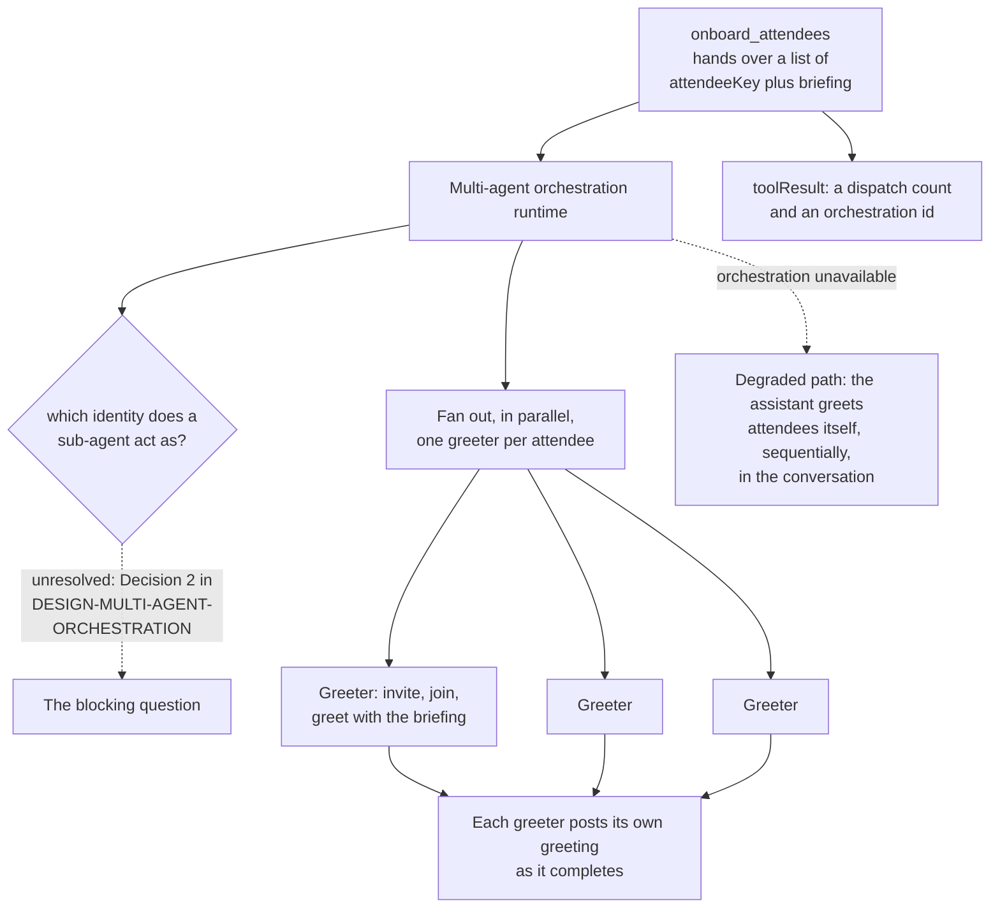

Output: `{ "dispatched": <n>, "orchestrationId": "..." }` - the assistant reports that onboarding is running, and each greeter's greeting arrives on its own. **No capability of its own.** The platform owns spawning, per-sub-agent identity, fan-out and lifecycle; the meetings assistant holds no bot-creation or bulk-invoke grant.

**The sub-agent identity question is open and it blocks this tool.** Which principal a greeter acts as is Decision 2 in [DESIGN-MULTI-AGENT-ORCHESTRATION.md](./DESIGN-MULTI-AGENT-ORCHESTRATION.md), and it is unresolved: the earlier answer, leasing an identity from a bounded pool of alt bots, is withdrawn, because an alt is an ordinary assistant assigned to a role for its classification with its own profile and version history rather than an anonymous shell. Two things remain settled - a bot is not minted per attendee on the turn path, and a sub-agent never acts as a human - and everything else, including whether workers get a bounded identity kind of their own or act as the orchestrator with attribution in metadata, waits on that decision. The related vended-versus-pooled question is recorded in [DESIGN-MULTI-ASSISTANT-TURN-ENGINE.md](./DESIGN-MULTI-ASSISTANT-TURN-ENGINE.md).

**The concurrency bound follows from that decision rather than preceding it.** There is no number to cap parallel greeters at until the mechanism names what is scarce.

#### `append_meeting_note` - EXECUTED, append-only

Serves `take_notes`. Description: "Capture a note, decision, or action item for the current meeting. Call this whenever the user states something to record. Include an owner for an action item."

```json
{
  "type": "object",
  "properties": {
    "meetingId": { "type": "string", "description": "Omit to use the current channel's meeting." },
    "kind": { "type": "string", "enum": ["note", "decision", "action_item"] },
    "text": { "type": "string" },
    "ownerKey": { "type": "string", "description": "Allowlist KEY of the action-item owner, if kind is action_item." }
  },
  "required": ["kind", "text"]
}
```

Output: `{ "noteId": "...", "saved": true }`. One immutable row per note, timestamped.

**Append-only is an IAM property, not a convention.** The role grants `dynamodb:PutItem` on `MeetingNotesTable` and no `UpdateItem` or `DeleteItem`, so a note cannot be silently altered even by a model that tried. **Attribution comes from the platform's sender identity, never from model input**, for the same reason: a record whose author field is model-supplied records who the model said it was. A write failure returns an error object, and the assistant says the note was not saved and offers to take it again.

#### `compile_follow_up` - EXECUTED - and `send_follow_up` - PROPOSE-AND-CONFIRM

Both serve `follow_up`. Compiling is a read, and only the send is behind a confirmation.

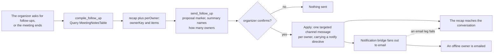

`compile_follow_up` input: `{ "meetingId": "string (optional)" }`. Output: `{ "recap": "...", "perOwner": [ { "ownerKey": "...", "items": ["..."] } ] }`. `send_follow_up` input: `{ "meetingId": "string", "perOwner": [ ... ] }`, with proposal payload `{ op: "send_follow_up", args: <input>, summary: "Send follow-ups to <n> owners" }`.

On apply the assistant posts as its own bot, being a member and moderator of the conversation, one targeted message per owner carrying `metadata.notify:{email:true}`. **The assistant holds no SES grant**: the outbound email is the notification bridge's job. **In-app delivery is the backstop** - a per-owner post failure is reported per owner, and the recap that reaches the conversation is never lost because an email leg failed.

### B.4 The primitives this assistant uses rather than reimplements

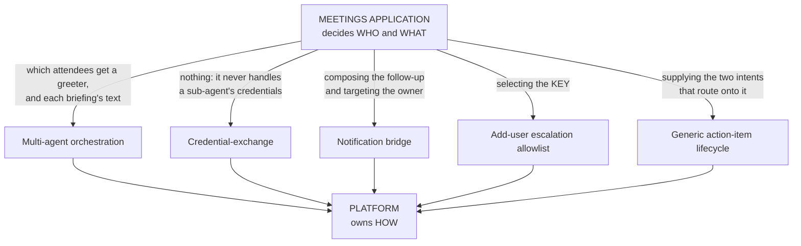

| Primitive | What the platform owns | What this assistant owns |
|---|---|---|
| Multi-agent orchestration ([DESIGN-MULTI-AGENT-ORCHESTRATION.md](./DESIGN-MULTI-AGENT-ORCHESTRATION.md)) | Spawning one sub-agent per attendee, each sub-agent's acting identity, the parallel fan-out, retries, lifecycle and teardown, **and recording what each leaf cost** (section 5a) | Which attendees get a greeter, and the per-attendee briefing text each one delivers. **This assistant is the first consumer of the fan-out, so its analytics precondition is this assistant's precondition too**: a per-attendee greeter is not buildable until a sub-agent's model call has a row of its own |
| Credential-exchange ([SPEC-CREDENTIAL-EXCHANGE.md](../governance/SPEC-CREDENTIAL-EXCHANGE.md)) | Vending short-lived, bearer-pinned credentials for a greeter, if the vended-identity option is the one Decision 2 chooses | Nothing. It never handles a sub-agent's credentials |
| Notification bridge ([SPEC-NOTIFICATION-BRIDGE.md](../../communication/SPEC-NOTIFICATION-BRIDGE.md)) | Fanning a message carrying a notify directive out to email | Composing the follow-up and targeting the owner. It emits the directive, not transport code |
| Add-user escalation allowlist ([SPEC-ADD-USER-ESCALATION.md](../governance/SPEC-ADD-USER-ESCALATION.md)) | Resolving an allowlist KEY to a real identity at the apply endpoint | Selecting the KEY. It never emits an ARN, sub, address or name as an identity |
| Generic action-item lifecycle ([SPEC-CONFIGURABLE-INTENT-PACK.md](./SPEC-CONFIGURABLE-INTENT-PACK.md), [SPEC-TASK-STATE-TRANSITIONS.md](../conversation/SPEC-TASK-STATE-TRANSITIONS.md)) | The `gathering` to `options_presented` to `awaiting_completion` to `completed` machine, hand-off notices and cross-conversation continuity | Supplying the `schedule_meeting` and `follow_up` intents that route onto it |

| Assignment and routing ([DESIGN-SEPARATE-ASSISTANTS-AND-DELEGATION.md](./DESIGN-SEPARATE-ASSISTANTS-AND-DELEGATION.md), [SPEC-CONVERSATION-TYPES.md](../conversation/SPEC-CONVERSATION-TYPES.md)) | Adding this assistant from the conversation type's declared roster; deciding which assigned assistant answers a turn; handing a turn it cannot place to the one that advertises it, before any turn is claimed | **Nothing, and this is the point.** It declares its intents in a pack. The advertisement is projected from that pack, so being routed to is a consequence of being configured, not of being built |
| Bounded initiative ([SPEC-ASSISTANT-MEETINGS.md](./SPEC-ASSISTANT-MEETINGS.md) FR11 and its companion) | What an assistant may do unprompted in a room it is a member of, and what stays behind confirmation | Choosing to greet an arrival or chase an absence, within that bound. The rule is the platform's; the occasion is this assistant's |

Where a primitive is absent from a deployment, the corresponding tool degrades to the fallback stated with it rather than failing the whole assistant.

| Primitive | What the platform owns | What this assistant owns |
|---|---|---|
| Telephony adapter (C.2) | Bringing one attendee into one meeting over a phone, and the credentials that takes | Deciding WHO to bring in, and asking a person first (FR13b). **Absent, dial-in and dial-out are unavailable and nothing else changes** |

**What follows from that table, and it is the sizing of this whole document.** If the platform work is right, a meetings assistant needs no new assistant machinery: no assignment code, no routing, no turn policy, no delegation transport, no identity minting for the common case. What is genuinely meetings-shaped is three things, and they are what the rest of this design is about: **the Amazon Chime SDK Meetings APIs** (Part C), **the context sources a meeting produces and consumes** (B.5), and **a profile with an intent pack** (Part B and Config wiring). Anything else that looks like new development is a sign the work belongs on the platform instead.

### B.5 The context a meeting produces, and how it comes back

A meeting generates the one kind of content this platform has no path for today: something worth asking about *after* it is over. Two embedding stores exist and they answer different questions, so the choice of which one a meeting summary lands in is the whole design.

| Store | Consumer | Question it answers | Shape |
|---|---|---|---|
| `summary_embeddings`, `conversation_topic_embeddings` | drift detection only | has THIS conversation moved on to something else | one anchor per channel, plus one vector per subject |
| `embeddings` | retrieval, the `## RETRIEVED CONTEXT` section of a turn | what content is relevant to the question being asked | chunked documents, filtered by source type and classification |

A meeting summary belongs in the **second**. The first is already written for every conversation and is not a retrieval surface: nothing a person asks will ever return it.

**Getting it there costs almost no code, and that is deliberate rather than lucky.** Ingestion is driven by an object landing under `rag/` in the archive bucket, and the path carries its own metadata: `deriveSourceType` takes the segment after `rag/` and the classification is the segment after that. So the summarizer writes to `rag/meeting/<classification>/<meetingId>.md` and the chunking, the embedding and the classification stamp all happen with no new infrastructure. The classification is the conversation's own, because a meeting is an event on a conversation and inherits what governs it. **A classification-wide prefix is right only where the conversation's audience is the classification's.** A summary under `rag/meeting/<classification>/` is retrievable from every conversation at that classification, so a meeting in a conversation whose audience is narrower, such as one customer's, is retrieved scoped to its own conversation and never written to the classification-wide prefix.

**The one real change is a single line, and its failure mode is silence.** Retrieval filters on source type against a closed list (`RAG_SOURCE_TYPES` in `lib/turn-grounding.ts`, today `wiki`, `doc`, `company`, `agentechelon`). Ingestion is open and retrieval is closed, so a `meeting` type not added to that list embeds correctly and is never queried. Summaries would accumulate, cost money to produce, and never come back, with nothing reporting it.

**What this does not settle.** A transcript is audio-derived, so it is not channel messages unless something writes it there, and automatic transcription is a stated non-goal for this phase because it changes the privacy posture of every meeting it touches. So B.5 covers the SUMMARY a person or this assistant chooses to record, not a transcript nobody asked for. It also inherits an open gap: `conversation_summaries` carries no classification column of its own, named as a prioritized gap in [SPEC-CONTEXT-SOURCES-AND-STORES.md](./SPEC-CONTEXT-SOURCES-AND-STORES.md) FR19, so a reader of that text directly needs its own control. The `rag/` path does not have that problem, which is a second reason to prefer it.

**Live meeting state is a different question and wants a different answer.** What is happening right now - who has joined, how long it has run - is not a document and should not be embedded. If this assistant needs it mid-meeting, it is a `lambda-service` context source resolved per turn against the 1500 ms budget, not a vector.

### B.6 What starts the unprompted work: ADR-061 events (partly built: `invitation-sent`, `invitation-unredeemed`; the meeting events are **NOT BUILT**)

**This assistant has no trigger of its own.** Each occasion it acts on without being asked is an event in [ADR-061](../../../design/decisions/061-a-welcome-is-a-workflow-an-event-starts.md)'s closed set, with one declared source, delivered to the router of the meeting conversation's classification, which verifies it against the record that answers it and runs the workflow of the conversation's primary assistant for that event. A deadline is a one-shot schedule the router creates when it runs the event that starts the thing it times, and only when a workflow declares the deadline event, never a poll (tenet D6). The workflow's steps are `platform` sends (instant, no model call) or `agent` steps (a deadline-bounded turn of the assistant, metered against the global budget as the join recap is, with read tools only and a declared platform fallback, ADR-061 decision 8).

| Occasion in this design | ADR-061 event | Steps |
|---|---|---|
| An attendee is invited (`invite_attendee` applied) | `invitation-sent` | `platform`: the targeted invitation notice and its email |
| An invitation is still unredeemed at its deadline | `invitation-unredeemed`, a schedule the router creates when it runs `invitation-sent` | `agent`: drafts a nudge, proposed to the inviter to send (FR11, FR32). Built as ADR-061's `chase-unredeemed`, with the chat client's confirmation card |
| A scheduled meeting is about to start | `meeting-starting`, a schedule the router creates in the meeting's conversation once the apply of `create_meeting` has created it | `platform`: a targeted reminder to each expected attendee (FR20, FR31), notice kind `meeting-reminder` |
| The meeting starts (Phase 3) | `meeting-started` | `platform`: one room message emailed to the expected attendees, notice kind `meeting` |
| Someone joins (Phase 3, then Phase 4's greeting, FR4) | `meeting-joined` | `platform`: one room message naming who joined (a mention, ADR-061 decision 6); then `agent`: the arrival's brief, targeted to them |
| An expected attendee has not joined (Phase 4's chase) | `expected-attendee-absent`, a schedule the router creates when it runs `meeting-started` | `agent`: drafts a nudge, proposed to the organizer to send (FR11, FR33). **NOT BUILT**: waits on the meetings code; the confirmation card (B.2) is built |

**What a brief knows about the person comes from the conversation type's participant roles.** "Why you are here" is the person's participant role in the meeting conversation (`organizer`, `attendee`, or another the type declares) and the reason their invitation recorded, resolved as [DESIGN-CONVERSATION-TYPES.md](../conversation/DESIGN-CONVERSATION-TYPES.md) section 6.1 declares and never inferred from the person's name or words. The `reason` field of `invite_attendee` is that recorded reason.

**`onboard_attendees` stays the turn entry for the same work.** An organizer who says the meeting is ready starts it from a turn; the `meeting-joined` workflow greets each arrival with no one asking. Both reach the same brief. Per-person fan-out for either waits on sub-agent identity (B.3), and until it exists the brief is one turn of this assistant per arrival.

**A nudge reaches someone outside the room, so it is drafted blind to the room.** The chase's `agent` step receives no conversation history, only its declared variables, and its output carries no link but the platform's own, so neither room content nor an inviter's words can steer what an outsider receives (ADR-061 decision 8, rule 6). A confirmed nudge is sent under the `nudge` notice kind, which a person can mute or unsubscribe from, at most once per person per meeting or invitation (SPEC-ASSISTANT-MEETINGS FR34).

**What the events do not cover.** The meeting ending has no event in ADR-061's set, so the follow-up that `compile_follow_up` starts "when the meeting ends" stays an organizer's request until one is declared (**OPEN**).

## Part C - Live meetings and calls

This part is the infrastructure a live meeting or call runs on, and how each one attaches to a conversation. It is adapted from a proven design on the same Amazon Chime SDK foundation, and it stays inside the platform's invariants: a meeting or call is an event on a governed conversation, scoped by that conversation's classification.

### C.1 A live meeting is an Amazon Chime SDK meeting attached to a conversation

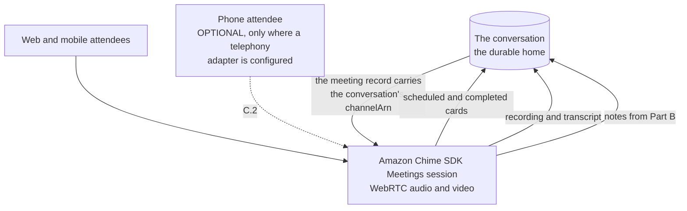

The conversation is the durable home; the meeting is an event on its timeline rather than a separate place. That is what lets every artifact the meeting produces post back where the topic already lives.

**How a meeting is bound to its conversation, and who may join it.**

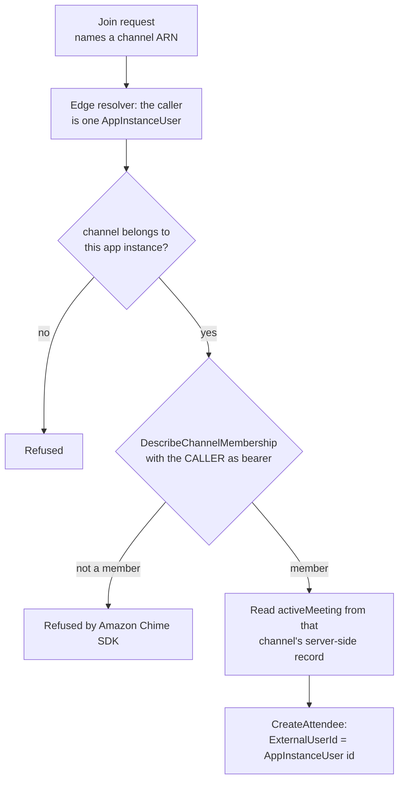

- **One meeting, one channel.** The meeting belongs to the conversation it was started in, or to its own meeting conversation when scheduled. The relation is the server-side `activeMeeting` record keyed by the channel ARN, claimed with a conditional write so two starts produce one meeting, and never member-writable channel Metadata. `ExternalMeetingId` is the channel id, so a lifecycle event names its conversation with no lookup, and the meeting carries the channel's classification as a tag.
- **The meeting is never chosen by the caller.** A request names a channel, never a meeting id, and the meeting is read from that channel's record, so a meeting id from another conversation admits no one.
- **Membership is checked as the caller.** The membership read bears the caller's own AppInstanceUser, so a non-member's check fails inside Amazon Chime SDK rather than being adjudicated by the handler. The Amazon Chime SDK Meetings actions are not ARN-scopable, so these handler checks, not a policy underneath, are the isolation, and they are what the deny-tests drive.
- **The attendee is the AppInstanceUser.** `ExternalUserId` is the caller's AppInstanceUser id, whichever identity provider signed them in, so the roster and every transcript segment resolve to one person.

**NOT BUILT**: the route uses a Cognito user-pool authorizer, and the caller ARN, `ExternalUserId` and `createdBy` are the token's `sub` claim rather than the caller's AppInstanceUser id (`callerPersonId`), and a caller from another issuer cannot reach the route (see SPEC-ASSISTANT-MEETINGS, "Phase 1 scope"). The channel check, the caller-as-bearer membership read and the per-channel record are on that branch as described.

### C.2 The phone leg is an adapter, and the platform ships none

**THE PHONE LEG IS OPTIONAL AND MUST STAY THAT WAY.** Amazon Chime SDK PSTN Audio entered maintenance mode on 2026-09-29, and from 2026-10-29 creating a new SIP media application requires an AWS Support exception granted **per account**. Meetings dial-in is a named exception category, but an exception one account holds does nothing for anybody deploying this project from a clean one. So a phone leg cannot be a default dependency, and FR13 requires meetings to run end to end without one.

**The seam is the SERVICE, not the carrier, and that is a correction.** An earlier version of this section made the carrier pluggable - the deployer supplies the SIP trunk - behind a Voice Connector plus a SIP Media Application named as the mechanism. That is one level too shallow: it lets a deployer choose whose trunk feeds one telephony service, and leaves the service itself unreplaceable. What has to be swappable is the whole phone leg.

**The adapter contract.** One interface, with no mention of any provider in it:

| | |
|---|---|
| **Handed** | a meeting reference, one attendee to bring in as a call leg naming their AppInstanceUser, and how to reach them |
| **Returns** | that attendee is in the meeting, or a reason it could not bring them |
| **May not** | post to the conversation, read it, hold any identity of its own, decide WHO to call, or identify a caller by phone number. Those stay with the assistant and the turn, so the adapter is a transport and never a participant |
| **Credentials** | belong to the adapter. The assistant holds no telephony credential, which is the same division B.4 applies to a greeter's credentials |

**A call leg is the identity of a phone participant.** A call placed from a conversation to a member writes a leg record naming that member's AppInstanceUser ARN before dialing, and everything the call produces (a transcript segment, a roster row, a voicemail) resolves through the leg. A phone number is a route, never an identity: an inbound call or voicemail from a number with no leg becomes a guest-class AppInstanceUser in a new conversation, with a call leg naming that AppInstanceUser written before transcription starts so its transcript is kept there, and it reaches a person's own conversations only through that person's action.

The implementations, and the design endorses none:

| Implementation | Who can deploy it |
|---|---|
| **A telephony connector (Twilio first), phone-only.** The connector places the call once a member starts it and their membership is checked; Real-Time Transcription posts signed events to the connector ingress, and segments are appended to the conversation's archive by call leg. No Amazon Chime SDK is involved | anybody with the vendor account, through [SPEC-CONNECTORS.md](../../communication/SPEC-CONNECTORS.md) |
| **A media bridge, for a phone leg into a WebRTC meeting.** The connector streams the call (Twilio `<Connect><Stream>`, bidirectional: the caller's inbound track as mulaw at 8000 Hz, and meeting audio sent back in the same format) to a container that joins the meeting as one WebRTC attendee per caller, taking the leg's AppInstanceUser id as `ExternalUserId`. Meeting transcription then transcribes the caller like any attendee. The bridge attendee can neither post nor read. **OPEN:** how a server process joins an Amazon Chime SDK meeting as an attendee, a headless browser or a supported native SDK | anybody, at the cost of running the container |
| Amazon Chime SDK PSTN Audio, a Voice Connector plus a SIP media application | an account that already holds one, or has an approved exception. **OPEN:** whether Amazon Chime SDK Voice Connector is affected. The notice scopes the change to the PSTN Audio service and does not name Voice Connector; unconfirmed with AWS |
| Amazon Connect | anybody, and it is where AWS is putting telephony investment. Whether it can bridge into an Amazon Chime SDK meeting is not known (**unverified**) |

**What a deployment with no adapter loses, stated so a regression is visible:** dial-in and dial-out. Nothing else. WebRTC meetings, the roster, every tool in Part B, the notes, the follow-ups and all of B.5's context sources are unaffected. **The roster's transport attribute (FR25) degenerates to one value rather than breaking**, which is the correct shape for an absent optional leg.

**What is deliberately NOT designed here.** A per-attendee transport decision. The flow below dials an attendee on request; nothing chooses a transport per person, and nothing measures availability before trying. A traced reference implementation attempts WebRTC optimistically for a single callee with a short acknowledgement deadline, and has no per-attendee transport record at all. Designing one is a separate piece of work, and reading this section as though it exists is the error to avoid.

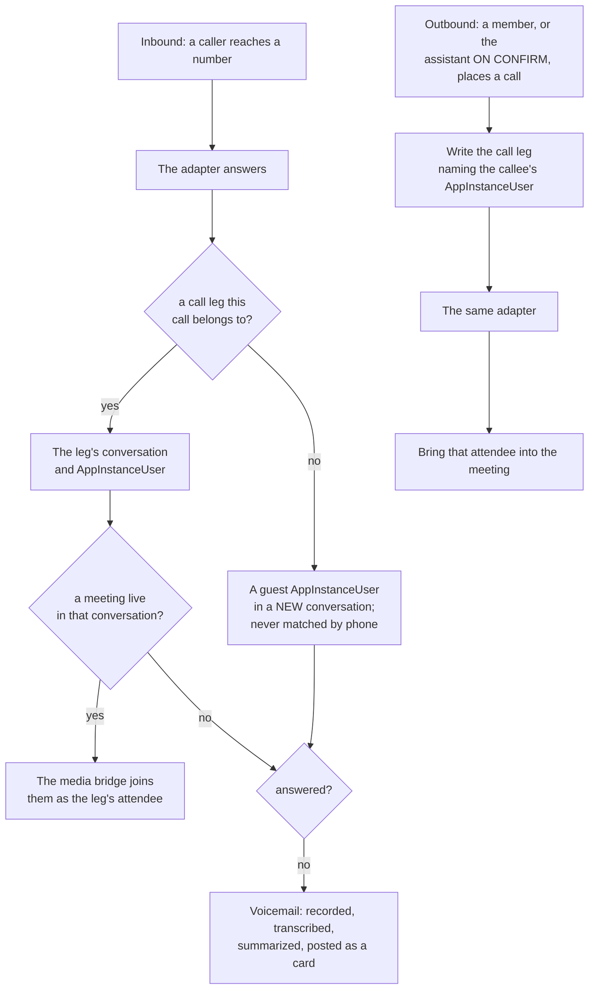

### C.3 Every event lands in the right conversation

The organizing principle is that **the conversation is the source of truth.** A person holds several conversations, each a distinct topic or engagement, and every event lands in the one it deterministically belongs to rather than spawning a stray channel. **An event is never placed by a guess.** A fuzzy match on topic, company or recency, or a caller's phone number, would put one person's call into another person's conversation, and a weak match that lands in the wrong conversation is a disclosure rather than an inconvenience.

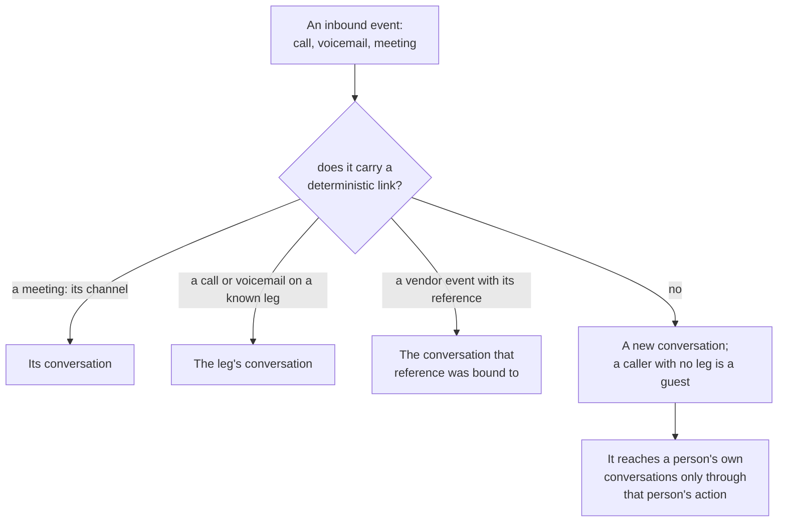

**Voicemail is placed once.** A voicemail on a known leg posts into that leg's conversation; one from a number with no leg opens a new guest conversation. Its transcript, when it arrives, updates the voicemail's card in place and never moves it to another conversation.

### C.4 Timeline cards

Each event posts a structured message carrying a `cardType` - `meeting-scheduled`, `meeting-completed`, `voicemail` or `call-summary` - rendered inline as a compact card with a drill-down detail panel: attendee join and leave times, recording, transcript, audio player. A conversation is then a self-contained timeline of everything about that topic, without leaving it for a separate meetings view. **Cards are ordinary channel messages with metadata**, so a message carrying no `cardType` renders exactly as before.

### C.5 The roster: one row per person, derived from the events

**The roster is a projection of the event stream, not a record kept beside it.** Every fact it shows is already emitted: joins and leaves, video starting and stopping, content sharing starting and stopping, and the transport each attendee is connected over. Deriving the roster from those events rather than maintaining it as rows that are updated in place is what FR22 asks for, and it is the difference between a roster that survives a dropped event and one that drifts away from the meeting it describes.

**One row per PERSON, and this is the part that is easy to get wrong.** The service issues a new attendee record for each connection, so one person routinely produces several:

| What the person did | What the service emits |
|---|---|
| Dialed in, then switched to their browser | Two attendee records, concurrently or in sequence |
| Lost connection and came back | A new attendee record each time |
| Started sharing their screen | **A separate attendee** whose id carries a `#content` suffix |

Keyed on the attendee, a person who dials in, switches to browser and shares their screen is three participants, and one of them is a screen. The roster therefore keys on the stable person key from FR21, the AppInstanceUser id each attendee carries as its `ExternalUserId` (for a phone leg, the leg's), and folds every attendee record for that person into one row, with the content-share attendee attributed to its owner rather than listed. A participant count taken from the roster is then a count of people.

**State, which answers "did this person turn up".**

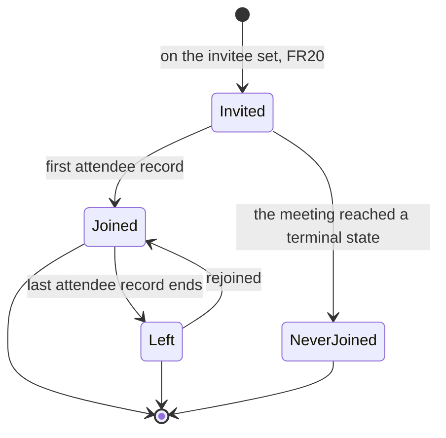

`NeverJoined` is only decidable once the meeting has ended, so a roster read during a meeting shows `Invited` and says the meeting is still running rather than implying a no-show. A statistic computed over a live meeting states that, per FR23.

**How the person is present, with the history rather than only the current value.** Each of these is a sequence of intervals, because the question worth asking is usually about the change rather than the state:

| Attribute | Derived from | The question it answers |
|---|---|---|
| **Audio transport**: phone or browser | the network type on each attendee record | did somebody start on the phone and move to the browser, or fall back the other way when their network degraded |
| **Video**: on or off | the video started and stopped events | was anyone on camera, and when did that change |
| **Screen share**: on or off | the content joined and left events, attributed to the owner | who presented, and for how long |
| **Connected**: present or absent | join to leave or drop, summed across records | how long this person was actually in the meeting, which is not last-minus-first once anyone reconnects |

So a roster row reads as a small timeline. On a deployment with no telephony adapter: joined at 14:02, camera on at 14:04, shared their screen from 14:15 to 14:28, dropped at 14:31, rejoined at 14:32. Where an adapter is configured, the transport appears beside it: joined by phone at 14:02, moved to browser audio at 14:09. **A transport switch is the clearest example of why the transition matters more than the state**: by itself it is unremarkable, and in a meeting where three people did it in the same two minutes it is the network, not the people.

**What it is for, in order.** Live, it is what lets this assistant know who it is still waiting for, which is the input to chasing an absence. After the meeting, it is the denominator for every statistic in the roadmap below, and the record of who presented. Those are two different reads of one projection and neither needs a second store.

**Where it lives.** It is derived from the archive, which owns the event sequence and outlives the channel. Aurora projects it for querying across meetings. **NOT BUILT:** in the Phase 1 design the lifecycle consumer writes events to Aurora through the data plane only, so a deployment in Athena mode records no roster, and its person key is the Cognito `sub` the attendee was created with. Nothing maintains a roster as mutable state, which is the mistake FR22 exists to prevent: a counter incremented on arrival and decremented on departure is wrong the first time an event is redelivered or lost, and it is wrong silently.

### C.6 How Parts A and B sit on this

`create_meeting` provisions the meeting and its conversation; `onboard_attendees` greets people as they join a live meeting; `take_notes` and `follow_up` write and summarize the meeting the timeline cards surface. That layering is why the chat-facing halves depend on nothing here.

## Phases

**Phase order.** Each phase states three goals, because "done" means something different to each audience and a phase that satisfies only one of them is not finished:

- **The person** - what they can do, and what they see.
- **The operator** - what is visible and measurable.
- **The assistants** - what any assistant in the conversation gains.

A phase ends somewhere a person could use. **The blocking chain in the spec is not a build order**: it orders what blocks FR4 and FR5, the per-attendee greeter, and read as a build order it puts the only buildable part last, which is how this stayed at zero.

**The telephony adapter is LAST on purpose, and that is a change from the first draft of this plan.** Put earlier, every phase after it sits on a tree that contains it and can quietly acquire a dependency on it - an assistant dialing somebody in is exactly that shape. Last, removing it touches nothing downstream, which is the property that keeps the phone leg genuinely pullable. It also puts outbound dialing after the assistant that has to ask permission for it.

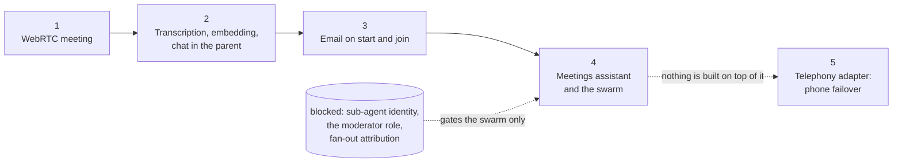

### Phase 1 - the WebRTC meeting, and nothing else

| Audience | Goal for this phase |
|---|---|
| **The person** | Start or join a meeting from the conversation they are already in. The meeting appears on that conversation's timeline and leaves a card behind when it ends. **There is no new place to go**, which is the whole claim of the timeline-event model |
| **The operator** | A roster per meeting: who joined, when they left, connected time summed across reconnects, drops separated from droppers, and join latency as p50 and p95. A meeting is visible as a child of its conversation rather than as a separate object |
| **The assistants** | Nothing. No assistant is in the room, deliberately, so that the meeting works before anything is asked of one and a later failure is attributable to the assistant rather than to the meeting |

**Closes:** FR12, FR13, FR14, FR15, FR18, FR20, FR21, FR22, FR23, FR24, FR25, FR26, FR27. FR20 belongs here because recording who was expected is a field on the meeting rather than a behavior, and every rate later depends on it.

**Deny-tested before this phase is done**, because it introduces a new resource into a governed conversation: a meeting on a conversation of one classification is not reachable from another, and a caller cannot join another channel's meeting with its meeting id, both proven against a deployed stack rather than argued. Isolation does not inherit just because the meeting hangs off a conversation that is already bounded. A person signed in through a second identity provider joins with their AppInstanceUser id as `ExternalUserId`, which the branch does not yet do (C.1).

**Builds toward Phase 2** by giving the transcript somewhere to land: the roster names who spoke, and the conversation is already the meeting's home.

### Phase 2 - transcription and embedding, with the meeting's chat in the parent conversation

**The non-goal that gated this is largely answered by where a transcript lives.** It called transcription automatic, which it is not: **recording is a host-controlled toggle in the meeting client**, captions are visible to everyone while it runs, and that is the industry norm. The host decides, attendees are told and may leave, and no mainstream product gives an attendee a veto, so this design does not invent one.

**A transcript is an ATTACHMENT on a message in the conversation**, which answers the two questions the non-goal raised rather than leaving them open:

| What the non-goal asked | Why it is already answered |
|---|---|
| How long a transcript is kept | It is conversation content, so it lives under that conversation's retention. Expiration is declared per conversation type, and the transcript goes when the conversation does |
| What classification it carries | The conversation's, by the same route every other attachment takes. There is no second boundary to design |

**Every segment is attributed to an AppInstanceUser, and the archive is fed by the service, not by a client.** Amazon Chime SDK live transcription attributes each transcript item to an attendee (`attendeeId`, `externalUserId`), so a segment resolves through its attendee to the AppInstanceUser who spoke; a speaker label such as "Speaker 2" is never the attribution. Results are archived from the media capture pipeline's transcription-message artifacts and appended to the conversation's archive, with Aurora projecting them. No client relays segments, because a client could relay anything. Live transcription transcribes the top two active talkers at any moment, so overlapping speech beyond two people is not captured. The pipeline is per meeting and carries its own cost beside the transcription stream; **OPEN:** that cost per meeting-hour, to be priced against the provider's pricing page and recorded beside the transcription prices in [DESIGN-MEETING-ONBOARDING-AND-INCIDENT-SUBAGENTS.md](./DESIGN-MEETING-ONBOARDING-AND-INCIDENT-SUBAGENTS.md), section 5.3. **Only the host starts transcription**, and every attendee is told it is running.

So Phase 2 is far less gated than the non-goal implies. **Two things remain, and neither is a question about transcripts.**

**Notice in the room**, which is an obligation rather than an open question: a visible indicator while recording runs, so somebody who objects can say so or leave. Matching the bar, not exceeding it.

**The derived copy outlives its source, and that is the real residual.** The transcript expires with the conversation; the SUMMARY embedded into the retrieval corpus does not. [ADR-008](../../../design/decisions/008-embedding-cost-and-ttl-policy.md) decided **no TTL on embeddings**, deliberately, because the cost is negligible until index size affects retrieval latency. So a conversation can expire while its meeting summary stays answerable in the corpus indefinitely. That is an accepted state rather than an oversight, **but the monitoring ADR-008 named as its own trigger for revisiting was never built**, so the gate it set for itself cannot fire. Phase 2 is where that stops being hypothetical, because it is the first feature to write conversation-derived content into a corpus with no expiry.


| Audience | Goal for this phase |
|---|---|
| **The person** | The host turns recording on from the meeting, and everyone in the room can see that it is running. What was said is then in the conversation afterwards, and findable later by asking. The ended card gains its summary **in place** rather than as a second message, so the record is one thing to read |
| **The operator** | Embedding coverage is countable: how many meetings have a retrievable summary and how many do not. **And the gap between the two retentions is visible**: transcripts that have expired with their conversation while their summary is still answerable in the corpus |
| **The assistants** | **Every** assistant in that conversation can ground on past meetings through ordinary retrieval. This is new context rather than new behavior, and it is the first phase where a meeting makes the assistants better at anything |

**Embedding costs almost nothing.** The summary is written to `rag/meeting/<classification>/<meetingId>.md`; the source type and the classification both come from the key, and chunking and embedding follow with no new infrastructure (B.5). **The one real code change is opening retrieval's closed source-type list, and its failure mode is silence**: a `meeting` type left out of it embeds correctly and is never queried. A meeting in a conversation whose audience is narrower than its classification, such as a customer's, is retrieved scoped to that conversation instead (B.5, ADR-008 amended).

**Closes:** FR28.

**Builds toward Phase 3** by making a notification worth sending: a start message can carry what the meeting is about because the conversation knows.

### Phase 3 - email on meeting start and on join, authored by the primary assistant

| Audience | Goal for this phase |
|---|---|
| **The person** | An email when a meeting they are expected at starts, and when somebody joins. The same message is in the room, so the email is a copy of the record rather than a separate channel to keep up with |
| **The operator** | Notification delivery is measurable, and every notification is attributable to the assistant that authored it |
| **The assistants** | The primary assistant speaks **unprompted** for the first time, inside a stated bound. That bound is the platform's, not this feature's, and it is what Phase 4 inherits |

**Nothing new is built for transport.** A message carrying a notify directive is fanned out by the notification bridge, so this phase posts messages and holds no mail grant. The start and join messages are `platform` sends of the `meeting-started` and `meeting-joined` workflows ([ADR-061](../../../design/decisions/061-a-welcome-is-a-workflow-an-event-starts.md), B.6).

**The author is the primary assistant, swapping to the meetings assistant in Phase 4.** That swap is configuration - which assistant authors the notification - rather than a rebuild, and starting with the primary is what lets this land a phase before the meetings assistant exists.

**The dependency this ordering surfaces.** A notification nobody asked for is an assistant speaking unprompted, so **bounded initiative and the declared turn kind are needed HERE rather than in the assistant phase**: FR11b because the primary assistant needs a rule permitting it to send anything at all, and FR19 because an unprompted message answers nothing, so undeclared it pairs with nothing and distorts model attribution - which has happened on this platform before.

**Closes:** FR11b, FR19, and the notification half of FR7 and FR9.

**Builds toward Phase 4** by settling the hard half of proactivity first. By the time the meetings assistant arrives, speaking unprompted is a solved and bounded thing, and all it adds is better judgment about when.

### Phase 4 - the meetings assistant, and the swarm

| Audience | Goal for this phase |
|---|---|
| **The person** | Greeted on arrival with what this meeting is about and why they are in it. Chased if they do not turn up. Scheduling and follow-ups happen by asking in the conversation rather than by filling anything in |
| **The operator** | Per-intent effectiveness for the meetings intents, with no analytics work: declaring the pack buys the measurement. **Chase effectiveness** becomes computable, which is the only figure here that says whether the assistant is doing any good. For the swarm, a fan-out drill under the turn: how many agents, what each cost, what each did |
| **The assistants** | A new assistant with its own profile, intent pack and advertisement, so routing to it is a consequence of configuring it. It takes over notification authorship from the primary. With the swarm, one sub-agent per attendee |

**The assistant half is not blocked.** It greets **as itself**, targeted to the arriving attendee, which is the buildable form of FR4 and FR5 and delivers what a person actually experiences. It chases on `expected-attendee-absent`, one one-shot schedule per meeting that the router creates when it runs the `meeting-started` workflow ([ADR-061](../../../design/decisions/061-a-welcome-is-a-workflow-an-event-starts.md) decision 1), which is the recognized tenet D6 exception because the absence of an event cannot be event-sourced. The greeting and the chase are `agent` steps of that ADR, and the chase is a nudge the organizer confirms (B.6), so the chase waits on the chat client's confirmation card (B.2).

**The swarm is the only blocked work in this document**, and it buys parallelism and separate attribution rather than a better greeting. Three gates, all platform questions:

| Gate | Where it is settled |
|---|---|
| Sub-agent identity: the assistant provisioner mints an identity at runtime only for an assistant in a deployed role (`assistant-provisioner.ts`, `manage-assistants`); nothing mints a non-addressable worker identity for a sub-agent | [DESIGN-MULTI-AGENT-ORCHESTRATION.md](./DESIGN-MULTI-AGENT-ORCHESTRATION.md) decision 2, reopened |
| The moderator role: a sub-agent adding a member to a channel it did not create is refused | Follows from the identity answer |
| **Fan-out attribution**: a sub-agent's model call has nowhere to be recorded, so its cost lands under the orchestrator's model | Section 5a of the same document |

**The third gate is a precondition, not a follow-up**, and the one most likely to be skipped. Attribution retrofitted after a fan-out ships does not backfill: this platform has already produced rows carrying an unknown model because a declaration arrived later than the rows it described, and they were not recoverable.

**Closes:** FR1 to FR10 as the intents land, FR11, FR16, and with scheduling and inviting, FR29 and FR30. With the swarm, FR4 and FR5 in their per-attendee form and FR17's cap, which cannot be set until the identity answer names what is scarce.

**Where Strands fits, if adopted.** As the orchestration layer over the existing loop rather than a replacement runtime: the single-agent surface is what this platform already has, and the genuine delta is the multi-agent coordination. The case for it rests entirely on this phase.

**Builds toward Phase 5** by putting an assistant in place that can ask permission before placing a call, which is what FR13b requires and what nothing earlier could provide.

### Phase 5 - the telephony adapter: phone as failover

**Last, so nothing is built on top of it.** Amazon Chime SDK PSTN Audio is in maintenance mode and closed to new accounts from 2026-10-29, so this phase does not use it: phone-only calls go through a telephony connector, and a phone leg into a WebRTC meeting goes through the optional media bridge (C.2). The deployment supplies the vendor account, and FR13's test exists to prove the four phases below it still run without this one.

| Audience | Goal for this phase |
|---|---|
| **The person** | Join by phone when the browser will not do, or be brought in by phone when WebRTC does not answer. On a deployment without an adapter, dial-in is simply absent and nothing else changes |
| **The operator** | Transport appears per person on the roster, with the moment it changed, so a WebRTC-to-phone fallback is visible as an event rather than inferred. The WebRTC-versus-phone split becomes a figure |
| **The assistants** | The assistant may bring somebody in by phone, **on a person's confirmation** (FR13b). It holds no telephony credential: that belongs to the adapter |

**The shape worth copying, stated as what it is rather than as more than it is.** A traced reference implementation tries WebRTC first and falls back to a phone call on a short acknowledgement deadline, then a longer timeout. It is **per call, for a single callee**, assumes availability optimistically rather than measuring it, and keeps no per-attendee transport record. That is the shape to copy. A per-attendee transport decision does not exist there and is not designed here.

**Closes:** FR13a, FR13b.

## Config wiring

- **Profile:** add a `meetings` `AssistantProfile` (Part A) in `backend/lib/config/profiles.ts`, with an assistant of that profile declared for each classification whose conversation types include it, so it always runs at the classification of the conversation it is in.
- **Persona:** `persona-meetings.txt`, injected via `-c assistantSystemPrompt`, merged into `cdk.context.json` and written to SSM by `assistant-profile-stack.ts`.
- **Intent pack:** `intent-pack-meetings.json`, injected via `-c assistantIntentPack`.

```json
{ "intents": [
  { "key": "schedule_meeting", "description": "Find a time and set up a new meeting.", "keywords": ["schedule", "set up a meeting", "find a time", "book a meeting"], "delivery": "TASK_MULTI_STEP" },
  { "key": "lookup_meeting", "description": "Find an existing meeting, its agenda, time, or attendees.", "keywords": ["when is", "agenda", "who is invited", "meeting details"], "delivery": "PLACEHOLDER_UPDATE" },
  { "key": "invite_attendee", "description": "Add one or more people to a meeting.", "keywords": ["invite", "add", "include"], "delivery": "PLACEHOLDER_UPDATE" },
  { "key": "onboard_attendee", "description": "Greet and orient each attendee as they join.", "keywords": ["onboard", "greet", "start the meeting", "welcome everyone"], "delivery": "TASK_MULTI_STEP" },
  { "key": "take_notes", "description": "Capture a note, decision, or action item during the meeting.", "keywords": ["note that", "record", "decision", "action item"], "delivery": "PLACEHOLDER_UPDATE" },
  { "key": "follow_up", "description": "Send the notes and action items to the attendees afterward.", "keywords": ["follow up", "send recap", "action items", "wrap up"], "delivery": "TASK_MULTI_STEP" }
] }
```

- **Tool enablement:** `ENABLE_MEETINGS_CALENDAR=true`, optionally with `MEETINGS_CALENDAR_API_BASE`, for `find_meeting_slot` and `create_meeting`. The other tools are on for this assistant by default.
- **Guardrail:** the platform default, from the shared construct.
- **Data stores:** `MeetingsTable` and `MeetingNotesTable` in DynamoDB, plus the calendar-read secret and the apply endpoint's calendar-write secret in Secrets Manager.
- **Grants added to the assistant's Lambda role:** `dynamodb:GetItem` and `Query` on `MeetingsTable`; `dynamodb:Query` and `PutItem` on `MeetingNotesTable`, with no update or delete; `secretsmanager:GetSecretValue` on the calendar-read secret. No membership, calendar-write, mail or bot-creation grant - those live on the apply endpoints and the platform primitives.

## Testing

The planned layers, mirroring the platform's own tool patterns.

| Layer | What it covers |
|---|---|
| Unit | Each tool's input coercion and output shape; proposal-marker encoding for `create_meeting`, `invite_attendee` and `send_follow_up`, including base64 with no marker-terminator leakage, as in the work-item tests; intent-pack classification and keyword fallback for the six intents; `find_meeting_slot` determinism, mirroring `corporate-travel-tool.test.ts` |
| Integration | The tool loop dispatching each EXECUTED tool, and intercepting each PROPOSE-AND-CONFIRM tool without executing it; append-only enforcement on `MeetingNotesTable`, asserted as the absence of an update path rather than as a convention; the guardrail on and off |
| End-to-end | One turn per intent through a deploy: schedule as propose then apply, look up, invite as propose then apply, onboard with greeters posted, note, and follow-up with a recap plus email |
| Deferred | The `onboard_attendees` end-to-end case waits on the orchestration primitive. The calendar tools are mocks until a real calendar client replaces `find_meeting_slot` |

## Open technical questions

| Question | Why it is open |
|---|---|
| One table with a composite key for meetings and notes, or two | One store simplifies the read side of `follow_up`; two keep the append-only grant on the notes store narrow, which is what makes FR10 an IAM property |
| Which component provisions the meeting conversation: `create_meeting`'s apply endpoint, or the platform conversation-type flow | It is a boundary with [SPEC-CONVERSATION-TYPES.md](../conversation/SPEC-CONVERSATION-TYPES.md), and the same question arises again in Part C |
| Whether the parallel-greeter cap belongs to this assistant or to the orchestration primitive | The cap is a cost bound on a fan-out a single turn starts, and the scarce resource is whatever Decision 2 makes it |
| Whether `find_meeting_slot` takes attendee time zones explicitly or the calendar client resolves them | An explicit argument is testable and puts the burden on the model; a resolving client is correct more often and hides a dependency |
| Whether a meeting summary should outlive the conversation it came from | **The only part of this still open**, and it is a corpus question rather than a transcript one. A transcript is an attachment and inherits the conversation's storage, retention and classification; the embedded summary has no TTL (ADR-008). See Phase 2 |
| Voicemail residency | Where a voicemail's audio and transcript are kept, and for how long. Placement is not open: C.3 places an event only by a deterministic link |
| How the media bridge joins a meeting | A server process joining an Amazon Chime SDK meeting as a WebRTC attendee needs either a headless browser running the client library or a supported native SDK; which one decides the bridge's size and cost (C.2) |

## Related Documents

- [SPEC-ASSISTANT-MEETINGS.md](./SPEC-ASSISTANT-MEETINGS.md) - requirements, personas, non-goals and what is delivered
- [ADR-061](../../../design/decisions/061-a-welcome-is-a-workflow-an-event-starts.md) - the events that start this assistant's unprompted work, and the `agent` step
- [DESIGN-CONVERSATION-TYPES.md](../conversation/DESIGN-CONVERSATION-TYPES.md) section 6.1 - the participant roles a brief reads
- [DESIGN-MULTI-AGENT-ORCHESTRATION.md](./DESIGN-MULTI-AGENT-ORCHESTRATION.md) - the fan-out primitive, and Decision 2
- [DESIGN-MULTI-ASSISTANT-TURN-ENGINE.md](./DESIGN-MULTI-ASSISTANT-TURN-ENGINE.md) - the vended-versus-pooled identity question
- [SPEC-NOTIFICATION-BRIDGE.md](../../communication/SPEC-NOTIFICATION-BRIDGE.md) - the email leg of the follow-up
- [SPEC-ADD-USER-ESCALATION.md](../governance/SPEC-ADD-USER-ESCALATION.md) - the allowlist-key rule
- [SPEC-CREDENTIAL-EXCHANGE.md](../governance/SPEC-CREDENTIAL-EXCHANGE.md) - the vend a greeter identity might use
- [SPEC-CONFIGURABLE-INTENT-PACK.md](./SPEC-CONFIGURABLE-INTENT-PACK.md) - the pack format and the generic lifecycle
- [SPEC-TASK-STATE-TRANSITIONS.md](../conversation/SPEC-TASK-STATE-TRANSITIONS.md) - the task machine the multi-step intents ride
- [SPEC-CONVERSATION-TYPES.md](../conversation/SPEC-CONVERSATION-TYPES.md) - the conversation-provisioning boundary
- [SPEC-CONNECTORS.md](../../communication/SPEC-CONNECTORS.md) - the telephony and calendar connectors, and the signed ingress their events arrive on
