# DESIGN-ASSISTANT: Meetings assistant

**Status:** PARTLY BUILT. The Phase 1 WebRTC meeting is built, and [SPEC-ASSISTANT-MEETINGS.md](./SPEC-ASSISTANT-MEETINGS.md), "Phase 1 scope", states what it covers and the status of each requirement; the invitation chase (FR32) is built for any conversation. The assistant as a meeting participant is **BLOCKED** on sub-agent identity, then the moderator role; the chain and its order are in [SPEC-ASSISTANT-MEETINGS.md](./SPEC-ASSISTANT-MEETINGS.md), "What Blocks This, In Order". Every occasion on which this assistant acts unprompted is an event of [ADR-061](../../../design/decisions/061-a-welcome-is-a-workflow-an-event-starts.md), the platform's one event model, and its reasoning steps are that ADR's `agent` steps, which are built (ADR-061); the meeting events in B.6 are **NOT BUILT**.

**The phone leg (C.2) is an optional adapter and the platform ships none**, because Amazon Chime SDK PSTN Audio is in maintenance mode and closed to new accounts from 2026-10-29.

**Coverage:** none - a draft design; nothing meeting-specific is built, and the invitation chase (FR32) is verified in SPEC-TASK-STATE-TRANSITIONS, so there is no deployed meeting behavior to drive.

**Related:** [SPEC-ASSISTANT-MEETINGS.md](./SPEC-ASSISTANT-MEETINGS.md) - what this assistant is for, its requirements, its personas and what it refuses to be. Per requirement, what is delivered is stated there, in Functional Requirements, and nowhere in this document. This is the mechanics only.

**Site section:** Interaction layer, assistants.

---

A worked exemplar of the per-assistant design pattern. Part A reuses the platform seams almost verbatim, Part B is the meetings-specific content, and Part C is the live meetings and calls infrastructure a meeting or call would run on. Parts A and B depend on nothing in Part C.

## Part A - where this assistant sits on the platform

The assistant is a persona, an intent pack and a tool set over seams the platform already owns. Nothing below is new machinery.

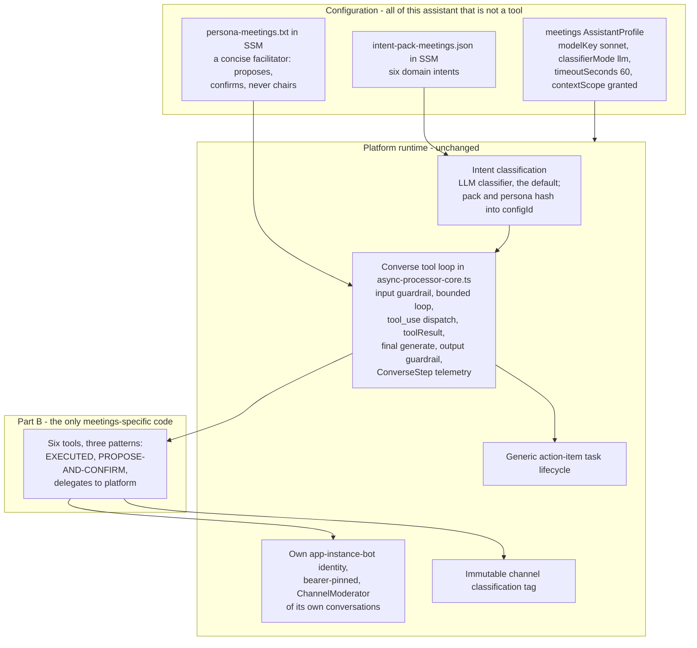

| Piece | Platform mechanism | This assistant's setting |
|---|---|---|
| **Profile and model** | `AssistantProfile` (`backend/lib/config/profiles.ts`) | A `meetings` profile: `modelKey: sonnet`, `classifierMode: 'llm'`, `timeoutSeconds: 60`, `contextScope: 'granted'`. Assigned to a conversation as that conversation's own assistant, and it runs at that conversation's classification, so a customer meeting's assistant reaches no internal content |
| **Persona** | `ASSISTANT_SYSTEM_PROMPT` in SSM, hydrated at cold start, stable prefix cached via `cachePoint` | `persona-meetings.txt`: a concise meeting facilitator - proposes, does not decide; confirms before consequential actions; never chairs |
| **Guardrail** | `applyInputGuardrail` and `applyOutputGuardrail`, out of band, withholding the turn when the guardrail cannot be applied | The platform default: prompt-attack screening on input, PII and marker filtering on output. No meeting-specific rules |
| **Context scope** | `load_company_context` and `load_platform_info` over a classification-scoped S3 prefix, IAM-bounded | The company-context tool is off. This assistant's context is the meeting record rather than a document corpus; `load_platform_info` may stay on for "what can you do?" turns |
| **Classification** | The immutable channel `classification` tag, read live | It serves the classification of the meeting conversation. An unreadable tag is not a value, and a caller that needs one refuses rather than substituting a floor. An attendee whose classification does not reach the conversation is refused the conversation rather than capped inside it |
| **Identity** | Its own app-instance-bot, provisioned the way every assistant identity is; bearer-pinned; privileged actions through credential-exchange | The meetings bot owns and moderates the meeting conversation. It holds no standing calendar-write or membership grant - those live on the apply endpoints |
| **Converse tool loop** | `invokeBedrock` in `async-processor-core.ts`, with `MAX_TOOL_ITERATIONS` bounding the loop | Unchanged. It exposes the tools in Part B |
| **Intent classification** | The intent pack in SSM plus the universal three; the LLM classifier, which is the default for every profile, with the keyword classifier opt-in per profile, and also the failure path of the LLM classifier: a classifier call that throws is answered by the keyword pass (`intent-classifier.ts`) | `intent-pack-meetings.json`, in Config wiring below |
| **Task lifecycle** | The generic `action_item` machine: `gathering` to `options_presented` to `awaiting_completion` to `completed` | The two multi-step intents, `schedule_meeting` and `follow_up`, ride it exactly as the corporate-travel worked example does. No meeting-specific machine is added. `onboard_attendee` is multi-step but its steps are attendee greeters run by the orchestration primitive, not a task graph |

## Part B - Intents to tools

### B.1 The map

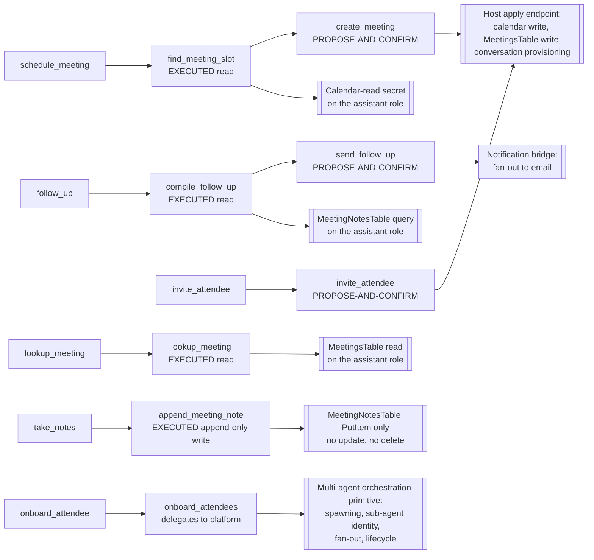

**The read-write asymmetry is the whole capability story.** Every read grant sits on the assistant's own role; every consequential write sits somewhere else. The assistant role holds `dynamodb:GetItem` and `Query` on `MeetingsTable`, `Query` and `PutItem` on `MeetingNotesTable`, and `secretsmanager:GetSecretValue` on the calendar-read secret. It holds no membership grant, no calendar write, no mail grant and no identity-creation grant.

The universal intents need no tools: `greeting` and `acknowledgment` answer directly, and `general` answers from the persona.

### B.2 The three tool patterns, as flows

**EXECUTED.** The loop runs the tool and feeds the result back.

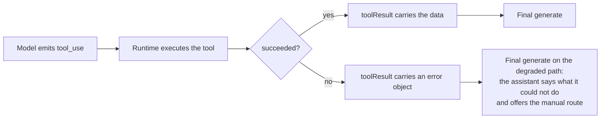

**PROPOSE-AND-CONFIRM.** The loop intercepts the tool instead of executing it, and the write happens only after a person accepts.

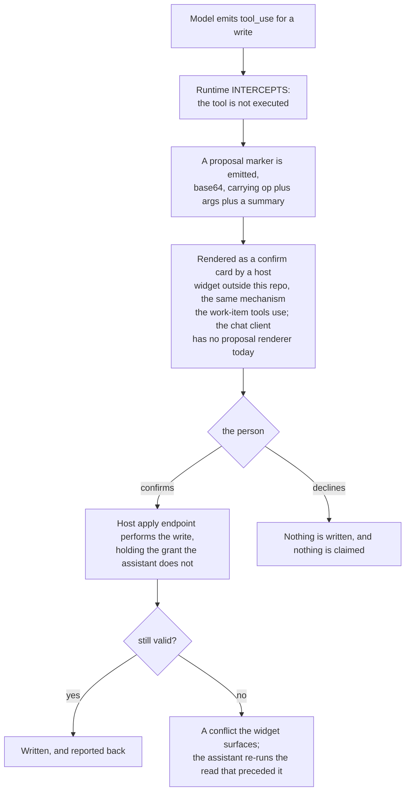

**Who may apply a proposal.** A proposal records the AppInstanceUser id of the person it is addressed to: the organizer who asked, or, for a proposal an [ADR-061](../../../design/decisions/061-a-welcome-is-a-workflow-an-event-starts.md) `agent` step drafted, the person its participant role or variable names. The apply endpoint authorizes `callerPersonId` (`backend/lambda/src/lib/auth.ts`) against that id and against the participant-role holdings on the conversation's context row at apply time, refuses a session whose bearer is an assistant, consumes the proposal with a conditional write so it applies once, and refuses it after it expires. A deny test proves that another member, and the assistant itself, are refused applying a proposal addressed to the organizer (ADR-061 decision 8, rule 8). **Built and verified on dev for the proposals an ADR-061 `agent` step offers** (`proposals-api.ts`, `backend/test/lib/a-proposal-is-applied-once-by-its-addressee.test.ts`, `tests/e2e/a-proposal-is-applied-once-by-its-addressee.spec.ts`, recorded in [SPEC-TASK-STATE-TRANSITIONS](../conversation/SPEC-TASK-STATE-TRANSITIONS.md)): a proposal addressed to an inviter or to a one-holder participant role. `create_meeting` and `invite_attendee` are **NOT BUILT**, because the meeting itself is not built.

**Why the interception rather than a confirmation sentence.** A model asked to wait for confirmation sometimes does not, and the write would already have happened. Interception makes the wait structural: the tool is never dispatched, so there is nothing to undo.

**Where the card renders.** The work-item proposal marker is emitted for a host widget that is not part of this repo, and the Apply that widget offers calls a host endpoint. A proposal an ADR-061 `agent` step offers is drawn by the chat client's own confirmation card (`ProposalCard.tsx`), from the `proposal` field of the targeted message's Metadata, and applied at `POST /proposals/apply`.

**Delegates to platform.** The tool hands a list to a platform runtime and returns a dispatch receipt. It holds no grant of its own.

### B.3 Tool detail

#### `find_meeting_slot` - EXECUTED

Serves `schedule_meeting`. Description the model sees: "Find times when the named attendees are all free for a meeting of the given length in a date window. Call this once you have the attendees, the duration, and a rough window. Returns candidate slots; it does not book anything."

```json
{
  "type": "object",
  "properties": {
    "attendeeKeys": { "type": "array", "items": { "type": "string" }, "description": "Allowlist KEYs of the attendees to check (never emails or ARNs)." },
    "durationMinutes": { "type": "number", "description": "Meeting length in minutes." },
    "windowStart": { "type": "string", "description": "Earliest date to consider, YYYY-MM-DD." },
    "windowEnd": { "type": "string", "description": "Latest date to consider, YYYY-MM-DD." }
  },
  "required": ["attendeeKeys", "durationMinutes", "windowStart"]
}
```

Output: `{ "slots": [ { "start": "ISO-8601", "end": "ISO-8601", "allFree": true } ], "note": "policy/availability note string" }`. No side effects. Capability: a scoped read-only calendar credential in Secrets Manager, its ARN granted to the assistant's Lambda role. It ships as a mock with deterministic slots and no network call, exactly as `corporate-travel-tool.ts` does, so the swap to a real calendar client is a client swap rather than a design change. Enabled only behind `ENABLE_MEETINGS_CALENDAR`, optionally with `MEETINGS_CALENDAR_API_BASE`, so the platform stays domain-neutral by default. On error the loop feeds back an error object and the assistant asks the organizer to name a time.

#### `create_meeting` - PROPOSE-AND-CONFIRM

Serves `schedule_meeting`. Description: "Propose creating the meeting once the organizer has chosen a time. Does not take effect until the organizer confirms."

```json
{
  "type": "object",
  "properties": {
    "title": { "type": "string" },
    "start": { "type": "string", "description": "ISO-8601 chosen start." },
    "durationMinutes": { "type": "number" },
    "attendeeKeys": { "type": "array", "items": { "type": "string" } },
    "agenda": { "type": "string" }
  },
  "required": ["title", "start", "durationMinutes", "attendeeKeys"]
}
```

Proposal payload: `{ op: "create_meeting", args: <input>, summary: "Create \"<title>\" at <start>" }`, emitted as a base64 proposal marker via `proposalMarker`. On apply: the calendar event (through a calendar connector), the meeting record in `MeetingsTable`, and the meeting conversation are created. The meeting conversation is its own channel, linked to the conversation it was scheduled from by a resource tag naming the parent channel, and its membership grants nothing in the parent; each attendee's invitation follows `invite_attendee`. The apply endpoint holds the calendar-write credential and the `dynamodb:PutItem`; the assistant only proposes, so nothing is written from model output. A slot taken between proposal and apply returns a conflict, and the assistant re-runs `find_meeting_slot`.

#### `lookup_meeting` - EXECUTED

Serves `lookup_meeting`. Description: "Look up a meeting's time, agenda, and attendees. Call this before answering any question about when a meeting is, who is invited, or what is on the agenda."

```json
{
  "type": "object",
  "properties": {
    "meetingId": { "type": "string", "description": "Omit to use the current channel's meeting." },
    "query": { "type": "string", "description": "What the user is asking about." }
  },
  "required": []
}
```

Output: `{ "title": "...", "start": "ISO-8601", "attendees": ["display names"], "agenda": "...", "found": true }`. Read-only, on `MeetingsTable` scoped to meetings in the assistant's app instance. **Attendees come back as display names only** - the model never receives a raw ARN, sub or address, which is the same rule the write side enforces from the other direction. An absent record returns `found: false` and the assistant offers to schedule one.

#### `invite_attendee` - PROPOSE-AND-CONFIRM

Serves `invite_attendee`. Description: "Propose adding a person to the meeting. Identify them by their allowlist KEY. Does not take effect until the organizer confirms."

```json
{
  "type": "object",
  "properties": {
    "meetingId": { "type": "string" },
    "attendeeKey": { "type": "string", "description": "Allowlist KEY of the person to add (never an email, sub, or ARN)." },
    "reason": { "type": "string", "description": "One line the greeter uses when this attendee joins." },
    "participantRole": { "type": "string", "description": "A participant role the meeting type declares invitable; the apply endpoint refuses any other." }
  },
  "required": ["attendeeKey"]
}
```

Proposal payload: `{ op: "invite_attendee", args: <input>, summary: "Invite <key>" }`. On apply the apply endpoint resolves the KEY against the deployment allowlist to an AppInstanceUser, or, for a person not yet known, has one assigned by the credential exchange; adds that AppInstanceUser as a member of the meeting conversation; writes the invitation's `Tokens` record (meeting channel ARN, invitee and issuing AppInstanceUser ARNs, redemption mode, expiry, single use, and the participant role and reason, recorded under the `invitable` and inviter rules of [DESIGN-CONVERSATION-TYPES.md](../conversation/DESIGN-CONVERSATION-TYPES.md) section 6.1); records the invitee as an expected attendee (FR20); and sends the notice and the calendar invite to the address the contact seam returns for that AppInstanceUser. The rules for redemption, binding, forwarding and revocation are in [SPEC-ASSISTANT-MEETINGS.md](./SPEC-ASSISTANT-MEETINGS.md), "Invitations". The apply endpoint holds `chime:CreateChannelMembership` scoped to the app instance plus the calendar-invite write. The key-not-ARN rule mirrors [SPEC-ADD-USER-ESCALATION.md](../governance/SPEC-ADD-USER-ESCALATION.md): no model output ever becomes an identity. An unknown key is rejected at the apply endpoint with an actionable message, and the proposal never resolves to an add.

Note the `reason` field: it is the one line this attendee's greeter delivers later, captured at the moment the organizer decides to invite them rather than reconstructed at onboarding time. It is member trust: said in the attendee's brief, never deciding; the `participantRole` decides which brief they receive.

**NOT BUILT:** the apply endpoints of `create_meeting` and `invite_attendee`, and a `role` on an invitation's `Tokens` record. The invitations function built for ordinary conversations (SPEC-CREDENTIAL-EXCHANGE section 4c) records a `reason` and refuses a `role` until a conversation type declares one `invitable`.

#### `onboard_attendees` - delegates to platform

Serves `onboard_attendee`. Description: "Onboard the meeting's attendees: for each one, ensure they are invited, joined, and greeted with their reason for attending. Call this when the organizer says the meeting is ready to start."

```json
{
  "type": "object",
  "properties": {
    "meetingId": { "type": "string" },
    "greeters": {
      "type": "array",
      "items": {
        "type": "object",
        "properties": {
          "attendeeKey": { "type": "string" },
          "briefing": { "type": "string", "description": "The one-line why-you-are-here this attendee's greeter delivers." }
        },
        "required": ["attendeeKey", "briefing"]
      }
    }
  },
  "required": ["greeters"]
}
```

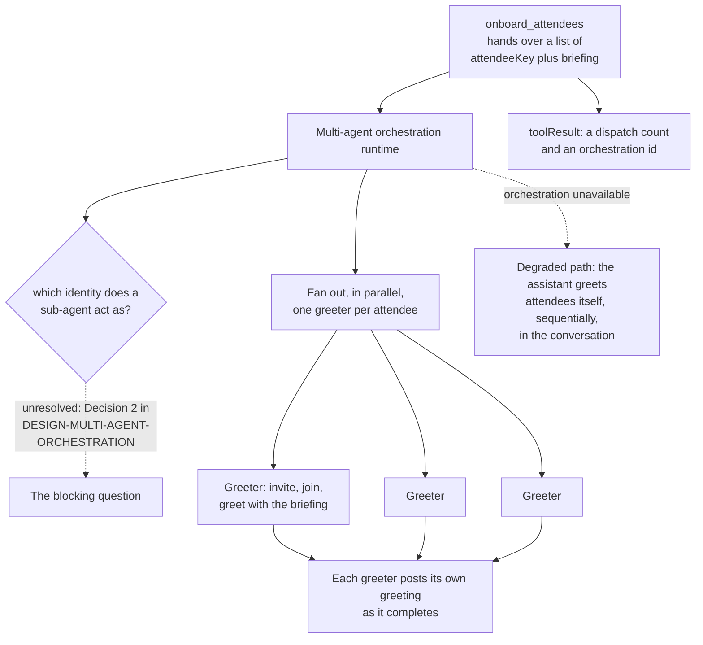

Output: `{ "dispatched": <n>, "orchestrationId": "..." }` - the assistant reports that onboarding is running, and each greeter's greeting arrives on its own. **No capability of its own.** The platform owns spawning, per-sub-agent identity, fan-out and lifecycle; the meetings assistant holds no bot-creation or bulk-invoke grant.

**The sub-agent identity question is open and it blocks this tool.** Which principal a greeter acts as is Decision 2 in [DESIGN-MULTI-AGENT-ORCHESTRATION.md](./DESIGN-MULTI-AGENT-ORCHESTRATION.md), and it is unresolved: the earlier answer, leasing an identity from a bounded pool of alt bots, is withdrawn, because an alt is an ordinary assistant assigned to a role for its classification with its own profile and version history rather than an anonymous shell. Two things remain settled - a bot is not minted per attendee on the turn path, and a sub-agent never acts as a human - and everything else, including whether workers get a bounded identity kind of their own or act as the orchestrator with attribution in metadata, waits on that decision. The related vended-versus-pooled question is recorded in [DESIGN-MULTI-ASSISTANT-TURN-ENGINE.md](./DESIGN-MULTI-ASSISTANT-TURN-ENGINE.md).

**The concurrency bound follows from that decision rather than preceding it.** There is no number to cap parallel greeters at until the mechanism names what is scarce.

#### `append_meeting_note` - EXECUTED, append-only

Serves `take_notes`. Description: "Capture a note, decision, or action item for the current meeting. Call this whenever the user states something to record. Include an owner for an action item."

```json
{
  "type": "object",
  "properties": {
    "meetingId": { "type": "string", "description": "Omit to use the current channel's meeting." },
    "kind": { "type": "string", "enum": ["note", "decision", "action_item"] },
    "text": { "type": "string" },
    "ownerKey": { "type": "string", "description": "Allowlist KEY of the action-item owner, if kind is action_item." }
  },
  "required": ["kind", "text"]
}
```

Output: `{ "noteId": "...", "saved": true }`. One immutable row per note, timestamped.

**Append-only is an IAM property, not a convention.** The role grants `dynamodb:PutItem` on `MeetingNotesTable` and no `UpdateItem` or `DeleteItem`, so a note cannot be silently altered even by a model that tried. **Attribution comes from the platform's sender identity, never from model input**, for the same reason: a record whose author field is model-supplied records who the model said it was. A write failure returns an error object, and the assistant says the note was not saved and offers to take it again.

#### `compile_follow_up` - EXECUTED - and `send_follow_up` - PROPOSE-AND-CONFIRM

Both serve `follow_up`. Compiling is a read, and only the send is behind a confirmation.

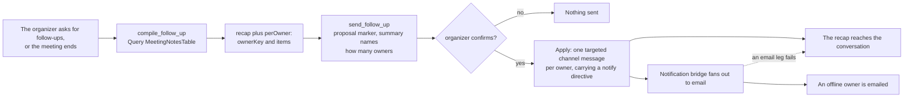

`compile_follow_up` input: `{ "meetingId": "string (optional)" }`. Output: `{ "recap": "...", "perOwner": [ { "ownerKey": "...", "items": ["..."] } ] }`. `send_follow_up` input: `{ "meetingId": "string", "perOwner": [ ... ] }`, with proposal payload `{ op: "send_follow_up", args: <input>, summary: "Send follow-ups to <n> owners" }`.

On apply the assistant posts as its own bot, being a member and moderator of the conversation, one targeted message per owner carrying `metadata.notify:{email:true}`. **The assistant holds no SES grant**: the outbound email is the notification bridge's job. **In-app delivery is the backstop** - a per-owner post failure is reported per owner, and the recap that reaches the conversation is never lost because an email leg failed.

### B.4 The primitives this assistant uses rather than reimplements

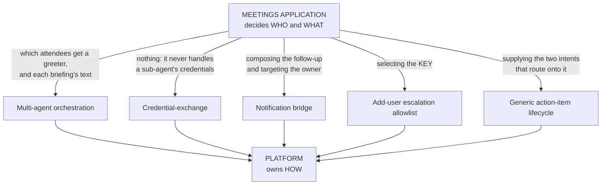

| Primitive | What the platform owns | What this assistant owns |
|---|---|---|
| Multi-agent orchestration ([DESIGN-MULTI-AGENT-ORCHESTRATION.md](./DESIGN-MULTI-AGENT-ORCHESTRATION.md)) | Spawning one sub-agent per attendee, each sub-agent's acting identity, the parallel fan-out, retries, lifecycle and teardown, **and recording what each leaf cost** (section 5a) | Which attendees get a greeter, and the per-attendee briefing text each one delivers. **This assistant is the first consumer of the fan-out, so its analytics precondition is this assistant's precondition too**: a per-attendee greeter is not buildable until a sub-agent's model call has a row of its own |
| Credential-exchange ([SPEC-CREDENTIAL-EXCHANGE.md](../governance/SPEC-CREDENTIAL-EXCHANGE.md)) | Vending short-lived, bearer-pinned credentials for a greeter, if the vended-identity option is the one Decision 2 chooses | Nothing. It never handles a sub-agent's credentials |
| Notification bridge ([SPEC-NOTIFICATION-BRIDGE.md](../../communication/SPEC-NOTIFICATION-BRIDGE.md)) | Fanning a message carrying a notify directive out to email | Composing the follow-up and targeting the owner. It emits the directive, not transport code |
| Add-user escalation allowlist ([SPEC-ADD-USER-ESCALATION.md](../governance/SPEC-ADD-USER-ESCALATION.md)) | Resolving an allowlist KEY to a real identity at the apply endpoint | Selecting the KEY. It never emits an ARN, sub, address or name as an identity |
| Generic action-item lifecycle ([SPEC-CONFIGURABLE-INTENT-PACK.md](./SPEC-CONFIGURABLE-INTENT-PACK.md), [SPEC-TASK-STATE-TRANSITIONS.md](../conversation/SPEC-TASK-STATE-TRANSITIONS.md)) | The `gathering` to `options_presented` to `awaiting_completion` to `completed` machine, hand-off notices and cross-conversation continuity | Supplying the `schedule_meeting` and `follow_up` intents that route onto it |

| Assignment and routing ([DESIGN-SEPARATE-ASSISTANTS-AND-DELEGATION.md](./DESIGN-SEPARATE-ASSISTANTS-AND-DELEGATION.md), [SPEC-CONVERSATION-TYPES.md](../conversation/SPEC-CONVERSATION-TYPES.md)) | Adding this assistant from the conversation type's declared roster; deciding which assigned assistant answers a turn; handing a turn it cannot place to the one that advertises it, before any turn is claimed | **Nothing, and this is the point.** It declares its intents in a pack. The advertisement is projected from that pack, so being routed to is a consequence of being configured, not of being built |
| Bounded initiative ([SPEC-ASSISTANT-MEETINGS.md](./SPEC-ASSISTANT-MEETINGS.md) FR11 and its companion) | What an assistant may do unprompted in a room it is a member of, and what stays behind confirmation | Choosing to greet an arrival or chase an absence, within that bound. The rule is the platform's; the occasion is this assistant's |

Where a primitive is absent from a deployment, the corresponding tool degrades to the fallback stated with it rather than failing the whole assistant.

| Primitive | What the platform owns | What this assistant owns |
|---|---|---|
| Telephony adapter (C.2) | Bringing one attendee into one meeting over a phone, and the credentials that takes | Deciding WHO to bring in, and asking a person first (FR13b). **Absent, dial-in and dial-out are unavailable and nothing else changes** |

**What follows from that table, and it is the sizing of this whole document.** If the platform work is right, a meetings assistant needs no new assistant machinery: no assignment code, no routing, no turn policy, no delegation transport, no identity minting for the common case. What is genuinely meetings-shaped is three things, and they are what the rest of this design is about: **the Amazon Chime SDK Meetings APIs** (Part C), **the context sources a meeting produces and consumes** (B.5), and **a profile with an intent pack** (Part B and Config wiring). Anything else that looks like new development is a sign the work belongs on the platform instead.

### B.5 The context a meeting produces, and how it comes back

A meeting generates the one kind of content this platform has no path for today: something worth asking about *after* it is over. Two embedding stores exist and they answer different questions, so the choice of which one a meeting summary lands in is the whole design.

| Store | Consumer | Question it answers | Shape |
|---|---|---|---|
| `summary_embeddings`, `conversation_topic_embeddings` | drift detection only | has THIS conversation moved on to something else | one anchor per channel, plus one vector per subject |
| `embeddings` | retrieval, the `## RETRIEVED CONTEXT` section of a turn | what content is relevant to the question being asked | chunked documents, filtered by source type and classification |

A meeting summary belongs in the **second**. The first is already written for every conversation and is not a retrieval surface: nothing a person asks will ever return it.

**Getting it there costs almost no code, and that is deliberate rather than lucky.** Ingestion is driven by an object landing under `rag/` in the archive bucket, and the path carries its own metadata: `deriveSourceType` takes the segment after `rag/` and the classification is the segment after that. So the summarizer writes to `rag/meeting/<classification>/<meetingId>.md` and the chunking, the embedding and the classification stamp all happen with no new infrastructure. The classification is the conversation's own, because a meeting is an event on a conversation and inherits what governs it. **A classification-wide prefix is right only where the conversation's audience is the classification's.** A summary under `rag/meeting/<classification>/` is retrievable from every conversation at that classification, so a meeting in a conversation whose audience is narrower, such as one customer's, is retrieved scoped to its own conversation and never written to the classification-wide prefix.

**The one real change is a single line, and its failure mode is silence.** Retrieval filters on source type against a closed list (`RAG_SOURCE_TYPES` in `lib/turn-grounding.ts`, today `wiki`, `doc`, `company`, `agentechelon`). Ingestion is open and retrieval is closed, so a `meeting` type not added to that list embeds correctly and is never queried. Summaries would accumulate, cost money to produce, and never come back, with nothing reporting it.

**What this does not settle.** A transcript is audio-derived, so it is not channel messages unless something writes it there, and automatic transcription is a stated non-goal for this phase because it changes the privacy posture of every meeting it touches. So B.5 covers the SUMMARY a person or this assistant chooses to record, not a transcript nobody asked for. It also inherits an open gap: `conversation_summaries` carries no classification column of its own, named as a prioritized gap in [SPEC-CONTEXT-SOURCES-AND-STORES.md](./SPEC-CONTEXT-SOURCES-AND-STORES.md) FR19, so a reader of that text directly needs its own control. The `rag/` path does not have that problem, which is a second reason to prefer it.

**Live meeting state is a different question and wants a different answer.** What is happening right now - who has joined, how long it has run - is not a document and should not be embedded. If this assistant needs it mid-meeting, it is a `lambda-service` context source resolved per turn against the 1500 ms budget, not a vector.

### B.6 What starts the unprompted work: ADR-061 events (partly built: `invitation-sent`, `invitation-unredeemed`; the meeting events are **NOT BUILT**)

**This assistant has no trigger of its own.** Each occasion it acts on without being asked is an event in [ADR-061](../../../design/decisions/061-a-welcome-is-a-workflow-an-event-starts.md)'s closed set, with one declared source, delivered to the router of the meeting conversation's classification, which verifies it against the record that answers it and runs the workflow of the conversation's primary assistant for that event. A deadline is a one-shot schedule the router creates when it runs the event that starts the thing it times, and only when a workflow declares the deadline event, never a poll (tenet D6). The workflow's steps are `platform` sends (instant, no model call) or `agent` steps (a deadline-bounded turn of the assistant, metered against the global budget as the join recap is, with read tools only and a declared platform fallback, ADR-061 decision 8).

| Occasion in this design | ADR-061 event | Steps |
|---|---|---|
| An attendee is invited (`invite_attendee` applied) | `invitation-sent` | `platform`: the targeted invitation notice and its email |
| An invitation is still unredeemed at its deadline | `invitation-unredeemed`, a schedule the router creates when it runs `invitation-sent` | `agent`: drafts a nudge, proposed to the inviter to send (FR11, FR32). Built as ADR-061's `chase-unredeemed`, with the chat client's confirmation card |
| A scheduled meeting is about to start | `meeting-starting`, a schedule the router creates in the meeting's conversation once the apply of `create_meeting` has created it | `platform`: a targeted reminder to each expected attendee (FR20, FR31), notice kind `meeting-reminder` |
| The meeting starts (Phase 3) | `meeting-started` | `platform`: one room message emailed to the expected attendees, notice kind `meeting` |
| Someone joins (Phase 3, then Phase 4's greeting, FR4) | `meeting-joined` | `platform`: one room message naming who joined (a mention, ADR-061 decision 6); then `agent`: the arrival's brief, targeted to them |
| An expected attendee has not joined (Phase 4's chase) | `expected-attendee-absent`, a schedule the router creates when it runs `meeting-started` | `agent`: drafts a nudge, proposed to the organizer to send (FR11, FR33). **NOT BUILT**: waits on the meetings code; the confirmation card (B.2) is built |

**What a brief knows about the person comes from the conversation type's participant roles.** "Why you are here" is the person's participant role in the meeting conversation (`organizer`, `attendee`, or another the type declares) and the reason their invitation recorded, resolved as [DESIGN-CONVERSATION-TYPES.md](../conversation/DESIGN-CONVERSATION-TYPES.md) section 6.1 declares and never inferred from the person's name or words. The `reason` field of `invite_attendee` is that recorded reason.

**`onboard_attendees` stays the turn entry for the same work.** An organizer who says the meeting is ready starts it from a turn; the `meeting-joined` workflow greets each arrival with no one asking. Both reach the same brief. Per-person fan-out for either waits on sub-agent identity (B.3), and until it exists the brief is one turn of this assistant per arrival.

**A nudge reaches someone outside the room, so it is drafted blind to the room.** The chase's `agent` step receives no conversation history, only its declared variables, and its output carries no link but the platform's own, so neither room content nor an inviter's words can steer what an outsider receives (ADR-061 decision 8, rule 6). A confirmed nudge is sent under the `nudge` notice kind, which a person can mute or unsubscribe from, at most once per person per meeting or invitation (SPEC-ASSISTANT-MEETINGS FR34).

**What the events do not cover.** The meeting ending has no event in ADR-061's set, so the follow-up that `compile_follow_up` starts "when the meeting ends" stays an organizer's request until one is declared (**OPEN**).

## Part C - Live meetings and calls

This part is the infrastructure a live meeting or call runs on, and how each one attaches to a conversation. It is adapted from a proven design on the same Amazon Chime SDK foundation, and it stays inside the platform's invariants: a meeting or call is an event on a governed conversation, scoped by that conversation's classification.

### C.1 A live meeting is an Amazon Chime SDK meeting attached to a conversation

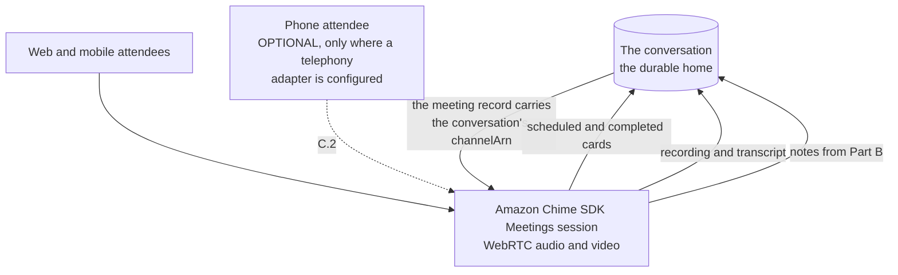

The conversation is the durable home; the meeting is an event on its timeline rather than a separate place. That is what lets every artifact the meeting produces post back where the topic already lives.

**How a meeting is bound to its conversation, and who may join it.**

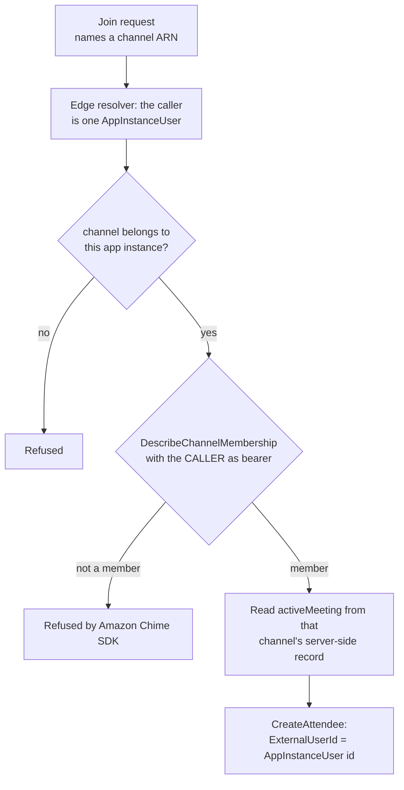

- **One meeting, one channel.** The meeting belongs to the conversation it was started in, or to its own meeting conversation when scheduled; C.7 moves every meeting into a meeting conversation of its own (**NOT BUILT**). The relation is the server-side `activeMeeting` record keyed by the channel ARN, claimed with a conditional write so two starts produce one meeting, and never member-writable channel Metadata. `ExternalMeetingId` is the channel id, so a lifecycle event names its conversation with no lookup, and the meeting carries the channel's classification as a tag.
- **The meeting is never chosen by the caller.** A request names a channel, never a meeting id, and the meeting is read from that channel's record, so a meeting id from another conversation admits no one.
- **Membership is checked as the caller.** The membership read bears the caller's own AppInstanceUser, so a non-member's check fails inside Amazon Chime SDK rather than being adjudicated by the handler. The Amazon Chime SDK Meetings actions are not ARN-scopable, so these handler checks, not a policy underneath, are the isolation, and they are what the deny-tests drive.
- **The attendee is the AppInstanceUser.** `ExternalUserId` is the caller's AppInstanceUser id, whichever identity provider signed them in, so the roster and every transcript segment resolve to one person.

**Who may start, join and end a meeting: its hosts.** The host is a role, not a person (SPEC-ASSISTANT-MEETINGS FR50). The room's type names the participant roles that host its meetings (`participants.meetingHost`), and every person holding one of them hosts: an `ops` room's lead, its on-call (`on-call:ops`, from the `ops-on-call` group) and its secondary on-call (`secondary:ops`, from `ops-secondary`). Where none is named or held, whoever starts the meeting hosts it; a meeting a workflow starts takes the room's host roles. The hosts are recorded on the meeting at its start (`activeMeeting.hosts`, `backend/lambda/src/lib/meeting-host.ts`).

| Action | Who | Where it is enforced |
|---|---|---|
| Start, and start again after it ended | a host, where a host role is held; anyone in a room with none | `startInHome` in `meeting-api.ts`, before any conversation is opened (`NOT_HOST`) |
| Join | any member of the room or the meeting's conversation, while the service says it runs | the join route reads the record and confirms it with `GetMeeting` |
| End for everyone, without joining | a host, or a moderator of the room or of the meeting's conversation (read live) | `mayEndMeeting` in `meeting-api.ts`; the console's end (FR49) uses the same `endMeeting` |
| End on its own | nobody: nobody else joined within five minutes, one person left alone at two checks five minutes apart, or the deployment's limit (`meetingMaxMinutes`, 90 minutes unless set) | the router's watch (`handleMeetingWatchFired`, `meeting-watch.ts`), one-shot schedules from the meeting's start, ending through the same `endMeeting` after telling the room why |

The client shows only what the server allows: the status, join and start answers carry `isHost`, `hostIds`, `mayEnd` and `mayStart`, and the room's banner offers End to those who may end it. A host's Leave asks whether to leave or end it for everyone. A meeting nobody is connected to also ends after five continuous minutes by Amazon Chime SDK's own rule, and its `MeetingEnded` event releases the conversation's record. The watch is what bounds a meeting one person forgot in: the service alone would let it run 24 hours.

**NOT BUILT**: the route uses a Cognito user-pool authorizer, and the caller ARN, `ExternalUserId` and `createdBy` are the token's `sub` claim rather than the caller's AppInstanceUser id (`callerPersonId`), and a caller from another issuer cannot reach the route (see SPEC-ASSISTANT-MEETINGS, "Phase 1 scope"). The channel check, the caller-as-bearer membership read and the per-channel record are on that branch as described.

### C.2 The phone leg is an adapter, and the platform ships none

**THE PHONE LEG IS OPTIONAL AND MUST STAY THAT WAY.** Amazon Chime SDK PSTN Audio entered maintenance mode on 2026-09-29, and from 2026-10-29 creating a new SIP media application requires an AWS Support exception granted **per account**. Meetings dial-in is a named exception category, but an exception one account holds does nothing for anybody deploying this project from a clean one. So a phone leg cannot be a default dependency, and FR13 requires meetings to run end to end without one.

**The seam is the SERVICE, not the carrier, and that is a correction.** An earlier version of this section made the carrier pluggable - the deployer supplies the SIP trunk - behind a Voice Connector plus a SIP Media Application named as the mechanism. That is one level too shallow: it lets a deployer choose whose trunk feeds one telephony service, and leaves the service itself unreplaceable. What has to be swappable is the whole phone leg.

**The adapter contract.** One interface, with no mention of any provider in it:

| | |
|---|---|
| **Handed** | a meeting reference, one attendee to bring in as a call leg naming their AppInstanceUser, and how to reach them |
| **Returns** | that attendee is in the meeting, or a reason it could not bring them |
| **May not** | post to the conversation, read it, hold any identity of its own, decide WHO to call, or identify a caller by phone number. Those stay with the assistant and the turn, so the adapter is a transport and never a participant |
| **Credentials** | belong to the adapter. The assistant holds no telephony credential, which is the same division B.4 applies to a greeter's credentials |

**A call leg is the identity of a phone participant.** A call placed from a conversation to a member writes a leg record naming that member's AppInstanceUser ARN before dialing, and everything the call produces (a transcript segment, a roster row, a voicemail) resolves through the leg. A phone number is a route, never an identity: an inbound call or voicemail from a number with no leg becomes a guest-class AppInstanceUser in a new conversation, with a call leg naming that AppInstanceUser written before transcription starts so its transcript is kept there, and it reaches a person's own conversations only through that person's action.

The implementations, and the design endorses none:

| Implementation | Who can deploy it |
|---|---|
| **A telephony connector (Twilio first), phone-only.** The connector places the call once a member starts it and their membership is checked; Real-Time Transcription posts signed events to the connector ingress, and segments are appended to the conversation's archive by call leg. No Amazon Chime SDK is involved | anybody with the vendor account, through [SPEC-CONNECTORS.md](../../communication/SPEC-CONNECTORS.md) |
| **A media bridge, for a phone leg into a WebRTC meeting.** The connector streams the call (Twilio `<Connect><Stream>`, bidirectional: the caller's inbound track as mulaw at 8000 Hz, and meeting audio sent back in the same format) to a container that joins the meeting as one WebRTC attendee per caller, taking the leg's AppInstanceUser id as `ExternalUserId`. Meeting transcription then transcribes the caller like any attendee. The bridge attendee can neither post nor read. **OPEN:** how a server process joins an Amazon Chime SDK meeting as an attendee, a headless browser or a supported native SDK | anybody, at the cost of running the container |
| Amazon Chime SDK PSTN Audio, a Voice Connector plus a SIP media application | an account that already holds one, or has an approved exception. **OPEN:** whether Amazon Chime SDK Voice Connector is affected. The notice scopes the change to the PSTN Audio service and does not name Voice Connector; unconfirmed with AWS |
| Amazon Connect | anybody, and it is where AWS is putting telephony investment. **OPEN:** whether it can bridge into an Amazon Chime SDK meeting |

**What a deployment with no adapter loses, stated so a regression is visible:** dial-in and dial-out. Nothing else. WebRTC meetings, the roster, every tool in Part B, the notes, the follow-ups and all of B.5's context sources are unaffected. **The roster's transport attribute (FR25) degenerates to one value rather than breaking**, which is the correct shape for an absent optional leg.

**What is deliberately NOT designed here.** A per-attendee transport decision. The flow below dials an attendee on request; nothing chooses a transport per person, and nothing measures availability before trying. A traced reference implementation attempts WebRTC optimistically for a single callee with a short acknowledgement deadline, and has no per-attendee transport record at all. Designing one is a separate piece of work, and reading this section as though it exists is the error to avoid.

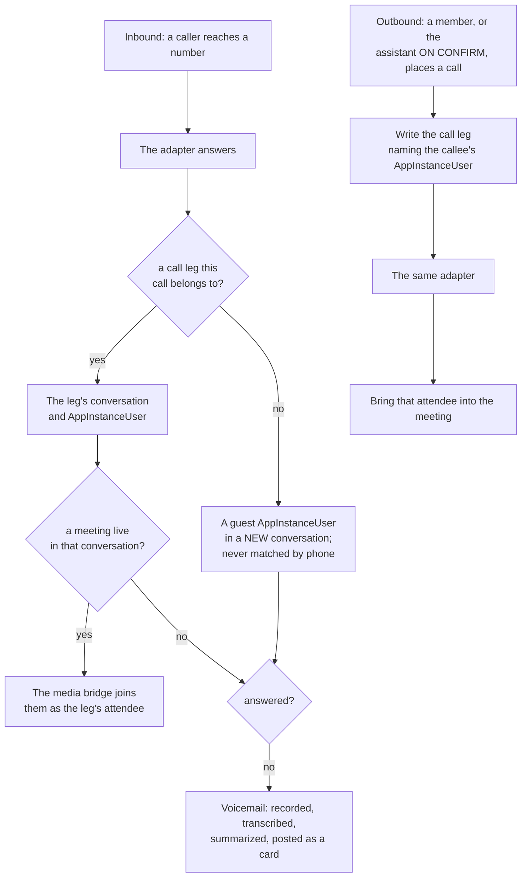

### C.3 Every event lands in the right conversation

The organizing principle is that **the conversation is the source of truth.** A person holds several conversations, each a distinct topic or engagement, and every event lands in the one it deterministically belongs to rather than spawning a stray channel. **An event is never placed by a guess.** A fuzzy match on topic, company or recency, or a caller's phone number, would put one person's call into another person's conversation, and a weak match that lands in the wrong conversation is a disclosure rather than an inconvenience.

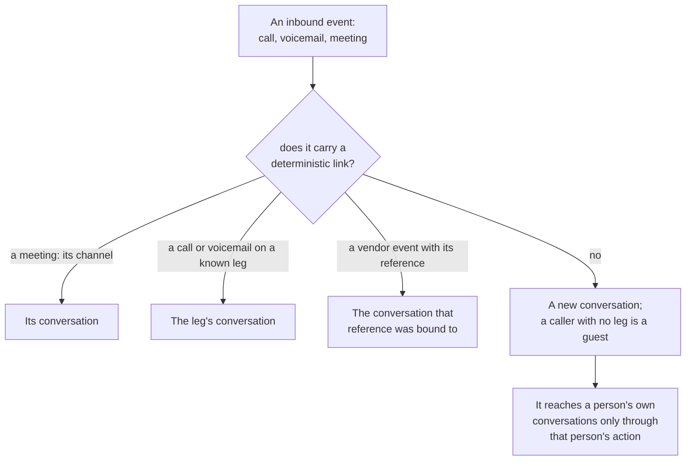

**Voicemail is placed once.** A voicemail on a known leg posts into that leg's conversation; one from a number with no leg opens a new guest conversation. Its transcript, when it arrives, updates the voicemail's card in place and never moves it to another conversation.

### C.4 Timeline cards

Each event posts a structured message carrying a `cardType` - `meeting-scheduled`, `meeting-completed`, `voicemail` or `call-summary` - rendered inline as a compact card with a drill-down detail panel: attendee join and leave times, recording, transcript, audio player. A conversation is then a self-contained timeline of everything about that topic, without leaving it for a separate meetings view. **Cards are ordinary channel messages with metadata**, so a message carrying no `cardType` renders exactly as before.

### C.5 The roster: one row per person, derived from the events

**The roster is a projection of the event stream, not a record kept beside it.** Every fact it shows is already emitted: joins and leaves, video starting and stopping, content sharing starting and stopping, and the transport each attendee is connected over. Deriving the roster from those events rather than maintaining it as rows that are updated in place is what FR22 asks for, and it is the difference between a roster that survives a dropped event and one that drifts away from the meeting it describes.

**One row per PERSON, and this is the part that is easy to get wrong.** The service issues a new attendee record for each connection, so one person routinely produces several:

| What the person did | What the service emits |
|---|---|
| Dialed in, then switched to their browser | Two attendee records, concurrently or in sequence |
| Lost connection and came back | A new attendee record each time |
| Started sharing their screen | **A separate attendee** whose id carries a `#content` suffix |

Keyed on the attendee, a person who dials in, switches to browser and shares their screen is three participants, and one of them is a screen. The roster therefore keys on the stable person key from FR21, the AppInstanceUser id each attendee carries as its `ExternalUserId` (for a phone leg, the leg's), and folds every attendee record for that person into one row, with the content-share attendee attributed to its owner rather than listed. A participant count taken from the roster is then a count of people.

**State, which answers "did this person turn up".**

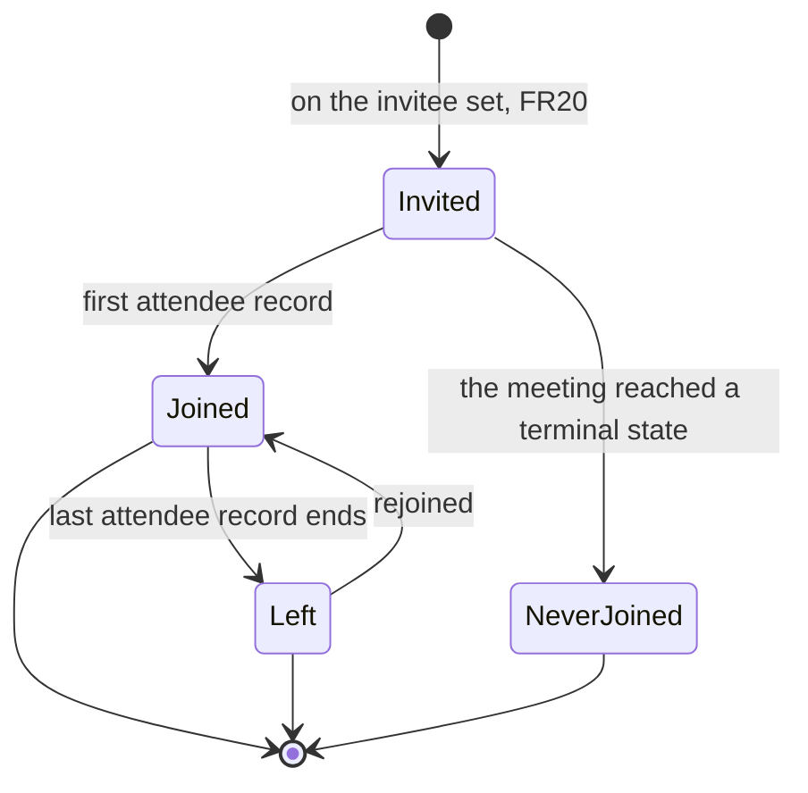

`NeverJoined` is only decidable once the meeting has ended, so a roster read during a meeting shows `Invited` and says the meeting is still running rather than implying a no-show. A statistic computed over a live meeting states that, per FR23.

**How the person is present, with the history rather than only the current value.** Each of these is a sequence of intervals, because the question worth asking is usually about the change rather than the state:

| Attribute | Derived from | The question it answers |
|---|---|---|
| **Audio transport**: phone or browser | the network type on each attendee record | did somebody start on the phone and move to the browser, or fall back the other way when their network degraded |
| **Video**: on or off | the video started and stopped events | was anyone on camera, and when did that change |
| **Screen share**: on or off | the content joined and left events, attributed to the owner | who presented, and for how long |
| **Connected**: present or absent | join to leave or drop, summed across records | how long this person was actually in the meeting, which is not last-minus-first once anyone reconnects |

So a roster row reads as a small timeline. On a deployment with no telephony adapter: joined at 14:02, camera on at 14:04, shared their screen from 14:15 to 14:28, dropped at 14:31, rejoined at 14:32. Where an adapter is configured, the transport appears beside it: joined by phone at 14:02, moved to browser audio at 14:09. **A transport switch is the clearest example of why the transition matters more than the state**: by itself it is unremarkable, and in a meeting where three people did it in the same two minutes it is the network, not the people.

**What it is for, in order.** Live, it is what lets this assistant know who it is still waiting for, which is the input to chasing an absence. After the meeting, it is the denominator for every statistic in the roadmap below, and the record of who presented. Those are two different reads of one projection and neither needs a second store.

**Where it lives.** It is derived from the archive, which owns the event sequence and outlives the channel. Aurora projects it for querying across meetings. Each event is filed in the archive first, under `meeting_events/` through the Meetings stack's own delivery stream, and then projected into Aurora where the deployment keeps it, so a deployment in Athena mode keeps every event. The stream and its Glue table belong to the Meetings stack, so a deployment that does not declare `meetings` has neither. Nothing maintains a roster as mutable state, which is the mistake FR22 exists to prevent: a counter incremented on arrival and decremented on departure is wrong the first time an event is redelivered or lost, and it is wrong silently.

### C.6 How Parts A and B sit on this

`create_meeting` provisions the meeting and its conversation; `onboard_attendees` greets people as they join a live meeting; `take_notes` and `follow_up` write and summarize the meeting the timeline cards surface. That layering is why the chat-facing halves depend on nothing here.

### C.7 Every meeting is its own conversation (FR27, FR41 to FR43)

**PARTLY BUILT, not deployed:** C.7.1 and C.7.2 (the meeting conversation, cards in the room, joining from the room, `parentMembersJoin`). C.7.3, C.7.4, the parent type's `meetings` entry, the start's narrowing, and C.7.7 are **NOT BUILT**. Every meeting, started from a conversation or scheduled, is held in a **meeting conversation** of its own. The meeting's chat, cards, transcript and summary live there. Who may join is who is a member of it. The meeting's settings decide whether people can be added and who, and being added to a meeting never gives anyone the parent conversation.

#### C.7.1 The meeting conversation

- **Started from a conversation, a meeting opens a child conversation.** The parent classification's typed creator (`typed-conversation-from-event.ts`, `aeMeeting: 'open'`, asked by the meetings function) opens it as the `meeting` conversation type through the canonical creator ([ADR-053](../../../design/decisions/053-a-conversation-records-its-type-rather-than-being-pinned-to-it.md)), at the parent's classification, read from the parent's immutable tag and never from the request. The child's server-side row names the parent (`meetingOf`), and the parent's names its newest meeting conversation (`meetingConversation`), claimed so two starts at once open one. The child is not listed among the parent's threads, so the parent's turns never read the meeting's chat. Only a meeting opens one: an event or a workflow step that names the type is refused. A scheduled meeting is the same conversation, opened when it is scheduled (FR30).
- **The meeting belongs to the child.** The `activeMeeting` record is the child's, the meeting's `ExternalMeetingId` is the child's channel id, and the meeting carries the child's classification as a tag. C.1's join checks apply unchanged, to the child: membership is read with the caller as bearer, so Amazon Chime SDK refuses a non-member of the meeting conversation whatever their standing in the parent.
- **Its first members** are the person or workflow that started it, the people the start called (C.7.3), the parent's primary assistant, which owns and moderates it, and every other assistant of the classification that is a member of the parent when the meeting starts. The meeting carries on part of the parent's subject, so the assistants working that subject are in it: an incident's call has the ops assistant to ask, while the primary still owns the meeting's cards and workflows. The creator reads each live assistant's membership of the parent as the service admin, and a read that fails opens no meeting conversation rather than one missing an assistant its room has. No assistant is welcomed there, because the meeting conversation is the meeting's chat. Each person is checked for the classification as an invitation checks its inviter (`invitations.ts` step 3), and a person whose clearance does not reach it is refused by name. Clearance is never raised to fit.
- **It holds none of the parent's history.** Its join recap is built from the child alone. What the meeting needs from the parent, it is told in the child's opening: an incident room's meeting names its incident there (`meeting-started-incident`).
- **The parent gets the cards, and a link.** The started card in the parent says a meeting is running and links to it; the ended card and its summary are posted in the parent too, because the parent's members are who the meeting was about. The transcript and the meeting's own chat stay in the child.
- **The child stays when the meeting ends.** It is the meeting's durable home, follows the `meeting` type's retention, and a later meeting started from the same parent opens a new child.

#### C.7.2 A member of the parent joins from the parent

Every member of the parent may join the parent's meeting unless the start called only some people and closed it to the rest (C.7.3). Joining is one request, `POST /meetings/join`, naming the parent:

1. The caller is a member of the parent, read with the caller as bearer, and the parent is not archived.
2. The parent's row names the child, and the child's settings let parent members join.
3. The meetings function asks the classification's creator to admit the caller (`aeMeeting: 'admit'`), which adds them to the child as the service admin, only where the child's row says it is a meeting's; it then answers the child's join information, naming the child (`conversationId`). A join may name the child itself, from a card's link, and is admitted the same way.

The parent's membership is what admits the caller, so a person removed from the parent can no longer join from it. Being in the child grants nothing back in the parent: the two memberships are separate Amazon Chime SDK channels, checked separately.

#### C.7.3 Calling some people (FR41)

- **The start names whom to call.** `POST /meetings` takes an optional `call: [<AppInstanceUser id>, ...]`, each a member of the parent, read with the caller as bearer; a non-member refuses the start with `NOT_A_MEMBER`. A workflow's `start_meeting` names participant roles instead (`call: ['on-call:ops']`), resolved to their holders when the step runs, as a `meeting_offer` task resolves them today (FR40).
- **Called people are added to the child at the start**, hear its ring (the ring is the child's, so it reaches only them), and are emailed (`targets` on the notify directive).
- **The rest of the parent may still join (C.7.2), or not.** The start's **Others in this conversation can join** switch decides, within what the meeting's settings allow (C.7.5). Off, the parent's started card says a meeting is running without a join link, and joining from the parent is refused.
- **The parent's card says whom the meeting is for**, in `meeting-started-call` (or `meeting-started-incident-call`), editable like every meeting card. Whether it names the people is the team's choice, made in the template.

#### C.7.4 Adding people to a meeting (FR42)

Anyone added to a meeting becomes a member of the meeting conversation only. They see the meeting, its chat and what is said in it from then on, never the parent. A person is given the parent only by the parent's own rules, as anyone is: sharing, an invitation into the parent, or the parent's group.

- **A member of the parent** is added to the child directly. The picker lists the parent's members.
- **A person who has an account but is not in the parent** is added to the child by sharing the child (`backend/lambda/share-conversation/`), under the child's checks: their clearance reaches the classification, and the meeting's settings allow people from outside.
- **A person with no account** is invited into the child (`POST /invitations`, `invitations.ts`): an invitee AppInstanceUser is minted, added to the child, and emailed a link that lands them in the meeting window after they redeem it (template `invitation-meeting`). The address is the route for that one email and is never stored or used to find anyone. This is the "invitations into meetings" SPEC-CREDENTIAL-EXCHANGE lists as not built.
- **During the meeting**, the meeting window's **Add people** opens the same picker. A person added while the meeting runs hears a ring if they have the app open.

Because the child is never group-sourced, a group-sourced parent (the ops team room, an incident room opened from it) needs no special case: its membership stays equal to its group, and a vendor or another team's engineer is added to the incident's meeting conversation alone.

#### C.7.5 The meeting's settings (FR43)

What a meeting allows is decided in three layers, each of which can only narrow the one above it:

| Layer | Where it is declared | What it sets |
|---|---|---|
| The `meeting` conversation type | the conversation-type registry | The most any meeting allows: who may add people (`organizer`, `attendees` or nobody), whether people from outside the parent may be added (`outsiders`), and how (`sharing`, `invitations` with their modes, as any type declares `invitations` today) |
| The parent's conversation type | its `meetings` entry in the registry | Narrower settings for meetings started from that kind of conversation: a customer's room may allow no outsiders, an incident room may let any attendee add people |
| The start | `POST /meetings`, or the `start_meeting` step | Narrower still, for this one meeting: **Others in this conversation can join**, and whether people can be added at all |

The meeting conversation's server-side row records the settings the start resolved, and every add reads them from there, never from the request or channel Metadata. Each add is checked twice: the meetings function checks the settings and the adder's role, and Amazon Chime SDK checks the membership write under the identity that makes it.

#### C.7.6 What a person sees

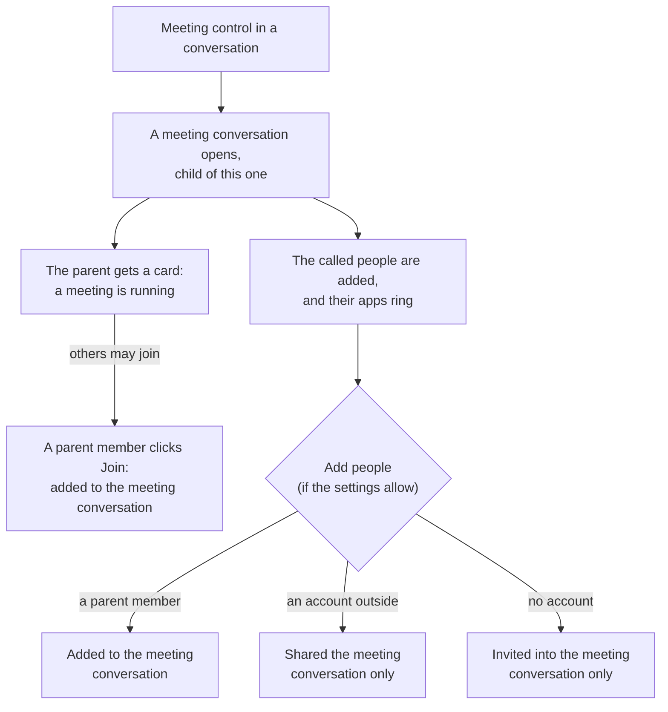

- **The meeting control** starts a meeting for everyone with one click, and **Call some people** opens the picker: the parent's members with check boxes, a search for someone else in the deployment, an email field for someone new, and the **Others in this conversation can join** switch. Choices the settings refuse are not offered.
- **The meeting window** shows the meeting conversation's chat in its right column, and **Add people** where the settings let this person add.
- **The parent** shows the meeting's cards, and its "meeting in progress" line opens the meeting.
- Every word in these is a template or a localized string (tenets P5 and D11).

#### C.7.7 Events and workflows

- The meeting conversation's `meeting-started` and `meeting-ended` run the workflows of its own primary assistant, the parent's.
- `meeting-started` gains a platform-computed field, `meetingCalled`, the people the start named.
- A new event, `meeting-person-added`, names the meeting conversation, the person and who added them, so a team's workflow can brief the newcomer (what `onboard_attendees` does in Part B, without the sub-agent fan-out).

#### C.7.8 What changes in what is built

| Built today | Changes to |
|---|---|
| The meeting is the started-in conversation's (`activeMeeting` on it; `meeting-api.ts`, `meeting-run.ts`) | The start opens the child and records the meeting on it; the parent's row names the child |
| The ring and the email reach the conversation's members | They reach the child's members |
| The started and ended cards and the summary are posted in the conversation | Posted in the parent, linking to the child |
| The meeting window shows the conversation's chat (`MeetingProvider`, `MeetingRoom`) | It shows the child's chat |
| `POST /meetings/join` checks membership of the named conversation | Checks the parent, the child's settings, then adds to the child (C.7.2) |
| The meetings and incident triage e2e specs assert the room's meeting | They assert the child, and a person who is in the child and not the parent being refused the parent |

New: the `meeting` conversation type and its settings, the parent type's `meetings` entry, `call` on the start, sharing and inviting from the meeting window, the templates `meeting-started-call`, `meeting-started-incident-call` and `invitation-meeting`, and the events in C.7.7.

**Open questions.** Whether a meeting conversation is archived some time after its last meeting, rather than at its type's retention. Whether one parent may have two meetings running at once, which a child per meeting allows and the parent's single started card does not yet describe.

### C.9 Transcription, the ended card, and the archive on end (FR28, FR55 to FR57)

**Proven on a sibling deployment, and built here with hosts as roles, people as AppInstanceUser identities, and the classification on every piece.**

| Piece | Built in |
|---|---|
| Starting live transcription, its settings | `lib/meeting-transcription.ts` `setTranscription`, from `meeting-api.ts` at the meeting's creation where `meetingTranscription` is set |
| Who turns it on or off | `POST /meetings/transcription`, the meeting's recorded hosts only (FR50), the control shown to a host only |
| Telling every client the state | the service's own `TranscriptionStarted` and `TranscriptionStopped` events, handed to the router as lifecycle events and posted in the meeting's chat; each client reads the service's transcription status on the data channel |
| The indicator | `MeetingRoom.tsx` `ae-meeting-transcribing`, for everyone in the meeting while on |
| The spoken notice | `services/meetingTranscription.ts` `announce`, in the reader's language from `meeting.transcription.*` |
| Two modes: live captions (nothing kept) and recording (captions, the stored transcript and the summary), recording the default | `nextTranscriptionMode` in `lib/meeting-transcription.ts`: recording turns captions on, captions cannot be turned off while it records; `meetingRecording` sets the start's mode; the host's app says the mode on the data channel, and the meetings function publishes a change the service raises no event for |
| Live captions | `MeetingRoom.tsx` `ae-meeting-captions`, every speaker's newest lines, partial lines included |
| Consent | none beyond the notice |
| Capturing what was said | each app sends its own person's final lines as it goes (`POST /meetings/transcript`), kept per line under `transcripts/<classification>/<conversationId>/<meetingId>/segments/` |

**Each line is its speaker's own app's.** An app sends only the final lines the service attributes to its own attendee, and the server keeps a line only from an attendee the service confirms is the caller's (`GetAttendee`, its `ExternalUserId`). So a line is attributed to the AppInstanceUser who spoke it and no member can attribute words to another; what remains a client's word is the text of its own lines. Capturing the service's transcription messages server side, through a media capture pipeline, would keep a line whose app never sent it; it is not built.

**The transcript is written once the meeting has ended**, when its summary is due (`MEETING_SUMMARY_DELAY_SECONDS`, so the last reports are in): the run entry reads the segments, names each speaker as the room shows them (their AppInstanceUser name), and writes `transcripts/<classification>/<conversationId>/<meetingId>.md`. Only a meeting that was transcribed at some point is written.

**The ended card** (FR55) is then rewritten in place with the transcript's link, which the chat app opens through the attachment download path: signed only for a member of the meeting's conversation, cleared for it, and only where the key's classification is the conversation's.

**The meeting's conversation is archived** (FR56) after the card, through the conversation management function's one archive sequence, which checks the conversation's own row first.

**The room reads it** (FR57): a meeting's conversation is the room's `thread` child, so a room turn reads its summary and its newest transcript under the membership rule every thread child is read under.

### C.10 The meeting's summary, and its action items as tasks (FR66, FR67)

**The summary's sections and rules were proven on a sibling deployment; its action items are Agent Echelon tasks** (owner, 2026-11-12).

| Piece | Built in |
|---|---|
| When it runs | the router's `handleMeetingSummaryFired`, once the transcript is written (C.9) and the card rewritten with its figures, only where the meeting was recorded (a transcript was written) |
| The prompt | `lib/meeting-summary-turn.ts` `MEETING_SUMMARY_INSTRUCTIONS`: the sections Summary, Key Discussion Points, Action Items and Next Steps, and their rules (nothing fabricated, only what was said, a plain statement for no meaningful dialogue, an assignee only where the transcript makes it clear, no model name), answered as one JSON object (`summary`, `keyPoints`, `actionItems` of `{ text, assignee, due }`, `nextSteps`) rather than Markdown parsed back (tenet D11) |
| The meeting's context | the date, the duration, and the participants as references `P1`, `P2`, ... with the names the room shows them under; the transcript, each line by its speaker's reference, inside a `<meeting-data>` block the instructions call data |
| Topics | `topicsOf`: the opening clause of each discussion point |
| The model call | one turn of the room's owning assistant, on its own vended session, through the processor's model path (`invokeBedrockWithFallback`, the assistant's own model and fallback), metered against the global budget as machine-written work |
| Where it is kept | the meeting conversation's server-side row, `lastMeeting.summary` (tenet D13, no new store) |
| Where it is shown | the ended card in the room, rewritten in place (`meeting-summary` with `summary`, `key_points` and `action_items`); the room's assistants read it there as the room's own history, beside the meeting's transcript (FR57) |
| Action items | one task each, on the platform machine `meeting_action_item` (FR67) |

**The turn.** The router dispatches it to the room's owning assistant (`eventWorkflowOwner`: the role the room's type names, such as `ops` in an ops room, else the primary) with ids and its own reads only: the meeting, its people as the meeting conversation's membership lists them, and the card. The processor reads the meeting's segments under its classification's transcript family, asks the model, records the turn on the card's message as a `meeting_summary` turn (model, tokens, latency; `trigger` and `turnKind` `meeting_summary`, an interaction kind that answers no message), and hands the summary back to the router (`aeMeetingSummary`). A turn the meter refuses, that times out, whose reply a guardrail touched or that is not the object, hands nothing back, and the card keeps its figures and links.

**The router writes it.** On the hand-back it reads the meeting conversation's row again (its last meeting, its ended card, no summary yet), checks both conversations are its own classification and the room is not archived, and checks the turn's assistant is still the room's owning assistant. It then opens the action items' tasks, stores the summary with each item's task id on the meeting conversation's row, and rewrites the card.

**The assignee rule.** The model names a participant only by a reference the platform gave it, and the platform maps the reference back to the AppInstanceUser id it was given for; no name in the model's text is ever matched to a person. An item is assigned to that person only where they are a member of both the meeting's conversation and the room, read live; that is also what keeps an item from crossing a classification, since the task is opened on the room, which the task service refuses for any classification but its own. Any other item (no assignee named, a reference it was not given, or a person outside the room) is held by a host: the meeting's first recorded host who is a member of the room, else the person who started it. A held item is that host's task, assigned to them and shown as held on the card. The task model has no unassigned person task: a task's worker is a person or an assistant, and an assistant worker would be taken up by the assistant itself (ADR-063 decision 5). Where the room has no host to hold it, the item is listed on the card and in the stored summary and opens no task.

**Each task** opens through the one workflow-task seam (`openWorkflowTaskStep`, ADR-063, ADR-067): on the room, the meeting's run (`meeting-summary#<meetingId>`, its meeting on `workflowRun.meeting`) and one step per item, so a redelivered hand-back opens each task once; its worker the person by `{ people: 'event:person' }`; its creator the owning assistant; its due date, where one was stated, a `due` deadline at the end of that day. The holder is told privately with the task's card and emailed (`workflow-task-assigned`), and marks it done on the card. Its settlement continues no run.

**Roadmap (owner, 2026-11-12): the Advisor follows up on open action items. Not built.** It hooks in as an event, never a poll (tenet D6): an action item with a stated due date already carries a `due` deadline. The follow-up adds a reminder schedule on that deadline (the `remind` kind a task step takes, WT21), whose firing names the task to the room's router as any task deadline does. The router runs the Advisor's declared workflow on that event, and an `agent` step drafts the follow-up to the holder, privately. An item with no due date is followed up on a deployment default from the meeting's end, set when its task opens. Nothing reads open tasks on a timer.

### C.11 Audio and video recording (FR70)

Owner decision 2026-11-12 (the spec's "Owner decisions"). Recording mode is one switch: where `meetingMediaRecording` is set, the moment recording turns on or off (`setTranscription`, `lib/meeting-transcription.ts`) calls `syncMediaCapture` (`lib/meeting-media-capture.ts`).

| Step | What runs | Where it is written |
|---|---|---|
| Recording on | `CreateMediaCapturePipeline` on the meeting, the guide's composited view (`GridView`, 1080p, `ActiveSpeakerOnly` while content is shared, audio muxed in); the part recorded as `capturing` | `recordings/<c>/<conv>/<meeting>/<part>/capture/` |
| Recording off, or a host or the watch ends the meeting | `DeleteMediaCapturePipeline`, then `CreateMediaConcatenationPipeline` on it; the part moved to `processing` by a conditional write, so it is concatenated once | `.../<part>/media/` |
| The service stops the capture itself (everyone left) or it fails | The `Chime Media Pipeline State Change` event (`chime:MediaPipelineDeleted`, `chime:MediaPipelinePermanentFailure`) concatenates a part still `capturing` (`meeting-recording-events.ts`) | as above |
| The file is written | The store's `Object Created` event for `.../media/composited-video/<id>.mp4` (or the concatenation's own deleted event, where the file is there) moves the part to `ready` with its key, deletes its `capture/` chunks, files `recordingReady` and publishes `recording-ready` | the part's `key` |
| The concatenation fails | Its permanent failure event, or a refused create, moves the part to `failed`, files `recordingFailed` and publishes `recording-failed` | |
| The card | The router's `recording-ready` and `recording-failed` lifecycle events call `rewriteEndedCard`, which renders the card again from the row (`endedCardValues`, `recordingCardValues`) as the assistant that posted it | the ended card |

The conversation is found from the event, never guessed: a pipeline event's `externalMeetingId` is the meeting conversation's id (`meeting-api.ts` sets it), else the pipeline's sink names the family's conversation and meeting, and the row must hold that pipeline as one of the meeting's parts; an object's key names the part the row must hold. Who acts: the meetings functions start and stop a capture; the recording's event function, with a delete grant on `recordings/*/capture/*` alone, finishes it. The media pipelines service writes the family by the conversation store's bucket policy (`lib/constructs/meeting-recordings.ts`), attached by the store's own stack where `meetings` is declared. The service checks the sink's policy with the caller's `s3:GetBucketPolicy`, which the callers hold on the store alone.

**Not verified on a deployed stack:** whether a concatenation pipeline's events carry the meeting's ids (the guide shows them for a capture), which is why the written file's object event also finishes a part; and whether the service lists the store under the family's prefix alone, as the policy's listing condition requires.

### C.8 The console's Meetings tab (FR45 to FR49)

**Every number on it is the server's.** The admin meetings function (`admin-meetings.ts`) folds the window's recorded events once (`meeting-figures.ts`) and answers the figures, each with its population, and each meeting's summary; one meeting's answer adds its roster, its events in time order and each attendee record's connectivity. The console lays these out and computes no figure of its own, so the tab, the room's ended card and the alarms agree (FR22, tenet D7). People are shown by their AppInstanceUser id, as the record keys them; the tab looks up no names.

**The overview** (`MeetingsOverview.tsx`):

| Part | Drawn from | Form |
|---|---|---|
| Headline figures | `figures` | A tile per figure, the population under it, and the dash rule in the tooltip of a figure that can be a dash |
| By day | `figures.byDay`: meetings, people, drops and app failures per UTC day | Four small column charts on one row, one axis each, every day of the window drawn (a day the answer omits held no meeting), and a table of the same numbers |
| How people fared | `figures.quality`, each person once per meeting | One segmented bar in the status colors, each part named with a glyph |
| Status and how meetings started | `figures.byStatus`, `figures.startedVia` | Segmented bars |
| Incidents | `figures.incidents`: each kind's count and newest 50 (`incidentKindOf`: a drop, a join failure, a microphone, camera or audio failure, a lost connection) | A list per kind with the time, the person, the event and its error, each opening its meeting |
| Devices and failure types | `failuresByType`, `browsers`, `operatingSystems`, `sdkVersions` | Ranked horizontal bars |
| Meetings | `meetings`, each with `live` | A table, live meetings first, with a Live now filter |

**The drill-down** (`MeetingTimeline.tsx`, `meetingLanes.ts`) puts the meeting on one time axis: a lane for the meeting and one per person on the roster, in the order they joined, then anyone the events name who is not on it. A person's lane carries three thin tracks, connected, camera and sharing, drawn from the roster row's `spans`, the same intervals its seconds are summed from, so the drawing and the figures cannot disagree. Every event but the periodic connectivity reading is a marker, by category (the meeting, join and leave, camera, sharing and mute, devices, connection, failures, ring, other), each with its own color and shape so a category never rests on color alone. A new event type the console has no words for still appears, under `other`, by its recorded name. The category filter scopes the markers and the list beneath alike, a lane's person narrows the list to them, and a marker or a row opens every recorded field of its event. The quality charts (`MeetingQualityCharts.tsx`) draw each measure from `connectivity` (FR44) over time, one line per attendee on the timeline's time axis with the thresholds as reference lines, and say the connection was not recorded where there are no readings; the experience issues (`MeetingExperience.tsx`, FR74) lead the meeting's view.

**Live is read from the source, not the record of events** (`meeting-liveness.ts`). A meeting whose events hold its end is ended. Any other is live only while its conversation's context row holds it as `activeMeeting` and Amazon Chime SDK still runs it (`meetingRunsNow`, the router's own check). A conversation can keep `activeMeeting` for a meeting the service has already ended until the next start or join releases it, so the record alone never reads as live. The newest 40 unended meetings of an answer are asked, eight at a time; any further one, and one whose read failed, answers `null`, which the tab shows as not known. How an ended meeting ended is read from its events: `everyoneLeft` when the last person left at least 30 seconds before the service's end, `withPeopleIn` otherwise, `nobodyJoined` for an empty roster.

**The meeting dashboard (FR68).** Beside everything above, the tab carries the healthy-meetings figure, per-person quality detail and the timeline's filters, a dashboard shape proven on a sibling deployment. It shows no phone-network figures (this platform has no phone leg), and meeting requests arrive with scheduling. What each part is drawn from:

| Part | Drawn from |
|---|---|
| Healthy meetings and the tile colors | `figures.healthyMeetings` (meetings in which no app reported a failure, over meetings); the console's `--status-*` tokens, each with a glyph and a word |
| Conversation and host columns | the meeting's `channelArn`, named through `find-conversation` where the operator holds it, and `hosts` else `createdBy` |
| Where it was held | `conversation` on the detail: the meeting conversation's type and `meetingOf` with the room's type, read from their records; `createdBy`, `hosts` and `mediaRegion` from `meetingCreated` |
| Quality and each person | the roster: `quality`, `failureEvents` (each with its error text), `device.name`, `presenceReceivedMs`, the join and leave times, and the person's own events |
| Timeline filter, source and error | the timeline's events; Only shows one category, Show all clears, and the chip still hides one |
| Transcript and summary | `GET /admin/meetings/{meetingId}/transcript`, below |

**A meeting's transcript and summary are conversation content** (`view-events`), so they are their own route, `GET /admin/meetings/{meetingId}/transcript`, granted under `view-events` and never under `view-meeting-analytics`. The detail says only whether each was written (`transcribed` from the service's `TranscriptionStarted`, `conversation.summarized` from the record). On the operator's request the console asks for a reason (the one the meeting's conversation was opened for, where it was), and the handler takes the meeting's conversation and classification from its events, refuses a classification the caller's scope does not reach, writes the access log (`meeting_transcript_read`) before reading and refuses the read if the record cannot be written, then reads the transcript from its key (`transcripts/<classification>/<conversation>/<meeting>.md`) and the summary from the meeting conversation's `lastMeeting.summary`. The summary's action items are tasks on the room, each shown with its assignee or the host holding it by id and opening the room in the conversation viewer. The function reads only the transcript family (`s3:GetObject` on its `.md` keys, `s3:ListBucket` under its prefix).

**Ending a meeting for everyone** (`end-meetings`, FR49) is its own capability on its own resource, `POST /admin/meetings/{meetingId}/end`, so reading the figures never carries it. The console asks for a reason through the change dialog every console change uses. The handler takes the conversation from the request and everything else from the source: the meeting must be the one that conversation holds now, its classification is the record's, the caller's signed role must reach that classification (`classificationAllowed`), and the service must still run it. It then writes the access log (`meeting_ended_for_all`: the person, the conversation, the meeting, the classification, the scope and the reason) and refuses the end if the record cannot be written. The end goes through the run entry of the meeting's recorded classification (`runHandler` with `op: 'end'`, named from `MEETING_RUN_FUNCTION_PATTERN`) to the same `endMeeting` a host or moderator uses: the service deletes the meeting, the conversation's record is released, and the service's own end event reaches the room's router, which posts the ended card. The admin function holds a read of the context table, `chime:GetMeeting` on meetings, the access log's `PutItem` and the invoke of every classification's run entry (an admin spans every classification), and no meeting write of its own.

## Phases

**Phase order.** Each phase states three goals, because "done" means something different to each audience and a phase that satisfies only one of them is not finished:

- **The person** - what they can do, and what they see.
- **The operator** - what is visible and measurable.
- **The assistants** - what any assistant in the conversation gains.

A phase ends somewhere a person could use. **The blocking chain in the spec is not a build order**: it orders what blocks FR4 and FR5, the per-attendee greeter, and read as a build order it puts the only buildable part last, which is how this stayed at zero.

**The telephony adapter is LAST on purpose, and that is a change from the first draft of this plan.** Put earlier, every phase after it sits on a tree that contains it and can quietly acquire a dependency on it - an assistant dialing somebody in is exactly that shape. Last, removing it touches nothing downstream, which is the property that keeps the phone leg genuinely pullable. It also puts outbound dialing after the assistant that has to ask permission for it.

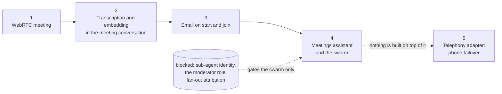

### Phase 1 - the WebRTC meeting, and nothing else

| Audience | Goal for this phase |
|---|---|
| **The person** | Start or join a meeting from the conversation they are already in. The meeting appears on that conversation's timeline and leaves a card behind when it ends. **There is no new place to go**, which is the whole claim of the timeline-event model |
| **The operator** | A roster per meeting: who joined, when they left, connected time summed across reconnects, drops separated from droppers, and join latency as p50 and p95. A meeting is visible as a child of its conversation rather than as a separate object |
| **The assistants** | Nothing. No assistant is in the room, deliberately, so that the meeting works before anything is asked of one and a later failure is attributable to the assistant rather than to the meeting |

**Closes:** FR12, FR13, FR14, FR15, FR18, FR20, FR21, FR22, FR23, FR24, FR25, FR26, FR27. FR20 belongs here because recording who was expected is a field on the meeting rather than a behavior, and every rate later depends on it.

**Deny-tested before this phase is done**, because it introduces a new resource into a governed conversation: a meeting on a conversation of one classification is not reachable from another, and a caller cannot join another channel's meeting with its meeting id, both proven against a deployed stack rather than argued. Isolation does not inherit just because the meeting hangs off a conversation that is already bounded. A person signed in through a second identity provider joins with their AppInstanceUser id as `ExternalUserId`, which the branch does not yet do (C.1).

**Builds toward Phase 2** by giving the transcript somewhere to land: the roster names who spoke, and the conversation is already the meeting's home.

### Phase 2 - transcription and embedding, in the meeting conversation

**The non-goal that gated this is largely answered by where a transcript lives.** It called transcription automatic, which it is not: **recording is a host-controlled toggle in the meeting client**, captions are visible to everyone while it runs, and that is the industry norm. The host decides, attendees are told and may leave, and no mainstream product gives an attendee a veto, so this design does not invent one.

**Built (FR28, owner decision 2026-11-12), as C.9 describes.** A transcript is an artifact of the meeting's conversation, in the conversation store's own platform-written family, so the two questions the non-goal raised are answered by the conversation:

| What the non-goal asked | How it is answered |
|---|---|
| How long a transcript is kept | As long as its conversation: the family expires the platform's longest conversation lifetime after it is written, which is when the meeting's conversation expires. No setting of its own |
| What classification it carries | The conversation's, in its key, so a reader's grant comes from the conversation's classification. There is no second boundary to design |

So Phase 2 is far less gated than the non-goal implies. **Two things remain, and neither is a question about transcripts.**

**Notice in the room** is built (C.9): the indicator while transcription runs, and a spoken notice on joining and on each start and stop, so somebody who objects can say so or leave.

**The derived copy outlives its source, and that is the real residual.** The transcript expires with the conversation; the SUMMARY embedded into the retrieval corpus does not. [ADR-008](../../../design/decisions/008-embedding-cost-and-ttl-policy.md) decided **no TTL on embeddings**, deliberately, because the cost is negligible until index size affects retrieval latency. So a conversation can expire while its meeting summary stays answerable in the corpus indefinitely. That is an accepted state rather than an oversight, **but the monitoring ADR-008 named as its own trigger for revisiting was never built**, so the gate it set for itself cannot fire. Phase 2 is where that stops being hypothetical, because it is the first feature to write conversation-derived content into a corpus with no expiry.


| Audience | Goal for this phase |
|---|---|
| **The person** | The host turns recording on from the meeting, and everyone in the room can see that it is running. What was said is then in the conversation afterwards, and findable later by asking. The ended card gains its summary **in place** rather than as a second message, so the record is one thing to read |
| **The operator** | Embedding coverage is countable: how many meetings have a retrievable summary and how many do not. **And the gap between the two retentions is visible**: transcripts that have expired with their conversation while their summary is still answerable in the corpus |
| **The assistants** | **Every** assistant in that conversation can ground on past meetings through ordinary retrieval. This is new context rather than new behavior, and it is the first phase where a meeting makes the assistants better at anything |

**Embedding costs almost nothing.** The summary is written to `rag/meeting/<classification>/<meetingId>.md`; the source type and the classification both come from the key, and chunking and embedding follow with no new infrastructure (B.5). **The one real code change is opening retrieval's closed source-type list, and its failure mode is silence**: a `meeting` type left out of it embeds correctly and is never queried. A meeting in a conversation whose audience is narrower than its classification, such as a customer's, is retrieved scoped to that conversation instead (B.5, ADR-008 amended).

**Closes:** FR28.

**Builds toward Phase 3** by making a notification worth sending: a start message can carry what the meeting is about because the conversation knows.

### Phase 3 - email on meeting start and on join, authored by the primary assistant

| Audience | Goal for this phase |
|---|---|
| **The person** | An email when a meeting they are expected at starts, and when somebody joins. The same message is in the room, so the email is a copy of the record rather than a separate channel to keep up with |
| **The operator** | Notification delivery is measurable, and every notification is attributable to the assistant that authored it |
| **The assistants** | The primary assistant speaks **unprompted** for the first time, inside a stated bound. That bound is the platform's, not this feature's, and it is what Phase 4 inherits |

**Nothing new is built for transport.** A message carrying a notify directive is fanned out by the notification bridge, so this phase posts messages and holds no mail grant. The start and join messages are `platform` sends of the `meeting-started` and `meeting-joined` workflows ([ADR-061](../../../design/decisions/061-a-welcome-is-a-workflow-an-event-starts.md), B.6).

**The author is the primary assistant, swapping to the meetings assistant in Phase 4.** That swap is configuration - which assistant authors the notification - rather than a rebuild, and starting with the primary is what lets this land a phase before the meetings assistant exists.

**The dependency this ordering surfaces.** A notification nobody asked for is an assistant speaking unprompted, so **bounded initiative and the declared turn kind are needed HERE rather than in the assistant phase**: FR11b because the primary assistant needs a rule permitting it to send anything at all, and FR19 because an unprompted message answers nothing, so undeclared it pairs with nothing and distorts model attribution - which has happened on this platform before.

**Closes:** FR11b, FR19, and the notification half of FR7 and FR9.

**Builds toward Phase 4** by settling the hard half of proactivity first. By the time the meetings assistant arrives, speaking unprompted is a solved and bounded thing, and all it adds is better judgment about when.

### Phase 4 - the meetings assistant, and the swarm

| Audience | Goal for this phase |
|---|---|
| **The person** | Greeted on arrival with what this meeting is about and why they are in it. Chased if they do not turn up. Scheduling and follow-ups happen by asking in the conversation rather than by filling anything in |
| **The operator** | Per-intent effectiveness for the meetings intents, with no analytics work: declaring the pack buys the measurement. **Chase effectiveness** becomes computable, which is the only figure here that says whether the assistant is doing any good. For the swarm, a fan-out drill under the turn: how many agents, what each cost, what each did |
| **The assistants** | A new assistant with its own profile, intent pack and advertisement, so routing to it is a consequence of configuring it. It takes over notification authorship from the primary. With the swarm, one sub-agent per attendee |

**The assistant half is not blocked.** It greets **as itself**, targeted to the arriving attendee, which is the buildable form of FR4 and FR5 and delivers what a person actually experiences. It chases on `expected-attendee-absent`, one one-shot schedule per meeting that the router creates when it runs the `meeting-started` workflow ([ADR-061](../../../design/decisions/061-a-welcome-is-a-workflow-an-event-starts.md) decision 1), which is the recognized tenet D6 exception because the absence of an event cannot be event-sourced. The greeting and the chase are `agent` steps of that ADR, and the chase is a nudge the organizer confirms (B.6), so the chase waits on the chat client's confirmation card (B.2).

**The swarm is the only blocked work in this document**, and it buys parallelism and separate attribution rather than a better greeting. Three gates, all platform questions:

| Gate | Where it is settled |
|---|---|
| Sub-agent identity: the assistant provisioner mints an identity at runtime only for an assistant in a deployed role (`assistant-provisioner.ts`, `manage-assistants`); nothing mints a non-addressable worker identity for a sub-agent | [DESIGN-MULTI-AGENT-ORCHESTRATION.md](./DESIGN-MULTI-AGENT-ORCHESTRATION.md) decision 2, reopened |
| The moderator role: a sub-agent adding a member to a channel it did not create is refused | Follows from the identity answer |
| **Fan-out attribution**: a sub-agent's model call has nowhere to be recorded, so its cost lands under the orchestrator's model | Section 5a of the same document |

**The third gate is a precondition, not a follow-up**, and the one most likely to be skipped. Attribution retrofitted after a fan-out ships does not backfill: this platform has already produced rows carrying an unknown model because a declaration arrived later than the rows it described, and they were not recoverable.

**Closes:** FR1 to FR10 as the intents land, FR11, FR16, and with scheduling and inviting, FR29 and FR30. With the swarm, FR4 and FR5 in their per-attendee form and FR17's cap, which cannot be set until the identity answer names what is scarce.

**Where Strands fits, if adopted.** As the orchestration layer over the existing loop rather than a replacement runtime: the single-agent surface is what this platform already has, and the genuine delta is the multi-agent coordination. The case for it rests entirely on this phase.

**Builds toward Phase 5** by putting an assistant in place that can ask permission before placing a call, which is what FR13b requires and what nothing earlier could provide.

### Phase 5 - the telephony adapter: phone as failover

**Last, so nothing is built on top of it.** Amazon Chime SDK PSTN Audio is in maintenance mode and closed to new accounts from 2026-10-29, so this phase does not use it: phone-only calls go through a telephony connector, and a phone leg into a WebRTC meeting goes through the optional media bridge (C.2). The deployment supplies the vendor account, and FR13's test exists to prove the four phases below it still run without this one.

| Audience | Goal for this phase |
|---|---|
| **The person** | Join by phone when the browser will not do, or be brought in by phone when WebRTC does not answer. On a deployment without an adapter, dial-in is simply absent and nothing else changes |
| **The operator** | Transport appears per person on the roster, with the moment it changed, so a WebRTC-to-phone fallback is visible as an event rather than inferred. The WebRTC-versus-phone split becomes a figure |
| **The assistants** | The assistant may bring somebody in by phone, **on a person's confirmation** (FR13b). It holds no telephony credential: that belongs to the adapter |

**The shape worth copying, stated as what it is rather than as more than it is.** A traced reference implementation tries WebRTC first and falls back to a phone call on a short acknowledgement deadline, then a longer timeout. It is **per call, for a single callee**, assumes availability optimistically rather than measuring it, and keeps no per-attendee transport record. That is the shape to copy. A per-attendee transport decision does not exist there and is not designed here.

**Closes:** FR13a, FR13b.

## Config wiring

- **Profile:** add a `meetings` `AssistantProfile` (Part A) in `backend/lib/config/profiles.ts`, with an assistant of that profile declared for each classification whose conversation types include it, so it always runs at the classification of the conversation it is in.
- **Persona:** `persona-meetings.txt`, injected via `-c assistantSystemPrompt`, merged into `cdk.context.json` and written to SSM by `assistant-profile-stack.ts`.
- **Intent pack:** `intent-pack-meetings.json`, injected via `-c assistantIntentPack`.

```json
{ "intents": [
  { "key": "schedule_meeting", "description": "Find a time and set up a new meeting.", "keywords": ["schedule", "set up a meeting", "find a time", "book a meeting"], "delivery": "TASK_MULTI_STEP" },
  { "key": "lookup_meeting", "description": "Find an existing meeting, its agenda, time, or attendees.", "keywords": ["when is", "agenda", "who is invited", "meeting details"], "delivery": "PLACEHOLDER_UPDATE" },
  { "key": "invite_attendee", "description": "Add one or more people to a meeting.", "keywords": ["invite", "add", "include"], "delivery": "PLACEHOLDER_UPDATE" },
  { "key": "onboard_attendee", "description": "Greet and orient each attendee as they join.", "keywords": ["onboard", "greet", "start the meeting", "welcome everyone"], "delivery": "TASK_MULTI_STEP" },
  { "key": "take_notes", "description": "Capture a note, decision, or action item during the meeting.", "keywords": ["note that", "record", "decision", "action item"], "delivery": "PLACEHOLDER_UPDATE" },
  { "key": "follow_up", "description": "Send the notes and action items to the attendees afterward.", "keywords": ["follow up", "send recap", "action items", "wrap up"], "delivery": "TASK_MULTI_STEP" }
] }
```

- **Tool enablement:** `ENABLE_MEETINGS_CALENDAR=true`, optionally with `MEETINGS_CALENDAR_API_BASE`, for `find_meeting_slot` and `create_meeting`. The other tools are on for this assistant by default.
- **Guardrail:** the platform default, from the shared construct.
- **Data stores:** `MeetingsTable` and `MeetingNotesTable` in DynamoDB, plus the calendar-read secret and the apply endpoint's calendar-write secret in Secrets Manager.
- **Grants added to the assistant's Lambda role:** `dynamodb:GetItem` and `Query` on `MeetingsTable`; `dynamodb:Query` and `PutItem` on `MeetingNotesTable`, with no update or delete; `secretsmanager:GetSecretValue` on the calendar-read secret. No membership, calendar-write, mail or bot-creation grant - those live on the apply endpoints and the platform primitives.

## Testing

The planned layers, mirroring the platform's own tool patterns.

| Layer | What it covers |
|---|---|
| Unit | Each tool's input coercion and output shape; proposal-marker encoding for `create_meeting`, `invite_attendee` and `send_follow_up`, including base64 with no marker-terminator leakage, as in the work-item tests; intent-pack classification and keyword fallback for the six intents; `find_meeting_slot` determinism, mirroring `corporate-travel-tool.test.ts` |
| Integration | The tool loop dispatching each EXECUTED tool, and intercepting each PROPOSE-AND-CONFIRM tool without executing it; append-only enforcement on `MeetingNotesTable`, asserted as the absence of an update path rather than as a convention; the guardrail on and off |
| End-to-end | One turn per intent through a deploy: schedule as propose then apply, look up, invite as propose then apply, onboard with greeters posted, note, and follow-up with a recap plus email |
| Deferred | The `onboard_attendees` end-to-end case waits on the orchestration primitive. The calendar tools are mocks until a real calendar client replaces `find_meeting_slot` |

## Open technical questions

| Question | Why it is open |
|---|---|
| One table with a composite key for meetings and notes, or two | One store simplifies the read side of `follow_up`; two keep the append-only grant on the notes store narrow, which is what makes FR10 an IAM property |
| Which component provisions the meeting conversation: `create_meeting`'s apply endpoint, or the platform conversation-type flow | It is a boundary with [SPEC-CONVERSATION-TYPES.md](../conversation/SPEC-CONVERSATION-TYPES.md), and the same question arises again in Part C |
| Whether the parallel-greeter cap belongs to this assistant or to the orchestration primitive | The cap is a cost bound on a fan-out a single turn starts, and the scarce resource is whatever Decision 2 makes it |
| Whether `find_meeting_slot` takes attendee time zones explicitly or the calendar client resolves them | An explicit argument is testable and puts the burden on the model; a resolving client is correct more often and hides a dependency |
| Whether a meeting summary should outlive the conversation it came from | **The only part of this still open**, and it is a corpus question rather than a transcript one. A transcript is an attachment and inherits the conversation's storage, retention and classification; the embedded summary has no TTL (ADR-008). See Phase 2 |
| Voicemail residency | Where a voicemail's audio and transcript are kept, and for how long. Placement is not open: C.3 places an event only by a deterministic link |
| How the media bridge joins a meeting | A server process joining an Amazon Chime SDK meeting as a WebRTC attendee needs either a headless browser running the client library or a supported native SDK; which one decides the bridge's size and cost (C.2) |

## Related Documents

- [SPEC-ASSISTANT-MEETINGS.md](./SPEC-ASSISTANT-MEETINGS.md) - requirements, personas, non-goals and what is delivered
- [ADR-061](../../../design/decisions/061-a-welcome-is-a-workflow-an-event-starts.md) - the events that start this assistant's unprompted work, and the `agent` step
- [DESIGN-CONVERSATION-TYPES.md](../conversation/DESIGN-CONVERSATION-TYPES.md) section 6.1 - the participant roles a brief reads
- [DESIGN-MULTI-AGENT-ORCHESTRATION.md](./DESIGN-MULTI-AGENT-ORCHESTRATION.md) - the fan-out primitive, and Decision 2
- [DESIGN-MULTI-ASSISTANT-TURN-ENGINE.md](./DESIGN-MULTI-ASSISTANT-TURN-ENGINE.md) - the vended-versus-pooled identity question
- [SPEC-NOTIFICATION-BRIDGE.md](../../communication/SPEC-NOTIFICATION-BRIDGE.md) - the email leg of the follow-up
- [SPEC-ADD-USER-ESCALATION.md](../governance/SPEC-ADD-USER-ESCALATION.md) - the allowlist-key rule
- [SPEC-CREDENTIAL-EXCHANGE.md](../governance/SPEC-CREDENTIAL-EXCHANGE.md) - the vend a greeter identity might use
- [SPEC-CONFIGURABLE-INTENT-PACK.md](./SPEC-CONFIGURABLE-INTENT-PACK.md) - the pack format and the generic lifecycle
- [SPEC-TASK-STATE-TRANSITIONS.md](../conversation/SPEC-TASK-STATE-TRANSITIONS.md) - the task machine the multi-step intents ride
- [SPEC-CONVERSATION-TYPES.md](../conversation/SPEC-CONVERSATION-TYPES.md) - the conversation-provisioning boundary
- [SPEC-CONNECTORS.md](../../communication/SPEC-CONNECTORS.md) - the telephony and calendar connectors, and the signed ingress their events arrive on
