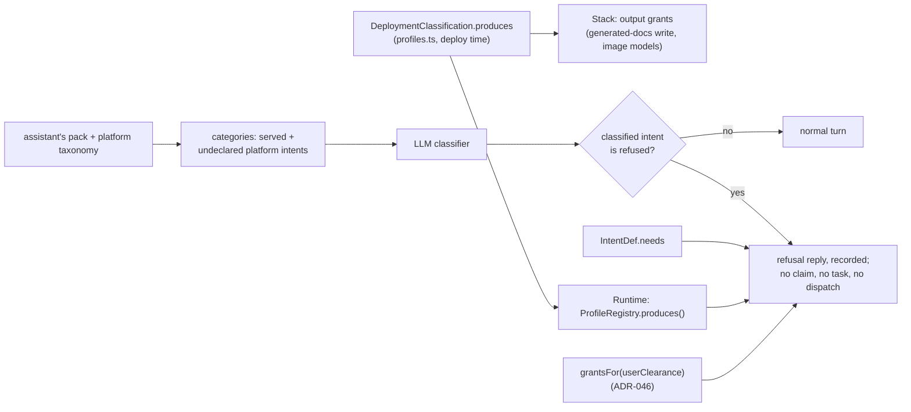
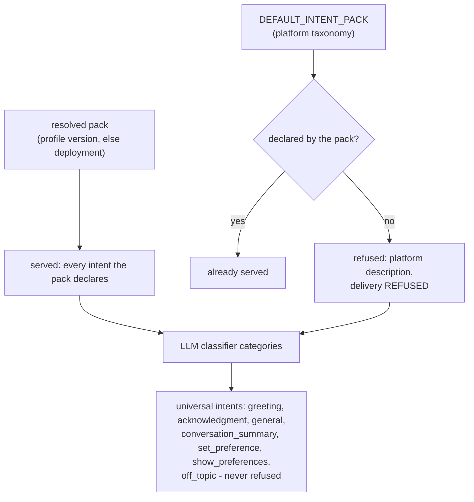
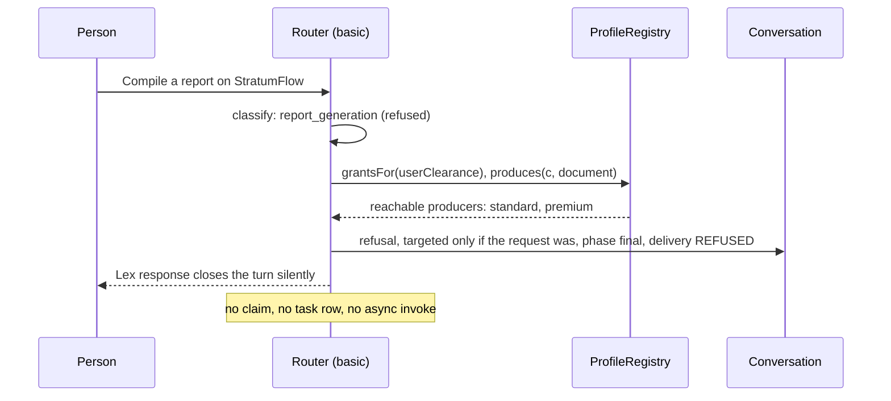

# DESIGN: Refusing what a classification cannot produce

**Status:** Partial - sections 1, 3 to 6, 8 and 9 are built and deployed; section 2's document half (the generated-docs grant reading `produces`; the image half is built, from the model catalog), section 7 (the guards) and the read surfaces in section 8 are not. What is delivered per requirement is in the spec.

**Coverage:** `tests/e2e/capability-refusal.spec.ts` (`validate.mjs --only=capability-refusal`).

**Related:** [SPEC-CAPABILITY-REFUSAL.md](./SPEC-CAPABILITY-REFUSAL.md) - the requirements, personas and what is delivered. This document is the mechanics only.

**Site section:** Interaction layer, assistants.

## 1. The shape

Whether a turn is refused is decided by **absence**: the turn is classified as a platform intent the assistant's pack does not declare. Where the refusal points the person is decided by three declared facts: what a classification **produces**, what an intent **needs**, and what the person's clearance **reaches**. The router does both after classification and before it claims the turn.

**Figure 1 - the three facts and where they meet.**



**The refusal is user experience, not an enforcement layer (tenet D3).** The boundary is IAM: a classification that does not produce documents holds no write grant on `generated-docs/*`, and one that does not produce images holds no `bedrock:InvokeModel` on an image model. The refusal tells the person before anything is attempted; a missed refusal fails at the grant.

## 2. What a classification produces is one field

`DeploymentClassification` (`backend/lib/config/profiles.ts`) carries `produces: Array<'document'>`. Absent is empty: a classification that has not declared an output does not claim it. Whether a classification produces an `image` is not declared there: it is the model catalog's to decide, and `ProfileRegistry.produces(c, 'image')` is true exactly when the catalog allows the classification an image model (`imageModelsAllowedFor`, `backend/lib/config/model-availability.ts`). A config naming `image` in `produces` is refused.

| Classification | `produces` | Images (from the catalog) | Topology it determines |
|---|---|---|---|
| basic | `[]` | none allowed | no `generated-docs/*` write; no image wiring |
| standard | `['document']` | none allowed | `generated-docs/*` write; no image wiring |
| premium | `['document']` | every image model allowed | `generated-docs/*` write; image grant, guardrail and env |

**The image half is built: the stack reads the catalog and the topology carries no image flag.** The stack wires image generation where `imageModelsAllowedFor(c)` is non-empty and grants exactly those models (`imageModelArnsForClassification`), the same list `produces(c, 'image')` and the runtime's image gate read, so the refusal's pointer, the grant and the turn cannot disagree (`backend/test/image-gen-iam-parity.test.ts`). **NOT BUILT: the document half.** The `generated-docs/*` write grant still follows `richProcessor` rather than `produces(c, 'document')`; `richProcessor` stays on the topology, because it also gates the experiments and battle-state grants and the orchestrator invoke, and synth does not yet fail when `produces` includes `document` on a classification whose topology is not `richProcessor`.

**An image request where no image model is allowed is refused, in a duel too.** The router refuses a turn whose intent needs an image when the conversation's classification is allowed no image model, beside the refusal of an intent the pack does not offer, and on a duel side as well as an ordinary turn.

**Runtime read.** `ProfileRegistry` (`backend/lib/profile-registry.ts`) carries `produces(classification, output)` beside `reaches` and `isBattleCapable`.

**A divergence this leaves visible.** Whether the processor generates a document is decided by the presence of the `ATTACHMENTS_BUCKET` environment variable (`assistant-async-processor.ts`), which the stack sets from the profile flag `attachmentsReadable`, while the `generated-docs/*` write grant follows the classification. The bucket also serves attachment reading, image persistence and battle rebuttal vision, so it cannot simply follow `produces`; T1 asks whether document generation should read `produces` instead of the bucket's presence.

**A label for the refusal to name.** `DeploymentClassification` carries `displayName?: string` (`profiles.ts`; the demo declares Basic, Standard and Premium), read through `ProfileRegistry.displayNameOf`, which falls back to the classification value. The chat app's own labels are frontend locale strings.

## 3. Refusal is triggered by absence

**An intent the assistant's pack does not declare is refused (owner).** The LLM classifier is given the assistant's resolved pack AND every platform intent that pack does not declare. A turn classified as one of those undeclared platform intents is refused. Nothing has to be listed in a pack to be refused, and nothing in a pack is refused: declaring an intent is how an assistant offers it, and not declaring it is how an assistant does not.

**Figure 2 - building the classifier's categories for one turn.**



- **The universal intents are never refused.** `greeting`, `acknowledgment`, `general`, `conversation_summary`, `set_preference`, `show_preferences` and `off_topic` (`UNIVERSAL_INTENT_KEYS`) belong to every assistant and no pack declares them. Summarizing or catching someone up on the conversation they are in is the platform's, not a report (owner): the classifier is told so in its `CONVERSATION_SUMMARY` category, so "summarize what we discussed" on basic is answered, not refused as `report_generation`.
- **What is refused is a platform intent.** Recognizing a report request needs the report description, which the platform taxonomy already carries. A request matching nothing in the platform taxonomy or the pack is `general`. It is not refused by the router. The processor's `WHAT YOU OFFER` block (`intent-answer.ts`) tells the model to decline it briefly when it is outside the pack: a model-voiced, prompt-level decline with no IAM backing that records no `REFUSED` delivery.
- **Off topic is classified, not refused.** The classifier's `OFF_TOPIC` category (`intent-classifier.ts`) names a request unrelated to every category that is not ordinary conversation either (trivia, creative writing, advice on an unrelated subject). The router does not refuse it: the turn is recorded with intent `off_topic`, and `intentAnswerPrompt` (`intent-answer.ts`) adds a `THIS REQUEST IS OFF TOPIC` block that tells the assistant not to answer it, even in part, and to say in one sentence that it is not something the assistant helps with, then name what it helps with. A `general` turn keeps the model-judged `WHAT YOU OFFER` decline. Both answer through the `general` route unless the version routes them (`ANSWERS_THROUGH_GENERAL`, `model-resolver.ts`).
- **Platform questions are a platform intent.** `platform_question` (questions about AgentEchelon itself) is in `DEFAULT_INTENT_PACK`, minimal by the parameter size budget: a description, the keyword `agentechelon`, `PLACEHOLDER_UPDATE` delivery and the one-line instruction "Answer from platform information.", with no tool list, so the turn keeps every tool. A pack offers it by declaring it at its own depth, and a pack that does not declare it refuses it like any other undeclared platform intent. The demo's basic pack (`PLATFORM_QUESTION_BASIC`, `backend/demo/intent-packs.ts`) says in a few plain sentences what AgentEchelon is and does, names no internal component, file, parameter or setting, and gives no configuration, customization or build steps even when asked how; standard and premium (`PLATFORM_QUESTION_INTERNAL`) give configuration and code examples and describe the architecture and its trade-offs. Both use `load_platform_info`. Basic's depth is enforced by what it can read, not only by its instructions: `load_platform_info` reads `platform-knowledge/{c}/` for each classification the caller's grants include, and IAM on the acting role and the vended session grants only those prefixes, so basic reads a public overview with no document index, and the RAG copy of the documentation is ingested at `standard`, which basic's grants do not include. It answers through the `general` route unless a version's `models.byIntent` routes `platform_question`.
- **A pack that declares an intent serves it.** The demo's standard pack declares `image_generation`, so standard keeps serving image requests by owner decision, although its stack generates no images; the activation guard in section 7 is what would close that, and it is deferred.
- **Basic, concretely.** Its pack declares `product_info` (its own) and `guided_troubleshooting` and `platform_question` (from the platform), and no `image_generation` (section 9), so a request classified as any other platform intent in `DEFAULT_INTENT_PACK` is refused: `report_generation`, `data_extraction`, `image_generation`, `code_generation`, `code_review`, `strategic_analysis`, `code_delivery`, `technical_design` or `design_review`.
- **LLM mode only (tenet D11).** Refused intents join the LLM classifier's categories through `intentPackCategoryLines`, so the model decides what was asked and records it as a key. They are **not** added to keyword classification (`classifyByPackKeywords`), which is a substring match: a refusal decided by a matched English word would fire on "report the status of X". In keyword mode, and on the keyword fallback when the model call fails, nothing is refused and the turn proceeds as it would without this feature (SPEC FR6). It fails toward answering, and `HOW-TO-ADD-OR-MANAGE-A-PROFILE.md` gains a note that keyword mode does not refuse.

## 4. What an intent needs, for pointing the person elsewhere

Absence decides WHETHER to refuse. Where to send the person is a separate question: which classifications the person reaches would serve the request. A basic router cannot read another classification's assistant configuration (tenets D12 and D13), so that answer comes from the deployment's own declarations: what each classification `produces` (section 2) and what each intent `needs`.

`IntentDef` (`backend/lambda/src/lib/intent-pack.ts`) gains `needs?: 'document' | 'image'`, which a custom intent declares on itself. The platform intents' values live beside the taxonomy in `PLATFORM_INTENT_NEEDS`, not inside `DEFAULT_INTENT_PACK`, because that pack is copied into every classification's 4096-character SSM parameter under a size budget; `needsOf` reads an intent's own declaration, else the platform's:

| Intent | Delivery | `needs` |
|---|---|---|
| `report_generation` | TASK_MULTI_STEP | `document` |
| `data_extraction` | TASK_MULTI_STEP | `document` |
| `image_generation` | PLACEHOLDER_UPDATE | `image` |
| every other platform intent | - | absent |

Declared rather than derived: "a TASK_MULTI_STEP intent whose machine has a state that `produces: 'document'`" (`task-state-machines.ts`, `TaskStateDef.delivers`) identifies documents but not images, which the processor keys on the literal intent `image_generation`. A declared field is data a validator reads (tenet D11). Pack validation (`validateIntentPackBody`) checks only that a declared `needs` is a known value. **NOT BUILT:** refusing a custom TASK_MULTI_STEP intent whose selected machine has a delivering state and no `needs`, which would keep the access hint accurate for a builder's own report intent.

**A refused intent with no `needs`** (for example `code_generation` on basic) names no output any classification is declared to produce, so which classification would serve it cannot be computed. Its refusal says the assistant does not do it, and adds the administrator line only when the person reaches no other conversational classification (owner, SPEC FR18); a person who does reach one is not pointed at a classification that may refuse too.

## 5. Where the router refuses

After classification, beside the DIRECT branch in `router-agent-handler.ts` (the path that answers greetings and acknowledgments without a claim, a task or a dispatch), and before the turn claim. No other assistant is consulted: every assistant in a conversation acts in its one classification (ADR-042), so none present produces what the classification does not.

**Figure 3 - one refused turn.**



**As visible as the request (owner).** A request targeted at the assistant gets a refusal targeted at its sender, `Target: [{ MemberArn: senderArn }]`, the pattern the router already uses for a reply only its sender should see. A request the whole conversation can read gets a refusal it can read. **The access lines always go to the sender alone (owner, SPEC FR17):** they state what the sender's clearance reaches, which no other member should read (tenet P4). So a refusal to a public request is two messages: the refusal line, public, then the access lines, targeted at the sender. A refusal to a targeted request is one targeted message carrying both.

**The turn queue.** A refusal does not wait for a turn in flight, the same as the DIRECT replies it sits beside. It writes no task and runs no model, so it cannot collide with the answer being produced, and only its sender sees it. T2 asks whether a refusal should instead queue behind an active responder.

**Abuse controls.** The refusal sits before the abuse gate, so it is not counted against a person's rate or budget. It spends no model call, so the cost the gate protects is not incurred.

## 6. Composing the reply

**The conversation's classification is its tag.** `channelClassification` is the value the router already reads from the conversation's immutable classification tag (`resolveChannelClassification`), before classification runs; `produces` is looked up by that value. Nothing here reads a classification from channel Metadata, a stored copy or the assistant's own configuration.

**Branch.** Computed from the clearance the router already resolves for the turn (`userClearance`):

```
offering = grantsFor(userClearance)
  .filter(c => c !== channelClassification && isConversational(c) && produces(c, need))
```

| Clearance | `offering` | Lines used |
|---|---|---|
| unresolved | - | `capabilityUnavailable` only, or `capabilityNotOffered` for an intent with no `needs` (SPEC FR5) |
| resolved, intent has no `needs`, reaches another conversational classification | - | `capabilityNotOffered` only (SPEC FR18) |
| resolved, intent has no `needs`, reaches none | - | `capabilityNotOffered`, then `capabilityNotOfferedNeedsAccess` (SPEC FR18) |
| resolved, intent has a `needs` | non-empty | `capabilityUnavailable`, then `capabilityHasAccess`, then one line per classification label, then `capabilityHasAccessClose` (FR3) |
| resolved, intent has a `needs` | empty | `capabilityUnavailable`, then `capabilityNeedsAccess`; no classification named (FR4) |

This is the onboarding intake's rule (`IntakeOffer.accessHas` / `accessNeeds`, `offerReply` in `onboarding-intake.ts`): two authored lines because they say opposite things, and silence about access when clearance did not resolve, because telling a person something false about their own permissions is the larger harm (tenet D9). `offering` is the person's own reach, which the New conversation picker already shows them (`creatableClassifications`, `NewConversationModal.tsx`), so listing it discloses nothing new. The no-access line names no classification.

**Words.** The lines are sections of the `capability-refusal` message template (`backend/lambda/src/lib/shipped-message-templates.ts`, ADR-062): the assistant's own template, else the classification's, else the shipped English, the way `handoverOwnerUnavailable` is selected. Like that line, they resolve from the addressed assistant's profile (the router's turn assistant profile, `turnAssistantProfile`), so a second role's assistant in the same classification speaks its own refusal wording; an alt, which has no published profile, speaks its primary's. Labels are listed one per line rather than joined into a sentence, so no list grammar ("A, B and C", "which does" against "which do") is built in code (tenet D11).

| Key | Placeholder | Shipped default |
|---|---|---|
| `capabilityUnavailable` | `{output}` | "I don't produce {output} in this conversation." |
| `capabilityNotOffered` | - | "That isn't something I do in this conversation." (an intent with no `needs`) |
| `capabilityHasAccess` | - | "You have access to conversations that do:" |
| `capabilityHasAccessClose` | - | "Start a new conversation there and ask again." |
| `capabilityNeedsAccess` | `{output}` | "If you need {output}, ask your administrator for access." |
| `capabilityNotOfferedNeedsAccess` | - | "If you need it, ask your administrator for access." |
| `capabilityOutputDocument` | - | "report documents" |
| `capabilityOutputImage` | - | "images" |

**Language.** A message template may carry a variant per declared language (ADR-062 decision 4), and the refusal is said in the first written language in its reader's order. `HOW-TO-ADD-OR-MANAGE-A-PROFILE.md` lists the refusal lines in its account of message templates (2.10). **Rejected:** a model-voiced refusal through the async processor. It would be in the conversation's language, but it runs a model and dispatches a turn to say no, which is the work SPEC FR2 exists to avoid. The `WHAT YOU OFFER` decline for `general` turns is a separate, model-voiced path and is not a capability refusal.

## 7. Guards that keep configuration honest (deferred)

Both are specified and not scheduled (SPEC FR15): the demo's standard pack serves `image_generation` on a classification that produces no images, by owner decision, and the first guard would refuse it.

- **Profile activation.** A `capabilityErrors` list joins activation in `lib/profile-lifecycle.ts`, modeled on `workIntentErrors`, which runs on the write path only because `validateDefinitionBody` also runs on read and would fail closed to the seed. It refuses a version whose pack serves an intent with a `needs` its classification (`classificationServedBy`) does not produce, naming the intent and the output; the API answers 422 through the existing path. Rolling back to an older version (`activateExistingVersion`) runs no pack validation, so an older version can still serve such an intent; the runtime rule in section 3 still covers it.
- **Experiments.** Experiment validation refuses a variant that selects an image model on a classification that does not produce images, the same rule applied to the other place an image model is chosen.

## 8. Recording the refusal

The refusal is posted to the conversation with analytics metadata (`botMessageMetadata` with the intent) and the router then returns a silent Lex response, the existing pattern for a targeted router reply; a Lex-returned reply carries no metadata and would record `intent` as NULL (SPEC FR11).

**It declares no turn kind.** Archival treats any declared kind as "not an answer" and skips it when pairing (`kinesis-archival.ts`: "a declared kind is not an answer"), so a refusal declaring one would never become an exchange. A refusal IS the answer to the message it refuses: its declaration carries `phase: 'final'`, `answers` naming the person's message, and `delivery: 'REFUSED'`, a new `DeliveryOption`. The exchange row then carries `intent` and `delivery_option = 'REFUSED'`, and no new metric is emitted (tenet D7). T3 asks the build to confirm a targeted message reaches the archive and pairs.

**Read surfaces.** An analytics query type over exchanges with `delivery_option = 'REFUSED'`, grouped by classification and intent, backs a refusals panel in the admin console (SPEC FR12). The profile editor shows the classification's `produces` beside the pack (SPEC FR13), read from the registry through the profiles API the editor already calls.

## 9. Demo configuration

- `backend/demo/intent-packs.ts`: basic loses `fromPlatform('image_generation')`. Report and extraction are already absent from basic; section 3 makes all three, and every other platform intent basic does not declare, recognized for refusal. Standard keeps `image_generation`.
- `backend/test/lib/intent-pack-extends.test.ts`: basic asserts no `image_generation`, beside its existing absences.
- The deployment-level classification packs in SSM are a fallback behind the profile version's pack and still declare `extends: 'default'`. The seed writes them only when absent (`putParamIfAbsent` in `seed-demo.ts`), so bringing them in line with the demo source takes an explicit overwrite.

## 10. Testing

| Layer | Test | Proves |
|---|---|---|
| Unit | `capability-refusal.test.ts` (`produces`) | the field per demo classification, absent as empty; an unknown output or `needs` value is refused |
| Synth | `image-gen-iam-parity.test.ts` | each classification's image grant, guardrail, session-policy edges and `produces(c, 'image')` match its model selection |
| **NOT BUILT** | synth derivation | the generated-docs grant derived from `produces(c, 'document')`; synth refusal of `document` without `richProcessor` |
| Unit | `capability-refusal.test.ts` (classifier categories) | every platform intent the pack does not declare is in the LLM categories as refused; a declared one is served; keyword classification never refuses |
| **NOT BUILT** | pack validation | a custom delivering TASK_MULTI_STEP intent without `needs` is refused |
| Unit | `capability-refusal.test.ts` (router refusal branch) | the refusal sits after the DIRECT branch and before the turn claim; the copy branches; keyword mode and classifier failure never refuse |
| e2e | `capability-refusal.spec.ts` | in a basic conversation: a public report request is refused publicly, its access lines reach the asker alone, the refusal declares the `REFUSED` delivery, and no report task row is opened; a targeted image request from a basic-only person is refused privately and points at an administrator; a summary request is answered, not refused. **OPEN:** the archived exchange row carrying the intent and `delivery_option = 'REFUSED'` is not read back |

## 11. Open technical questions

| # | Question |
|---|---|
| T1 | Does `ATTACHMENTS_BUCKET` keep a reason to exist beside `produces`, or does document generation read `produces` directly? |
| T2 | Should a refusal queue behind a turn in flight in the same conversation rather than posting beside it? |
| T3 | Does a targeted bot message reach the archive and pair as the answer to the message it names? The pairing assumes it does |
