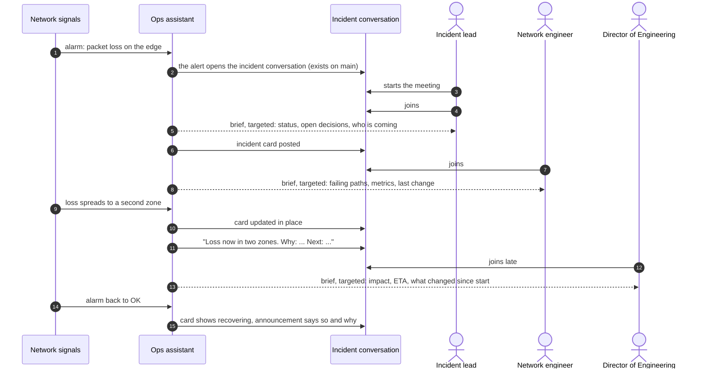
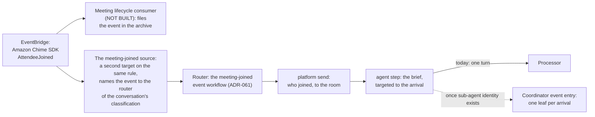
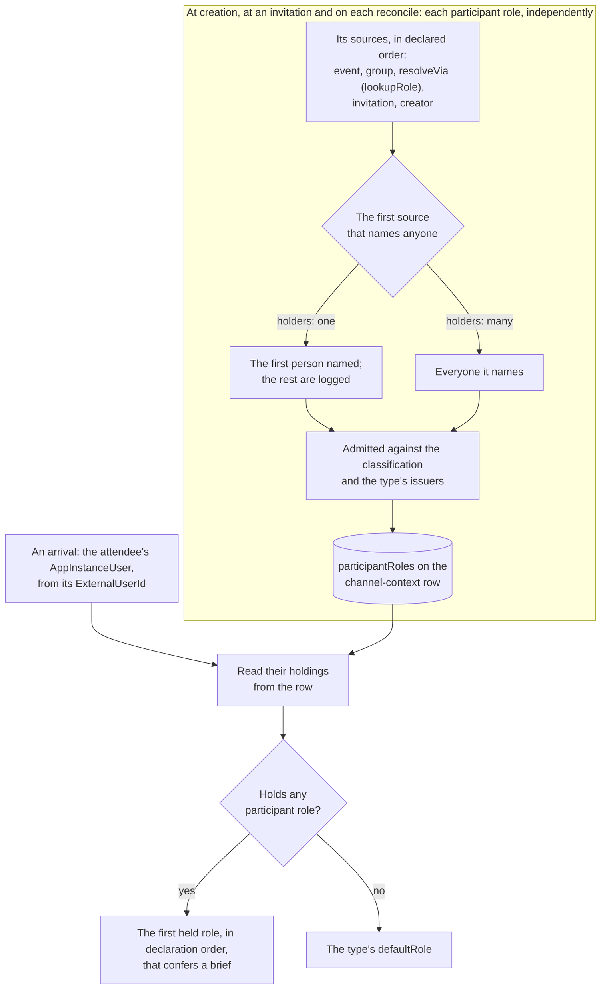
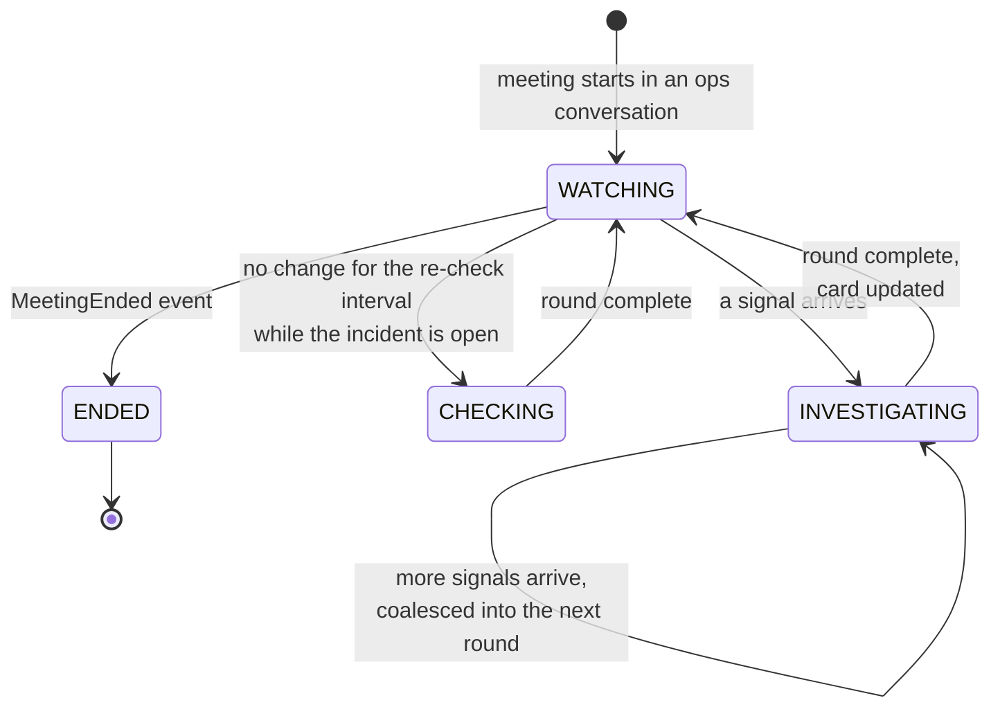
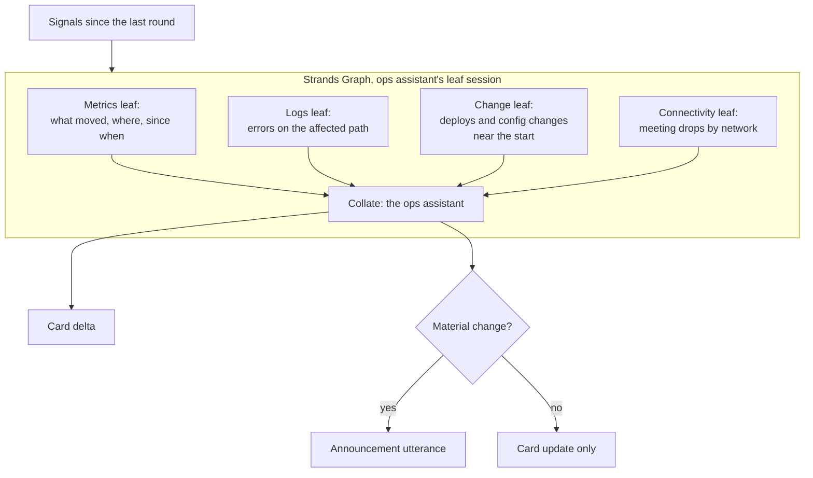
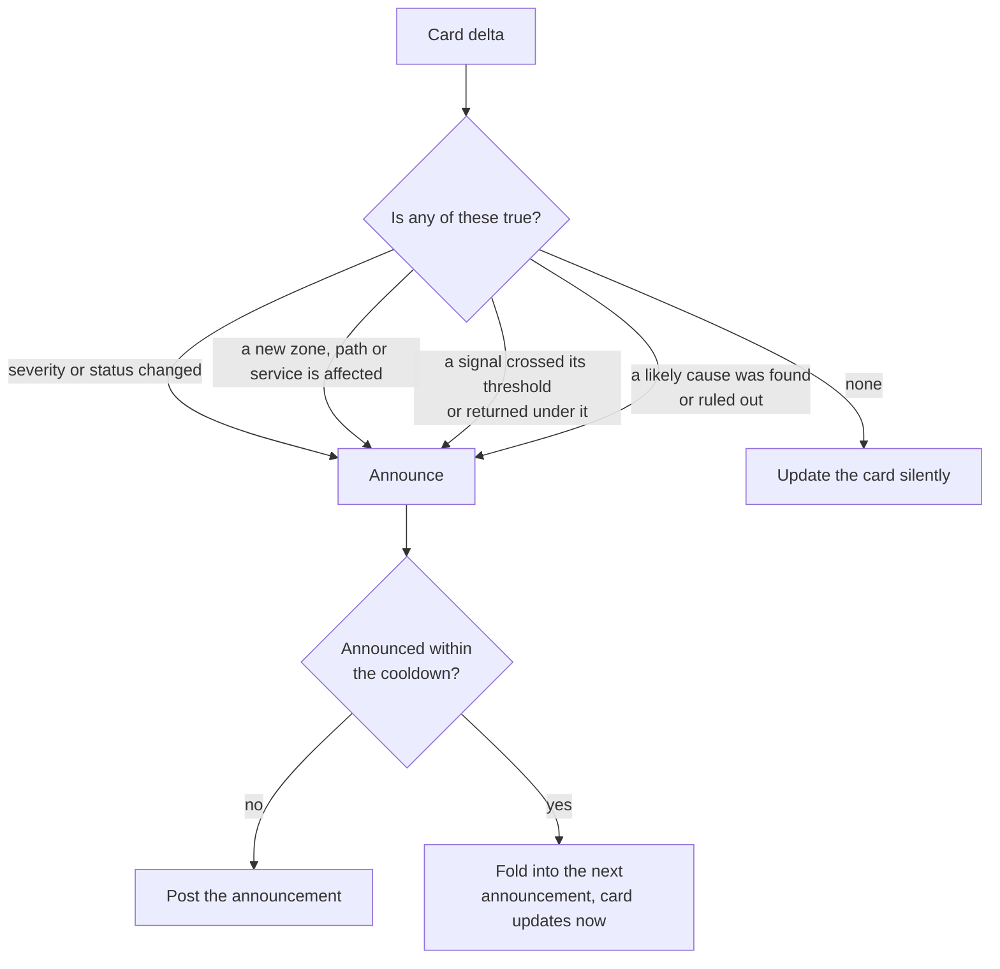
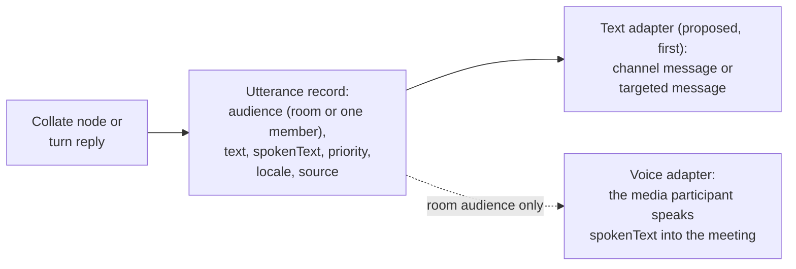
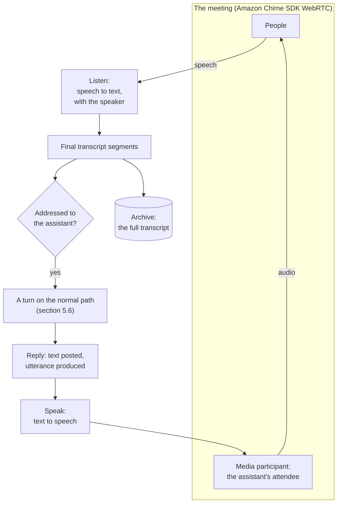
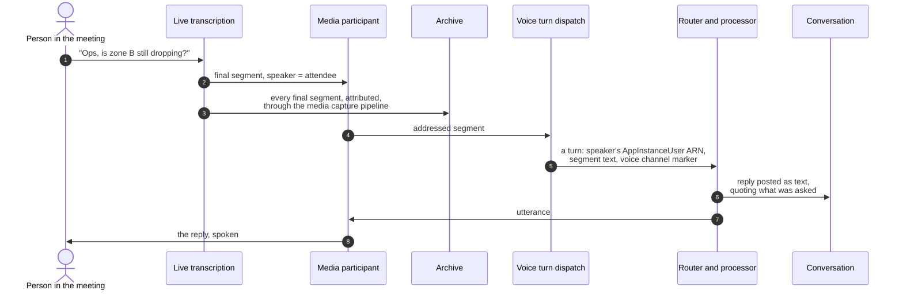
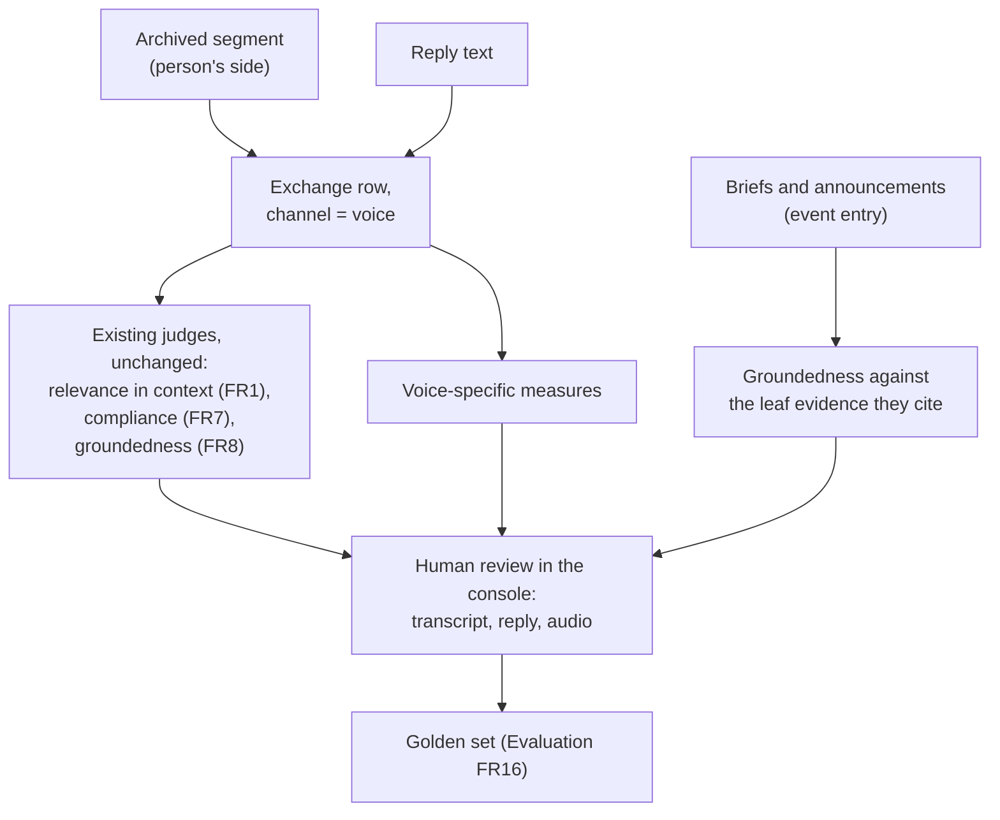

# DESIGN: Meeting sub-agents for onboarding and live incident work

**Status:** Partial. Two parts are built (ADR-061 slice 3e) and **NOT VERIFIED** on a deployment: the room's first look as an `incident_first_look` task (section 2) and the alarm state change as an ADR-061 event, `alarm-state-changed`, that starts the room's workflow in the ops room that watches the alarm (sections 4.1 and 4.2). Everything else is a draft design for review and **NOT BUILT**. The design for the meetings demo: sub-agents that onboard each person who joins a meeting with context for their role, and an ops assistant whose sub-agents investigate network signals, keep an incident card current and call out what changed in the meeting. Text first, with voice as a later adapter over the same output. Both flows start from [ADR-061](../../../design/decisions/061-a-welcome-is-a-workflow-an-event-starts.md)'s events, the platform's one event model, their model-driven work is that ADR's `agent` steps, and a person's role is the conversation type's ([DESIGN-CONVERSATION-TYPES.md](../conversation/DESIGN-CONVERSATION-TYPES.md) section 6.1).

**Coverage:** `tests/e2e/an-alarm-a-room-watches-starts-its-workflow.spec.ts` drives the built parts against a deployment (`npm run validate -- --only=incident-watch`): an ops event naming an alarm opens an `ops` room that records the watch, the first look opens an `incident_first_look` task that reaches `findings_shared`, a state change on the watched alarm posts the state and the re-read, and a change on an alarm no room watches posts nothing. It has not yet run against a deployment. The unit and synth tests are `backend/test/lib/an-event-step-opens-a-task-the-room-works-on.test.ts`, `backend/test/lib/an-alarm-a-room-watches-starts-its-workflow.test.ts` and `backend/test/the-incident-watch-reaches-only-its-own-router.test.ts`; the rest is a draft design with no behavior to drive.

**Related:** [DESIGN-MULTI-AGENT-STRANDS-RUNTIME.md](./DESIGN-MULTI-AGENT-STRANDS-RUNTIME.md) - the fan-out runtime both flows run on. [DESIGN-ASSISTANT-MEETINGS.md](./DESIGN-ASSISTANT-MEETINGS.md) and [SPEC-ASSISTANT-MEETINGS.md](./SPEC-ASSISTANT-MEETINGS.md) - the meetings assistant this demo is a slice of (FR4, FR5, FR11b, FR15, FR17, FR20).

**Site section:** Interaction layer, assistants.

> **Not built.** Everything below is a proposal. Where a section names existing code, it says so explicitly; every other component, table, tool, Lambda and test named here does not exist.

---

## 1. Overview

Two flows, one meeting.

| Flow | Trigger | Sub-agents | What the room sees |
|---|---|---|---|
| **Onboarding** | A person joins the meeting: ADR-061's `meeting-joined` | One leaf per arriving person: read their role, gather the context that role needs, draft a brief. Until per-person fan-out exists, one `agent` step turn per arrival | A brief only that person sees, from the assistant, within seconds of joining |
| **Incident watch** | A network signal changes while the meeting is live | One investigation round of parallel leaves: metrics, logs, recent changes, meeting connectivity | One incident card kept current in place, and a short announcement when something material changes, saying what and why |

Both run on the runtime in [DESIGN-MULTI-AGENT-STRANDS-RUNTIME.md](./DESIGN-MULTI-AGENT-STRANDS-RUNTIME.md): a Strands `Graph` of read-only leaves in the coordinator Lambda, with the assistant posting as itself. This document adds what the demo needs on top: the ADR-061 events each flow starts from, roles read from the conversation type, the incident card, the materiality rule for speaking up, and the utterance record that voice reads later. Per-person fan-out depends on sub-agent identity, which [SPEC-ASSISTANT-MEETINGS.md](./SPEC-ASSISTANT-MEETINGS.md) ("What Blocks This, In Order") lists as BLOCKED; until it exists each `agent` step runs as the room's assistant, one turn per run (ADR-061 decision 8). The runtime's proposal that a leaf needs no identity of its own (DESIGN-MULTI-AGENT-STRANDS-RUNTIME, decision D) is a recommendation, not an accepted answer.

**What is reused.** On main: an alert can open an `ops` conversation with the ops assistant in it (`typed-conversation-from-event.ts`). The ops assistant reads CloudWatch metrics and this deployment's alarm state on its own vended session through `read_deployment_health`; it reads no logs. Targeted messages, visible to one member, are posted the same way the private follow-up path posts them. In the Phase 1 meeting design, which is **NOT BUILT** in this codebase: a WebRTC meeting belongs to a conversation, and its lifecycle reaches the platform as Amazon Chime SDK events on EventBridge (arrivals, departures, drops and each attendee's network type), stored where the roster is a query over them. Gaps in that design: the events are written to Aurora only rather than to the archive first, and an attendee's person key is the token's `sub` claim, which equals the AppInstanceUser id only for a pool user, and the route's Cognito user-pool authorizer admits no caller from another issuer ([SPEC-ASSISTANT-MEETINGS.md](./SPEC-ASSISTANT-MEETINGS.md), "Phase 1 scope"). Both flows depend on that phase being built.

**Where incident content lives.** Incident content belongs in the ops room, an `ops` conversation whose audience is the `operations` classification. It is never posted into, and never targeted inside, a conversation that has members from outside that audience, such as a customer's room. The ops room links to the conversation it concerns by a resource tag on its own channel, and reads it under the declared grant from the `operations` classification to that conversation's classification. Nothing in either flow writes into the concerned room: a person posts any customer update there. The event creator on main posts nothing into the concerned room. **NOT BUILT:** the link tag and the declared grant; the event creator refuses a concerned room at another classification (`typed-conversation-from-event.ts:184`).

## 2. The demo, end to end

The story a viewer follows: nobody asks the assistant to catch them up, because each arrival is briefed for what they do. Nobody refreshes a dashboard, because the card in the room is the dashboard. And the room hears about a change once, with a reason, rather than seeing a number move silently.

**The room's first minute is ADR-061's `conversation-opened` workflow.** Once the alert has opened the room, the ops assistant posts an instant opening that mentions the lead (`participantRole:lead`, the person the alert named), greets the lead, and then runs an `agent` step: the runtime opens an `incident_first_look` task in the room before the turn (`openEventTask`, `event-task.ts`; owned by the assistant, visible to the conversation), the turn runs its first step, `reading_health`, with `read_deployment_health`, and once the turn posted what it found the task moves to `findings_shared`, where it rests as the room's work until someone asks for another read or says it is resolved ([ADR-061](../../../design/decisions/061-a-welcome-is-a-workflow-an-event-starts.md) decision 8, example a; the platform's `ops-room` workflow). Built and **NOT VERIFIED** on a deployment, unit-tested by `backend/test/lib/an-event-step-opens-a-task-the-room-works-on.test.ts`.

## 3. Flow 1: onboarding on join

### 3.1 Trigger

- **The event is the trigger** (tenet D6), and it is ADR-061's `meeting-joined`, not a trigger of this design's own. No poll of the roster. The existing lifecycle rule gains a second target, the event's one source, so the archive filing and the event workflow see the same event independently, and a failure of one does not stop the other. **NOT BUILT.**
- **Exactly once per arrival.** The event run's claim is keyed by the meeting, the person and the join's sequence (the lifecycle event's own id, ADR-061 decision 5), so a redelivered event does not brief twice and a rejoin is its own run. A rejoin after a drop arrives with `event:rejoin` set, and the workflow's edge `when: { event:rejoin: true }` takes it to a second `agent` step, which sends a one-line "welcome back, here is what changed while you were away" instead of the brief (ADR-061, example b).
- **Bounded.** Each run is metered against the deployment's global budget as the join recap is (ADR-061 decision 5), and SPEC-ASSISTANT-MEETINGS FR17 caps how many arrivals of one meeting run at once.
- **Arrivals batch only once fan-out exists.** With per-person fan-out, joins for the same meeting within a short window form one fan-out of several leaves, which is FR5's parallelism; the window is a coalescing delay on events that already arrived, not a timer looking for one. Until then each arrival is its own run and its own turn.
- **Which assistant briefs.** The conversation's primary assistant (`primaryAssistantOf`). In the demo's incident conversation that is to be confirmed against the `ops` type's roster (section 9); the recommendation is the ops assistant, since the brief's content is the incident.

### 3.2 Participant roles

**A participant role is the conversation type's, declared once in [DESIGN-CONVERSATION-TYPES.md](../conversation/DESIGN-CONVERSATION-TYPES.md) section 6.1** (SPEC-CONVERSATION-TYPES FR30), and the brief reads the holdings recorded for the person (`participant:role`, ADR-060). This design resolves no participant role itself. Each participant role resolves independently, from its own sources tried in order, and a person may hold several; the brief takes the first held role, in the type's declaration order, that confers a brief (`prompt: { fromRole: brief, else: role-brief }`).

The diagram reads in two halves: participant roles are resolved per role and recorded before anyone arrives, and an arrival only reads what was recorded for that person.

A participant role is read from records, never inferred from a person's name or from how they write. **OPEN:** mapping a user profile's title or team to a participant role through a role table is not one of the type's sources; whether it becomes one, a directory lookup declared through `resolveVia`, is open in DESIGN-CONVERSATION-TYPES section 6.1.

### 3.3 What each participant role is told

| Participant role | The brief carries | Sources a leaf reads |
|---|---|---|
| Lead | Status, severity, open decisions, who has joined and who is expected | The incident card, the roster query, the expected-attendee list |
| Network engineer | The failing paths and zones, the metrics that moved and when, the last change near the start | `read_deployment_health`, Logs Insights, the incident card timeline |
| Application on-call | Error rates and latency for the services on the affected path, recent deploys | Same tools, scoped to the services named on the card |
| Support lead | Customer-facing impact in plain terms, a holding statement to use | The incident card, company context for support |
| Director of Engineering | Impact, current estimate, the decisions that need a director, what changed since the meeting started | The incident card and its timeline |
| responder, the type's `defaultRole` | Why this meeting exists and the current status in two lines | The incident card |

Every brief also states **why this person is here**, from the invitation where one exists (FR4), and for a late arrival **what changed since the meeting began**, read from the card's timeline. Each row is a participant role the `ops` type declares, and the brief it confers (`confers.brief`, a prompt template, ADR-062) is what the `agent` step drafts that brief from.

### 3.4 Delivery

- **Targeted, as the assistant.** The collate node posts each brief with `Target: [{ MemberArn: <attendee> }]`, so only that person sees it. It is posted on the assistant's speak session, never by a leaf.
- **Context stays inside the room.** A brief carries only what the conversation's classification reaches. A person in the room is cleared for it by membership, so a participant role changes what is selected, never what is reachable.
- **Targeting is not an audience boundary.** A targeted brief narrows who sees a message among members who already share the conversation's audience. It never carries content the conversation's audience could not read, so in a room with members from outside it (a customer's room) an incident brief is never sent, targeted or not: the incident flow runs in the ops room.
- **A failed leaf still produces a brief.** The `agent` step's declared fallback: a `platform`-filled message template in the conversation's language, naming the meeting's purpose ([ADR-061](../../../design/decisions/061-a-welcome-is-a-workflow-an-event-starts.md) decision 8, [ADR-062](../../../design/decisions/062-a-message-is-a-template-stored-and-versioned-like-a-document.md)). Never silence.

## 4. Flow 2: the incident watch

### 4.1 Signals

| Source | How it arrives | Exists? |
|---|---|---|
| CloudWatch alarm state changes for the alarm an ops room watches | EventBridge `CloudWatch Alarm State Change` on the default bus | Built; **NOT VERIFIED** on a deployment. The room watches the alarm its opening event named (`watchesAlarm`; `send-ops-event.mjs --alarm`). The rule `IncidentWatchAlarmChanges` matches only this deployment's alarm name prefixes (`incidentWatchAlarmPrefixes`) and targets the router, which runs the room's `alarm-state-changed` workflow (section 4.2). A list of network alarms the deployment declares for the meeting is **NOT BUILT** |
| The meeting's own connectivity: drops and network type per attendee | The meeting lifecycle stream | **NOT BUILT** |
| Demo injector: scripted network events for a reproducible demo | EventBridge custom source, published by a script run by hand | No, not built. Every card and announcement driven by it is labeled **Simulated** |

The injector exists so the demo does not depend on breaking a real network. Its events take the same path as real ones and are marked at the source, and the label travels to everything they produce, so a simulated incident cannot be read as a real one.

### 4.2 Watch lifecycle

- **One round at a time per incident.** A signal during a round sets a pending flag on the watch record; the next round starts when the current one completes and includes everything that arrived. Signals are never dropped and rounds never overlap.
- **The one timer.** While an incident is open and nothing has changed, a single re-check is scheduled per interval. That is the absence of an event ("still degraded, nothing new"), which tenet D6 allows to be time-based. It is cancelled when the meeting ends.
- **No long-running agent.** Each round is a bounded fan-out on Lambda. Between rounds nothing runs, so an hour-long meeting needs no host that outlives Lambda's limit.
- **Which of these are ADR-061 events.** Decided: each is a platform addition to ADR-061's closed set with one declared source, so the watch keeps no path of its own. **The alarm state change is in the set and built** (**NOT VERIFIED** on a deployment): `alarm-state-changed`, whose one source is the CloudWatch alarm state change on the default bus. The canonical creator records the alarm a room watches (`watchedAlarm` on the room's context row and a watch record `watch#alarm#<name>`, the newest room for an alarm watching it). The router runs only when the watch record and the row both name the room, the room carries the classification's tag and is not archived, and the state it reads back from CloudWatch matches the event; it then runs the room primary's served version's workflow on the event, keyed by the alarm and the state's timestamp (`handleAlarmStateChanged`). `event:alarmName` and `event:alarmState` are platform trust (ADR-060). The platform's `incident-watch` workflow says the new state to the room (`incident-alarm-changed`) and then runs one `agent` step, `ops-incident-recheck`, that reads the deployment's health again and the room's recent messages and says what changed; a version copies it into its own `eventWorkflows`. Verified by `backend/test/lib/an-alarm-a-room-watches-starts-its-workflow.test.ts` and, for the IAM boundary, `backend/test/the-incident-watch-reaches-only-its-own-router.test.ts`. **NOT BUILT:** the watch starting on `meeting-started`, and the meeting ending (`MeetingEnded`) as an event, which wait on the meetings code landing on main; the re-check as a one-shot schedule created when a round completes, which needs investigation rounds; and a round as a fan-out of read-only leaves (one per specialty) at the coordinator's event entry (ADR-061 decision 8, rule 10), which waits on sub-agent identity (**BLOCKED**, SPEC-ASSISTANT-MEETINGS). Until then the built re-check is one turn of the room's assistant.

### 4.3 An investigation round

Each leaf returns findings with their evidence (metric, window, value, query) through `report_result`. The collate node turns them into a card delta and decides whether to speak. A leaf makes no claim the collate node cannot cite.

### 4.4 The incident card

The dashboard is **one channel message owned by the ops assistant and updated in place** with `UpdateChannelMessage`. It is the room's shared picture and it is where the meeting already is.

| Section | Content |
|---|---|
| Header | Severity, status (investigating, identified, mitigating, recovering, resolved), **Simulated** when the injector drove it |
| Impact | Affected zones, paths and services, in one line each |
| Signals | The three to five metrics that matter, each with its current value and change since the start |
| Timeline | The last five changes, newest first, each with its time and one-line reason |
| Next | What the assistant is checking next, and when the next re-check is due |

- **Text first.** The card's content is a compact text rendering that every client shows. A structured copy rides on the message for a richer card later (FR15), so the rendering can improve without the data changing.
- **History is free.** Each in-place update is an edit, and the archive keeps every prior version of an edited message (tenet D7). The card's full history is reconstructible from the archive, and the watch record holds only the current state and the timeline the card shows.
- **One card per incident**, pinned in the conversation. A new card is never posted per update.

### 4.5 Calling attention

An announcement has a fixed shape, so it reads the same whether it is read or heard:

1. **What changed**, in one sentence.
2. **Why the assistant thinks so**: the evidence, by name ("packet loss on edge zone B rose from 0.2 to 4 percent at 14:06").
3. **How sure**: "confirmed" only when a leaf's evidence shows it; otherwise "likely" with what would confirm it.
4. **What next**: what the assistant is checking, or the decision a person needs to make.

The rule is materiality plus a cooldown, so a flapping metric updates the card without filling the meeting with messages. The assistant speaks unprompted only into a conversation it is a member of, to members present, as itself (FR11b).

### 4.6 What it never does

- **No remediation.** A suggested rollback or restart is a proposal on the card that a person confirms (FR11). The watch has no write path to infrastructure.
- **No paging or email.** Bringing more people in is a person's action. The assistant may say who is missing from the expected list.
- **No claim beyond its evidence.** A cause is stated as likely until a leaf's finding confirms it, and the card shows which.

## 5. Voice, server-side

The selected design is server-side: the assistant is a participant in the meeting, heard by everyone, on the roster and in recordings. Client-side playback remains an option and is compared in section 5.3, but it is not selected. Text stays first: everything below is added beside the text path, and nothing is spoken that is not also posted.

### 5.1 The seam

- **One record, two renderings.** Every brief, announcement and spoken reply is an utterance with a text form and a spoken form: short sentences, no tables or markup, numbers said the way they are spoken. Voice changes delivery, not what the assistants decide.
- **The text is always posted.** The record in the conversation and the archive is the same with or without voice.
- **Targeted briefs stay text.** Meeting audio reaches everyone, so an utterance addressed to one member is never spoken.

### 5.2 What server-side voice is made of

Three parts, each with its own options: the **host** that keeps a media participant in the meeting, **listening** (speech to text with speaker attribution), and **speaking** (text to speech). One option replaces the last two with a single speech-to-speech model.

**The media participant is the media bridge.** It is the same component that brings a phone caller into a WebRTC meeting ([DESIGN-ASSISTANT-MEETINGS.md](./DESIGN-ASSISTANT-MEETINGS.md), C.2): a container that joins the meeting as WebRTC attendees, one per caller and one for the assistant's voice. Each of its attendees takes an identity it was handed, a call leg's AppInstanceUser id or the assistant's own, as its `ExternalUserId`, and none of them can post to or read the conversation: text is posted on the assistant's speak session (section 6). **OPEN:** how a server process joins an Amazon Chime SDK meeting as an attendee, a headless browser (H1 to H3 below) or a supported native SDK (H4).

**Why no media pipeline does this.** The Amazon Chime SDK media pipelines carry meeting media out of a meeting (capture to Amazon S3, media streams to Amazon Kinesis Video Streams, live connector to RTMP). None puts audio into one, so speaking requires an attendee.

### 5.3 Options by part

Prices are us-east-1 list prices as published in 2026 by AWS and third-party price trackers, recorded here to compare options. They are to be verified against the providers' own pricing pages before any commitment.

**Host for the media participant.** One attendee per live meeting, joined on `MeetingStarted` and removed on `MeetingEnded`. Every option also pays the attendee's own WebRTC minutes: **$0.0017 per attendee-minute, about $0.10 per meeting-hour**, which is the floor.

| Option | What it is | Approximate cost per meeting-hour, beyond the attendee | Trade-off |
|---|---|---|---|
| **H1. Headless browser on AWS Fargate, one task per meeting** | The Amazon Chime SDK client library in headless Chromium, 1 vCPU and 2 GB, Graviton | About $0.04 (Graviton: $0.03238 per vCPU-hour, $0.00356 per GB-hour) | The well-trodden path: the client library is the supported one, and per-meeting tasks isolate meetings from each other. Chromium is heavy for one audio stream |
| **H2. Headless browser on Amazon Bedrock AgentCore Runtime** | The same participant in an AgentCore session (up to eight hours) | About $0.16 ($0.1276 per vCPU-hour, $0.0169 per GB-hour) | Managed sessions and isolation built for agents; roughly four times H1 for the same work |
| **H3. Shared pool on Amazon EC2** | Several headless participants per Graviton instance, with a Savings Plan or Spot capacity | Below H1 at steady volume, by packing meetings per instance | Cheapest per meeting at scale; needs placement, draining and a scheduler, which is operations the platform does not run elsewhere |
| **H4. Native client** | The Amazon Chime SDK C++ signaling client with a WebRTC implementation, no browser | Lowest compute per meeting: many meetings per small task | Signaling only is provided; media, codecs and the WebRTC stack are the builder's to own. A large build for a cost that is already small next to listening |

**Listening.**

| Option | What it is | Approximate cost per meeting-hour | Trade-off |
|---|---|---|---|
| **L1. Amazon Chime SDK live transcription** | `StartMeetingTranscription` sends the meeting to Amazon Transcribe streaming; segments carry the speaking attendee and reach every attendee, including the media participant | One Transcribe stream for the meeting: published standard streaming rates range from $0.60 to $1.44 per hour across 2026 sources (to verify) | One stream regardless of attendee count, speaker attribution included, no extra infrastructure. Custom vocabulary and language identification are available |
| **L2. Media stream pipeline to Amazon Kinesis Video Streams, then Amazon Transcribe per attendee** | Individual attendee audio to Kinesis Video Streams, a consumer streams each to Transcribe | L1's rate multiplied by the number of speaking attendees, plus Kinesis Video Streams | Exact per-speaker audio and full control of the stream; cost grows with the room |
| **L3. Wake phrase on the host, then transcribe** | The media participant runs a small local keyword spotter on the mixed audio and opens a Transcribe stream only after "Ops" (or the assistant's name) | A small fraction of L1: only the seconds after a wake phrase | Cheapest way to answer spoken questions. There is no full transcript, so section 5.6's context and section 5.7's transcript-based evaluation lose most of their input |
| **L4. Speech-to-speech model** | Amazon Nova 2 Sonic hears the meeting and answers in speech, replacing L1 to L3 and S1 to S3 | Published at $3 per million speech input tokens and $12 per million speech output tokens, estimated by trackers at about $0.015 per minute of conversation | The most natural conversation: lowest latency, interruption handling, one model. It answers before the platform's output guardrail can see the words, and its loop is not the platform's turn loop, so guardrails, the ledger and evaluation would have to be rebuilt around it |

**Speaking.** Volume is small: ten announcements of about 200 characters is roughly 2,000 characters per meeting-hour, so voice quality, not price, decides this part.

| Option | Published price per million characters | About 2,000 characters | Trade-off |
|---|---|---|---|
| **S1. Amazon Polly neural** | $16 | $0.03 | AWS-native, called on the assistant's vended session, good quality |
| **S2. Amazon Polly generative** | $30 | $0.06 | Polly's most natural voices, same integration as S1 |
| **S3. ElevenLabs (Flash or Multilingual)** | $50 to $100 | $0.10 to $0.20 | Widely rated the most natural, with fast first audio on Flash. A third-party processor of meeting content, outside the AWS account and its IAM |
| **S4. Amazon Polly standard** | $4 | Under $0.01 | Cheapest, noticeably synthetic |

**Not selected: client-side playback.** Each person's chat client receives the utterance with its text message, fetches the synthesized audio and plays it locally beside the meeting audio.

| | Client-side playback |
|---|---|
| Cost per meeting-hour | Speaking only (S1 to S4). No host and no attendee for the assistant, so the $0.10 attendee floor and the host cost do not apply |
| Strengths | No new infrastructure and no long-running host. The only option where a targeted brief can be spoken and stay private, because it plays only on its person's client. Each person can mute the assistant without affecting anyone else |
| Why it is not selected | The assistant is not a participant: it is absent from the roster, absent from recordings and capture pipelines, and unheard by anyone not on a client. It cannot listen, so section 5.6 and the voice half of section 5.7 need a listener anyway. Playback timing differs per client, so the room does not hear the assistant at the same moment |
| When it would be the right choice | A deployment that wants spoken briefs privately to each person and needs neither recordings nor listening. It sits behind the same utterance seam, so it can be added beside the server-side adapter rather than instead of it |

**Ruled out.** Mixing synthesized audio into a person's microphone stream attributes the assistant's speech to that person. A SIP media application dialing into the meeting would have been the natural serverless option, but it belongs to Amazon Chime SDK PSTN Audio, which is being deprecated: in maintenance mode and closed to new accounts from 2026-10-29.

### 5.4 Three configurations, costed

Per meeting-hour, for the assistant's voice and listening only. The model's own turn costs are the platform's existing Bedrock costs and are the same in all three.

| | Cost savings | Recommended | Best in breed |
|---|---|---|---|
| Host | H1 on Graviton, or H3 at volume | H1 on Graviton | H2 |
| Listening | L3, wake phrase then transcribe | L1, Amazon Chime SDK live transcription | L1 with custom vocabulary, or L4 |
| Speaking | S1, Polly neural | S2, Polly generative | S3, or L4 |
| Attendee | $0.10 | $0.10 | $0.10 |
| Approximate total | **About $0.20** | **About $0.80 to $1.65** | **About $0.95 to $1.90 with L1; L4 priced per minute of conversation** |
| What it gives up | No full transcript, so no catch-up from what was said, and spoken turns are the only voice data evaluated | Nothing the demo needs | L4 gives up the platform's guardrail ordering and its single turn path; S3 sends meeting text to a third party |

**Where the money is.** Listening dominates every configuration that keeps a full transcript. The host and speaking are small next to it, so the real cost lever is how much of the meeting is transcribed, not which voice reads the output.

### 5.5 Recommendation

**H1 on Graviton, L1 live transcription, S2 Polly generative.** One Fargate task per live meeting runs the media participant; Amazon Chime SDK live transcription provides the full, speaker-attributed transcript; Polly generative speaks on the assistant's vended session through a new `speech` grant edge, in a voice the assistant's versioned profile names.

- **Why.** Every part is AWS-native and runs under the assistant's IAM, so voice adds no processor of meeting content outside the account. The full transcript is what makes section 5.6 and section 5.7 possible, which is the larger value of listening. And the output still passes the platform's output guardrail before it is spoken, which L4 cannot offer.
- **The savings path, when cost matters more than the transcript.** Move listening to L3 and speaking to S1. That is the change that moves the total, and it can be made per assistant.
- **The best-in-breed path, and its condition.** L4 (Nova 2 Sonic) when conversational feel matters most, on the condition that its text is guardrailed before it is voiced and its turns are written to the ledger. That condition is real work and a later decision, not a configuration change.
- **What does not change between configurations.** The utterance record, the rule that text is always posted, and the turn path in section 5.6.

### 5.6 Transcript to messages to responses

- **Every final segment goes to the archive**, attributed to the speaking attendee and through the attendee to the person: the meeting API sets each attendee's `ExternalUserId` to their AppInstanceUser id, so a segment carries an AppInstanceUser ARN and never a speaker label. The archive is fed from the media capture pipeline's transcription-message artifacts, never relayed by the media participant or any client; the media participant reads live segments only to find the addressed ones. That is the transcript of record, and it is what a late joiner's brief draws on for "what was said since you joined". **NOT BUILT:** in the Phase 1 design the attendee's `ExternalUserId` is the token's `sub` claim, which equals the AppInstanceUser id only for a pool user, and no transcription or capture pipeline exists.
- **Only addressed segments become turns.** A segment that names the assistant, or continues an exchange the assistant is in, is dispatched as a turn on the normal path: the router, the classifier, the turn lock, the Converse loop, the guardrails. A voice question is answered by the same machinery as a typed one.
- **Who posts the question.** The question appears in the conversation inside the assistant's reply, quoted and attributed ("Priya asked: is zone B still dropping?"), because the platform never posts as a person and the segment is the person's words rather than their message.

| Option for the question in the conversation | Effect | Decision |
|---|---|---|
| The assistant quotes it in its reply | One message per voice exchange, attributed correctly, no new identity | **Recommended** |
| A transcript identity posts every segment | The conversation becomes the full transcript, and an identity that is not a person or an assistant posts words people said | Not recommended: noise in the conversation, and a new identity kind |
| The person's own identity posts it | The platform would act as a human | Refused |

- **The exchange is still paired.** The ledger pairs the archived segment, as the person's side, with the assistant's reply, so a voice exchange is one row in `exchanges` like a typed one, marked with a `voice` channel and carrying the segment's transcription confidence.

### 5.7 Evaluation

- **A voice exchange is judged as any exchange is.** Because the spoken question becomes the person's side of an exchange, relevance in context, compliance against the assistant's rules and groundedness against what the answer was given apply with no new judge ([SPEC-EVALUATION](../quality/SPEC-EVALUATION.md) FR1, FR7, FR8). The judge reads the transcript text, never audio.
- **Voice-specific measures sit beside the verdict, not inside it.**

| Measure | Why |
|---|---|
| Transcription confidence of the person's side | A low-confidence question that was answered wrongly is a hearing failure, not a reasoning one. Verdicts are stratified by it, and the stratum's population is stated (Evaluation FR9) |
| Speech end to reply start | The latency a listener actually feels, recorded as its own figure rather than folded into the turn's |
| Missed address | A segment that named the assistant and produced no turn, found by sampling archived segments |
| False address | A turn started by a segment that was not addressed to the assistant |

- **Unprompted output is evaluated too.** A brief or announcement answers no person's message, so it is judged for groundedness against the leaf findings it cites, the evidence that section 4.5 requires each announcement to name. An announcement that claims more than its evidence is a groundedness failure regardless of how it sounded.
- **Review is where voice earns its keep.** The console's review of a voice exchange shows the transcript segment, the reply and a link to the meeting audio where it is captured, so a person can tell whether the assistant misheard or misjudged. A positively reviewed voice exchange enters the golden set like any other (Evaluation FR16), which is how a draft profile is measured against spoken questions before it activates (Evaluation FR17).
- **Not a new evaluation system.** Everything above adds rows and measures to the existing one. A speech-to-speech model (L4) would put the reply outside this path, which is the evaluation half of its condition in section 5.5.

### 5.8 Speaking rules

- **Room utterances only.** Targeted briefs are never spoken.
- **Transcription is announced.** The meeting states that it is transcribed when transcription starts, in the conversation's language, and the organizer can turn listening off for a meeting. Speaking does not require listening.
- **The cooldown applies to voice as it does to text.** One spoken announcement per cooldown, so a flapping signal is never read aloud repeatedly.
- **Spoken numbers are rounded and timed.** "About four percent loss in zone B since six past two", not a table read aloud.
- **Someone is speaking.** The media participant waits for a short pause in the meeting's active-speaker signal before speaking, up to a limit, and a person addressing it stops it mid-utterance.
- **Simulated is spoken.** An utterance driven by the demo injector begins with "Simulated", so a listener hears what a reader sees.

## 6. Security

- **Ops leaves read telemetry; onboarding leaves do not.** The ops leaf session's grant edges add `telemetry`, which the classification boundary already denies to any session whose role is not an observability role. An onboarding leaf session carries `context` and models only.
- **No leaf speaks.** Both flows' leaves run on a session with no channel messaging (runtime section 7). The card update, announcements and briefs are posted on the assistant's speak session by the collate node.
- **Targeting narrows within an audience, and never crosses one.** A role brief may mention things not every member of the ops room needs (for example a holding statement for support). It is targeted to the person it is for, and the archive records the target with the message, as it does for every targeted message. Incident content is posted only in the ops room, never into a conversation with members outside the `operations` classification's audience, and a reply or recap whose audience is wider than a brief's target never repeats it. History keeps a targeted message only for a reply addressed to one person who already sees it (`privateReaderOf`, `lib/async-processor-core.ts:1154`), so a public reply or a recap never reads a brief back.
- **Simulated is carried, not inferred.** The injector's events carry their source; the label is set from it at every hop and cannot be removed by a leaf or the model.
- **Voice runs as the assistant.** The media participant joins with an attendee created for the assistant by the meeting API, synthesizes on the assistant's vended session through the `speech` grant edge, and dispatches voice turns with the speaker's AppInstanceUser ARN, resolved from the speaking attendee's `ExternalUserId`, never from what was said. The media participant is the media bridge (section 5.2), and none of its attendees can post to or read the conversation.
- **The transcript is personal data.** Segments are archived under the conversation's classification with the conversation's retention, transcription is announced when it starts, and an organizer can turn listening off for a meeting.

## 7. Measurement

Each onboarding fan-out and each investigation round is a fan-out with leaf rows in the ledger (runtime section 8). The figures the demo can show, all derived from recorded events:

| Figure | Derived from |
|---|---|
| Time from join to brief | The `AttendeeJoined` event and the brief's message time |
| Briefs by role, and failed briefs | Leaf rows by role and status |
| Signal to card update | The signal's event time and the card edit's time |
| Announcements per incident, and how many changes each folded in | Announcement messages and the watch timeline |
| Cost per incident watched | Sum over the rounds' leaf rows |

## 8. Demo runbook

1. Create the incident conversation through the alert path, or let the injector's first event open it.
2. The incident commander starts the meeting from the conversation and joins: the brief and the card appear.
3. The network engineer joins: their brief names failing paths and the moving metrics.
4. Run the injector's "spread" step: the card updates and one announcement explains what changed and why.
5. The Director joins late: their brief summarizes impact and what changed since the start.
6. Run the injector's "recover" step: the card moves to recovering and the announcement says what evidence shows it.
7. End the meeting: the watch ends and the console shows the fan-outs, their leaves and their cost.

## 9. Decisions for review

| # | Decision | Recommendation |
|---|---|---|
| A | Who briefs in the incident conversation | The ops assistant, confirmed against the `ops` type's primary |
| B | Brief delivery | Targeted message, posted by the assistant, never by a leaf |
| C | Participant role source | The conversation type's declared participant roles (DESIGN-CONVERSATION-TYPES section 6.1), each resolved independently from its own sources (the invitation's recorded role, the opening event, a group, a connector's `lookupRole`, the creator) and recorded before anyone arrives; a member no source names holds the type's `defaultRole`. The profile-store role table is **OPEN** there |
| D | The dashboard | One pinned channel message updated in place, text first, structured copy for a later card |
| E | When to speak | Materiality rules plus a cooldown; card updates are silent |
| F | Event fan-outs and the turn lock | An investigation round or a brief does not take the conversation's turn lock (runtime section 3.1); people's questions are never queued behind a round |
| G | Demo signals | A labeled injector on the same event path as real signals |
| H | Voice | Server-side, selected: a media participant on AWS Fargate (Graviton), Amazon Chime SDK live transcription, Polly generative, with the cost-savings and best-in-breed paths in section 5.5. Client-side playback is a compared option, not selected (section 5.3) |
| I | Spoken questions | Every final segment archived; only addressed segments become turns on the normal path; the question appears quoted in the assistant's reply (section 5.6) |
| J | Evaluating voice | Voice exchanges go through the existing judges unchanged, with transcription confidence, speech-to-reply latency and address accuracy beside them; briefs and announcements judged for groundedness against their leaf evidence (section 5.7) |

## 10. Open questions

| Question | Why it is open |
|---|---|
| The `ops` type's primary assistant | The type names the advisor and the ops assistant; which is primary determines who briefs unless decision A overrides it |
| Cooldown and re-check intervals | Demo values are a judgment call; they belong in the assistant's versioned profile so they can be tuned without a deploy |
| Card size | A channel message has a content limit; the card's text rendering is budgeted to fit with room for the structured copy, and the overflow rule (drop oldest timeline rows) needs confirming against the limit |
| A person asks a question during a round | Answered by the normal turn path while the round runs; whether the answer should wait for the round's card update to avoid stating stale status |
| Polly voice per assistant | Whether the voice is a field of the assistant's versioned profile, beside its display name, and how it maps across languages |
| Media participant spike | Whether a headless participant receives live transcription events and can play audio reliably on a 1 vCPU, 2 GB Graviton task, measured before the host size and cost in section 5.4 are relied on |
| Price verification | Section 5.3 records published list prices from AWS and third-party trackers, which disagree on Amazon Transcribe streaming; they are confirmed against the providers' pricing pages before a configuration is chosen |
| Address detection | Whether "addressed" is a name match on the segment, a classifier over the segment and the recent transcript, or both, and what a missed address costs in a live incident |
| Role table ownership | Whether a title-to-role mapping exists at all, as a declared role source on the conversation type, and if so whether it is per assistant or per deployment (DESIGN-CONVERSATION-TYPES section 6.1) |

## Related Documents

- [DESIGN-MULTI-AGENT-STRANDS-RUNTIME.md](./DESIGN-MULTI-AGENT-STRANDS-RUNTIME.md) - the runtime both flows use
- [DESIGN-MULTI-AGENT-ORCHESTRATION.md](./DESIGN-MULTI-AGENT-ORCHESTRATION.md) - the fan-out mechanism and its decisions
- [DESIGN-ASSISTANT-MEETINGS.md](./DESIGN-ASSISTANT-MEETINGS.md) and [SPEC-ASSISTANT-MEETINGS.md](./SPEC-ASSISTANT-MEETINGS.md) - the meetings assistant and its requirements
- [ADR-061](../../../design/decisions/061-a-welcome-is-a-workflow-an-event-starts.md) - the events both flows start from, and the `agent` step
- [DESIGN-CONVERSATION-TYPES.md](../conversation/DESIGN-CONVERSATION-TYPES.md) section 6.1 - the participant roles a brief reads
- [ADR-033](../../../design/decisions/033-a-conversation-answers-one-turn-at-a-time.md) - the turn lock decision F leaves to people's turns
