# DESIGN: Multi-Agent Orchestration

**Status:** Design (alignment doc), not scheduled - the backend swarm is not being built yet (owner, 2026-09-19). This proposes a structure and a set of explicit decisions to confirm. Every "Recommendation" below is a starting position, not a committed design, and Decision 2 (sub-agent identity) is an OPEN question rather than a recommendation - the identity mechanism this doc originally leaned on no longer exists in the form it assumed. Nothing here should be read as ready to build.

**Coverage:** none - an alignment document proposing a structure; no code implements it yet.

**Related:** [DESIGN-MULTI-ASSISTANT-TURN-ENGINE.md](./DESIGN-MULTI-ASSISTANT-TURN-ENGINE.md) - the peer turn-taking engine, which shares this document's identity question. [DESIGN-SEPARATE-ASSISTANTS-AND-DELEGATION.md](./DESIGN-SEPARATE-ASSISTANTS-AND-DELEGATION.md) - what an assistant role and its alt now are, which is why Decision 2 reopened. [SPEC-ASSISTANT-MEETINGS.md](./SPEC-ASSISTANT-MEETINGS.md) and [DESIGN-ASSISTANT-MEETINGS.md](./DESIGN-ASSISTANT-MEETINGS.md) - the first consuming application. This document owns the mechanism only.

**Site section:** Interaction layer, assistants.

---

## 1. What this owns, and what it does not

The fan-out **mechanism** is a platform capability: spawning ephemeral sub-agents, whatever acting identity they are given, their lifecycle and bounds, and the orchestration layer above them. The fan-out **configuration** is assistant configuration and lives with the assistant.

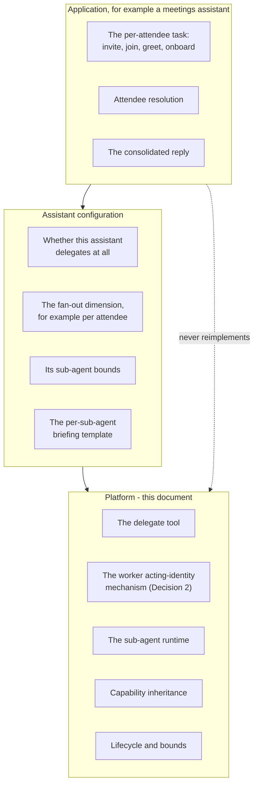

This is the split the platform draws elsewhere: for battle, fanning out to two is platform while the variant an experiment arms is configuration; for the Converse loop, the runtime is platform while the tools an assistant exposes are configuration.

**Summary of the proposal:** give one assistant the ability to spin up N short-lived sub-agents, each with its own task and some channel-acting identity, coordinated by an orchestrator that runs on top of today's single-assistant Converse loop. The candidate integration point is the AWS Strands Agents SDK as an orchestration layer rather than a replacement runtime.

## 2. The motivating shape

Somebody asks their assistant to "set up the Thursday design review with Priya, Marco, and Dana." Per attendee the assistant has to look the person up, invite or add them to a channel, greet them, and explain why they were added.

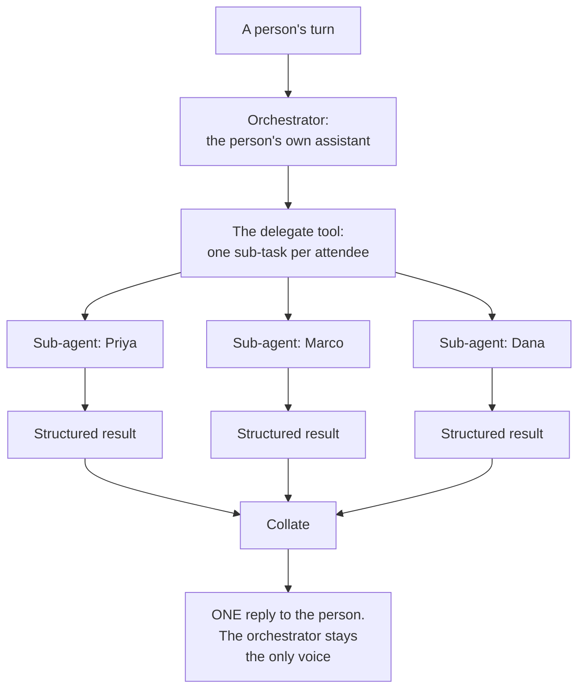

Each sub-agent runs a short invite, join, greet, onboard sequence, reports back, and is gone. The shape recurs beyond meetings: bulk onboarding, multi-party support triage, any fan-out-then-collate task. This document specifies the reusable primitive; the meetings assistant is its first application.

**Boundary with [ADR-030](../../../design/decisions/030-a-message-is-answered-by-the-assistant-whose-work-it-answers.md).** Two different multi-assistant situations exist and only one is here.

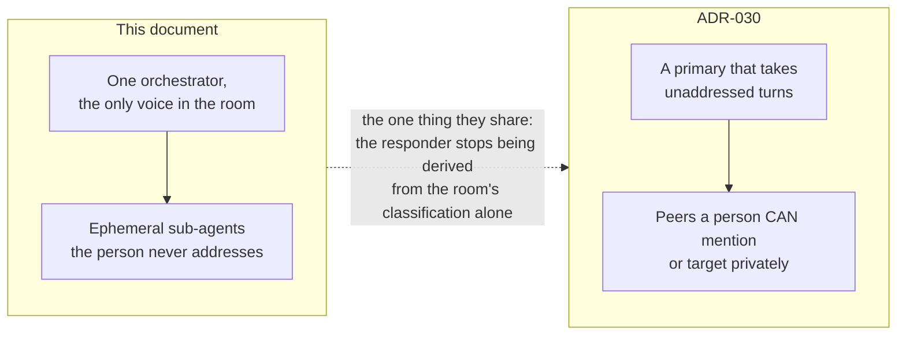

## 3. The gap

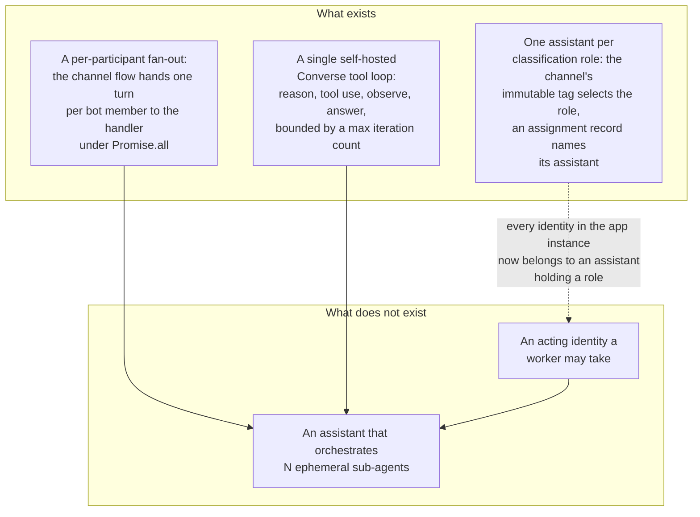

Two of the three pieces exist. The fan-out machinery does, and so does the single-agent runtime. The third, an acting identity a worker may take, does **not**: every identity in the app instance belongs to an assistant holding a role. That is a missing piece rather than a composition problem, and it is Decision 2.

**The alt assistant is not a pool to borrow from.** Each conversational classification has its own alt, tagged with that classification, because a cross-classification principal is the shape [ADR-042](../../../design/decisions/042-an-assistant-acts-in-exactly-one-classification.md) refuses. [DESIGN-SEPARATE-ASSISTANTS-AND-DELEGATION](./DESIGN-SEPARATE-ASSISTANTS-AND-DELEGATION.md) takes it the rest of the way: an alt is an ordinary assistant holding an alt role, and a battle activation derives its profile version from the live assistant plus the variant delta. So there is no anonymous identity sitting spare for a sub-agent to borrow.

## 4. Recommended structure

The **orchestrator** is the person's existing assistant, running the single-assistant loop, with one new tool added: a delegate tool that takes a list of sub-tasks and fans them out. It stays the single voice. Each **sub-agent** is an ephemeral worker - a scoped system prompt plus a small task - that runs, acts in the channel, returns a structured result, and is discarded. It holds no durable state; the orchestrator owns the collation.

**How Strands expresses it.** The AWS Strands Agents SDK is open-source, model-driven, code-first and model-agnostic over Bedrock, which matches the self-hosted-loop posture. Its multi-agent primitives map onto three different shapes of problem.

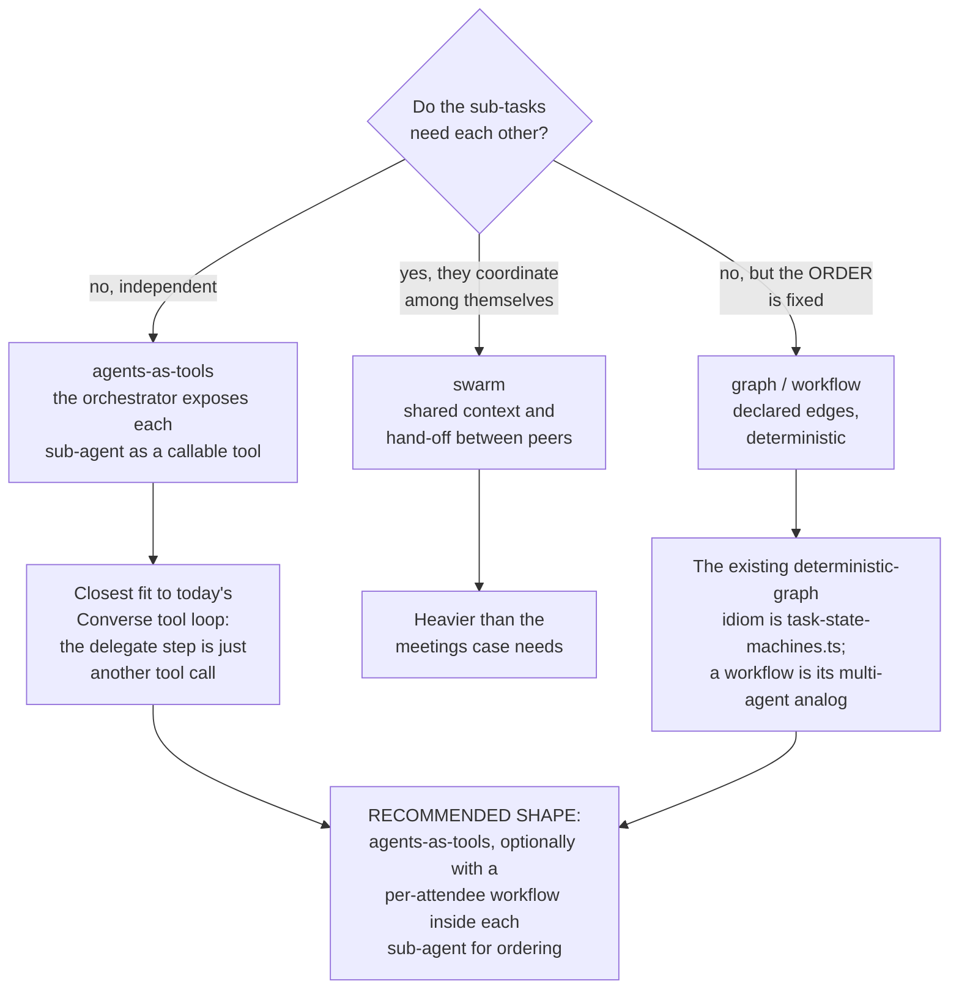

**How a sub-agent gets an identity to act in a channel is unresolved, and it is the blocking question.** A sub-agent that posts, invites or greets must act as an Amazon Chime SDK principal, and no identity kind fits one. Borrowing an alt is not an answer, for the reasons in Decision 2. Two things are settled: a bot is not minted per attendee on the turn path, and a sub-agent never acts as a human. Everything else is Decision 2, and the concurrency bound follows from whichever answer is chosen rather than from a pool size.

## 5. Message and turn flow

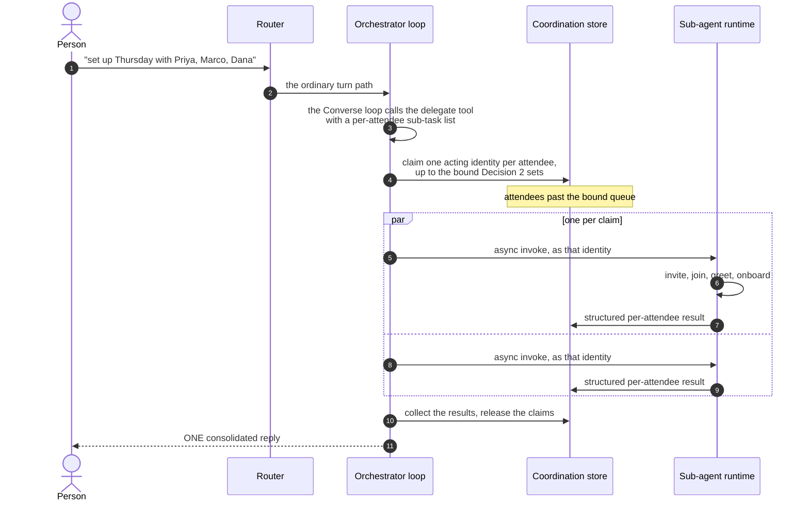

**Steps 4 through 8 are written against an identity mechanism that does not exist, so they describe the intended shape rather than a buildable sequence.** The fan-out shape itself is the one the channel flow already uses: `Promise.all` over a per-participant dispatch. The two flavors differ, and the choice is not incidental - round-1 battle hands each side to the handler synchronously so the handler makes its ordinary decisions, while the battle orchestrator's round-2 dispatch is an asynchronous event invoke straight to the worker. A delegate fan-out wants the second flavor, because the orchestrator is not waiting inline on a Lex response, and it therefore inherits the obligation the orchestrator carries there: supplying everything the handler would have decided.

## 5a. What a fan-out owes the ledger, and how the console shows it

**This is a precondition, not a follow-up.** The fan-out is not buildable until a sub-agent's model call has somewhere to be recorded. Attribution retrofitted after the fact does not backfill: the platform has already produced 149 exchanges carrying `unknown` model and `unknown` intent because a declaration arrived later than the rows it described, and those rows were not recoverable from the out-of-band store because they had never been in it. A fan-out generates the same shape of row at several times the rate.

### 5a.1 Why the current ledger cannot hold it

**The ledger's unit is the turn, and its model fields are scalars rather than accumulators.** One `exchanges` row per user message and answer, carrying one `modelId`, one `inputTokens`, one `outputTokens`, one `assistant` and one `profile_version`. That shape is correct for a single assistant answering once, which is every turn the platform runs today.

A fan-out puts N model calls inside one turn, so each of those fields is asked to describe several things at once:

| Field | What a fan-out does to it |
|---|---|
| `modelId` | A fan-out whose leaves use different models has no representation. The column names one model for a turn that used three |
| `inputTokens`, `outputTokens` | Either the leaves overwrite each other or they are summed under whichever model the orchestrator names. **Cost attribution stops meaning what it says, and the bill is where it surfaces** |
| `model_ms`, `tool_ms` | Both nest inside `latency_ms`. A parallel fan-out makes the sum of its parts exceed the wall clock it sits in, so the leg stops reconciling and the reconciliation is what makes the number trustworthy |
| the evaluation verdict | Scoring is per exchange and per intent. A fan-out produces one exchange, so the verdict judges the composite and a bad leaf is invisible unless it ruins the answer |

**The failure mode is a confident wrong number, not a missing one**, which is the harder kind to notice. A turn that spent four model calls and reports one is not obviously broken from any surface.

### 5a.2 The shape, which already exists for duels

A duel is the structurally identical problem solved once: one user message, two assistants answering, measured without either disappearing. What made it work was not a new analytics surface but three properties worth copying exactly.

1. **A shared identifier is a real indexed column, not a JSONB field.** `battle_id` and `battle_round` were lifted out of JSONB precisely so a duel is joinable. A fan-out wants the same: a turn-scoped fan-out id that every leaf carries.
2. **One row per participant, each with its own model and tokens.** The leaf is the row. Nothing is summed at write time.
3. **The parent's totals are DERIVED by summation, never asserted.** This is the property that makes the console drill honest, and it is the one most easily lost: if the turn's token total is written independently of its leaves, the two disagree the first time a leaf fails and nothing reports it.

A fan-out leaf is not an assistant, and this document already says so: it is ephemeral, never addressed, has no versioned behavior, and exists only inside one turn. So a leaf row is a **third kind of row**, keyed to its turn, not an `exchanges` row with a borrowed assistant. Giving it an assistant would put a worker into every per-assistant rollup and break the one dimension the console is built on.

### 5a.3 The console: a fan-out is a child of the turn

**The rule the console already enforces, and this must obey it:** a leg is only shown inside the metric it decomposes, and it sums to that metric by construction. The Router-leg table sums to `router_ms` because `router_ms` is defined as its parts. A fan-out drill is the same discipline one level down.

So a turn that fanned out renders as **one row with a child indicator**, not as N rows in the turn list. The turn keeps its place in every existing view, with its totals being the sums of its leaves, and the fan-out is reached by opening it.

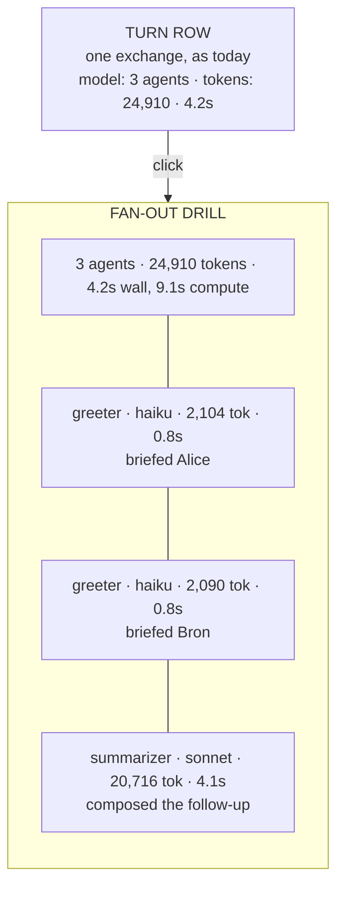

**What the drill states, and why each is there:**

- **How many agents ran**, which is the number a reader wants first and the one no current surface could answer.
- **Tokens per leaf, and the sum**, because cost is the reason anyone opens this. The sum must equal the turn's figure or the drill has disproved its own parent.
- **The model per leaf**, since a fan-out mixing an expensive model into a cheap pattern is exactly the thing worth catching, and it is invisible from the turn row.
- **Wall clock against total compute**, stated as two numbers rather than one. A parallel fan-out taking 4.2 seconds of wall time and 9.1 seconds of compute is working correctly, and a single `latency` figure makes that look like either a stall or a miracle depending on which one it reports.
- **What each leaf did**, in one line, because a token count with no task attached tells a reader that something was expensive and not what to do about it.
- **Any leaf that failed**, as a row rather than an absence. A fan-out of three that reports two is indistinguishable from a fan-out of two unless the third is present and marked.

**Where it hangs.** The fan-out drill belongs under the turn in the conversation and turn views, not as a tab of its own. A fan-out is not a thing an operator goes looking for; it is something they discover while asking why a turn was slow or expensive, which is the same path the latency legs are already reached by.

**One thing the drill must not do.** It must not become the place sub-agent behavior is evaluated. Quality is judged per exchange and per intent, and a leaf has neither. If a leaf's output needs judging, that is an argument for the leaf being a real assistant with a profile, which is decision 2 and is reopened.

## 6. Decisions to confirm

Each decision carries a recommendation, the reasoning and the tradeoff. None is committed; this section is the point of the document.

### 1. Strands scope: orchestration layer versus full runtime

- **Recommendation:** adopt Strands as an **orchestration layer on top of** the existing Converse loop. The orchestrator uses Strands to plan and fan out; each leaf sub-agent still runs the hand-rolled loop, or a thin Strands agent wrapping the same Converse call.
- **Rationale:** incremental. The single-assistant loop is load-bearing and carries a lot of hard-won behavior: prompt caching, guardrail in and out, work-item proposals, task tools, battle mode, metadata shedding. Wrapping it preserves all of that and limits the new surface to coordination.
- **Tradeoff:** two runtime idioms coexist for a while. Strands as the full runtime is cleaner long-term but is a rewrite that re-validates every existing behavior, and the meetings case alone does not justify it.
- **What Strands would actually add, narrowed** (owner review, 2026-09-19). Its single-agent surface - a Converse loop, tool calling, session state, streaming, Bedrock Guardrails, model portability - is the part the platform already has and has fitted to itself: guardrail in and out, control-marker stripping, work-item proposals, prompt caching, classification-scoped tools. Adopting it there is a rewrite that buys parity. The genuine delta is the multi-agent layer in section 4: agents-as-tools, swarm and graph are coordination patterns this codebase has no equivalent of. So the case for Strands rests entirely on the fan-out being built, and the fan-out is blocked on Decision 2. That ordering is why this document is not scheduled.

### 2. Sub-agent identity: REOPENED - the pool this recommended is gone

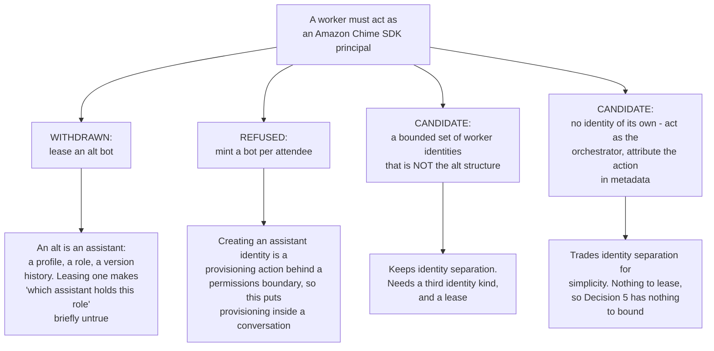

- **Status: OPEN.** Leasing alt identities is not an option, because each alt belongs to a role and a classification (section 3) rather than to a shared pool.
- **Why that closes the door rather than narrowing it.** A borrowed identity would need to be persona-less and freely borrowable, and an alt is neither.
- **So a sub-agent identity is probably a THIRD kind.** A user-facing assistant is addressable, has a profile and a role, and is measured. A backend worker is none of those: ephemeral, never addressed, no versioned behavior, existing only inside one turn's fan-out. Pretending it is an assistant is what leasing an alt would do.
- **Not being built yet** (owner, 2026-09-19), so this stays a named open decision rather than a recommendation that reads as settled. Every other decision here either follows from it or is independent of it, and the ones that follow say so.

### 3. Runtime: Lambda versus a longer-running host

- **Recommendation:** run sub-agents on **Lambda**, on the same async-processor substrate. The invite, greet and onboard tasks are short and the 15-minute cap is comfortable.
- **Rationale:** no new infrastructure, reuses the existing async fan-out, inherits the existing IAM and observability (tenet D8).
- **Tradeoff:** the 15-minute cap rules out a sub-agent that **sits in a live meeting** for an hour. That is a different workload needing a long-running host, explicitly out of scope, and wanting it later is a separate runtime decision rather than a reason to reject Lambda for the short-task fan-out the meetings case actually needs.

### 4. Capability inheritance: a sub-agent reaches nothing the parent does not

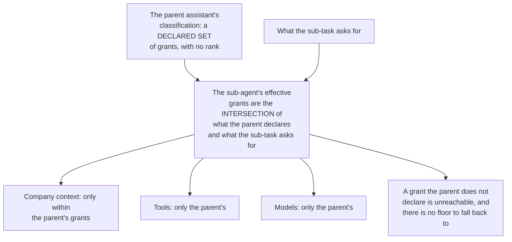

- **Recommendation:** a sub-agent **inherits the parent assistant's classification and reaches nothing outside it**. Its effective grants are the intersection of what the parent's classification declares and what the sub-task asks for. It cannot read company context, call a tool or reach a model the parent could not.
- **Rationale:** classification is the platform's authorization axis, and it is the only closed one IAM evaluates. **A classification is a declared set of grants rather than a ladder** ([ADR-046](../../../design/decisions/046-classifications-are-a-set-not-a-ladder.md)): there is no rank to compare, so "inherit" means "reaches exactly what the parent's set declares" rather than "somewhere at or under a level". If a sub-agent could reach outside that set, delegation would become an escalation path around the immutable classification tag.
- **Tradeoff:** a sub-agent cannot be handed a grant the parent lacks for one step even where that would be convenient. That is the correct default; a genuine cross-classification need is a separate, explicitly authorized flow rather than an implicit consequence of spawning.

### 5. Lifecycle and bounds

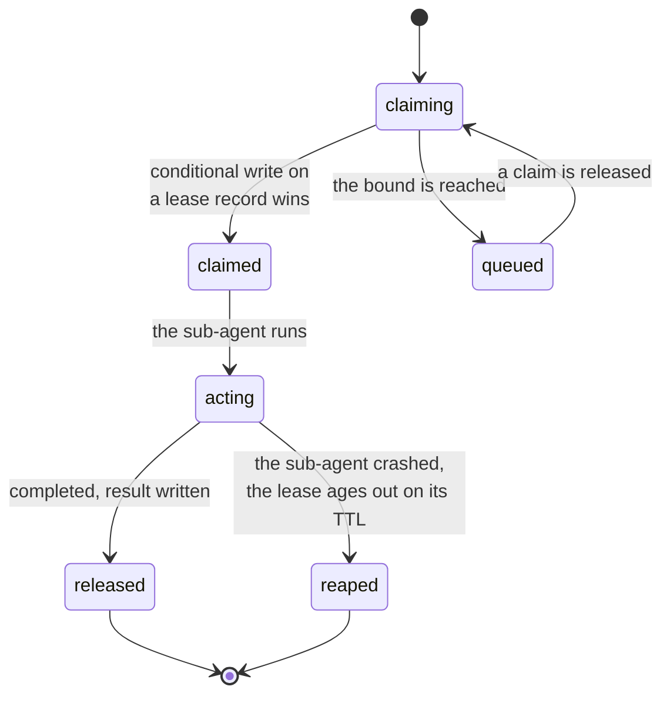

- **Max concurrency:** a fixed per-turn bound, whose value is whatever Decision 2 makes the scarce resource. It was the alt pool size; with no pool to borrow from, the bound is a property of the worker-identity mechanism and has no number until that is chosen.
- **Claim and release:** a sub-agent claims its acting identity atomically, by conditional write on a lease record keyed by identity, mirroring the battle-state idiom, and releases on completion. A crashed sub-agent's lease ages out on a TTL, so a lost identity self-heals. This shape survives Decision 2, because leasing a scarce identity is the same problem whichever kind of identity it is, but it is moot if Decision 2 lands on sub-agents acting as the orchestrator, because then there is nothing to lease.
- **Failure and timeout:** one sub-agent failing does not fail the batch.
- **Cleanup:** claims are released and transient coordination rows age out. No durable per-sub-agent state persists past the turn.
- **Recommendation:** ship the bounded, TTL-reaped, fail-soft lifecycle above, and no durable sub-agent registry.

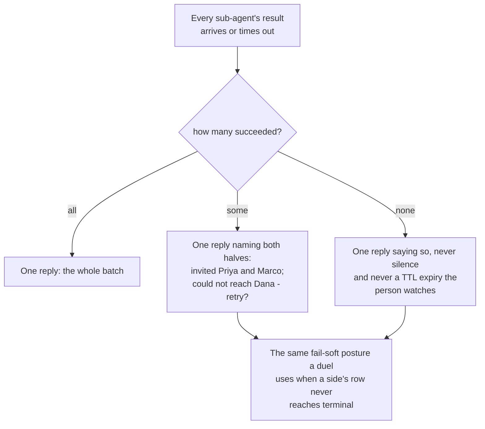

## 7. How applications build on it

The primitive is an orchestrator, a delegate tool, a bounded way for a worker to act in a channel, and a fan-out-then-collate lifecycle. Section 1's diagram is the boundary; the rule that keeps it crisp is that an application declares *what* each sub-task is and the platform decides *how* it runs. A second application - bulk onboarding, support triage - reuses the same primitive with a different per-sub-agent task and no platform change. An assistant declares its delegation configuration as assistant configuration and consumes this capability; it does not grow an orchestrator of its own, because a second orchestrator is a second thing to keep correct (tenet D8).

## 8. Security and IAM

- **Bearer pinning.** A sub-agent must act as one identity and never as a human. An assistant session's bearer is pinned by IAM to the bot it was minted for (`.../bot/${aws:PrincipalTag/bot}`, `assistantActingRole` in `backend/lib/stacks/agent-classification-common.ts`), and the bot's own `classification` tag must match as a second layer ([SPEC-CREDENTIAL-EXCHANGE](../governance/SPEC-CREDENTIAL-EXCHANGE.md) §4a). Whatever identity a sub-agent ends up with must be vended the same way to carry that pin.
- **Capability scoping.** A sub-agent's effective grants are the intersection in Decision 4, and company context, tool availability and model choice are each bounded by the parent's classification-scoped IAM as well as by the tool config, which is the second enforcement layer tenet D3 asks for.
- **Identity boundary.** Sub-agents act on the assistant plane, never the admin plane. Nothing here touches the per-human administration identity or the admin vend plane; delegation is an assistant-runtime concern rather than an administrative one.
- **Injection defense.** The existing input and output guardrails and control-marker stripping apply to each sub-agent turn exactly as they do to a normal turn, so a malicious attendee name or onboarding string cannot break out of a sub-agent prompt any more than it can today.
- **Bounded blast radius.** The concurrency bound caps how many principals one turn can put in motion, which is also the cost bound. Until Decision 2 names what is scarce there is no bound, so an unbounded fan-out is the failure mode to design against rather than a risk to note.

## 9. Testing strategy

- **Unit:** the delegate tool's fan-out planning, from task list to claims to waves; lease claim and release with the conditional write and the TTL; the capability intersection in Decision 4; and result collation including partial failure. These are pure-logic seams testable without AWS, mirroring the existing battle unit tests under `backend/test/lib/`.
- **Integration:** orchestrator to N sub-agents against a stubbed Amazon Chime SDK and Bedrock, asserting that each sub-agent acts as exactly the identity it was given and releases it, and that a crashed sub-agent's lease reaps.
- **End-to-end:** a meetings-setup flow driving invite and greet for two or three attendees, asserting the consolidated reply.
- **Deferred:** long-running-host sub-agents; fan-outs wider than the concurrency bound under real load; cross-classification delegation.
- **Blocked on Decision 2:** every assertion above about *which* identity a sub-agent acts as. Those tests cannot be written against a mechanism that has not been chosen.

## 10. Open technical questions

| Question | Why it is open |
|---|---|
| What a worker identity IS (Decision 2, and it gates the rest) | A bounded set of non-addressable worker identities that is not the alt structure, or no identity of its own at all. Contention with `/battle` does not arise, since an alt belongs to a role and is not available to borrow, so the question is what kind of principal a thing with no profile and no role gets to be |
| Orchestrator wait model | Whether the orchestrator polls the coordination store for results or sub-agents call back and wake it. Polling is simplest on Lambda; a callback avoids the spin but needs a resume path. The same question is open for the turn engine's phase barrier, and the two should be answered together (tenet D9) |
| Where the delegate tool lives | A new tool in the Converse loop's tool config, uniform with the company-context and task tools, versus a distinct orchestration entry point wrapping the loop |
| Strands packaging on Lambda | SDK size, cold-start cost, and whether the leaf sub-agent adopts a thin Strands agent or keeps the hand-rolled Converse call |
| Sub-agent visibility in the channel | Whether each attendee sees the sub-agent's greeting as a distinct named member, or the orchestrator relays. Partly a product choice for the consuming application, and it constrains Decision 2: a sub-agent the room can see needs a name and an identity of its own, and one that relays does not |
| Result schema | The structured per-sub-task result contract the orchestrator collates - status, artifacts, error - needs a stable shape so several applications can reuse it |

## Related Documents

- [DESIGN-MULTI-AGENT-STRANDS-RUNTIME.md](./DESIGN-MULTI-AGENT-STRANDS-RUNTIME.md) - the runtime this mechanism runs on: Strands, the coordinator, leaf rules, IAM and ledger
- [DESIGN-MULTI-ASSISTANT-TURN-ENGINE.md](./DESIGN-MULTI-ASSISTANT-TURN-ENGINE.md) - peer turn-taking, and the same identity question from the other side
- [DESIGN-SEPARATE-ASSISTANTS-AND-DELEGATION.md](./DESIGN-SEPARATE-ASSISTANTS-AND-DELEGATION.md) - what an assistant role and its alt are, which is why Decision 2 reopened
- [SPEC-ASSISTANT-MEETINGS.md](./SPEC-ASSISTANT-MEETINGS.md) - the first consuming application's requirements
- [DESIGN-ASSISTANT-MEETINGS.md](./DESIGN-ASSISTANT-MEETINGS.md) - the per-attendee task this primitive would run
- [ADR-030](../../../design/decisions/030-a-message-is-answered-by-the-assistant-whose-work-it-answers.md) - the other multi-assistant case, which this document does not own
- [ADR-042](../../../design/decisions/042-an-assistant-acts-in-exactly-one-classification.md) - why a cross-classification principal is refused
- [ADR-046](../../../design/decisions/046-classifications-are-a-set-not-a-ladder.md) - a classification is a declared set of grants, which is what Decision 4 inherits
- [ADR-048](../../../design/decisions/048-an-assistant-is-not-a-classification.md) - creating an assistant is a lifecycle event, and per-invocation creation is what stays refused
- [SPEC-CREDENTIAL-EXCHANGE.md](../governance/SPEC-CREDENTIAL-EXCHANGE.md) - the bearer pin section 8 depends on
- [DESIGN-BATTLE.md](../quality/DESIGN-BATTLE.md) - the conditional-write and TTL idioms Decision 5 mirrors
