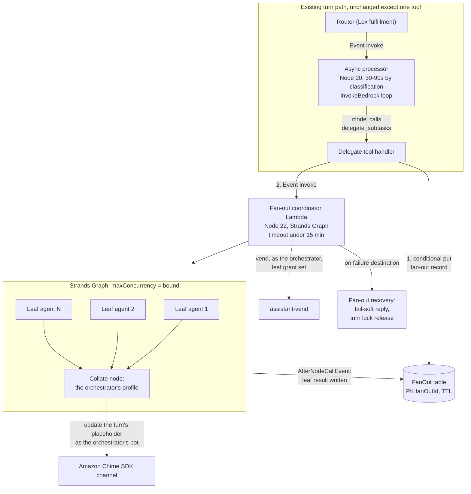
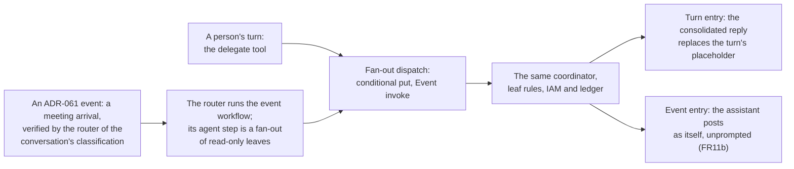
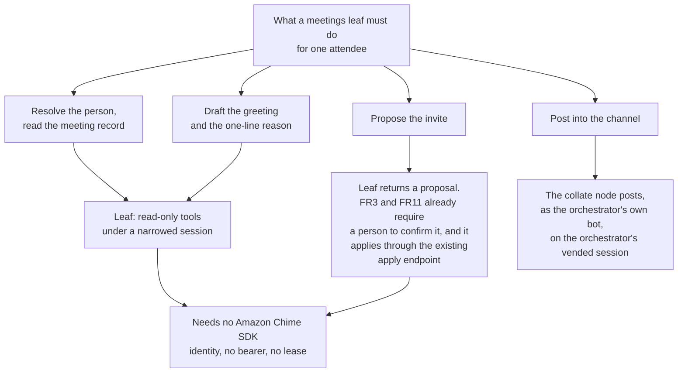
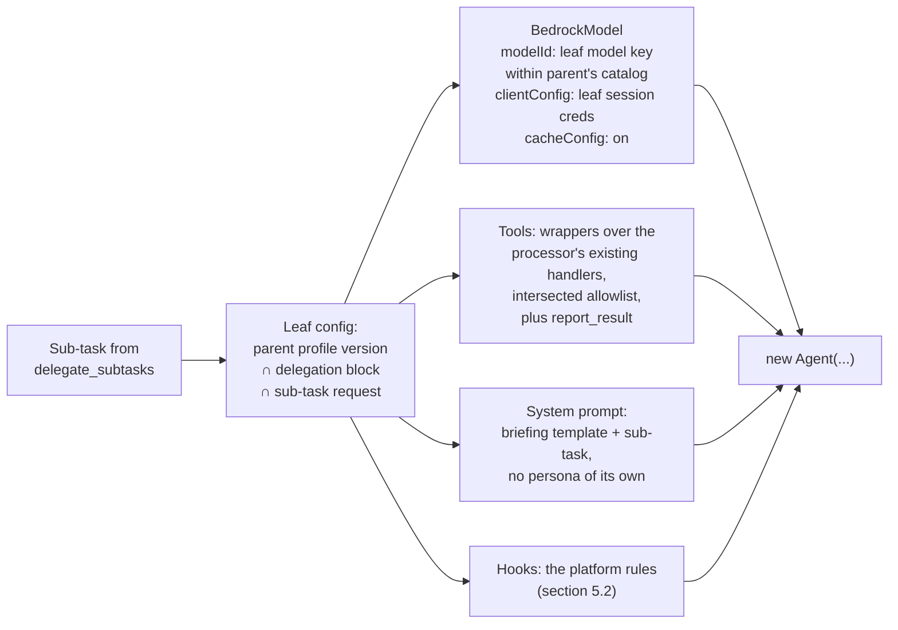
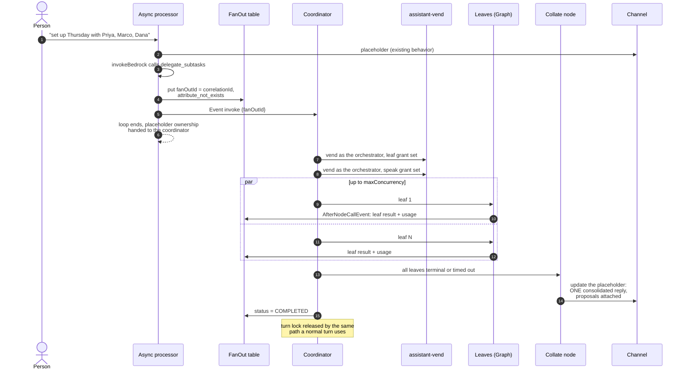
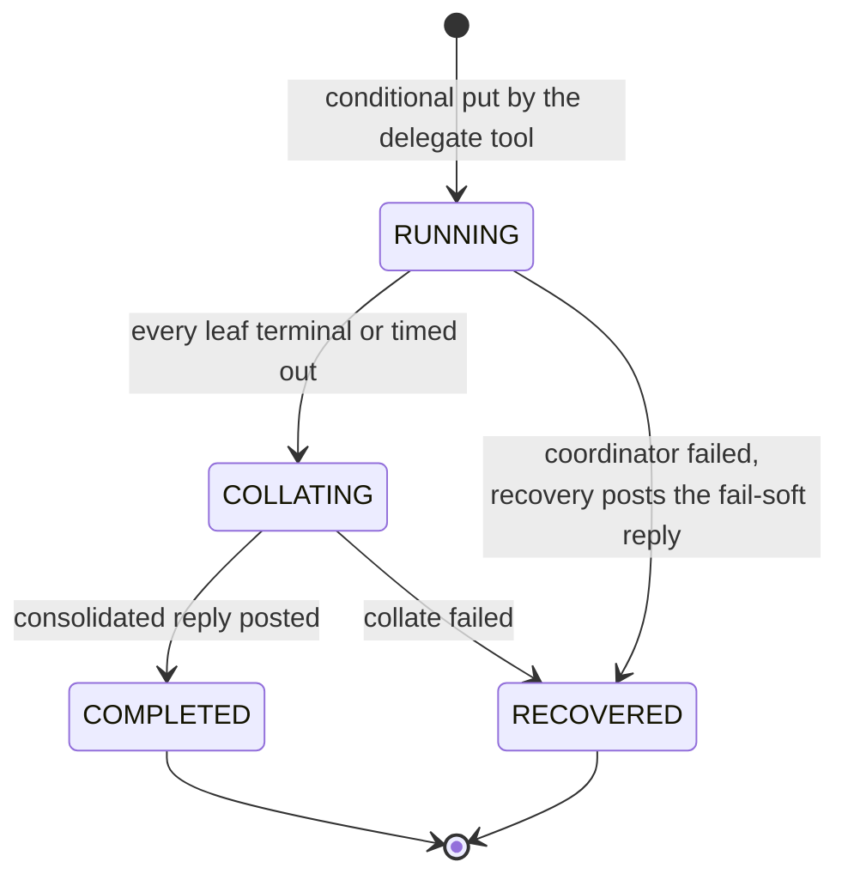
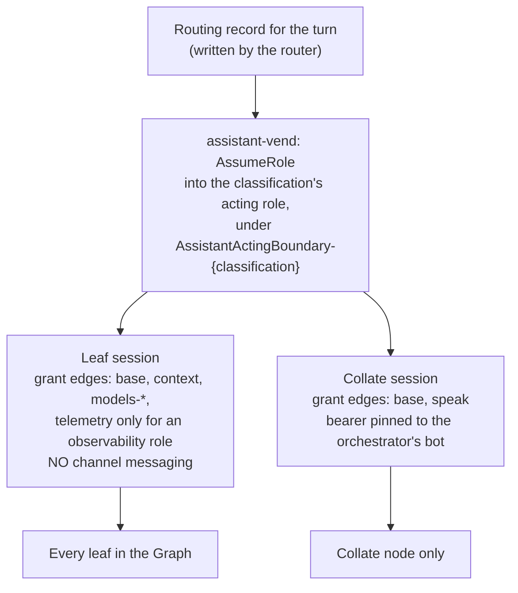
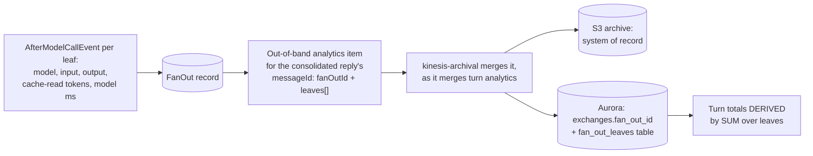
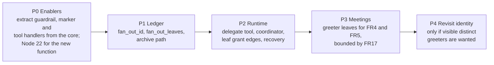

# DESIGN: Multi-agent fan-out on Strands, the runtime

**Status:** NOT BUILT, under consideration. Draft design for review; no code, infrastructure or tests exist for anything this document proposes. Proposes a buildable runtime for the fan-out that [DESIGN-MULTI-AGENT-ORCHESTRATION.md](./DESIGN-MULTI-AGENT-ORCHESTRATION.md) specifies at the level of shape and decisions. Every recommendation here is a starting position, not a decision. Nothing is built.

**Coverage:** none - a draft design; nothing is built, so there is no deployed behavior to drive.

**Related:** [DESIGN-MULTI-AGENT-ORCHESTRATION.md](./DESIGN-MULTI-AGENT-ORCHESTRATION.md) - the mechanism this document makes concrete, and the owner of decisions 1 to 5. [SPEC-ASSISTANT-MEETINGS.md](./SPEC-ASSISTANT-MEETINGS.md) and [DESIGN-ASSISTANT-MEETINGS.md](./DESIGN-ASSISTANT-MEETINGS.md) - the first consuming application (FR4, FR5, FR17).

**Site section:** Interaction layer, assistants.

> **Not built.** Everything below is a proposal. Where a section names existing code, it says so explicitly; every other component, table, tool, Lambda and test named here does not exist.

---

## 1. Overview

The orchestration design settles what a fan-out is: one orchestrator, ephemeral sub-agents, one consolidated reply, fail-soft collation, capability inheritance by intersection, and a ledger that records each leaf. It leaves open how any of that runs. This document answers that, using the AWS Strands Agents SDK where it earns its place and the platform's existing seams everywhere else.

**Scope of this document.** The runtime: which SDK and language, which Lambda runs what, how a leaf is configured so the platform's guardrail, marker and tool rules hold inside Strands, how the orchestrator's turn waits without polling, how credentials are narrowed, what the ledger receives, and how it is tested and rolled out.

**Not in scope.** The per-attendee task content (the meetings design owns it), a long-running host for an agent that sits in a live meeting (orchestration decision 3 excludes it), and cross-classification delegation (orchestration decision 4 refuses it).

**The one proposal that changes the picture.** Section 4 recommends that a leaf never acts in the channel. It reads, reasons and returns a structured result; every side effect is either posted by the orchestrator as itself or is a proposal a person confirms. That answers orchestration decision 2 for this phase without a third identity kind, and it is why the rest of this design is buildable.

## 2. Strands, as it ships

These are the facts the design rests on, read from the published package `@strands-agents/sdk` 1.20.0 (type definitions) and the project's 1.0 release notes. Apache-2.0.

| Fact | Consequence here |
|---|---|
| A TypeScript SDK at 1.x, `engines.node >=22` | No Python runtime is needed. The backend has no Python, and the TypeScript SDK keeps the leaf on the same libraries, bundler and tests as the processor. Any Lambda that imports it runs `NODEJS_22_X` |
| Runtime dependency on `@aws-sdk/client-bedrock-runtime` | The leaf calls Bedrock Converse through the same client family the processor already uses |
| `BedrockModel` takes `clientConfig`, `guardrailConfig`, `cacheConfig`, `region`, `additionalRequestFields` | Credentials are injected per leaf, so the leaf runs on a vended, classification-bounded session. Prompt caching is available. The guardrail option is NOT used (section 5.2) |
| `agent.asTool()` and `asTool({ delegate: true })` | Plain `asTool()` returns the sub-agent's result to the caller. `delegate: true` makes the sub-agent's output the turn's final message, which breaks "the orchestrator is the only voice", so it is never used |
| `Graph` with `maxConcurrency`, `maxSteps`, `timeout`, `nodeTimeout` | A bounded, parallel, per-node-timed fan-out with no edges, or with edges where order matters. Node timeouts are cooperative through `AbortSignal`, so every leaf tool must honor the signal |
| `Swarm` with `maxSteps` and handoff detection | Peers hand work to each other. Not used: leaves are independent and must not address each other |
| Hook events, including `BeforeInvocationEvent`, `BeforeModelCallEvent`, `AfterModelCallEvent`, `BeforeToolCallEvent` (settable `cancel`), `AfterToolCallEvent`, `AfterInvocationEvent`, `BeforeNodeCallEvent`, `AfterNodeCallEvent`, `MultiAgentHandoffEvent` | The platform's rules attach as hooks rather than as forks of the SDK (section 5.2) |
| Model usage per call (`inputTokens`, `outputTokens`, `cacheReadInputTokens`) and metrics on the model metadata event | The ledger's per-leaf row is filled from the SDK's own usage figures, not estimated |
| Tool calls within one turn run concurrently by default (`ToolExecutorStrategy`) | Leaf tools are written to be safe under concurrency, or the leaf is configured `sequential` |
| OpenTelemetry tracing | Off for metrics. The ledger is the one source for cost and latency (tenet D7); traces, if enabled, are diagnostic only |

**Known limitation to design around.** The release notes record that Swarm structured output on Bedrock with Claude Sonnet fails on assistant-message prefill. This design uses neither Swarm nor SDK structured output: a leaf returns its result by calling a `report_result` tool whose input schema is the result contract (section 6.2), which is an ordinary tool call on every provider.

## 3. Where it runs



**Why a separate coordinator Lambda.** The processor's timeout is 30 to 90 seconds by classification and it is on `NODEJS_20_X`. A fan-out of a handful of model-driven leaves plus a collation pass does not fit that window reliably, and the SDK needs Node 22. The coordinator gets its own timeout, memory and reserved concurrency, and the processor's behavior on every non-delegating turn is untouched.

**Why Strands in the coordinator and not in the processor.** Orchestration decision 1 narrows Strands' value to the multi-agent layer. The processor's single-agent loop carries guardrail in and out, marker stripping, work-item proposals, prompt caching and task tools, and rewriting it on Strands buys parity. The coordinator is new code whose whole job is bounded parallel fan-out with per-node timeouts and a join, which is what `Graph` provides.

**Where the delegate tool lives** (orchestration open question). In the processor's tool config, uniform with the company-context and task tools: a `delegate_subtasks` spec added to `rawToolSpecs` and filtered by the profile allowlist through `filterToolSpecsByProfile`. An assistant whose profile does not list it never sees it. That is the switch; there is no feature flag.

### 3.1 Two entry points



| | Turn entry | Event entry |
|---|---|---|
| Started by | The orchestrator model calling `delegate_subtasks` | An `agent` step of an [ADR-061](../../../design/decisions/061-a-welcome-is-a-workflow-an-event-starts.md) event workflow whose work is per person, handed on by the router of the conversation's classification; ADR-061's events are the one event model, so no feature wires its own rule to the coordinator |
| Fan-out key | The turn's `correlationId` | The event's natural key, for example meeting and attendee, or incident and round |
| Turn lock ([ADR-033](../../../design/decisions/033-a-conversation-answers-one-turn-at-a-time.md)) | Held, because the fan-out is the turn | Not taken. It answers no one, and holding it would queue people behind work they did not ask for. Rounds for the same subject serialize on their own fan-out record instead |
| Output | One reply in place of the placeholder | Messages the assistant posts as itself: room-wide, targeted to one member, or an in-place update of a message it owns |
| Ledger anchor | The turn's `exchanges` row | The message the fan-out posted |

[DESIGN-MEETING-ONBOARDING-AND-INCIDENT-SUBAGENTS.md](./DESIGN-MEETING-ONBOARDING-AND-INCIDENT-SUBAGENTS.md) is the first user of the event entry. No event reaches the coordinator except through the router: an `agent` step whose work is a fan-out of read-only leaves (one per person, or one per specialty of an investigation round) is handed here by the router that ran its workflow (ADR-061 decision 8, rule 10). An incident watch's network signal is not yet an ADR-061 event, so its rounds do not enter here until one is declared. Until sub-agent identity is settled, an `agent` step runs as one turn of the assistant in the processor instead.

## 4. Identity: leaves do not act



**Recommendation.** For this phase, adopt the "no identity of its own" candidate from orchestration decision 2, in its strongest form: a leaf holds no channel-acting capability at all. It reads within the parent's grants, reasons, and reports. Anything a person sees is posted by the orchestrator as itself, and anything consequential is a proposal that FR3 and FR11 already route through human confirmation and the existing apply endpoints (`lib/channel-creation.ts` stays the single place membership changes).

**What it settles.** No third identity kind, no lease table, no TTL reaping of identities, and the `/bot/*` bearer gap in orchestration section 8 does not reach a leaf because a leaf session cannot call Amazon Chime SDK messaging at all (section 7).

**What it gives up, stated plainly.** FR5 asks for "parallel per-attendee greeters, each a classification-bounded identity". Under this recommendation the greeters are parallel and classification-bounded, but the room sees one assistant greeting several people, not several greeters. The meetings design already says the assistant "greets as itself", so the experience matches it; FR5's identity clause is met in its attribution form (each greeting is attributable to its leaf in the ledger) rather than as distinct members. If the owner wants distinct visible greeters, decision 2 stays open and section 4 of this document is replaced; the rest of the design stands.

**The bound.** With nothing scarce to lease, orchestration decision 5's bound becomes a configured number rather than a pool size: cost and blast radius are what it limits. Section 6.3 sets it.

## 5. The leaf

### 5.1 Construction



- **Model.** The delegation block names a leaf model key. Activation validates it against the parent classification's model catalog, the same check `validateBody` applies to the profile's own model. IAM is the second layer: the leaf session can invoke only the models its grant edges name.
- **Tools.** Leaf tools are thin `tool()` wrappers around the handlers the processor already dispatches (`load_company_context`, `load_platform_info`, the open-work reader, and so on). No handler is reimplemented; the dispatch chain in `async-processor-core.ts` is refactored so each handler is callable by name from both runtimes. Work-item and task-advance tools are not offered to a leaf.
- **No persona.** A leaf is not an assistant and carries no persona or display name. The briefing template from the delegation block plus the sub-task is its whole prompt. Only the collate node speaks, and it speaks with the orchestrator's persona, language and profile version (tenet P5).

### 5.2 The platform's rules, as hooks

The leaf must obey every rule a normal turn obeys. Each attaches at one hook, and each calls the processor's existing function after that function is moved out of `async-processor-core.ts` into a shared module. Two implementations of a guardrail policy is the failure this avoids.

| Rule | Hook | Implementation reused |
|---|---|---|
| Input guardrail on the briefing (attendee names and other person-supplied text are untrusted) | `BeforeInvocationEvent` | `applyInputGuardrail`, with the profile-selected guardrail and the deployment default, and its existing fail-open posture |
| Tool allowlist, second layer after IAM | `BeforeToolCallEvent`: set `cancel` for any tool outside the intersection | `filterToolSpecsByProfile` semantics |
| Iteration bound | `BeforeModelCallEvent`: count calls, end the loop at `MAX_TOOL_ITERATIONS` | The processor's constant, so both runtimes share one number |
| Abort on node timeout | Each tool wrapper forwards the `AbortSignal` | New, and required: Strands cancellation is cooperative |
| Output guardrail and marker stripping on the leaf's result text | `AfterToolCallEvent` on `report_result` | `applyOutputGuardrail`, `stripMessageMarkers`, `stripReasoningTags` |
| Usage capture for the ledger | `AfterModelCallEvent` | New accumulator, written per leaf (section 8) |

**Why not `BedrockModel.guardrailConfig`.** It applies a guardrail inside Converse with one id and version. The platform's guardrail is `ApplyGuardrail` with a profile selection, a deployment fallback, findings capture per turn and a fail-open rule. Using the SDK option would create a second guardrail behavior that disagrees with the first on exactly the cases that matter (fallback and failure).

## 6. The fan-out

### 6.1 Turn flow



**The wait is event-driven** (orchestration open question, tenet D6). The orchestrator's turn does not wait or poll. It hands the placeholder to the coordinator, which owns the turn until the consolidated reply replaces the placeholder, the same handover battle uses between round 1 and its orchestrator. The only time-based element is the absence case: a coordinator that dies is caught by its Lambda on-failure destination, and a backstop sweep over expired `RUNNING` records catches the destination itself failing. That sweep is the reconciliation tenet D6 allows, not the primary path.

**One turn at a time.** [ADR-033](../../../design/decisions/033-a-conversation-answers-one-turn-at-a-time.md) holds the conversation's turn lock for the duration of a turn. A fan-out is one turn, so the lock is held until the coordinator finalizes or the recovery path releases it, and a person's next message is queued as it would be behind any long turn. The queued-message acknowledgement names the fan-out in progress.

### 6.2 Contracts

```typescript
// delegate_subtasks input, the only thing the orchestrator model writes.
interface DelegateSubtasksInput {
  purpose: string;                       // one line, shown in the drill and the reply
  subtasks: Array<{
    key: string;                         // stable within the fan-out, e.g. a person key
    task: string;                        // what this leaf is asked to do
    tools?: string[];                    // narrows the leaf allowlist; never widens it
  }>;
}

// report_result input, the only way a leaf finishes.
interface LeafResult {
  key: string;
  status: 'completed' | 'partial' | 'failed';
  summary: string;                       // one line: what this leaf did
  draft?: { text: string };              // text the collate node may post
  proposals?: Array<{ kind: string; payload: unknown }>;  // applied only on confirmation
  error?: string;
}
```

A leaf that ends without calling `report_result`, or whose node times out, is recorded as `failed` with the reason, never omitted.

### 6.3 Configuration

The delegation block is part of the assistant's versioned profile body, so it is edited as a draft, validated, activated and rolled back like every other behavior field ([SPEC-PORTABLE-PROFILES](./SPEC-PORTABLE-PROFILES.md)).

| Field | Meaning | Validation at activation |
|---|---|---|
| `delegation.maxLeaves` | Hard cap on subtasks per fan-out, also the Graph `maxConcurrency` | 1 to a deployment limit (proposed 10) |
| `delegation.leafModelKey` | The leaf model | In the classification's model catalog |
| `delegation.leafTools` | The leaf allowlist | A subset of the profile's own `tools`, excluding state-changing tools |
| `delegation.briefing` | The leaf prompt template | Size limit, like `persona` |
| `delegation.nodeTimeoutMs`, `delegation.timeoutMs` | Graph `nodeTimeout` and `timeout` | `timeoutMs` below the coordinator's Lambda timeout minus the collation margin |

A subtask list longer than `maxLeaves` is refused by the delegate tool with a result the orchestrator model reads ("at most N at once"), not truncated silently. Waves of `maxLeaves` are a later decision, not a hidden behavior.

### 6.4 Fan-out record



Table `FanOut`: PK `fanOutId` (the turn's `correlationId`, so a duplicate dispatch is the same fan-out), attributes `state`, `channelArn`, `placeholderMessageId`, `leaves` (map by key: status, summary, usage), `ttl`. Transitions are conditional writes, the `BattleState` idiom. The record is coordination state and ages out; the facts it held reach the ledger (section 8), which is where they are read from afterwards.

## 7. Security and IAM



- **Two sessions, both narrowed from the orchestrator's grant.** The coordinator vends twice through the existing `assistant-vend`, keyed by the turn's routing record, so both sessions carry the orchestrator's `assistant`, `bot`, `classification` and `role` tags and sit under its permissions boundary. The leaf session uses a new `leaf` grant edge set that omits channel messaging; this is delegation by narrowing a vended, recorded grant (tenet D4), not a new role.
- **Deny tests, which are the proof** (tenet P4). A leaf session's `SendChannelMessage`, `CreateChannelMembership` and `UpdateChannelMessage` are denied. A leaf session cannot invoke a model outside its grant edges. A leaf session cannot read another classification's `context/` prefix. Each is asserted against the deployed policies, the way the classification boundary tests already are.
- **Two layers on every leaf capability.** Tools: the `BeforeToolCallEvent` allowlist and the session's IAM. Models: activation-time catalog validation and the grant edges. Context: the tool's own scoping and the boundary's prefix deny.
- **Injection.** Attendee names and meeting text reach a leaf only through the briefing, which passes the input guardrail. A leaf's text reaches the room only through the collate node, which passes the output guardrail and marker stripping a second time on the consolidated reply.
- **Blast radius.** One turn can start at most `maxLeaves` model-driven leaves, each bounded by `MAX_TOOL_ITERATIONS` and `nodeTimeoutMs`. The coordinator's reserved concurrency bounds simultaneous fan-outs per deployment.

## 8. The ledger

This implements orchestration section 5a. It is a precondition: the coordinator does not ship before leaf rows are recorded.



- **A third kind of row.** `fan_out_leaves` (`fan_out_id`, `leaf_key`, `status`, `model_id`, `input_tokens`, `output_tokens`, `cache_read_tokens`, `model_ms`, `tool_ms`, `summary`, `error`), keyed to its turn. A leaf is not an assistant and never appears in per-assistant rollups.
- **`fan_out_id` is an indexed column** on `exchanges`, lifted the way `battle_id` was in migration 057, so a fan-out is joinable without JSONB.
- **Totals are derived, never asserted.** The turn's tokens and cost are the sum of its leaves plus the orchestrator's and collate node's own calls. Wall clock and total compute are recorded as two numbers.
- **The archive holds it.** Leaf facts travel on the consolidated reply's out-of-band analytics item, the path `writeMessageAnalytics` and `kinesis-archival` already use, so they reach the S3 archive as well as Aurora (tenet D7). Nothing is emitted only to traces.
- **Evaluation is unchanged.** The exchange is judged per intent, as every exchange is. A leaf is not scored.

## 9. Failure handling

| Failure | Behavior the person sees | Mechanism |
|---|---|---|
| Some leaves fail or time out | One reply naming both halves: "invited Priya and Marco; could not reach Dana. Retry?" | Collate node reads every leaf's terminal record, including failures |
| Every leaf fails | One reply saying so and offering to retry | Same, with no drafts |
| Coordinator crashes or times out | One fail-soft reply replacing the placeholder, never a placeholder left spinning | Lambda on-failure destination; backstop sweep on expired `RUNNING` |
| Duplicate dispatch of the same turn | No second fan-out | Conditional put on `fanOutId = correlationId` |
| Leaf model throttled | Retried within the node timeout, then recorded as failed | `AfterModelCallEvent` retry request, bounded by `attemptCount` |
| Leaf tool ignores the abort | The node is recorded as timed out; the stray call cannot post anything because the leaf session cannot | Cooperative cancellation plus the leaf session's deny |

## 10. Testing

| Level | What it proves | Proposed file |
|---|---|---|
| Unit | Leaf config intersection (profile, delegation block, sub-task); `maxLeaves` refusal; the iteration-bound and allowlist hooks; result collation including partial and total failure; fan-out state transitions | fan-out-*.test.ts under backend/test/lib (proposed) |
| Unit | The guardrail, marker and tool handlers are the same functions in both runtimes (import identity, not copies) | fan-out-reuses-turn-rules.test.ts (proposed) |
| Synth | The `leaf` grant edges omit channel messaging; the coordinator runs Node 22 with an on-failure destination | additions to `backend/test/cdk-synth.test.ts` |
| Deployed deny | Leaf session denied channel messaging, out-of-grant models, other classifications' context | a-leaf-cannot-speak.spec.ts under tests/e2e (proposed) |
| End to end | A request that fans out to three subtasks produces one reply, three leaf rows whose sum equals the turn's tokens, and a released turn lock; a forced leaf failure produces the partial reply | delegated-fan-out.spec.ts under tests/e2e (proposed) |

## 11. Rollout



P1 precedes P2 because attribution retrofitted after a fan-out ships does not backfill (orchestration section 5a). P0 is useful on its own: it shrinks the processor core and is the step that keeps a second guardrail implementation from appearing.

## 12. Decisions for review

| # | Decision | Recommendation |
|---|---|---|
| A | SDK language | TypeScript `@strands-agents/sdk`, not Python |
| B | Where Strands runs | Only in a new coordinator Lambda; the processor loop is unchanged |
| C | Orchestration pattern | `Graph` with parallel leaf nodes and one collate node. Never `Swarm`, never `asTool({ delegate: true })` |
| D | Leaf identity (orchestration decision 2, this phase) | No channel-acting capability; the orchestrator posts as itself; side effects are confirmed proposals |
| E | Guardrails in the leaf | The platform's `ApplyGuardrail` path through hooks, not the SDK's `guardrailConfig` |
| F | Wait model | Placeholder handover to the coordinator, on-failure destination, backstop sweep for absence only |
| G | Bound | `delegation.maxLeaves` in the versioned profile, under a deployment limit |
| H | Ledger | A `fan_out_leaves` row per leaf, `fan_out_id` on `exchanges`, totals derived, archived through the existing analytics path |

## 13. Open questions

| Question | Why it is open |
|---|---|
| Coordinator cold start | The package is about 4 MB unpacked. The cost on a Node 22 Lambda with the bundle tree-shaken is unmeasured |
| Processor on Node 22 | Not required by this design, and the processor already logs the AWS SDK's Node 20 deprecation warning. Whether to move it in the same change or separately |
| Ending a leaf loop from a hook | The iteration bound assumes a `BeforeModelCallEvent` hook can stop the loop cleanly; to be confirmed against the SDK before P2, with a fallback of a wrapper model that refuses past the bound |
| Waves beyond `maxLeaves` | Refused in this design. Whether a later version runs waves inside one fan-out, or asks the person to split the request |
| Queued-message wording during a fan-out | The acknowledgement copy is persona- and language-bound (tenets P5 and D11) and belongs with the turn queue's existing copy |

## Related Documents

- [DESIGN-MULTI-AGENT-ORCHESTRATION.md](./DESIGN-MULTI-AGENT-ORCHESTRATION.md) - the mechanism and its decisions
- [DESIGN-MEETING-ONBOARDING-AND-INCIDENT-SUBAGENTS.md](./DESIGN-MEETING-ONBOARDING-AND-INCIDENT-SUBAGENTS.md) - the meetings demo: onboarding on join and the live incident watch
- [DESIGN-ASSISTANT-MEETINGS.md](./DESIGN-ASSISTANT-MEETINGS.md) and [SPEC-ASSISTANT-MEETINGS.md](./SPEC-ASSISTANT-MEETINGS.md) - the meetings assistant
- [ADR-033](../../../design/decisions/033-a-conversation-answers-one-turn-at-a-time.md) - the turn lock a fan-out holds
- [ADR-042](../../../design/decisions/042-an-assistant-acts-in-exactly-one-classification.md) and [ADR-046](../../../design/decisions/046-classifications-are-a-set-not-a-ladder.md) - why a leaf reaches only the parent's declared grants
- [SPEC-PORTABLE-PROFILES.md](./SPEC-PORTABLE-PROFILES.md) - the versioned profile the delegation block lives in
- [SPEC-CREDENTIAL-EXCHANGE.md](../governance/SPEC-CREDENTIAL-EXCHANGE.md) - the vend both coordinator sessions come from
- [DESIGN-BATTLE.md](../quality/DESIGN-BATTLE.md) - the placeholder handover, conditional-write and fail-soft idioms reused here
