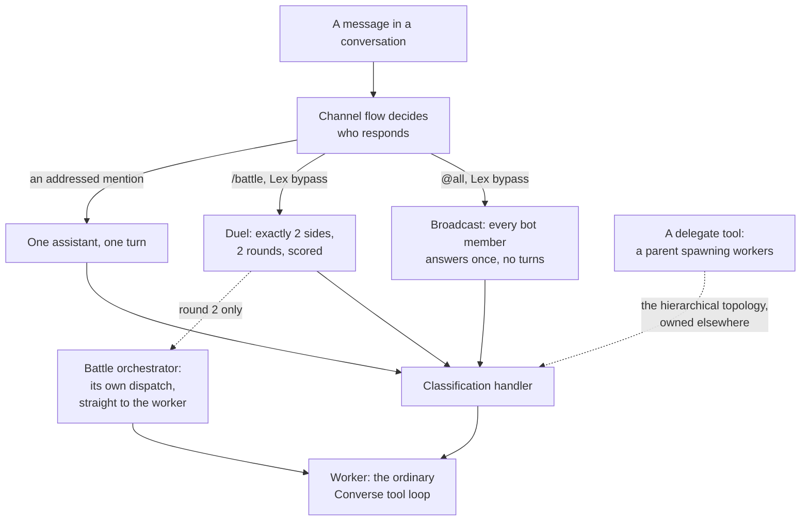
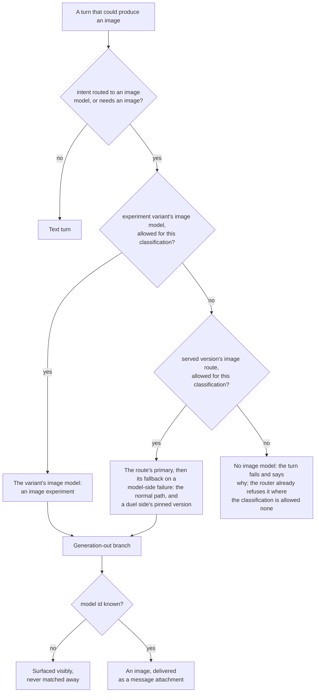
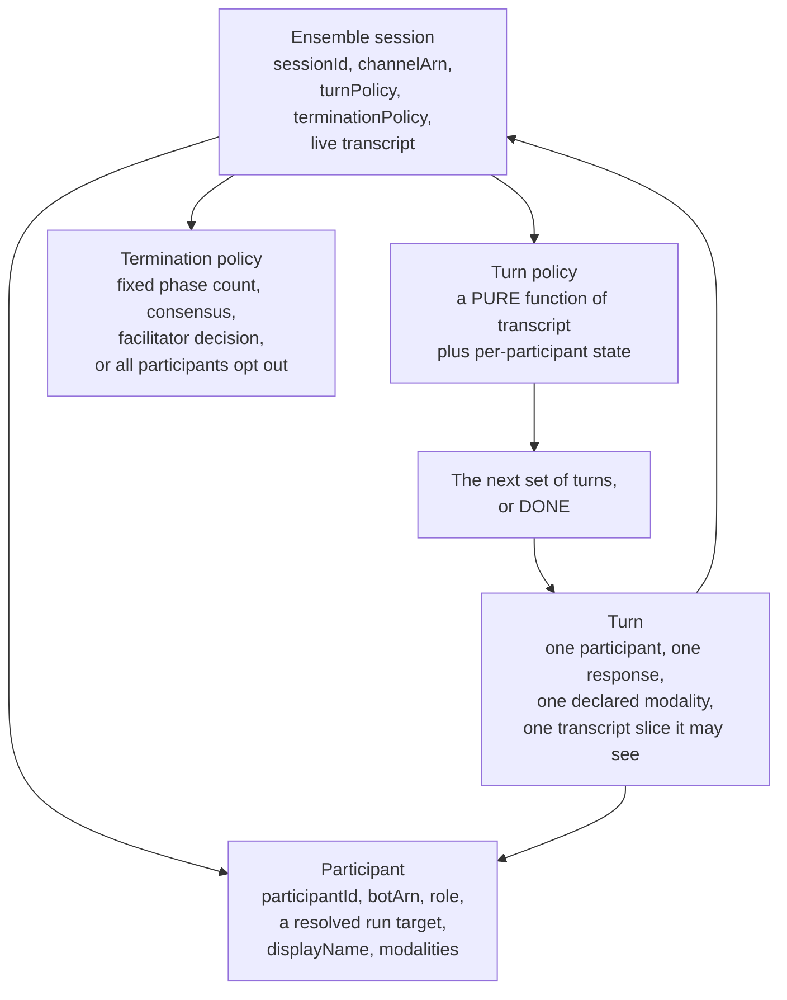
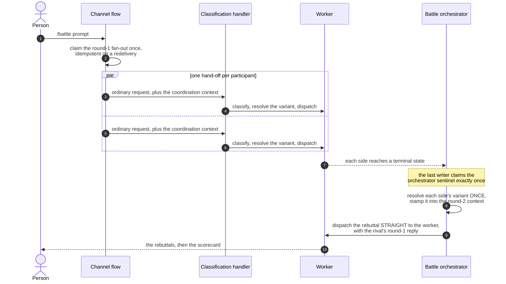
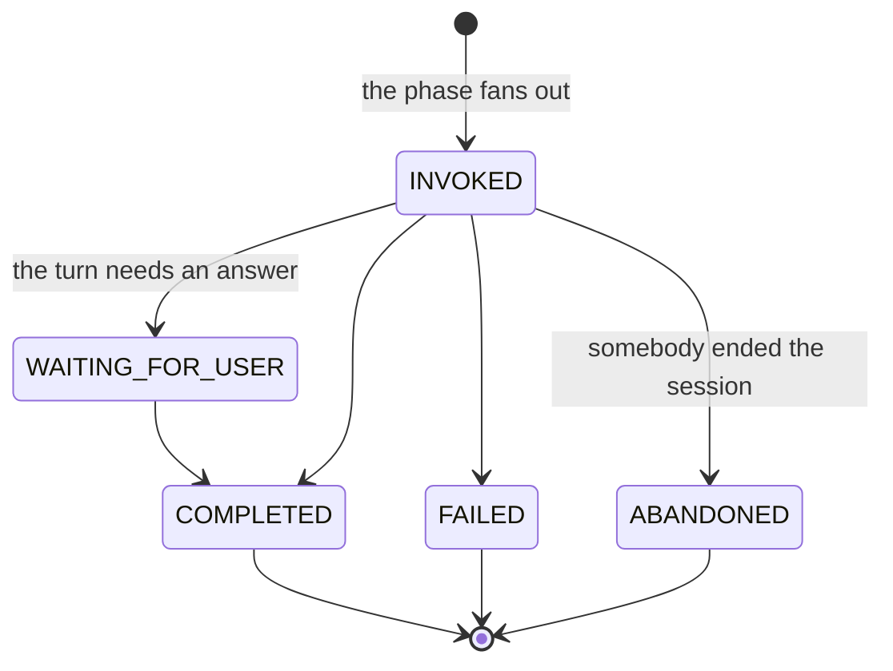
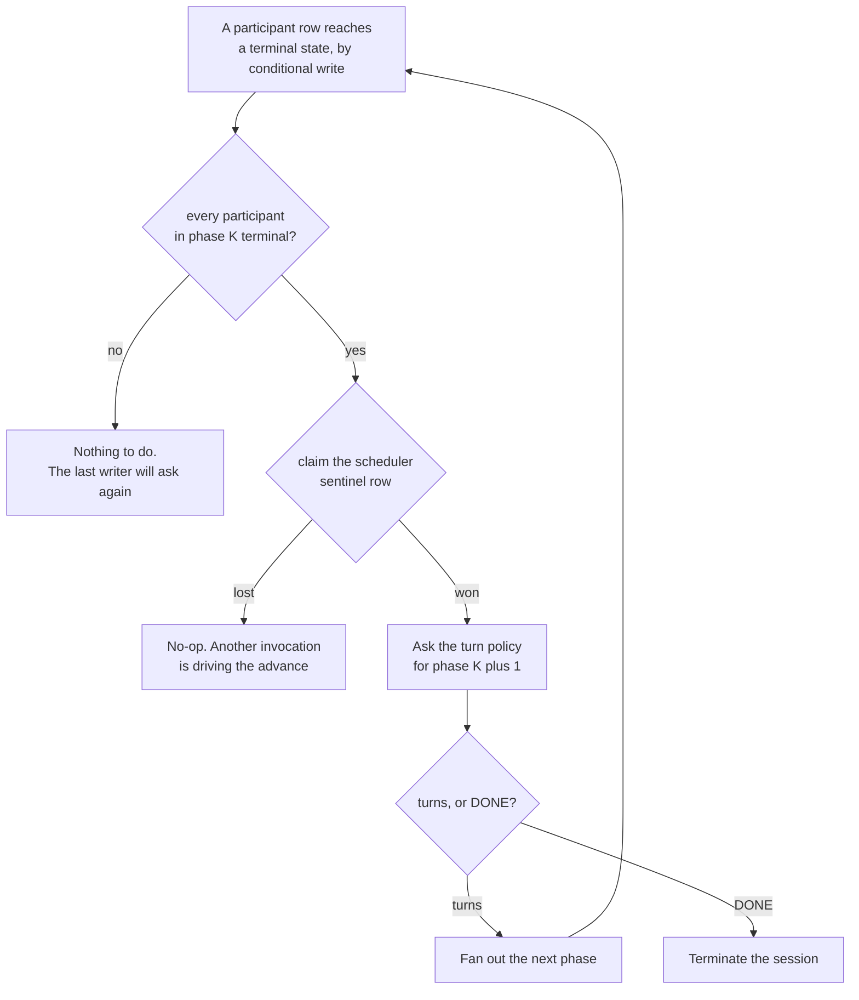
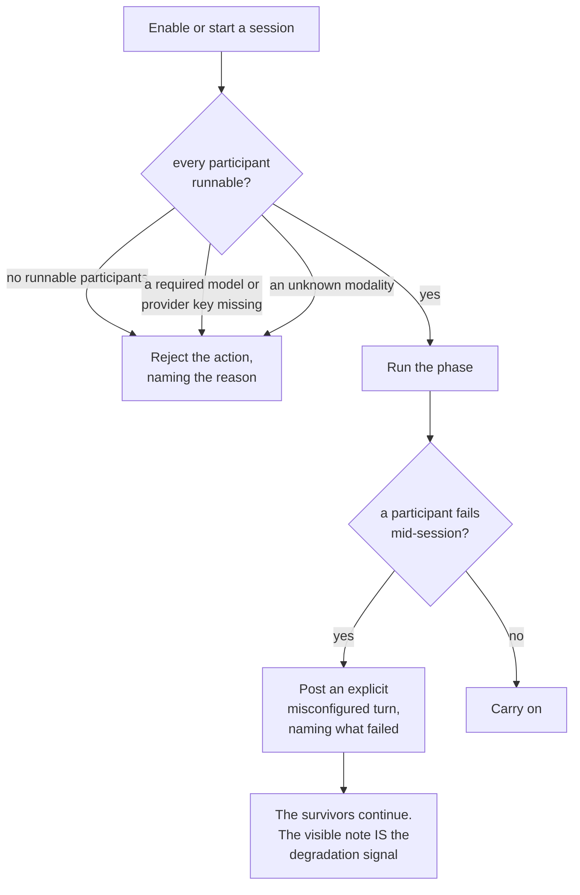
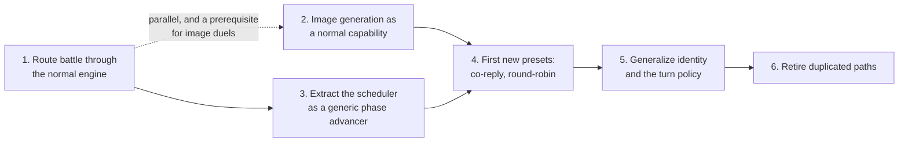
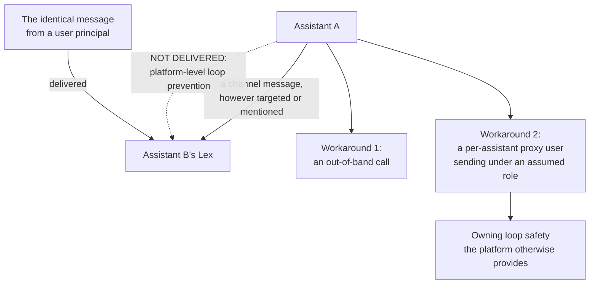

# DESIGN: Multi-Assistant Turn Engine

**Status:** NOT BUILT, under consideration. A design target for generalizing `/battle`.

**Coverage:** none - a design target for generalizing `/battle`; the engine it describes is not built. The battle preset it would subsume is covered by `e2e/battle.spec.ts`.

**Related:** [SPEC-BATTLE.md](../quality/SPEC-BATTLE.md) - the product surface of the one preset that exists, its requirements and what is delivered. [DESIGN-BATTLE.md](../quality/DESIGN-BATTLE.md) - the peer round-scheduler this generalizes. [DESIGN-MULTI-AGENT-ORCHESTRATION.md](./DESIGN-MULTI-AGENT-ORCHESTRATION.md) - the hierarchical fan-out-and-collate primitive, and the identity question both documents share. This document is the mechanics of the engine only; requirements and delivery status live in the spec.

**Site section:** Interaction layer, assistants.

---

## 1. What the engine unifies

Three entry points let assistants speak together, and none of them composes. They converge on the same handler and then diverge into three sets of turn logic.

The shape of the problem is in the dotted edges. Everything reaches one worker, and nothing models the three as configurations of one thing, so battle is the platform's only peer turn-taker and it is fixed at two participants and two rounds.

**The goal:** one engine that runs N named assistant participants through a policy-driven sequence of turns, where battle, co-reply, round-robin discussion and facilitated meetings are configurations over it rather than separate features.

## 2. Design direction

These constraints are authoritative and shape every phase below.

- **Battle is an engagement option on an A/B experiment, not a separate feature.** It is a flag on an experiment, and the two sides are whatever variants that experiment configures. There is no battle-specific notion of a combatant.
- **Battle runs the platform's normal request engine.** Each side answers through the same flow as any other message: real intent classification, real profile model resolution, real tools. A side is resolved by the same experiment-variant resolution the normal engine already applies to an in-experiment request; battle runs **all** the experiment's variants instead of hash-assigning one. The `/battle` prefix adds exactly three things: every variant responds, a rebuttal round runs, and a scorecard is rendered.
- **The rebuttal is the point, and assistants are coached for it.** After the parallel first responses each side reacts to what the other produced. A side carries a light awareness note on its first turn and explicit guidance on the rebuttal turn; round-one content and length stay normal.
- **The parallel race comes first.** Round one is simultaneous. Richer assistant-to-assistant coordination is a later enhancement (section 9).
- **Battle mode is scoped to the experiment's lifetime.** It is a property of the experiment (`experiment.battleEnabled`) rather than a per-conversation toggle re-enabled each time. **This is a proposed change:** enablement today layers a per-channel moderator toggle (`ChannelBattleConfig`) on the experiment's flag.
- **The scorecard is inline and terminal**, appearing at the end of each duel rather than staying visible.
- **Results are recorded as they are today** unless the refactor forces a change.

## 3. Consequence: image generation must become a normal capability

Image generation is a first-class profile capability and intent, and that is the enabling change rather than an add-on. `image_generation` is an intent in the pack, and an image model is a route in `models.byIntent` whose primary is an image model, with a fallback like every other intent; any intent routed that way generates an image, whatever it is called. A version's legacy `models.image` reads as the `image_generation` route's primary. `resolveTurnImageRoute` decides the route for a turn. It follows the rule every model selection follows ([MODEL_STRATEGY](../../../guides/developer/MODEL_STRATEGY.md#one-rule-for-every-model)): an image model serves only an image route or an intent that needs an image, and only one the classification's catalog list allows.

Because an assistant can generate an image on any request, a duel of image prompts needs no battle-specific image code: both sides run their ordinary flow. The declaration order in the pack matters and is deliberate - `image_generation` is declared before `report_generation`, because "generate an image" contains `report_generation`'s keyword and the first-listed match wins.

## 4. The abstraction

A participant is a first-class, named channel member; there are N of them and nothing in the engine assumes two. The turn policy being a pure function is what replaces battle's hardcoded `round === 1 ? ... : ...` branch: the decision becomes data the scheduler asks for rather than a literal in a handler.

## 5. Format presets, as configuration over the engine

| Preset | Participants | Turn policy | Cross-injection | Extras |
| --- | --- | --- | --- | --- |
| Co-reply (`@all`) | N | one parallel phase, all speak once | none | none |
| Battle | exactly 2 (precondition) | two ordered phases: answer, then rebuttal | each sees the rival's prior turn | awareness note, rebuttal guidance, scorecard |
| Discussion / round-robin | N | ordered turns, M rounds or until consensus | each sees all prior turns | optional summary |
| Meeting | N plus a facilitator role | facilitator-driven ordering over an agenda | policy-defined | agenda, minutes |

Battle stops being a feature and becomes the two-participant, two-phase, scored preset. Its distinctive parts - the awareness note, the rebuttal guidance, the `battlestats` scorecard, the `NO_REBUTTAL` opt-out - are preset configuration rather than engine mechanics.

## 6. Battle delegates to the normal engine

Each side's turn is a normal request through the single request engine. The side's configuration comes from the experiment variant it is assigned, resolved by the same resolution the normal engine applies to any in-experiment request. The engine resolves no models, prompts or modality on a battle-specific path. The fan-out passes a worker only the coordination context it cannot derive itself: the shared session, which variant it is, and, on a rebuttal, the transcript slice it is reacting to.

**The two rounds differ in one way that matters, and it is the remaining work.** Round 1 hands each side to the handler exactly as `@all` does, so the handler classifies, resolves the variant, selects the delivery option and dispatches. Round 2 goes straight to the worker, so the orchestrator supplies what the handler would have: it resolves both variants once and stamps them into the round-2 context, it inherits round 1's recorded intent rather than deriving one, and it carries a fixed non-task delivery option. Each of those is a deliberate consequence of the direct dispatch rather than a divergent second implementation - the intent is omitted when round 1 recorded none rather than falling back, and the fixed delivery is what keeps a rebuttal from becoming a third, ungated door into opening work ([ADR-047](../../../design/decisions/047-a-turn-resolves-its-task-machines-once.md)). Dispatching the rebuttal through the same handler entry, with the rival's prior turn injected as the thing to respond to, is what removes the need for any of them.

**This is the class of bug the redesign was triggered by.** The pre-handoff fan-out resolved the image-model pair and display names while the worker independently re-resolved the battle variant, so a resolution that succeeded on one side and fell through on the other - the fan-out Lambda missing the experiments-table grant, for instance - silently degraded to a text turn with no signal. An image duel therefore ran as a text duel and nothing errored. When there is one resolution path, there is nothing to diverge.

## 7. Modality follows the profile, never the battle path

Because a turn is a normal request, its modality is whatever the assistant's profile and the classified intent produce. An assistant whose profile grants image generation produces an image when the intent calls for one, in a duel or not; an assistant without it does not. There is no battle-specific image branch and no separate image-model registry to forget, which is what section 3's precedence chain buys.

## 8. Scheduler: generalize the barrier and the sentinel

The round-1-to-round-2 handoff generalizes to a phase advancer. No component holds a phase count.

Every state move is a conditional write, and the sentinel row is what makes the advance exactly-once under an at-least-once delivery. Battle is two phases, co-reply is one, discussion is M, and a meeting is policy-driven.

**The wait model is the open mechanical question.** The barrier is write-then-read today: whoever writes the last terminal state discovers it and drives the advance. At larger N that is N reads of the whole participant set per phase, and whether the scheduler should instead be woken by a callback is unresolved.

## 9. Data model: generalize what is built

| Built for battle | Generalized to | What widens |
|---|---|---|
| `BattleState`, PK `battleId`, SK `botArn` | `SessionState`, PK `sessionId`, SK `participantId` | The key stops naming a duel. Each row stores that participant's completed-turn output so a later turn can be given it. TTL-based crash cleanup is retained |
| `__orchestrator__` fire claim | `__scheduler__` sentinel SK | One row per session rather than one per duel, claimed once per phase advance |
| `ChannelBattleConfig` | `ChannelSessionConfig` | Which formats are enabled on the channel, plus the active-session pointer for continuation |
| `rivalBotArn`, singular | "the transcript slice this turn sees", a list | Two becomes N |
| `variants[0]` control, `variants[1]` treatment | `participants[]` with roles | Position stops carrying meaning |
| `totalRounds: 2`, a literal type | a policy-driven phase index | The phase count leaves the type system |
| the fewer-than-two-bots fallback to the router | the general N case | Co-reply is the N-participant preset; battle asserts exactly two as a preset precondition |

**The participant pool is the one row that does not generalize from battle, because what it would have generalized from is gone.** An alt belongs to one classification, is tagged with it, and the turn-path identity check filters on it ([DESIGN-BATTLE](../quality/DESIGN-BATTLE.md)). A borrowable pool of persona-less acting identities re-opens exactly the question that closed - which room a leased identity may act in - so it has to answer that per lease rather than inherit an answer. Which kind of principal a leased participant is remains open (section 11).

## 10. Fail loud

The engine never silently falls back to a degraded format. A duel that quietly answers as a single participant is worse than one that refuses, because the result still looks like a comparison.

## 11. Open questions to resolve during build

| Question | Why it is open |
|---|---|
| What kind of principal a participant identity is | The pool of alt bots this design once leased from is gone: an alt is an ordinary assistant holding a role for its classification, with its own profile and version history. The same question is [DESIGN-MULTI-AGENT-ORCHESTRATION](./DESIGN-MULTI-AGENT-ORCHESTRATION.md) Decision 2, where it is recorded as open and blocking, and the candidates are a bounded set of worker identities that is not the alt structure, or no identity of its own at all |
| Vended versus leased | A credential-exchange-vended identity and a leased pool identity are two stories for the same participant. The engine needs one, or a rule for when each applies, and the rule cannot be written before the question above is answered |
| Pool sizing and contention | Whatever the scarce resource turns out to be, battle, discussion and any future delegation compete for it. There is no number to size it at until the mechanism names what is scarce |
| Peer versus hierarchical | This engine models peer turn-taking, which is the built topology. The hierarchical delegate-and-collate topology is expressible as a turn policy and is out of scope for the first build |
| Whether the two sides of a duel are two variants of one profile or two distinct assistant profiles | A configuration choice the engine supports either way, so it does not gate the build |

## 12. Phasing, with battle working throughout

1. **Route battle through the normal engine.** Round 1 hands each side to the handler as an ordinary request. What remains is the round-2 orchestrator: dispatching the rebuttal through the same handler entry, with the rival's prior turn injected as the thing to respond to, rather than straight to the worker with the intent, delivery option and variants supplied around it.
2. **Image generation as a normal capability.** Section 3's precedence chain is the enabling change, and a prerequisite for image duels under the new model rather than a follow-on.
3. **Extract the scheduler.** Reimplement the round handoff as the generic phase advancer over `SessionState`. Behavior-preserving.
4. **First new presets.** Co-reply, folding `@all` in, and round-robin discussion. The first reply-together and take-turns formats beyond battle, and the substrate for later coordination.
5. **Generalize identity and the turn policy.** Grow the participant set past two and add the turn-policy interface, which is what the meeting preset needs.
6. **Retire duplicated paths.** Remove the battle-specific resolvers and the flow-side turn logic once presets cover them. The `@all` and `/battle` Lex bypasses stay, because neither is a native Amazon Chime SDK mention, but they converge on the handler so that bypassing Lex is the only way either differs from an ordinary turn ([MESSAGE-FLOW](../../../guides/developer/MESSAGE-FLOW.md)). The flow keeps the one decision only it can make, which is who responds.

## 13. Beyond this pass

**Guide people toward the experiment's goal intents.** An experiment exists to test something specific - report quality, a routing change, a persona - so when battle mode is on, prompting for the kinds of intents worth trying is what makes the duel exercise what the experiment is measuring.

**Assistant-to-assistant coordination**, moving past the parallel race plus single rebuttal to a genuine multi-turn exchange, is what the turn-policy interface is designed to express. It has a measured constraint in front of it.

Amazon Chime SDK does not deliver a message authored by an `AppInstanceBot` to another `AppInstanceBot`'s Lex, so one assistant cannot trigger another by addressing it. The identical message from a user principal does trigger. This is undocumented - `TargetedMessages: ALL` reads as though any targeted message would be processed - and it is loop prevention rather than an oversight. The evidence and the two ways around it are in [ADR-023](../../../design/decisions/023-battle-round-coordination.md). Any turn policy that assumes assistants can pass control to each other in-channel has to choose one of them first, and the proxy route means owning the loop safety the platform otherwise provides.

## Related Documents

- [SPEC-BATTLE.md](../quality/SPEC-BATTLE.md) - the requirements and delivery status of the one preset that exists
- [DESIGN-BATTLE.md](../quality/DESIGN-BATTLE.md) - the turn path, the state, the markers and the IAM this generalizes
- [DESIGN-EXPERIMENTS-BATTLE-DECISION-LOOP.md](../quality/DESIGN-EXPERIMENTS-BATTLE-DECISION-LOOP.md) - the experiment lifecycle a duel's variants come from
- [DESIGN-MULTI-AGENT-ORCHESTRATION.md](./DESIGN-MULTI-AGENT-ORCHESTRATION.md) - the hierarchical topology, and Decision 2, which is this document's identity question
- [ADR-023](../../../design/decisions/023-battle-round-coordination.md) - assistant-to-assistant signalling, measured, and the two workarounds
- [ADR-027](../../../design/decisions/027-speaker-attributed-transcript.md) - how a multi-speaker transcript is attributed, which a transcript slice depends on
- [ADR-047](../../../design/decisions/047-a-turn-resolves-its-task-machines-once.md) - the doors that may open work, and why a rebuttal is not one
- [MESSAGE-FLOW.md](../../../guides/developer/MESSAGE-FLOW.md) - where the `@all` and `/battle` bypasses sit on the turn path
