# DESIGN: Separate assistants, separately owned, and how work reaches the right one

**Status:** Partially implemented. Phases 2 and 4 are built, Phase 1b is built (see its NOT BUILT list), Phase 1 is built and partly wired, and Phase 3 is **NOT BUILT**. This completes [`SPEC-PORTABLE-PROFILES.md`](./SPEC-PORTABLE-PROFILES.md), which defines a profile as what an assistant is and names a classification hosting several assistants as the model, with one assistant per classification as the degenerate case. A classification holds two assistants in practice, a named one is answered by that assistant rather than by the classification's primary (Phase 2's gate), and a question belonging to a roommate is handed to it by reference and answered in its own name, with the room told where it went (Phase 4). The handover is a message targeted at the roommate and routed by the channel flow; no component starts another assistant's turn by invoking a handler (3.4). Phase 1b is built: every assistant acts as itself through one IAM role per classification, assumed per turn by a vend from a routing record with the assistant, its assistant role and its bot as session tags, and every grant a turn uses is on that role; a role declares its own context scope; each assistant's session is narrowed to what its approved definition declares; services that speak outside a user turn speak on vended sessions; and a turn's retrieval and drift run on its classification's own turn data plane. Live deny-tested. **NOT BUILT** in Phase 1b: a per-role model allowlist (§1.3). Phase 1 built the derivation - `IntentDef.summary`, `advertisedIntents()` and `capabilityStatement()` all ship with a named test - and routing is its first consumer: the advertisement feeds the classification that decides a handover. `capabilityStatement` still has no production caller, so no greeting is assembled from a pack and a person cannot ask who does what. It adds three decisions `SPEC-PORTABLE-PROFILES` does not carry, each marked where it is taken: the advertisement is internal rather than an interoperability surface (3.1); a version inheriting the deployment pack advertises nothing (3.1a); and the roommate lookup is gated on a cached count of live assistants, so a classification holding one assistant pays nothing (3.1b).

**Coverage:** `tests/e2e/portable-profile-gates.spec.ts`, `tests/e2e/assistant-classification-boundary.spec.ts`, `tests/e2e/an-ops-role-reaches-only-its-own-classification.spec.ts` - the profile, ownership and per-role boundary halves this builds on. Delegation has no e2e spec: it is proven by the unit tests named below plus a live exercise, and the three-assistant case - two roommates advertising different keys with a correct pick between them - is untested. The acting role's live deny-tests are the e2e specs listed in Phase 1b. Phase 3 has nothing to cover.

**Verified by:** `backend/test/an-assistant-acts-through-one-tagged-role.test.ts`, `backend/test/lib/a-turn-acts-as-the-assistant-it-was-routed-to.test.ts` and `backend/test/a-turn-runs-on-the-assistant-not-the-processor.test.ts` for the acting role, the routing record, the vend and the processor acting on the session (Phase 1b); `tests/e2e/an-ops-role-reaches-only-its-own-classification.spec.ts` for the per-role context and observability reach on the acting role (Phase 2's third gate clause); `backend/test/lib/battle-turn.test.ts` for which identities the bypass gate admits and refuses; `backend/test/an-assistant-says-what-it-does.test.ts` for the capability derivation; `backend/test/lib/an-assistant-advertises-only-what-it-declares.test.ts` for what an advertisement may and may not carry; `backend/test/lib/a-turn-goes-to-the-assistant-that-advertises-it.test.ts` for the routing decision; `backend/test/delegation-sits-after-drift-and-before-the-claim.test.ts` for where the decision sits, the one-hop bound, the per-message claim and the reference-not-content property; `backend/test/an-assistant-is-addressable-by-the-name-it-shows.test.ts` for the name a person types resolving. Nothing verifies an assembled greeting or a "who does what" answer, because neither is wired.

**Site section:** Interaction layer, assistants.

**Problem and who it is for:** A business puts one assistant in front of its people and immediately has an ownership problem. The finance team owns what a financial report may say and what it may be built from. The HR team owns the same for anything touching people. Neither team wants the other editing their assistant's instructions, and neither wants a central platform team to be the bottleneck for a wording change. One assistant per classification whose behavior is edited in one place makes the choice a central team that becomes a queue, or shared edit access to a single configuration where one team's change silently reshapes another team's answers. Both are how a platform stops being adopted. What they need is to own their own assistant, its instructions and the data it reads, and still have their people find it from wherever they happen to be talking.

**References:** [ADR-030](../../../design/decisions/030-a-message-is-answered-by-the-assistant-whose-work-it-answers.md) (a message is answered by the assistant whose work it answers), [ADR-033](../../../design/decisions/033-a-conversation-answers-one-turn-at-a-time.md), [ADR-034](../../../design/decisions/034-addressing-a-message-is-not-making-it-private.md) (addressing a message is not making it private), [ADR-042](../../../design/decisions/042-an-assistant-acts-in-exactly-one-classification.md) (an assistant acts in exactly one classification), [ADR-046](../../../design/decisions/046-classifications-are-a-set-not-a-ladder.md) (a classification is a declared set of grants), [ADR-048](../../../design/decisions/048-an-assistant-is-not-a-classification.md) (an assistant is not a classification), [ADR-050](../../../design/decisions/050-the-alt-is-an-assistant-and-a-conversation-is-enrolled-once.md) (the alt is an assistant), SPEC-PORTABLE-PROFILES, SPEC-CONFIGURABLE-INTENT-PACK, SPEC-CONVERSATION-SECURITY, SPEC-CREDENTIAL-EXCHANGE. The worked case for adding one role end to end is [DESIGN-ADDING-AN-ASSISTANT-ROLE](./DESIGN-ADDING-AN-ASSISTANT-ROLE.md).

---

## 1. The business case for separate ownership

### 1.1 Ownership of an assistant follows ownership of the subject

The team that owns a subject already owns the judgment calls about it: which figures may be quoted, which caveats are mandatory, which questions should be refused and referred. That judgment is most of what an assistant's instructions are. Putting it in a configuration a different team edits does not move the ownership; it separates the accountability from the control, which produces the worst version of both.

The concrete failure is not dramatic. It is a finance-approved sentence about revenue recognition, edited six weeks later by someone tuning an unrelated intent, still attributed to the finance assistant, still being read by people who act on it. Nobody did anything wrong and the audit trail says the platform team changed a prompt.

### 1.2 A central team is a queue, and a queue is why platforms do not get adopted

If every wording change goes through one team, the cost of a change is that team's backlog rather than the change itself. Teams route around it: they stop refining, or they build their own thing. Either way the platform stops being the single place AI integrates with the business (tenet P1). Separate ownership means the finance team ships a finance change on a finance timeline, with no deploy and nobody else's review.

### 1.3 Context ownership is the same argument, and it is the one with teeth

An assistant is only as good as what it reads, and what it reads is a per-tenant, per-team decision. Finance's sources are finance's to publish, scope and withdraw. The platform reads each source of truth live rather than copying it (tenet P5), so the team that owns the source keeps owning it, including the right to stop an assistant reading it without asking anyone.

**The requirement:** a primary can see a generated report in the conversation and cannot go and fetch the raw data it was built from. That is three boundaries, and the one that had to move first is the acting identity, because the other two are properties of it.

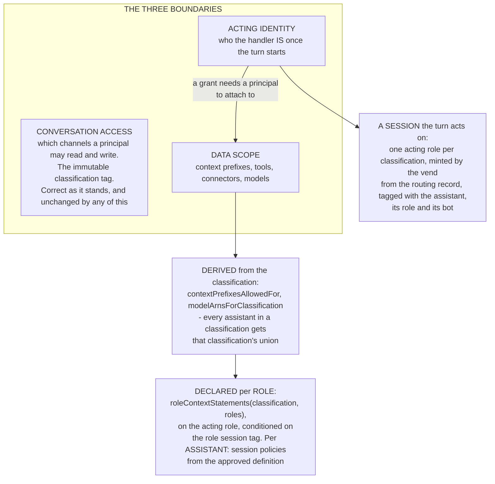

The isolation this argues for is not delivered by putting several assistants in one classification. It is delivered by **declaring scope rather than deriving it**, and that declaration needs a principal to attach to, which is why the acting identity moves first. Neither is a change to the classification model, and both are tenet D4's own mechanism: a capability is scoped by narrowing a vended grant.

**THE REQUIREMENT ABOVE IS DELIVERED PER ROLE, AND NARROWED PER ASSISTANT BY SESSION POLICY.** A role narrows company context below its classification (`roleContext`, `roleContextStatements`), and that read runs on the assistant's session, so premium's `ops` role is refused premium context its classification grants. The model allowlist is the classification's; an assistant's session is narrowed below its role by session policies chosen from its approved definition (Phase 1b). `tests/e2e/an-ops-role-reaches-only-its-own-classification.spec.ts` deny-tests the per-role context edge and a WIDENING - that the ops role reaches observability and the primary does not - which is a different property from one assistant being unable to fetch the raw data behind a report another assistant of the same role can see.

**What that leaves unnarrowed, and what is decided about it.** Today scope belongs to the ROLE, so two assistants holding the same role reach exactly the same data. The owner's decision is that **each assistant has its own boundary inside its classification**: the classification is the access IAM evaluates for every principal, and an assistant's own declared reach is enforced inside it by narrowing its vended session (tenet D4). The vend passes session policies chosen from the assistant's approved definition, so the effective permission is the acting role, its boundary and those policies together (Phase 1b, built). This supersedes the role-only reading in ADR-048 for the narrowing direction; a role remains the thing that declares a new scope inside the boundary.

**What is still wider than one assistant, stated rather than implied.** The async processor acts as the assistant only on the vended session: its own role holds logs, the vend invoke, the admin alert and the processor's own records (the abuse counters and cost circuit, the turn state and lock, the message-analytics row and the triage dispatch), none of which the acting role holds, and a turn the vend refuses does not act (`adoptTurnIdentity`, `assistant-async-processor.ts`). What remains is outside the turn. The channel flow reads on its own role (`ListChannelMemberships`, `ListChannelModerators`, `GetChannelMessage`, `ListTagsForResource` on `${appInstanceArn}/*`, with no condition), so it can read bearing any bot or user of any classification. The router's own role keeps a classification-conditioned read `/bot/*` bearer, an unconditioned `chime:SearchChannels` on `/bot/*` and `/user/*`, and, with drift on, channel, membership and moderator creation on `${appInstanceArn}/*`. The services that put a line in a conversation outside a user turn name a notice to the router, which says it; the roles that create conversations and add their members keep a classification-conditioned `/bot/*` bearer for creation and membership, and post nothing on it. The processor's admin error alert bears only admin-plane-tagged bots (`errAlert.grant(processorRole)`). And because a bot is never removed from an app instance by a stack replacement, `/bot/*` names every bot any earlier deployment created that still carries the classification tag.

Stated plainly so the wrong version does not get rebuilt: **a prompt is not an access control.** Where scope is not declared for the role, the prompt is what is doing the work.

### 1.4 Separation is what makes quality measurable

Evaluation, experiments and cost attribution are per profile and per `configId`, and the analytics grain carries the assistant and the role it holds (`assistant`, `assistant_role`, both resolved from the assistant's session). Separate assistants mean the finance team measures the finance assistant: its own scores, its own model spend, its own A/B. Merged into one assistant, every metric is an average over subjects that have nothing to do with each other, and a regression in one is invisible against the others.

### 1.5 An assistant is not a backend swarm, and the test is organizational

These get conflated, and the cost runs in both directions: a swarm modeled as assistants buys a stack, a bot identity and a role per step in exchange for nothing, while a team's work modeled as a swarm puts one team's rules inside another team's assistant.

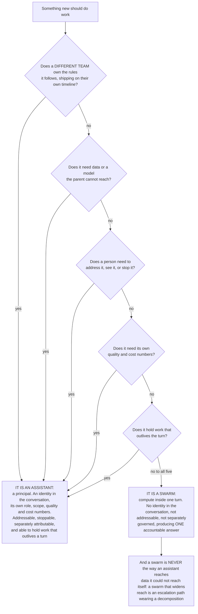

Parallel retrieval, a drafting pass and a verification pass are a swarm. The test is mostly organizational, because the point of separation is separate roadmaps and separate queues. The reuse argument sits here too: an assistant owned by one team can be placed in many conversations across many contexts, which a swarm step cannot, because a swarm step has no identity to place.

**What identity a sub-agent acts as is an open question and is not this document's.** [DESIGN-MULTI-AGENT-ORCHESTRATION](./DESIGN-MULTI-AGENT-ORCHESTRATION.md) owns the fan-out mechanism and records sub-agent identity as unresolved and blocking: every identity in the app instance belongs to an assistant holding a role, so there is no spare principal to lease, and nothing here should be read as answering it.

### 1.6 What separation costs, and when it is the wrong choice

A business case that does not name its own downside is one a platform team will resist on instinct, so:

- **N assistants means N of everything.** One bot identity, one Amazon Lex bot resource for any role beyond the primary, and one set of parameters each - to monitor, alarm, budget and keep on a version. IAM is not among them: every assistant of a classification acts through the same acting role.
- **Duplicated taxonomy work.** Each team re-authors and re-tunes intents that overlap with other teams', and shared platform wording stops being shared in practice even when it is copied from one place.
- **Divergent answers.** Two separately owned assistants can give two different answers to the same question in the same room, and nobody owns the disagreement. This is the mirror of 1.1's failure and at least as likely.
- **Higher aggregate spend.** More assistants in a room means more classifier calls and more profile resolutions per conversation.

**The threshold:** below a handful of teams, or where one team can genuinely own every subject, one assistant with a well-scoped pack and per-intent instructions is the right answer, and Phase 1 delivers most of the legibility benefit without any of this cost.

### 1.7 What the person gets

A person does not care about ownership. They care that the answer is right and that they can tell who gave it. Separation delivers both: the answer comes from the team that owns the subject, and it is attributable to a named assistant rather than to a single voice that is sometimes authoritative and sometimes guessing. The cost, which section 3 exists to remove, is that they now have to know who to ask.

---

## 2. What holds today

| Fact | Where |
|---|---|
| An assistant's whole behavior rides its own versioned profile: model, persona, intent pack, onboarding, tools, guardrail selection, context selection | `lib/active-profile.ts`, SPEC-PORTABLE-PROFILES |
| A version activates, rolls back, exports and imports as data, with no deploy, converging within the resolution cache TTL | `lib/profile-lifecycle.ts`, `lib/profile-manifest.ts` |
| A **classification** declares the ROLES it instantiates, and a profile name may not be a classification value - `validateProfilesConfig` refuses the collision | `backend/lib/config/profiles.ts`, with `ASSISTANT_ROLES` as the platform default for a classification that declares none |
| A **classification** is the boundary for conversation access: the channel grant and the model allowlist are generated from the classification value. **Company context is per role:** a role's `roleContext` (a subset of the classification's grants) is granted on the acting role conditioned on the session's `role` tag, the classification's boundary caps it, and the processor's own role holds no data grant at all, so premium's `ops` role reads basic and standard context and is refused premium's | `agent-classification-common.ts` (`contextPrefixesForRole`, `roleContextStatements`), `lib/config/profiles.ts` (`roleContext`), `lib/company-context.ts`, `async-processor-core.ts` (`actingRole`) |
| An **assistant** acts through its classification's one acting role, assumed per turn by the vend, with the bearer `.../bot/${aws:PrincipalTag/bot}`; a **role** contributes its own statements, conditioned on the `role` session tag. No IAM role exists per assistant or per role | `agent-classification-common.ts` (`assistantActingRole`), `assistant-profile-stack.ts` |
| The router writes which bot a turn answers as to the routing record before it dispatches; the vend reads it, resolves the assistant and its role from the assignment records, and mints a session tagged `assistant`, `classification`, `role` and `bot`; the processor adopts it first and fails closed | `lib/turn-routing.ts`, `assistant-vend.ts`, `lib/assistant-session.ts`, `assistant-async-processor.ts` (`adoptTurnIdentity`), `router-agent-handler.ts` (`invokeAsync`) |
| The **assignment record** is the authority for which assistant a bot is and which assistant role it holds, and the flow's responder lookup reads it with no fallback to a per-classification key | `channel-flow-processor.ts` (`resolvePrimaryBotArn`), `assistant-vend.ts`, records written by `assistant-profile-stack.ts` and `battle-stack.ts` |
| An intent carries behavior: its own instructions, model route, tool subset and workflow, and a person-facing `summary` | SPEC-CONFIGURABLE-INTENT-PACK, `lib/intent-pack.ts` |
| A turn hands over when a TASK names a different assistant. No task, no handover; unit-covered, with **no live exercise** | `router-agent-handler.ts`, ADR-030 |
| A conversation answers one turn at a time **per assistant**. The lock key is `turn#{channelArn}#{responderId}`, so it does **not** serialize two different assistants - ADR-030 calls two working at once a supported state. The queue is off in the CDK default; a deployment turns it on with the turn-queue context flag | `lib/turn-lock.ts`, `agent-classification-common.ts` |
| Live bot membership is read from Amazon Chime SDK, not from a roster copy | `channel-flow-processor.ts`, tenet D7 |
| A hand-over travels as a message targeted at the receiving assistant, which the channel flow routes from its token after release, post-processing backstops, and the receiving router verifies as its own bearer before acting (3.4). The Amazon Lex route does not carry it, because Amazon Chime SDK starts no Amazon Lex turn for a message an assistant authored (measured, ADR-023) | `router-agent-handler.ts` (`postHandover`, `verifyHandover`), `channel-flow-processor.ts`, `lib/handover-routing.ts`, `lib/handover-backstop.ts`, ADR-030 |

Two things the runtime keys on the classification rather than the assistant, because they name classification-level infrastructure several assistants share: `/assistant/{classification}/processor-arn` and `router-arn`. `bot-arn` is keyed the same way and is the one of the three that names a per-assistant fact; the per-assistant authority is the separate assignment namespace beside it rather than a migration of that key.

What the assignment record carries is the classification, the assistant role, the assistant, its bot ARN, and the Amazon Lex bot resource for a role that owns one. Its SSM key keeps an earlier shape, `/assistant-assignments/{classification}/{role}/{live|alt}`; renaming it is a separate migration. The `profileRef` and pinned version that 3.0 puts on it are the part not yet written there, so which profile serves an assistant is still resolved from the profile registry rather than read off the assignment.

---

## 3. The design

### 3.0 The structure: a classification has roles, and a role has assistants

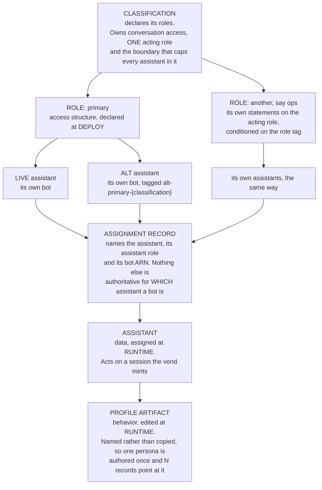

**A role NAME may become platform-wide, and that is deliberately not the same as a cross-classification assistant.** The forward-compatible reading is that the set of role names is a registry the platform owns, which each classification instantiates the ones it wants from - so `reporting` can mean the same thing everywhere while `(premium, reporting)` and `(standard, reporting)` remain different role instances with different assistants and different scopes, on different acting roles. That keeps ADR-042 intact: an assistant acts in exactly one classification, and a shared role name never produces a shared principal. What a shared name buys is a question worth asking of the data, which is a grouping in analytics rather than a grant. **The one thing that must not be inferred from a shared name is a shared SCOPE**, because a platform role carrying a platform scope would be a classification boundary expressed in the one place that cannot see classifications.

**One profile artifact, N assistant records.** The same role in three classifications is three assistants, and three copies of one persona is a maintenance cost with no boundary behind it - a wording change authored three times, drifting on the second. The mechanism exists: a profile exports and imports as one artifact carrying behavior and persona together, deliberately dropping the target's own compiled config (`lib/profile-manifest.ts`, SPEC-PORTABLE-PROFILES), which is precisely the split between what is shared and what is per instance. **The pins stay independent, and that is the point of pinning rather than pointing:** three records sharing a single pointer to whatever is active would activate a change in every classification at once and remove the ability to roll one out to premium before standard. The cost is that "everything is on v5" becomes something to check rather than something guaranteed, and the benefit is that identical `configId`s across instances make the same configuration measurable in three classifications.

**Access attaches to the ROLE, and each assistant is narrowed inside it.** The live and alt assistants of a role hold the same grants and differ only in which bot each may bear. That is what keeps an A/B honest: if the alt's reach differed from the live assistant's, a comparison would measure access rather than behavior, and "the challenger is worse at finance questions" would be indistinguishable from "the challenger could not reach the data". Per-assistant narrowing keeps that property: a turn serving an experiment's version, a duel side or an enrolled arm, is narrowed by the version the router recorded for it, the control is the live assistant's active version, and each duel side's pinned version is derived from the live assistant's active body, so their reach matches unless an experiment declares an access difference deliberately.

**A role's scope may narrow the classification's boundary and may never widen it.** Widening is a change to the boundary and belongs to whoever owns that boundary, which is a deploy; the permissions boundary in 3.6 is what enforces the direction rather than merely encouraging it. This is the same direction the credential exchange already states for people - a session policy only narrows - applied to an assistant.

**An alt is an ordinary assistant, not a pooled shell.** It carries its own versioned profile, its own identity and its own `configId`, so evaluation, cost attribution and rollback work on a challenger exactly as they do on anything else, and a duel becomes "run this request through two assistants of the same role" rather than a separate path with a persona injected into an anonymous identity.

**Roles are structural, not per-conversation.** An assistant is the primary for its classification rather than the primary of a particular room, so the answering assistant resolves from `(classification, role)` and not from a per-room store. Putting the role on the conversation would let one assistant be primary in one room and a specialist in another; nothing asks for that, and it costs a per-room lookup on the hottest path.

#### An identifier and a name are two fields

Collapsing them is why an assistant could not be renamed: one string served as the SSM segment a version is stored under, the assignment record's `assistant`, the analytics dimension AND the word a person reads in the room, so renaming the label moved every key and orphaned the version history. The durable thing was never the name - an assistant's identity is its `AppInstanceBot` ARN, which the platform owns for the life of the deployment.

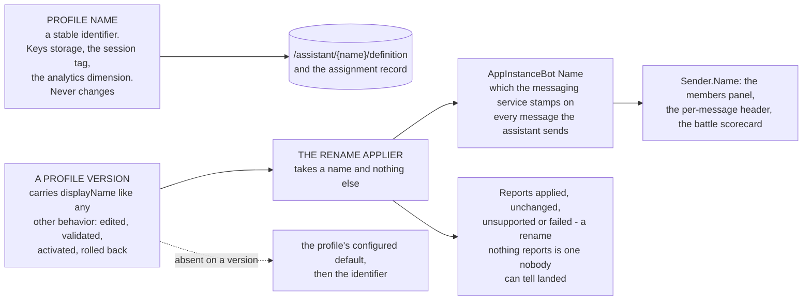

**A rename is not complete until it reaches the identity, and that is a provisioning action rather than a profile edit.** What a person sees is the `Name` on the `AppInstanceBot`, and `ProfileRegistry.displayNameFor` has exactly one non-test caller, the stack that provisions the identity - so **nothing at runtime resolves the profile field at all**, which makes the applier load-bearing rather than a tidy-up. `UpdateAppInstanceBot` takes the bot's whole `Configuration` alongside its name, so that grant is a grant to repoint the identity's Amazon Lex wiring; giving it to the profile writer (`manage-profiles.ts`) would let a behavior edit reach infrastructure, which is the line SPEC-PORTABLE-PROFILES draws when it says a version SELECTS within a boundary and never points at a resource.

Three things make the applier narrow structurally rather than by promise. It accepts only a name, so no parameter can express an opinion about configuration. It re-sends the configuration the identity ALREADY HAS, read back at call time, so it keeps no copy of the Amazon Lex wiring to drift or substitute. And its IAM grant names one bot ARN, its own, so it cannot reach another classification's assistant even if asked.

**Reusing the existing provisioner was the obvious move and is the wrong one** (tenet D8 asks first, and the answer here is no). The provisioner already holds the grant and the wiring, but a stack's seed is a CloudFormation custom-resource handler whose branches include Delete, and a caller chooses the event it sends. Granting the profile writer (`manage-profiles.ts`) permission to invoke it would grant it, by the same call, the ability to destroy an assistant's identity, and no guard inside that handler can distinguish a forged CloudFormation event from a real one. **Reuse that widens a capability is not reuse.**

**An assistant's identifier must not be a classification value.** A sample that names each profile after the classification it serves makes every reader that builds `/assistant/{classification}/...` correct by accident, and no test can tell the two apart because the strings match - which is how a classification came to stand in for an assistant across the tree. Names that cannot collide make the distinction checkable rather than conventional, and what a seed calls its assistants is the seed's choice: the platform only requires that a name is not a declared classification value.

### 3.1 An assistant declares what it does, and that declaration is public

Each assistant's intent pack is the authoritative statement of what it recognizes, and two audiences read it for different things: the assistant's own **classifier**, which needs `description`, written to separate this intent from its neighbors; and **everyone else** - a person deciding who to ask, and later a primary assistant deciding where to send something - which needs a short statement of what the assistant does with it, which is `IntentDef.summary`. **The published set is that plus the authored `boundary` line**, which says what the assistant does NOT reach. It is authored rather than derived because absence is not a phrase: a pack says nothing about the intents it does not declare, so what an assistant cannot do cannot be assembled from it. In a room holding several assistants it is the sentence that sends somebody to a different one, which makes it part of the advertisement rather than decoration around it. Its absence means the intent is recognized but not advertised, which keeps a narrow internal lookup out of every introduction.

**What is published is deliberately less than the pack.** Keys and the person-facing line, never `instructions` or `tools`. Those are how the finance team's assistant works; publishing them puts one team's implementation into another team's prompt, and makes every internal refinement a change other assistants see.

**THAT NON-DISCLOSURE IS CODE-ENFORCED AND IS NOT A BOUNDARY, which matters because it reads like one.** The advertisement is read from the versioned profile parameter, and the grant for it is `ssm:GetParameter` on `/{root}/assistant/*/definition` - wildcarded across every assistant and NOT scoped by classification. So a component that reads a roommate's `summary` is a component that may read that roommate's whole version body: its `instructions`, its tool selection, its persona, its guardrail selection, across classifications. The projection down to keys and one line happens in application code, so it holds as long as the code holds and no IAM denial backs it. Two ways to make the claim true rather than observed: publish a projected advertisement parameter that consumers read instead, and scope the definition read to the classification. Until one of them is done, this paragraph describes a convention and tenet D3 asks for two layers.

**THE ADVERTISEMENT IS INTERNAL, BY DECISION** (owner, 2026-09-30). It is read by assistants and people inside one deployment, and it is not an interoperability surface. The alternative considered and declined is publishing each assistant as an agent card over HTTP in the shape the A2A protocol defines, which would make these assistants discoverable by agents outside the deployment. Declined because no external face is wanted: this platform is deployed internally, or built on by an enterprise for its own use cases, and in both cases the agents that need to find each other are already members of the same conversation.

**What that decision buys, which is mostly the absence of work.** No well-known URL and no HTTP service surface per assistant; no signing, so none of the canonicalization machinery a signed card needs; no card staleness, timeout or partial-failure handling; and discovery scoped by CONVERSATION MEMBERSHIP rather than by a registry, so the candidate set is bounded by the room instead of by everything registered. A registry has to decide who may enumerate it; a room has already decided.

**And it stays cheap to reverse, which is the only reason the comparison is recorded.** An advertised intent is a key plus a one-line summary plus the assistant's display name, which projects onto an external skill declaration with no information missing, and both designs independently refuse to publish tools or instructions. So an external face, if one is ever wanted, is a projection of this data rather than a different model of it. Nothing is done now to preserve that property because nothing needs to be.

### 3.1a Membership is the index, and the advertisement is not in it

**An Amazon Chime SDK membership row carries an ARN and a display name, and nothing else.** It cannot hold an advertisement and must not be asked to. It answers exactly one question, which is the question it is authoritative for: WHICH assistants are in this conversation. Everything advertised is then read from each assistant's own artifact.

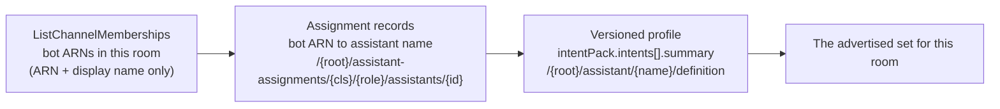

**Two of the three legs are already paid for on the turn path, in two different functions.** The roster read is in the channel flow and the cached map of live assistants is in the async processor, so neither pays for a lookup made in the other and a consumer in the flow has only the roster for free.
 The flow reads the roster ONCE and passes it down, which is the same read the `@all` size branch already makes, so the roster costs nothing new. `liveAssistantsForClassification` (`lib/default-agents.ts`) already resolves a classification's live assistants from the assignment records and caches them per container. Only the third leg is new work, and it is one profile read per OTHER assistant in the room rather than per assistant in the deployment.

**The intent pack is per assistant, and has two homes that compose.** `/{root}/assistant/{classification}/assistant-intent-pack` is the deploy-seeded per-classification pack; `intentPack` on the versioned profile is per assistant and operator-editable. It rides the version because `models.byIntent` is keyed by intent key, so the taxonomy and the per-intent model map are two halves of one decision.

**An assistant that inherits the deployment pack advertises NOTHING.** Absence of `intentPack` on a version means inherit, so an assistant with no pack of its own would otherwise advertise the classification's taxonomy as its own capabilities, and a primary routing against that would hand work to an assistant that is no more specialized than itself. Advertising is a positive act by a specialist, so inheriting is indistinguishable from declining to advertise and is treated as declining.

### 3.1b What is cached, what is not, and why the split falls where it does

| What | Cached | Why |
|---|---|---|
| The roster | **No.** Read live once per turn and passed in memory | Membership is Chime-owned state and a cached roster is a roster copy, stale exactly when somebody joins or an assistant is removed. Within one turn it is a value, never a store |
| bot ARN to assistant name | Per container, keyed by bot, in the processor; for one minute in the vend. **NOT cached in the bypass-identity gate**, which pages the records on every turn addressed to a bot other than its own | An assistant's ROLE and bot change on a deploy and which assistant is the alt when an experiment arms, neither of which is per turn. Readers of one fact that cache on different terms are a real inconsistency rather than a described design: the gate's reader should cache on the same terms, and until it does the cost claim below holds for the processor and not for the gate |
| An assistant's advertised summaries | Per container, keyed by assistant name, on the existing profile TTL | The same artifact and the same lifecycle as the profile it rides, so an activation converges within the TTL with no second mechanism. This is an assistant's own self-description rather than a copy of somebody else's state |

**The advertisement cache is keyed by ASSISTANT, not by conversation.** A deployment's assistants are few and its conversations are not, so keying by conversation would cache the same three profiles under every room and expire them independently. Keyed by assistant, a busy deployment resolves each specialist once per TTL however many rooms it serves.

**The gate is how many assistants the classification holds, and it is asked before anything is read.** Cheapest first:

1. **Does the classification hold another live assistant?** From the cached map of live assistants, so this is a lookup over a few records and no network call. Every single-assistant deployment stops here and the whole mechanism is inert for it, which is the common case.
2. **Does the room hold one?** A live `ListChannelMemberships`, the same read the turn already needs for sizing. A classification may hold two assistants with only one of them in this conversation.
3. **Only then** resolve the roommates' advertisements, from the cache where it is warm, and merge their lines into the pack the turn classifies against.

**A FALL-THROUGH GATE WAS THE ORIGINAL DESIGN HERE AND IT CANNOT WORK, which is worth stating because it reads as the obvious cost control and is the thing a later reader will reinstate.** The idea was to resolve roommates only when this assistant's own classifier landed on `general`, so a turn it recognized cost a count and nothing else. A classifier does not behave that way: it returns the nearest category it was shown, so an assistant whose pack advertises "a figure like ARR or churn" classifies "the deployment's error rate" as that, with high confidence, and never falls through. Measured directly - the ops question reached the finance pack and came back `financial_metric`, HIGH. The gate would have fired on the turns that did not need it and stayed shut on the ones that did.

**So the decision is the classification itself, made once.** The roommates' advertised lines are merged into the pack as prefixed categories before the turn classifies, and the key that comes back either belongs to this assistant or names a roommate. Resolving roommates after the classification instead would need a second model call: that shape was built and measured at 757 ms plus 795 ms on a single turn.

**What this costs on a turn in a room with a roommate:** one cached lookup per roommate and a longer prompt, with no extra model call. What it costs everywhere else: a cached count of live assistants.

**AND IT NEVER DELAYS A REPLY, which has to be stated because this sits on the reply path.** The resolution is a best-effort side path (tenet D5): a lookup that fails, or is refused, or finds this assistant alone among the bots, returns no roommates and the turn classifies against its own pack exactly as it would with none present. Every failure path returns the empty list rather than throwing, so no routing failure reaches the person as a lost answer.

### 3.2 An assistant's introduction is derived, not restated

An authored onboarding greeting that lists what an assistant covers, while its pack separately declares the same capabilities, is two statements of one fact maintained by hand in the same profile: edit the pack and the greeting lies. One source per question (tenet D7) says the introduction is assembled from the pack.

**THE DEMO IS PAST THE FIRST STATE AND NOT YET AT THE SECOND**, which is worth recording because it is the state a reader will actually find. The demo onboarding greetings have already been stripped of capability prose in anticipation of assembly, and nothing assembles, so what those assistants say about what they cover comes from the deployment orientation and the persona rather than from either source this section contrasts. The drift this section describes is therefore not the live defect; the live defect is that the authored half was removed before the derived half arrived. **The assembly is configuration, not fixed English:** the line a person reads carries the assistant's persona and the conversation's language (tenets P5 and D11), so the wording around the advertised intents is deployment-authored like the rest of `copy`. A hardcoded "I can help with:" would be the same defect in a new place.

### 3.3 A person can ask who does what

An introduction is read once. A person who joins a room later, or who forgot, needs to ask, and "who can help with X" is answerable from the advertised intents of the assistants actually in the conversation, read live from membership. This is the half-step that stands alone: a person in a room with a finance assistant and an HR assistant can tell which to address, and address it, with no delegation built at all.

### 3.4 Delegation reads the same advertisement

Once a primary can read what its roommates advertise, it can route rather than either attempting the work or failing to recognize it. The advertisement is the contract; delegation is a consumer of it rather than a second mechanism. **Published by the specialist, not listed by the primary** - a field on the primary's intent naming the assistant that owns it makes adding a finance assistant an edit to every primary, and the whole point of separate ownership is that the finance team changes their own profile and nothing else.

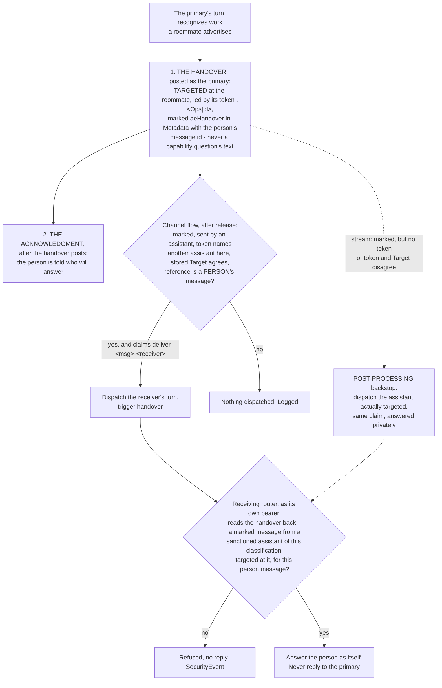

**THE TRANSPORT IS A TARGETED HANDOVER MESSAGE, ROUTED BY THE CHANNEL FLOW.** No component starts another assistant's turn by invoking a handler with that assistant named in a payload: an assistant reaches another only by posting a message in the conversation, and the receiving router acts only after reading that message back and verifying it. Post-processing on the Kinesis stream is the backstop, not the route. `lib/assistant-handover.ts` (the marker and body), `lib/handover-routing.ts` (the routing both callers share), `lib/handover-backstop.ts`, the assistant branch of `channel-flow-processor.ts`, and `postHandover` / `verifyHandover` in `router-agent-handler.ts`.

1. **The primary posts the handover, then the acknowledgment.** The handover is targeted at the roommate, so only the two assistants can read it. Its body leads with the roommate's delimited address token, `.<Name|id>`, which resolves by id. Its `Metadata` carries the `aeHandover` marker: the person's message id and sender, whether the person's message was private, and the kind. A capability handover carries the receiver's own advertised intent key and never the question's text. A task handover carries the person's words, because an answer addressed privately to the primary is not readable by the owner; the handover reaches exactly the owner, as the earlier payload did. The acknowledgment follows only once the handover has posted. A capability acknowledgment is returned and inherits the person's message's visibility; a task receipt is posted and targeted at the person. Both are fixed English, a recorded tenet D11 exception (**OPEN**).
2. **The channel flow routes it, after the release.** The flow sees every message, including one an assistant authored (MESSAGE-FLOW §5.1, measured), and its callback never carries `Target`. For an assistant-authored message carrying the marker, and only then, it resolves the token against the live roster, reads the stored `Target` back as the sender, and reads the referenced message to confirm a person sent it. When all agree it claims `deliver-<person message id>-<receiver>` and dispatches the receiver's turn with `trigger: 'handover'`, the handover's id, and the person as the sender. A person's own `.Ops` message never reaches this branch: Amazon Chime SDK stamps the sender, so it is an ordinary private address left for Amazon Lex (MESSAGE-FLOW §4.5). Model text that merely starts with `.Name` carries no marker and is never routed. The reads run after `callbackAllow`, so the release never waits on them (ADR-041 point 4).
3. **The receiving router verifies the handover itself.** A `trigger: 'handover'` turn must name a handover message, and the router reads it as its own bearer, which Amazon Chime SDK permits only to the sender and the `Target`, with one retry for a read moments after the post. It proceeds only when the message carries the marker, references the message the turn answers, was sent by an assistant this classification sanctions other than itself, and is targeted at it. Anything else ends the turn with no reply and a `SecurityEvent` line. The sender the turn records is the one on the verified message, never the payload's.
4. **Post-processing delivers what the flow could not.** The stream record carries the token and the `Target` together. A marked handover with no token, or whose token names someone other than its `Target`, is a defect in whatever composed it, and post-processing dispatches the assistant actually targeted, under the same claim, answered privately because this rule cannot read the person's message to learn its audience (ADR-041 point 6). When the token matches the `Target` it stands aside, because that is the flow's case and the stream can arrive first. It never acts on an unmarked message, so a receipt or a reply that inherited targeting is never dispatched.
5. **The receiver answers the person, never the sender.** It reads the person's message as its own bearer, or takes a task handover's words from the verified message, and answers under its own name, privately when the person's message was private. When it cannot read what it was handed, it says so and asks for the question again rather than going quiet (tenet D5). It never posts a message to the primary; replies between assistants are coordination, which is **NOT BUILT**.

**Why a message rather than an invoke.** The handover is a stored conversation message moving under the same controls as every other one: the sender posts it on its own vended session, pinned to its own bot, Amazon Chime SDK authorizes a read of it on `Target`, the flow routes it, and the receiver verifies it as itself. A forged turn request has nothing in the conversation to verify against, so it is refused. The handover is invisible to the room; the room sees the acknowledgment. It reaches the stream and the S3 archive, and the Aurora projection records its sender and `targeted_to` rather than its marker.

**THE LOOP AND COST BOUNDS.** An assistant answering an assistant without a bound is a loop that spends model calls until something stops it. Each bound below holds on data the sender cannot write:

| Bound | Where it holds |
|---|---|
| **One hop, by data.** Only a message a PERSON sent may be handed over | the flow confirms the referenced message's `Sender`, which Amazon Chime SDK stamps; and a turn that arrived by handover, of either kind, may not hand over again (`arrivedByHandover`) |
| **One turn per person message and receiver** | the flow and post-processing both claim `deliver-<person message id>-<receiver>`, separate from the sender's own `delegate-` and `handover-` keys, so the sender's dedup never blocks the delivery and the second deliverer stops |
| **No reply to the sender** | the receiving turn posts only to the person or the room. `bot-coordination.ts` does not enforce this: it keys on a `Target` the flow callback never carries (MESSAGE-FLOW §4.11) |
| **Marker and token, never a token alone** | the flow and the backstop both require the marker |
| **Counted from the archive** | a handover is read from its `aeHandover` marker in `messages.metadata`, defined once (`handoverSql`, `analytics-query.ts`). The `handovers` query reports, per day, receiver and kind, the handovers sent, those answered (a `handover`-kind turn by the receiver in the same conversation, from `v_turn_latency`) and the gap, which the console's Handovers panel shows beside Turn kinds. A handover is a message, so it counts in message totals (broken out as `handover_count`) and appears in Turn kinds as its own kind, `handover`; it is never an answer, so it never pairs as one |

**HOW A HANDOVER IS MEASURED.** Two exchanges, one per assistant, both kept tied to the person's message:

- **The primary's response is its acknowledgment.** It pairs with the person's message as the primary's exchange, so the primary's time to first feedback is the time to tell the person where the question went.
- **The handover starts the receiver's end to end.** The receiving turn declares the handover as what it answers, so its exchange is (handover, reply) and its latency runs from the handover, not from a message the primary already answered. Archival pairs a handover only with the reply its receiver declared for it, never by proximity, and never treats a handover as a reply (`isHandoverRecord`, `kinesis-archival.ts`).
- **The person's message stays the subject of the work.** The receiving turn reads it, its task rows record it as `userMessageId`, and the handover's marker names it (`personMessageId`), so every exchange and task in the chain joins back to what the person asked.

**Known limit.** A claim cannot be released, so a flow dispatch that fails after claiming is not retried by the backstop; it is logged as an error. The receiving router's invoke is synchronous from the flow, so this is the router being unreachable, and the person is left with the acknowledgment and no answer. **OPEN.**

A reference rather than the content keeps a capability request private: the boundary is the receiving assistant's read access rather than the sending assistant's judgment about what is safe to repeat. **Open:** a person's question targeted privately at the primary is not readable by the roommate, so the receiver asks for it again. Whether a capability handover should carry that one question, as a task handover carries an answer, is not decided.

**THREE PRODUCERS REACH THE IDENTITY GATE, AND THEY ARE NOT BOUNDED THE SAME WAY.** This section describes the mention path, which is bounded by a live `ListChannelMemberships`: a person cannot name a bot that is not in the room. The other two splice a task record's `assistantId` onto the acting bot's ARN prefix, and their bound is task ANSWERABILITY, so they can name an assistant that has since been removed from the conversation.

**THAT IS AN INCONSISTENCY RATHER THAN AN EXPOSURE, and the distinction is worth being exact about** because the loose version of it reads as a vulnerability and is not one. Immediately after the identity is validated, the router performs a `DescribeChannel` AS THE ADOPTED BEARER - a read that exists precisely so IAM and Amazon Chime SDK decide before the model does - and a refusal ends the turn ahead of intent classification, processor resolution, drift and dispatch. So an identity that should not be acting here never reaches a tool, a model or a message; it reaches a refused read. The ordering is the enforcement, and it was already there.

What the splice actually costs is a turn that adopts an identity destined to refuse, and two producers that answer "who is in this room" differently. The flow's own roster is already in hand for the turn, so the fix is a lookup: the task-spliced identity is used only when that bot is a current member, and otherwise the classification's own assistant answers. Same roster the mention path resolves against, so the two cannot disagree.

**WHO REPORTS A FAILED HANDOVER IS THE RECEIVER, AND IT CANNOT BE THE PRIMARY.** The primary answers that it has passed the question on and returns - before the turn claim, before any placeholder - and the dispatch is fire-and-forget, so by the time anything can go wrong the primary is gone. An earlier version of this section said the primary tells the sender privately who owns the request, which is not reachable from there. It also matters more than it looks: the person has been PROMISED a reply by one assistant, so a receiver that cannot resolve the reference and says nothing is worse than the silence that promise replaced - the room shows a successful-looking handover and a question that is never answered again. The receiver therefore speaks as itself and asks for the question again, which is a helpful degradation rather than silence (tenet D5). It does that rather than throwing, because an asynchronous invoke's exception is retried and then dropped with nobody in the room told either time.

**The fail-closed property in the diagram is stronger than the prose claims, and the credit belongs elsewhere.** "The specialist reads the conversation itself, with its own permissions" is enforced by Amazon Chime SDK authorizing a channel read on MEMBERSHIP, not by anything in this design: a non-member bearer cannot read the conversation at all. That is a platform property rather than application logic, which is what makes it worth resting a boundary on.

**The acknowledgment follows the handover, on both kinds.** Sent first, a handover that then failed to post would leave a person told that another assistant had their answer while this one answered it instead, under a name they were never given. The two kinds differ in how it travels. A capability acknowledgment is its own copy and is RETURNED, so it inherits the visibility of the question it answers. A task receipt is POSTED and targeted explicitly rather than returned, because a reply inherits the inbound message's targeting and would broadcast to the room that a message it never saw had been passed somewhere. A second delivery that loses the dispatch claim stays quiet rather than telling the person twice.

**The primary stands down, and nothing enforces that.** The lock key is `turn#{channelArn}#{responderId}`, so it serializes one ASSISTANT's turns and was never scoped to serialize two, and ADR-030 calls two assistants working at once a supported state deliberately. So standing down is application logic with no lock behind it - a requirement on the code rather than a property of the platform, which is exactly the kind of claim that reads as safe because a mechanism with a similar name exists nearby.

**Delegation moves no data across a boundary, and the reason is not the one to reach for.** Two assistants holding the same role hold identical grants today (3.0), so no per-assistant IAM is doing any refusing between them. What refuses is the ROLE's reach, so the claim is only as strong as the roles being different; "its own IAM refuses what its grants do not cover" describes nothing when the delegate shares the delegator's role, until per-assistant narrowing is built (1.3).

### 3.5 The rules that have a wrong answer that looks right

**"One assistant serving several classifications" is the repetition that must not be factored out.** A meetings assistant wanted in basic, standard and premium rooms looks like one assistant deployed three times, and the duplication is real: three bot identities, three sessions on three acting roles, three scope grants, three of everything except the behavior. The instinct to collapse it into one principal is the strongest wrong answer in this design, because the thing being duplicated is the boundary. That assistant reads PREMIUM notes and transcripts in a premium room and basic ones in a basic room, so a single principal serving all three would have to hold all three classifications' transcripts at once, which is exactly the cross-classification principal ADR-042 refuses, arrived at by tidying rather than by deciding. The tell is general: **if factoring out a repetition would produce one principal reaching several classifications' data, the repetition IS the enforcement.** What is genuinely duplicated and should not be is the BEHAVIOR, which is why an assistant record names a profile artifact rather than owning a copy.

**The qualifier that keeps that honest: one assistant across classifications is architecturally viable, and it is refused on cost rather than on possibility.** The shape is a single bot whose turn assumes a role scoped to the ROOM's classification rather than to the assistant's, which is how a person already works - `classificationsAllowedFor` gives a person the SET they reach while `channelsAnAssistantMayActIn` gives an assistant a POINT. It is recorded rather than left to be re-derived, so a later reader who notices the same thing finds the price instead of starting over.

| The objection | Why it does not survive contact |
|---|---|
| Memory bleeds between classifications | The runtime is per classification: a premium turn and a basic turn execute in different Lambda functions, not one warm container |
| The deny-test is lost | It moves from the base role to the assumed session, and is as simulable there |
| The IAM condition changes shape | It is already `StringEquals` over a list, so a set matches the way a point does |

| What it would cost | What it would buy |
|---|---|
| **Blast radius:** one compromised identity reaches every classification it may assume, where N identities reach one each | The profile duplication, which naming one artifact rather than copying it already removes (3.0) |
| A different carrier for the assistant's own classification, because a tag is single-valued and that tag is load-bearing for the provisioning grants (3.6) | One name a person sees, which three bots sharing a display name already deliver |
| An amendment to ADR-042, a deny-tested decision rather than an assumption to route around | |

| Question | Decision | Why the obvious alternative is wrong |
|---|---|---|
| Two assistants advertise the same intent key | Both are offered to the person; a primary delegating refuses to choose and asks | Silently picking one makes the answer depend on membership order, which nobody can see |
| The owning assistant is not in the room | Say so and name it; do not invite | Auto-inviting a principal into a conversation is a membership change made on someone's behalf, at a classification boundary |
| The primary's classifier prompt grows with every roommate | Advertised intents are offered for ROUTING, not merged into the primary's own taxonomy | Merging makes the primary claim to do things it cannot, which is the failure this design exists to end |
| An advertised intent the specialist later removes | The advertisement rides the PROFILE's own resolution TTL, so a withdrawal converges the same way every other profile edit does (3.1b) | A separate capability cache with its own lifetime is a second thing to invalidate, and the one that goes stale exactly when a team withdraws something. What must never be cached across turns is the ROSTER, which is Chime-owned |

### 3.6 Provisioning an assistant, and why a permissions boundary is the control

Creating an assistant creates a principal in the conversation: a bot identity, the profile it serves, and the facts that resolve it. It creates nothing in IAM. Putting it at runtime so a team self-serves reads like it requires a Lambda holding `iam:CreateRole` or `iam:PutRolePolicy` - the most escalation-prone grants a runtime principal can carry, because a role is exactly the thing that carries permissions. It requires neither, because an assistant is a set of session tags on a role that already exists.

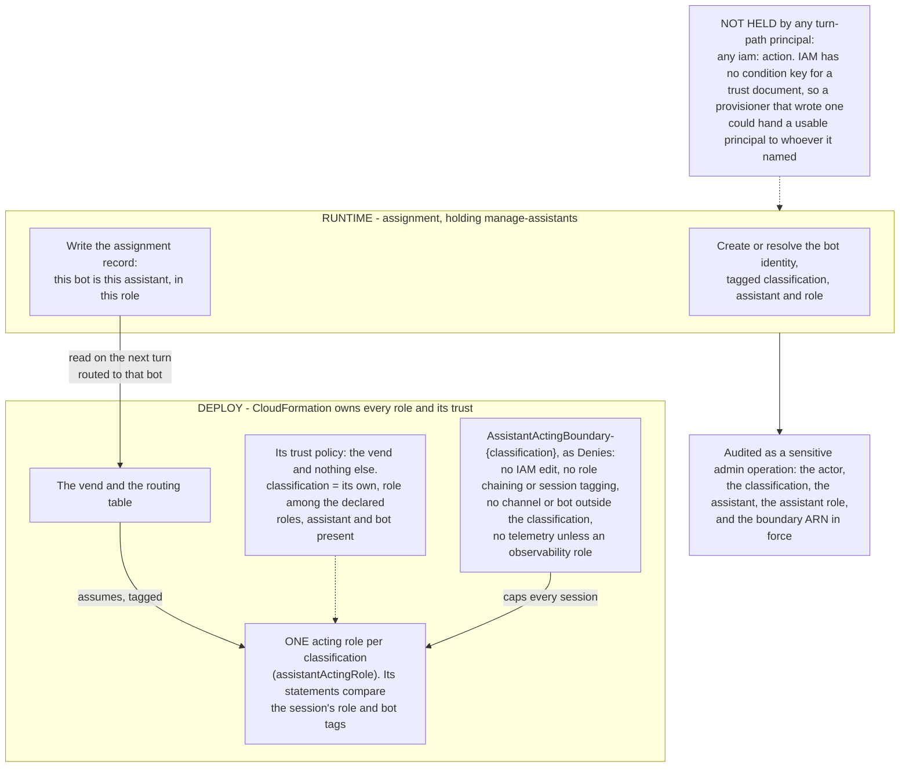

**The absent grant is what closes the worst hole.** A permissions boundary caps what a created role may hold and says nothing about WHO MAY ASSUME it, so `CreateRole` plus a boundary is not the safe combination it reads as. With one acting role per classification there is nothing to create and nothing to write: the assistant is the `assistant` and `bot` tags on a session the vend mints (`assistant-vend.ts`), and who may assume the acting role is fixed at deploy (`assistantActingRole`, `agent-classification-common.ts`). The only identity grants are the provisioner's (`runtimeAssistantProvisioningAllow`), which carry no `iam:` action beyond passing a Lex runtime role to Amazon Lex and whose tag writes are locked to `RUNTIME_ASSISTANT_TAG_KEYS`; `admin-experiments.ts` assigns an alt by writing its assignment record and writes no IAM.

**That split follows the line 3.0 already drew.** A role is access structure, so it is deploy-time and belongs to whoever owns the classification; an assistant is data, so it is runtime and belongs to the team. Adding a role is a deploy, which is right, because a role declares a new scope inside the boundary. Adding an assistant, or changing which assistant serves, is a data write, which is the ownership this design argues for. A reconcile in the shape of `backend/scripts/reconcile-assistant-identity-tags.mjs` still earns its place, reporting an assignment record whose bot carries no matching identity tags, or a tagged bot no record names.

**What remains code-trusted, stated because it is not zero.** The router decides which bot answers, and the vend trusts the assignment records for which assistant and which assistant role that bot is. A defect in the router could route a turn to the wrong assistant of the same classification; a defect in an assignment write could give a bot the wrong assistant role, though only one the trust policy accepts. Both stay inside one classification's boundary and neither hands a principal to anyone outside it. The router, the assignment writer and the vend are a trust boundary of the same kind the credential exchange is for people.

**Two layers, as tenet D3 requires.** The capability decides who may ask; the permissions boundary decides what the answer may contain. Neither alone is sufficient: a capability check without a boundary is one bug away from an over-scoped assistant, and a boundary without a capability check lets anyone who reaches the API create assistants inside the boundary. The capability is `manage-assistants` (`POST /admin/roster`, `POST /admin/roster/{assistantId}/retire`, in the capability catalog, `backend/lib/config/admin-capabilities.ts`), authorizing creating and retiring an assistant within a deployed role, and it is deliberately neither a capability that edits or activates a profile version (`edit-profiles`, `activate-profiles`, which change behavior and may not touch a boundary) nor the one that changes a classification boundary (a deploy).

**AND THE BOUNDARY IS THE CONTROL, SO IT NEEDS A DENY-TEST RATHER THAN THIS ARGUMENT.** Tenet P4 settles the form of the evidence: isolation is provable by deny-test rather than by code review, and a section that rests on a permissions boundary and names no deny-test has given a reason instead of a proof. **Gate:** a session of the deployed acting role cannot hold a grant outside `AssistantActingBoundary-{classification}`, asserted against the deployed role rather than against the synthesized template, so a boundary that failed to attach is caught; a session tagged for assistant A cannot send as bot B; and no turn-path principal holds an `iam:` action (deploy-time custom resources hold `iam:PassRole` and `iam:CreateServiceLinkedRole`). `tests/e2e/an-assistant-boundary-refuses-cloudwatch.spec.ts` is the shape to copy, since it already simulates a deployed role against a boundary. The synthesized half is asserted by `backend/test/an-assistant-acts-through-one-tagged-role.test.ts`. **Until the live half runs, this section is specified and NOT proven.**

**Deleting an assistant removes the bot and the facts that resolve it together, and not the Amazon Lex bot resource.** There is no per-assistant IAM to remove. Every assistant owns its Amazon Lex bot, built and removed with its identity by the provisioner (ADR-048, amended 2026-10-24). The delete keeps the rules the bot half learned (`deleteIdentity` in `lambda/src/lib/assistant-provisioner.ts`): establish existence where the API declares it rather than inferring it from a delete's error, treat already-gone as success so a teardown is never wedged, and surface anything else rather than leaving a live principal behind a log line. **Channel memberships are the known gap:** a deleted assistant's membership rows linger, and `membership-audit.ts` resolves them to null and skips them silently, so they are neither removed nor reported - tracked separately rather than solved by widening any role with channel permissions.

### 3.7 Populating the alt

An alt is an ordinary assistant, `alt-{role}-{classification}` ([ADR-050](../../../design/decisions/050-the-alt-is-an-assistant-and-a-conversation-is-enrolled-once.md)), rather than a pre-provisioned shell, which raises the question of when that assistant comes into being. **Almost all of it exists before a battle starts**, and what activation adds is a profile version.

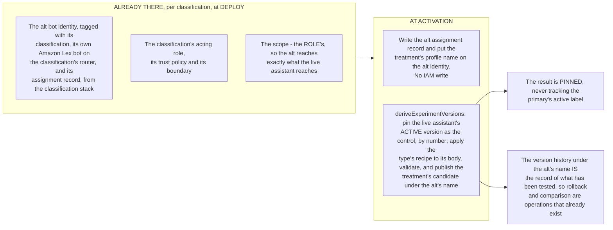

A variant carries exactly the recipe and nothing else - `modelKey`, `profileRef`, `imageGenModelKey`, `systemPromptAddendum` - and `lib/profile-lifecycle.ts` publishes versions against `/assistant/{name}/definition`, stamping `derivedFrom` so a candidate is refused as a rollback target. A variant carries no name: a duel side is named from its pinned version (`battleSideNames`), and a variant `displayName` a request still sends is dropped on write. So the derivation is an op on an existing seam rather than new infrastructure (tenet D8), and arming calls it.

**Both duel sides are pinned versions** ([DESIGN-EXPERIMENTS-BATTLE-DECISION-LOOP](../quality/DESIGN-EXPERIMENTS-BATTLE-DECISION-LOOP.md) §3.5, [SPEC-BATTLE](../quality/SPEC-BATTLE.md) FR11). Arming any experiment pins two versions in the same request: the experiments handler invokes the profile writer (`deriveExperimentVersions` in `manage-profiles.ts`), which pins the live assistant's active version as the control by number (`controlPin`, nothing published under the live name) and publishes the treatment's candidate under the alt's name (`altPin`), the control's body plus the type's recipe read from the experiment row (`variantDeltaOf`): `intent` changes only `models.byIntent[<intent>].primary`, `base_model` the base model, `classification` `models.classifier`, and `profile` takes the referenced body, intents excepted. An experiment arms only with both pinned (`armRefusal` in `admin-experiments.ts`). A side's turn then reads that one version like any assistant's turn reads the version it serves: the router classifies with it and gates task creation by its workflow selection, and the processor serves it as a version, answering through its per-intent routes and base model with no model forced beside it. Nothing about the variant rides the turn beside the version; the battle context carries only the two sides' names, read from their versions.

The live assistant's history holds only versions that served or were promoted. Promotion copies the measured candidate into the live history, refused before any write unless the live active version is still the pinned control and the copy hashes to the candidate's `configId` (`promoteCandidate` in `profile-lifecycle.ts`, [DESIGN-EXPERIMENTS-BATTLE-DECISION-LOOP](../quality/DESIGN-EXPERIMENTS-BATTLE-DECISION-LOOP.md) §3.6). A duel side is named from its profile, never by an alias on the experiment (`battleSideNames` in `experiment-manager.ts`): the control by its pinned version's `displayName`, else the live assistant's configured name (`ProfileRegistry.displayNameFor`), and the treatment by its version's `displayName`, else the control's. When the two names match, case aside, the treatment's carries the `battleAltName` line from its own version's copy (by default `{name} (alt)`), so the two sides read differently. The alt identity wears the treatment's name while the experiment holds it, and the live identity's name never changes for a battle. A profile name names no model, so the duel stays semi-blind. Built and deployed; promotion is verified on a deployment by `tests/e2e/a-tested-treatment-is-promoted-into-the-live-assistant.spec.ts` (2026-10-27).

The alt is provisioned like any assistant, through its classification's own provisioners, by its own `Assistants-<classification>` stack (`attachBattle` in `classification-capabilities.ts`, on the provisioners `assistant-profile-stack.ts` builds): its own bot, its own Amazon Lex bot on that classification's router, so a reply targeted at it resolves from `event.bot.id` like any addressed assistant, and the `(classification, role, alt)` record. It exists only where the deployment declares `battle`.

**What keeps the scope down, stated as the things deliberately NOT done:**

- **No identity is created at battle time.** The bot and the acting role are deploy-time artifacts. An activation that had to mint a principal would drag the whole provisioning path (3.6) into the battle path, and the battle path is the one a person triggers from a conversation.
- **No profile is authored.** The alt's behavior is derived, so there is no second place to edit and no drift between the assistant under test and the one serving. A variant that is not a delta of the live assistant is not an A/B, it is a different assistant.
- **No new store**; the API adds only arming's derivation, the challengers listing and promotion.
- **No scope decision.** It is the role's, settled once.
- **No teardown.** Deactivating a battle stops routing to the alt; the version stays, because a version is the evidence of what ran.

**The delta cannot widen access, and that is structural rather than checked.** A profile version carries selections and never references - no classification, no context scope, no ARN, no policy (SPEC-PORTABLE-PROFILES D-3) - so there is no field in a variant through which scope could travel, and a variant naming a tool the acting role cannot invoke for this assistant role produces a runtime failure in the loop rather than an escalation. This is the same split that makes `edit-profiles` and `activate-profiles` different capabilities from `manage-assistants`: behavior is data, a boundary is infrastructure.

**One property to preserve.** The derivation reads the live assistant's ACTIVE version at activation and pins the result rather than tracking it. An alt that followed the primary's active label would have its control's counterpart silently changed by a mid-experiment activation, making the measurement meaningless - the same rule the experiment already applies by treating variant models and count as immutable once traffic accrues (`variantIdentity`).

---

### 3.8 Who speaks in a room: the primary runs the conversation, and others support it

**DESIGN TENET: there is always a primary to orchestrate when the correct responder is not clear.** Every room has exactly one primary assistant, recorded on the room and never absent. When a message names no assistant, when `@all` asks the room, or when the platform has something to say in the room, the primary answers and decides whether another assistant should take the work. Every other assistant supports it: it speaks when it was asked by name, when the primary handed it the work, or when the work is already its own. This applies [ADR-030](../../../design/decisions/030-a-message-is-answered-by-the-assistant-whose-work-it-answers.md)'s rule, that a message is answered by the assistant whose work it answers, to everything a room hears.

**BUILT, NOT YET DEPLOYED.**

| What is said | Who says it | Source of the bot |
|---|---|---|
| A turn nobody addressed, and `@all` | The room's primary | `primaryAssistantOf` |
| Anything said for the room: join, share, Battle Mode on and off, archive, the typed-conversation notice, a briefing, a duel's closing line | The room's primary | `primaryAssistantOf` |
| A message addressed to an assistant (`@Ops`, `.Ops`) | That assistant, and privately when the address was private | The addressed member |
| A change to a work item, or the next step of a task | The assistant that owns it ([ADR-024](../../../design/decisions/024-task-ownership.md)) | The owner recorded on the item |
| A hand-over | The receiving assistant | The stored hand-over target |
| A duel round, and a side's "did not finish" line | That side | The duel's rows |
| A queue notice | The assistant whose queue it is | The assistant that posted the queued reply |
| An admin alert | The admin assistant, in admin channels only | The admin-agent bearer, never a room assistant |

**EVERY ROOM RECORDS ITS PRIMARY.** A channel tag, `primaryAssistant`, names the primary's assistant handle. It is written in the same `CreateChannel` call that writes `classification` (`primaryTagFor` in `lambda/src/lib/conversation-primary.ts`, used by `lib/channel-creation.ts`, through which every path creates, the proactive briefing and both federated paths included), so no room exists for an instant without it. The admin notification channel is one of these rooms: its provisioner names the admin assistant through the same `primaryTagFor` at creation, and stamps the tag on an existing channel on every deploy (`admin-notification-channel-provision.ts`). Members cannot change a channel tag, so it is tamper-proof the way `classification` is. A handle rather than a bot ARN means reassigning an assistant moves every room that names it with no re-tagging. Channel Metadata is member-writable and is never the source.

**ONE RESOLVER, `primaryAssistantOf(channelArn)`.** It reads the room's `classification` and `primaryAssistant` tags and resolves the handle to its bot through the assignment records, the authority on which assistant holds a role (3.0). It returns the bot, the assistant and the classification. A caller that already reads the room's tags shares one read with it (`memoizedTagReader`), so the flow and Battle Mode pay for one tag read per conversation. It never reads `/assistant/{classification}/bot-arn`, which is the deployment's pointer to a classification's default bot rather than a role's assigned assistant.

**There is always a primary, and each place one could go missing is guarded.**

| Where a primary could go missing | Protection | Enforced by |
|---|---|---|
| A classification with no assistant in its `(primary, live)` assignment record | The record is written only at deploy, by the classification stack, with the assistant and its bot; the only runtime assignment writer (`admin-experiments.ts`) writes the alt's record | `a-room-is-spoken-for-by-its-primary` (synth and source) |
| A room created without one | Creation resolves the primary BEFORE `CreateChannel` and throws `RoomHasNoPrimary` if the bot it was asked to create the room for is not a live assistant of the classification | `primaryTagFor`; `a-room-is-spoken-for-by-its-primary` |
| The primary not in the room | It is the bot the room is created for, so it is a member and moderator from creation; remove-member refuses any assistant | `conversation-management.ts` |
| A room created before the tag existed | `scripts/backfill-primary-assistant.mjs` tags every room, private and public, from its classification's primary assistant | The backfill |
| A tag missing or naming an assistant the classification no longer has | The resolver falls back to the classification's primary assistant, so the room keeps answering (tenet D5), and logs `[PrimaryAssistantFault]` naming the room so the backfill is run. It does not rewrite the tag: a role able to write channel tags could rewrite `classification` | `primaryAssistantOf` |
| A classification with no primary assistant at all | The resolver throws `RoomHasNoPrimary`; a notice is skipped and a turn fails, as an unreadable classification already does | `primaryAssistantOf` |

Admin-plane channels are outside this rule: nothing speaks for them but the admin assistant, through the admin-agent bearer.

**Every path that speaks for a room resolves through it.** The router (an unaddressed turn), the channel flow (`@all`, unaddressed commands, private-address notices), Battle Mode's notices, share, the federated join, the typed-conversation notice, the archive notice and a duel's closing line call `primaryAssistantOf`; conversation creation, the briefing and the federated creators take the classification's primary assistant (`primaryAssignmentOf`) for the room they are creating and tag it. The archive notice names the archiver by their `AppInstanceUser` name, which the credential exchange sets from the identity provider.

**Enforced by a test, not by convention.** `backend/test/a-room-is-spoken-for-by-its-primary.test.ts` holds the list of every file that speaks on an assistant session, requires each one that speaks for a room to resolve through `primaryAssistantOf` or `primaryAssignmentOf`, and holds the list of the paths that still read the classification's `bot-arn` pointer, none of which posts a message: membership administration (federated remove-member, the group reconcile), the membership audit's map of assistant bots, `user-tasks-api`'s read bearer, and the router's own bot for sanction checks and read bearers.

**Verified by:** `backend/test/a-room-is-spoken-for-by-its-primary.test.ts` (the resolver, the creation tag, the assignment guards, the speaker and reader lists), `backend/test/conversation-management.test.ts` (the archive notice from the room's primary), `backend/test/lib/the-flow-pays-for-what-it-uses.test.ts` (one tag read per conversation), `backend/test/the-assignment-says-which-assistant-is-live.test.ts` (the assignment reader's path).

**NOT BUILT:**

- **Changing a room's primary.** An administration act that re-tags the room to another assistant already in it and is announced there. Until it exists, a room's primary is the one it was created with.
- **The membership audit's check** that a room's primary is a member.
- **The notice that a room gained a second assistant** ([ADR-030](../../../design/decisions/030-a-message-is-answered-by-the-assistant-whose-work-it-answers.md)).
- **An admin alert for `[PrimaryAssistantFault]`.** The fault is a log line today.

## 4. Phases

Each phase is independently useful, and its gate is stated as evidence rather than as a completion claim.

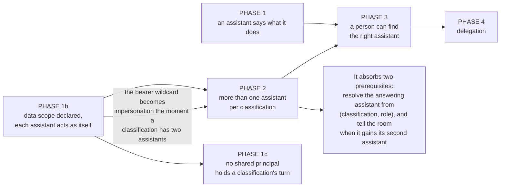

### Phase 1: an assistant can say what it does

Derive the capability statement from the pack, wire the onboarding greeting to it, and answer "what can you do" from it. Correct any demo content and profile guide that frames capability as a property of a classification.

**THE DERIVATION IS BUILT. ONE OF ITS TWO CONSUMERS IS WIRED, and which one matters.** `IntentDef.summary` is declared, parsed, validated and bounded (`MAX_INTENT_SUMMARY`, with `MAX_ADVERTISED_IN_INTRODUCTION` bounding the list separately); the demo packs populate it; `advertisedIntents()` filters and returns it; `assistant-capabilities.ts` composes the statement including the introduction cap and the authored `boundary` line; and `an-assistant-says-what-it-does` covers all of it.

**Routing consumes it** (Phase 4): an activation publishes the advertisement to the assistant's own parameter, and a roommate's lines become categories in the classification that decides a handover. **The person-facing half does not.** `capabilityStatement` has no production caller, so nothing assembles a greeting or answers "what can you do", and the demo greetings have ALREADY been emptied of capability prose in anticipation of that caller (`demo/onboarding.ts`) - so what a person receives today is composed from the deployment orientation and the persona rather than from the pack. An advertisement a person never sees is the half that was easiest to build and the half this phase was written for.

- **Delivers on its own:** an assistant's introduction cannot drift from what it actually recognizes.
- **Gate:** the WELCOME A PERSON RECEIVES contains a summary string that appears only in the pack, and changes when the pack is edited. Stated against the delivered greeting on purpose: a test that `capabilityStatement()` changes when its input changes passes today, against a function with no caller, so a gate written that way is green while the phase is unbuilt. That is the same defect as the `@Ops` gate below, in this phase, and it is why the gate names the person-facing artifact rather than the helper.
- **The inherit case from 3.1a is implemented.** `advertisedIntents()` runs on the RESOLVED pack and cannot tell an inherited intent from a declared one, so "a version with no `intentPack` advertises nothing" would have held only because no platform default intent carries a `summary` - and adding one is a natural edit, since summaries are person-facing, which would silently make every inheriting assistant advertise the deployment taxonomy as its own. So the advertisement is projected from the STORED pack rather than the resolved one. **Verified by:** `backend/test/lib/an-assistant-advertises-only-what-it-declares.test.ts`, which gates an inheriting version advertising nothing EVEN WHEN a platform intent carries a summary.

### Phase 1b: an assistant acts as itself, and its data scope is declared, not derived

Make every step of a turn act as the assistant it was routed to, through one IAM role per classification assumed per turn with session tags; make the context prefixes and the model allowlist properties of the ROLE rather than of its classification; and narrow each assistant inside its classification from its own definition.

**DELIVERED.** The acting identity is built: the acting role, the vend and the routing record below, with every grant a turn uses as the assistant on the acting role, and the processor's own role holding only its bootstrap and the processor's own records about a turn (abuse counters and the cost circuit, turn state, the message-analytics row, the triage dispatch), which an assistant session cannot write. **The S3 company-context edge is built:** a role's context scope is declared on its classification (`roleContext` in `profiles.ts`, a subset of the classification's grants, refused at synthesis if wider), granted on the acting role conditioned on the session's `role` tag (`roleContextStatements`), bounded by the classification's boundary, and read on the assistant's session (`loadCompanyContext` and `loadContextDigest` with `actingRole`). The same holds for a context-source catalog entry under `context/` (`company-docs`). The model scope does **NOT** ship per role: `modelArnsForClassification` is still keyed on the classification. **Per-assistant narrowing is built** (below).

**The mechanism is one acting role per classification, a routing record, and a vend.** No IAM role exists per assistant or per role, so a classification holds any number of assistants and adding one is data.

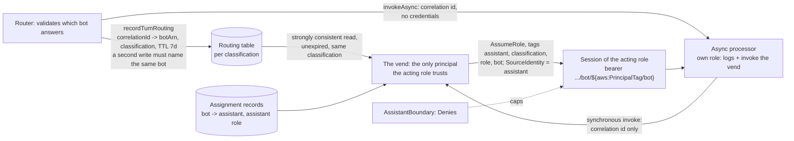

- **The routing record** (`lib/turn-routing.ts`) carries the router's decision across the invoke in a form the processor cannot rewrite: credentials do not cross an invoke, and a payload field is whatever the invoker wrote. The router writes a turn record before every dispatch (`invokeAsync` in `router-agent-handler.ts`), including a duel's rebuttal round, which the battle orchestrator hands to the duel classification's router (`dispatchRebuttalRound`). The router records its own posts on `speak-` routes too (`speak-router-<uuid>`, `speak-notice-<uuid>`, and `speak-duel-<uuid>` for a round-2 placeholder or a duel's marker clear), so it never holds a turn's session. The only other writer is arrival triage, which records only `speak-` routes, which the vend narrows to posting (Phase 1c). The channel flow, the battle orchestrator, Battle Mode, the notification functions, the federated join and the typed-conversation creator write no routing record: they name a notice, a round or a marker clear to the router.
- **The vend** (`assistant-vend.ts`) reads the record, resolves the assistant and its assistant role from the assignment records rather than from the caller or the record, validates the assistant id, and assumes the acting role with the tags and `SourceIdentity`. It refuses anything else and is invoked synchronously only, because an asynchronous event is kept and replayed by the Lambda service and a session must not travel that way.
- **The acting role** (`assistantActingRole`, `agent-classification-common.ts`; wired in `assistant-profile-stack.ts`) trusts only the vend, tag-pinned on the assume itself: `classification` equal to its own, `role` among the roles the deployment declares (`deployedRoles` in `assistant-profile-stack.ts`; a shipped role other than `primary` is declared by naming its assistant in `profiles`), `assistant` and `bot` present. Its bearer is `${appInstance}/bot/${aws:PrincipalTag/bot}` with `aws:ResourceTag/classification` equal to its own; per-role company context and the ops CloudWatch reads are conditioned on `aws:PrincipalTag/role`. Its boundary is an allow-list of the services a turn uses (`BoundaryTheServicesATurnUses`), with S3 allowed only on the unclassified key families a turn uses and the `context/` and `platform-knowledge/` prefixes the classification grants (`BoundaryObjectsATurnUses`, `BoundaryListingItsOwnPrefixes`), so no other classification's prefix is in it and none is named, plus Denies: no `iam:*`, `sts:AssumeRole`, `sts:TagSession` or bot tagging (`AnAssistantNeverEditsIdentityOrChains`); no channel or bot outside this classification; no telemetry unless the session's role is an observability role.
- **The processor** adopts the session first and releases it last (`adoptTurnIdentity` in `assistant-async-processor.ts`, `adoptAssistantSession` and `sessionClient` in `lib/assistant-session.ts`), and every AWS client it reaches is wrapped so it sends on the session. **It fails closed:** a refused session fails the turn, there is no fallback identity, and an event naming a bot the turn was not routed to is refused. Its own role holds logs, the vend invoke, the admin error alert posted as the admin assistant (whose bearer is pinned to admin-plane bots by tag), and the processor's own records: the abuse counters and cost circuit, the turn lock and queue, the message-analytics row, the triage dispatch and the parked-turn resume, written on ambient clients (`abuse-controls.ts`, `turn-lock.ts`, `message-analytics.ts`, `turn-triage.ts`, `parked-turn.ts`). The acting role holds none of them and its boundary allows no `ssm:PutParameter`, so an assistant session cannot reset a counter, release a lock or trip the circuit (`tests/e2e/a-vended-session-cannot-write-processor-records.spec.ts`).
- **The router** speaks as the assistant it routed to: right after it validates which bot answers, it records a decision on a speak route (`speak-router-<uuid>`) and adopts that session (`speakAsRoutedAssistant`), which the vend narrows to the `speak` edge, so every Amazon Chime SDK messaging call it makes after that, reads included, goes out on that assistant's speak session: the placeholder, a refusal, a handover, the queue notice and every notice another component names (`sayNotice`, `aeNotice`) among them. It never holds a turn's session. Its DynamoDB and SSM reads, the drift scope search (`live-drift-flow.ts`, on a plain client) and channel creation stay on its own role, which holds no send or update as a bot. The drift link message is posted on the session (`driftChannelCreateStatements(..., { linkPostedOnSession: true })`); channel creation itself stays a platform action on the service role.
- **The channel flow** holds no `SendChannelMessage` or `UpdateChannelMessage`, no vend invoke and no routing-table write, and speaks as nobody: it names its notices to the router (`sayNotice`), logs a reply the router hands back (`noteHandedBackMessage`), and records a turn it could not start as turn state (`recordDispatchFailure`). Its invoke grant names the routers and task services by ARN (`channel-flow-stack.ts`). **The battle orchestrator** holds no Amazon Chime SDK grant, no vend invoke and no routing-table write, and speaks as nobody: it hands each rebuttal round to the duel classification's router, which validates the round against the battle state and posts the side's placeholder (`dispatchRebuttalRound`), and names its closing lines to that router as notices (`sayThroughRouter`; `battle-orchestrator.ts`, `battle-stack.ts`).
- **Bots carry their identity tags**, `classification`, `assistant` and `role`, with the alt's assistant `alt-{role}-{classification}` (`provisionerTags` in `lambda/src/lib/assistant-provisioner.ts`, `altAssistantName` in `profile-registry.ts`).
- **Each assistant's session is narrowed to what its approved definition declares** (tenet D4). The vend passes session policies chosen from the definition (`grantEdgesFor` in `lib/assistant-grant.ts`) out of a catalog the classification stack creates (`assistantGrantCatalog`, `AssistantGrant-{classification}-{edge}`), so the session is the acting role, its boundary and those policies together and can only narrow. Narrowed: company context (the `company-docs` source or `load_company_context`), platform knowledge (`load_platform_info`), telemetry (`read_deployment_health`), text models (the classification's routed set plus what the definition and a recorded experiment variant name) and image models. The vend reads the definition with the `active` label and the processor serves exactly that version (`resolveProfileVersion`); a definition that declares nothing, the seed, selects everything; a duel or A/B variant the router records narrows that turn instead. Activation refuses a chosen model the classification cannot reach (`validateBody`). Each edge is the whole family at the classification's reach: `context` grants all of the classification's company context, not a chosen prefix. When the selected model edges would pass IAM's limit of 10 session policies, the session gets `models-all`, the classification's boundary.
- **A turn's retrieval, drift and summaries run at its own classification, for its own conversation.** Each conversational classification has its own turn data plane, pinned by environment, and a classification's roles may invoke only theirs. A call carries the routing record of the turn it serves (`routeId`). The data plane serves it only when that record is in its classification's routing table and names the same conversation; the classification and retrieval scope are set by the function, never by the payload (`turn-data-plane-binding.ts`, `TurnDataPlane-{classification}` in `archive-stack-aurora.ts`). Admin reads, client events and backfills run on the shared data plane, which no assistant session or router can invoke.

  **What IAM enforces and what the function enforces.** Each `TurnDataPlane-{classification}` runs on its own role, which reads only its own classification's routing table (Phase 1c). Every turn data plane still reaches the shared Aurora database with one login, so the classification pin on what it reads there is an environment value the function code applies. A `routeId` is not tied to the caller's session: any routed turn of that classification in the same conversation is accepted, and a call that names no conversation is checked for classification only. **OPEN:** a per-classification database login; binding a `routeId` to the caller is declined (Phase 1c).
- **Services that put a line in a conversation outside a user turn name a notice, and the router says it.** The proactive briefing, the federated join line and welcome, share-conversation's join line, Battle Mode's on and off notices, the typed-conversation notice and the archive notice each name a notice kind, the assistant it concerns and its variables to the router of the conversation's classification (`sayThroughRouter`, `lib/say-through-router.ts`). The router checks every variable against the kind's declared type and cap (`NOTICE_VARS`, `checkNoticeVars`, `lib/assistant-notice.ts`), resolves the line from that assistant's own copy, builds the kind's metadata (`noticeMetadata`) and posts on a speak session. These roles hold the router invoke and the reads that resolve the room's primary (`sayThroughRouterWiring`, `roomPrimaryReadStatements`), and no vend invoke or routing-table write. One component still speaks outside a turn on its own speak sessions: arrival triage (the queue reads and notice settle, `adoptSessionAsAssistant` in `lib/assistant-session.ts`, granted by `speakAsAssistantStatements`). A duel's round-2 placeholders and the clearing of its waiting markers are the router's (`aeRebuttal`, `aeClearMarkers`), each validated against the battle state, and the battle orchestrator's closing lines are notices. The declared list of speakers is `backend/lib/config/speakers.ts`. A conversation split speaks as nobody: the processor posts the link to each new conversation from the assistant's copy. None of the notice-naming roles holds a send bearing a bot; the membership audit sends nothing: it raises an `ae.alert` event (`alertEmitterWiring`, `backend/lib/constructs/membership-audit.ts`), which the AdminServices stack posts into the admin channel. The share's recap for a new member is not one of these: it is a turn by the room's primary, asked of the classification's router with trigger `join_recap` and targeted at the new member, so it runs in that assistant's own model and copy (`lib/join-recap.ts`; the router checks the member and the speaker in `joinRecapRefusal`).

**Verified by:** `backend/test/an-assistant-acts-through-one-tagged-role.test.ts` (the synthesized acting role, trust, bearer and boundary), `backend/test/lib/a-turn-acts-as-the-assistant-it-was-routed-to.test.ts` (the routing record and the vend's refusals), `backend/test/a-turn-runs-on-the-assistant-not-the-processor.test.ts` (the processor's own role is bootstrap only and its clients send on the session), `backend/test/conversation-split-checks-the-offer.test.ts` (the split speaks as the routed assistant or not at all), `backend/test/lib/an-assistant-reaches-only-what-it-declares.test.ts` (which session policies a definition selects), `backend/test/lib/an-activated-definition-stays-inside-its-classification.test.ts`, `backend/test/lib/a-turn-data-plane-serves-only-its-routed-turn.test.ts`. Live deny-tests (the narrowed spec simulates the deployed session policies, not a vended session): `tests/e2e/assistant-classification-boundary.spec.ts`, `tests/e2e/only-the-vend-mints-an-assistant-session.spec.ts`, `tests/e2e/no-platform-role-speaks-as-an-assistant.spec.ts`, `tests/e2e/an-assistant-session-is-narrowed-to-its-definition.spec.ts`.

**NOT BUILT, and named so it is not read as behavior:**

- **Per-assistant narrowing beyond the families below.** Guardrails are not narrowed per assistant, because a denied apply fails open. Context sources other than `company-docs` (DynamoDB, Lambda and SSM sources) stay classification-scoped. Approval of a definition is a single `activate-profiles` capability holder, with no second approver.
- **Creating a conversation bears the service admin, never `/bot/*`**: every creator (the person-facing API, the drift and conversation splits, the typed-conversation creator, federated create and add-member, the proactive briefing) creates through `lib/channel-creation.ts`, and its role holds `CreateChannel`, tagging and membership changes bearing only the admin's exact ARN. **Adding a member to an existing conversation still bears `/bot/*`** on share-conversation, channel-battle, federated remove-member and `GroupMembershipReconcileRole`, conditioned on the classification tag. None of them posts on that role.
- **The router and the flow still hold reads on their own roles.** The flow's role holds `ListChannelMemberships`, `ListChannelModerators`, `GetChannelMessage` and `ListTagsForResource` on `${appInstanceArn}/*` with no condition, so it can read bearing any bot or user of any classification (`channel-flow-stack.ts`). The router's role holds a classification-conditioned `/bot/*` bearer for describe, list and get, `chime:SearchChannels` on `/bot/*` and `/user/*` with no condition, and, with drift on, `CreateChannel`, create and delete channel membership and moderator on `${appInstanceArn}/*`, `AssociateChannelFlow` and `PutChannelExpirationSettings`.
- **The processor's role holds no Amazon Chime SDK grant.** Its admin error alert is an `ae.alert` event: the role holds only `events:PutEvents` on the default bus for that source (`alertEmitterWiring`, `backend/lib/stacks/agent-classification-common.ts`), and the AdminServices stack owns the one rule that posts the event into the admin notification channel. `backend/test/admin-agent-notifications.test.ts` asserts the wiring names no send and that `adminErrorAlertWiring` stays gone.
- **Persisted names keep the earlier shape where the key is structural**: the SSM keys `/assistant-assignments/{classification}/{role}/{live|alt}` keep the role and `live|alt` in the key, so one challenger per `(classification, role)` stays structural (owner decision). An experiment names its challenger by assistant id (`challengerAssistant`); a row of the earlier shape carries `altBotSlotId` and `altBotSlotArn`, which the readers accept, and every write stores `challengerAssistant` only.
- **A registry of assistants and the rename of those keys are not built**; an assistant is found through the assignment record for its classification and role.

**Where the scope is declared, and why it is not the versioned profile body alone.** A role's scope is a property of the classification's declaration (`roleContext`), and an assistant's narrowing is derived from its APPROVED definition rather than from any version an `activate-profiles` holder can activate: SPEC-PORTABLE-PROFILES D-3 keeps scope, ARNs and policy out of a version deliberately, and letting a behavior edit move a boundary would make behavior and boundary the same capability. Whatever store carries the approved definition becomes part of the boundary, and its write path is a `manage-assistants` act rather than a profile edit. **That the assignment is runtime data while the boundary is deploy-time infrastructure is the whole safety argument** - a session can never hold a grant the boundary does not permit, whatever the request asked for, so a team self-serves without a deploy and no request reaches past the classification's boundary.

**A bot ARN is a good pin target, and a service-minted id is not what makes it feel otherwise.** People and assistants are principals of the same kind on the same control plane, and with both halves of the bot lifecycle present - created by the provisioning custom resource, deleted when the resource is removed - a bot is as reproducible as a person, because the provisioning logic owns the mapping from assistant name to bot ARN either way. It is still not the PLATFORM handle, because it is instance-bound and SPEC-PORTABLE-PROFILES keeps ARNs out of a manifest so a profile can move between instances. **The name identifies the assistant across instances, analytics and storage; the bot identifies the principal within one deployment, exactly as a `sub` does for a person** - and deciding that once is the point, because three surfaces each inventing a handle is how the classification came to stand in for the assistant in the first place.

- **Delivers on its own:** the requirement in 1.3, with per-assistant narrowing. Valuable at one assistant per classification, because it lets an existing assistant be narrowed below its classification's reach.
- **Gate:** deny-tests against the deployed roles, in the shape `tests/e2e/assistant-classification-boundary.spec.ts` already uses. A session for one assistant role is denied `s3:GetObject` on a `context/` prefix its classification grants - `tests/e2e/an-ops-role-reaches-only-its-own-classification.spec.ts` asserts this for the ops role on the deployed acting role. A session tagged for assistant A is denied `chime:SendChannelMessage` bearing assistant B's bot while allowed bearing its own (`tests/e2e/assistant-classification-boundary.spec.ts`, 'a session acts as its own bot and is DENIED acting as any other, in or out of its classification'). The first turns 1.3 from an argument into a property; the second is what makes the pin real rather than declared.

### The channel flow never authors a message, and the assistant speaks for itself

A channel flow's contract is to release the sender's message, optionally modified, or to deny it: `ChannelFlowCallback` carries the SENDER'S message and nothing else, so a flow structurally cannot author one of its own. Where it appears to, it is reaching past that contract and borrowing an assistant's identity to do it.

**So the rule is that the flow releases or denies, and records state. Anything that AUTHORS a message belongs to a principal that legitimately holds an assistant identity**, which in practice means the assistant itself. This is not only an access question: a notice the flow composes is fixed English written by the platform, while a notice the assistant composes carries the persona, copy and language its profile configures, which is what tenets P5 and D11 ask for.

**The duel scaffolding is the primary assistant orchestrating, not the platform narrating.** Twelve of the flow's fifteen authoring sites are battle - the round announcements, the waiting affordance, the end-of-duel scorecard - and those are the primary assistant acting as the orchestrator of a duel it is running, so they move to it: the router says the duel's notices and clears a waiting side's marker as that side (`aeClearMarkers`, asked by `endBattle`). The other three are handled without the flow speaking: a handed-back reply is logged and the processor posts the answer itself, the abuse gate's refusal is a notice the router says, and a dispatch failure is recorded as turn state.

**The client renders a failure only where no assistant can speak.** Three cases qualify - no assistant is configured for the conversation or the vend refuses it (`assistant_unreachable`), the router could not be reached (`handoff_failed`), and an answer that ran could not be posted (`reply_undeliverable`) - because in each the point is precisely that no assistant message can carry it. They are recorded as turn state (`recordDispatchFailure`), and the person's own client reads it at two deadlines after the send, 15 s and 120 s (`useTurnState.ts`), and says their message was delivered and nothing is coming, scoped to them rather than shown to the room. The person's message is never denied to make the point.

**The flow is reads-only, not no-grant, and the difference is worth stating.** Amazon Chime SDK requires a `ChimeBearer` on every messaging call including reads, and a bearer that is not a channel member cannot read at all. The flow genuinely reads - sizing a channel is a live `ListChannelMemberships`, synchronously, before it can route anything. So the flow keeps its read actions and holds no `SendChannelMessage` or `UpdateChannelMessage`, no vend invoke and no routing-table write (`channel-flow-stack.ts`): it posts nothing, and every line it decides is due is a notice the router says. It holds no destructive grant either - no `DeleteChannelMessage`, no `RedactChannelMessage`, no membership write - and that absence is IAM rather than convention.

### Phase 1c: a session is no wider than the work it was minted for, and no shared principal holds a classification's turn

**BUILT, NOT YET DEPLOYED OR LIVE DENY-TESTED.** Phase 1b makes every speaker an assistant. This phase keeps the principals that serve every classification from holding more than speaking needs (tenet D12), without adding a role per assistant.

**What it closes.**

- **A shared service obtaining a full assistant session of any classification.** The channel flow, Battle Mode, the notification functions and post-processing write routing records in every classification's table and invoke every vend. A vend that narrows only by the assistant's definition gives a record written to post a join notice the same session a turn gets: that assistant's models, company context, platform knowledge and telemetry. The channel grant stops such a session posting into another classification's room; the data reach is what the speak edge removes.
- **A single-classification caller reaching every vend.** The vend invoke is name-pattern scoped (`${STACK_PREFIX}*AssistantVend*`, conditioned on this instance's tag and the caller's classifications), because a generated function name carries no classification.
- **One role reading every classification's routing table** for every turn data plane.

**The shape: the record says what the session is for, and IAM decides who may write which kind.**

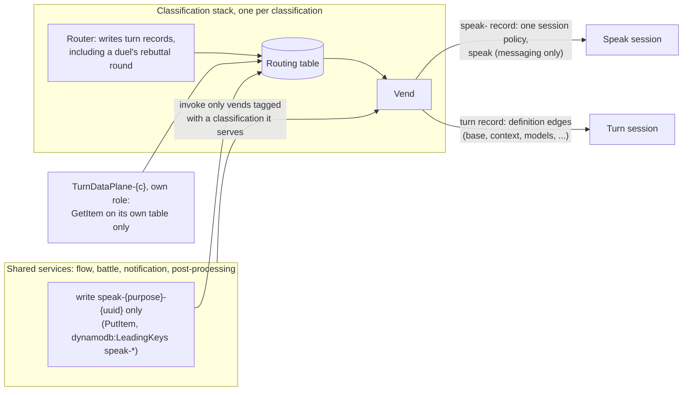

| Step | Change | Enforced by | What it removes |
|---|---|---|---|
| **1c.1 Speak-only sessions** | Every route id written to speak is `speak-{purpose}-{uuid}`: the router's own posts, the notices it says and a duel's placeholders and marker clears (`speak-router-`, `speak-notice-`, `speak-duel-`), and arrival triage (`adoptSessionAsAssistant` in `lib/assistant-session.ts`). The services that name a notice and the battle orchestrator write none. The speak edge is `SendChannelMessage`, `GetChannelMessage`, `UpdateChannelMessage`, and the reads `ListChannelMessages`, `ListChannelMemberships` and `DescribeChannel` (`SPEAK_ACTIONS` in `lib/assistant-grant.ts`), which is every call those sessions make. The vend gives a `speak-` record exactly one session policy, `speak`, from the classification's catalog: the messaging actions those callers make, bearer-pinned by the acting role as for any session. A shared service's `PutItem` carries `ForAllValues:StringLike` on `dynamodb:LeadingKeys` `["speak-*"]`. | IAM: the key condition on the table write, the session policy on the session | A shared service can at most post as an assistant into rooms that assistant's classification already reaches. No models, context, telemetry or data plane. |
| **1c.2 The rebuttal round is the router's** | The orchestrator hands a duel's rebuttal round to the duel classification's router with a synchronous invoke (`aeRebuttal`). The router refuses anything but a round-2 rebuttal for its own classification, in a conversation tagged with it, for a side `isSanctionedBattleBot` admits and the duel's state supports; it re-resolves the side's pinned version itself and drops any version, definition or attribution in the payload, posts the side's placeholder on a speak route of its own, records the turn and dispatches its own processor (`dispatchRebuttalRound`). The orchestrator resolves no processor and writes no routing record. | IAM, through the 1c.1 key condition | The one shared writer of a turn record. |
| **1c.3 The vend invoke is scoped by tag** | `speakAsAssistantStatements` conditions the invoke on `aws:ResourceTag/classification` being one the caller serves; every vend carries the stack's `classification` tag. Arrival triage is its one caller outside the classification stacks. The battle orchestrator serves every classification: it invokes the routers by their published ARNs and no vend; the channel flow invokes the routers and task services by ARN and no vend. The services that name a notice (federated join, briefing, the typed-conversation notice, Battle Mode, archive, share) invoke the routers only (`sayThroughRouterWiring`). **OPEN:** whether the condition evaluates on `lambda:InvokeFunction` is proven only by the live arrival-triage path; the fallback is an explicit vend `functionName` per classification and exact ARNs. | IAM | A single-classification caller reaching another classification's vend. |
| **1c.4 A role per turn data plane** | `TurnDataPlane-{classification}` gets its own role: `GetItem` on its own routing table, plus what the shared role grants it (database secret and connect, VPC, embeddings). | IAM | The routing-record read crossing classifications. |

**Declined, with the reason kept.**

- **Binding a `routeId` to the calling session.** A Lambda invoke carries no caller identity, so there is nothing for the function to compare against; the caller is already limited by IAM to its classification's data plane, and the record must name the same conversation. A forged `routeId` reaches nothing the caller could not already reach.
- **Row-level security per classification in Aurora** (a database login per classification). It would make the data plane's classification pin a database rule rather than code, but a schema change applies at cold start, every turn query would need the classification or return nothing, and that failure reads as worse retrieval rather than an error. **OPEN** until a classification's rows must be unreadable to another classification's turn code.

**Risks, and how each is contained.**

- **A missing messaging action in `speak`** fails a best-effort notice quietly. The action list is pinned by a test over every call made on a speak client, and each notice has an e2e that asserts it posts: Battle Mode on and off, the duel scorecard, the federated join, the typed-conversation notice and the briefing.
- **Deploy order.** The vend must understand `speak-` before a writer is restricted to it, and a writer must emit `speak-` before its role is restricted. Three deploys: the classification stacks (catalog edge, vend, router round entry); the shared stacks' code; then the shared roles' key condition and tag-scoped invoke.
- **The rebuttal round moves path** (1c.2), the largest behavior change here. The duel e2e covers both rounds, and the router owns round one.
- **The tag condition fails closed.** A vend without the tag refuses every speaker of that classification: a lost notice, not a leak.

- **Verified by:** `backend/test/a-shared-service-only-speaks.test.ts` (the vend's speak edge, the speak routes every writer records, no routing-table write on the battle and flow roles, the tag condition, the speak edge's actions, a role per turn data plane, the router's rebuttal refusals against the battle state, its placeholder and record, and its marker clears), `backend/test/battle-orchestrator.test.ts` (round 2 goes to the duel classification's router and never another), `backend/test/flow-does-not-run-the-turn.test.ts` (the orchestrator chooses no worker).
- **Delivers on its own:** each step is independently deployable; 1c.1 alone removes the data reach.
- **Gate:** a synth test that no role outside a classification stack holds `PutItem` on a routing table without the `speak-*` key condition; live simulations that the battle role is denied `PutItem` on a key outside `speak-*`, that a speak session is denied `bedrock:InvokeModel` and `s3:GetObject` on `context/`, that the federated role is denied invoking another classification's vend, and that one turn data plane's role is denied reading another classification's routing table.

### Phase 2: more than one assistant per classification

Declare the second role, provision its identity, and seed its own profile.

**The topology is one runtime per classification hosting N identities, and that is forced rather than chosen.** Provisioning at runtime cannot deploy a CloudFormation stack, so "one stack per assistant" is not available to it. The handler, processor and task service are therefore shared, and what is NOT shared is the identity: each assistant has its own bot, and each turn acts on a session pinned to that bot, while the shared runtime's own roles hold little more than routing reads and the ability to ask the vend.

**Because the runtime is shared, the assistant identity needs a carrier across each invoke, and the carrier is the routing record.** A channel tag names a classification and cannot choose between two assistants in one, and a payload field is whatever the invoker wrote. So the router writes the bot it routed to under the turn's correlation id, the vend reads it back and mints the session, and IAM refuses a session for an undeclared role, another classification or another bot, so a wrong identity is a denial instead of an impersonation. A bot the classification's assignment records do not name resolves to nothing and the turn does not act (Phase 1b).

**An Amazon Lex bot resource per role is what makes the identity recoverable at all.** An Amazon Lex turn from Amazon Chime SDK carries `CHIME.channel.arn` and `CHIME.sender.arn` and no addressed-bot attribute, so two assistants sharing one Amazon Lex bot resource are indistinguishable to the handler. DESIGN-ADDING-AN-ASSISTANT-ROLE section 10a is the measurement and the consequence.

- **Does NOT deliver on its own**, because of a property of the current routing: the router is invoked for the CHANNEL'S classification, so two assistants of one classification behind one Amazon Lex bot resource would answer from whichever that router serves, whoever was addressed - a room where addressing the finance assistant is answered by the HR assistant under the finance assistant's name.
- **So it absorbs two prerequisites:** resolve the answering assistant from `(classification, role)` rather than from the classification alone, and post the mode-change notice when a conversation gains its second assistant. Amazon Chime SDK `AUTO` counts bots, so a second one silently flips the room from answering everything to answering only mentions, and ADR-030 predicts this notice is "the one most likely to be skipped, because the change is invisible to whoever builds it and obvious only to whoever is using it."
- **Gate:** a named assistant is answered by that assistant and not by the classification's router bot; the room is told when it gains its second assistant; a deny-test that assistant A cannot send as assistant B's bearer.
- **What each clause rests on, because they are not equally evidenced.** The first rests on ONE manual observation and no e2e spec: the unit tests pin the gate PREDICATE, which is not the mention-to-second-role-to-answer path, and the naming defect below is the proof those are different things. The e2e it needs asserts the roommate authored the reply - the message's own sender - rather than that an answer arrived. The third passes where `ops-premium` is declared in `profiles`; every case skips without it, and a skip is not a pass. The second is unmet.
- **Where the gate stands.** The first clause holds: in a conversation holding both assistants, an addressed question is answered by the named one, in its own voice, reaching what the primary cannot. **The failure shape when it does not is silent**, which is the durable thing to know: the bypass-identity gate admits the handler's own bot, the alt of its own role, and the live assistant of any role in the same classification read from the assignment records - and a refusal falls back to the classification's own bot by design, so the primary answers under its own name and the only trace is one `SecurityEvent` line. A second role's live assistant is neither of the first two, so it is the third clause that makes an addressed specialist answerable at all.

  **WHAT THE WIDENING ACTUALLY WIDENS, stated correctly because the obvious phrasing is false.** It is tempting to say this widens which assistant may answer and never what it may reach. That is wrong, and wrong in the direction that matters: a turn admitted as the ops bot acts on a session whose `role` tag is `ops`, and the acting role grants the observability reads to that role alone (`observabilityRoles`), so it reaches telemetry the primary cannot. That IS the feature - an addressed specialist answering with its own reach - and the honest statement is that the widening admits an assistant to answer AS ITSELF, with its own role's reach, which for `ops` today is CloudWatch and Logs. What bounds it is the classification: the admitted set is read per classification from the deployment's own records and the classification comes from the deploy-stamped environment rather than from any caller, so ADR-042 holds.

  **AND THE BOUND IS NOT THE SAME ON EVERY PRODUCER**, which is an inconsistency rather than an exposure: see 3.4. The mention path is bounded by a live `ListChannelMemberships`; two others splice a task record`s `assistantId` and are bounded by task answerability. An identity that should not be acting in the room reaches a refused `DescribeChannel` and not a tool, because that read is performed as the adopted bearer before anything expensive runs. The flow therefore uses a spliced identity only when that bot is a current member, from the roster it already holds.
- **And one thing the gate does not cover.** An assistant is addressable by its Amazon Chime SDK member NAME. A bare `@` token that matches no member starts NO TURN, so the failure is silence rather than a refusal. The primary's bot carries its profile `displayName` while a second role's is the composed `{role}-{classification}`, which means the spelling a person is shown is not the spelling that resolves. **The rule:** the name a person sees must be the name that resolves, and a gate worded "a named assistant is answered" is satisfied by whichever spelling the test chooses. A delimited `@<Name|id>` token resolves by id and is unaffected, so this reaches a person typing rather than a person picking. **OPEN.**
- **Scope warning:** this is not one field, and it is not a new topology either. Conflating the two inflates the estimate by an order of magnitude. **What does not move:** the runtime, so there is no second stack and no construct-id collision; `processor-arn`, `router-arn` and `task-service-arn`, which name classification-level infrastructure N assistants share; the acting role, which already serves any number of assistants. **What moves:** the profile resolution, since roughly a dozen router sites resolve the serving profile from the classification alone. Size this as the router-resolution work on top of Phase 1b, not as a rebuild.
- **Migration:** conversations created under the one-assistant shape hold work items bound to that assistant. State whether they gain the second assistant, and note that removing a bot from a room where it holds open work is not symmetric with adding it.

### Phase 3: a person can find the right assistant

Read live membership, resolve each member assistant's advertised intents, and answer "who can help with X" in the conversation.

- **Delivers on its own:** the half-step. A person in a room with several assistants can tell who to ask and address them.
- **Gate:** a live exercise with two assistants advertising different sets, asked who does what, asserting a string that exists ONLY in the roommate's `summary` and in no prompt the primary holds - and that the answer changes when the roommate activates a version with a different summary. A primary can produce a plausible answer from its own prompt without reading any advertisement, which is exactly what happened in practice: asked a telemetry question, a primary volunteered that the ops assistant "appears to be configured for CloudWatch metrics" having inferred it from watching that assistant answer earlier in the same conversation. A gate that accepts a plausible answer cannot tell the two apart.

### Phase 4: delegation

A primary recognizes that a request belongs to a roommate and hands it over by reference, announced in the room, standing down with a receipt.

**ONE CLASSIFICATION DECIDES IT, and the gate is a count of live assistants rather than a fall-through** (3.1b). The roommates' advertised lines are merged into the pack as prefixed categories before the turn classifies, so the single classification every turn already makes names either one of this assistant's own intents or one of theirs. What bounds the cost is the cached map of live assistants: a classification holding one live assistant resolves no roommates, reads no roster and no advertisement, and the turn is unchanged.

**A fall-through gate cannot work here, and that is a property of classifiers rather than of this one.** A classifier returns the nearest category it was shown, so an assistant whose pack advertises "a figure like ARR or churn" classifies "the deployment's error rate" as that, with high confidence, and never falls through. Measured directly: the two-pass shape it replaced cost 757 ms plus 795 ms on a single turn and still routed wrongly.

- **Delivers on its own:** the person stops having to know the org chart.
- **The transport is a targeted handover message the channel flow routes** (3.4). The primary posts the handover targeted at the roommate, the flow dispatches the roommate's turn after checking the marker, the stored `Target` and that a person sent the referenced message, the receiving router verifies the handover as its own bearer, and post-processing delivers a marked handover the flow could not route. No sender invokes a Lambda. `bot-coordination.ts`'s closed `nudge`/`ack` set is unchanged and does not apply: its guard keys on a `Target` the flow callback never carries.
- **The reference travels, never the question.** The receiver reads the referenced message itself, as its own bearer, so what it may see is bounded by its own membership rather than by what the sender chose to repeat. A receiver that cannot resolve the reference says so in the room rather than going quiet, because the sender has already promised a reply by then.
- **Gate:** the live exercise ADR-030 records as missing - two assistants where the one addressed does not own the work - end to end, asserting that the ROOMMATE authored the answer, that the primary posted nothing after it, and that the handover payload contains no substring of the question. Without those three a referral passes: "ask the ops assistant" is a signpost rather than a hand-over, and nothing else in the gate distinguishes them or tests the reference-not-content property the design rests on. Plus plus a metric for delegations attempted, delegations that found no owner, and ambiguous ones that had to ask. Without the last, "refuse to choose and ask" is untracked and nobody learns how often the platform pushes its problem to a person.
- **Where the gate stands.** The handover itself holds: a question belonging to a roommate is answered by that roommate, under its own name, and the room is told where it went before the answer arrives. **Verified by:** `backend/test/delegation-sits-after-drift-and-before-the-claim.test.ts`, `backend/test/lib/a-turn-goes-to-the-assistant-that-advertises-it.test.ts`, and a live exercise. The metric clause is **NOT BUILT**: delegations attempted, delegations that found no owner, and ambiguous ones that had to ask are not emitted, so "refuse to choose and ask" is untracked and nobody learns how often the platform pushes its problem back to a person.
- **The one-hop bound holds on data the sender cannot write.** Only a message a person sent may be handed over, and Amazon Chime SDK stamps the sender; and a turn that arrived by handover, of either kind, may not hand over again. Delivery is claimed once per person message and receiver (3.4).
- **Gate for the transport:** `backend/test/lib/a-handover-is-a-message-not-an-invoke.test.ts` (a person cannot post a handover, the stored `Target` decides, one hop by data, one delivery per receiver shared with the backstop, no route without the marker), `backend/test/delegation-sits-after-drift-and-before-the-claim.test.ts` (no sender invokes a Lambda; a handed-over turn without a verified handover is refused) and `backend/test/lib/handover-follows-the-task.test.ts`. The live two-assistant exercise on the message transport is **NOT YET RUN**.

---

## 5. What this design does not decide

- **The admin-console screens for creating and managing assistants.** Section 3.6 settles the provisioning MECHANISM - the permissions boundary, the capability, the audit record and the delete path - because that is an access-control question and the screens ride on it. Which screens exist, what an operator sees when a classification holds several assistants, and how a role is presented are interface questions belonging with the console (SPEC-CAPABILITY-PROFILES, SPEC-ADMIN-CONSOLE). `role` is the field that has to be declared before a console can show it, and 3.0 puts it on the classification rather than on a conversation.
- **Whether a specialist may delegate onward, beyond one hop.** A turn that arrived by handover may not create another, and only a person's message may be handed over, so a chain cannot cycle (3.4, Phase 4). What is not decided is whether onward delegation should be ALLOWED at all, and that waits on coordination between assistants, which is not built.
- **Cross-classification delegation.** Out of scope: ADR-042 binds an assistant to exactly one classification, and a request that needs another classification is a conversation boundary question rather than a routing one.
- **What identity a backend sub-agent acts as.** DESIGN-MULTI-AGENT-ORCHESTRATION owns it and records it as open and blocking (1.5).
