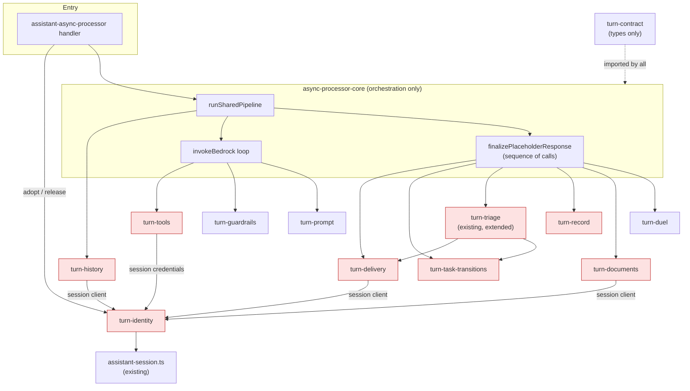

# DESIGN: Decomposing the turn processor

**Status:** NOT BUILT. No new module named here exists; `backend/lambda/src/lib/async-processor-core.ts` holds every responsibility described in section 2. This document is the extraction plan only.

**Coverage:** none - a behavior-preserving refactor adds no user-facing behavior, so the existing unit and source-shape tests named per step, and the e2e specs named for the steps a deployed spec exercises, are the proof, unchanged.

**Related:** [MESSAGE-FLOW.md](../../../guides/developer/MESSAGE-FLOW.md) §7 (the async processor), [TENETS.md](../../../overview/TENETS.md) (D1, D3, D4, D7, D8, D9, D12, D15), [DESIGN-SEPARATE-ASSISTANTS-AND-DELEGATION.md](./DESIGN-SEPARATE-ASSISTANTS-AND-DELEGATION.md) (the vended turn session).

**Site section:** Interaction layer, assistants.

## 1. Overview

The shared turn processor, `backend/lambda/src/lib/async-processor-core.ts`, runs every assistant turn after the router dispatches it: it adopts the assistant's identity, rebuilds the conversation, calls the model and its tools, posts the answer, advances the task and writes the turn's record. It is roughly 7,600 lines in one module. This design moves its responsibilities into bounded modules one at a time, authorization-sensitive boundaries first, with no rewrite and no change in behavior.

## 2. Problem

A security reviewer asking "where does a turn choose who it acts as, what it reads, and where it posts" has to read one file that also builds prompts, plans duels and parses queue readings. The identity code is about 85 lines; the function that delivers an answer, `finalizePlaceholderResponse`, is about 2,500. A boundary that small inside a file that large is reviewed by search, not by reading, and a change to an unrelated concern lands in the same diff as the boundary. Extracting each authorization-sensitive unit behind a named seam makes it reviewable on its own and makes a change to it visible as a change to that module.

## 3. Current responsibilities

Sizes are approximate line spans of the declarations, comments included.

| # | Concern | Symbols in `async-processor-core.ts` | Approx. lines |
|---|---|---|---|
| C1 | Turn identity and clients | `bedrockClient`, `messagingClient`, `actingCredentials`, `actingRole`, `companyContextScope`, `actAsAssistant`, `actingAs`, `releaseAssistantIdentity`, `endAssistantTurn` | 85 |
| C2 | Turn contract types | `BattleContextPayload`, `AsyncProcessorEvent`, `AsyncProcessorResult`, `AsyncProcessorConfig`, `LongResponseResult`, `ConversationMessage` | 710 |
| C3 | Placeholder resolution | `resolveDeliveryMessageId`, `scanForPlaceholderMessage`, `isPlaceholderMessage` | 115 |
| C4 | History and privacy | `HistoryBound`, `privateReaderOf`, `historyMessageReaches`, `targetsOf`, `loadChannelHistory`, `resolveHistoryImageBlocks` | 370 |
| C5 | Prompt and request shaping | `modelSupportsPromptCaching`, `buildSystemBlocks`, `insertIntoCacheablePrefix`, `replyLanguageInstruction`, `formatDomainContextForPrompt`, `firstTurnGreetingDirective`, `userIdentityDirective`, `formatUserProfileForPrompt`, `consolidateConsecutiveMessages`, `docFormatFromContentType`, `imageFormatFromContentType`, `buildConverseMessages` | 560 |
| C6 | Tool specs and proposal markers | `toolSpecName`, `filterToolSpecsByProfile`, `WORK_ITEM_OPENAI_TOOLS`, `proposalMarker`, `suggestionsMarker`, `extractSuggestions` | 225 |
| C7 | Guardrails | `runGuardrail`, `summarizeGuardrailFindings`, `beginTurnGuardrailFindings`, `takeOutputGuardrailFindings`, `outputGuardrailVerdict`, `applyOutputGuardrail`, `applyInputGuardrail` | 260 |
| C8 | Model loop and tool execution | `invokeBedrock`, including its `runExecutableTool` closure, the `actionEnv` it hands `runStepActions`, and its calls to `handleDeliverDocumentTool` and `handleAdvanceTaskStateTool` (`task-tools.ts`) | 820 |
| C9 | Message delivery | `buildAttachmentLede`, `handleLongResponse`, `updateMessage`, and the placement block of `finalizePlaceholderResponse` (`planResumedChainDelivery`, `replyIsTargeted`, `placeholderIsNotice`, the targeted-answer branch, `closeOutAcknowledgement`) | 240 + 680 |
| C10 | Turn record and analytics | `safeMetadataString`, the `buildAnalyticsMetadata` call and `writeTurnAnalytics` in `finalizePlaceholderResponse` | 30 + 490 |
| C11 | Task transitions | `getTaskLabel`, `detectStateTransition`, `buildTaskLoopContext`, `shadowKeywordTransition`, `recordStallIfNoTransition`, `postTaskHandoffNotice`, plus the task writes in `runSharedPipeline` and `finalizePlaceholderResponse` (`updateTaskStatus`, `markTaskPrivate`) | 275 + 260 |
| C12 | Queue reading exit | the `event.triage` branch of `finalizePlaceholderResponse` (another pass, proposal parse, amendments, task creation, targeted questions, notice settlement) | 935 |
| C13 | Generated documents | `isDocumentRequest`, `isDeliverableDocument`, `solicitsInput`, `GeneratedDocument`, `generateAndUploadDocument` | 215 |
| C14 | Duels and image routes | `buildRebuttalContext`, `buildRebuttalImageNote`, `buildBattleAwareness`, `resolveBattleVisionPlan`, `resolveGenerationOutPlan`, `resolveTurnImageGenModelId`, `resolveTurnImageRoute`, `recordBattleTerminalAndFireOrchestrator`, `isNoRebuttal`, `parseBattleClarification`, `planBattleClarificationDelivery`, `battleWaitingMarker`, and the round-1 branch of `finalizePlaceholderResponse` | 450 + 65 |
| C15 | Pipeline and errors | `runSharedPipeline` (including `claimCorrelation`), `declaredTurnKind`, `handleProcessingError`, `sendProcessorErrorAlert` | 500 |

Every AWS client the file declares (`bedrockClient`, `messagingClient`, and the module-private S3 and Lambda clients) is built with `sessionClient` from `assistant-session.ts`, so each sends on the session the turn adopted. Seven source modules import from the file (`assistant-async-processor.ts`, `analytics-aurora/evaluation-runner.ts`, `analytics-aurora/golden-run.ts`, `lib/answer-prompt.ts`, `lib/bedrock-resilience.ts`, `lib/host-context-resolvers.ts` and `lib/providers/external-llm.ts`), chiefly `assistant-async-processor.ts`, which calls `actAsAssistant`, `endAssistantTurn` and `runSharedPipeline`.

## 4. Which concerns are authorization-sensitive

A concern is authorization-sensitive when it chooses a bearer or acting identity, vends or uses a session, reads classified context, posts to a conversation, or writes a record another reader trusts.

| Concern | Why it is sensitive | Tenet |
|---|---|---|
| C1 Turn identity | Vends and adopts the routed assistant's session (`vendAssistantSession`, `adoptAssistantSession`); scopes company context to the acting role (`companyContextScope`) | D1, D4 |
| C4 History and privacy | Decides which targeted messages a reply may see (`privateReaderOf`, `historyMessageReaches`) and which history image keys belong to the conversation (`conversationHoldsHistoryImageKey` in `loadChannelHistory`) | D1, D15 |
| C8 Tool execution | Reads company context and deployment health on the session's credentials; runs declared step actions under the same allowlist as the model (`filterToolSpecsByProfile`) | D3, D4 |
| C9 Message delivery | Posts and updates messages in the conversation, and chooses public or targeted placement | D1 |
| C11 Task transitions | Writes task state other readers act on (`updateTaskStatus`, `advanceTaskStateTo`, `markTaskPrivate`, `recordToolRun`) | D3 |
| C12 Queue reading exit | Creates tasks and posts targeted questions to the person who sent a private message | D1, D3 |
| C10 Turn record | Writes the analytics record the archive and evaluation trust (`writeMessageAnalytics`) | D7 |
| C13 Generated documents | Writes `generated-docs/<channelId>/` objects a later reader downloads | D15 |
| C15 Correlation claim | `claimCorrelation` decides which invocation owns a turn, so a turn has one responder; it chooses no identity | - |
| C14 Duel terminal | Writes duel state and invokes the duel orchestrator | - |

C2, C3, C5, C6 and C7 are not authorization boundaries. C7 is a content control (input and output guardrails) and moves as one unit, without being split.

## 5. Target boundaries

**Figure 1: target modules and the direction of their dependencies.** Shaded modules are authorization-sensitive. The core keeps orchestration only and re-exports every moved symbol, so its seven importers are unchanged. The queue-reading exit extends the existing `turn-triage` module rather than adding one.

## 6. Extraction plan

Each step is one change that moves code, repoints the tests that read moved text, and changes nothing else. Module names are proposed and live under `backend/lambda/src/lib/`, except step 6, which moves the queue-reading exit into the existing `turn-triage.ts` beside the queue reading it finishes (D8, reuse before building). An e2e spec is named where a deployed spec exercises the moved path; "none" means the unit and source-shape tests are the whole proof for that step.

| Step | Module | What moves | Tests that pin it | E2E spec | Seam it exposes |
|---|---|---|---|---|---|
| 0 | `turn-contract` | C2 types | `backend/test/lib/converse-tool-loop.test.ts`, `backend/test/bedrock-resilience.test.ts`, type-check of every importer | none | Types only, so later modules import the contract without importing the core (no runtime code, no cycle) |
| 1 | `turn-identity` | C1 | `backend/test/lib/a-turn-acts-as-the-assistant-it-was-routed-to.test.ts`, `backend/test/lib/an-assistant-is-assigned-one-classification.test.ts`, `backend/test/lib/the-document-menu-is-cached.test.ts`, `backend/test/lib/converse-tool-loop.test.ts` | `tests/e2e/assistant-classification-boundary.spec.ts`, `tests/e2e/an-ops-role-reaches-only-its-own-classification.spec.ts`, `tests/e2e/a-turn-role-is-refused-another-classifications-context-source.spec.ts` (the deny-tests) | The only place a turn obtains, reads or drops its acting identity; the session-bound clients are declared here |
| 2 | `turn-history` | C4 | `backend/test/lib/channel-history-context.test.ts`, `backend/test/lib/a-private-brief-never-reaches-a-public-reply.test.ts`, `backend/test/lib/a-queue-behind-a-turn-is-not-its-history.test.ts`, `backend/test/lib/converse-image.test.ts`, `backend/test/lib/guardrail-scores-the-user-turn.test.ts` | none | `loadChannelHistory(bound)` is the one reader of conversation content; the privacy rule is its pure `privateReaderOf` / `historyMessageReaches` pair |
| 3 | `turn-tools` | C6 and the `runExecutableTool` closure and `actionEnv` from C8, lifted into a factory that takes the config and the identity scope | `backend/test/lib/converse-tool-loop.test.ts`, `backend/test/lib/a-deterministic-workflow-runs-in-the-turn.test.ts`, `backend/test/lib/a-step-may-require-a-tool-before-the-task-leaves-it.test.ts`, `backend/test/lib/tool-registry.test.ts`, `backend/test/lib/a-turn-that-changed-something-says-so.test.ts` | `tests/e2e/a-step-requires-its-lookup-before-the-task-moves-on.spec.ts` | One function returns the tools a turn may execute and runs them; model calls and step actions share it, as `invokeBedrock` already requires |
| 4 | `turn-delivery` | C3, C9 (the placement block becomes one function returning the message the answer lands in) | `backend/test/lib/the-sender-records-where-it-sent.test.ts`, `backend/test/lib/a-long-message-is-one-response-in-parts.test.ts`, `backend/test/lib/async-processor-battle.test.ts`, `backend/test/lib/a-reply-goes-where-the-work-lives.test.ts`, `backend/test/lib/the-notice-lives-in-the-answers-placeholder.test.ts`, `backend/test/lib/resumed-chain-delivery.test.ts`, `backend/test/lib/an-answer-that-moved-is-the-one-that-pairs.test.ts`, `backend/test/tenets-are-enforced.test.ts` (ADR-062 list: posts no fixed line) | `tests/e2e/identical-private-messages.spec.ts` | Every post and update a turn makes, with the audience decided in one place |
| 5 | `turn-task-transitions` | C11 | `backend/test/lib/task-loop-machines.test.ts`, `backend/test/lib/a-task-path-is-measured-against-its-own-machine.test.ts`, `backend/test/lib/nothing-is-claimed-that-did-not-happen.test.ts`, `backend/test/task-store-boundary.test.ts`, `backend/test/tenets-are-enforced.test.ts` (D3: no source module reads the task table directly) | `tests/e2e/task-state-machine.spec.ts` | Every task write from a turn, still through `task-store.ts` |
| 6 | `turn-triage` (existing) | C12, calling `turn-delivery` and `turn-task-transitions` | `backend/test/lib/a-drain-leaves-nothing-behind.test.ts`, `backend/test/lib/a-reading-leaves-no-stray-message.test.ts`, `backend/test/lib/the-queue-is-read-again-when-it-moves.test.ts`, `backend/test/lib/the-reading-is-a-choice-not-a-sentence.test.ts`, `backend/test/lib/a-private-request-is-not-published-by-accident.test.ts`, `backend/test/lib/a-queue-with-nothing-readable-still-empties.test.ts`, `backend/test/tenets-are-enforced.test.ts` (ADR-062 list: posts no fixed line) | `tests/e2e/turn-queue.spec.ts` | One function finishes a reading pass: another pass, or proposal, tasks and questions |
| 7 | `turn-record` | C10 | `backend/test/lib/safe-metadata-string.test.ts`, `backend/test/analytics-aurora/an-exchange-is-declared-not-inferred.test.ts`, `backend/test/every-turn-kind-records-how-it-entered.test.ts`, `backend/test/lib/the-close-out-carries-the-turn-not-its-compute.test.ts`, `backend/test/lib/a-turn-records-its-subject-decision.test.ts` | `tests/e2e/analytics-accuracy.spec.ts` | One writer of a turn's message metadata and analytics row |
| 8 | `turn-documents` | C13 | `backend/test/lib/a-delivered-document-is-recorded-for-evaluation.test.ts`, `backend/test/deliver-on-generation.test.ts`, `backend/test/lib/report-delivery.test.ts` | `tests/e2e/document-templates.spec.ts` | One writer of `generated-docs/` objects |
| 9 | `turn-guardrails` | C7 | `backend/test/lib/guardrail-block-is-not-an-answer.test.ts`, `backend/test/lib/a-turn-records-only-its-own-guardrail-findings.test.ts`, `backend/test/lib/guardrail-mask-tokens.test.ts`, `backend/test/lib/guardrail-selection.test.ts`, `backend/test/control-parity.test.ts` (the guardrail controls a model-dispatch file references) | `tests/e2e/profile-config.spec.ts` (guardrail selection on a live turn) | Input and output checks with their per-turn findings |
| 10 | `turn-prompt` | C5 | `backend/test/lib/prompt-cache.test.ts`, `backend/test/lib/converse-image.test.ts`, `backend/test/lib/first-turn-greeting.test.ts`, `backend/test/lib/user-identity-directive.test.ts`, `backend/test/lib/reply-preferences.test.ts` | `tests/e2e/reply-preferences.spec.ts` | Pure request shaping, no SDK call |
| 11 | `turn-duel` | C14 | `backend/test/lib/battle-clarification.test.ts`, `backend/test/lib/battle-vision-plan.test.ts`, `backend/test/lib/battle-generation-out-plan.test.ts`, `backend/test/lib/battle-waiting-marker.test.ts`, `backend/test/lib/battle-round1-complete.test.ts`, `backend/test/task-shaped-battle-parity.test.ts` | `tests/e2e/battle.spec.ts` | Duel planning and the round-1 terminal write |

After step 11 the core holds C15 and the loop body of `invokeBedrock`, and `finalizePlaceholderResponse` reads as a sequence of calls into the modules above.

## 7. Rules for every step

- **Moved, not rewritten.** A step moves declarations verbatim, adds the import, and re-exports the symbol from the core. A fix found while moving is a separate change.
- **Source-shape tests follow the text.** About 70 test files read the core's source by path (for example `backend/test/control-parity.test.ts` lists it as a model-dispatch file that references the guardrail and correlation controls, and `backend/test/tenets-are-enforced.test.ts` lists it among the files that post no fixed line, ADR-062). A step repoints a test to the new module only where the text it asserts moved there, and never edits the assertion. A list-shaped guard adds the new module rather than dropping the core.
- **One module, one seam.** A new module exports its seam and nothing the core does not already export. Nothing outside the core imports a new module until the step that moves it ships.
- **Same proof.** Each step runs its slice, the touched shards, and the e2e spec section 6 names for it where there is one, before the next step starts.
- **Precedent.** The same shape holds in `resumed-chain-delivery.ts`, `turn-triage.ts` and `chime/send.ts`: each holds logic the core calls, and the core keeps orchestration (D9).

## 8. What does not change

| Not changed | Why |
|---|---|
| Behavior | No reply, message, record, metric or log line differs. A step that would change one is not a step of this plan. |
| Features | No new capability, setting, flag or route. |
| Principals | The processor stays one deployment per classification profile, on that classification's role. No step merges per-classification principals or shares a module instance across classifications; a shared module is code, not a principal (D12, ADR-042, ADR-054). |
| Identity model | The turn still acts only on the session vended for the routed assistant (`assistant-session.ts`); the Lambda's own role still holds no conversation grant (D1, D4). |
| Infrastructure | No stack, role, policy, table or Lambda is added or changed (D8). |
| Entry points | `assistant-async-processor.ts` and the other six importers keep their imports, through the core's re-exports. |

## 9. Related documents

- [MESSAGE-FLOW.md](../../../guides/developer/MESSAGE-FLOW.md) §7 - the async processor's runtime behavior that each step preserves.
- [DESIGN-SEPARATE-ASSISTANTS-AND-DELEGATION.md](./DESIGN-SEPARATE-ASSISTANTS-AND-DELEGATION.md) - the vended session `turn-identity` wraps.
- [TENETS.md](../../../overview/TENETS.md) - D1, D3, D4, D7, D8, D9, D12, D15.
