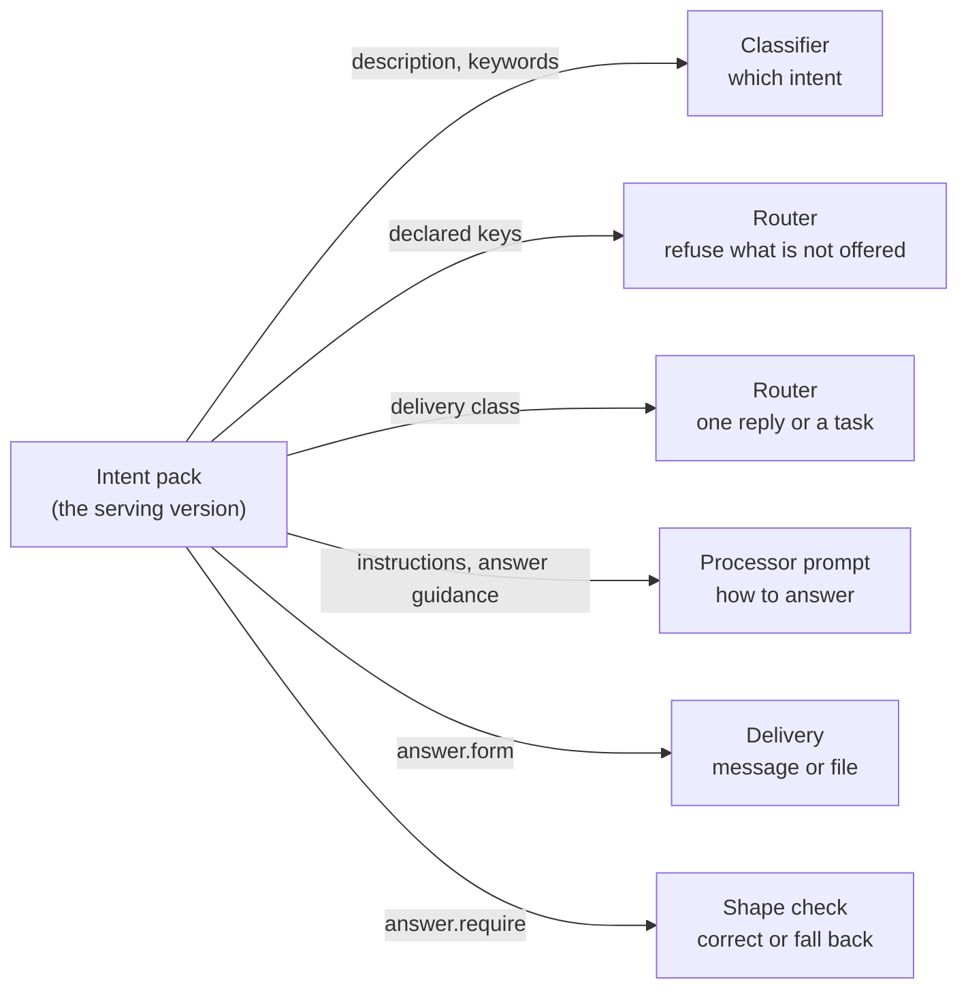
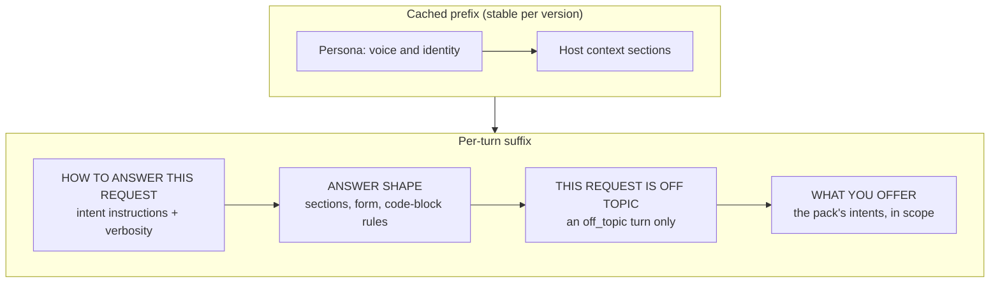

# SPEC: Configurable intent pack (per-deployment intent taxonomy)

**Status:** Implemented (the taxonomy mechanism; the domain taxonomy is per-deployment config).

**Coverage:** `tests/e2e/agent-intents.spec.ts`

**Verified by:** `backend/test/the-intent-pack-rides-the-version.test.ts` (the pack rides the versioned definition; a deployment-declared intent is routable, carries instructions, and narrows tools; an unreachable route and a widening tool list are refused), `backend/test/lib/intent-pack.test.ts` (back-compat, override, malformed-fallback, and the per-intent response settings), `backend/test/task-state-machines.test.ts` (task-machine graph validation, and the per-deployment pack's optional `machines` block carried over the platform defaults with a malformed-override fallback), `backend/test/lib/task-loop-machines.test.ts` (the loop honors exactly the machine set its caller hands it, ADR-047), and `backend/test/lib/a-pack-machine-keeps-its-flags.test.ts` (`requires`, `resolvedByOneResponse`, `produces: 'document'` and `presented` survive the coercion, a pack-declared delivering state reaches the attachment gate, and a pack declaring a contradiction is refused whole-block), `backend/test/lib/an-intent-decides-how-its-answer-is-shaped-and-delivered.test.ts` (the answer prompt built from a pack, message-or-file, the shape checks, the answer-guidance gate, and the intent temperature on every model path), `backend/test/demo-personas.test.ts` (source text: a seed persona carries no scope rule of its own, and the off-topic rule rides the pack-derived prompt), `backend/test/lib/a-classification-pack-is-a-body.test.ts` (a classification's pack is a body behind a pointer: an inline value still reads, a pointer is followed only into its own classification's prefix, a body whose hash is not its content id is refused, and the writer puts the body before the pointer), and `backend/test/a-classification-reads-only-its-own-pack.test.ts` (synthesized grants: each reader holds its own classification's pack prefix and no other, and only the deploy-time writer may put a body).

**Related:** [SPEC-ASSISTANT-CONFIG.md](./SPEC-ASSISTANT-CONFIG.md) - the broader configuration pillar this is part of. Appendix A, "Answer guidance", is how each intent's instructions and prescriptive guidance shape and deliver its answer (FR17-FR22). [SPEC-TASK-STATE-TRANSITIONS.md](../conversation/SPEC-TASK-STATE-TRANSITIONS.md) - the contract a pack's `machines` block is written against.

**Site section:** Interaction layer, assistants.

---

## Overview

**The taxonomy mechanism is platform; the taxonomy itself is a deployment's config.** An assistant classifies each turn into an intent before it chooses a delivery shape and a model route, and which intents exist belongs to the business rather than to the platform. A deployment supplies its own pack and the platform ships a generic default, so nothing domain-specific is baked in and a support deployment classifies "reset my password" as the intent it actually is rather than collapsing it to the catch-all.

**A declared intent carries behavior, not only a label.** Every vocabulary that keys off an intent is open to a key a deployment invents:

- **Its own model.** A per-intent route is keyed by the intent itself ([ADR-064](../../../design/decisions/064-a-turn-takes-its-model-from-the-intent-and-the-step-it-runs.md) decision 1). An intent with no route of its own answers through the `general` route when it is a platform intent in `ANSWERS_THROUGH_GENERAL`, else on the base model.
- **Its own workflow.** A task state machine keyed by the intent name opens a task of that type; no machine for the key means the turn answers as an ordinary reply.
- **Its own tool subset.** An intent's `tools` narrows the profile's allowlist.
- **Its own answering instructions.** `instructions` is what the answering model reads, as distinct from `description`, which only the classifier sees.
- **Its own advertisement.** `summary` is one line a person reads, saying what they get. Absence means the intent is recognized and not advertised, which is the default so that advertising is a decision.

**The classifier is handed the taxonomy on every turn.** The pack renders as the category list in the classifier prompt, the model returns a category name, and the name is matched against the pack's own keys. An unmatched reply resolves to the general intent rather than to a guess. Two alternative classifier modes exist, chosen per profile in deployment config: `llm` hands the taxonomy to the classifier model every turn as above, and `keyword` matches each intent's `keywords` against the message with no model call; the sample's `ops-premium` profile chooses `keyword` deliberately.

**Two rules bound an open key space, both enforced at the write path.** A route must be reachable from some intent the pack declares, and an intent narrows and never widens the profile's tools. An open key space grants nothing on its own, because routing is a lookup: a key no strategy declares resolves to the profile's base model.

**A pack is a whole taxonomy, not an addition to one, unless it says otherwise.** `extends: 'default'` inherits the platform intents and merges a declared platform key field by field over the inherited one; omitting `extends` replaces them. The shipped demo packs omit it, which is the recommended shape for an assistant whose reach is narrower than the platform's. The reason is not economy: inheriting gives an assistant every platform intent including the ones it cannot satisfy, and an intent an assistant cannot satisfy is an invitation it should never have extended. Good instructions make it decline well, which is not the same as not offering.

**A replacing pack that declares no work-management intent is an assistant that cannot track work, and it is refused where there is a write path to refuse it on.** A pack carried by a profile version goes through the profile write path and is refused there with a message that names the fix. The per-deployment parameter is written by deploy context, by the seeder or by hand, so for that seam it is an authoring rule rather than an enforced one, and this document says so rather than implying otherwise.

**This is the first of two layers.** A classification's context scope and its model allowlist are enforced by IAM whatever a pack declares, so a mis-scoped taxonomy is a behavior and legibility problem rather than an access one (tenet D3).

## Business Problem

A business adapting an assistant to its own domain - support, recipes, billing, field service - wants the assistant to recognize *its* intents and to route delivery, model choice and workflow on them. The products on offer either bake in a vendor's fixed intent set, which collapses everything the business actually cares about into a generic bucket, or expect the team to fork the classifier and maintain that fork. Either way the intent signal becomes dead weight: it never reflects what the user wanted, so it cannot drive a cheaper model on the easy turns, a tracked task on the multi-step ones, or an analytics breakdown anybody reads. This spec makes the taxonomy a config value that rides the same versioned artifact as the per-intent model map, so a domain is declared rather than forked.

## Personas

Personas are defined in [PERSONAS.md](../../../overview/PERSONAS.md) and are not redefined here. Four of them meet the taxonomy, and they meet it at different moments: the AI developer authors it, the operator transports it, the end user is classified by it, and the BI analyst reads what it produced.

### AI developer

**How this relates to them:** this is the authoring surface, and it is where most of what makes one assistant behave unlike another is written. They decide which intents exist, what each one does, and which of them the assistant admits to being able to do.

| What they need | Requirement |
|---|---|
| Declare the domain's own intents without editing platform code | FR1 |
| Choose between replacing the platform taxonomy and extending it | FR2 |
| Give each intent its own answering instructions, distinct from what the classifier reads | FR4 |
| Narrow the tool surface for one intent, and be refused when the narrowing would widen it | FR5 |
| Shape the answer size per intent rather than globally | FR6 |
| Open a task of the intent's own type, with the intent's own lifecycle | FR7, FR8 |
| Advertise only the intents worth advertising, and have the list bounded | FR9 |
| Have a pack that cannot open work refused rather than quietly shipped | FR10 |
| Be refused at the write for an unreachable route, so a route that can never fire never publishes | FR16 |

### Admin / operator

**How this relates to them:** they carry the pack from an authoring decision to a running deployment, and the pack has a size bound that has nothing to do with whether the taxonomy is any good.

| What they need | Requirement |
|---|---|
| A pack that fits its transport, with an oversize pack refused before the write rather than mid-seed | FR11 |
| A classification's pack that is not capped by a parameter's value limit, read only by that classification | FR23 |
| A bad pack that degrades to the platform default loudly rather than breaking classification | FR12 |
| Confidence that a pack is deploy-time config and never user input | FR13 |

### End user

**How this relates to them:** they never see the taxonomy, and the point is that what they ask for is recognized as the thing it is - which decides whether they get one reply, a reply updated in place, or a tracked piece of work.

| What they need | Requirement |
|---|---|
| A request recognized as what it actually is rather than as a generic one | FR1 |
| A delivery shape that fits the request | FR7 |
| An assistant whose first contact is an introduction rather than a menu | FR9 |

### BI analyst

**How this relates to them:** they read what classification produced, so a taxonomy that means something is the difference between an intent breakdown that informs a decision and a single bar labeled general.

| What they need | Requirement |
|---|---|
| Domain-meaningful intent values on the per-turn record, with no schema change | FR14 |
| A configuration fingerprint that changes when the pack does, so a breakdown can be sliced by it | FR15 |

## Functional Requirements and Acceptance Criteria

**Priority is a keep-or-cut decision set against what the field expects, not against how interesting the work is.** `Table stakes` means a deployment without it is behind. `Differentiator` is worth the cost because few platforms do it. `Gap - prioritize` marks a requirement whose absence puts this below comparable systems. `Above bar - optional` is more than the field asks and can wait. `Optional - attach instead` should be bought rather than built. `Enabler` is not user-visible and is what makes another row affordable.

| # | Requirement | Priority | Delivered | Validated by |
|---|---|---|---|---|
| FR1 | A deployment declares its own intents as config, and a declared intent is classifiable: the classifier is handed the pack's categories and an unmatched reply resolves to the general intent | Table stakes | Yes | `intent-pack` (unit, behavior), `the-intent-pack-rides-the-version` (unit, behavior), `agent-intents` (e2e, behavior) |
| FR2 | A pack either replaces the platform taxonomy or extends it with `extends: 'default'`, and an extending pack's declared platform key keeps every field it does not itself declare | Differentiator | Yes | `intent-pack-extends` (unit, behavior) |
| FR3 | Seven universal intents - greeting, acknowledgment, general, conversation_summary, set_preference, show_preferences and off_topic - are always present, cannot be overridden, and their values are stable | Enabler | Yes | `intent-pack` (unit, behavior), `reply-preferences` (unit, behavior, the preference intents are universal), `platform-question-and-off-topic` (unit, behavior, `off_topic` is universal) |
| FR4 | An intent carries answering instructions the answering model reads, bounded in length, distinct from the description only the classifier sees | Differentiator | Yes | `the-intent-pack-rides-the-version` (unit, behavior) |
| FR5 | An intent's tool list narrows the profile's allowlist and never widens it: a tool the profile forbids is refused at the write path, and an intent naming only forbidden tools yields a turn with no tools | Differentiator | Yes | `the-intent-pack-rides-the-version` (unit, behavior) |
| FR6 | An intent may shape its own answer budget and verbosity, the per-intent value wins, and it can never exceed the classification boundary or drop below the reasoning floor | Differentiator | Yes | `intent-pack` (unit, behavior) |
| FR7 | A pack decides each intent's delivery shape - one reply, a reply updated in place, or a tracked multi-step task | Table stakes | Yes | `intent-pack` (unit, behavior) |
| FR8 | The per-deployment pack may carry its own task state machines merged over the platform defaults, every field a state may declare survives the coercion, and a malformed or contradictory block falls back to the defaults whole and logs loudly; a version's pack may not carry one, and is refused at the write if it does | Differentiator | Yes | `task-state-machines` (unit, behavior), `a-pack-machine-keeps-its-flags` (unit, behavior), `task-loop-machines` (unit, behavior), `profile-lifecycle` (unit, behavior) for the refusal |
| FR9 | An intent may carry a person-facing summary, bounded in length, and the number of summaries an introduction lists is bounded separately | Differentiator | Yes | `intent-pack` (unit, behavior) |
| FR10 | A replacing pack that declares no work-management intent is refused at the profile write path with a message naming the fix | Differentiator | Partly - enforced on the profile write path; the per-deployment parameter has no write path to enforce it on, and is an authoring rule | `the-intent-pack-rides-the-version` (unit, behavior), `intent-pack-extends` (unit, behavior) |
| FR11 | A pack fits its transport: the whole serialized pack is bounded, its size is checked before the write with the measurement named, and the platform defaults cost no transport bytes in a pack that extends them | Enabler | Yes | `intent-pack` (unit, behavior) for the whole-pack bound and the platform default's budget; `demo-seed-budget` (unit, behavior) measures each seeded pack against the whole-pack bound; `a-classification-pack-is-a-body` (unit, behavior) for the seeder's refusal before any write; `a-classification-reads-only-its-own-pack` (unit, synthesized template) for the refusal at synth |
| FR12 | A bad pack never breaks classification: absent, unparseable, wrongly shaped, empty or wholly invalid falls back to the platform default and logs | Table stakes | Yes | `intent-pack` (unit, behavior) |
| FR13 | A pack is deploy-time config and never user input, so the strings interpolated into the classifier prompt are not a user-reachable injection surface | Table stakes | Yes | none - a property of the write paths, asserted nowhere |
| FR14 | The classified key rides the existing per-turn telemetry, so a deployment's analytics show its own intents with no schema change | Enabler | Yes | none |
| FR15 | The pack is hashed into the configuration fingerprint, so quality can be sliced by which taxonomy produced a turn | Enabler | Yes | `config-identity` (unit, behavior) |
| FR16 | A per-intent model route must be reachable from an intent the pack declares, refused at the write path rather than discovered as a route that never fires | Differentiator | Yes | `the-intent-pack-rides-the-version` (unit, behavior) |
| FR17 | Every turn's answer is shaped by the pack the router classified against: the processor reads the same serving version's pack, so instructions, tools and scope never come from a different pack than the one that routed the turn | Table stakes | Yes | `an-intent-decides-how-its-answer-is-shaped-and-delivered` (unit, behavior, the prompt built from a pack); the processor's use of the serving version's pack (`turnPack`) is not asserted (**OPEN**) |
| FR18 | Every platform intent carries answering instructions, including how its answer is delivered (in the message, or as a file), so scope and delivery come from the pack and not from persona text | Differentiator | Yes | `an-intent-decides-how-its-answer-is-shaped-and-delivered` (unit, behavior, every platform intent carries instructions), `demo-personas` (unit, source text), `agent-intents` (e2e, the intent is answered rather than declined; delivery form not asserted) |
| FR19 | An intent may set its answering temperature, so an intent that must answer the same way every time runs at a low, fixed temperature, on the Bedrock path and the external-provider path alike | Differentiator | Yes | `an-intent-decides-how-its-answer-is-shaped-and-delivered` (unit, source text: "the intent temperature reaches every model path" pins `temperature: invokeConfig.temperature` in the external-provider call) |
| FR20 | An intent declares whether its answer is posted in the message, attached as a file, or chosen by a threshold on the generated answer; code makes the choice from what was produced, and a code file is named by its language | Differentiator | Yes | `an-intent-decides-how-its-answer-is-shaped-and-delivered` (unit, behavior) |
| FR21 | An intent may require sections in order and named shape checks, and a non-task answer that fails them is corrected through the existing correction rounds or falls back | Differentiator | Yes | `an-intent-decides-how-its-answer-is-shaped-and-delivered` (unit, behavior) |
| FR22 | Answer guidance on a version's pack is validated at activation like the rest of a definition, and a refused field names the fix; the per-deployment pack has no activation, so its answer guidance is coerced on read and a bad field is dropped (as with FR10's parameter seam) | Table stakes | Yes | `an-intent-decides-how-its-answer-is-shaped-and-delivered` (unit, behavior) |
| FR23 | A classification's pack is a content-addressed body under that classification's own prefix of the body store, and its parameter holds a pointer: every writer puts the body before the pointer, a reader accepts an inline value or a pointer and follows a pointer only into its own classification's prefix, a body whose hash is not its content id is refused, and IAM grants each classification's functions read on its own prefix only and its deploy-time writer the only write | Enabler | Yes | `a-classification-pack-is-a-body` (unit, behavior), `a-classification-reads-only-its-own-pack` (unit, synthesized template), `an-assistant-acts-through-one-tagged-role` (unit, synthesized template, the acting role's boundary admits its own pack prefix only) |

**Reading the "Validated by" column.** Each entry is one specific test, named by its filename without its extension. Backend unit tests live in `backend/test/`, with the shared-library ones under `backend/test/lib/`; end-to-end specs live in `tests/e2e/` and are listed against their phase in [e2e-coverage-matrix.md](../../../reference/e2e-coverage-matrix.md). The status in brackets is what the test does, which matters more than that it is green:

- **behavior** - executes the code path and asserts on the result.
- **source text** - asserts that a convention still appears in the source. It catches the convention being dropped; it does not catch a wrong number.
- **none** - no test exists.

**Known limits on the delivered rows.** FR1's regression asserts the pack-level primitives - the categories, the keyword matching and the delivery map - and not the assembled classifier prompt or the model call behind it, which needs a stubbed Bedrock Converse. FR13 is a property of which paths can write a pack - the deploy context, the seeder and the profile write path, none of which takes input from a conversation - rather than a behavior a test can execute, and nothing asserts it. FR14's value reaches analytics through an existing free-string field, so there is nothing new to assert and nothing asserts the field.

**OPEN:** whether the per-deployment parameter seam should keep existing when a pack also rides the profile version. Two seams answer the same question, and the versioned one is the only one with a write path that can enforce anything.

## Non-Goals - Out of Scope

| Out of scope | Why | Where it is covered instead |
|---|---|---|
| Deciding the model for a turn from anything but the intent | The intent is the *what the user wants* signal. A turn's geographic segment and the person's language are separate signals that sit ahead of the intent route, and they never competed with it | [SPEC-CONTEXT-AWARE-MODEL-ROUTING.md](./SPEC-CONTEXT-AWARE-MODEL-ROUTING.md) - the segment and language rules |
| Choosing the reply language from the intent | Language is per person and per turn, carried as its own signal, and no decision depends on recognizing a phrase (tenets P5 and D11) | [SPEC-BILINGUAL-CONVERSATIONS.md](./SPEC-BILINGUAL-CONVERSATIONS.md) |
| Shipping a domain taxonomy as the platform default | The platform default exists so a deployment that declares nothing still works; a domain belongs to the deployment | FR1, FR12 |
| Enforcing the work-management intent on the per-deployment parameter | That parameter is written by deploy context, by the seeder or by hand, none of which is a path this code sits on. Claiming enforcement there would be a guarantee nothing keeps | FR10, and [HOW-TO-ADD-OR-MANAGE-A-PROFILE.md](../../../guides/developer/HOW-TO-ADD-OR-MANAGE-A-PROFILE.md) for the authoring rule |
| Injecting a missing intent into an authored pack | Adding the intent regardless delivers one guarantee and breaks another: a replacing pack must contain exactly what it declares, and silently substituting into an authored taxonomy is the failure this seam exists to remove | FR10 - refuse at the write instead |
| An unbounded pack because the body store has no practical size limit | A pack is prompt weight on every classified turn and must stay portable, so the whole-pack bound holds on the body store as it does on a version | FR11, FR23 |
| Treating a pack as a security boundary | A classification's context scope and model allowlist are IAM, whatever the pack declares | [SPEC-CONVERSATION-SECURITY.md](../governance/SPEC-CONVERSATION-SECURITY.md) - the layered access model |

## User Experience Description and Mocks

**The pack has no end-user surface; an AI developer authors it and an end user meets it as being understood.** What they do:

1. **Write the domain's intents.** For each: a stable key, the one line the classifier is shown, the keywords, the delivery shape, and optionally the answering instructions, the narrowed tool list, the answer budget and the person-facing summary.
2. **Decide replace or extend.** Replacing is the recommended shape for an assistant narrower than the platform, and it is what the shipped demo packs do. Extending is for a pack that is genuinely an addition.
3. **Publish it on the profile version, beside the per-intent model map.** The taxonomy and the routes keyed by it are two halves of one decision, so they publish together and a route that names an intent the pack does not declare is refused.
4. **Watch the analytics change shape.** The intent breakdown starts reading as the business's own intents rather than as one general bar, and the configuration fingerprint changes so the before and after do not blur.

**OPEN:** this document carries no mocks. The candidate is the taxonomy editor beside the per-intent model map, because the write path already treats them as one decision; the editor surface itself is specified in [SPEC-PORTABLE-PROFILES.md](./SPEC-PORTABLE-PROFILES.md).

## Related Documents

- [SPEC-ASSISTANT-CONFIG.md](./SPEC-ASSISTANT-CONFIG.md) - the broader configuration pillar this is one field of
- [SPEC-PORTABLE-PROFILES.md](./SPEC-PORTABLE-PROFILES.md) - the versioned artifact a pack rides, and where a pack body is stored
- [SPEC-TASK-STATE-TRANSITIONS.md](../conversation/SPEC-TASK-STATE-TRANSITIONS.md) - sections 9 to 12, the half of the `machines` contract a pack's schema cannot express
- [SPEC-CONTEXT-AWARE-MODEL-ROUTING.md](./SPEC-CONTEXT-AWARE-MODEL-ROUTING.md) - the segment and language signals that sit ahead of the intent route
- [SPEC-BILINGUAL-CONVERSATIONS.md](./SPEC-BILINGUAL-CONVERSATIONS.md) - the language signal, which the taxonomy does not carry
- [MODEL_STRATEGY.md](../../../guides/developer/MODEL_STRATEGY.md) - the catalog and the route strategy an intent key feeds
- [HOW-TO-ADD-OR-MANAGE-A-PROFILE.md](../../../guides/developer/HOW-TO-ADD-OR-MANAGE-A-PROFILE.md) - authoring a pack, and the rules the deployment parameter cannot enforce
- [PERSONAS.md](../../../overview/PERSONAS.md) - the canonical definitions of the personas above
- [TENETS.md](../../../overview/TENETS.md) - tenet D3 for the two layers, tenet D11 for why the taxonomy carries no language decision

## Appendix A - The pack's shape and its transport

### What a pack declares

An intent definition carries a stable `key` (the classified value, the model route and the task type), the `description` the classifier is shown, the `keywords` the no-model classifier matches, and the `delivery` shape - one reply, a reply updated in place, or a tracked multi-step task. It may also carry `instructions` for the answering model, a narrowed `tools` list, a `maxTokens` and a coarse `verbosity`, and a person-facing `summary`.

A pack carries its `intents`, an optional `extends: 'default'`, and, on the per-deployment parameter only, an optional `machines` block keyed by task type and merged over the platform defaults. A pack carried by a profile version may not carry `machines`: task graphs are global, a version selects among them with `workflows`, and the write path refuses a version whose pack declares one.

Invalid values are dropped rather than kept: a non-positive answer budget, an unknown verbosity, a non-string entry in a state's requirement list. A duplicate key is a silent override rather than a harmless repeat, so it is reported.

### Answer guidance (FR17-FR22)

The intent pack decides what an assistant answers and how. The router already refuses an intent the pack does not declare. The answering prompt and the delivery of the answer come from the same pack: each intent carries instructions, and where a result must be the same every time, prescriptive guidance that code enforces.

- **The persona is voice and identity only.** Scope ("off topic"), document-delivery promises and answer shape live in intents, not in persona text.
- **Queue and task workflows are out of scope.** The queue loop and the task state machines are already deterministic platform code. Guidance governs how one intent's answer is produced and delivered, and never restates a task or queue rule.

#### What reads the pack



Every arrow reads the **same** version the router classified against: the serving version's own pack, else the deployment pack, which the processor hydrates from SSM exactly as the router does (`turnPack` in `assistant-async-processor.ts`).

#### The fields

| Field | Decides | Enforced by |
|---|---|---|
| `instructions` | How to answer this intent, including when the answer goes in the message and when it becomes a file | The model, from the prompt; every platform intent carries them |
| `verbosity` | Tight, normal or long | The prompt: `tight` and `long` render one line into the instructions block; `normal` renders nothing |
| `answer.temperature` | The answering temperature for this intent, 0 to 1 (the deployment default is 0.7) | The Converse call |
| `answer.form` | `message`, `file`, or `auto` with a threshold (`fileAbove: { lines, chars }`), and a `fileType` (`markdown`, `code`) | Code, after generation, from the answer it produced |
| `answer.sections` | Text the answer must contain, in order | The shape check, as a case-insensitive in-order text match |
| `answer.require` | Named checks: `code-block`, `sections`, `no-file-claim` | The shape check, with up to two correction rounds |

**A `form: 'file'` answer under 400 characters posts in the message.** The minimum artifact size applies to every file the processor generates, so a short answer is never shipped as a download whatever the intent declares.

**OPEN:** `no-file-claim` matches English phrasing (`FILE_CLAIM` in `intent-answer.ts`), so it is an English-only meaning test and misses a file claim written in another language (tenet D11).

`answer` is optional. An intent without it uses the deployment defaults, so a deployed pack keeps working (tenet P3: schema evolves additively). The shape check runs off the task path only: a task turn may be a question or an outline, and its delivering step has its own check. Implemented in `lambda/src/lib/intent-answer.ts`.

**A task state's own `prompt` is read too.** Every machine is told what to do in each state from the state's declared `prompt`, followed by the list of legal next states. The shipped machines carry their per-state guidance this way, as data, so a pack machine that redeclares a shipped task type has its own prompts rendered in place of the platform's.

#### How the prompt is assembled



The answer guidance sits in the per-turn suffix, after the cache point, because it varies by intent.

**Scope guidance is a prompt instruction the model follows, not an access control.** What an assistant can reach is its classification's IAM boundary, narrowed per assistant by session policy (tenet D4). A model-voiced decline under WHAT YOU OFFER records no `REFUSED` delivery; the router's capability refusal ([SPEC-CAPABILITY-REFUSAL](./SPEC-CAPABILITY-REFUSAL.md)) is the deterministic one.

**An off-topic turn is told to decline.** A turn the classifier records as `off_topic` (a universal intent) gets a `THIS REQUEST IS OFF TOPIC` block before WHAT YOU OFFER: do not answer it, even in part; say in one sentence that it is not something the assistant helps with, then name what it helps with. A `general` turn is left to the WHAT YOU OFFER judgment. Neither records a `REFUSED` delivery.

#### Message or file

Off the task path the intent decides; on it the task machine still does. The decision and its diagram are in [SPEC-TASK-STATE-TRANSITIONS section 10](../conversation/SPEC-TASK-STATE-TRANSITIONS.md#10-delivery-attachment-or-inline-and-how-an-author-steers-it).

#### Default guidance for the platform intents

A snippet and a code deliverable are separate intents, and so are producing a design and reviewing one. The task-based ones deliver through their machine.

| Intent | Delivery | Instructions cover | Form | Temperature | Required |
|---|---|---|---|---|---|
| `code_generation` | reply updated in place | A short piece of code: the language and assumptions, one fenced block, a usage note | `message` | 0.2 | `code-block` |
| `code_delivery` | task (`code_delivery` machine) | Agree the language, behavior and runtime, then the complete code | file from the machine, named by language | 0.2 | `code-block`, `no-file-claim` |
| `code_review` | reply updated in place | Findings ranked by severity, each with a fix | `message` | 0.2 | `sections` |
| `technical_design` | task (`technical_design` machine) | Goal, constraints and audience, then an outline, then the design | document from the machine | 0.3 | `sections`, `no-file-claim` |
| `design_review` | reply updated in place | Findings ranked by impact, each with the risk and a change | `message` | 0.3 | `sections` |
| `strategic_analysis` | reply updated in place | Recommendation first, then the reasoning and the risks | `auto`: a file above 8,000 characters | 0.5 | `sections` |
| `report_generation` | task | Written for the agreed audience and length | document from the machine | 0.4 | `no-file-claim` |
| `data_extraction` | task | A table first; values verbatim from the source | document from the machine | 0 | `no-file-claim` |
| `guided_troubleshooting` | task | One step at a time, with the result to look for | `message` | 0.2 | none |
| `image_generation` | reply updated in place | Describe the image; the image path delivers it | image path | default | none |
| `platform_question` | reply updated in place | One line in the platform pack, "Answer from platform information.": by the size budget it carries a description, the keyword `agentechelon` and a one-line instruction, and names no tools, so the turn keeps every tool; a declaring pack sets the depth (the demo packs in `backend/demo/intent-packs.ts`: basic explains what AgentEchelon is and does, the internal packs add configuration and code examples and architecture) | default | default | none |

On a task intent, `require` is prompt guidance for the delivering step: the shape check runs off the task path only, and the delivering step runs its own deliverable check (length, chat wrapper, a question to the reader, and a claimed file), so of the named checks only `no-file-claim` has an enforced equivalent there; `code-block` and `sections` are not enforced on a task.

#### Validation at activation

The same gate as the rest of a definition (`validateIntentPackBody`): known `form`, `fileType` and check names; `temperature` in 0 to 1; `fileAbove` positive; `sections` bounded in count and length; a check naming sections requires `sections`. A refused field names the fix. `needs` is checked by the same gate (DESIGN-CAPABILITY-REFUSAL).

#### Not yet covered

- **OPEN:** a version activated with scope or document-delivery rules in its persona body keeps them until it is re-seeded or re-activated; the seed personas carry neither.
- **OPEN:** the phrase list (`isDocumentRequest`) answers for an intent that declares no `answer.form`. It retires when every intent in use declares one.
- **NOT BUILT:** a state's `placeholder` copy is coerced but not read; placeholder copy is hard-coded per task type.

### Before writing a `machines` block

Read [SPEC-TASK-STATE-TRANSITIONS.md](../conversation/SPEC-TASK-STATE-TRANSITIONS.md) sections 9 to 12. They state the half of the contract the schema cannot express: which decisions belong to the platform and which to the deployment (section 9), how a delivering state chooses between an attachment and an inline answer and what a state's prompt may therefore claim about a file (section 10), the defaults an author gets no warning about (section 11), and who a step awaits (section 12). Finality is declared rather than inferred, and a state's wait declaration is the signal that topic-drift detection, intent classification and model selection all read to tell a continuation from a new subject. A state that waits on a person without declaring it compiles, validates, and then loses all three.

A waiting state declares the party it awaits; the older boolean spelling is still accepted and means the same thing, so a pack written against it keeps working. A state naming a party the platform does not resolve is refused, and the whole block falls back to the platform defaults rather than shipping steps that can never find an owner.

A pack machine keeps every field a task state may declare, and that is worth stating because the coercion rebuilds each state field by field rather than copying it. A pack that declares a contradiction the platform refuses from any other author is refused whole-block for the same reason: a deployment running the reference workflows is one an operator can diagnose, while a block quietly missing the field that decides delivery is not.

### The transport

A per-deployment pack is a body on the same object store a profile version's persona and pack use, and its parameter holds a pointer (FR23). A workflow declares a prompt on every step, so a pack outgrows any parameter tier; on the body store the parameter's value limit is not the pack's limit.

- **The key names its owner.** The body is written to `classification-packs/<classification>/<sha256>/intentPack` in the deployment's attachments bucket (`classificationPackKey` in `backend/lambda/src/lib/profile-bodies.ts`), apart from the `profiles/` family a version's bodies use. The classification is a key segment, so IAM names one classification's prefix: that classification's router, task service and processor read it, and the processor's boundary admits it, while no other classification's functions do. The deploy-time writer of that classification holds the only write, on that prefix only.
- **The pointer is `{ "ref": { "key", "configId" } }`**, where `configId` is the SHA-256 of the body. The key is content-addressed and never overwritten, so a changed pack is a new object beside the old one, and pointing the parameter back at an earlier id is a rollback that still finds its bytes.
- **Body first, then pointer.** CDK writes the body with a custom resource and makes the parameter depend on it; `writeClassificationPack` in `backend/lambda/src/lib/intent-pack.ts`, which the seeder uses, puts the body and only then the parameter. A parameter never names a body that is not there.
- **The whole serialized pack is bounded** at the write by `MAX_INTENT_PACK_BYTES`, the same bound a version-carried pack has, with the measurement named. CDK refuses an oversize `-c assistantIntentPack` at synth, and the seeder refuses before it writes anything. Bounding one intent does not bound how many a pack declares, and a pack is prompt weight on every classified turn.
- **`extends: 'default'` keeps the platform taxonomy out of the pack.** The platform defaults are already compiled into the function bundle, so a pack that extends them carries no copy of what the function already holds.

### Where a pack is read from

The function receives the name of the parameter rather than the pack, hydrates it once at cold start, and prefers the hydrated value, then the inline environment value, then the platform default. The parameter's value is either a pack, as a parameter written before the body store holds it, or a pointer, which is followed through the body store in the same hydration (`resolvePackParameterValue`), so a pointer costs one object read per container and none per turn. A pointer outside the reading classification's prefix, an absent body, or a body whose hash is not its content id is refused, and the function serves the platform default and logs the refusal (FR12). Every shipped classification is provisioned to read its own parameter; a classification whose topology declines it uses the platform default with no other change. A pack carried by a profile version is stored as a body in object storage when a body store is configured and validated inline first, so the write path that reconciles it against the per-intent model map still holds both halves.

### Worked example: corporate-travel booking, on the generic task engine

A deployment can turn the generic multi-step task lifecycle into a concrete capability without changing the platform, by declaring one intent and enabling one tool. This is the canonical example of the seam: the platform stays domain-neutral and the deployment adds the flavor.

**The intent**, in the deployment's pack:

```json
{ "key": "book_travel",
  "description": "Book or arrange business travel - flights, hotels, a corporate trip.",
  "keywords": ["flight", "hotel", "book travel", "trip", "itinerary"],
  "delivery": "TASK_MULTI_STEP" }
```

The multi-step delivery shape routes the turn to the generic action-item task. The state machine, the prompts, the hand-off notice and the cross-channel continuity are all platform code; nothing in them is travel-specific.

**The tool** is `search_corporate_travel`, an executed Converse tool on the same pattern as the company-context tool: the assistant gathers origin, destination and dates, calls the tool, and gets back policy-checked flight and hotel options, each with an in-policy flag, a price and a deep link into the corporate travel portal. The assistant presents them; the traveler completes the booking in the portal, which drives the task toward completion. The implementation is a mock with deterministic options and no network call, so swapping it for a real travel client makes it live.

**Enablement stays platform-neutral by default:** the tool is off unless the deployment turns it on, with an optional portal host for the deep link. A deployment that sets neither never sees the tool and stays generic.

The same recipe generalizes. Any deployment vertical - procurement, IT provisioning, expense approval - is its own intent plus its own executed tool on the unchanged task engine.

### Host and platform split

- **Platform:** the pack shape, the loader with its memoization and its fallback, the classifier and delivery wiring that read the pack, the seven always-present universal intents, the transport bounds, and the platform default pack.
- **Deployment:** its own pack, injected at deploy time or published on a profile version. The persona and the pack are the two halves of what an assistant is.
