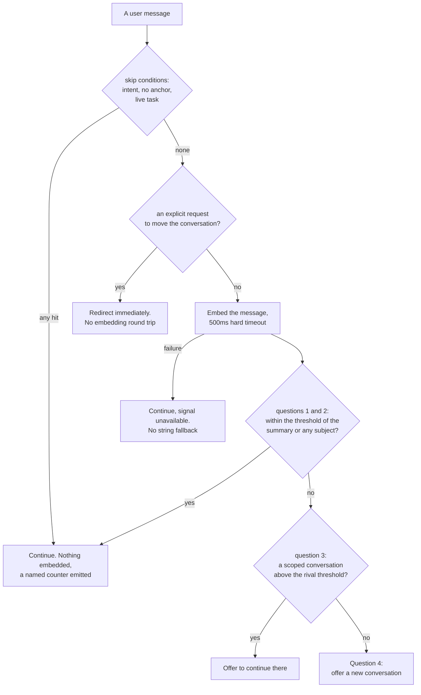
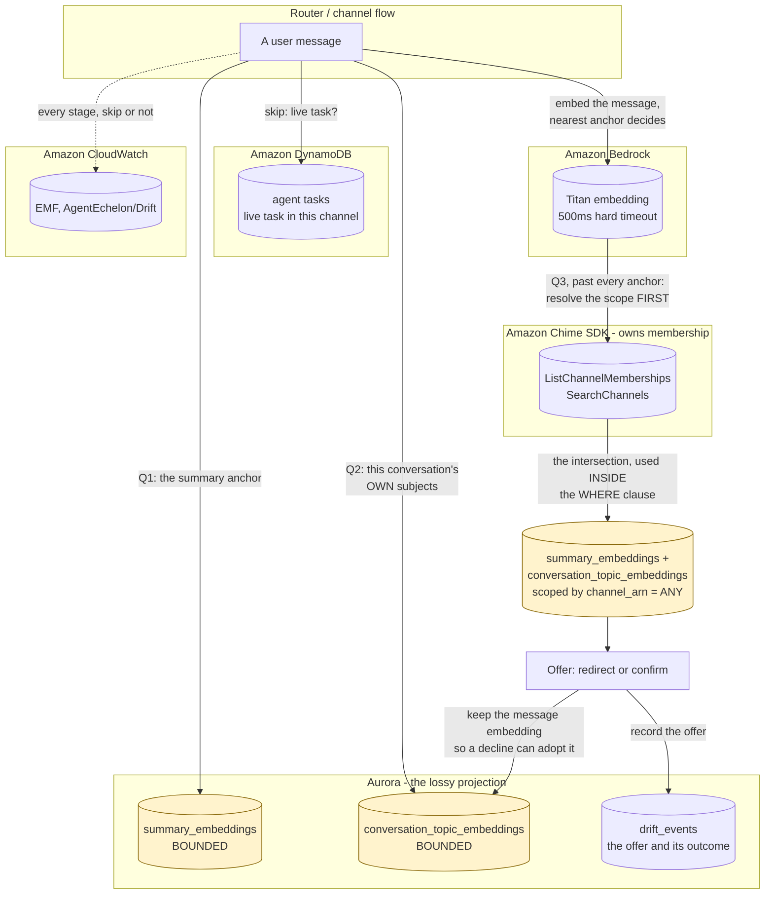
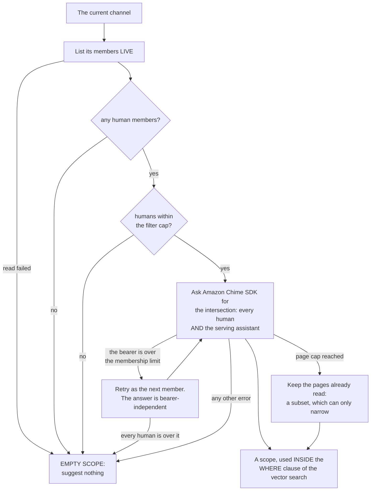
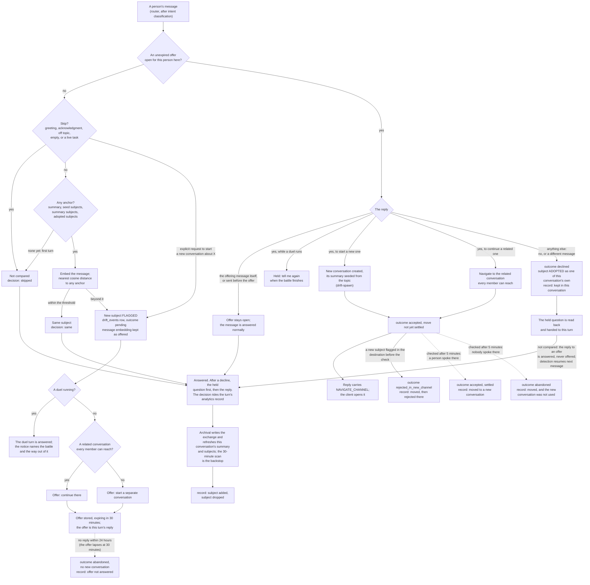
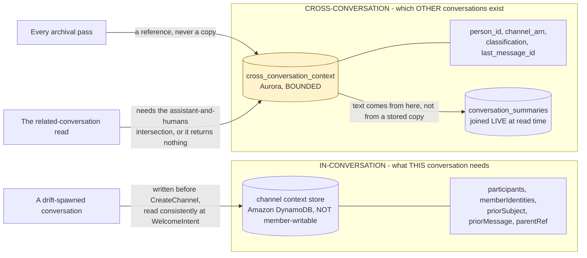

# SPEC: Drift Detection (Drift Convergence)

**Status:** Partial. The embedding-based signal, the confirm and decline flow, the summary updater (refreshed after each archived assistant reply, with a scheduled backstop), related-conversation retrieval, the per-stage telemetry, active-task suppression, the per-subject comparison on every turn and the per-turn subject decision on the analytics record are in place in Aurora mode, with the live-suggestion path behind an opt-in. The requirements table below states what is delivered, what is partial and what each row is validated by, and it is the authority on that - this line is a summary rather than a second record.

**Coverage:** `e2e/drift-detection.spec.ts`, `e2e/turn-state-without-lex.spec.ts` (an ordinary reply declines an open offer; an offer made and accepted through the channel flow, with no Lex session, is honored), `e2e/drift-scope-heavy-member.spec.ts` (a conversation whose members include one over the `SearchChannels` membership limit still resolves its scope, by re-asking the identical filter as somebody under it). Its precondition needs updating for the assistant-first bearer order, since the assistant is the first principal tried. It is opt-in and conditional either way, so it is not standing coverage: `DRIFT_SCOPE_E2E=1`, phase `drift-scope`, Aurora mode with `-c enableLiveDrift=true`, and a test user over the limit, which the reference deployment does not provision - it SKIPS rather than passes. `e2e/subjects-and-intents.spec.ts` drives a subject change on turn two through a browser: the new subject is flagged, and declining the offer keeps it in the conversation (written, not yet run against a deployment). The redelivery guard needs a duplicate delivery on demand, which a browser cannot produce; it has unit coverage.

**Related:** [ADR-013](../../../design/decisions/013-drift-retrieval-vs-decision.md) - where the embedding and pgvector work executes. [ADR-019](../../../design/decisions/019-conversation-summary-seeded-on-first-turn.md) - the first-turn anchor. [SPEC-WELCOME-AND-CONTEXT.md](./SPEC-WELCOME-AND-CONTEXT.md) - the composer that opens a split-out conversation. This spec carries its own mechanics in the appendices, because drift has no separate design document.

**Site section:** Interaction layer, assistants.

---

## Overview

Drift detection notices that a person has pivoted to a different subject mid-conversation and offers to continue it somewhere else. It is built on conversation-level cosine similarity, with deterministic scoring, per-stage observability and multi-member privacy scoping.

**The signal is embedding-based throughout.** No substring, keyword or Jaccard match feeds it: the signal is the minimum `cosine_distance` between the message embedding and each of the conversation's anchors - its summary embedding and the embedding of each of its subjects - over the deployment's configured embedding model (1024-dimension vectors), computed in the data-plane Lambda. One number, deterministic, and on an embedding-call failure the answer is "no drift this turn" rather than a string fallback. String matching survives in exactly one place, `detectExplicitRoutingRequest`, which is a latency optimization for an unambiguous explicit request and not a drift signal.

**Every live drift decision resolves four questions in order**, so the expensive steps run only when the cheap ones have justified them: is the person moving off the current subject, is the new subject already one of this conversation's own, is it already live in another conversation they can reach, and otherwise offer a new conversation. The first two are answered by one comparison on every turn, and each question can end the turn.

**A fired suggestion IS the reply.** The router returns it and the agent flow never runs, so a pivot is worth interrupting for and a false positive costs the person the whole turn. That asymmetry shapes every gate below: the design errs toward continuing rather than toward offering.

**Where it runs.** Drift requires Aurora mode, because the signal needs pgvector. The post-hoc analytics signal runs by default in Aurora mode; the live-suggestion path is behind the `enableLiveDrift` CDK context flag. An Athena-mode deployment has neither the `summary_embeddings` table nor the embedding writer, so it gets no drift at all.

## Business Problem

When a person pivots to a new subject mid-conversation, the thread's context and summary stop matching what they are asking: replies get worse, the conversation's analytics describe two subjects as one, and nobody notices until somebody reads the transcript. Catching it reliably otherwise means standing up a drift harness of your own - an embedding store, a threshold, a privacy-scoped nearest-neighbor search, and an evaluation set to tune all three against - which is a quarter of work before the first offer is made. The alternative most products settle for is keyword matching, which fires on a word the person happened to reuse and stays silent in every language nobody tested. This exists so a deployment gets the signal, the offer, and the measurement of whether the offer was right, without building any of it.

## Personas

Personas are defined in [PERSONAS.md](../../../overview/PERSONAS.md) and are not redefined here. Four of them use drift, and they split on a single question: the person experiences an interruption, and everyone else has to decide whether that interruption was earned.

### End user

**How drift relates to them:** the offer answers their turn instead of their question, so every offer they decline costs them a round trip. What they need from drift is that it be right, and that declining be cheap and permanent.

| What they need | Requirement |
|---|---|
| An offer only when they have genuinely changed subject, not when they circle back | FR4, FR5 |
| A decline that settles the matter, so the same subject is not offered again | FR6 |
| An answer the assistant already solicited never read as a pivot | FR10 |
| To ask for a separate conversation outright and get one, whatever else is running | FR3 |
| A new conversation that opens knowing what it is for and links back to where it came from | FR11 |
| Their own words kept out of an analytics record they never see | FR14, FR15 |

### AI developer

**How drift relates to them:** the threshold, the anchor and the suppression rules are theirs to tune, and a false positive is invisible unless the interception is distinguishable from a turn that failed to dispatch.

| What they need | Requirement |
|---|---|
| A deterministic signal that returns the same verdict for the same input | FR1 |
| No path where a phrase decides a semantic question | FR2 |
| Per-stage timing and a correlation id that stitches the metric, the log and the event | FR16 |
| A curated set of positive, negative and injection cases to tune the threshold against | FR20 |
| Whether the call was right, judged independently of what the person did about it | FR17, FR18 |
| Subjects that stay current with the conversation rather than lagging it by a schedule interval | FR22 |

### Admin / operator

**How drift relates to them:** drift is inert in exactly the way a switched-off feature is, so what they need is to tell "correctly quiet" from "silently broken".

| What they need | Requirement |
|---|---|
| Skip counters that separate "no anchor yet" from "already a subject here" from "a task is open" | FR4, FR10, FR16 |
| A conversation record that shows on which turns the subject changed | FR23 |
| The subjects that keep drawing turns no intent serves, as candidates for a new intent | FR23 |
| Every offer's ending, including a move nobody used, recorded at the time it was decided | FR25 |
| A rate that says the population behind it, and renders nothing when nothing supports it | FR17 |
| To be alerted when latency or accuracy leaves its band | FR21 |
| Confidence that a duel is not quietly answered by a drift offer | FR19 |

### QA / test engineer

**How drift relates to them:** a semantic signal cannot be asserted by equality, so what is assertable is the scope boundary, the fail-closed behavior and the fixture.

| What they need | Requirement |
|---|---|
| The cross-member scope proven by a test that fails when the filter is removed | FR8, FR9 |
| An offer that only a later message can answer, so an at-least-once delivery cannot decline it | FR12 |
| An offer that survives a turn arriving without an Amazon Lex session | FR13 |
| A published true-positive and false-positive target, run on a schedule | FR20 |

## Functional Requirements and Acceptance Criteria

**Priority is a keep-or-cut decision set against what the field expects, not against how interesting the work is.** `Table stakes` means a deployment without it is behind. `Differentiator` is worth the cost because few platforms do it. `Gap - prioritize` marks a requirement whose absence puts this below comparable systems. `Above bar - optional` is more than the field asks and can wait. `Optional - attach instead` should be bought rather than built. `Enabler` is not user-visible and is what makes another row affordable.

| # | Requirement | Priority | Delivered | Validated by |
|---|---|---|---|---|
| FR1 | A pivot is detected from the nearest cosine distance between the message embedding and the conversation's anchors - its summary embedding and each of its subject embeddings - deterministically, with the same verdict for the same input | Table stakes | Yes | `drift-detection` (unit, behavior) |
| FR2 | No substring, keyword or Jaccard match feeds the signal, and an embedding failure returns "no drift this turn" rather than a string fallback | Table stakes | Yes | `drift-detection` (unit, behavior), `explicit-routing` (unit, behavior) |
| FR3 | An unambiguous explicit request to move the conversation is honored without the embedding round trip, and is never suppressed by any gate | Table stakes | Yes | `explicit-routing` (unit, behavior), `drift-detection` (unit, behavior) |
| FR4 | Every turn after the first is compared, including turn two against the opening-exchange seed's summary and subjects, so a second message continuing the first is not read as a pivot and a second message on a new subject is; a split-out conversation's own anchor is compared against from its first message | Differentiator | Yes | `every turn is compared with the conversation subjects` (unit, behavior) |
| FR5 | Returning to a subject this conversation already covers is not drift, judged on every turn against that conversation's own subject embeddings as well as the average of them | Differentiator | Yes | `every turn is compared with the conversation subjects` (unit, behavior), `embedding-writer` (unit, behavior) |
| FR6 | A subject the person declined to split out belongs to the conversation for its life and is not offered again, matched on the declined subject's own embedding rather than on its distance | Differentiator | Yes | `drift-detection` (unit, behavior), `live-drift-flow` (unit, behavior), `drift-detection` (e2e, behavior) |
| FR7 | A pivot to a subject already live in another conversation the whole room can reach offers to continue there rather than creating a duplicate thread | Differentiator | Yes | `drift-detection` (unit, behavior), `live-drift-flow` (unit, behavior) |
| FR8 | The related-conversation search is scoped inside the query to the intersection of every human member's memberships and the serving assistant's, computed live, never from the archive and never cached, and only on a turn that asks question 3 | Table stakes | Yes | `scoped-channels` (unit, behavior), `live-drift-flow` (unit, behavior), `drift-detection` (unit, behavior) |
| FR9 | Every case the scope cannot answer returns an empty scope, and a search that reaches its page cap returns a subset, so drift suggests less rather than widening the intersection | Table stakes | Yes | `scoped-channels` (unit, behavior) |
| FR10 | A live task in the conversation suppresses the cosine path, so an answer the assistant itself solicited is never read as a pivot | Table stakes | Partly - any live task suppresses, so a genuinely new subject gets no offer while one is open | `drift-detection` (unit, behavior), `live-drift-flow` (unit, behavior) |
| FR11 | Accepting an offer creates the conversation, names it from the subject, opens it with the ordinary composed welcome carrying the drift context, and links both directions durably | Table stakes | Yes | `channel-creation` (unit, behavior), `drift-detection` (e2e, behavior) |
| FR12 | Only a message sent after an offer answers it; a redelivery of the message that made the offer, or a message sent before it opened, leaves the offer open | Table stakes | Yes | `routing-state` (unit, behavior), `live-drift-flow` (unit, behavior) |
| FR13 | The open offer is a durable row rather than Amazon Lex session state, so a turn the channel flow answers can still resolve it | Enabler | Yes | `live-drift-flow` (unit, behavior), `turn-state-without-lex` (e2e, behavior) |
| FR14 | The analytics record references the originating message by id and never stores its body | Table stakes | Yes | `channel-creation` (unit, behavior) |
| FR15 | A deletion request reaches the message reference on `drift_events` and the quote the child conversation's welcome carries | Gap - prioritize | No | none |
| FR16 | Every stage of a drift turn emits its own metric, and one correlation id stitches the metrics, the log lines and the event row | Table stakes | Yes | `drift-detection` (e2e, behavior) |
| FR17 | Health is two separate rates, was the offer right and was it taken, each over the population that supports it, rendering "No data" on a zero denominator and "Not measured" when nothing is judged | Differentiator | Yes | `drift-offer-eval` (unit, behavior), `driftHealth` (unit, behavior) |
| FR18 | Accuracy is judged post-hoc by the evaluation runner's drift-offer pass over live offers only, blind to what the person did about the offer, and an unjudgeable offer stays unmeasured rather than counted wrong | Differentiator | Yes | `drift-offer-eval` (unit, behavior) |
| FR19 | A running duel withholds the offer, sends no notice and records nothing, while detection runs exactly as it does anywhere else | Table stakes | Yes | `live-drift-flow` (unit, behavior), `drift-detection` (e2e, behavior) |
| FR20 | A curated fixture of drift-positive, drift-negative and prompt-injection cases is scored against a published true-positive and false-positive target on a schedule | Gap - prioritize | Partly - `backend/scripts/score-drift-fixture.mjs` scores the 100 drift-positive and drift-negative cases on demand (2026-10-15: 92% true positives and 12% false positives at the 0.84 default, short of both targets); nothing runs it on a schedule, and the injection cases belong to the off-topic path rather than to this score | `drift-detection` (e2e, behavior; schema, case count and identity), `score-drift-fixture.mjs` (script, on demand) |
| FR21 | Latency and accuracy leaving their bands raise an alert | Gap - prioritize | No | none |
| FR22 | A conversation's summary and subjects are refreshed once an assistant reply in it is archived, bounded per archival batch, with the scheduled scan as the reconciliation backstop | Enabler | Yes | `summarizeChannelsNow - the event-driven refresh archival calls` (unit, behavior; source text for the archival call site) |
| FR23 | Each turn's subject decision (`same`, `new` or `skipped`, with the distance) rides the turn's existing analytics record into Aurora `messages.metadata`, so the conversation record shows where the subject changed and unclassified turns can be grouped by subject | Differentiator | Partly - recorded on turns where the live drift flow runs detection, including a skip (`skipped`), and that then dispatch to the assistant: a turn that accepts an open offer runs no detection and records none, a turn that declines one runs detection and records it, and a turn the offer itself answers dispatches nothing. The grouping view is the `unserved_subjects` analytics query, shown as "Subjects no intent serves" on the console's Answer types tab: the window's `general` and `off_topic` turns, from `exchanges` plus live `drift_events` for the turns an offer answered, counted against every subject of their conversation's latest summary, Aurora mode only and not readable by a team-scoped role | `a turn records its subject decision` (unit, behavior and source text), `unserved_subjects: candidates for new intents` (unit, behavior), `subjects no intent serves` (unit, behavior) |
| FR24 | Declining an offer answers the question the offer held, before anything else the reply asks | Table stakes | Yes | `held-question` (unit, behavior), `live-drift-flow` (unit, behavior), `subjects-and-intents` (e2e, behavior; written, not yet run) |
| FR25 | Every live offer reaches a terminal outcome with the time it was decided (`outcome_at`): a decline is final at once; an accepted move stays open until the abandonment detector checks it, which settles it `accepted` when a person spoke in the destination or `abandoned` when nobody did; a new subject flagged in the destination before that check settles it `rejected_in_new_channel`; an offer nobody answers is `abandoned` after 24 hours | Table stakes | Yes | `drift outcomes record when they were decided` (unit, behavior), `accepted moves are checked for engagement, once` (unit, behavior) |

**Reading the "Validated by" column.** Each entry is one specific test, named by its own filename or `describe` block. Unit tests live in `backend/test/lib/`, `backend/test/analytics-aurora/` and `frontend/packages/admin/src/components/admin/`; end-to-end specs live in `tests/e2e/` and are listed against their phase in [e2e-coverage-matrix.md](../../../reference/e2e-coverage-matrix.md). The status in brackets is what the test does:

- **behavior** - executes the code path and asserts on the result.
- **source text** - asserts that a convention still appears in the source. It catches the convention being dropped; it does not catch a wrong number.
- **none** - no test exists.

**Known limits on the delivered rows.** FR7's redirect branch has no test of its own: the cosine path is covered, and nothing asserts that a high-similarity rival produces `suggestedAction: 'redirect'` with `rivalConversationArn` set. FR9 changed on 2026-09-30: the serving assistant bears the search and a human member is the fallback, rather than a human bearing it from the start. The rotation survives as that fallback, so a heavy member still does not switch drift off for a room. Unit-covered; the live assertion is the same one it always lacked, because the reference deployment provisions no test user over the membership limit. FR20's end-to-end spec validates the fixture's schema, its required fields, its injection targets and its content hash, and separately drives a live confirm, decline, battle and metric case; it does not run the curated cases through detection. `score-drift-fixture.mjs` does, against the live embedding model, when someone runs it; its figures are in "The curated set" in Appendix G, and they fall short of the published targets. FR23's decision is reported by the live drift flow and carried on the dispatch, so a turn answered by the offer itself, which dispatches nothing, carries no decision on its analytics record, and a deployment without `enableLiveDrift` records none.

## Non-Goals - Out of Scope

| Out of scope | Why | Where it is covered instead |
|---|---|---|
| Keyword, substring or topics-array matching anywhere in the signal | A phrase match is a language judgment wearing a regex, and it is wrong in every language nobody tested (tenet D11). The attachment gate already ran this experiment and an English opener list was defeated in both directions | FR2, and "String matching in the design" in Appendix A |
| Algorithmic correction of drift decisions in production | The evaluation set measures the rate; it does not overrule a live call, because a judge tuned on the labels it is measured against stops being independent | FR18 |
| Cross-channel drift correlation | A single conversation is the anchor. Correlating across them is a different signal with a different privacy boundary | FR8 draws the boundary this one respects |
| Drift in Athena mode | The signal needs pgvector, and an approximation that reads like the real figure is worse than not having it | [SPEC-AURORA-VPC-MODE](../../foundations/SPEC-AURORA-VPC-MODE.md) |
| A length or question-shape rule for follow-ups | "Where is the file?" and "What about hiring?" are the same shape and opposite answers, and the rule puts English punctuation back into a signal required to be embedding-based | Appendix D, where a second anchor is the honest alternative |
| A recency window after a task reaches a terminal state | It needs a fact nothing on this path holds, and it is wrong exactly where drift is most useful: the turn after a piece of work finishes is the likeliest moment for a legitimate new subject | Appendix D |
| Suppressing by distance rather than by subject | Matching a number suppresses an unrelated subject that happens to sit at a similar distance, and stops suppressing the declined one as soon as its distance moves | FR6, and "A Declined Topic Belongs to the Conversation" in Appendix E |
| An entity-extraction pass, or `originalTopic` / `currentTopic` / `topicType` fields | Conversation-level cosine replaces them, and the user-facing suggestion is templated rather than interpolating a subject name | Appendix A, Interface |
| An evaluation gate in a pull-request build | A nondeterministic judge makes flaky builds, flaky builds acquire retries, and the gate stops meaning anything | FR20 asks for a schedule, not a per-push gate |
| A per-tenant drift architecture | A single deployment reaches Aurora's limits before any one tenant does | Appendix I |

## User Experience Description and Mocks

Drift has two surfaces: the conversation, where the offer is made and answered, and the admin console's Conversations > Drift view, where the offers are read back.

**The person's path.** A message that leaves the subject draws a templated suggestion instead of an answer: "It looks like you're shifting topics. Want me to start a separate conversation for this so we keep both threads clean?", or, when a related conversation already exists, an offer to take them there. Replying "yes" creates or navigates; anything else keeps the subject here and adopts it as one of this conversation's own so it is never offered again, and that turn answers the question the offer held before anything else the reply asks. A new conversation opens with the ordinary composed welcome, named from the subject, quoting the person's own words back under "You asked:", and linking to the conversation it continued from; the parent gets a message carrying a durable link forward.

**The operator's path.** The Drift view lists the events and the two health rates side by side: was the offer right, and was it taken. They stay separate, because a person can decline a correct call and accept a bad one, and blending them hides which half is failing. Volume is not on the surface as a health figure: how often people change subject is a fact about people. A rate with no denominator reads "No data" and a rate with nothing judged reads "Not measured", and neither is colored, because no target has been agreed and coloring one would assert a threshold the product has not set.

**OPEN:** no mocks exist for either surface. Should the console mock be drawn from the admin stylesheets the way the evaluation mocks are, and is the suggestion copy worth a mock at all given it is per-deployment configured text?

## Related Documents

- [ADR-013](../../../design/decisions/013-drift-retrieval-vs-decision.md) - the data-plane seam the embedding and pgvector work runs behind
- [ADR-019](../../../design/decisions/019-conversation-summary-seeded-on-first-turn.md) - the first-turn anchor, and the reversal of the earlier latency position
- [ADR-028](../../../design/decisions/028-vector-store-classification-boundary.md) - the classification boundary the vector tables sit inside
- [ADR-012](../../../design/decisions/012-assistant-config-store-and-drift.md) - why the archive is never the authority for a live access decision
- [ADR-006](../../../design/decisions/006-drift-detection-shape.md) - the shape of the signal, and the cross-repo `DriftResult` contract
- [PERSONAS.md](../../../overview/PERSONAS.md) - the canonical definitions of the four personas above
- [SPEC-WELCOME-AND-CONTEXT.md](./SPEC-WELCOME-AND-CONTEXT.md) - the composer that renders a split-out conversation's opening
- [SPEC-TURN-QUEUE.md](../conversation/SPEC-TURN-QUEUE.md) - keeps a conversation in sequence, where this keeps it on subject
- [SPEC-TASK-STATE-TRANSITIONS.md](../conversation/SPEC-TASK-STATE-TRANSITIONS.md) - the wait declaration active-task suppression deliberately does not depend on
- [SPEC-BATTLE.md](../quality/SPEC-BATTLE.md) - the duel a running offer is withheld during
- [RAG.md](../../../guides/developer/RAG.md) - retrieval, which shares the data-plane Lambda and the pgvector cluster
- [AURORA-MODE-GUIDE.md](../../../guides/admin/AURORA-MODE-GUIDE.md) - the mode drift requires, and the scale breakpoints

## Open questions

| Question | Why it is open |
|---|---|
| The source for incremental summaries | The summary updater, on both its event-driven and its scheduled path, reads the Aurora `messages` projection, so summary quality and therefore drift sensitivity degrade silently whenever archival is incomplete, with no signal separating "the conversation covered little" from "the messages did not arrive". Amazon Chime SDK Messaging, or the S3 archive that is the system of record, would remove the failure mode. The seed is unaffected either way, because it never reads a store |
| A second anchor for the immediately preceding exchange | Appendix D's uncovered class needs it, and its risk is the inverse one: a wandering assistant reply becomes a wide anchor that suppresses genuine pivots. A second anchor may therefore only ever suppress, by taking the nearer of the two distances, never fire on its own |
| Whether the distance threshold becomes runtime-tunable | It is deploy-time environment configuration on the data-plane Lambda today. Moving it to SSM is worth doing; until it happens, nothing describes it as if it already were |

## Appendix A - The signal

### Interface

`DriftResult` has this shape:

```typescript
export interface DriftResult {
  isDrift: boolean;
  driftScore: number;                  // cosine_distance (0-2 range, lower = more similar). NaN if unavailable
  suggestedAction: 'continue' | 'confirm' | 'redirect';

  // Observability + flow fields
  confidence: 'low' | 'medium' | 'high';
  signalAvailable: boolean;             // false if embedding call failed -> suggestedAction='continue', no suggestion
  correlationId: string;                // UUIDv7
  suggestionTemplate?: 'drift-offer' | 'drift-redirect-offer'; // The message template of the offer; the router renders it
  rivalConversationArn?: string;        // Set when an existing related conversation matched (suggest_switch rather than offer_create)
}
```

Fields intentionally absent: `originalTopic`, `currentTopic`, `topicType`. These would represent entity-extracted subject strings; the conversation-level cosine comparison replaces them, and the user-facing suggestion is templated rather than interpolating a subject name.

### String matching in the design

String matching lives in exactly one place: `detectExplicitRoutingRequest` (`lib/explicit-routing.ts`), an explicit-intent fast path for requests like "let's start a new conversation about X". It skips the embedding round trip and routes immediately. It is not a drift signal; it is a latency optimization for an explicit request, backed by a unit-tested allowlist.

Everything else is embedding-based. Subject extraction and similarity use conversation-level cosine over the configured embedding model's vectors rather than a keyword regex or Jaccard overlap. Related-conversation retrieval uses cosine nearest-neighbor rather than a `topics[]` array overlap or a company-name filter, which semantic retrieval handles naturally. An embedding failure returns "no drift this turn", and there is no separate entity-extraction pass, because the conversation-level cosine makes it redundant.

### Where it executes, and where to look when it seems switched off

The embedding and pgvector work (`detectDrift`, `recordDriftFire`, `recordDriftOutcome`) runs inside the VPC-attached retrieval **data-plane Lambda**, which the non-VPC agent handler invokes synchronously ([ADR-013](../../../design/decisions/013-drift-retrieval-vs-decision.md)). The handler orchestrates the suggestion and any conversation creation and is not itself VPC-attached. Retrieval shares the same data-plane Lambda, which is the existing seam rather than a new one (tenet D8).

Two consequences are worth knowing before debugging. Every drift metric under the `AgentEchelon/Drift` namespace and every `[Drift]` log line lands in the **data-plane** log group, so searching the handler's logs for drift returns nothing and looks exactly like the feature being switched off. And the handler bundle carries only the thin `invoke('detectDrift', ...)` client, so a change to `analytics-aurora/drift-detection.ts` requires deploying the analytics stack; deploying only the assistant-profile stacks ships an inert change. `logGateExit` in `live-drift-flow.ts` logs once per container, so its absence never proves drift did not run.

### Decision flow

Every turn resolves four questions in order. Each one can end the turn, so the expensive steps only run when the cheap ones have already justified them.

1. **Is the person moving off the current subject?** Compare the message embedding against this conversation's summary embedding. The only context it needs is this conversation's own subject, plus any in-progress task, which anchors the turn just as the summary does: somebody answering a task's clarifying question is on-topic by definition, however far the wording sits from the summary.
2. **Is the subject already a subject of THIS conversation?** A conversation legitimately covers several, and returning to an earlier one is not drift. Compare the message embedding against the per-subject embeddings held for this conversation. This is cosine over embeddings, not `topics[]` string overlap.

   Questions 1 and 2 are one comparison, made on every turn: the distance is the minimum over the summary and every subject, and within the threshold of any of them the turn is the same subject and ends here. The summary is an average that no single subject sits near, which is why the subjects stand beside it; the summary stays in the comparison because a subject is a short label, and a full question can sit far from a label it is plainly about. Including it can only make an offer less likely than the subjects alone.
3. **Is the subject already discussed in another of the person's conversations?** Only if the message is far from the summary and from every subject. Cosine nearest-neighbor over each candidate conversation's summary and subjects (`summary_embeddings` and `conversation_topic_embeddings`), scoped by the member-intersection boundary. On a match, ask whether they want to continue there (`suggestedAction: 'redirect'`, `rivalConversationArn` set) rather than creating a duplicate thread.
4. **Otherwise, offer to create a new conversation** and redirect them into it (`suggestedAction: 'confirm'`).

The shared comparison is the foundation: steps 3 and 4 are refinements of what to do about a pivot, and neither runs until the comparison has established that a pivot happened.



### What each step reads, and as whom

The diagram above is the logic. This one is the same flow by RESOURCE: which store answers each question, which identity the statement runs as, and which of the three stores owns the answer. The two are separate because the expensive property of this flow is not its branching, it is that four of its five reads cross a classification boundary and each one is a place a conversation could be shown to a classification that may not see it.

**Every bounded read runs as a per-classification reader role, never as the runtime login role.** `embeddings`, `summary_embeddings`, `conversation_topic_embeddings` and `cross_conversation_context` are under FORCE ROW LEVEL SECURITY ([ADR-028](../../../design/decisions/028-vector-store-classification-boundary.md)), and the read policy matches a row only when its `classification` is in the current role's declared grant set. A statement issued unroled matches no policy and returns nothing, which is the safe direction: the failure is a conversation nobody is offered, not one offered to the wrong person.



**Reading the diagram against the tenets.** The membership read is live and never a stored copy, because Amazon Chime SDK owns membership and a projection of it is stale in the one direction that discloses ([tenet D7](../../../overview/TENETS.md)). The scope is resolved BEFORE the question-3 search and is applied inside its `WHERE` clause rather than filtering the result, so a conversation outside the intersection is never read in the first place. And the two mechanisms are deliberate rather than redundant: the reader role is the privilege and the scope is the query, so either failing alone is survivable.

**When the scope is resolved, and what it costs.** The scope costs one `SearchChannels` page per 50 conversations the room shares with the serving assistant, so it grows with history. Only a turn on which questions 1 and 2 agree there is a pivot ever asks question 3, so the live flow runs detection first with `deferRelatedLookup`, and the data plane returns the offer with the message embedding instead of searching. Only then does the router resolve the scope from Amazon Chime SDK Messaging and call the `resolveDriftRival` data-plane op, which runs the scoped search and upgrades `confirm` to `redirect` on a match. An ordinary turn makes no membership read and no search. Nothing is cached between turns: a stored scope is the lagging copy this control exists to avoid, since it keeps a conversation somebody was just removed from. A battle turn names the duel instead of offering a split, so it never resolves a scope.

**Who bears the search, and the one limit that matters.** The serving assistant bears it. That was a human until 2026-09-30, on the reading that a bot cannot bear `SearchChannels`; measured against the live API, it can, and the bearer does not change the answer. Counted to exhaustion on one app instance: the assistant alone reached 388 channels, the assistant intersected with a person 265, and the same filter borne by that person returned the same 265. The bearer is the only principal the service limit-checks, and the assistant is the principal that grows fastest - one membership per conversation of its classification - so it is the one that will cross the limit first. It therefore asks first and, only if the service refuses it for the membership limit, a human member asks the IDENTICAL filter instead. That fallback is safe for the reason the earlier per-member intersection was not: the rejected one could not carry the assistant term and so answered a wider question, whereas changing the bearer changes only who asks. Both the assistant and every human being over the limit is logged as an error rather than a warning, because at that point the conversation can scope nothing and the symptom is silence.

| Step | Resource | Identity it runs as | Owns the answer |
|---|---|---|---|
| Skip: live task | `agent tasks` (Amazon DynamoDB) | the turn's execution role | Amazon DynamoDB |
| Q1: the summary anchor (none and no subjects is a skip) | `summary_embeddings` | `ae_reader_<classification>` | Aurora |
| Q2: this conversation's own subjects | `conversation_topic_embeddings` | `ae_reader_<classification>` | Aurora |
| Embed the message | Amazon Bedrock Titan | the turn's execution role | Amazon Bedrock |
| Q3: resolve the scope | `ListChannelMemberships`, `SearchChannels` | the caller's own bearer-pinned credential | Amazon Chime SDK |
| Q3: the scoped search | `summary_embeddings`, `conversation_topic_embeddings` | `ae_reader_<classification>` | Aurora |
| Record the offer and its outcome | `drift_events` | the runtime login role | Aurora |
| Retain a declined subject | `conversation_topic_embeddings` | `ae_writer` | Aurora |
| Every stage, including a skip | EMF to `AgentEchelon/Drift` | the turn's execution role | Amazon CloudWatch |

**`conversation_topic_embeddings` is read for question 2 and written by two different producers,** which is why the same table appears twice above. The summarizer, the opening-exchange seed included, writes one row per subject it identified (`origin = 'summary_topic'`, `status = 'established'`); the live flow keeps the message embedding of an offer somebody declined (`origin = 'drift_offer'`, `status` moving `offered` to `adopted`). Question 2 admits every status but `offered`: a row is one of the conversation's subjects unless it is a proposal still waiting on an answer.

### Detection Algorithm

```typescript
async function detectDrift(input: DetectDriftInput): Promise<DriftResult>

interface DetectDriftInput {
  channelArn: string;
  messageId: string;
  latestMessage: string;
  intent: IntentType;           // Skip drift on GREETING, ACKNOWLEDGMENT, OFF_TOPIC
  correlationId?: string;       // UUIDv7. Generated when omitted
  userClearance?: Classification;  // EMF dimension; metrics aggregate across clearances when omitted
  retainOfferEmbedding?: boolean; // Live flow only: keep the message embedding when an offer fires, so a decline can adopt it
  activeTaskInProgress?: boolean; // Skip the cosine path while this CHANNEL has a live task, whoever holds it
}
```

1. **Skip conditions**, each an early return of `{isDrift:false, suggestedAction:'continue', signalAvailable:true}`:
 - Intent in `{GREETING, ACKNOWLEDGMENT, OFF_TOPIC}`.
 - Empty or whitespace-only text, counted under the same `drift_skipped_intent`.
2. **Explicit routing fast path.** If `detectExplicitRoutingRequest(latestMessage)` matches, return `{isDrift:true, suggestedAction:'confirm', confidence:'high', signalAvailable:true}` immediately and emit `drift_fastpath_explicit_intent`. This is the only string-matching path.
3. **Live task.** If a live task exists in this channel (status `pending` or `in_progress`), whichever principal holds it, return `continue` and emit `drift_skipped_active_task`, or `drift_skipped_recent_task` when `taskSignal` is `recently_ended`. Checked after the explicit-routing fast path and before the anchor reads and the embed call, so a suppressed turn costs no Bedrock round trip.
4. **Load the anchors.** The conversation's summary embedding from `summary_embeddings`, keyed by `channel_arn`, and its subject embeddings from `conversation_topic_embeddings`. A row is one of the conversation's subjects unless it is a proposal still waiting on an answer, so the read admits every status but `offered`: the subjects a summary established, the opening-exchange seed's included, and the subjects of offers a person declined. Both reads run as the channel's reader role. A failed read of one leaves the other to compare against; with no anchor at all - the normal state on a conversation's first user turn, because drift runs before that turn's exchange is seeded - the turn continues and emits `drift_skipped_no_summary`.
5. **Embed the latest message.** Bedrock `InvokeModelCommand` against the deployment's configured embedding model, producing a 1024-dimension vector. Hard timeout 500ms.
6. **Nearest-anchor decision (decision-flow questions 1 and 2).** Compute the cosine distance from the message to every anchor in the Lambda, since every vector is already in hand, and take the minimum. Within `DRIFT_DISTANCE_THRESHOLD` (default `0.84`, measured against the curated set; see "The curated set" in Appendix G) the turn is the same subject: return `{isDrift:false, suggestedAction:'continue'}` with that distance and emit `drift_skipped_known_topic`. Beyond it from every anchor the turn is a new subject and emits `drift_fired`, and its `confidence` is `low`, `medium` or `high` by which third of the headroom between the threshold and a distance of 1 the distance falls in. The knob is deploy-time environment configuration on the data-plane Lambda, not an SSM parameter.

  The subjects stand beside the summary because the summary embedding is an **average** over everything the conversation covers, so in a genuinely multi-subject conversation every individual subject sits some distance from it, and distance from the summary alone rises whenever somebody moves between the conversation's own subjects. Comparing against the subjects individually is what separates "returning to something we already discuss here" from "leaving for something new". The `topics[]` field is the model's human-readable labeling of what got embedded, never the matching key.

  **Turn two is compared, not skipped.** The opening-exchange seed writes a summary and its subjects, so a second message continuing the first sits near one of them, and a second message on a new subject - "What is AgentEchelon?" followed by a request for a revenue figure - is far from all of them and draws an offer.

7. **Related-conversation lookup (decision-flow question 3, only if step 6 fired).** `findRelatedConversation` compares the message against the same anchors step 6 uses, for each candidate conversation: its summary and every subject that is not a pending offer. A candidate's similarity is that of its nearest anchor, so a conversation whose summary is broader than the one subject the message names still matches on that subject:

   ```sql
   SELECT channel_arn, 1 - MIN(distance) AS similarity
   FROM (
     SELECT channel_arn, embedding <=> :messageEmbedding::vector AS distance
       FROM summary_embeddings WHERE channel_arn = ANY(:candidateArns)
     UNION ALL
     SELECT channel_arn, embedding <=> :messageEmbedding::vector AS distance
       FROM conversation_topic_embeddings WHERE channel_arn = ANY(:candidateArns) AND status <> 'offered'
   ) anchors
   GROUP BY channel_arn
   ORDER BY MIN(distance)
   LIMIT 1;
   ```

 `:candidateArns` is the intersection described under "Scoping (Security + Privacy)", less the current conversation. If the top result's similarity is at or above the re-route threshold (default 0.80, the `DRIFT_REROUTE_THRESHOLD` environment variable on the data-plane Lambda), `suggestedAction='redirect'` and `rivalConversationArn` is set; otherwise `suggestedAction='confirm'`.

8. **Fallback on any embedding failure** (Bedrock 5xx, timeout past 500ms, empty response): return `{isDrift:false, suggestedAction:'continue', signalAvailable:false}` and emit `drift_skipped_unavailable`. No substring fallback. The next message gets another shot.
9. **Emit per-stage metrics** for every invocation, whatever the outcome.

### The subject decision on the turn record

The live drift flow reports each comparison it makes as `{decision, distance}`: `new` when the turn fired, `same` when a distance was measured within the threshold, and `skipped` when nothing was compared. It is recorded on turns where the live drift flow runs detection, including a skip, and that then dispatch to the assistant: a turn that accepts an open offer runs no detection and records none, a turn that declines one runs detection and records it, and a turn the offer itself answers dispatches nothing, so its decision is not recorded. The router carries it on the turn's dispatch as `subjectDecision`, and the async processor puts it on the turn's analytics metadata, which reaches Aurora `messages.metadata` through the existing out-of-band analytics record and archival. The turn makes no write of its own for it. The decision lets the conversation record show where the subject changed, and lets `general` and `off_topic` turns be grouped by subject to find intents worth adding; that grouping view is not built.

## Appendix B - Summary Updater (Prerequisite)

Drift needs anchors to compare against; without a summary or a subject every call hits `drift_skipped_no_summary` and the feature cannot function. A summary-updater Lambda writes them, from four paths.

**No summary until a person speaks.** Both transcript paths (the archival refresh and the scheduled scan, through `processChannel`) read message events only and skip a conversation in which no person has sent a message. A summary of the assistant's welcome alone would become the anchor and make the person's first question read as a change of subject; channel and membership events are excluded because their `content` is a channel or member name, sent by the service admin that assembled the room.

**What `generated_by` records.** Every summary row names its writer: `drift-spawn`, `summary-seed` or `summary-updater`. Two of those write `version = 1` and they mean different things: a `summary-seed` row is built from one exchange, and a `drift-spawn` row is a subject the person explicitly chose to move somewhere else. Detection compares against both alike; the column keeps the provenance for whoever reads the row.

**1. The subject a split-out conversation was created for (`drift-spawn`).** A conversation created by accepting an offer is the one conversation whose subject is settled before it has any messages. That subject, together with the person's own words, is written as `version = 1` at creation, on the confirm path, strictly best-effort. This path takes no model call: every other summary compresses a transcript and needs one, and this one has nothing to compress. Asking a model to restate words somebody already chose would add a call, a failure mode and latency to the conversation-creation path in exchange for nothing. A failure here is invisible to the person, because the conversation is already created and they are already being navigated to it, and it costs the new conversation only its early anchor, which the next summary refresh supplies. Without this path, the conversation created *because* of a subject would be the one place drift stayed blind longest.

**2. Opening exchange (seed).** The row is created from the conversation's opening exchange, at the same point the conversation is named: naming and summarizing describe the same exchange, so they are attempted together. It writes the same `{name, summary, purpose, topics[], key_points[]}` shape as an incremental update, at `version = 1`, from the first user message and the assistant's reply alone. It is a genuine summary of a one-exchange conversation rather than a placeholder, so its embedding is directly comparable to later versions.

**The gate is a cost bound, not an ordinal, and that distinction is not pedantry.** Both this and the naming are gated on `earlyInConversation` rather than on an `isFirstUserTurn` flag derived from channel history at processor time. Under [ADR-033](../../../design/decisions/033-a-conversation-answers-one-turn-at-a-time.md) a burst of messages is queued and read together, so the first message may never run as its own invocation, and by the time one does its own history already holds a user message: an ordinal flag reads false on every invocation and the anchor is never written, leaving a conversation unnamed and unanchored after three messages in a burst and two processor invocations. The correctness is never the ordinal's to hold: `seedSummaryFromExchange` selects from `conversation_summaries` first and returns `already-summarised`, and its insert is `ON CONFLICT (channel_arn, version) DO NOTHING`, so asking more than once is safe and even two concurrent turns write one row. The once-per-conversation rule lives in the data plane, where it can be enforced against a fact.

**The seed does not read a message store.** The reply handler already holds the first user message and the assistant's reply in memory at the moment it responds, so the seed is composed from those directly. Reading them back from the Aurora `messages` table would be both redundant and self-defeating: that table is a derived projection fed by Kinesis and then the archival Lambda, so a seed that waited for it would inherit exactly the lag that leaves early turns without an anchor. Amazon Chime SDK Messaging is the authoritative conversation and Aurora is a projection of it, so neither needs to be consulted for content the handler is already carrying. Mechanically the seed rides the existing data-plane seam: the non-VPC reply handler calls a `seedSummary` op on the VPC-attached data-plane Lambda, which owns the Aurora write, the summarization and the embedding. No new VPC endpoint and no new egress path (tenet D8).

**3. After an assistant reply is archived (event-driven).** Once the Kinesis archival Lambda commits a batch, it calls `summarizeChannelsNow` for each conversation in which an assistant message (`CREATE_CHANNEL_MESSAGE` or `UPDATE_CHANNEL_MESSAGE` with `is_bot`) was archived. It runs the same per-channel `processChannel` as the scheduled scan, so there is one summary writer, and it reads the archived transcript, so the filter that keeps a privately addressed message out of the summary applies. It is bounded to `SUMMARY_ON_ARCHIVE_MAX` conversations per batch (default 3), skips a conversation whose latest summary is at least as new as its newest message, and never throws: a failed or deferred conversation is left to the scheduled scan, and archival cannot fail over a summary. The call is in-process, so it needs no Lambda invoke from the isolated subnets; the archival role holds `bedrock:InvokeModel` on the utility model and Claude 3.5 Haiku for it (`lib/stacks/archive-stack-aurora.ts`).

**4. Scheduled reconciliation.** EventBridge fires the Lambda every 30 minutes, the rate fixed in `archive-stack-aurora.ts`. Each run finds channels whose newest message is newer than their newest summary:

```sql
SELECT DISTINCT m.channel_arn
  FROM messages m
  LEFT JOIN (
    SELECT channel_arn, MAX(updated_at) AS last_summary_at
      FROM conversation_summaries
     GROUP BY channel_arn
  ) cs ON cs.channel_arn = m.channel_arn
 WHERE m.created_at > COALESCE(cs.last_summary_at, 'epoch'::timestamptz)
```

The scan still handles a channel that has never been summarized, and every conversation the event-driven path deferred or failed on, so it is the reconciliation backstop behind the seed and the archival refresh rather than the primary mechanism (tenet D6). Channels with no activity since their last summary are excluded, so no Bedrock call is wasted.

Per channel, the algorithm reads the recent messages since the last summary's `updated_at` capped at 50, reads the current summary row as anchor context so the model summarizes incrementally rather than from scratch, calls the deployment's configured summary model at temperature 0 for a structured `{summary, purpose, topics[], key_points[]}` JSON, upserts at `version = previous + 1` race-safely on `WHERE version = previous_version`, embeds the new summary text into `summary_embeddings` with `embedded_from_version` set, embeds each `topics[]` entry individually and replaces this channel's summarizer rows in `conversation_topic_embeddings` at the same version, and emits its run metrics. The per-subject rows are what step 6 compares against beside the summary, so a return to a subject this conversation already covers is measured against that subject rather than against the average of all of them. They are capped at twelve a version and deduplicated case-insensitively, and they are best-effort and last: a conversation left with a good anchor and no subject rows behaves exactly as one that has never been summarized since the summarizer gained this half. Idempotency: the embedding write checks `WHERE embedded_from_version < $newVersion` so a duplicate invocation does not re-embed, and the summary write's conditional means the second concurrent writer is a no-op. Every step is best-effort; a Bedrock failure leaves the previous summary in place and the next trigger retries, so no per-channel circuit breaker is needed. The archival refresh makes a summary call per answered conversation rather than per scheduled run, so its model cost grows with the number of assistant replies, bounded per batch by `SUMMARY_ON_ARCHIVE_MAX` and by the skip for a conversation whose summary is already current.

**When drift becomes available depends on which path wrote the anchor.** A split-out conversation has drift from its first message, because its `drift-spawn` anchor exists before the conversation does. An ordinary conversation has drift from its second user turn: the first skips with `drift_skipped_no_summary`, and the seed written after it supplies a summary and subjects that turn two is compared against. `drift_skipped_no_summary` is expected to be non-zero on a healthy deployment, one per new conversation. Freshness after that follows the archival refresh: the summary and subjects move once an assistant reply is archived, and the 30-minute scan bounds the lag only for a conversation the refresh deferred or failed on.

## Appendix C - Scoping (Security + Privacy)

The related-conversation query is the highest-risk surface here, because a bug leaks one person's summaries to another through a nearest-neighbor lookup. Two requirements are not optional.

**Cross-user scoping.** `channel_arn IN (:scopedChannelArns)` is enforced inside the WHERE clause of the vector search, never as a post-filter on results. A dedicated test covers two people whose summaries embed close together and fails if either scope includes the other's channel.

**Multi-member intersection scoping.** In a 1:1 channel the scope is the sender's memberships. In a multi-member channel the scope is the intersection of every human member's memberships **and the serving assistant's**, so a related conversation can only be suggested if every current human member already has access to it and the assistant answering is itself in it.

**The serving assistant is an intersection term, not an exclusion.** Leaving it out makes the scope "channels every human shares", which can include a conversation this assistant was never added to, and the lookup reads summaries directly from Aurora where no Amazon Chime SDK membership check applies. The scope *is* the access control, so an assistant could surface a conversation it is not in, including across profiles: two people sharing a basic and a premium channel would let the premium assistant reach the basic one. Adding a term to an AND can only narrow the result, so this is strictly safer. An earlier rationale that excluded bots "because they are in many channels" had it backwards: that argument applies to using a bot as the search *seed*, never as an intersection term. Other bots in the room are still not seeds, because one bot's membership says nothing about who may see what.

Verified against the live API: a bot ARN is accepted as a `MEMBERS` value and genuinely AND-filters. With the same person and bearer, the human alone returns their full channel count; the human plus a bot sharing those channels returns the same count; the human plus a bot that shares none returns zero. The zeros are the control: an ignored term would leave every count unchanged, and an OR would never fall below it. Because the assistant takes one of the filter's values, the cap is on humans (`MAX_HUMANS_IN_FILTER`), one below the filter bound.

**The intersection is never computed from the Aurora archive.** The archive is filled asynchronously, and **both lag directions leak, precisely when membership has just changed**: a member who joined but is not projected yet is left out, so the scope comes out wider than the people in the room, and a channel someone was removed from that is still projected stays in their set. The one failure this control exists to prevent is the one a lagging copy produces. The archive remains useful for analytics and is never the authority for a live access decision ([ADR-012](../../../design/decisions/012-assistant-config-store-and-drift.md)).



Every path to `EMPTY SCOPE` is deliberate, because dropping an unreadable member would widen the intersection, and widening is the one direction that discloses.

Two live paths, both authoritative:

1. **`SearchChannels` with `MEMBERS ... INCLUDES`.** Several values are an AND, so the intersection is computed by the service that owns membership. The search must bear one of the members, because the service rejects any other bearer and a bot is not an AppInstanceUser. Which member does not change the answer, since every member of the intersection is in every channel it contains.
2. **Retry with a different bearer.** `SearchChannels` refuses when the searching user belongs to too many channels; on the reference deployment the refusal came at 1038 channels. Only the bearer is limit-checked and the answer is bearer-independent, so the same question is put to the next member. Any other error is about the request itself and would fail identically for every member, so it is not retried.

**When every human is over the limit the scope is empty and drift suggests nothing.** There is deliberately no per-member intersection fallback, computed by listing each human's own memberships and intersecting them. Such a fallback intersects humans only, so it cannot apply the assistant term and answers a wider question than the primary path on exactly the heaviest accounts, and it needs a `chime:ListChannelMembershipsForAppInstanceUser` grant the role does not carry. A fallback less safe than the path it backs up is worse than no fallback. Adding one requires a way to apply the assistant term.

**Every case it cannot answer returns an empty scope, meaning suggest nothing:** no human members, more members than one filter can express, a failed membership read, a failed search whose cause is not the membership limit, or a member whose own list cannot be read. Dropping an unreadable member would widen the intersection, which is the one direction that discloses.

**The search reads at most `MAX_SCOPE_PAGES` pages (10, so 500 conversations).** Every page holds conversations that satisfy the whole filter, so stopping early yields a subset of the true intersection: it can miss a related conversation and can never include one somebody in the room cannot open. Which subset is the service's page order, which it does not document, so a room with a longer shared history may lose a match that would otherwise have been offered. Reaching the cap is logged as a warning.

**It runs on the router, not in the data plane.** `detectDrift` executes in the data-plane Lambda, in isolated subnets with no Amazon Chime SDK endpoint and no NAT, where such a call would hang to the timeout. `resolveScopedChannelArns` (`backend/lambda/src/lib/scoped-channels.ts`) lists the current channel's members live, keeps only `/user/` ARNs, and asks Amazon Chime SDK for the intersection. `DetectDriftInput.scopedChannelArns` is supplied by the caller, and absent means no suggestion by design.

## Appendix D - Active-Task Suppression

A live task means the assistant is mid-workflow and has asked someone in this conversation for something: report requirements, an outline approval, troubleshooting symptoms, a scheduling slot. The next turn is the answer, and an answer continues the thread rather than pivoting away from it.

The cosine signal cannot see that, because it compares one message against the summary and the subjects. An answer is typically a short fragment that repeats none of their words, so it lands far from every anchor and fires drift on the exact turn the assistant solicited: mid-`report_generation`, without the suppression, it costs the flow a turn and interrupts the person with an offer to split the conversation. The router resolves the live task for task continuation anyway, so it passes `activeTaskInProgress` into `detectDrift` and no extra read is incurred.

**The condition is "live task in THIS CHANNEL", not "live task this person owns".** Ownership moves to the person only when the machine enters a state that declares `awaits` ([ADR-024](../../../design/decisions/024-task-ownership.md)), so an owner-keyed suppression silently inherited every such declaration as a dependency: a state that ends its turn on a question without carrying the flag leaves the task with the assistant, the owner-keyed lookup finds nothing, and the protection is gone with no error anywhere. `report_generation.drafting_outline` is exactly such a state, and under an owner-keyed suppression somebody answering the assistant's own outline question with "Can you make it 1-2 pages?" is served "It looks like you're shifting topics" instead of a shorter report. The flag is still worth declaring for its own reasons, because it is what puts the item in the person's queue and what lets their next message resume it, but the drift guard does not depend on it being right. The router derives the condition from the task lookups it already makes, all of which filter to `pending` and `in_progress` in their key condition, so nothing is read that was not read before.

**This suppression is blunter than the intended rule.** It treats any live task as a reason to continue here, so while a task is open a genuinely new subject is never offered a conversation of its own. The target design asks two questions where this asks one: is the message unrelated to the *task* but still related to the *conversation*, in which case break out of the task and carry on here with no offer; or is it unrelated to both, which is real drift. The interim errs toward continuity because continuity is the cheaper failure: interrupting an answer the assistant just solicited costs the person the turn they were in, while a missed offer costs them a split they can still ask for outright, since the explicit-routing fast path is never suppressed. The decision lives in one named place (`backend/lambda/src/lib/task-continuity.ts`) so the two-axis rule replaces that function's body without touching the router or the drift flow.

**What the two-axis version needs and does not have is a task-scoped signal.** Drift's anchors are the conversation's summary embedding and its subjects, and nothing embeds a task, so question 1 has no input at all today. `conversation_topic_embeddings` is the right shape for one - many small embeddings for one channel, replaced per summary version, compared by minimum distance - but its rows are the conversation's subjects and say nothing about which of them an open task is asking about.

Scope of the suppression, deliberately narrow: it suppresses the cosine path only, so an explicit request for a separate conversation mid-task still gets one and a long-running task never becomes a trap; it does not touch the pending-suggestion branch, so answering an outstanding yes/no is always honored; and it is per-channel and owner-independent, lifting as soon as the task reaches a terminal state. `drift_skipped_active_task` is expected to be non-zero on any deployment that uses multi-turn tasks and is not an alertable condition: a precision dashboard reads it as "correctly declined to interrupt", not as lost coverage.

### The same class of false positive that suppression does not reach

A fired suggestion is not an annotation on the reply, it *is* the reply: `runLiveDriftFlow` returns a Lex response and the router returns it immediately, so the agent flow never runs. The turn is served without conversation history, without a model call and without the assistant's persona. A false positive therefore costs a whole turn, which the end-to-end suites reflect: a spec asserting an answer has to recognize the suggestion text and decline before re-asking. The interception is logged for the same reason: the router logs its delivery decision only after the drift check returns, so an intercepted turn left a trace identical to a turn that failed to dispatch, and a report of "the assistant forgot the previous turn" could not be told apart from "drift answered instead".

The first follow-up after a seeded summary is the highest-risk turn. Measured on the reference deployment against the seed's summary alone: a summary seeded four seconds after the opening reply, then a follow-up asking for a detail stated in that opening turn, scores past the threshold and fires. Turn two is compared against the seed's subjects as well as its summary, and is the same subject when it is near any of them, which is what a follow-up continuing the opening is expected to be; no deployed measurement of that case against the subjects is recorded here. The broader class still arrives against a mature anchor.

**The same class arrives the moment a task ends, and nothing covers it.** Reproducible in a live `report_generation` conversation: the report is delivered, the person says "Looks good", the assistant says it has saved the file, and "Where is the file?" fires an offer. Every task lookup on the router path filters to `pending` and `in_progress`, so a task that reached a terminal state is invisible to all of them, and widening the suppression to any live task does not reach this turn because by then there may be no task at all.

The shape of the miss names what a fix would have to be. The message refers to the **immediately preceding assistant turn**, and the anchors drift holds, the summary and the subjects, describe the conversation as a whole: "Where is the file?" is far from an annual-revenue summary and very close to a reply that just said a file had been saved. So the honest fix is a second anchor, carrying the last exchange as its own embedding and treating the message as on-topic when it is near either. It costs one embed per assistant turn on the path that already embeds the summary, and no additional read on the drift path. Its risk is the inverse one, which is why a second anchor may only ever suppress and never fire on its own. Both false offers above remain reproducible on a deployment.

## Appendix E - Live-Suggestion Flow

When `detectDrift()` returns `isDrift=true` and `suggestedAction` is `confirm` or `redirect`:

1. **The assistant emits a templated suggestion** as the user-facing reply, said from the `drift-offer` or `drift-redirect-offer` message template in the assistant's words: drift detection names the template and the router renders it ([ADR-062](../../../design/decisions/062-a-message-is-a-template-stored-and-versioned-like-a-document.md) decision 6). The shipped text, for `confirm`, with no related channel found: "It looks like you're shifting topics. Want me to start a separate conversation for this so we keep both threads clean? Reply 'yes' to create one, or anything else to keep going here." `redirect`, with a related channel: "It looks like you're shifting to something we covered in another conversation. Want me to take you there? Reply 'yes' to switch, or 'no' to keep going here.", carrying a `NAVIGATE_CHANNEL:<arn>|<name>` marker the frontend uses for navigation.
2. **The open offer is a row in `conversation_creation_tasks`**, the only record of it: kind, rival conversation, originating message id, cosine distance, correlation id and drift event id, expiring after 30 minutes. It is read through the data plane at the start of every drift turn, whichever way the turn arrived. Nothing about the offer is held in the Amazon Lex session, which a turn the channel flow answers does not have.
3. **Only a message sent after the offer answers it.** A redelivery of the message that made the offer, or a message sent before the offer opened, leaves the offer open and is answered normally, so an at-least-once delivery cannot decline an offer nobody has seen. "yes", "yeah", "sure", "please do" confirm: create the channel, or navigate. The originating message's text is read back from Amazon Chime SDK by its id, to name the new conversation and quote it in the welcome. Anything else keeps the subject here, as the offer's own copy says. That is a decline: the outcome and the offer are resolved as declined, the offer's subject is adopted, and the message is answered normally after detection runs on it.
4. **The `drift_events` row records the outcome and when it was decided** (`outcome_at`). `declined` at the prompt is final. `accepted` at the prompt leaves the move open (`engagement_settled` false) until the abandonment detector below checks whether anybody used the destination, unless a new subject is flagged there first, which settles it `rejected_in_new_channel`. An offer nobody answers is `abandoned` by the detector.
5. **Declining answers the held question.** The offer was that turn's whole reply, so the declining turn reads the question back from the conversation (in parallel with adopting the subject, so the turn waits no longer) and the assistant answers it first, then anything else the reply asks (`lib/held-question.ts`). The question is quoted as the person's words, with internal markers stripped and tag characters neutralized. If it cannot be read back, the reply is answered alone and the miss is logged.

**Why a custom Amazon Lex intent and fulfillment Lambda rather than a Bedrock Agent Action Group.** The confirm and decline branches need deterministic state: the same reply resolves the same way every time. An Action Group pushes that determinism into the agent's reasoning, which is harder to make reproducible, and the offer's whole value rests on being answerable exactly once.

**The `0.84` distance is measured; the `0.80` redirect similarity is a stake-in-the-ground default.** `backend/scripts/score-drift-fixture.mjs` scores the curated set against the embedding model drift uses, and the distance default is chosen from its result (see "The curated set" in Appendix G). The redirect similarity has not been scored against anything. Changing the embedding model invalidates the measured threshold, so the script is re-run after one. The `+DRIFT` sanity-check sidecar is reserved on the same basis: the model's own drift flag lands on `drift_events.signal_disagreement` when it disagrees with the cosine call, feeds calibration of the curated set, and never overrides the cosine decision.

### End to end

Every path a message can take through drift, from the comparison to the offer and each way it ends. Solid arrows happen on the turn or in archival right after it; dashed arrows are the endings nothing signals, which only the scheduled abandonment detector can see (tenet D6: the absence of an event is time-based).



Every ending records when it was decided (`outcome_at`), so the conversation record shows the flag at the time of the flag and its ending as a separate "Flagged subject" row at the time of the ending. A move that ends `rejected_in_new_channel` is settled in the same statement that records the new flag in the destination, so a later check never overwrites it.

### A Declined Topic Belongs to the Conversation

Declining an offer to split a subject out is the person saying that subject belongs here. So it becomes a topic of the conversation for the life of the conversation, and a later message about it is not drift however far it sits from the summary.

- **When an offer fires**, the data plane already holds the message embedding it compared, so the live flow asks it to keep that embedding as an `offered` row in `conversation_topic_embeddings`, keyed `drift:<correlationId>` (`retainOfferEmbedding`). Archival scoring and a battle turn show no offer, so they keep nothing.
- **When the offer is declined**, the `adoptOfferedTopic` data-plane op promotes that row to `adopted`. An `offered` row is not yet a subject; once adopted, step 6 compares against it on every turn.
- **No message text is stored.** The by-reference rule holds: the row is an embedding keyed by the offer.
- **Why a topic and not a distance.** Suppressing messages whose distance from the summary lands near a declined distance matches a number, not a subject: an unrelated subject at a similar distance is suppressed, and the declined subject fires again once its distance moves. Comparing against the declined subject's own embedding asks the actual question.

### What the new conversation opens with

A drift-created conversation opens with the ordinary composed welcome, not a message written by the drift flow. `createConversationFromDrift` posts nothing into the child: it stamps the drift context into channel `Metadata` and the assistant's `WelcomeIntent` renders it through the same composer every other conversation uses ([SPEC-WELCOME-AND-CONTEXT.md](./SPEC-WELCOME-AND-CONTEXT.md)). `WelcomeIntent` fires on the assistant's automatic channel membership, acquired by being the `CreateChannel` bearer: no explicit `CreateChannelMembership` is needed or made, and it is not opt-out-able. Verified against the live Amazon Chime SDK service, a channel created by a bot bearer with no membership call receives the welcome within seconds.

| Metadata field | In the welcome |
|---|---|
| `triggerContext` | the subject: "This conversation continues from `<topic>`" |
| `priorMessage` | the person's own message, quoted under "You asked:" |
| `parentChannelArn` | a link back to the conversation this continued from |
| `originatingMessageId` | anchors that link to the specific message |

**How the originating message is identified.** Amazon Chime SDK sends exactly three Lex request attributes - `CHIME.channel.arn`, `CHIME.sender.arn` and `x-amz-lex:channels:platform`, with `WelcomeIntent` omitting the sender - measured across every classification. `CHIME.message.id` is not among them, so the id cannot be passed through and is instead read back from the parent channel and matched by the exact text of the message being handled, newest first. It is deliberately not "the sender's most recent message": that is a near-miss for the same thing, and a second message sent while the turn is in flight would anchor the link to the wrong one. A link that points at the wrong message is worse than no link, because it still looks live, so when no content match is found in the recent window the id is left empty and the welcome links to the conversation instead. This needs `chime:ListChannelMessages` on the assistant role, classification-scoped like its other channel reads.

The subject is derived from the triggering message with its conversational preamble removed, so "let's start a new conversation about quarterly revenue forecasting" titles the conversation `quarterly revenue forecasting`.

**The person's message IS quoted here, and that is a deliberate exception to the by-reference principle.** Showing somebody their own words is how they confirm the assistant picked up the right thread rather than having to trust a paraphrase. The consequence has to be carried: this is a second copy of text that already exists in the parent, so redacting or deleting the original does not remove it, and anything that erases a message must reach the copies. The by-reference rule still holds where it was aimed, because the `drift_events` analytics row stores an id and never a body.

### Navigating between the two conversations

Both directions are needed and they use different mechanisms, because only one of them is durable. Child to parent is the welcome's link, built from `parentChannelArn` and `originatingMessageId`, part of the message body and so surviving any re-read. Parent to child is a message the drift flow posts into the parent carrying `driftRedirect: { childChannelArn, label }` in message `Metadata`.

The parent side needs `Metadata` rather than link text because the confirm reply reaches the parent through Amazon Lex, and a Lex-delivered message cannot carry Amazon Chime SDK message `Metadata`. That reply instead carries a `NAVIGATE_CHANNEL:` marker, which the client consumes once to switch conversations and `stripMessageMarkers` then removes for display, so on a later re-read the announcement is there and the way to reach what it announced is not. The `Metadata`-carrying follow-up is what makes the link durable, and it deliberately does not repeat the marker, so the switch still happens exactly once.

### Abandonment Detector

A scheduled Lambda (`abandonment-detector.ts`) runs every 5 minutes and makes two sweeps. This is one of the cases a schedule is the right mechanism for, because the absence of an event cannot be event-sourced (tenet D6).

- **Unsettled moves.** Rows where `engagement_settled` is false, `outcome` is empty or `accepted`, `new_channel_arn` is set, and the offer is older than `ABANDONMENT_WINDOW_MIN` (default 5 minutes). It counts the person-sent messages (`CREATE_CHANNEL_MESSAGE` rows that are not from an assistant) in `new_channel_arn`: none settles the move `abandoned`, any settles it `accepted`, each with `outcome_at` and `engagement_settled` true. The count covers only messages since the move (`outcome_at`), so a redirect into a related conversation is judged on what happened there after it, not on its earlier history.
- **Unanswered offers.** Rows with no outcome and no `new_channel_arn` older than `UNANSWERED_OFFER_WINDOW_HOURS` (default 24) become `abandoned`, with `outcome_at`, so every offer reaches a terminal state and the outcome rates cover the whole population.

A decline is settled when it is written, so neither sweep reads it. Migration `077` marks every row that already holds a final answer, and every row older than a day, as settled, so the detector does not re-judge history.

## Appendix F - Stores and schema

### In-conversation context against cross-conversation context

Two different things are called context and they answer different questions, live in different stores, and carry different amounts of what somebody said. Conflating them is how a cross-conversation lookup ends up holding message bodies.



**In-conversation context is the only one that holds a person's words, and it holds them for the conversation they were said in.** `priorMessage` is the message that caused a split, quoted back by the welcome of the conversation it created. It lives in the channel context store rather than Amazon Chime SDK channel `Metadata` for three reasons that all still hold: `Metadata` is not reliably readable at `WelcomeIntent`, it is member-WRITABLE, and its whole-blob cap truncated the quoted message.

**Cross-conversation context holds no message text at all** (migration `068`). A row records that a person has a conversation, which classification it belongs to, and the id of the message that last touched it. A copy of message text there is exactly what redaction cannot reach: the `-RED` and `-DEL` sibling mechanism resolves at READ time, which works for a derived view of a message and not for a duplicate of one. Holding no text removes the problem rather than adding a third redaction path to chase it. The text the read needs is joined from `conversation_summaries` at request time, so a redaction or a rewrite is reflected the moment it lands.

The columns are DROPPED rather than blanked, and that is deliberate: blanking leaves somewhere for the next call site to put message text back, and a column that does not exist cannot be repopulated by somebody who means well.

### The `drift_events` table

The `drift_events` table (migration `006-drift-events-hardened.sql`):

```sql
CREATE TABLE drift_events (
  event_id UUID PRIMARY KEY DEFAULT gen_random_uuid(),
  occurred_at TIMESTAMPTZ NOT NULL DEFAULT NOW(),
  outcome VARCHAR(32) CHECK (outcome IN ('declined','rejected_in_new_channel','abandoned','accepted')),
  cosine_distance NUMERIC(6,4),                   -- distance at fire time; null for non-fire telemetry
  parent_channel_arn VARCHAR(256) NOT NULL,
  new_channel_arn VARCHAR(256),                    -- null when outcome IS 'declined'
  rival_conversation_arn VARCHAR(256),             -- for redirect (existing channel match); null for confirm
  person_id VARCHAR(128),                          -- the BARE AppInstanceUser id, never the full ARN
  originating_message_id VARCHAR(128),             -- reference; never message body
  intent VARCHAR(64),                              -- classified intent at fire time
  confidence VARCHAR(16) CHECK (confidence IN ('low','medium','high')),
  correlation_id UUID,                             -- stitches with EMF + log lines
  signal_disagreement BOOLEAN DEFAULT FALSE,       -- reserved; LLM +DRIFT sidecar can populate this
  created_via_explicit_intent BOOLEAN DEFAULT FALSE  -- true when fast-path matched, not cosine
);
CREATE INDEX ON drift_events (occurred_at DESC);
CREATE INDEX ON drift_events (outcome, occurred_at DESC);
CREATE INDEX ON drift_events (parent_channel_arn);
```

Migration `077-a-drift-outcome-records-when-it-was-decided.sql` adds `outcome_at TIMESTAMPTZ`, when the outcome was decided, and `engagement_settled BOOLEAN NOT NULL DEFAULT FALSE`, whether an accepted move has been checked, with a partial index on `occurred_at` over unsettled rows that have a `new_channel_arn`.

**No `user_message` column.** Telemetry references the originating message by id, and the body is read on demand from the conversation archive when a person inspects the event.

**Erasure (FR15).** The intended path is an archive scrubber that nulls `originating_message_id` on rows for the matching `parent_channel_arn` in the same transaction as the deletion. No scrubber exists anywhere in the codebase, so nothing removes the message reference. The by-reference design limits the exposure to an id rather than message text, but it does not by itself satisfy a deletion request. The same claim is asserted as built in the `COMMENT ON TABLE drift_events` in migration `006`; that comment is wrong and is corrected when the scrubber lands or the comment is next touched.

`summary_embeddings` (migration `005-summary-embeddings.sql`) is keyed by `channel_arn` and holds a `vector(1024)` column with the latest summary embedding plus `embedded_at` and `embedded_from_version` for cache-invalidation tracking.

`conversation_topic_embeddings` (migration `044`) holds one row per topic per conversation: `(channel_arn, topic_key, origin, status, embedding vector(1024), classification)`, primary key `(channel_arn, topic_key)`. It holds the subjects every turn is compared against, and it has two writers.

The drift offer writes `origin = 'drift_offer'`: an `offered` row per offer, `adopted` when the person declines, so a subject somebody kept stays matched on its own embedding rather than on a distance.

The summarizer writes `origin = 'summary_topic'` (migration `067`), one row per entry in the `topics[]` it returned, at `status = 'established'` and carrying the `embedded_from_version` the subjects came from. `established` is a third value rather than a reuse of `adopted` because a summarizer subject was never offered and never declined: collapsing them would make "how many subjects did people decline here" unanswerable from the column that appears to answer it. The key is derived from the subject itself and namespaced `summary:`, so a subject surviving a new version updates its own row instead of accumulating one per version, and can never collide with a `drift:<correlationId>` row. A new summary version replaces the set, scoped to `origin = 'summary_topic'`, so a subject somebody kept by declining an offer is never deleted by a summary rewrite. There is no backfill: a conversation gains its subjects the next time it is summarized.

It is a classification-bounded table under [ADR-028](../../../design/decisions/028-vector-store-classification-boundary.md), like `summary_embeddings`: reads run as the channel's reader role, writes as the writer role, with FORCE ROW LEVEL SECURITY. A subject row is stamped with the same resolved classification as the summary anchor written alongside it, because a row stamped differently is one no reader role can pair with the summary it describes.

The distinction from `summary_embeddings` is the point: one averaged vector per conversation cannot answer "is this one of the things we already talk about here", because the average is not near any single subject in a conversation that covers several.

`conversation_creation_tasks` (migration `007`, with `drift_event_id` added by `044`) holds the open offer for a person and channel, and is the only record of it.

## Appendix G - Per-Stage Observability (EMF)

`backend/lambda/src/lib/emf-metrics.ts` writes to the `AgentEchelon/Drift` namespace. Stage dimensions: `summary_fetch`, the reads of the summary embedding and the subject embeddings; `message_embed`, the embedding call for the message; `comparison`, the cosine and threshold check; `related_conv_lookup`, only when drift fires; `suggestion_emit`, the outbound message call; and `total`, wall clock from entry to return.

Counters: `drift_fired`, `drift_skipped_intent`, `drift_skipped_unavailable`, `drift_skipped_known_topic`, `drift_skipped_no_summary`, `drift_skipped_active_task`, `drift_skipped_recent_task`, `drift_fastpath_explicit_intent` and `drift_signal_disagreement`. `drift_skipped_known_topic` counts every turn the nearest-anchor comparison judged the same subject, so with `drift_fired` it accounts for every compared turn.

`drift_skipped_no_summary` needs care to alarm on, because a non-zero rate is normal: drift runs in the reply path on the first user turn, before that turn's exchange exists to summarize, so every new conversation contributes exactly one skip and the counter tracks the new-conversation rate: on a healthy deployment the skip count, the new-conversation count and the seed count move together. The alertable condition is therefore skips materially exceeding new conversations, or skips with no matching seed log line, which means seeds are failing and drift is silently inert for those conversations, presenting exactly like the feature being switched off. Alarming on "non-zero" instead fires on healthy traffic.

A correlation id (UUIDv7, time-ordered) attaches to every metric dimension, every log line and the assistant's outbound message metadata, so one message is traceable end to end.

**Threshold alerting (FR21).** The intent is to reuse the existing admin-notification pattern, posting to the admin channel with `metadata.notify={email,sms}`, at Warn (P95 above 800ms over 10 minutes; true-positive rate below 90% on the scheduled run) and Critical (P95 above 2000ms; true-positive rate below 80%). No drift alarms exist, and the rate tiers additionally depend on the scheduled run FR20 asks for.

### The metric that matters: was the offer right, and was it taken

Drift volume answers "how often did people change subject", which is a fact about people rather than about this feature. It is not a health metric and is not presented as one: a high number is not a problem and a low number is not success.

| Question | Metric | Source |
|---|---|---|
| **1. Was the detection accurate?** | `evaluated_correct / evaluated` | The evaluation runner's drift-offer pass judges each offer post-hoc and writes the verdict to `drift_events` |
| **2. Did the person accept it?** | `accepted / offered` | `drift_events`: one row per offer, `outcome='accepted'` set at the prompt; a move later settled `abandoned` or `rejected_in_new_channel` leaves the numerator |

They are kept separate on purpose. Somebody can decline a perfectly correct call, being busy or mid-thought, and can accept a bad one; blending them into a single number hides which half is failing, which is the one thing an operator needs to know.

**Accuracy is a judgment about the call, so it comes from evaluation rather than from reaction.** The drift-offer pass selects live offers with `evaluated_at IS NULL`, reads the originating message by reference from `messages` plus the conversation summary that was the detector's anchor, and asks the judge one question: was this message genuinely a new subject deserving its own conversation. The prompt deliberately omits the outcome, because telling the judge the person declined would turn accuracy into a second measure of reaction. A judge response that cannot be parsed, or that omits a boolean verdict, leaves `evaluated_at` NULL so the offer stays unmeasured and is retried rather than recorded as a wrong call. Accuracy's denominator is offers *judged*, not offers made, so a growing unjudged backlog cannot read as falling accuracy; the console shows that backlog separately.

**Only `source='live'` rows count.** `recordDriftFire` is called from the live path, where a suggestion is shown, and from the Kinesis archival pass, which scores historical messages and shows nothing to anybody. Both wrote identical rows until migration 016. Counting the archival rows would inflate the denominator with offers nobody could accept (the unanswered-offer sweep closes live offers only, so an archival row never settles), and a message that fired live drift is re-scored on archival, so the same event produced two rows. Rows written before 016 have `source` NULL and are excluded rather than guessed at.

Two presentational rules the surface holds, because breaking either recreates the problem this section exists to remove: a rate with a zero denominator renders "No data" rather than 0%, because an empty window is not a perfect one; and a metric with nothing judged yet renders "Not measured" rather than a number, because for accuracy both 0% and 100% would be claims no evaluation supports. No good/bad coloring is applied, because no target has been agreed for either rate.

### The curated set

`tests/e2e/fixtures/drift-detection-cases.json` is the canonical fixture: 50 drift-positive anchor-to-pivot pairs covering different subjects, common-substring subjects, abbreviations, non-English entities, technical pivots and adversarial framings; 50 drift-negative messages including mention-in-passing, ambiguous referents and on-topic deeper questions; and 10 prompt-injection inputs that must reach the `OFF_TOPIC` rejection path rather than the routing path. The published targets are a true-positive rate of at least 95% and a false-positive rate of at most 5%.

`tests/e2e/drift-detection.spec.ts` asserts the fixture's schema, its required fields per case, that every injection case targets the rejection path, and that its content hash is stable as a cross-repo identity check. It separately drives a live confirm, a live decline, the battle interaction and the metric contract.

**`backend/scripts/score-drift-fixture.mjs` scores the 100 drift-positive and drift-negative cases on demand.** It embeds each case with the model and settings drift uses (Titan Text Embeddings V2, 1024 dimensions, normalized) and reports true- and false-positive rates over a range of thresholds under two rules: the nearest-anchor rule `detectDrift` runs (summary and every subject) and the summary-only comparison for reference. The injection cases are not scored, because the classifier's off-topic path decides them. Measured 2026-10-15 under the nearest-anchor rule:

| Threshold | True positives | False positives |
|---|---|---|
| 0.35 | not recorded | 100%: every negative fires |
| 0.84 (the default) | 92% | 12% |
| 0.86 | 92% | 8% |

Distances between a question and an on-topic summary sit near 0.75 with this model, which is why a threshold of 0.35 fires on everything. 0.86 trades nothing in catch rate for fewer false offers on the fixture, but live turn-two pivots measured 0.844, 0.867 and 0.904, so 0.86 misses the lowest of them; 0.84 is the default for that reason. Neither threshold meets the published targets.

`.github/workflows/ci.yml` carries no drift reference, so there is no scheduled run, no deploy-gate pre-flight and no build that fails on the targets; the script runs when someone runs it, and it is re-run after any change of embedding model.

## Appendix H - Interaction with `/battle`: the battle blocks the ACTION, not the detection

**A battle turn is an ordinary turn, so detection runs exactly as it does anywhere else.** What a battle changes is what happens when drift fires: the turn proceeds and the duel answers. No split is offered, because none is possible while a battle is running, and no notice is sent either. Nothing is recorded: no drift row, no durable task, no pending suggestion, because there is no offer to accept or decline and an outcome would be a fiction. If the person persists, the next turn detects again, and once the duel ends an ordinary offer can be made.

**Why the notice is not sent.** A drift response is the turn: the router returns it and nothing else runs. Detection runs per answering assistant, so on a duel it fires for one side, and that side would send the notice instead of its round-1 reply, leaving a comparison with a single participant and with which side survived decided by whichever embedding happened to clear the threshold: the alt posts the notice, the control answers alone, and the duel has nothing to compare. A notice whose copy promises to answer in place and then returns without answering compounds it. Somebody who opens a turn with `/battle` has said what they want, and it is the one thing a notice could not give them.

An acceptance made before Battle Mode was switched on is held, neither honored nor discarded: acting on it would create the new conversation and walk the person out of a duel in progress, so the pending suggestion stays in place and a later "yes" still works.

`runLiveDriftFlow` (`lib/live-drift-flow.ts`) reads `isBattleEnabled(channelArn)` against `ChannelBattleConfig` once per turn and threads the result, so detection and both branches agree even if a moderator toggles Battle Mode mid-turn. `backend/lambda/src/lib/battle-state.ts` exports that helper with a 60-second in-memory cache and **fails open**, returning `false` on a missing table or an access denial, so the helper works in a deployment where `/battle` has not shipped; the worst case is drift firing in a battle-enabled channel that has not been registered with the helper, which is a soft failure.

Drift runs during a duel; only the offer is withheld. A gate that returned before `detectDrift()` ran would be cheaper and silent: somebody who changed the subject mid-duel would get no suggestion and no explanation, which reads as the product ignoring them, so they retype the pivot. Suppressing the whole capability would also be a battle-specific divergence in a feature meant to behave identically everywhere (tenet D9).

The offer is withheld because two competing flows - "here are two answers, compare them" and "want to start a new conversation about a new subject?" - leave the person unsure what the conversation is for, and acting on the second abandons a duel whose sides are mid-round. Assistant replies are not what drift measures: the signal is over the *person's* latest message, so two variants answering at length do not themselves move it. The post-hoc analytics path does not short-circuit on battle, and records events for all messages including battle; a rollup can filter on the battle-enabled channel list, and a `created_during_battle` column can promote that filter if the noise becomes a problem in practice.

## Appendix I - Scale, rollback and validation

Drift is per-message overhead on the live path: one embedding call, one primary-key lookup, one cosine nearest-neighbor query and the membership calls behind the scope. The per-message cost stays constant; the bottlenecks emerge at scale on specific dimensions.

| Scale tier | Channel count | Daily message volume | First bottleneck | Mitigation |
|---|---|---|---|---|
| **Small** | under 1k channels | under 10k msgs/day | None - the design works as specified | n/a |
| **Medium** | 1k to 50k | 10k to 500k | Embedding latency on the critical path, roughly 50-100ms per call with the default model (Titan v2) | A write-through summary-embedding cache with a 24-hour backstop. The first post-launch optimization |
| **Large** | 50k to 500k | 500k to 5M | Aurora memory pressure: the pgvector HNSW index outgrows shared buffers at the minimum ACU, so at roughly 250k embeddings the index no longer fits in memory and queries hit disk | Raise the Aurora Serverless v2 minimum ACU, and document the breakpoint in the Aurora mode guide |
| **Large** (parallel) | - | Same | Per-account, per-region embedding-model throughput throttling; a sustained throttle degrades the signal through the `signalAvailable:false` path | Request a quota increase, or move to provisioned throughput for the embedding endpoint |
| **Huge** | over 500k | over 5M | The intersection scope. The `SearchChannels` path makes one call regardless of member count; above the search-user membership limit the scope fails closed to empty, so drift suggests nothing for those members | A per-user-memberships cache invalidated on membership events, or a precomputed scoped-channel table refreshed on a TTL |

**The load math behind those rows.** A 1024-dimension float embedding is 4KB raw per row and the HNSW index adds two to three times that, so a million channels is roughly 4GB of embeddings and 10GB of index, needing at least 4 ACU to keep the working set hot; below that, queries page from disk and P95 climbs from under 50ms to seconds. Default Titan v2 quotas are typically 100 to 300 transactions per second per region per account, and one embedding call per non-skipped message puts 200 concurrently active people at roughly 6 to 7 per second, well under quota, so burst rather than sustained traffic is what trips throttling; the practical breakpoint is sustained traffic around 50 messages per second. The nearest-neighbor lookup is logarithmic in the *scoped* set rather than the table, so a single person with 1000 channels costs 5 to 10ms, and a multi-member intersection is usually *faster* because the intersection shrinks - the intersection computation itself is the slow part. The long pole at extreme scale is per-person channel growth: 10k channels means a 10k-row scope, which is the strongest argument for the memberships cache and is out of launch scope, because launch deployments have nobody with 10k channels.

**What this does not address.** Multi-tenant scale, where a single deployment serving many tenants reaches Aurora's limits before any one tenant does. Cross-region replication of summary embeddings: drift is region-local, and a cross-region failover loses drift state until the embedding writer backfills. Embedding-model churn: a move to a different embedding model requires re-embedding every existing summary, as an offline rebuild.

**Reference-deployment targets:** 100 active channels, at most 1k daily messages, P95 drift latency under 500ms, Aurora minimum 0.5 ACU with `summary_embeddings` and its index well under 50MB, and embedding cost around $0.02 a day.

**Rollback** is the `enableLiveDrift` CDK context flag rather than a runtime feature flag: the live-suggestion wiring deploys only when the flag is set, so rollback is a redeploy with it off, which reverts the deployment to analytics-only drift. There are no SSM-parameter feature flags on this path. The templated suggestion ships with the live path and has no flag of its own. The embedding writer rolls back with the analytics stack, after which new summaries stop gaining embeddings and drift skips those conversations. The schema migrations are forward-only, so rolling one back is a revert and a redeploy. After a rollback, the per-stage metrics are watched for at least 30 minutes before it is called successful.

**Validation.** `summary_embeddings` populates within 60 seconds of a `conversation_summaries` insert, with the HNSW index used by `EXPLAIN ANALYZE`. `detectDrift()` over identical inputs produces an identical `DriftResult`, excluding the correlation id, across at least 50 consecutive runs, and the embedding-failure path returns `signalAvailable:false` and emits its skip metric. The cross-user leakage test fails with a deliberate bug and passes with the SQL `IN` filter, and the multi-member test prevents cross-member disclosure. With the live path on, a pivot triggers a templated suggestion, confirming creates a channel, declining stays put and a later message on the declined subject is not offered again, and a bare "yes please" creates the channel from the message reference rather than from the literal text. An accepted-but-abandoned offer reaches `outcome='abandoned'` within 10 minutes of the window expiring. FR20's remaining half is the curated set reporting its targets on two consecutive scheduled runs.
