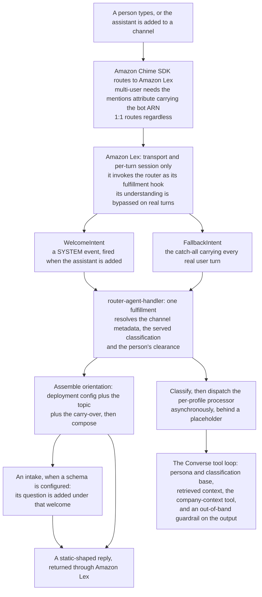

# SPEC: Welcome flow and assistant context

**Status:** Partial (the welcome wiring ships; the welcome as the one workflow `WelcomeIntent` starts (FR22), with its template step (FR23), its prompt step (FR24) and steps that greet and then continue (FR25), is built, **NOT VERIFIED** on a deployment, the version's separate `welcome` retired behind `npm run migrate-legacy-welcome`; later context phases are design).

**Coverage:** `tests/e2e/welcome.spec.ts` asserts the deployed welcome path per classification (the orientation parameter is in the handler env, resolves, parses with the shipped parser, and IAM allows the role to read it), that the welcome delivered on the Amazon Chime SDK websocket is byte-for-byte what this deployment's own SSM config composes to, and that a run of consecutive new conversations never drops one, separating "never delivered" from "delivered and not rendered". `tests/e2e/context-sources.spec.ts` covers the wider context assembly. `tests/e2e/a-version-variable-fills-a-welcome-and-a-template.spec.ts` (gated by `E2E_VERSION_VARIABLES=1`, because it activates a version of the premium primary for its run) asserts that one version variable fills the room's opening and a template sent to the conversation's one subject from the same declaration (ADR-060). `tests/e2e/a-person-who-joins-is-welcomed-once-in-their-language.spec.ts` and `tests/e2e/an-opened-room-welcomes-its-lead-once-by-role.spec.ts` (phase `welcome-workflows`, gated by `WELCOME_WORKFLOWS_E2E=1` because each activates a version of the premium primary for its run) assert the welcome table of ADR-061 decision 5: a share runs the version's `person-joined` workflow, which welcomes the joiner once with the join recap after it and leaves the share no `memberWelcome` to send, and a room an event opens welcomes its lead once from its `conversation-opened` run while the primary's join posts nothing. Both verified on dev 2026-10-29, 3/3 and 2/2 passed (`node scripts/validate.mjs --only=welcome-workflows`). `tests/e2e/a-welcome-workflow-offers-the-intake-as-a-step.spec.ts` (same phase and gate) asserts ADR-061 decision 2's intake step: a workflow welcome posts its opening to the room and its greeting to the subject, then its `start_intake` step asks the version's intake question once, targeted at the subject alone, and records the intake on the context row as theirs; verified on dev 2026-10-29, 2/2 passed (`node scripts/validate.mjs --only=welcome-workflows --spec=a-welcome-workflow-offers-the-intake`).

**Verified by:** `backend/test/lib/welcome-orientation.test.ts` (parser tolerance, the generic fallback copy, the name-less lead-in, the trigger/topic short-circuits, and the oriented rendering), `backend/test/lib/first-turn-greeting.test.ts` (the by-name greeting on the first real turn, which is where personalization moved to), `backend/test/lib/a-welcome-is-a-workflow-word-for-word.test.ts` (the welcome workflow, its selection by conversation type and the migration of a stored welcome, word for word, FR22 and FR23), `backend/test/lib/a-prompt-welcome-follows-the-opening.test.ts` (the prompt step, FR24), `backend/test/lib/an-event-starts-a-workflow.test.ts` (a welcome that runs, FR25).

**Related:** [SPEC-USER-PROFILE-AND-ONBOARDING.md](../conversation/SPEC-USER-PROFILE-AND-ONBOARDING.md) - the per-user store the once-per-user gate reads. [SPEC-CONTEXT-SOURCES-AND-STORES.md](./SPEC-CONTEXT-SOURCES-AND-STORES.md) - every grounding path and the guard on it. [SPEC-DRIFT-CONVERGENCE.md](./SPEC-DRIFT-CONVERGENCE.md) - the flow that spawns a conversation carrying its reason for existing.

**Site section:** Interaction layer, assistants.

---

## Overview

**One composition function is the single source of welcome copy, and it assembles rather than branches.** Every surface that greets a person calls it, and every present piece of orientation renders its own clause. There is no point at which one present value discards another, and the generic welcome is what an *empty* assembly renders rather than a branch anything falls back into. That is the property this document exists to pin, because the two defects it replaced both looked fine: an implementation that short-circuited on a conversation's topic forgot which company it was in, and a field gate one level up threw away an access line because no company name sat beside it.

**Orientation means everything that orients a person in this conversation** - who the assistant is, where they are, what access this conversation carries, **why this conversation exists**, and what they can do next. It is not the name of one input. A deployment's own SSM parameter is one source of orientation, a topic supplied at creation is another, and a carry-over from the conversation this one spawned from is a third. The sources are composed together; they do not compete.

**The welcome is instant and shaped, which is a deliberate trade against being clever.** No model call runs on this path, so the greeting lands with the channel rather than after it, and the copy is interpolation into static clauses rather than generated prose - predictable for tests, with no model variance and no guardrail surprise on the highest-visibility surface the platform has. That is the welcome's template step, and the platform's default welcome is that step alone. An assistant may add a model-written welcome, which follows the instant opening and never replaces it: a prompt step after the opening (FR24), or an `agent` step in a welcome that greets and then continues (FR25), each built and not deployed.

**Two trust groups, and only one of them is the deployment's.** Amazon Chime SDK channel `Metadata` is member-WRITABLE, so a topic or a trigger label is attacker-controlled text: those fields are marker-stripped and length-capped before they can reach the copy, and the deployment parameter cannot set them at all. Private grounding therefore does not live in Metadata; it lives in a server-only per-conversation row that no member can write, which is why that row's presence is a requirement of its own rather than an implementation detail.

**A spawned conversation gets a shorter welcome than a fresh one, on purpose.** Somebody who arrived by accepting an offer to continue one thought has already been told who the assistant is and what they can ask. Repeating the introduction pushes the only new line - what this thread is for - below something they just read.

### Where the welcome sits among the context sources

Welcome is one entry in a larger set assembled per turn, and the difference between it and the rest is timing. The welcome fires on the assistant's own channel membership, which happens at creation, **before** the creator's membership and the channel Metadata converge. Every ordering rule in this document follows from that single fact: a value resolved on the welcome path races, so per-conversation context is written ahead of `CreateChannel` rather than read back afterwards, and a source that is not reliably readable yet is omitted rather than awaited. Waiting would trade the one property this surface cannot give up - that a welcome always lands, promptly - for data that may never arrive.

## Business Problem

A person opening a new conversation with an assistant meets it at the moment they have the least reason to trust it, and a silent channel or a stock "Hello, I'm your AI assistant" spends that moment. Worse is a conversation that makes them say again what they already said somewhere else, which is exactly what happens when a thread spun off an earlier one arrives with no memory of why it exists. A business that wants a warm, specific first turn - the right company named, the right access described, a few things worth trying, and the reason this particular conversation was opened - has to build the machinery for it: decide where each piece of context lives, when it is readable, which pieces a participant is allowed to influence, and which single place composes them into copy. Building that per surface is how a deployment ends up with three greetings that disagree, and how a misconfigured one degrades silently, because a welcome that lands with worse copy raises no error and draws no complaint.

## Personas

Personas are defined in [PERSONAS.md](../../../overview/PERSONAS.md) and are not redefined here. Four use this, and they split by who controls the copy: the end user reads it, the platform developer wires the path, the AI developer and the admin / operator decide what it says.

### End user

**How this relates to them:** this is the first thing the platform ever says to them, and everything they can infer about what the assistant knows and may do comes from it. They configure nothing; they only notice when the greeting is generic, late, absent, or asks them something they already answered.

| What they need | Requirement |
|---|---|
| A greeting that always arrives, promptly, however the conversation was created | FR1, FR2 |
| To be told what this conversation is for when it continues from another, without retyping it | FR9 |
| To be greeted by name once the platform actually knows who is speaking | FR10 |
| Not to be asked the same intake questions in a second conversation | FR12 |
| An intake that adds a question rather than swallowing the orientation they needed | FR11 |
| To not have another participant's text crowd out the welcome | FR8 |

### Platform developer

**How this relates to them:** they wire the welcome path and answer for it behaving the same on every creation path. Their question is where each value is readable, and what happens when it is not there yet.

| What they need | Requirement |
|---|---|
| One composer every greeting surface calls, so surfaces cannot drift apart | FR3 |
| A composition rule with no precedence between sources, so adding one cannot suppress another | FR4 |
| The per-conversation row written before the welcome can fire, on every creation path | FR14 |
| A sparse row that is indistinguishable from an absent one to every consumer | FR15 |
| Absence surfaced rather than inferred, since it throws nothing | FR21 |

### AI developer

**How this relates to them:** they decide what the assistant knows and how it opens, so the welcome is the one surface where their configuration is visible verbatim. They also own what the turn is grounded in after the welcome.

| What they need | Requirement |
|---|---|
| Company-specific orientation as configuration rather than code, per classification | FR5 |
| One missing field to cost one clause, not the whole welcome | FR6 |
| Which context orients a conversation type's welcome, as configuration | FR20 |
| How the assistant greets in each conversation type: an instant structured opening, a model-written welcome after it from instructions, or a workflow | FR22, FR23, FR24, FR25 |
| The conversation's own history folded in once it outgrows the recent window | FR17 |
| What the platform learned about a person carried into their next conversation | FR18, FR19 |

### Admin / operator

**How this relates to them:** they own what the deployment says and whether it is saying it. A degraded welcome is the failure mode they cannot see without help, because it produces no error, no retry and no complaint.

| What they need | Requirement |
|---|---|
| A misconfigured or unreadable orientation raised as an alertable condition, distinguishing absent from malformed from denied | FR7 |
| Assurance that member-supplied text cannot ground an answer or choose a model | FR8, FR16 |
| An intake that is inert until they configure one | FR11 |

## Functional Requirements and Acceptance Criteria

**Priority is a keep-or-cut decision set against what the field expects, not against how interesting the work is.** `Table stakes` means a deployment without it is behind. `Differentiator` is worth the cost because few platforms do it. `Gap - prioritize` marks a requirement whose absence puts this below comparable systems. `Above bar - optional` is more than the field asks and can wait. `Optional - attach instead` should be bought rather than built. `Enabler` is not user-visible and is what makes another row affordable.

| # | Requirement | Priority | Delivered | Validated by |
|---|---|---|---|---|
| FR1 | A welcome always lands: with no orientation, no topic and no carry-over, the composer still returns the generic copy, and the assistant never opens a conversation in silence | Table stakes | Yes | `welcome-orientation` (unit, behavior), `welcome` (e2e, behavior) - a run of consecutive new conversations never drops one |
| FR2 | The first message of a welcome is instant: no model call stands before the first message the room reads, the orientation parameter is loaded once per warm container, and the identity and channel lookups are cached. This protects latency and does not make a welcome template-only: a model-written welcome posted after that instant opening is a prompt step (FR24) or an `agent` step of a welcome that greets and then continues (FR25), [ADR-061](../../../design/decisions/061-a-welcome-is-a-workflow-an-event-starts.md) decisions 8 and 9 | Table stakes | Yes - the welcome's template step makes no model call and waits on no read the opening did not already make: the welcome workflow is selected from the profile read that composes the opening (`loadWelcomeFor`), so knowing how it is said is synchronous. **One exception, for experiments:** where a conversation-scoped experiment is live for the classification, in the container's cached list of enrollable experiments, or where the container holds no fresh list yet, the conversation's enrollment is read beside that profile read, never after it, so an enrolled conversation is welcomed by its arm's version (`servedWelcomeVersion`, `enrollmentMayApply`). With no live experiment the welcome makes no read beyond the profile's. A prompt step adds one wait before the opening is returned, the dispatch: the processor ARN (cached per container after its first read) and `invokeAsync`, which records the turn routing and invokes the processor asynchronously (`InvocationType: Event`). The meter, who is here and the template are read by the processor's turn, after the opening | `a-prompt-welcome-follows-the-opening` (unit, source) - "a welcome said by the reply waits on nothing new", "a prompt welcome's one added wait is the dispatch" and "a welcome reads the enrollment only when an experiment can serve it"; `welcome-orientation` (unit, behavior) - the composer is pure |
| FR3 | One composition function is the single source of welcome copy for every surface that greets, the drift-spawned conversation included | Differentiator | Yes | `welcome-orientation` (unit, behavior), `welcome-answers-spawning-question` (unit, behavior) |
| FR4 | Composition is additive across sources: every present field renders its own clause, every absent field omits only its own, and no present value discards another | Differentiator | Yes | `welcome-orientation` (unit, behavior) - "orientation is assembled, so no source discards another" |
| FR5 | A deployment supplies company-specific orientation as configuration, per classification, with no code change | Differentiator | Yes | `welcome-orientation` (unit, behavior), `welcome` (e2e, behavior) - the wire copy is byte-for-byte what this deployment's own config composes to |
| FR6 | A field that is absent, blank or the wrong type omits only its own piece of copy; the generic welcome is served in exactly one case, when no field is usable at all | Table stakes | Yes | `welcome-orientation` (unit, behavior) - "a partial orientation omits one piece of copy, never the rest" |
| FR7 | A degraded welcome is recorded as an alertable condition, distinguishing a declared-but-unreadable parameter from a parsed-but-incomplete one, and naming the omitted fields | Differentiator | Yes | `emf-schema` (unit, behavior) - the emitted document is one CloudWatch parses, which is the failure this emitter was moved out of the router to cover; `welcome-opening-is-selected-and-composed-once` (unit, behavior) - which conditions are recorded, and that a welcome naming its mode and workflow, or a template that rendered, records none |
| FR8 | Per-conversation orientation text is treated as member-controlled: marker-stripped and length-capped before it can reach the copy, and the deployment parameter cannot set it | Differentiator | Yes | `welcome-orientation` (unit, behavior) - the member-controlled-text group, and the group asserting the deployment parameter cannot set a per-conversation field |
| FR9 | A conversation spawned from another opens on its continuity - what it picks up, the person's own words, and a link back - rather than on an introduction | Differentiator | Yes | `welcome-orientation` (unit, behavior), `welcome-answers-spawning-question` (unit, behavior) - the welcome stays above the answer, and an ordinary conversation gets the plain one |
| FR10 | The welcome carries no user name, because the sender is not reliably known yet; the assistant greets by name on the first real turn instead. **Narrowed by design, built for event workflows, NOT VERIFIED on a deployment:** [ADR-061](../../../design/decisions/061-a-welcome-is-a-workflow-an-event-starts.md) decision 6 and [ADR-060](../../../design/decisions/060-a-variable-is-declared-once-and-its-trust-decides-what-it-may-do.md) decision 7, as amended 2026-10-27, let an event workflow's room message mention a member by display name, resolved from the participant shape, the event or a conversation type's participant role, bound by a `mention:` field, rendered inert and restricted to members, and let a targeted message name the person it is addressed to; every other fact about a person (clearance, onboarded, language, host facts) stays in targeted messages. An event workflow's mentions are built (`inertMention`, `sendValues`, `event-workflow.ts`); the `structured` and `prompt` welcomes are unchanged and carry no name | Table stakes | Yes | `welcome-orientation` (unit, behavior) - the name-less lead-in in both forms, `first-turn-greeting` (unit, behavior) |
| FR11 | An optional intake ADDS its question to the orientation welcome rather than replacing it, and is inert when no schema is configured | Table stakes | Yes | `onboarding-intake` (unit, behavior) - `startIntake` uses the caller's opening line, `onboarding-intake` (e2e, behavior) - "the welcome renders IN FULL, the offer is asked on top of it" |
| FR12 | Onboarding fires once per USER rather than once per conversation, and a returning person is not re-interrogated | Table stakes | Yes | `an-intake-asks-only-what-is-unknown` (unit, behavior), `onboarding-intake` (e2e, behavior) - "does NOT re-onboard the same user" |
| FR13 | Intake progress lives on the conversation's server-only row rather than the Amazon Lex session, is advanced only by its subject, and each answer is written conditional on the state the turn read | Differentiator | Yes | `an-intake-is-advanced-only-by-its-subject` (unit, behavior) - the losing duplicate records nothing, `an-intake-answer-lands-on-the-question-asked` (unit, behavior), `channel-context-client` (unit, behavior) |
| FR14 | Every conversation an assistant will answer in has a context row, written before `CreateChannel` completes | Table stakes | Partly - the conversation-create, drift-create, federated-create, member-add, proactive-briefing and router paths write one; the admin-notification provisioner writes no fields at all | `channel-context-client` (unit, behavior) for the write and its participant shape; none for the guarantee across creation paths |
| FR15 | A sparse row is indistinguishable from an absent one to every consumer: each guards the FIELD it needs, never the row | Enabler | Yes | `host-grounding` (unit, behavior), `channel-context-client` (unit, behavior) |
| FR16 | No private grounding and no trusted state is sourced from channel `Metadata`, and nothing falls back to it | Table stakes | Yes | `legacy-channel-context` (unit, behavior) - promotion is one-shot and never overwrites the store, `host-grounding` (unit, behavior) |
| FR17 | The conversation's own summary is folded into the turn once the conversation has outgrown the recent-history window, and omitted on a short one | Differentiator | Yes | `document-retrieval` (unit, behavior) - a blank summary renders nothing, `channel-history-context` (unit, behavior) for the window itself |
| FR18 | What the platform learned about a person carries into their next conversation, scoped to their own conversations and classification | Differentiator | Yes | `user-profile-client` (unit, behavior), `an-intake-asks-only-what-is-unknown` (unit, behavior) |
| FR19 | A running cross-conversation summary is folded into each turn, so a returning person's earlier threads inform the answer without being re-read | Differentiator | No - the lookup exists and has no caller, so nothing injects its result into a prompt | none |
| FR20 | A conversation type configures which context orients its welcome and how a template becomes copy, defaulting byte-identically to the built-in assembly | Enabler | Retired, superseded by the version's welcome workflow (FR22 to FR25): how a conversation is greeted belongs to the assistant's version, not the conversation type ([ADR-061](../../../design/decisions/061-a-welcome-is-a-workflow-an-event-starts.md) decision 9). The type's designed `welcome` configuration was never read at run time and is removed, so no conversation type declares a welcome | `conversation-types` (unit, behavior) - "no conversation type declares a welcome" |
| FR21 | A conversation with no context row is detected rather than inferred, since absence throws nothing and degrades silently | Gap - prioritize | No | none |
| FR22 | The welcome is one workflow `WelcomeIntent` starts: the assistant's version declares it on `assistant-joined` in its `eventWorkflows`, and the room's conversation type selects it (the workflow whose `types` name the type, else the one that names none, else the platform's `welcome`). Its opening is a template step (FR23), a prompt step follows it (FR24), or its steps greet and then continue (FR25). A version declares one welcome per kind of room. A room an event opens runs the `conversation-opened` workflow its type selects. The version carries no separate `welcome` | Differentiator | Yes, built, **NOT VERIFIED** on a deployment: `welcomeWorkflowOf`, `openedWorkflowOf`, `welcomePlan` (`event-workflow.ts`), read by the router's `loadWelcomeFor` and `handleConversationOpened` from the served version. Validation refuses two welcomes that name no type and two that name one type (`versionEventWorkflowsErrors`). A stored `welcome` is refused at a draft, validate, activate, an experiment's variant, an import and a rollback, naming `npm run migrate-legacy-welcome` (`retiredWelcomeErrors`), which carries it into its welcome workflows as a new version, word for word (`legacyWelcomePlan`); nothing on the runtime path reads it. The console's Welcome area under Workflows, on an assistant's page and as the creation wizard's Workflows step, edits, per kind of conversation, the welcome's opening step and its prompt turn (`welcomeWorkflow.ts`, `WelcomeFields` in `AssistantConfigFields.tsx`) | `a-welcome-is-a-workflow-word-for-word` (unit, behavior) - every retired shape, every kind of room and room context; `a-prompt-welcome-follows-the-opening` (unit, behavior) - "which welcome applies"; `DraftWelcome` (vitest, behavior) |
| FR23 | The template step (`opening`): the built-in opening over the step's orientation fields, or the step's own text with conversation fields (`renderWelcomeTemplate`), posted at `assistant-joined`, instant and with no model call; a step with no field of its own says the deployment's orientation for the classification's primary. The platform's default welcome is this step alone. The opening text names `{{field}}` variables (ADR-060): the conversation's fields, `{{role}}`, `{{examples}}` and the version's own variables, each read through the variable resolver, and text saved with `{field}` tokens reads as `{{field}}`. The room reads the opening, so a variable describing a person inserts its fallback there. The console inserts a field, or one of the version's variables by its name from the variable picker, which does not offer a fact about a person for the opening | Table stakes | Yes. **NOT BUILT:** a console editor for the version's list of variables: the picker lists them and links the guide, and adding or removing one is a draft patch (`variables`, edited as JSON) | `welcome-orientation` (unit, behavior), `each-mechanism-reads-the-one-declaration` (unit, behavior), `VariablePicker.test.tsx` (console), `welcome` (e2e, behavior), `a-version-variable-fills-a-welcome-and-a-template` (e2e, gated, not yet run) |
| FR24 | The prompt step (`prompt`), after the opening: it names instructions (an [ADR-062](../../../design/decisions/062-a-message-is-a-template-stored-and-versioned-like-a-document.md) template of kind `prompt`) telling the assistant how to greet and what to draw on (company documents, context sources, conversation fields, who is here, and tools the step names, read tools only). The router posts the opening instantly, then asks for one model turn of the joining assistant on its own vended session, dispatched as the join recap is (`dispatchJoinRecapTurn`), bypassing the turn lock, metered against the global budget (`machineWritten`) and declared as a `welcome` turn. Past its deadline, or on a failed or blocked call or a refused meter, nothing more is posted: the opening is the welcome. Nothing follows a prompt step in its workflow | Differentiator | Yes, built, **NOT VERIFIED** on a deployment, with one difference from the dispatch this row names: the router is already running, so it invokes the processor itself (`dispatchWelcomePromptTurn`, `welcome-prompt-turn.ts`, through `invokeAsync`, which records the turn routing the joining assistant's session is vended from) rather than invoking a router as `dispatchJoinRecapTurn` does. Its correlation is the conversation and the assistant, so a redelivered `WelcomeIntent` greets once. The processor runs the turn alone (`runWelcomePromptTurn`, from `assistant-async-processor.ts`): the template the step names (`loadNamedPromptTemplate`: the assistant's, the classification's, then the shipped `welcome-greeting`), rendered with the topic, the event, the assistant's role and who is here as delimited data, under the assistant's system prompt with its context sources and the company document tool, and only the named tools. It posts once, as a new message declared `turnKind: welcome`, and never a placeholder. Validation refuses a state-changing or unknown tool, a step after it, and a template no family holds (`eventWorkflowErrors`, `eventWorkflowTemplateErrors`). Every outcome is logged; a fallback, which posts nothing and so reaches no archive, is counted as `welcome_prompt_fallback` by `Reason` (`deadline`, `model-error`, `guardrail`, `empty`, `template`, `meter`, `post-failed`) in `AgentEchelon/Welcome` (`recordWelcomePromptOutcome`). The meter (`machineWritten`, global budget) and who is here are read by the processor's turn, so a refused meter is recorded there as `fallback:meter`; the opening waits only on the dispatch (FR2). The greeting follows a model turn, so it lands after the opening in practice, and nothing orders the two posts beyond that | `a-prompt-welcome-follows-the-opening` (unit, behavior) - "the turn", "the dispatch", "the turn meters and reads who is here itself", and "where the router and processor run it" (the added waits, and the single dispatch site) |
| FR25 | A welcome that greets and then continues: its opening (a template step or a `platform` send) is followed by other steps, which may target people, start the intake, or run `voice` and `agent` steps. A `conversation-opened` workflow its type selects replaces the `assistant-joined` opening in a room an event opens, so the room is greeted once | Differentiator | Yes, built, **NOT VERIFIED** on a deployment: the welcome is read from the version the conversation is served, its experiment arm's when it is enrolled (`servedWelcomeVersion`). The router runs its steps and returns to Lex the one message the channel flow denies (`runWorkflowFor`, `formatLexNothingToPost`), posting its template step as the assistant with `turnKind: welcome` (`postWelcomeOpening`). In a room an event opens the join posts nothing, and the typed-conversation creator names `conversation-opened` to the router once the room's people are added (`nameEventThroughRouter`), which verifies the conversation's classification and its type's `openedBy` before it runs the room primary's workflow for that type (`handleConversationOpened`); the creator's separate `memberWelcome` is not sent where a run greeted the room. A person a run greeted by name is not greeted by name again on their first turn (`wasGreetedByEventRun`). A welcome that runs owns the intake: the join starts no intake of its own, and the workflow offers it where its author put a `start_intake` step (`{ action: { tool: start_intake, to: subject } }`, as the platform's `opening-and-subject` does after greeting the subject). The router offers the intake as the join reads it, only where the person is not onboarded, and records it only where no other person's intake is in progress, with the question addressed to the person (`offerIntakeStep`). A `person-joined` workflow may offer the intake to the person who joined (`to: joined`). A drift-spawned conversation keeps the opening said by the reply, by design, composed from the welcome's template step: it carries the drift context and answers the question it was spawned for (SPEC-DRIFT-CONVERGENCE FR11, `welcome-answers-spawning-question.test.ts`); running the welcome's other steps there would replace that answer with a generic opening. A workflow lives on an assistant's version, so an intent pack that declares `eventWorkflows` is refused (`validateIntentPackBody`, `intent-pack.ts`). A person who joins later is caught up whatever the version declares: `person-joined` always runs, the version's own workflow with the platform's join recap before each terminal step where it writes none (`withJoinRecap`), else the platform's `join-recap` (`personJoinedWorkflowOf`, `event-workflow.ts`); the recap is one agent step that reads the room's recent messages with every targeted message kept out, posts to the person who joined, and records `skipped` with no model call where no person has spoken | `an-event-starts-a-workflow`, `a-version-declares-its-event-workflows`, `a-welcome-is-a-workflow-word-for-word` ("a welcome that greets and then continues"), `the-intake-is-a-step` and `a-joiner-is-caught-up-whatever-the-workflow` (unit, behavior and source); `EventWorkflowEditor` and `DraftWelcome` (vitest, behavior); `a-welcome-workflow-offers-the-intake-as-a-step` (e2e, gated, its opening a template step) |

**Reading the "Validated by" column.** Each entry names one specific test by its filename without the extension, or by the `describe` block inside it where that is the precise unit. Backend unit tests live in `backend/test/`, with the shared-library ones under `backend/test/lib/` and the Aurora ones under `backend/test/analytics-aurora/`; end-to-end specs live in `tests/e2e/` and are listed against their phase in [e2e-coverage-matrix.md](../../../reference/e2e-coverage-matrix.md). The status in brackets is what the test does, which matters more than that it is green:

- **behavior** - executes the code path and asserts on the result.
- **source text** - asserts that a convention still appears in the source. It catches the convention being dropped; it does not catch a wrong value.
- **none** - no test exists, which is expected where `Delivered` is No.

**Known limits on the delivered rows.** FR2 holds in the code and is not asserted end to end: no test fails if a model call is added to the welcome path, which is the cheapest regression to introduce here. FR7's emitter is covered for its document shape rather than for firing on each of the four conditions in Appendix B. FR17's condition - a summary row exists, therefore inject - is covered at the renderer rather than at the decision.

**Acceptance criteria.** A new conversation on every declared classification receives a welcome within seconds of creation, byte-identical to what that classification's own configuration composes to. An orientation carrying only an access line renders that line rather than the generic copy. A conversation created by confirming a drift offer opens on its carried subject, quotes the person's own words, and carries a link back. A member who rewrites channel `Metadata` changes no grounding, no model choice and no onboarding decision. A second conversation for a person already onboarded asks nothing.

**OPEN:** whether a missing context row should be repaired lazily by the first turn that notices, or whether creation paths must simply be correct. Lazy repair hides FR14's shortfall; strict creation surfaces it and leaves existing conversations unrepaired.

**OPEN:** whether any non-creation writer may create a context row. None does today, so a row's existence still means a creation path ran. Admitting one trades that signal for the convenience of writing without checking, and is safe only while every consumer stays field-guarded (FR15).

**OPEN:** whether the topic refresh the primitive already supports should be wired. Channel `Metadata` is updatable at any time, so a topic could be rewritten from the running summary or on a drift redirect; nothing does it, and the reason to want it is the same reason to be careful, since the field is member-writable.

## Non-Goals - Out of Scope

| Out of scope | Why | Where it is covered instead |
|---|---|---|
| A model-generated welcome in place of the opening | Latency and predictability: the welcome would land after the channel rather than with it, and model variance would sit on the surface every test and every first impression reads | FR2. The welcome's template step makes no model call (FR23); a prompt step or an `agent` step adds a model-written welcome only after the instant opening (FR24, FR25). The per-conversation-type welcome configuration is removed (FR20, ADR-061 decision 9) |
| Personalizing the welcome by name | The sender is not reliably resolvable when the welcome fires, so a name here races and is routinely wrong or missing | FR10 - the by-name greeting moved to the first real turn. The race does not apply where the participant shape, the event or a participant role names the person, which is the narrowing ADR-061 decision 6 designs, built for an event workflow's mentions |
| Copying a user's message body into a spawned conversation as grounding | The drift design carries a subject by reference. The one quoted line is a deliberate, documented exception with an erasure consequence | FR9, and [SPEC-DRIFT-CONVERGENCE.md](./SPEC-DRIFT-CONVERGENCE.md) |
| A second bot message posted by the drift flow | The welcome already arrives, so an extra message fills no gap and would open the conversation with two bot messages in nondeterministic order, one of them bypassing the composer | FR3 |
| Sourcing grounding, routing or trusted state from channel `Metadata` | Members hold `UpdateChannel`, so anything there is attacker-controlled | FR16, and [SPEC-CONTEXT-SOURCES-AND-STORES.md](./SPEC-CONTEXT-SOURCES-AND-STORES.md) |
| A member count on the context row | Derived from archived membership events it collapses assistants into the human roster, so it cannot answer the question it was written for. Channel size is resolved live instead | [SPEC-TURN-QUEUE.md](../conversation/SPEC-TURN-QUEUE.md) |
| Holding conversation history in the Amazon Lex session | Session attributes are per channel and per user and would become a second copy of what the messaging service already holds authoritatively | FR17, and tenet D7 |
| A long system prompt baked into the handler as TypeScript strings | Classification-scoped documents and the versioned profile already separate content from code, and a prompt in a string is a prompt nobody can version or roll back | [SPEC-PORTABLE-PROFILES.md](./SPEC-PORTABLE-PROFILES.md), [SPEC-ASSISTANT-CONFIG.md](./SPEC-ASSISTANT-CONFIG.md) |
| Consolidating the channel-creation paths | The right fix for FR14 and out of scope here: there is no single place where "a conversation is created" happens, so there is no single place the guarantee can be made | FR14, and the checklist in Appendix D |

## User Experience Description and Mocks

The welcome has no surface of its own: it is an ordinary channel message, which is what makes it survive every client that can render one. Four journeys reach it.

1. **A fresh conversation.** The person clicks New Conversation. The assistant's greeting arrives with the channel: the lead naming the deployment's company, what this conversation's access covers, a few things worth trying as bullets, and a closing platform note. Every one of those clauses is present only if the deployment configured it, and each is missing independently (FR5, FR6).
2. **Their first real question.** They type. This is the turn where the sender is known, so the assistant greets them by name here rather than in the welcome, and answers (FR10).
3. **A conversation continued from another.** They accepted an offer to carry a thought into its own thread. The conversation opens on what it picks up, with a link back to where it came from and their own words quoted underneath, and then the answer. The introduction, the access line, the examples and the platform note are all absent, because they read them in the thread they came from (FR9).
4. **A first conversation where an intake is configured.** The full orientation welcome arrives, and the intake's first question is asked underneath it. Each answer advances a state stored on the conversation rather than in the session, so a pause resumes at the same field and only the person being onboarded can answer. When it completes, the working assistant sees the collected answers in its ordinary recent-history window, because the questions and answers were ordinary messages (FR11, FR13).

**What a misconfiguration looks like, and why it needs help.** A deployment whose orientation parameter is missing a company name gets a welcome with no company name. Nothing errors, nothing retries and nobody complains - it is simply worse copy - so the operator's only signal is the recorded condition and its log line (FR7).

**OPEN:** this document carries no mocks. The welcome is a channel message rendered by whichever client is in use, so a mock would draw the client rather than this capability; the surface worth drawing is the operator's view of recorded welcome defects, which does not exist yet.

## Related Documents

- [GUIDE-ASSISTANT-CONTEXT.md](../../../guides/developer/GUIDE-ASSISTANT-CONTEXT.md) - the developer and operator how-to for building and operating assistant context, including the intake schema shape
- [SPEC-CONTEXT-SOURCES-AND-STORES.md](./SPEC-CONTEXT-SOURCES-AND-STORES.md) - every grounding path, the store behind it, and the guard that restricts it
- [SPEC-USER-PROFILE-AND-ONBOARDING.md](../conversation/SPEC-USER-PROFILE-AND-ONBOARDING.md) - the pluggable per-user store the once-per-user gate reads, and the ordering rule this document's timing constraint produces
- [SPEC-DRIFT-CONVERGENCE.md](./SPEC-DRIFT-CONVERGENCE.md) - the confirm flow that writes a spawned conversation's carry-over
- [SPEC-CONVERSATION-TYPES.md](../conversation/SPEC-CONVERSATION-TYPES.md) - the conversation types a welcome workflow selects by `types`
- [SPEC-PER-PROFILE-OWNERSHIP.md](./SPEC-PER-PROFILE-OWNERSHIP.md) - the per-profile processors the real-turn path dispatches to
- [MESSAGE-FLOW.md](../../../guides/developer/MESSAGE-FLOW.md) - the fuller treatment of the transport hop, and why Amazon Lex is not the brain
- [HOW-TO-ADD-OR-MANAGE-A-PROFILE.md](../../../guides/developer/HOW-TO-ADD-OR-MANAGE-A-PROFILE.md) - the practical guide a team uses when its assistant's copy changes
- [PERSONAS.md](../../../overview/PERSONAS.md) - the canonical definitions of the personas above
- [TENETS.md](../../../overview/TENETS.md) - tenet P2, context compounds and is shared but bounded, and tenet D7, one source per question

## Appendix A - Where context is gathered

Every real user turn transits the Amazon Lex bot resource: Amazon Chime SDK routes the message to Lex, and Lex invokes the router as its fulfillment code hook. What the router does not do is trust Lex's understanding of it. Lex matches at most two intents, and only `WelcomeIntent` carries meaning, and only in its Amazon Chime SDK-triggered form: a SYSTEM event fired when the assistant is added to a channel, which the router detects by the absence of an input transcript. Every other turn arrives as `FallbackIntent`, whose label the router ignores entirely, classifying the request itself. So a message reaching Lex is transport, not classification: Lex is the managed messaging-to-Lambda bridge and the per-turn session, and the router is the brain. [MESSAGE-FLOW.md](../../../guides/developer/MESSAGE-FLOW.md) is the fuller treatment of the same hop.

The router resolves the person's display name from the identity provider, cached for the container's warm life, and reads it on the FIRST real turn and for the intake - not on the welcome path, where the creator's membership and the channel Metadata are not reliably readable yet.

## Appendix B - The welcome composition contract

`composeWelcomeMessage` in `backend/lambda/src/lib/welcome-orientation.ts` is the single source of welcome copy. Every surface that greets calls it: the `WelcomeIntent` fulfillment, the drift-created conversation, and any later recap.

### Orientation is the whole welcome context

Orientation fields fall into two groups, distinguished by who controls them and therefore how far they are trusted.

| Group | Fields | Source | Trust |
|---|---|---|---|
| Deployment | `companyName`, `companyBlurb`, `accessBlurb`, `examples`, `platformNote` | The classification's own SSM orientation parameter | operator |
| Per-conversation | `topic`, `priorSubject`, `priorMessage`, `parentRef` | `topic` from `Channel.Metadata`; the rest from the server-only channel-context row, falling back to `Metadata` (`triggerContext`, `parentChannelArn`, `originatingMessageId`) | **member** - the text originates with a member, and every Metadata fallback is member-writable |

**Composition is additive across sources.** Every present field renders its own clause; every absent field omits only its own clause. Clause order:

1. **The lead.** "I'm your assistant at `<companyName>`, `<companyBlurb>`". With no company name the "at `<company>`" clause is dropped and a neutral lead is used, rather than naming an organization the configuration did not name; a `companyBlurb` with no `companyName` keeps its own line. Dropped entirely on a spawned conversation.
2. **Why this conversation exists.** `priorSubject` renders "This conversation continues from `<subject>`", with `parentRef` as a link back. `topic` renders "I can help with `<topic>`". Only one of these renders that sentence, `priorSubject` first, since two reason-for-existing sentences would be redundant. This is precedence *within* one group; it never suppresses another group.
3. **The access line.**
4. **The example prompts**, as bullets.
5. **The platform note.**

The lead-in is always the bare `Hi`: the welcome carries no user name by design (FR10).

**Per-conversation fields are member-controlled and sanitized.** They are marker-stripped - the same injection defense the context-source runtime applies - and length-capped before they can reach the copy, so one participant cannot crowd the rest of the welcome out. The deployment parameter cannot set them at all: a parameter naming `topic` is ignored and reported, because a deployment-wide value would apply one conversation's reason-for-existing to every conversation.

`priorSubject` is a **label, never a message body**: the drift design's by-reference principle forbids copying a person's text into a new conversation, so the subject travels in `priorSubject` and the way back travels in `parentRef`.

### Welcome orientation config

The platform ships a generic, classification-neutral welcome. A deployment supplies company-specific orientation as JSON in the classification's own SSM parameter (`ASSISTANT_WELCOME_PARAM`, wired by `backend/lib/stacks/assistant-profile-stack.ts` to `${SSM_ROOT}/assistant/{classification}/welcome-orientation`), with no code change, which is itself a worked customization example. The router loads and parses it once per warm container.

| Field | Type | Renders as |
|---|---|---|
| `companyName` | string | "I'm your assistant at `<companyName>`" |
| `companyBlurb` | string | a trailing clause on the same sentence |
| `accessBlurb` | string | one line stating what this classification's access covers |
| `examples` | string[] | "A few things you can try:" plus one bullet each, capped at 4 |
| `platformNote` | string | a closing line, typically pointing at the platform itself |

`backend/scripts/seed-demo.ts` writes one orientation per classification for the demo deployment.

#### One missing field omits one piece of copy

Every field is optional and each is composed independently. A field that is absent, blank or the wrong type omits only its own piece of copy; the fields that are present are still rendered. There is no threshold at which a partial orientation reverts to the generic greeting, and no placeholder is invented for a missing one. An orientation carrying only an `accessBlurb`, or only `examples`, or only a `platformNote`, renders that field. The generic welcome is served in exactly one case: no orientation field is usable at all.

#### A degraded welcome is recorded as an error

This path cannot fail loudly on its own. The welcome still lands, so a missing field, an unparseable value or a revoked `ssm:GetParameter` grant produces no exception, no retry and no complaint, only worse copy. Silence here is therefore indistinguishable from health, so the router records it instead.

| Condition | Recorded as |
|---|---|
| The parameter is declared and read cleanly, but a field was blank, wrong-typed or truncated | `welcome_orientation_incomplete` |
| The oriented welcome rendered with one or more fields absent | `welcome_orientation_incomplete`, naming the omitted fields |
| The parameter is declared but does not exist, cannot be read, or yields no usable orientation | `welcome_orientation_unusable` |
| No parameter is declared for the classification | nothing; the generic welcome is the documented platform default, not a defect |
| The assistant's own welcome template rendered and is the text posted | nothing of the assembly or the parameter: the template is the copy and the parameter was not read. A field the version may not set is still recorded, as `welcome_orientation_incomplete` (`welcomeConfigDefects`, `welcome-metrics.ts`) |

Both are `Count` metrics in the `AgentEchelon/Welcome` namespace, dimensioned on `Classification`, alongside a `[Router][WelcomeIntent][ConfigDefect]` error log carrying the specific reasons. The router reads the parameter through a variant of its SSM helper that preserves the failure reason, because the ordinary helper collapses "absent", "malformed" and "access denied" into a single `undefined`, and the difference between those is the difference between a legitimately un-configured deployment and a silent misconfiguration. `tests/e2e/welcome.spec.ts` asserts the deployed wiring directly - the parameter name in the handler env, the parameter resolving, the shipped parser accepting it, and IAM allowing the role to read it - for the same reason.

### The drift-created conversation uses the same welcome

A conversation created by confirming a drift suggestion runs the welcome flow above, unchanged. It is worth stating explicitly because the mechanism is easy to get wrong in a way that looks fine.

**`WelcomeIntent` fires on the assistant's channel membership, however it is acquired.** The service admin creates the conversation (`CREATOR_BEARER_ARN_PARAM`, `service-admin-bearer.ts`) and adds the primary assistant with `CreateChannelMembership` after the channel flow is associated, so the welcome passes through the flow like any other message. A `CreateChannel` bearer is a member from creation itself: verified against a live Amazon Chime SDK deployment, a channel created by an assistant bearer with **no** `CreateChannelMembership` call receives the composed welcome within seconds, before the flow can be attached. That is why the service admin creates and then leaves. Where the parameter is unset or unreadable, creation is refused rather than made with the assistant as bearer.

The consequence for the ordering rule is direct: because the welcome fires on creation, it can arrive before the creator's own membership settles. That is why per-conversation participant context is written ahead of `CreateChannel` rather than read back afterwards.

**What the drift path contributes is context, not copy.** `createConversationFromDrift` in `backend/lambda/src/lib/channel-creation.ts` posts nothing into the new conversation. It writes `priorSubject` (the topic label), `priorMessage` (the person's own words), `parentRef` (the link back), the participant shape and any carried member identity to the server-only row before `CreateChannel`, stamps `triggerContext`, `parentChannelArn` and `originatingMessageId` on `Metadata` as the member-readable label and pointers, and the composer renders them.

**A spawned conversation gets a shorter welcome than a fresh one.** The composer detects the spawn from its evidence - `priorSubject` or `priorMessage`, which only the drift creation path sets - and drops the parts that orient someone arriving cold:

| Section | Fresh conversation | Spawned conversation |
|---|---|---|
| Lead ("I'm your assistant at `<companyName>`") | rendered | dropped |
| Reason this conversation exists (`priorSubject` plus link back) | when set | rendered |
| The person's quoted message (`priorMessage`) | when set | rendered |
| Access line, example prompts, platform note | rendered | dropped |

None of the dropped copy is new information to this reader: they were already mid-conversation with this same assistant, were told who it is and what they can ask in the thread they came from, and arrived by accepting an offer to continue one thought.

**On quoting.** The `priorMessage` clause quotes the person's message back to them, which is a deliberate exception to the by-reference principle and is documented with its erasure consequence in [SPEC-DRIFT-CONVERGENCE.md](./SPEC-DRIFT-CONVERGENCE.md). The topic and the quote are separate fields because they answer different questions: what this conversation is about, and what the person actually typed.

### Invariants of the default welcome

These govern the default static welcome. The intake relaxes "instant" only in the sense that it adds a question; it makes no model call either.

- **Welcome always lands.** With orientation, topic and carry-over all unknown, the composer returns the generic copy.
- **Welcome is instant.** No model call on this path. Identity lookups are cached for the container's warm life, channel metadata is cached per channel, and the orientation parameter is loaded once per warm container.
- **Welcome is consistent.** One composer for every surface that reaches this path.
- **Welcome is shaped, not free-form.** Static copy with interpolated fields. Predictable for tests, no model variance, no guardrail surprise.

## Appendix C - Channel metadata schema (welcome-relevant fields)

The router reads these from `Channel.Metadata`; `backend/lambda/src/create-conversation.ts` writes them. Every value here is member-writable, which is what limits what each may be used for.

| Key | Type | Set by | Read by |
|---|---|---|---|
| `modelTier` | a classification value (sample: the three shipped) | create-conversation | admin tools, for display and as a secondary page filter behind the SQL scope on the admin conversation list. Deprecated: no live decision reads it. The router resolves the served classification from the immutable `classification` tag, deliberately not from this field |
| `createdBy` | string (user ARN) | create-conversation, server-set from the validated claim. A host's context create does not write it at all | share-conversation and admin views, for ATTRIBUTION ONLY. Deliberately not the onboarding gate: this value can be rewritten by another member, so it must never key a per-user decision. The gate reads the server-only participant store instead |
| `topic` | string (capped at 240 characters and control-marker stripped as written, by the same `sanitizeTriggerContext` applied to `triggerContext`) | create-conversation, when the request carries a `topic`; written to BOTH this field and the channel-context row | router, for the welcome and later prompt grounding, reading the context row first and this field as the fallback - Metadata is eventually consistent at `WelcomeIntent`. The composer renders at most the first 200 characters |
| `triggerContext` | string (capped at 240 characters) | the drift-confirm flow, as a label derived from the triggering message; create-conversation when the request carries one | router, as the fallback when the channel-context row carries no `priorSubject` |
| `parentChannelArn`, `originatingMessageId` | string | the drift-confirm flow | router, to reassemble the link back when the row carries no `parentRef`; also routing, live drift and the data plane |

The person's quoted words are not in `Metadata`: the drift path writes `priorMessage` to the channel-context row only, where nothing caps the whole blob at roughly a kilobyte and no member can rewrite it, and the router reads it only from there.

`topic` and `triggerContext` are intentionally separate fields: a topic is what the person is here for, durable across the conversation; a trigger context is what brought them to this specific conversation right now, one-shot, referencing the conversation it came from by label. Both are orientation sources and both render, alongside the deployment's configured copy rather than instead of it; only the reason-for-existing *sentence* is taken by one of them.

## Appendix D - The conversation-context store

### What this store is, and why its absence matters

The server-only channel-context store (`ChannelContextTable`, keyed by channel ARN) holds the conversation's private grounding, routing signals, shape and per-conversation progress. The fields it owns are declared once, as `OWNED_FIELDS` in `backend/lambda/src/lib/channel-context-client.ts`, and a field outside that list is silently discarded on write: `participantProfile`, `domainContext`, `otherContexts`, `userName`, `participants`, `userLanguage`, `segment`, `priorSubject`, `topic`, `eventSummary`, `visitSummary`, `priorMessage`, `parentRef`, `memberIdentities`, `onboardingIntake`, `conversationType`, `membershipSource`, `createdAt`, `enrollment`, `participantRoles` and `watchedAlarm`, plus a server-managed `updatedAt`.

It exists because channel `Metadata` is member-writable, so anything a member could forge cannot ground an answer or choose a model. That makes this store the only place several answers can legitimately come from, and therefore the only place their ABSENCE has consequences.

**Absence is not neutral, and the degradations are not equally visible.**

| Consumer | Without context | How it looks |
|---|---|---|
| `backend/lambda/src/lib/host-grounding.ts` | no participant profile, no domain grounding, no resolved name | a generic, slightly worse answer. **Invisible.** |
| Model routing (`userLanguage`, `segment`) | falls back to the deployment default | the wrong language or the wrong model. Invisible to the operator |
| Onboarding (the participant-shape read) | reads live membership instead | a race the recorded shape exists to avoid |

None of these throw. That is the whole problem, and it is why FR21 exists: a conversation with no context answers slightly worse forever and nothing reports it.

The store holds no member count, and the responder decision for an all-assistants address is not a consumer of one: channel size is resolved live through `backend/lambda/src/lib/channel-size.ts`, because a count derived from archived membership events collapses assistants into the human roster. That decision is therefore unaffected by a missing or sparse row.

### The guarantee, and the two properties under it

**Every conversation an assistant will answer in must have a context row before its first turn** (FR14). Two properties follow and both are load-bearing:

1. **Written before `CreateChannel` completes**, not after. The welcome fires on membership, so a row written afterwards races the first turn it is meant to ground.
2. **A row may be sparse, and sparse must be indistinguishable from absent to every consumer** (FR15). Fields are written by different paths at different times, so a consumer that branched on the ROW rather than the FIELD would read a row carrying one unrelated attribute as "context exists". Every consumer today guards the field, and that is a requirement rather than a coincidence.

### Writers, and what each contributes

| Path | Writes | When |
|---|---|---|
| `backend/lambda/src/create-conversation.ts` | `participants` - the shape `single`, with the caller as its subject | before `CreateChannel` |
| `backend/lambda/src/lib/channel-creation.ts` | `participants`, the member identity carried from the parent, `priorSubject`, `priorMessage`, `parentRef` | before `CreateChannel` |
| `backend/lambda/src/create-conversation-at-classification.ts` (a context request) | `participantProfile`, `domainContext`, `otherContexts`, `userName`, `userLanguage`, `segment`, `memberIdentities`, each null where the request omitted it | after `CreateChannel`, and again on the edit path |
| `backend/lambda/src/conversation-management.ts` (`membershipHandler`, `op: 'add'`) | the grounding and routing fields the request carries, and one appended `memberIdentities` entry | on member add |
| `backend/lambda/src/router-agent-handler.ts` | `onboardingIntake`: written when the intake starts, then advanced conditional on the cursor, phase and subject the turn read | at `WelcomeIntent`, then on each answer |
| `backend/scripts/backfill-channel-context.ts` | the six legacy grounding and routing fields promoted from channel `Metadata`, re-bounded and marker-stripped, never over a value the row already holds | one-shot, run by an operator |
| `backend/lambda/src/admin-notification-channel-provision.ts` | no context fields | - |
| `backend/lambda/src/proactive-briefing.ts` (through `createConversationForBriefing`, `lib/channel-creation.ts`) | `participants`, `conversationType`, `createdAt`, and `membershipSource` where the type stamps one | before the assistant joins |

The admin-notification row is what FR14's `Delivered` column records. A conversation it creates has no participant shape and no grounding; the assistant still answers in it, with less than it should, and nothing surfaces that.

**The shortfall has a root cause already on record: channel creation is implemented in several places.** There is no single place where "a conversation is created" happens, so there is no single place where "and therefore it has context" can be guaranteed. Every new creation path re-decides the question, and two of them decided it by omission. Consolidating creation is the actual fix and is out of scope here; until then, the checklist below is what a new path owes.

### What a new creation path owes

1. Write the context row **before** `CreateChannel` returns.
2. Write `participants` at minimum - it is what onboarding reads to avoid re-interrogating a person.
3. Never write grounding into channel `Metadata` as a substitute. Metadata is member-writable.
4. If the conversation is machine-created and has no human participant shape, write the row anyway with what is known. A row asserting "no participants" is a positive statement; an absent row is a question nobody answers.

## Appendix E - The complete assistant-context model

Welcome is one entry in a larger set of context sources assembled per turn. This inventories all of them so a reader building an assistant sees the whole picture; the how-to is [GUIDE-ASSISTANT-CONTEXT.md](../../../guides/developer/GUIDE-ASSISTANT-CONTEXT.md), the per-path guard is [SPEC-CONTEXT-SOURCES-AND-STORES.md](./SPEC-CONTEXT-SOURCES-AND-STORES.md), and the message path is [MESSAGE-FLOW.md](../../../guides/developer/MESSAGE-FLOW.md).

| Source | Where it comes from | How it reaches the model |
|---|---|---|
| Conversation history | Recent channel messages, read fresh each turn | The model input, as the recent window |
| Company context | Classification-scoped documents plus their digest | Retrieved and folded into the prompt |
| Project retrieval | A vector store over the reference corpus | Top-K relevant chunks in a retrieved-context section |
| Participant and domain context | The server-only channel-context row | Prompt sections, present only when the row carries them |
| Persona and standing policy | The versioned assistant profile | The stable prompt prefix |
| Conversation summary | The summary row, fetched from the data plane | A prompt section, when the conversation has outgrown the recent window (FR17) |
| Per-user facts | The pluggable per-user profile store | The once-per-user onboarding decision, and the facts it collected (FR18) |
| Welcome orientation | Deployment configuration plus what the conversation carries | The welcome reply (Appendix B) |

### Company context as digest plus retrieval

Company context loads through two classification-scoped paths. The company-context tool and the always-present per-classification **digest** (document titles and one-line descriptions) are scoped by the physical **IAM** prefix boundary, so a classification whose grants do not cover another's prefix cannot read it. Company documents are also embedded into the vector store and retrieved by relevance per turn, scoped by the fail-closed **SQL** filter and the reader role. The digest tells the assistant what company context exists; retrieval and the tool supply the detail. With company retrieval active, a document's classification is enforced by both IAM (tool and digest) and the database boundary (retrieval).

This document describes a reference implementation. A production deployment keeps genuinely sensitive records - financials, personal data, regulated data - in their **source of truth** and reads them live through a connector rather than embedding a copy; the demo embeds *fictional* financials for illustration. See [RAG.md](../../../guides/developer/RAG.md) and [SPEC-CONNECTORS.md](../../communication/SPEC-CONNECTORS.md).

### Conversation summary as consumable context

The summary that exists for drift is also assistant context, consumed conditionally: the turn fetches it from the data-plane Lambda and folds it into the prompt under an `## EARLIER IN THIS CONVERSATION` heading when the conversation has grown beyond the recent-history window, and omits it on short conversations. The fetch runs in parallel with retrieval, and both run in the processor while it waits on the placeholder, so neither adds wall clock and neither sits inside time-to-first-token. It is not a drift-only artifact (FR17).

### Cross-conversation context, per user

Context compounds within a conversation and, per person, across their conversations, so nobody starts from zero. Two parts of that carry today and one does not:

- **Per-user facts carry across conversations.** A durable per-user record holds what the platform learned about a person - who they are, what they told it during an intake, whether they have been onboarded - keyed by their identity, and every new conversation reads it, so a returning person is not re-onboarded and their company and role are already in hand. This is the pluggable store of [SPEC-USER-PROFILE-AND-ONBOARDING.md](../conversation/SPEC-USER-PROFILE-AND-ONBOARDING.md); a deployment can point it at its own store by ARN (FR18).
- **A running cross-conversation summary is not folded into the per-turn prompt.** The capability to find and summarize a person's related past conversations exists as a function with no caller, so nothing injects its result. Until FR19 lands, cross-conversation carry is the per-user facts above plus whatever the person brings into the new conversation, not an automatic summary of every prior thread.

All of it stays **bounded by the same access model**: cross-conversation context is scoped to the requesting person's own conversations and their classification, never a window into another participant's threads.

### The two-tier welcome

The welcome is a passthrough that can be as light as an instant greeting or as rich as a context-gathering intake. The **static greeting** of Appendix B is the default. An assistant that must collect structured inputs before it can help uses the **onboarding welcome pattern**: a short, multi-step intake that gathers the minimum required inputs, confirms them, and hands off to the working assistant with that context in place. It is opt-in, and the invariants in Appendix B govern the default path.

The intake is deterministic. Like the static welcome it makes no model call on any intake turn, so it stays instant and predictable. Its question is ADDED to the orientation welcome rather than standing in place of it: the router composes the welcome and passes it in as the opening line, so configuring an intake does not cost a deployment its orientation (FR11).

Progress is stored on the conversation's server-only row, with the person being onboarded named as its subject, and only that person's messages advance it. Because the questions and answers are ordinary channel messages, the working assistant sees the collected inputs in its recent-history window once the intake confirms, with nothing extra to thread. It is enabled per deployment by supplying an intake schema (`ONBOARDING_INTAKE` in the environment, or `ONBOARDING_INTAKE_PARAM` in SSM); absent a schema it is inert and the router behaves exactly as the static path. The engine is `backend/lambda/src/lib/onboarding-intake.ts`, a pure state machine wired into the router's welcome and first-turn paths. The schema shape and field semantics are documented in [GUIDE-ASSISTANT-CONTEXT.md](../../../guides/developer/GUIDE-ASSISTANT-CONTEXT.md).

The intake does not depend on the Amazon Lex session. Its state is read from the channel-context row on every turn, so a pause mid-intake resumes at the same field, and a turn that did not arrive through Lex is handled identically. No stored intake means no intake is in progress, and such a message is answered normally. The first question is sent only once the intake has been recorded, so a question is never asked whose answer nothing reads. Each answer advances the stored intake with a write conditional on the state it was read from, so a duplicate delivery of the same answer, or two messages racing, cannot file an answer under the next question; the delivery that loses the race replies with the same step and records nothing (FR13).
