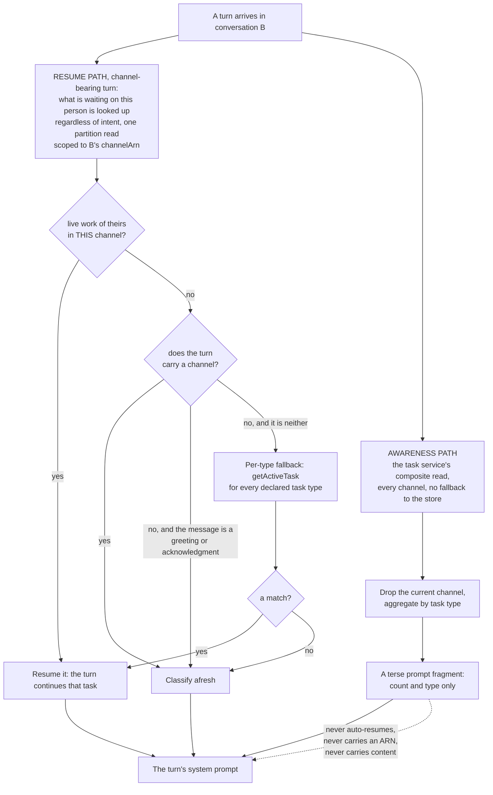
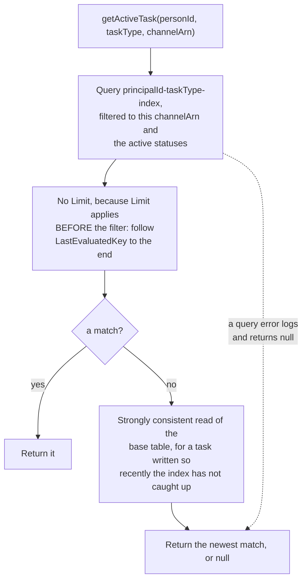

# Cross-Channel Task Continuity

**Status:** Implemented.

**Coverage:** `tests/e2e/cross-channel-tasks.spec.ts` - drives two conversations as one user and asserts in DynamoDB, not in the reply text, that a continuation-shaped turn in conversation B leaves the task opened in conversation A untouched (same `taskState`, `status`, `updatedAt`, `turnsInState`) and that A's `taskId` acquires no row under B's `channelArn`. The open-task precondition is arranged directly in the source of truth, because `getActiveTask` only considers `pending`/`in_progress` and a task the model finished inside one turn would make the assertion vacuous. Falsified by sending the same turn in conversation A, where it resumes the task and moves every one of those fields.

**Related:** [SPEC-TASK-STATE-TRANSITIONS.md](./SPEC-TASK-STATE-TRANSITIONS.md) - the task model, its requirements and its personas. [ADR-024](../../../design/decisions/024-task-ownership.md) - the ownership model the two reads below rest on.

**Site section:** Interaction layer, conversation.

---

**What this document is.** A mechanics note, not a feature spec. It describes how task resume is scoped to one conversation and how the assistant is nonetheless told that work is open elsewhere. The requirements, personas, priorities and delivery status for the task model live in [SPEC-TASK-STATE-TRANSITIONS.md](./SPEC-TASK-STATE-TRANSITIONS.md); nothing here restates them.

**Audience.** Anyone working on assistant behavior, task tracking, or the asynchronous-fulfillment pipeline.

## The rule, in one picture

A task is pinned to the conversation it lives in. A turn in another conversation may know that it exists and may never pick it up.



**Why two paths rather than one.** A single read that returned every open task would make the nearest match resumable from anywhere, and a person carrying three pieces of work in three conversations would find one of them silently continued in the wrong place. Scoping the resume read is what prevents that; the awareness read exists so the assistant is not blind to work it must not touch.

## The resume path: channel-scoped and deterministic

`getActiveTask(personId, taskType, { channelArn })` queries the `principalId-taskType-index` GSI and adds `channelArn = :channelArn` to the filter. Same-channel tasks resume normally, and tasks in other channels are invisible to this path.



**One caller, two branches.** `router-agent-handler.ts` (`backend/lambda/src/router-agent-handler.ts`), the shared router and Amazon Lex fulfillment Lambda that serves every classification and profile, and both of its branches are built. On a turn that carries a channel, what is waiting on this person is looked up regardless of intent (ADR-026): one strongly consistent partition read of the person's queue, scoped to this `channelArn`, answers both what they hold here and what of theirs ended here recently. A bare "ok" or "thanks" is how people answer a clarifying question, so a greeting or acknowledgment does not skip that read; when the read finds work waiting, the fast-path classification the short message was given is corrected to a continuation. On a turn that carries no channel, which is the only turn that read cannot serve, the per-type fallback runs instead: it iterates every declared task type from the merged task-state machines (`Object.keys(taskStateMachines())`) rather than a hand-maintained list, so a pack-defined type is covered automatically, and stops at the first match. A greeting or acknowledgment does skip that fallback, because letting a bare "thanks" be absorbed by an open chain is a message annexed by work it was not about. If neither branch finds live work, the handler proceeds with a fresh classification.

**The merged set is wider than the reference workflows.** It holds `guided_troubleshooting`, `data_extraction`, `report_generation`, `place_item` and `action_item`, and also the platform's own queue machines, plus whatever a deployment's intent pack declares. Iterating the keys is what keeps this true as that set changes.

**The GSI read is paged, not capped.** `Limit` applies before the filter in DynamoDB, so a capped read can filter its one page down to nothing and report no active task while one exists on the next page. The query therefore sends no `Limit` and follows `LastEvaluatedKey`. Behind it sits a strongly consistent base-table read, for the case where the index has not yet caught up with a task written moments earlier - without it, one turn can open a second task on work that already has one.

## The awareness path: prompt-only, and it never resumes anything

`getActiveTasksForUser(personId, opts?)` queries the `UserTasksTable` by partition key - no GSI, no scan - and returns every active task for the user across all channels, sorted by `updatedAt` descending, clamped to `opts.limit` (default 10, low and high bounds applied, maximum 25).

`buildCrossChannelTasksHint(currentChannelArn, allActive)` drops the tasks in the current channel and produces a system-prompt fragment:

```
## OTHER ACTIVE WORK

The user has 2 active tasks in other conversations (1 report_generation, 1 data_extraction).

Do NOT interrupt the current conversation to handle them. Only acknowledge them if the user's message references one (e.g. "what was I working on?"), in which case offer to pick the thread up there.
```

The assistant gets COUNT and TYPE, and nothing else: no other channels' ARNs, no task content, no message excerpts. Two reasons, and they pull in the same direction.

| Reason | What it rules out |
|---|---|
| **Privacy** | Another channel's ARN in the prompt lets the assistant reveal a channel identifier the person did not ask about. The hint is metadata, not data |
| **Performance** | Naming the other conversation ("in your Q3 sales conversation") needs one Amazon Chime SDK `DescribeChannel` per other-channel task, on every turn, for anybody carrying several. Worth it only if user testing shows the richer hint changes an outcome |

**Called from the shared async processor at prompt-build time** - `assistant-async-processor.ts` (`backend/lambda/src/assistant-async-processor.ts`). The list the hint is built from is the `elsewhere` half of the task service's composite read for the turn (`tasksForTurn`), which is where the classification gate on task reads lives, and there is NO FALLBACK TO THE STORE: an absent composite means the guarded read did not happen, and the honest response is no hint rather than an ungated one. Where a deployment has not wired the task service, the hint is therefore silently absent, with no metric and no log line to say so.

**Best-effort.** A failure of the cross-channel lookup logs and proceeds. The assistant still replies; it loses cross-channel awareness for that turn.

## Schema

The pattern uses the existing two-table layout, with no DynamoDB migration.

| Table | Key | Purpose |
|---|---|---|
| `AgentTasksTable` | PK `taskId`, SK `channelArn` | Full task record: state, details, status |
| `UserTasksTable` | PK `principalId`, SK `taskId` | Active-task lookup; a lightweight row |
| `principalId-taskType-index` (GSI on `UserTasksTable`) | PK `principalId`, SK `taskType` | "Active task of type T for user U" |

Both tables are defined in `backend/lib/stacks/conversations-stack.ts`, and the GSI definition sits alongside the `UserTasksTable` construct.

`getActiveTasksForUser` is a constant-cost partition-key query rather than a scan. With the 24-hour default TTL on `UserTasksTable` rows (`backend/lambda/src/lib/task-tracking.ts`), cardinality stays bounded: a person who has not been active in a day has no rows there at all. A task that legitimately outlives a day passes its own longer TTL at creation.

## Deliberately out of scope

| Out of scope | Why |
|---|---|
| **Cross-channel resume.** Saying "continue the report" in conversation B does not resume conversation A's task | The hint tells the assistant the task exists; if the person asks explicitly, the assistant offers to take them to the other conversation using the navigation marker the client already handles. Auto-resuming is a meaningful change to how work is addressed, not a convenience |
| **The conversation's name in the hint** | One extra Amazon Chime SDK call per turn, per other-channel task, for marginal value |
| **Cross-conversation battle tasks** | A duel side's task is created with the dueling assistant as its owner and is mirrored under that assistant, not under the person ([SPEC-BATTLE.md](../quality/SPEC-BATTLE.md), ADR-024), so it never reaches a person's hint. That is correct: a duel's tasks are channel-local by design |

## The privacy boundary, and the one case a deployer should see first

The hint exposes counts and task-type labels, never channel ARNs and never content. Task counts are metadata; conversation content is not.

One nuance is worth stating plainly. A task created in a private one-to-one conversation between a person and an assistant surfaces in the cross-channel hint when that same person later sends a message in a multi-member conversation with colleagues. The hint there reads, for example, "1 active task in another conversation (data_extraction)". That reaches the assistant, not the colleagues - the assistant reasons about it and does not emit it as text, and its prompt instructs it not to interrupt the current conversation with the reference.

**The failure mode is a deployment whose task TYPES are themselves sensitive.** Where an internal taxonomy is such that seeing "data_extraction" reveals business intent, the hint leaks that signal. Two mitigations, both small:

| Mitigation | What it costs |
|---|---|
| Skip the `buildCrossChannelTasksHint` call in the async processor | The assistant loses cross-channel awareness entirely. Quick and total |
| Pass counts without the per-type breakdown | A small change to `buildCrossChannelTasksHint` |

For most deployments the default is correct. The note is here so a deployer with a stricter posture meets the consideration before they meet it in user testing.

## Operational notes

**Failure isolation.** The cross-channel lookup wraps in try/catch and logs to CloudWatch on failure, in the form `[AssistantAsyncProcessor] cross-channel task hint failed (non-fatal): <error>`. The reply proceeds without the hint, and the assistant loses cross-channel awareness for that turn only. A chronic occurrence points at a `UserTasksTable` or IAM problem worth investigating.

**Cost.** One additional `Query` per turn against `UserTasksTable` under its partition key. On the pay-per-request billing this project defaults to, that is on the order of $0.000000125 per turn at current AWS pricing. The hint itself adds nothing: no writes, no Amazon Chime SDK calls, a string concatenation into the prompt.

**Latency.** Expected in the 5 to 15 millisecond range at p50, from DynamoDB partition-key query semantics. **OPEN:** no measurement has been taken at this call site. If turn latency becomes a concern this is a clean instrumentation candidate, wrapping the call site the way drift timing is emitted.

**Observability, and the gap in it.** Every async-processor invocation emits `activeTaskInfo` to the analytics pipeline when a same-channel task resumes. Cross-channel hint emission is silent: no metric, no analytics. Because that path emits no telemetry, a chronic `UserTasksTable` problem - an IAM regression, a hot partition, a TTL set wrongly - and a deployment where the task service is unwired look the same from outside: the hint is absent, and nobody knows until somebody reports that the assistant has forgotten about work in another conversation.

**Test coverage.** `backend/test/lib/task-tracking-cross-channel.test.ts` pins 18 cases across four groups:

| Group | What it holds |
|---|---|
| Scoped resume | The GSI is queried without a channel filter by default; `opts.channelArn` adds the filter; an unset table environment makes no implicit call; a query error returns null rather than throwing |
| Duplicate-task guard and paging | A strongly consistent base-table read finds a task the index has missed; a later page is reached when the first filtered to nothing; the consistent fallback reads every page with no `Limit` and returns the newest match |
| Cross-channel read | The partition key of the right table is queried rather than the GSI; no `Limit` is sent, because it applies before the filter; `LastEvaluatedKey` is followed; the returned count is clamped low and high; an unset table and a query error each return an empty list |
| Prompt hint | No other-channel ARN is emitted; same-type tasks aggregate into one line with the right count and plural; a task with no type falls back to a generic label; nothing is emitted when no task is active elsewhere or when every active task is in the current conversation |

**A known gap in that coverage.** The ARN-leak case asserts that a specific channel ARN does not appear in the rendered hint. It does not assert that the hint contains no `arn:aws:chime:` substring at all, so a future-form leak - somebody interpolating `task.channelArn` in the belief they are enriching the hint - is not caught by it.

## Related

- [SPEC-TASK-STATE-TRANSITIONS.md](./SPEC-TASK-STATE-TRANSITIONS.md) - the task model, its requirements and its delivery status
- [ADR-024](../../../design/decisions/024-task-ownership.md) - the three roles a task names, and why "what do I owe" reads the assignee
- [SPEC-BATTLE.md](../quality/SPEC-BATTLE.md) - battle tasks, excluded from this pattern
- `backend/lambda/src/lib/task-tracking.ts` - the implementation
- `backend/test/lib/task-tracking-cross-channel.test.ts` - the tests
