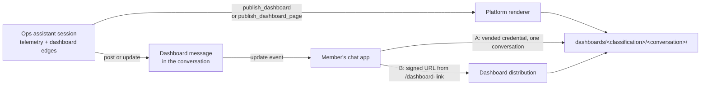

# DESIGN: Conversation dashboards

**Status:** Built. Verified on dev 2026-11-08 (`an-alarm-a-room-watches-starts-its-workflow.spec.ts`, 6 of 6): the required refresh, a member's own read and its refusals, and the signed page. Designed 2026-11-08 for the ops demo: an incident's key metrics, kept current by the ops assistant and readable by the conversation's members alone. Two delivery tools are built side by side so they can be compared.

**Coverage:** `tests/e2e/an-alarm-a-room-watches-starts-its-workflow.spec.ts` (its dashboard tests: the required refresh, a member's one-conversation read and the refusals, and the signed page)

**Related:** [DESIGN-WORKFLOWS-AND-TASKS](./DESIGN-WORKFLOWS-AND-TASKS.md) - the workflow steps that choose or require a tool, and the `thread` relation that shows an incident's dashboard in its team conversation. [DESIGN-SEPARATE-ASSISTANTS-AND-DELEGATION](../assistants/DESIGN-SEPARATE-ASSISTANTS-AND-DELEGATION.md) - how a declared tool becomes an assistant's session reach. [TENETS](../../../overview/TENETS.md) - D1, D3, D4, D6, D12, D15.

**Site section:** Interaction layer, conversation.

---

## 1. The problem

An incident's people need one view of how it is going: the watched alarm's state and its metric against the threshold, and the deployment's error, throttle, invocation and duration series. Today that is spread across the ops assistant's replies, and nothing keeps it current. The view must reach exactly the conversation's members, through the same access everything else in the conversation is under, and must not hand anyone a read of the account's telemetry.

## 2. The model

The ops assistant publishes the dashboard with a tool; the platform renders it; members read it with their own credentials.

| Part | Who | How |
|---|---|---|
| Reads the telemetry | The ops assistant, in its own vended session | The reach `read_deployment_health` already has: the published alarms, the watched alarm, the deployment's Lambda metrics. Beside the watched alarm's metric, up to three metrics published in its namespace with exactly its dimensions in the last three hours, by name, at its period (`ListMetrics`, in the same metric-read grant); a listing that fails leaves the watched metric's chart as it is. Members never read CloudWatch: `GetMetricData` cannot be scoped to a resource, so a member grant would read every metric in the account |
| Draws the charts | The platform renderer (`lib/dashboard-render.ts`) | Numbers in, SVG out, labels escaped. No model writes markup |
| Stores it | One key family in the conversation record's bucket | Section 3 |
| Says where it is | One dashboard message in the conversation, updated in place | Members' clients get the update event and read again, so nothing polls (tenet D6) |
| Reads it | Each member, with their own credential | Section 4: the in-app view, or the hosted page |

## 3. Storage

One key family, decided before the first write (tenet D15):

`dashboards/<classification>/<conversationId>/snapshot.json` and `dashboards/<classification>/<conversationId>/page.html`

- **The owner is the conversation record**, so it lives in the attachments bucket beside `generated-docs/`, with its own prefix and provenance: only an assistant's dashboard tool writes it.
- **The classification is in the key**, so every grant on it names the classification from the same tag the session carries, and IAM refuses the crossing case.
- **Lifecycle**: a rule scoped to `dashboards/`, expiring an object 30 days after its last write and noncurrent versions after one day. An ops conversation expires after 30 days without a message, so its dashboard goes with it.

## 4. Two delivery tools

Two tools, each declared on a version by name, each carrying its own grant. A version declares the one it needs, or both.

| | `publish_dashboard` (in the app) | `publish_dashboard_page` (a hosted page) |
|---|---|---|
| Writes | `snapshot.json`: the rendered dashboard and what its message says (kind, time, alarm state); the id of the message it is shown in rides the object's metadata | `page.html`: one self-contained page, charts inline, no script, a content security policy that loads nothing |
| Opened from | The dashboard message, as a panel in the conversation | The dashboard message, as a link that opens a new tab |
| Member's read | The chat app asks `POST /exchange-credentials` for `capabilities: ['dashboard']` on the conversation. The exchange checks membership and clearance as the attachment presigner does, then vends a session whose policy reads that one conversation's `snapshot.json`. The browser signs its S3 read with that session and reuses it for at most 60 seconds, for that person and conversation only, dropping it at sign-out, so a removal or a clearance downgrade reaches the read within that minute | The chat app asks `POST /dashboard-link`. It checks membership, then returns a CloudFront signed URL to that one page, valid for five minutes |
| What IAM bounds | Every read: the role allows only the prefixes of the classifications its token grants, and the session only the one conversation | The signing: only the link function may sign, and only after the check. The page itself is bounded by the URL's signature, not by the viewer's credential |
| Origin | The chat app's own | A separate CloudFront distribution and domain, so a page can never reach the chat app's storage or token |
| Deployed | Always: no capability | The `dashboard-pages` capability (`DashboardPages` stack): the distribution, its signing key and the link route. Its one reach into the core is the attachments bucket letting CloudFront read dashboard pages, and only pages. Where it is not declared, the page tool is not offered |

**Which to use.** The in-app view keeps every read under the member's own credential. The hosted page is for a dashboard opened outside the chat app, from an email or a wall screen, at the cost of a link that works for anyone holding it until it expires.

## 5. Grants and selection

**The `dashboard` edge.** A new session-policy edge in the assistant grant catalog: `s3:PutObject` and `s3:GetObject` on `dashboards/${aws:PrincipalTag/classification}/*`. It is selected when a version's tools include `publish_dashboard` or `publish_dashboard_page`, and it carries the telemetry read the dashboard draws from, in place of the `telemetry` edge, so declaring a dashboard tool adds no session policy and no definition passes STS's limit of ten. Like telemetry, the boundary denies the actions unless the session's `role` tag is one the tools declare (`ops`), and the acting role's identity grant carries the same condition. Three limits, as for `read_deployment_health`: the boundary, the identity policy, and the session that holds the edge only when the version declares the tool.

**The member side.** The classification's exchange role gains `s3:GetObject` on the dashboards of each classification its token grants, as its conversation grant reaches them, and nothing else in S3. A vend carries it only when it asks for `dashboard` on one conversation, and its session policy names that conversation's object alone. The link function's role may read the signing key and nothing in the bucket.

**Chosen in a workflow step.** A step either lets the assistant choose or requires the tool:

- **The assistant chooses**: an `agent` step lists the tool in `tools`. Agent-step tools are read tools, and a tool that writes only its own conversation's dashboard at the run's classification (`writes: 'conversation-dashboard'`) is admitted beside them.
- **The workflow requires it**: a task machine state declares `action: { tool: 'publish_dashboard' }`, and the runtime runs it on entry and takes its `onSuccess` or `onFailure` edge. No model decides.

The ops demo uses both: the incident watch requires a refresh on every alarm change, and the first look may publish when it judges the room needs one.

## 6. Refused tests

- An assistant whose version does not declare a dashboard tool holds no `dashboard` edge, and its write is refused.
- A dashboard tool writes only the conversation its turn is in: a conversation id other than the turn's is refused before anything is written.
- A member's dashboard session reads its own conversation's object and is refused another conversation's at the same classification.
- A person whose token does not grant a classification is refused that classification's dashboards by the exchange role, whatever the session asks for.
- `/dashboard-link` refuses a caller who is not a member, and signs nothing.
- The hosted page carries no script: the renderer emits none, and the page's policy forbids it.

## 7. What it changes

| Where | Change |
|---|---|
| `lib/dashboard-render.ts` (new) | Snapshot to SVG charts and to the hosted page |
| `lib/tool-registry.ts`, `async-processor-core.ts` | The two tools, their specs and handlers |
| `assistant-grant.ts`, `agent-classification-common.ts` | The `dashboard` edge, the boundary and identity grants |
| `credential-exchange.ts`, `exchange-role.ts` | The `dashboard` capability on one conversation |
| `dashboard-link.ts`, `dashboard-keys.ts` (new), `DashboardPagesStack` | The link route, the dashboard distribution, its key group and signing key, in the `dashboard-pages` capability; the one key family every writer and reader names |
| `event-workflow.ts`, `task-state-machines.ts` | Agent-step admission of a dashboard tool; the incident watch's refresh |
| `frontend/packages/chat` | The dashboard message, the in-app panel and the link |
