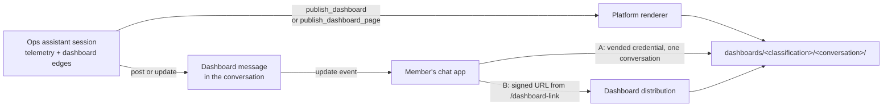
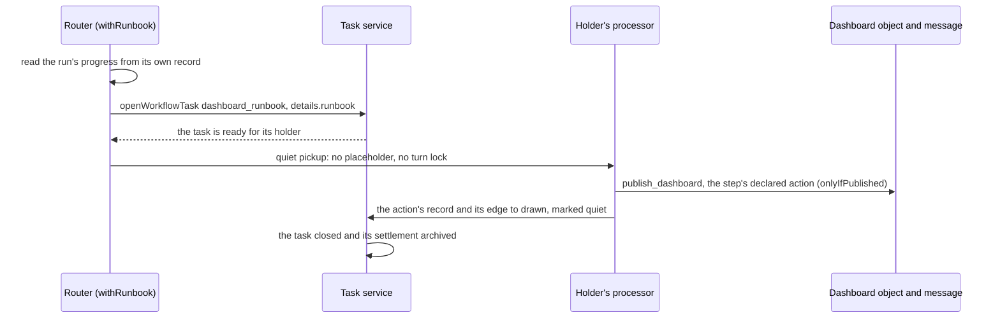

# DESIGN: Conversation dashboards

**Status:** Built. Verified on dev 2026-11-08 (`an-alarm-a-room-watches-starts-its-workflow.spec.ts`, 6 of 6): the required refresh, a member's own read and its refusals, and the signed page. Designed 2026-11-08 for the ops demo: an incident's key metrics, kept current by the ops assistant and readable by the conversation's members alone. Two delivery tools are built side by side so they can be compared.

**Coverage:** `tests/e2e/an-alarm-a-room-watches-starts-its-workflow.spec.ts` (its dashboard tests: the required refresh, a member's one-conversation read and the refusals, and the signed page)

**Related:** [DESIGN-WORKFLOWS-AND-TASKS](./DESIGN-WORKFLOWS-AND-TASKS.md) - the workflow steps that choose or require a tool, and the `thread` relation that shows an incident's dashboard in its team conversation. [DESIGN-SEPARATE-ASSISTANTS-AND-DELEGATION](../assistants/DESIGN-SEPARATE-ASSISTANTS-AND-DELEGATION.md) - how a declared tool becomes an assistant's session reach. [TENETS](../../../overview/TENETS.md) - D1, D3, D4, D6, D12, D15.

**Site section:** Interaction layer, conversation.

---

## 1. The problem

An incident's people need one view of how it is going: the watched alarm's state and its metric against the threshold, and the deployment's error, throttle, invocation and duration series. Today that is spread across the ops assistant's replies, and nothing keeps it current. The view must reach exactly the conversation's members, through the same access everything else in the conversation is under, and must not hand anyone a read of the account's telemetry.

## 2. The model

The ops assistant publishes the dashboard with a tool; the platform renders it; members read it with their own credentials.

| Part | Who | How |
|---|---|---|
| Reads the telemetry | The ops assistant, in its own vended session | The reach `read_deployment_health` already has: the published alarms, the watched alarm, the deployment's Lambda metrics. Beside the watched alarm's metric, up to three metrics published in its namespace with exactly its dimensions in the last three hours, by name, at its period (`ListMetrics`, in the same metric-read grant); a listing that fails leaves the watched metric's chart as it is. Members never read CloudWatch: `GetMetricData` cannot be scoped to a resource, so a member grant would read every metric in the account |
| Says what customers experience | The ops assistant's first look and each re-read (`incident_first_look`, `incident-recheck-ask`) | The health read carries the same series as figures for the watched alarm (`figuresAround` in `lib/deployment-health.ts`): each metric's median before the alarm changed state (from ten minutes ahead of the change), its latest value, and its lowest and highest since, with where it is measured (the alarm's dimensions). The first look turns them into what a customer of the service notices, with each figure beside the claim, so the words and the charts read one population. The customer-impact step and the initial customer notice start from that description |
| Draws the charts | The platform renderer (`lib/dashboard-render.ts`) | Numbers in, SVG out, labels escaped. No model writes markup |
| Stores it | One key family in the conversation record's bucket | Section 3 |
| Says where it is | One dashboard message in the conversation, updated in place | Members' clients get the update event and read again, so nothing polls (tenet D6) |
| Reads it | Each member, with their own credential | Section 4: the in-app view, or the hosted page |

## 3. Storage

One key family, decided before the first write (tenet D15):

`dashboards/<classification>/<conversationId>/snapshot.json` and `dashboards/<classification>/<conversationId>/page.html`

- **The owner is the conversation record**, so it lives in the attachments bucket beside `generated-docs/`, with its own prefix and provenance: only an assistant's dashboard tool writes it.
- **The classification is in the key**, so every grant on it names the classification from the same tag the session carries, and IAM refuses the crossing case.
- **Lifecycle**: a rule scoped to `dashboards/`, expiring an object 30 days after its last write and noncurrent versions after one day. An ops conversation expires after 30 days without a message, so its dashboard goes with it.

## 4. Two delivery tools

Two tools, each declared on a version by name, each carrying its own grant. A version declares the one it needs, or both.

| | `publish_dashboard` (in the app) | `publish_dashboard_page` (a hosted page) |
|---|---|---|
| Writes | `snapshot.json`: the rendered dashboard and what its message says (kind, time, alarm state); the id of the message it is shown in rides the object's metadata | `page.html`: one self-contained page, charts inline, no script, a content security policy that loads nothing |
| Opened from | The dashboard message, as a panel in the conversation | The dashboard message, as a link that opens a new tab |
| Member's read | The chat app asks `POST /exchange-credentials` for `capabilities: ['dashboard']` on the conversation. The exchange checks membership and clearance as the attachment presigner does, then vends a session whose policy reads that one conversation's `snapshot.json`. The browser signs its S3 read with that session and reuses it for at most 60 seconds, for that person and conversation only, dropping it at sign-out, so a removal or a clearance downgrade reaches the read within that minute | The chat app asks `POST /dashboard-link`. It checks membership, then returns a CloudFront signed URL to that one page, valid for five minutes |
| What IAM bounds | Every read: the role allows only the prefixes of the classifications its token grants, and the session only the one conversation | The signing: only the link function may sign, and only after the check. The page itself is bounded by the URL's signature, not by the viewer's credential |
| Origin | The chat app's own | A separate CloudFront distribution and domain, so a page can never reach the chat app's storage or token |
| Deployed | Always: no capability | The `dashboard-pages` capability (`DashboardPages` stack): the distribution, its signing key and the link route. Its one reach into the core is the attachments bucket letting CloudFront read dashboard pages, and only pages. Where it is not declared, the page tool is not offered |

**Which to use.** The in-app view keeps every read under the member's own credential. The hosted page is for a dashboard opened outside the chat app, from an email or a wall screen, at the cost of a link that works for anyone holding it until it expires.

## 5. Grants and selection

**The `dashboard` edge.** A new session-policy edge in the assistant grant catalog: `s3:PutObject` and `s3:GetObject` on `dashboards/${aws:PrincipalTag/classification}/*`. It is selected when a version's tools include `publish_dashboard` or `publish_dashboard_page`, and it carries the telemetry read the dashboard draws from, in place of the `telemetry` edge, so declaring a dashboard tool adds no session policy and no definition passes STS's limit of ten. Like telemetry, the boundary denies the actions unless the session's `role` tag is one the tools declare (`ops`), and the acting role's identity grant carries the same condition. Three limits, as for `read_deployment_health`: the boundary, the identity policy, and the session that holds the edge only when the version declares the tool.

**The member side.** The classification's exchange role gains `s3:GetObject` on the dashboards of each classification its token grants, as its conversation grant reaches them, and nothing else in S3. A vend carries it only when it asks for `dashboard` on one conversation, and its session policy names that conversation's object alone. The link function's role may read the signing key and nothing in the bucket.

**Chosen in a workflow step.** A step either lets the assistant choose or requires the tool:

- **The assistant chooses**: an `agent` step lists the tool in `tools`. Agent-step tools are read tools, and a tool that writes only its own conversation's dashboard at the run's classification (`writes: 'conversation-dashboard'`) is admitted beside them.
- **The workflow requires it**: a task machine state declares `action: { tool: 'publish_dashboard' }`, and the runtime runs it on entry and takes its `onSuccess` or `onFailure` edge. No model decides.

The ops demo uses both: the incident watch requires a refresh on every alarm change, and the first look may publish when it judges the room needs one.

## 6. Refused tests

- An assistant whose version does not declare a dashboard tool holds no `dashboard` edge, and its write is refused.
- A dashboard tool writes only the conversation its turn is in: a conversation id other than the turn's is refused before anything is written.
- A member's dashboard session reads its own conversation's object and is refused another conversation's at the same classification.
- A person whose token does not grant a classification is refused that classification's dashboards by the exchange role, whatever the session asks for.
- `/dashboard-link` refuses a caller who is not a member, and signs nothing.
- The hosted page carries no script: the renderer emits none, and the page's policy forbids it.

## 7. What it changes

| Where | Change |
|---|---|
| `lib/dashboard-render.ts` (new) | Snapshot to SVG charts and to the hosted page |
| `lib/tool-registry.ts`, `async-processor-core.ts` | The two tools, their specs and handlers |
| `assistant-grant.ts`, `agent-classification-common.ts` | The `dashboard` edge, the boundary and identity grants |
| `credential-exchange.ts`, `exchange-role.ts` | The `dashboard` capability on one conversation |
| `dashboard-link.ts`, `dashboard-keys.ts` (new), `DashboardPagesStack` | The link route, the dashboard distribution, its key group and signing key, in the `dashboard-pages` capability; the one key family every writer and reader names |
| `event-workflow.ts`, `task-state-machines.ts` | Agent-step admission of a dashboard tool; the incident watch's refresh |
| `frontend/packages/chat` | The dashboard message, the in-app panel and the link |

## 8. Runbook progress

An incident is driven through chat: each step posts, and each decision is a card. Following where the incident stands means scrolling back through the conversation. The dashboard carries a **Runbook** section beside the metrics, so one view shows how the service is doing and how far the response has got. Chat stays where the work happens; the section only reads.

| Part | Choice |
|---|---|
| What it lists | Every step of the conversation's run that declares a `label`, in the order the workflow declares them: its label and description, its status (not started, in progress, waiting on a person, done, skipped, failed), who holds it, and when it started and settled |
| Where the status comes from | The run's own record, one source (tenet D7): its step claims (`readEventSteps`: each step, its continuation and the run's end) and the tasks its task steps opened (`eventTaskId`), read through the task service, each task's machine through its own version (`machinesForTask`). A step's times are its task's; a step with no task shows none. `runbookOf` in `lib/runbook-progress.ts` |
| Acting on a step | Never on the page. In the app, a step with a task links to `?conversation=<id>#task=<task id>`, which opens a new tab of the app at that task's newest card, as answering from the task list finds it. The frame allows only that new tab (`allow-popups allow-popups-to-escape-sandbox`); it runs no script and never navigates itself. The hosted page carries no links, since it has no app to open |
| Who writes it | The same publisher as the metrics (`publishDashboard`), in the session of the assistant holding the dashboard (section 8.1), rendered by the platform renderer (`renderRunbook`): ids and declared words in, escaped markup out. The progress is stored beside the dashboard as `runbook.json` under the same key family, which no member reads and the page distribution never serves; a newer read replaces it and an older one never does, and every publish draws it, so a refresh for the alarm keeps the section |
| When it updates | A claim of a labeled step (reached, gone on from, moved on from) or of the run's end marks the runbook moved (`withRunbook` in the router). Once the engine returns, the router reads the progress and the run opens one quiet `dashboard_runbook` task for the conversation's dashboard holder, whose declared action draws each dashboard already published again with no model call and no chat line; the one dashboard message is updated in place, which members' clients already read again on (tenet D6). Section 8.1 (built, not deployed) |
| What a member sees in chat | Nothing new: the dashboard message the incident already posts |

Verified by `backend/test/lib/a-dashboard-shows-where-the-runbook-stands.test.ts` (the statuses from the record, the escaped section and its links, the newest runbook kept, a refresh of an unpublished dashboard drawing nothing) and the chat app's `useConversationDeepLink.test.tsx` and `DashboardCard.test.tsx`. **NOT YET VERIFIED on a deployment.**

### 8.1 How a refresh reaches the dashboard

**Status:** Built, not deployed. Verified by `backend/test/lib/a-runbook-refresh-is-a-quiet-task.test.ts`, `backend/test/lib/a-quiet-step-runs-with-no-model-and-no-message.test.ts`, `backend/test/lib/a-dashboard-shows-where-the-runbook-stands.test.ts` (an older read draws nothing) and `backend/test/demo/the-ops-assistant-is-created-by-importing-its-manifest.test.ts` (the ops assistant advertises `dashboard_runbook`). **NOT YET VERIFIED on a deployment.**

A run has an assistant act through a task the task service opens ([COMMUNICATION-PATHS](../../../guides/developer/COMMUNICATION-PATHS.md)), and the runbook refresh takes that path. No workflow step declares it: the platform raises it for every run with a labeled step, as it opens a meeting summary's action items, so it runs under a platform run name rather than a step of the run.

| Part | Choice |
|---|---|
| The run it belongs to | `dashboard-runbook` (`DASHBOARD_RUNBOOK_RUN`), one of `PLATFORM_RUN_NAMES` (`lib/event-workflow.ts`), which no version's workflow may take. Its run key is `dashboard-runbook#<the run's key>` (`runbookRefreshRunKey`, `lib/event-task.ts`), so the run's end neither cancels the task (`endRunTasks` reads the run's own key) nor waits on it. A settlement under any platform run name continues no run (`handleTaskNaming` in the router) |
| Who holds it | The run's own assistant where it consents, else the room's one live assistant of a role the dashboard tool's registry entry names (`toolRolesOf('publish_dashboard')`, today `ops`, through `roleHolder`) that consents (`dashboardHolder` in the router). An assistant consents when its role is one the tool is offered to, its served version's tool allowlist (`tools`) is absent or lists the tool, and it advertises the `dashboard_runbook` intent (`readAdvertisement`), all read with no model call (`runbookConsent`, `lib/dashboard-tool.ts`). Advertising the intent is the assistant's consent to be given the platform's task, as advertising an intent is for a workflow's request. An assistant that could draw it but advertises no such intent is given nothing, which the router logs once per run; the run is unaffected. No holder, or more than one, opens nothing |
| What it carries | The progress the router read (`runbookOf`, with the roles' people and `decide`), as JSON in the task's `details.runbook`, written as the task opens: `openWorkflowTask` takes opening `details`, top-level text only, refused above 24 KB (`openingDetails`, `task-service.ts`). The holder reads its own task row only, never the run's claims, its workflow or its other tasks |
| The machine | `dashboard_runbook` (`DASHBOARD_RUNBOOK_MACHINE`), a platform machine (`PLATFORM_MACHINE_KEYS`), so no version declares or overrides it. One step, `drawing`, whose action is `publish_dashboard` with `{ runbook: 'detail:runbook', onlyIfPublished: true }`, `onSuccess: drawn`, `onFailure: failed`. No state declares a prompt, a choice or an awaited party. `dashboard_refresh` stays as section 5 has it: the alarm's refresh publishes a first dashboard too and says one line |
| A quiet step | A state that declares an `action` and no `prompt`, and hands nothing to a reply (it produces and delivers nothing, and its action is neither a drawn image nor a document), is a quiet step, in any machine (`isQuietStep`, `lib/task-state-machines.ts`). The router takes it up under the same once-per-entry pickup claim (`claimPickup`), with no placeholder message and without the conversation's turn lock, since it speaks no turn; a lock handed to it at a turn's exit is given back first (`quietPickup`, `dispatchTaskPickup`). The processor reads quietness from the task's own machine, never from the payload, runs the declared action on the holder's own vended session, held to the turn's allowlist and the tool's runtime precondition as a model's call is (`runStepActions`), and returns: no model call and no message. A state the action lands on that declares a prompt is named ready again and taken up as an ordinary pickup |
| Measured | Every quiet step is a measured turn. Its action is the turn's one step (`platform-action:publish_dashboard`, model `platform`, no cost), and its edge is marked quiet, so the task service closes the task where the edge settles it and puts one archive fact for the settlement (`AE_TASK_SETTLED`, cause `platform-step`, carrying the action and how it went), the fact a card press or a deadline already puts where no message carries the move |
| The action's arguments | `runbook` and `onlyIfPublished` are honored only from a declared action of a platform machine (`isPlatformMachineKey` of the task's type), never from a model's call, whose input the dashboard tool does not read; `runbook` must read as a runbook (`isRunbookProgress`), and the conversation is the turn's. With `onlyIfPublished` the action draws again each dashboard already published that the turn may publish (the snapshot, and the page where `dashboard-pages` is declared and the page tool is allowed), stores the runbook where it is newer, and draws nothing where it is no newer than the stored one or shows nothing new (`refreshDashboardRunbook`). A conversation with no dashboard yet only has the runbook stored, which its first publish draws |
| Once per run state | The task id is `eventTaskId('dashboard-runbook#<the run's key>', <digest of the progress less its asOf>)` (`runbookRefreshTaskId`). A redelivered event, or a move that changed nothing the section shows, opens the same id, which the service returns as it is, so nothing is named or drawn twice. Each new state opens its own task; two taken up out of order draw the newer, since an older read draws nothing |
| Never open work | No reference number, never listed as the conversation's open work (`UNLISTED_TASK_TYPES` in `getOpenTasksForConversation`, which the assistant's open-work hint, `/stop` and the open-work summary read), never in a person's list (an assistant owns it), private, and no card (no state offers a choice). The row is kept one hour (`keepForSeconds: 3600`) |
| The processor | Holds no runbook mode of its own: its event carries no runbook, and the refresh reaches it only as a task |

Refused tests: a refresh task posts no message and makes no model call; a turn whose allowlist does not offer the tool draws nothing; it is not listed as the conversation's open work and shows no card; a second refresh of the same state opens nothing and names nothing; opening details that are not text or are over their bound are refused; a holder without the dashboard tool, or whose version lists the tool but advertises no `dashboard_runbook` intent, is given nothing; a model's `publish_dashboard` call that carries a `runbook`, and a version's own machine declaring the same arguments, draw none of it; an older read draws nothing; a refresh task's settlement continues no run; and a move a turn's message carries records no platform-step fact.
