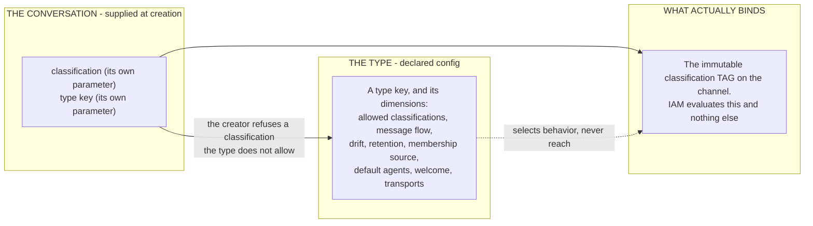
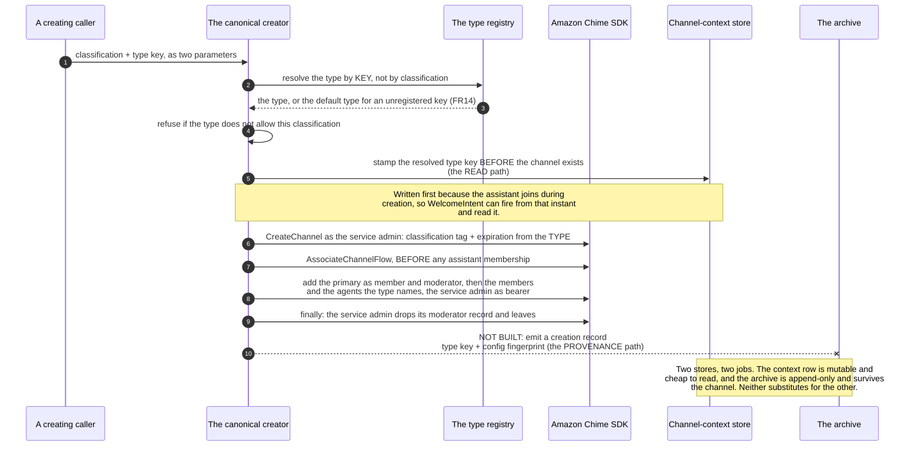
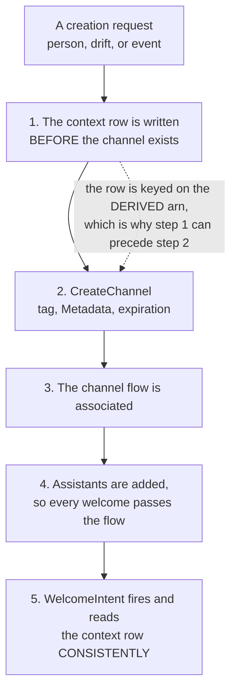
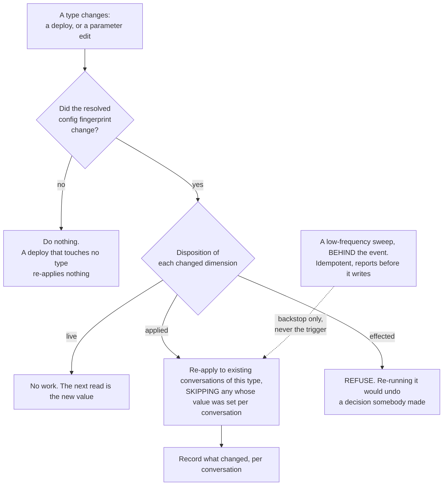
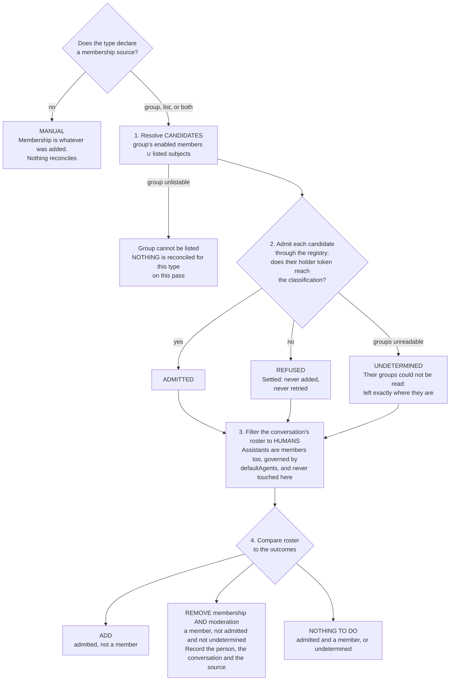
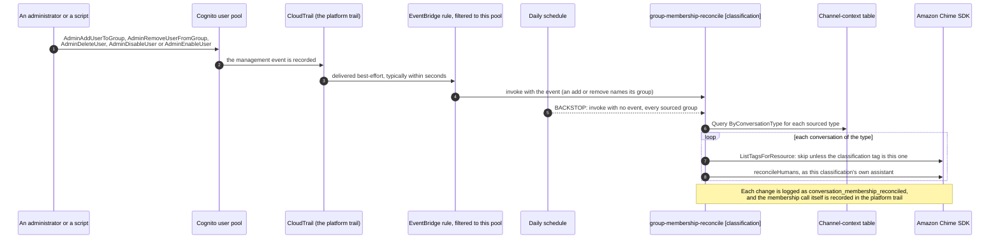
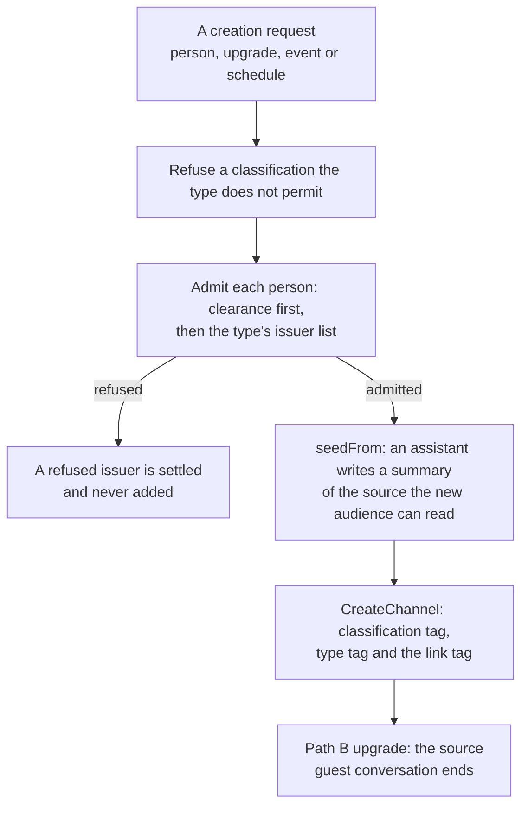

# DESIGN: Conversation Types

**Status:** Section 2 is built on one creation path. Section 6 (membership) is built for the manual and group modes, with group and list sources; the hybrid mode is **NOT BUILT**, and participant roles (section 6.1) are built, not verified on a deployment, for every source except `resolveVia`, which is **NOT BUILT**. Sections 5, 7 and 8 are **NOT BUILT**. Sections 3 and 4 are an enumeration of what a conversation carries and a statement of how each property is created, updated and disposed of; the enumeration is as-built, and the disposition vocabulary in 4.4 is **NOT BUILT**. A conversation acquires and records a type, the creator resolves its policy by the type KEY, and the turn path reads the stamp, so a type whose key is not a classification value is selectable and honored. **The person-facing path creates through the canonical creator**, which is [ADR-053](../../../design/decisions/053-a-conversation-records-its-type-rather-than-being-pinned-to-it.md) decision 1, BUILT and DEPLOYED: it has no creator of its own, so a conversation a person opens carries its type's retention, agents and flow. The creator serves three origins - `person`, `drift` and `event` - and three paths remain outside it: a host's context conversation (`create-conversation-at-classification.ts`), a host's add (`membershipHandler` in `conversation-management.ts`) and `proactive-briefing` each resolve their own flow parameter and create at the default type, so none of them honors a type. What no client can do is NAME a type - the API takes no `conversationType` - so the key the person-facing path stamps is always the ordinary type, `general`. Dimensions read: `driftEnabled` at the turn, `expiration`, `defaultAgents` and `membershipSource` at creation, `membershipSource` again by the membership reconcile, `initiation` by the event creator and at synthesis, `openedBy` at synthesis (one EventBridge rule per declared event, section 10) and by the event creator, and `classifications` as a check rather than a value. Propagation, provenance and storage are **NOT BUILT**, so a change to a type reaches conversations created afterwards and no others. Section 11 (linked conversations: issuer narrowing, seeding, the upgrade paths, invitation redemption, link tags, and the declared rule for an event link across classifications) is **NOT BUILT**; its event path already posts nothing into the concerned room.

**Coverage:** `e2e/a-typed-conversation-creator-creates-at-one-classification.spec.ts` - the classification pin on the one creator that honors a type. The unit guards are `an-ops-conversation-is-its-type-and-not-its-classification`, `a-handle-with-no-assistant-is-refused`, `no-type-exceeds-the-retention-limit`, the type cases in `live-drift-flow`, and for membership (section 6) `a-group-sourced-conversation-is-kept-equal-to-its-group`, `a-group-sourced-conversation-cannot-be-shared`, `an-event-opened-conversation-adds-people-as-its-type-declares`, `the-platform-trail-records-every-api-call` and `cdk-synth` (the reconcile wiring). The spec also names `e2e/a-person-opened-conversation-goes-through-the-canonical-creator.spec.ts`, which opens a conversation as a person and asserts its flow, its type's expiration and its roster. `e2e/an-opened-room-welcomes-its-lead-once-by-role.spec.ts` (phase `welcome-workflows`) asserts section 6.1's addressing at a deployment: the creator records the `ops` room's lead on its context row, and the `ops-room` run's send to `{ participantRole: 'lead' }` reaches the lead and is absent from the view of a member who holds only `responder`. It is **NOT VERIFIED** on a deployment.

**Related:** [SPEC-CONVERSATION-TYPES.md](./SPEC-CONVERSATION-TYPES.md) - the requirements this implements, and which of them are unmet. [ADR-053](../../../design/decisions/053-a-conversation-records-its-type-rather-than-being-pinned-to-it.md) - the decisions, and why each alternative was refused. [ADR-046](../../../design/decisions/046-classifications-are-a-set-not-a-ladder.md) - why the classification is the only closed axis. [SPEC-CONVERSATION-SECURITY.md](../governance/SPEC-CONVERSATION-SECURITY.md) - the layered access model a type composes with and never replaces. [SPEC-ACCESS-AND-CONTROLS-AUDITING.md](../governance/SPEC-ACCESS-AND-CONTROLS-AUDITING.md) - retention levels and the audit bar.

**Site section:** Interaction layer, conversation.

---

## 1. What a type is, mechanically **(the target shape)**

The shipped types declare `classifications`, `driftEnabled`, `messageFlow`, `expiration`, `membershipSource`, `defaultAgents` and `initiation` (`CONVERSATION_TYPES`, `backend/lib/config/conversation-types.ts`). The refusal edge below is BUILT in the canonical creator's event entry (`classificationAllowedForType`, called from `backend/lambda/src/lib/channel-creation.ts`); the ordinary type, `general`, declares no `classifications` and so permits any. A named bundle of declared selections, compiled into the deployment. It carries no IAM, grants nothing, and is not a security boundary: the classification is, and a type carries a constraint on which classifications it may be used at rather than a value to be read off.



**The one thing to carry away:** a type decides experience and a classification decides reach. Every mechanism below is arranged so a type cannot widen what a conversation touches.

## 2. How a conversation acquires a type **(BUILT; a type can be NAMED only on the event-initiated path)**

`createConversationFromEvent` takes the classification and the type key as two parameters, refuses a classification the type does not permit, stamps the resolved key in the channel-context store before the channel exists, and resolves retention and the assistant roster by that key. Every other path passes the ordinary type, `general`, with the classification as a separate parameter; no type key is a classification value.

**The one step below that is not built is the archive record**, the dashed leg: nothing emits a creation record, so an archived conversation does not say which configuration produced it (section 7).



**Three mechanical traps this sequence exists to avoid.** The third is the failure of a path that falls back to a classification floor that does not exist. The first two are each held by a test, because both are invisible when got wrong.

- The creator must resolve by **key**, not by classification, or the type's own retention never reaches the channel. `ops` declares thirty days and `general` 270 (`MAX_CONVERSATION_TTL_DAYS`), and the test asserts the inequality as well as the value (`an-ops-conversation-is-its-type-and-not-its-classification`), so making the two equal does not make it pass.
- The context-store write must add its field to that store's allowlist, or it is silently discarded and looks like a working write. A test reads the allowlist and asserts the field is in it.
- An unregistered **classification** must be refused rather than resolved to some type, or a conversation gets a grant set that is not its own. An unregistered type **key** still degrades to the default, which FR14 requires: an unknown key must never fail a conversation.

## 3. Everything a conversation carries, and which store owns it

**This enumeration exists because the absence of one is a defect with consequences.** Five stores hold a conversation's state, no document lists their fields together, and the result is a creation API that reaches two of eighteen context fields while accepting three that nothing reads. A property nobody can enumerate is a property nobody can give a retention rule, which is why section 4 and [SPEC-CONVERSATION-TYPES.md](./SPEC-CONVERSATION-TYPES.md) FR20 are blocked on this table rather than on a decision.

Tenet D7 settles which store answers which question, and the column that matters most below is **who may write it**: channel Metadata is member-writable, so nothing that decides anything may be sourced from it.

### 3.1 The Amazon Chime SDK channel - authoritative for current state

| Property | Set by | Mutable after creation | Notes |
|---|---|---|---|
| `ChannelId` | the creator, as `conv-<ms>-<hex>`, or `conv-drift-<ms>-<hex>` on the drift path (`newConversationChannelId`, `newDriftChannelId`, `channel-creation.ts`) | no | The ARN derives from it, and the context row is keyed on that ARN before the channel exists |
| `Name` | the caller's title, sanitized | yes, by a member holding the `rename` capability | The only property a person can edit through a supported control |
| `Mode: RESTRICTED`, `Privacy: PRIVATE` | fixed in code today; a type may later declare them (section 6) | `Privacy`: no. `Mode`: yes, by any moderator through `UpdateChannel` | Not a dimension. Person moderators hold `chime:UpdateChannel` (`backend/lib/constructs/exchange-role.ts`), so a moderator can change `Mode`; the change is inert because no credential vended on the chat plane carries a membership write (section 6) |
| `Tags: [classification]` | the classification parameter | **no, immutable by policy** | The only axis IAM evaluates. Every live access decision reads this tag |
| `ExpirationSettings` | the type's `expiration`, or the caller's override | nothing re-applies it | A change to a type's retention reaches conversations created afterwards and no others (section 5) |
| `Metadata` JSON, ~1KB whole-blob cap | `modelId`, `modelName`, `modelTier`, `createdVia`, `topic`, and the parent pointers of the drift and event paths | **by any member who is a moderator of their own channel** | `chime:UpdateChannel` writes Name, Mode and Metadata in one call, which is why no trusted value is sourced here. A relation to another conversation belongs in a tag (section 11), and the parent pointer here is **NOT BUILT** as one (`metadataExtras`, `channel-creation.ts`) |
| `ChannelFlowArn` | associated after creation, before any assistant is added | an association can be replaced | Creation with no flow is refused on the event path |
| members and moderators | the creator, then add and remove | yes | The authority for who is in the conversation. Archive strips every moderator |

### 3.2 The channel-context row - server-only, and where the grounding actually lives

One DynamoDB row per conversation, keyed on the channel ARN, written before `CreateChannel` and read consistently. Twenty-three fields (the twenty-one in the store's owned-field allowlist, `OWNED_FIELDS` in `channel-context-client.ts`, plus the key and `updatedAt`):

| Field | Written by | Read by | What it is for |
|---|---|---|---|
| `channelArn` | the creator | all readers | Partition key |
| `participantProfile` | **a host's context create only** | the assistant's prompt assembly | Free text describing who the assistant is helping |
| `domainContext` | a host's context create; the event path writes `{ title: issue }` | the assistant's prompt assembly | Structured items to ground in. This is where an ops issue lands |
| `otherContexts` | **a host's context create only** | the assistant's prompt assembly | Additional context blobs carried onto the conversation |
| `userName` | **a host's context create only** | reply personalization | The resolved display name |
| `userLanguage` | **a host's context create** at creation, and the async processor when a turn resolves one | model selection | Selects the reply language. Here rather than Metadata because it decides which model answers |
| `segment.country` | **a host's context create** at creation, and the async processor when a turn resolves one | model selection | `CN` routes the turn to the Chinese model |
| `participants` | the creator, before the channel exists; also `admin-notification-channel-provision`, which is infrastructure rather than a conversation | `WelcomeIntent` | Who is in the conversation as a SHAPE, readable when live membership has not converged |
| `priorSubject` | drift, and the person path from `triggerContext` | the welcome composer | The topic label carried from the conversation that spawned this one |
| `topic` | the person path | the welcome composer | The subject in the person's own words. Also on Metadata, deliberately: see section 4.2 |
| `eventSummary` | the event path | a welcome template naming `{{eventSummary}}` | The sentence the originating event wrote |
| `visitSummary` | the canonical creator, when a conversation is seeded from a guest visit (`visitWelcomeOf`) | the welcome composer, as `conversation:visitSummary` | The one line the new conversation's welcome carries about the visit it was seeded from. No message is copied |
| `priorMessage` | drift | the welcome composer | The person's own words, quoted back |
| `parentRef` | drift, composed at write time | the welcome composer | The deep link back to the originating message |
| `memberIdentities` | the creator, carried from a parent | host grounding, the federated `iss` lookup, and the `host` participant-role source (section 6.1) | `{sub, iss, role}`. A LOOKUP and never an authority: membership is read live |
| `onboardingIntake` | the intake, on start and on every answer | the intake | Personal answers, which is why it is server-only |
| `conversationType` | the creator | any turn needing the type's policy | The registry key. Mutable and last-write-wins, so it is state and **not provenance** |
| `membershipSource` | the creator, for a type that declares a source (`membershipSourceStamp`, called from `channel-creation.ts`; owned in `OWNED_FIELDS`) | the share API, and the membership reconcile | The enforced source as a short stamp, `group:ops`, `list` or `group:ops+list`. Absent means manual. Here rather than Metadata because a member able to clear it could make an enforced conversation accept invitations the reconcile then undoes |
| `createdAt` | the creator; write-once (`WRITE_ONCE_FIELDS`) | experiment enrollment (`experiment-enrollment.ts`) | When the conversation began, which decides the experiment it is enrolled in |
| `enrollment` | experiment enrollment, the first time it is decided from `createdAt`; write-once | every turn of an experiment, through `enrollmentHolds` | The experiment and variant the conversation is served ([ADR-050](../../../design/decisions/050-the-alt-is-an-assistant-and-a-conversation-is-enrolled-once.md)) |
| `participantRoles` | the creator, the membership reconcile and invitation redemption | the invitation path, the membership reconcile and moderation (section 6.1) | Who holds which participant role. Server-only because a holding decides who is addressed and who moderates |
| `watchedAlarm` | the creator, for a room opened with `watchesAlarm` | the router, which runs `alarm-state-changed` only in the room that watches that alarm | The alarm the incident watch follows |
| `updatedAt` | every writer | diagnostics | Last write |

### 3.3 The conversation type - declared configuration, not per-conversation state

Nineteen dimensions on `ConversationTypeConfig` (`backend/lib/config/conversation-types.ts`): `classifications`, `membershipSource`, `driftEnabled`, `messageFlow`, `initiation`, `openedBy`, `name`, `defaultAgents`, `commsChannels`, `capabilities`, `participants`, `connectors`, `offboardMode`, `expiration`, `metadataSchemaVersion`, `upgrade`, `seedFrom`, `invitations` and `admitsIssuers`. Thirteen are read:

- `driftEnabled`, at the turn (`live-drift-flow.ts`).
- `expiration`, at creation (`channel-creation.ts`).
- `defaultAgents`, at creation (`typed-conversation-from-event.ts`).
- `classifications`, as a check rather than a value (`classificationAllowedForType`, called from `channel-creation.ts` and the membership reconcile, and at synthesis in `assistant-profile-stack.ts`).
- `membershipSource`, at creation (`membershipSourceFor` in `typed-conversation-from-event.ts`, and the stamp, `membershipSourceStamp`, in `channel-creation.ts`) and by the membership reconcile (`group-membership-reconcile.ts`).
- `initiation`, by the event creator, which lets a `system` type open with no concerned conversation (`typed-conversation-from-event.ts`), and at synthesis, which selects the event-opened types a classification builds a creator for (`assistant-profile-stack.ts`).
- `openedBy`, at synthesis, where each declaration becomes one EventBridge rule on the stack of the classification it resolves to (`event-opened-conversations.ts`), and by the event creator, which reads the declaration a rule names (`typed-conversation-from-event.ts`, `detailFromOpener`).
- `name`, by the event creator, which names a room opened for a purpose from what opened it (`openedRoomNaming` in `typed-conversation-from-event.ts`).
- `participants`, by the participant-role resolvers (`backend/lib/config/participant-roles.ts`, section 6.1).
- `upgrade` and `seedFrom`, by the guest bind and claim paths (`upgradePathsOf`, `bindTargetOf`, `claimTargetOf`).
- `invitations`, when a member invites somebody and when the invitation is redeemed (`invitationPolicyOf`).
- `admitsIssuers`, after the clearance check on every add path (`typeAdmitsIssuers`, `admittedIssuersOf`).

`commsChannels` and `capabilities` are read only at synthesis, where each type is checked against the deployment's declared capabilities and a gap is recorded as the `ConversationTypeGaps` output (`typeCapabilityGaps`, `backend/lib/config/type-capabilities.ts`); no conversation applies them. The other four, `messageFlow`, `connectors`, `offboardMode` and `metadataSchemaVersion`, are declared and read at **no site at all**. `messageFlow` has a resolver, `resolveMessageFlowKey`, that no creator calls.

**`welcome` is retired rather than wired, and removed from the type** (`WelcomeConfig` and `resolveWelcomeConfig` are gone from `conversation-types.ts`). How a conversation is greeted belongs to the assistant, not the room: each assistant's version declares its welcome as its workflow on `assistant-joined`, which `WelcomeIntent` starts, and the room's conversation type selects it (built, **NOT VERIFIED** on a deployment: its opening a template step, the built-in opening or the version's opening text with conversation fields, instant, no model call; a prompt step after it, one model turn of the joining assistant under a deadline; or steps that greet and then continue). A room an event opens runs the `conversation-opened` workflow its type selects ([ADR-061](../../../design/decisions/061-a-welcome-is-a-workflow-an-event-starts.md) decision 9, [SPEC-WELCOME-AND-CONTEXT.md](../assistants/SPEC-WELCOME-AND-CONTEXT.md) FR22 to FR25). The type's part is what a welcome workflow's `types` name: its key, its `openedBy` declarations and its participant roles (section 6.1).

### 3.4 The archive and the Aurora projection - what outlives the channel

The S3 and Athena archive is the system of record and survives channel deletion by design, holding the full event sequence plus what the Amazon Chime SDK never knew: model used, tokens, latency, guardrail decisions, evaluation scores and experiment attribution. Aurora is a lossy rebuildable projection of it. **Neither is a property of the conversation that anything may delete**, which is the half of disposition that is already settled correctly.

### 3.5 The task store - a conversation's open work, reached through a service rather than read directly

**A conversation's tasks are part of what it carries.** A reader who takes section 3 as the list of what a conversation holds, without this section, would conclude that work items are not part of a conversation, and every creation and disposition rule below would silently exclude them.

**The relationship is one conversation to zero or more tasks, and it is navigable in both directions.** A task names its conversation in `channelArn`, which is also `AgentTasksTable`'s sort key; a conversation finds its tasks through the `channelArn-updatedAt-index` global secondary index, partitioned on `channelArn` and ordered by recency. The conversation is the aggregate root: a task has no meaning without one, and nothing creates a task that names no conversation. So parent-then-child is the correct creation order, and it is the order the platform already uses.

**It is one of two stores a turn reaches through a Lambda rather than directly**, and the two are behind a service for different reasons. The router and the processor invoke a task SERVICE (`TASK_SERVICE_ARN`) rather than querying the table, and the direct table grants are off both roles - only the `GET /tasks/mine` function holds one. That is a governance decision rather than a layering preference: task access had exactly one enforcement layer, a `channelArn` the caller supplied in a query, and tenet D3 requires two, so the service is the second. Aurora is the other, reached through the data plane (`AURORA_DATA_PLANE_ARN`) because a non-VPC handler cannot reach a VPC database at all - a reachability constraint rather than an enforcement one. The channel, the context row and the archive are read directly.

**What a turn is told is one composite read, and the composition is a latency decision.** `TasksForTurn` returns three fields in one invoke, because the three reads it replaces would cost roughly 60 to 180ms warm against a one-second time-to-first-feedback budget. The rule that follows is recorded with the type: a future read a turn needs goes INTO this shape rather than beside it.

**The three fields disclose different amounts, and the gradient is the privacy design rather than an optimization.**

| Field | Scope | What reaches the prompt |
|---|---|---|
| `current` | the one task this turn continues | Everything, including `details` - the state-specific data collected during the task - rendered as `Collected information: {JSON}` |
| `here` | every open task on this `channelArn`, filtered to what the viewer may see | Existence and position only: `taskRef`, `taskType`, `taskState`, `status`, `assigneeId`, `dueBy`. **No `details`, no `userMessage`, no `result`** |
| `elsewhere` | the speaker's own open work in OTHER conversations | Thinner again: `personId`, `taskRef`, assignee and owner type, `assistantId` |

A private task is room-visible as EXISTENCE only, which is what lets a shared conversation refer to item `#3` without disclosing whose it is or what it says. The collected answers reach a prompt only for `current`, the task the turn is actually continuing.

**Scoping fails closed on the classification tag, and must.** An absent or unrecognized tag is refused by every instance rather than substituted for the narrowest classification, because substituting the lowest would turn every untagged conversation into one that EVERY instance may serve - converting "unknown" into "permitted", which is the one conversion an authorization decision cannot make. The cost is that an untagged conversation gets no task context from anyone, which is a loud degradation rather than a quiet leak.

**The service fails SOFT on its own errors, and this store is the only one where that is true.** `tasksForTurn` catches and returns an empty composite with the log "answering without task context", so a service outage costs the turn all three fields and the answer still arrives. That is tenet D5's degrade-rather-than-fail, and it means task context is best-effort in a way the conversation's own grounding is not: a missing context row is reported, a missing task read is absorbed.

**A task is not creation-time context, and the creation request must not carry one.** Tasks accrue during a conversation rather than being supplied when it opens, and they are read per turn through this seam with its own authorization story. A client that wants a task on a new conversation creates the conversation, takes its ARN, and opens the task against it - parent then child, which is the order the aggregate already implies.

### 3.5.1 A person opens a work item **(BUILT)**

**A person opens a task directly through `POST /tasks`.** The route is thin over the task service's `createTask` operation. The other routed task operations are for reading and administration - `GET /tasks/mine`, `GET /admin/tasks/channel/{channelId}`, `GET /admin/tasks/assignee/{assigneeId}`, `POST /admin/tasks/channel/{channelId}/cancel` - and this route is the one that lets a person open an item from outside a turn.

It is served by `user-tasks-api.ts`, which already owned the `/tasks` resource (tenet D8), behind the same edge authorizer on `PersonApi` the conversation routes use. The service stays the enforcement layer, so the route adds no authorization surface of its own; what it adds is the field discipline and the refusals below.

**THE TASK SERVICE IS PER CLASSIFICATION, SO A WRITE TARGETS EXACTLY ONE.** The operator console holds all three ARNs and asks each in turn, because "what is stuck in this conversation" is not answerable from inside one classification. A write is the opposite: fanning out would put the row in the wrong service or in three of them. This route reads the conversation's `classification` tag first and invokes that service alone, resolving its ARN from SSM **at runtime** - the classification stacks publish those keys and deploy after the stack that owns this function, so a synth-time read would fail a first install, and reaching back from the classification stack to supply it as an env var would be a dependency cycle.

| Field | Source | Rule |
|---|---|---|
| `channelArn` | the request | Required. The conversation the item belongs to, and the only way the aggregate is named |
| `taskType` | the request | Required, and must be a type the deployment's state-machine registry declares. An unknown type is refused rather than stored, because a task whose machine does not exist can never advance |
| `requestExcerpt` | the request | What the person is asking for, in their words. Bounded and marker-stripped like every other member-authored string that reaches a prompt |
| `visibility` | the request | `conversation` or `private`. **The route invents no default**: the store already rules that an absent or unrecognized value reads as `private` (`task-visibility.ts`), and that is the fail-closed direction for an item a person may have filled with their own words. A person who wants the room to see it says so. A private item is still room-visible as EXISTENCE, which is what `taskRef` carries |
| `priority`, `dueBy`, `details` | the request | Optional. `details` is the collected-information bag the prompt renders for `current` |
| `owner` | **the token** | `{ id: principalIdFromArn(callerArn), type: 'user' }`, which the store records as `assigneeId` and `assigneeType`. Never the body: an owner from the request is a caller assigning their work to someone else, or taking someone else's |
| `assigneeId` | **not accepted** | `TaskCreateOptions` has no field for one, so passing it would be a value silently dropped - the defect class this codebase keeps paying for. Reassignment has its own authorized path |
| `taskRef` | **the server** | The per-conversation reference number, assigned at write. A caller-chosen reference would collide with the room's existing items |
| `taskId` | **the server** | As for every other identifier on this platform |
| `ttlSeconds` | bounded by the parent | `min(requested, the conversation's remaining retention)` - the invariant in section 4.4 |

**The five refusals, each of which is a check the service cannot make for the route.**

1. **Not a member of the conversation, no task.** Membership is read live from the Amazon Chime SDK rather than from any stored roster, for the reason tenet D7 gives: the roster copy on the context row is a LOOKUP and never an authority.
2. **An undeclared `taskType` is refused**, with the declared set named in the error. A task that cannot advance is worse than no task.
3. **A classification the caller does not reach is refused** by the same grant-set membership test the conversation routes use - a declared set, never a rank comparison.
4. **An untagged or unrecognized conversation is refused outright.** The task service already refuses to serve one, so a task opened there would be invisible to every turn that followed. Fail closed, loudly, rather than storing an item nothing can read.
5. **An archived conversation is refused.** Archive is terminal: the channel is read-only and every moderator is stripped, so an item opened there could never be worked.

**Why this does not weaken the task store's governance.** The route supplies identity from the validated token and the conversation through the request attributes the service already keys the row on, and the service re-derives everything else - so the two enforcement layers tenet D3 requires are both still present, and the weaker of them is not the new one. What a person gains is the ability to say "track this" without asking an assistant to do it for them, which is the half of work management a conversation-first product otherwise cannot express.

**Verified against a live deployment.** A premium member of a conversation opens an `action_item` through the signed API and receives `201` with a server-assigned `taskRef`; the row exists in the task table keyed on that conversation, its `assigneeId` and `userArn` are the token caller even when the request body names a different owner, its TTL does not exceed the conversation's retention, and its visibility reads `private` because none was asked for. An undeclared `taskType` is refused with the ten declared types named, and a channel ARN from another deployment is refused before any Amazon Chime SDK call is made. **Verified by:** `backend/test/a-person-opens-a-work-item.test.ts` (13 cases, including every refusal and the fail-closed tag read).

### 3.6 What the creation API can actually reach

**Of the eighteen context fields a conversation can carry, the person-facing API reaches two** - `topic` and `priorSubject`, both as free text. Of the fourteen type dimensions it reaches **none**, because it passes no type key. It does accept `modelId` and `modelName`, which are written to Metadata for display and which **nothing routes on**, since the model is selected by the assistant profile and the model strategy per intent - tenet P5's "the builder controls which model runs where" places that with the deployment and not with the caller.

**A host's context create already accepts SIX of these fields in its request body**: `participantProfile`, `domainContext`, `otherContexts`, `userName`, `userLanguage` and `segment`. In the "written by" column of section 3.2, almost every field that grounds an assistant or routes a turn has exactly one writer, and it is the federated route. The person-facing API, which is how every ordinary conversation in the deployment is opened, supplies none of them.

So the designed context contract is not missing. It exists, it is implemented, and it is reachable only from the route that serves partner users. **What is unbuilt here is a consolidation, not a design**: the shape to extend is already in the tree.

## 4. How a conversation's context is created, updated and disposed of

### 4.1 Creation: one writer, and an ordering that is load-bearing



**Step 1 precedes step 2 because of step 5.** `WelcomeIntent` fires on an assistant's membership at creation, when channel Metadata is not yet reliably readable, so anything the welcome must ground on has to be in a store that is written earlier and read consistently. That single constraint is why the grounding fields live on the context row rather than on Metadata, and it is the reason the row is keyed on an ARN derived before the channel is created.

### 4.2 One property is written to two stores, and that is deliberate

`topic` is written to both the context row and channel Metadata. The context copy is what the welcome reads, for the timing reason above. The Metadata copy keeps the subject member-visible and member-editable, which is correct for a value its own author typed. `priorSubject` is different and server-only, because it carries what happened in ANOTHER conversation.

### 4.3 Update: three actions exist, and none of them updates context

`archive`, `remove-member` and `leave`. **There is no update endpoint and no delete endpoint for a conversation.** What can change after creation is therefore: the `Name`, through the `rename` capability; `Metadata`, by any member who moderates their own channel; membership; and the context row, by a server-side last-write-wins put from whichever path owns the field.

**Nothing re-applies a type's configuration to a conversation that already exists** (section 5, and FR19). `expiration` is written onto the channel once at creation, so shortening a type's retention reaches conversations created afterwards and no others. For a type serving unauthenticated participants that is a retention commitment broken rather than an inconsistency.

### 4.4 Disposition: the gap, stated plainly **(NOT BUILT)**

Archive is terminal by design ([ADR-017](../../../design/decisions/017-conversation-archive-mechanism.md)): a conversation is marked read-only by tag and every moderator is stripped, and the channel is never deleted. That decision is sound only if archive is also where disposition happens, and it is not.

- **The context row is never deleted and the table has no TTL.** The stack records the choice as "Durable (no TTL), PITR on". Archive does not touch the row. So a channel expires at the deployment limit while that conversation's `memberIdentities`, `onboardingIntake` and `domainContext` persist indefinitely, with point-in-time recovery over them.
- **Attachments are not conversation-scoped.** The expiry rule on the attachments bucket carries no prefix, so it governs four key families at once and deleting a conversation leaves its files behind.
- **The archive must survive**, so the answer is never "delete everything". Disposition has to be declared per property rather than per store.

**ONE RULE REMOVES A WHOLE CLASS OF ORPHAN WITHOUT WAITING FOR THE REST: a child's expiry may not exceed its parent's.**

The task store is the case that shows why. Three clocks run on one aggregate and none of them is aware of the others:

| | Expiry |
|---|---|
| A task, by default | 24 hours (`DEFAULT_TASK_TTL_SECONDS`) |
| A plan task | 200 days (`TRIP_TASK_TTL_SECONDS`) |
| The channel | the type's `expiration` - 270 days for `general`, 30 for `ops` |
| The channel-context row | never |

So a plan task opened in an `ops` conversation **outlives its own conversation by 170 days**, carrying `details` and `userMessage` with no conversation left to justify holding them. Nothing cascades either: archive strips every moderator and marks the channel read-only, and leaves tasks untouched to expire on their own clocks.

The invariant is one line - a task's TTL is `min(requested, the conversation's remaining retention)` - and it is worth stating separately because it needs none of the per-property work below. **NOT BUILT.**

**And the general form of it is a declared disposition on every row of section 3**, which is what FR20 asks for and what section 3 is the substrate for. Two independent axes:

| Axis | Values | Question it answers |
|---|---|---|
| Write discipline | `create-time`, `read-through`, `re-applied`, `one-time-action` | May a propagation sweep touch this, and what must it refuse to re-run |
| Retention | `retain-in-archive`, `expire-with-channel`, `purge-on-archive` | What happens to this when the conversation ends |

A property with no disposition is the current state, and it defaults to "kept forever", which is the wrong default for every personal field in section 3.2.

**Tenet D15 settles the half of this that is not a product decision.** State is keyed by the conversation or the principal, and an artifact's key names its owner - so a row keyed on the channel ARN is the conversation's, and when the conversation ends there is no owner left to justify keeping it. That does not decide the retention period, which is a policy question, but it does decide that "forever by omission" is not an answer.

## 5. What a change to a type does to a live conversation **(NOT BUILT)**

Three dispositions, and the mechanism differs per disposition rather than per dimension.

| Disposition | Where the value lives | What a change requires |
|---|---|---|
| `live` | Read when needed | Nothing. The next read sees it |
| `applied` | Written onto an AWS resource at creation | Re-application against existing conversations, clamping where the type's value is a maximum |
| `effected` | A one-time action at creation | Nothing may re-run it |



**The flow is a separate call with an ordering invariant.** `CreateChannel` takes no channel-flow field, so association is its own call, and it must land after creation and before any membership - an ordering four creators document identically, because a creator that associates late leaves the conversations it makes with a defect nothing reports.

**Retention is the worked case and the only dimension that is both read and `applied`.** It is written inline on `CreateChannel` and nothing re-applies it, so changing a type's retention reaches conversations created afterwards and no others. The classification is also written onto the channel at creation, as the immutable tag, and is not a dimension to classify: ADR-053 decision 3 removes the read rather than giving it a disposition. The update API exists, and the permission already exists in the shape a per-classification re-applier needs: on the per-classification assistant role, conditioned on the channel's classification tag, and paired with the bearer-resource statement the action also authorizes against - without that pairing every call is denied, silently. So re-application needs no new capability CLASS per classification, only those two statements on a principal that does not exist yet; running it once across every classification is what removes the condition. That trade is **OPEN** in ADR-053 and is the largest single decision left in this area.

**The type's retention is a MAXIMUM, and re-application clamps to it.** A conversation may elect a shorter retention at creation and never a longer one, so re-application lowers any value above the current maximum and leaves anything already below it alone. Skipping an overridden conversation would be wrong: a type that shortens from ninety days to fourteen leaves a conversation that elected thirty retaining data the policy no longer permits. Clamping needs only the maximum, so nothing has to record which level chose a value.

**The TYPE's cap is not enforced at creation.** The override is validated against the deployment's `MAX_CONVERSATION_TTL_DAYS` limit and never against the type's, so a conversation can be created retaining the limit's 270 days under a type that declares 30. That is tracked as its own defect and is a precondition of treating the type's value as a maximum. The deployment limit itself binds, at 270 days, well inside the Amazon Chime SDK's own bound of 5475 days.

## 6. Membership (BUILT: manual, and group with group and list sources; participant roles from an opening event, a group, an invitation, the person whose confirmation opened the conversation and a creating application's assertion, including a role as a member (6.1). **NOT BUILT**: hybrid, and the `resolveVia` participant-role source (6.1). **FUTURE**: type-declared channel settings)

A type declares one of three membership modes, which is [SPEC-CONVERSATION-TYPES.md](./SPEC-CONVERSATION-TYPES.md) FR18. The mode decides one thing: whether a source, rather than an invitation, puts people in the conversation. It sits on top of the Amazon Chime SDK channel settings, which every mode inherits and none relaxes (section 3.1).

| Mode | Who decides | What reconciles | Share | Status |
|---|---|---|---|---|
| **manual** | Invitation only, within the inherited channel settings | Nothing | Allowed, under the classification | BUILT. The default; a type declaring no source is manual |
| **group** | The source alone (a directory group, a declared list, or both) | The roster is kept EQUAL to the admitted set: added on join, removed on leave | Refused, with the reason | BUILT (`ops`, `ops-team`, both `{ group: 'ops' }`). A `list` source is built and unit-tested only: no shipped type declares one |
| **hybrid** | The source seeds a floor of people; members may add others above it | The source's people are kept present and removed when they leave the source. A person added by hand is never removed by the reconcile | Allowed, under the classification | **NOT BUILT** |

**What every mode inherits, manual included.** Every conversation is created `Mode: RESTRICTED` and `Privacy: PRIVATE`, fixed in code today. PRIVATE means nobody can find the channel or join it on their own. RESTRICTED means only a moderator or the app instance admin can add or remove a member. No credential the exchange vends on the chat plane carries a membership write: the vend role's boundary lists `DeleteChannelMembership` pinned to the caller's own user, so a person can leave a conversation and nothing more (`backend/lib/constructs/exchange-role.ts`), and the chat exchange refuses every moderation capability, `manage-membership` among them (`MODERATION_CAPS` in `backend/lambda/src/lib/vend.ts`, enforced by `credential-exchange.ts`), and the member a membership call targets is not an IAM resource. Only the admin plane adds or removes members: `manage-membership` is vended by the admin credential exchange alone, scoped to one channel. So in manual mode a member who wants someone else in the conversation goes through the share API: it checks that the caller is a member, checks that the invitee's clearance reaches the conversation's classification from the immutable tag, and has the conversation's assistant, a moderator of the channel, make the add. Manual means no source reconciles the roster. It does not mean membership is ungoverned.

**FUTURE: a type may declare its channel settings.** Every current use case is private, which is why the settings are fixed rather than declared. A later type may need a `PUBLIC` conversation that people find and join on their own, or an `UNRESTRICTED` one where any member adds others. Before either is offered, a self-join or a member-made add has to meet the same admission the share API applies today, because both bypass it: the Amazon Chime SDK checks neither the classification tag nor a person's clearance. The settings then become a declared type dimension, written at `CreateChannel` like retention and stamped on the context row.

**NOT BUILT. Hybrid needs one thing group does not: a record of how each person got in.** Group can compare the roster to the set and remove the difference, because everyone outside the set is wrong by definition. Hybrid cannot: a person outside the set may be a legitimate manual add or a group member who left. So every membership would record its origin (`source` or `added-by:<personId>`), and the reconcile would remove only memberships of origin `source` that the set no longer contains. A person who is in the source AND was added by hand would keep the manual membership when they leave the source. The origin would live on the server-only context row, never in channel Metadata, which members can write. Admission would still bind every manual add: hybrid widens who may invite, never what the classification admits.

**A role as a member, resolved by a lookup, is a participant role (section 6.1, NOT BUILT).** A source names people through a group or a list; a participant role names a function in the conversation (for example `on-call:payments`, or the account owner for the account an event concerns), resolved to a person from a declared source, and a participant role that adds its holders makes them members through the same admission. Its open questions are in section 6.1.

The rest of this section is the group mode as built. Hybrid would reuse its resolution, admission and reconcile, and add the origin record.

**As built.** `membershipSource: { group?, list? }` on the type (`ops` and `ops-team` declare `{ group: 'ops' }`, `CONVERSATION_TYPES`, `backend/lib/config/conversation-types.ts`). The allowed set is resolved by `lambda/src/lib/membership-source.ts`: the group's enabled members and the listed subjects, each admitted by the same registry the credential exchange uses - the holder token their groups resolve to must reach the conversation's classification (`resolveAllowedSet`, `membership-source.ts`). The creator adds the admitted set and refuses an event whose lead is not in it; it stamps the source on the conversation's context row (the authority share reads) and, as a display hint only, in channel Metadata (so the client can show Share disabled with the reason). `group-membership-reconcile.ts`, one per classification, keeps every live conversation of a sourced type equal to its set through `lambda/src/lib/membership-reconcile.ts`, the reconcile the admin-conversation sync shares. Conversations of a type are found through the sparse, keys-only `ByConversationType` index on the context table.

**`ops-team` is opened once, by a manual invoke of the event creator** with `conversationType: 'ops-team'` and no concerned conversation, which the creator accepts only because the type declares `initiation: 'system'` (`typed-conversation-from-event.ts`).



**The trigger path.** A Cognito call that changes who is in a group reaches the reconcile through the platform trail; the daily schedule is the backstop for an event that was dropped.



**Why the human filter is load-bearing rather than tidy.** An assistant is a channel member - the conversation's primary assistant is a member and a moderator - and no membership source names a bot. A loop without this filter removes every assistant on its first pass, which is the feature deleting itself. `reconcileHumans` draws this line for both of its callers (`membership-reconcile.ts`).

**A type's group requires the type's classification of its members, so the two cannot contradict.** A group never raises anyone's clearance: clearance comes from the clearance groups (`groupClearance`) alone. A type that takes its people from a group names a MEMBERSHIP group (`membershipGroups` in `backend/lib/config/profiles.ts`), which declares the clearance its members must already hold and grants nothing; the shipped `ops` requires `premium`, the classification the `ops` types are created at. The Cognito stack creates it with no role and a precedence after every clearance group, so holding it never changes the role a person is vended (`a-membership-group-carries-no-role`). An administrator adds and removes members in the console's user list, through `POST /users/group`, which accepts membership groups only and refuses anyone not already cleared for the group's requirement, or not approved and enabled (`CLEARANCE_BELOW_GROUP`). Changing a member's clearance through `POST /users/tier` to one that does not reach a group's requirement removes them from the group. Every change is a Cognito group call, so the reconcile follows on the event. Synthesis refuses a type whose group is not a declared membership group, is a clearance group, or requires a classification that does not reach the type's (`assertTypeGroupsRequireTheirClassifications`, `backend/lib/conversation-type-grants.ts`). **Verified by:** `a-conversation-types-group-requires-its-classification`, `a-membership-group-requires-the-clearance-it-names`, `a-membership-group-carries-no-role`, `UserManagementTab.membershipGroups`.

**Why admission still runs per person.** The route keeps the group within its requirement, and the reconcile admits each candidate anyway, as the second layer (tenet D3): a change made straight in the directory or an identity provider bypasses the route, and a person whose groups cannot be read is left where they are rather than assumed. The group reconcile admits each candidate through the registry (`resolveAllowedSet`, `membership-source.ts`), and a person the classification refuses is never added. The admin-conversation sync, the other caller of `reconcileHumans`, does not run admission: its set is the `admins` group, placed onto admin-classified conversations.

**Where a reconcile decision is recorded.** Every change the reconcile makes is logged as a `conversation_membership_reconciled` audit event in the function's own log, naming the conversation, the type, the classification, the source stamp, who was added and removed, and how many candidates the classification refused (`group-membership-reconcile.ts`). The membership call itself is an Amazon Chime SDK management event, recorded in the platform trail.

**OPEN: whether an archived conversation is skipped or reconciled.** The reconcile does not skip one: it filters only on the classification tag (`group-membership-reconcile.ts`). Archive removes every moderator the channel lists (`archiveConversation`, `conversation-management.ts`), which includes the assistant the creator made a moderator (`channel-creation.ts`), so on an archived conversation the bearer is no longer a moderator. A membership change due there is expected to be refused by the Amazon Chime SDK and counted as a failure (`group-membership-reconcile.ts`); no test covers that case.

**Verified by:** `backend/test/lib/a-group-sourced-conversation-is-kept-equal-to-its-group.test.ts`, `backend/test/lib/a-group-sourced-conversation-cannot-be-shared.test.ts`, `a-group-sourced-conversation-refuses-a-share-before-any-add.test.ts`, `backend/test/lib/an-event-opened-conversation-adds-people-as-its-type-declares.test.ts`, `backend/test/the-platform-trail-records-every-api-call.test.ts`, and `backend/test/cdk-synth.test.ts` (the reconcile wiring).

**Three decisions settle the rest of this section:**

- **A member-initiated invite collides with enforcement: the share API REFUSES** on a conversation with a declared source, from the stamp on its context row, returning `409` with `code: MEMBERSHIP_FROM_SOURCE` (`membershipSourceRefusal`, `share-conversation/index.js`); the client renders the localized reason. The chat app shows Share disabled, with the reason on hover, focus and tap. In group mode a source is enforcement, not a floor; hybrid is the mode where it is a floor. An unreadable context row allows the share (fail open, `share-conversation/index.js`); the reconcile removes the person on its next pass. This is a roster outcome, not an access decision: the invitee is still admitted against the classification (`share-conversation/index.js`).
- **A group's trigger: subscribe to the directory's own event.** A Cognito group change is an IAM-authenticated API call (`AdminAddUserToGroup`, `AdminRemoveUserFromGroup`, and `AdminDeleteUser`, `AdminDisableUser` and `AdminEnableUser`, which change whether a person counts in any group they belong to). CloudTrail records it and delivers it to EventBridge, best-effort and typically within seconds, and a rule filtered to this deployment's pool invokes the reconcile. That needs a trail, so the foundations stack creates one by default (`-c platformTrail=false` where an organization trail already exists): all management events plus data events for Lambda, DynamoDB, S3 objects and Kinesis (`-c trailDataEvents=false` keeps management events only), retained for `trailRetentionDays` (default 400) (`identity-stack.ts`). A daily sweep stays as the backstop for a dropped event (tenet D6). The admin-conversation sync takes the same event, with a daily schedule as its backstop (`adminSyncRate` overrides it). An external identity provider with no event remains the stated exception, on the backstop alone.
- **The reconciler's reach: ONE PER CLASSIFICATION.** It acts as that classification's own assistant, which moderates only conversations created at its classification, and the Amazon Chime SDK refuses a membership change to anyone who is not a moderator - a boundary IAM does not draw here. IAM grants these membership writes on every app-instance resource (`assistant-profile-stack.ts`) without a classification condition, so the bearer is chosen in code: the classification's own bot ARN, read from SSM (`group-membership-reconcile.ts`). The boundary is the Amazon Chime SDK moderator rule plus that code path. **OPEN**: a deny-test that simulates the deployed reconcile role.

### 6.1 Participant roles **(built, not verified on a deployment, for the event, group, invitation, creator and host sources; `resolveVia` NOT BUILT)**

**As built.** The declaration (`ParticipantRoleDeclaration` on `participants.participantRoles`, `defaultRole`) and every synthesis rule below (`participantRoleDeclarationErrors`, `backend/lib/config/participant-roles.ts`, asserted in each classification's stack). Three sources fill holdings: `event` and `group`, resolved by the canonical creator and written on the context row with the rest of it before the channel exists (`holdingsAtCreation`), and `invitation`, recorded by the invitations path under the `invitable` and inviter rules. The membership reconcile keeps a `group` role equal to its group (`reconcileGroupRoles`): a person who leaves it loses the holding and the role's moderation and stays a member, a person whose groups cannot be read keeps what they held, and a group that cannot be listed changes nothing. A role that `adds` (FR31) puts its admitted holders in the room through the creator and the reconcile, and their arrival is `person-joined`. The holdings live in `participantRoles` on the context row (`ParticipantRoleHoldings`, `backend/lambda/src/lib/participant-roles.ts`), and every reader takes them through `holdersByRole`, which keeps the roles the type declares and the holders who are members now, and gives each member no source names the type's `defaultRole` at read time rather than storing it. The readers are the ADR-060 resolver (`participant:role`, `participantRole:<name>`, `invitation:role`) and ADR-061's event workflows (the `{ participantRole: '<name>' }` audience on a send or an agent step, at most ten holders, a `participantRole:<name>` mention, which lists at most five names in its readers' language and counts the rest, and `fromRole`, which says a person the `template` or drafts them the `brief` their first held role confers). The processor's agent step reads the holdings the router hands it and keeps only holders the live roster still holds. A holding is said in a room message of a type a guest or a link session reads only when its role declares `visibleToGuests` (`typeIsMixedTrust`, `roleSaidInRoom`). `moderator` is conferred on the invitations path: the invitee is made a moderator as the service admin, the bearer that path adds them with, and the holding records the moderation's origin `participantRole:<name>`, so a revocation removes that moderation and no other. At creation the service admin makes a moderator role's holders moderators before it leaves (the opener already is one, so their holding names no moderation), and afterwards the reconcile does so for a `group` role, bearing the classification's assistant. The shipped `ops` type declares `lead` from the opening event's person, one holder, a moderator, and `responder` as its default; the ops room's workflow mentions and greets `participantRole:lead`. `general` declares no participant roles, by decision: roles belong to typed conversations, so an everyday room stays free of moderator questions, and `general` admits link invitations, so a role that confers moderation would be refused there anyway. The invitation's participant role is built and works on any type that declares a role `invitable`; no shipped type declares one yet. Verified by `backend/test/lib/a-participant-role-is-declared-held-and-addressed.test.ts`, `backend/test/lib/a-participant-role-follows-its-group-and-confers-what-it-declares.test.ts`, `backend/test/a-group-sourced-role-is-reconciled-narrowly.test.ts` and `backend/test/invitations-are-granted-narrowly.test.ts`.

**Decided, of what this section left open:** an `adds` role may appear only on a type with no membership source, because a group-mode reconcile would remove the holders it added, and synthesis refuses the combination; a person who stops holding an `adds` role stays a member and loses the holding and the moderation of the role's origin; a `group` lookup that fails leaves the holdings as they are.

**The `creator` source is built, NOT VERIFIED on a deployment:** the person whose confirmation of an ADR-061 `open_conversation` proposal opened the conversation holds each role sourced from `{ creator: true }`, origin `creator`, recorded by the typed creator (`confirmedBy`, which it refuses unless it names the person the conversation is for); synthesis refuses the source on a type the platform opens on its own (`backend/test/lib/a-proposal-is-applied-once-by-its-addressee.test.ts`). **The `host` source is built, NOT VERIFIED on a deployment:** a member holds each role sourced from `{ host: true }` that the creating application asserted for them in `memberIdentities[].role`, read when the holdings are read and never stored (`hostRoleHoldings`, `withHostHoldings`, `backend/lambda/src/lib/participant-roles.ts`; `hostSourcedRoles`, `backend/lib/config/participant-roles.ts`). Only members count, and an entry that names an issuer's subject (`iss`) becomes a person through `Identities`. Stored holdings come first, and a person a host names no longer holds the type's `defaultRole`. The holders are addressed and mentioned and kept out of every condition (`decidingRoles` in the router), and `host:role` is resolved for a send addressed to one person when its template binds it (`backend/test/lib/a-host-asserted-role-addresses-and-never-decides.test.ts`). **NOT BUILT, refused at synthesis with its reason:** `resolveVia` (no vendor adapter implements `lookupRole`, so a connector declaring it is refused by the registry too).

**A type declares the participant roles people hold in its conversations, where each is resolved from, and what it confers in the room.** A support room has a case owner, an incident room has a lead and people on call, a meeting has an organizer and attendees. Each of those decides which greeting a person receives, which brief they are drafted, who is made a moderator and whom a workflow can address, and without one definition each design resolves them its own way or not at all. This section is the one definition. It gives the `participants` dimension, declared and read by nothing ([SPEC-CONVERSATION-TYPES.md](./SPEC-CONVERSATION-TYPES.md) Appendix A), its readers; it is the role-as-a-member direction section 6 records; and it is what "read their role" means in [DESIGN-MEETING-ONBOARDING-AND-INCIDENT-SUBAGENTS.md](../assistants/DESIGN-MEETING-ONBOARDING-AND-INCIDENT-SUBAGENTS.md) section 3.2. Requirements: SPEC-CONVERSATION-TYPES FR30 and FR31.

**A participant role is not an assistant role.** A participant role is a function a person holds in one conversation. An assistant role (the welcome's `{role}` token, a role such as `ops-premium` that names an assistant, ADR-048) names what an assistant is, and an IAM role is a principal. The declarations, the holdings, the variables (`participant:role`, `participantRole:<name>`, ADR-060) and the audience (`{ participantRole: '<name>' }`, ADR-061) all say "participant role" so the three never meet.

**A participant role shapes the experience and never grants access.** A type decides experience and a classification decides reach (section 1), and a participant role is part of the type. `classification` is the access IAM evaluates for every principal (tenet P4), and a classification is a declared set of grants (tenet D2): a participant role adds nothing to it. Like a membership group (section 6), a participant role requires what the conversation's classification admits and grants none of it. A person a source names is admitted against the conversation's classification and the type's issuer list before they hold the role, a refused person never holds it, and a participant role that adds its holders adds them through the canonical add-member path and its admission, never around it.

**What `moderator` confers, stated fully.** A holder of a participant role that confers `moderator` becomes an Amazon Chime SDK moderator of this one channel. On the chat plane that is the `rename` capability (`chime:UpdateChannel`, `CAPABILITY_ACTIONS` in `backend/lambda/src/lib/vend.ts`), which writes the channel's `Name`, its `Mode` and its member-writable `Metadata` in one call (section 3.1), and it is what the share API and a confirmed proposal read as "moderates the channel" (below). It carries no membership write through any credential the chat plane vends (section 6, "What every mode inherits"), and nothing a classification decides. Because it is still a power over the room:

- **Synthesis refuses `confers.moderator`** on a participant role that a `resolveVia` source can fill, and on one that a guest or a person of an external issuer can fill: an `invitation` or `event` source on a type whose `admitsIssuers` includes a guest or external issuer, or whose invitations admit `link` redemption.
- **The moderation is recorded with origin `participantRole:<name>`** on the holding, and only a moderation of that origin is removed when the person stops holding the role, so a moderator made by creation or by an administrator is never undone by a role change.
- **Who applies it.** At creation, the canonical creator, with the service admin as bearer, before the service admin leaves. After creation, the classification's own assistant as bearer (it is the channel's moderator), from the invitations path and the membership reconcile, through `chime:CreateChannelModerator` and `chime:DeleteChannelModerator` pinned to that bearer ([ADR-061](../../../design/decisions/061-a-welcome-is-a-workflow-an-event-starts.md), "IAM this adds").

**The schema.** On `participants`, beside the `seed`, `mayAdmit` and `resolveVia` fields already declared there (`ParticipantPolicy`, `backend/lib/config/conversation-types.ts`):

```ts
participants: {
  resolveVia?: ConnectorRef[];            // declared today: the connectors a participant role may look up through
  defaultRole?: string;                   // the participant role a member holds when no source names one
  participantRoles?: {
    [name: string]: {                     // 'lead', 'organizer', 'attendee', 'responder', 'on-call:<team>'
      from: ParticipantRoleSource[];      // tried in order; the first source that names anyone decides
      holders?: 'one' | 'many';           // default 'many'
      adds?: boolean;                     // a holder who is not yet a member is added, through admission
      invitable?: boolean;                // an invitation may record it; default false
      visibleToGuests?: boolean;          // its holding may be said in a room a guest reads; default false
      confers?: {
        moderator?: boolean;              // a moderator of this channel; default false
        template?: string;                // the message template its holders are greeted with (ADR-062 selection order)
        brief?: string;                   // the prompt template an `agent` step drafts its holders' brief from (ADR-061 decision 8)
        audience?: boolean;               // addressable as { participantRole: '<name>' } and participantRole:<name>; default true
      };
    };
  };
}

type ParticipantRoleSource =
  | { event: OpenerField }                                           // a person field the opening event names: 'forPerson' (event-openers.ts)
  | { group: string }                                                // a declared membership group
  | { resolveVia: ConnectorRef['connectorId']; op: 'lookupRole'; args?: Record<string, string> }  // a lookup through a declared connector
  | { invitation: true }                                             // the participant role an invitation records
  | { creator: true }                                                // the person whose confirmed request created the conversation, a meeting's organizer
  | { host: true };                                                  // member trust: the role a creating application asserts; never decides
```

**Where a participant role is resolved from.**

| Source | When it is read | How a person is named | Validated at synthesis |
|---|---|---|---|
| `event` | At creation, by the event creator | The person field the type's `openedBy` declaration maps (`forPerson`), which the creator already resolves to an AppInstanceUser (section 10) | Only on a type that declares `openedBy`, and only a field the declaration maps |
| `group` | At creation, and on every membership reconcile pass (section 6) | The group's admitted members; without `adds`, only those who are already members of the conversation | A declared membership group, as `membershipSource` is checked (`assertTypeGroupsRequireTheirClassifications`) |
| `resolveVia` | At creation, and again on a handoff (**OPEN** below) | A connector the type lists in `participants.resolveVia`, whose registry entry declares the `lookupRole` capability (**NOT BUILT**: a lookup of who holds a role, such as who is on call, which `resolveParticipant` cannot answer because it resolves a person the vendor already named), returns a person the vendor names, resolved to an AppInstanceUser through `Identities` and never by an address ([SPEC-CONNECTORS.md](../../communication/SPEC-CONNECTORS.md)) | The connector is declared on the type and in the registry, with `lookupRole`; synthesis refuses one without it |
| `invitation` | When the invitation is made; the invitee is a member from then (SPEC-ASSISTANT-MEETINGS FR29) | The participant role the invitation's `Tokens` record names (**NOT BUILT**: the invitations API takes no role today): one the type declares `invitable`, chosen by the inviter, or resolved by the assistant from the organizer's words into a declared name when it proposes the invitation and confirmed with the proposal (tenet D11: understood once, recorded as data). A participant role that confers `moderator`, or that a workflow names as a proposal's confirmer, is recorded only when the inviter holds that role or moderates the channel; a deny test proves that an inviter who does neither is refused recording it, and that a participant role not marked `invitable` is refused for every inviter. The invitation's free-text `reason` is kept as the line its holder's brief may say (`invitation:reason`, ADR-060), never as what decides the role | The type declares `invitations` (FR25) |
| `creator` | At creation | The person whose confirmed request created the conversation, as the creating path records it: a scheduled meeting's organizer, the person whose confirmation of `create_meeting` applied it | Only on a type a person's confirmed request creates |
| `host` | At creation and on a host's add | The role a creating application asserted in `memberIdentities[].role` (`channel-context-client.ts`). Only members count, and an entry with `iss` is resolved through `Identities`. **Member trust:** a holding from this source is read when the holdings are read and never stored; its holders are addressed as `{ participantRole: '<name>' }` and mentioned, and `host:role` (ADR-060) is inserted into its holder's targeted messages. It never reaches a condition (`participant:role`, `participantRole:<name>`), conferral, or a template or brief selection | Synthesis refuses `confers` and `visibleToGuests` on a participant role with a `host` source |

**How resolution works.**

- **Participant roles resolve independently.** Each participant role tries its own sources in order, and a person may hold several.
- **`holders: 'one'` takes the first person named** by the first source that names anyone, and logs the others it named, by AppInstanceUser id.
- **Where two held roles confer the same thing**, the participant role declared first on the type wins (`template`, `brief`), and `moderator` is conferred if any held role confers it.
- **A member no source names** holds `defaultRole`, if the type declares one, and otherwise no participant role.
- **A workflow binds to what a role confers explicitly**, never implicitly: `template: { fromRole: template, else: ops-lead-welcome }` on a `send`, and `prompt: { fromRole: brief, else: role-brief }` on an `agent` step (ADR-061), each taking the first held role, in declaration order, that confers one.
- **A workflow names participant roles only through the types it declares** (`types`, ADR-061 decision 1), which is how validation knows which declaration to check.

**What a participant role confers in the room.**

| `confers` | Effect | Never |
|---|---|---|
| `moderator` | The holder is made a moderator of this channel when the role is resolved, with origin `participantRole:<name>`, and that moderation is removed when they stop holding it | A membership write, an admin-plane action, or anything in another conversation |
| `template` | The name of the message template a workflow's greeting for the holder uses when the workflow binds `fromRole: template`; [ADR-062](../../../design/decisions/062-a-message-is-a-template-stored-and-versioned-like-a-document.md) decision 3's order resolves it, so an assistant's own template of that name wins and the type never supplies an assistant's words | Text of its own on the type |
| `brief` | The prompt template an `agent` step drafts the holder's brief from when the step binds `fromRole: brief`, on a targeted message to them ([ADR-061](../../../design/decisions/061-a-welcome-is-a-workflow-an-event-starts.md) decision 8) | A tool or a grant: the step's tools are the assistant's |
| `audience` | Whether a workflow may address the holders as `{ participantRole: '<name>' }` (ADR-061 decision 3) and read them as `participantRole:<name>` ([ADR-060](../../../design/decisions/060-a-variable-is-declared-once-and-its-trust-decides-what-it-may-do.md)) | A way to reach anyone who is not a member |

**A room a guest reads hears a holding only when the role says so.** On a type that admits an external or guest issuer ([SPEC-CONVERSATION-SECURITY.md](../governance/SPEC-CONVERSATION-SECURITY.md) Layer 7, FR16), who holds a participant role (an incident's lead, who is on call) is said in a room message only when the role declares `visibleToGuests: true`; otherwise it is said in a message targeted to members of an internal issuer.

**What an added holder receives.** A person an `adds` participant role puts in the conversation is a new member, so their arrival is `person-joined` (ADR-061 decision 1), and the assistant's workflow on it greets them with a targeted send addressed `joined` or `{ participantRole: '<name>' }`, from the template the role confers.

**Where holdings live.** On the conversation's server-only channel-context row, as a `participantRoles` field mapping each participant role name to the AppInstanceUser ids that hold it (tenet D14) and the origin of each holding (its source kind), added to the store's owned-field allowlist (section 2's second trap). Never in channel Metadata, which any moderating member can write (section 3.1): a participant role decides which brief and which moderation a person receives, so a `participantRoles` field written into Metadata is ignored by the resolver, the audience and moderator conferral, and a test proves it. The row is the one source a reader asks (tenet D7), and the holdings are a field of the conversation rather than a table of their own (tenet D13). Each resolution is logged with the participant role, the conversation and the AppInstanceUser, never with a connector's payload, as the reconcile logs its changes. `memberIdentities[].role` stays where it is and is read as the `host` source when the holdings are read; it is never stored as a holding (SPEC-TASK-STATE-TRANSITIONS section 12.4).

**Who reads it**, which is what makes `participants` a dimension rather than a declaration:

- **The canonical creator**: resolves each participant role at creation, adds an `adds` role's admitted holders, applies `moderator`, and records the holdings.
- **The membership reconcile**: keeps a `group`-sourced participant role's holdings equal to the group's members in the conversation.
- **The invitations path**: records an invitation's participant role on its `Tokens` record, under the `invitable` and inviter rules above, and the holding when the invitee becomes a member.
- **The ADR-060 resolver**: `participant:role` and `participantRole:<name>`, platform trust, and `host:role`, member trust, read from the row.
- **ADR-061 event workflows**: the `{ participantRole: '<name>' }` audience, a mention of a holder in a room message, and the `fromRole` bindings of a greeting and a brief.

**How the shipped and designed types would declare it.** `ops`: `lead` from the opening event's person (`{ event: 'forPerson' }`), one holder, a moderator, greeted with `ops-lead-welcome` and briefed from `ops-lead-brief`; `on-call:network` through a declared on-call connector with `lookupRole`, adding its holder; `defaultRole: 'responder'` for the `ops` group's members. A meeting conversation: `organizer` from `{ creator: true }`, a moderator; `attendee` from `{ invitation: true }`, `invitable`, and the default when the invitation names none.

**OPEN:**

- **The handoff signal.** Which event says a participant role changed hands: the rotation's own event, arriving through the connector's `ingest` capability, with a daily sweep as the backstop (tenet D6). Until one is chosen, a `resolveVia` role is resolved at creation only.
- **The outgoing holder.** Whether a person who stops holding an `adds` role is removed from the conversation or kept. A membership of origin `participantRole:<name>` in hybrid's origin record (section 6) would let the reconcile answer it.
- **A failed or empty lookup.** The direction is to leave the holdings as they are, like an undetermined person in section 6, and never to empty a participant role on a failed read. What the room is told, and whether a `holders: 'one'` role left empty blocks anything, is not decided.
- **Which membership modes an `adds` role may appear in.** In group mode the reconcile removes anyone outside the group, so a participant role that adds someone outside it fights the reconcile; manual and hybrid have no such conflict. Whether synthesis refuses the combination or the role's holders join the admitted set is not decided.
- **A person's title or team as a source.** The meetings onboarding design maps a profile title or team to a role through a role table. That is not one of the six sources: whether it becomes a declared source (a directory lookup through `resolveVia`), and whether the table is per assistant or per deployment, is not decided.
- **A participant role private to its holder.** Holdings are the room's shape and a room message may say who holds a participant role (ADR-060, decision 7). Whether a type may declare one whose holding only its holder sees is not decided.
- **`seed` and `mayAdmit`.** Both stay declared and unread. Whether `mayAdmit` becomes a list of participant role names a member may ask to pull in is not decided.

## 7. Provenance **(NOT BUILT)**

Propagation and provenance are separate mechanisms, which is what lets a conversation take new configuration immediately and still say what it ran under.


**The fingerprint is of the RESOLVED configuration, never of a declared delta.** A record naming a type and a version is not interpretable alone once types inherit defaults, because the base moved independently. Fingerprinting the resolved result keeps one conversation's record self-contained, which is the only reason it can live in a store that is never joined.

**The archive needs a producer, not only a schema.** It ingests Amazon Chime SDK events off a stream, and a provenance record is not one of those, so something has to emit it. Provenance therefore lives exactly as long as the archive's own lifecycle allows, which is a deployment choice.

## 8. Storage **(NOT BUILT)**

Compiled config today, changed by a deploy. The assistant-profile lifecycle is the precedent for moving it: SSM, versioned, immutable per version, served through a movable `active` label.

**The order is the decision.** Dispositions and the propagation trigger come first. Storage without them is live editing over a bundle whose propagation nobody has decided, which is worse than a deploy, because a deploy is dated, reviewed and attributable.

**And the movable label is a precondition rather than a benefit.** A profile edit is not live when written; it is live when the label moves. Without that indirection, an SSM edit to a propagating type changes every conversation at once with no review. A change audit is a precondition for the same reason: while types change by deploy the deploy is the record, and an edit has none.

## 9. What has to be true for any of this to mean anything

**One creator has to own creation, and does for the path that matters most.** Five implementations issue `CreateChannel`, and four of them create a conversation. A type read in one of them applies to the conversations that path made and silently not to the others, which is the difference between a type and a decoration. The person-facing path creates through the canonical creator and reads the type; a host's context conversation, a host's add and `proactive-briefing` create at the default type, and each resolves its own flow parameter.

The person-facing route serves a bundled function that calls the registry and the canonical creator directly, so classification admission has one home rather than a compiled mirror beside it. The admin notification channel is deliberately out of scope: it is a provisioned resource rather than a conversation of a type.

## 10. Phase 1, and what it deliberately leaves undone

**BUILT.** One working non-classification type, for a conversation created through the canonical creator only: the type is registered, agent handles resolve to bot ARNs through the live assignment records, the creator reads the type by key, the key is stamped for the turn path, and creation is triggered by a declared event or by a manual invoke.

**Which events open which type is declared on the type.** `openedBy` (`backend/lib/config/event-openers.ts`) lists, per type, the events that open it: an EventBridge `source`, `detailType`, optional `detail` filter and bus (the default bus when none is named, a vendor's partner bus by its name), and, per creator field, a path into the event or a fixed value. The fields are the person, the label, the summary, the concerned conversation and the alarm the room watches (`watchesAlarm`, which the platform `ae.ops` event carries as `detail.alarmName` and `send-ops-event.mjs --alarm` sets); a classification or a type is not among them, and synth refuses a declaration that names either. The shipped `ops` type is opened by `ae.ops` / `Incident opened` on the default bus, matched to this deployment's instance (`detail.instance`, as `ae.alert` is), and `backend/scripts/send-ops-event.mjs` puts one. A CloudWatch alarm state change or a vendor's partner event is declared the same way, with no code.

**The default bus, not a deployment-owned one.** A CloudWatch alarm state change and every other AWS service event arrive only on the default bus, the platform's own `ae.alert` already uses it, and the instance filter keeps two deployments in one account apart. A bus of the deployment's own would be a second place for an alerting tool to point and would separate nothing the filter does not. A partner bus is declared per opener when a vendor's events are the trigger.

**One rule per declaration, on the stack of the one classification it resolves to** (`backend/lib/constructs/event-opened-conversations.ts`). Its target input is `{ aeOpener, event }`: the declaration's id and the event as it arrived, so the creator reads the type from the declaration and never from the event, and creates at the classification it was deployed with. `targets.LambdaFunction` scopes the creator's resource policy to that rule's ARN. EventBridge retries a failed delivery up to eight times for at most an hour and then keeps the event in a dead-letter queue, with an alarm on the queue; the function's own asynchronous retries are off, because a retried creation is a second room, and an invocation that fails outright goes to the same queue. A type permitting several classifications names the one its rule is built at, so one event never opens a room at each. **One room per opening event.** EventBridge delivers at least once, so the creator claims `opened#<opener>#<event id>` in the context table before it creates (`claimOpening`, `settleOpening`, `channel-context-client.ts`): a redelivery of the same event returns the room the first delivery opened, and a claim left without a room for five minutes may be taken again (`backend/test/lib/an-opening-event-opens-one-room.test.ts`). **The room watches its alarm.** Where the event named an alarm, the creator records `watchedAlarm` on the room's context row and a watch record `watch#alarm#<name>` (`recordAlarmWatch`), so the newest room for an alarm watches it, and the alarm's state changes start the room assistant's `alarm-state-changed` workflow there ([ADR-061](../../../design/decisions/061-a-welcome-is-a-workflow-an-event-starts.md), the incident watch). Verified by `backend/test/event-opened-conversation-rules.test.ts` (synth) and, on a deployment, the resource-policy check in `tests/e2e/a-typed-conversation-creator-creates-at-one-classification.spec.ts`.

**The people it was opened for are emailed, by the room's assistant.** Once the room exists, the creator welcomes the person the event named and each person the type admitted into it privately, as the room's primary, with the `memberWelcome` notice a share uses; the notification bridge emails each welcome with a link into the new room, in that assistant's voice, as a `conversation-shared` notice the person can mute (`backend/lambda/src/lib/typed-conversation-notice.ts`). The subject is the room's label. Nothing is said in the concerned room. Verified by `backend/test/lib/an-event-opened-conversation-welcomes-its-people-by-email.test.ts`; on a deployment, `tests/e2e/demo-cast-mail.spec.ts` reads the email the on-call lead receives.

**One thing Phase 1 cannot proceed without and does not build.** The `ops` role's identity, its Amazon Lex bot and its assignment record exist only where the deployment declares the role (`ops-premium` in `profiles`). Without that the agent-handle resolver finds nothing and creation is refused - which is the intended behavior and makes declaring the role a precondition of using the type rather than a detail of deploying it.

**And the pin that makes a manually invokable creator safe, which is proven rather than argued.** The trigger's principal is pinned to one classification with its tagging conditioned to match, because a creator taking its classification from a payload is otherwise a create-at-any-classification primitive. The pin is three layers deep - the IAM condition, the deployed classification, and the refusal of an event naming a conversation at another - and `a-typed-conversation-creator-creates-at-one-classification` simulates the DEPLOYED role on three axes: tagging, reading a conversation's membership, and enumerating assistant assignments. Each is allowed at its own classification and refused at every other. Simulating the deployed role catches what no test of the source can: a condition that failed to render, a statement that lost its condition to a Sid collision, or a permissions boundary that narrows it.

**What it does not do, and why each is safe to defer for `ops` and not for a public type:** no propagation, so a later change to the type reaches new conversations only; no provenance, so an archived conversation will not say what produced it. Membership is not deferred: `ops` declares `{ group: 'ops' }` (`CONVERSATION_TYPES`, `backend/lib/config/conversation-types.ts`), so its roster is the `ops` group, kept equal by the reconcile (section 6). For an operations conversation on a demo deployment the two deferrals are lags nobody relies on. For a type serving unauthenticated participants, the first one is a retention commitment broken, which is why a public type must not ship on Phase 1 alone.

## 11. Linked conversations **(NOT BUILT)**

This section is the mechanics behind [SPEC-CONVERSATION-TYPES.md](./SPEC-CONVERSATION-TYPES.md) FR17 and FR23 to FR29, and the customer types listed there. None of it is built. The rule it serves: a conversation's audience is fixed at creation by its classification and type, context moves inward only through a declared grant, context moves outward only when a person posts it, and every record names a person by their AppInstanceUser.

### 11.1 Links as tags

A relation between two conversations is a resource tag on the newer conversation's channel naming the other channel's ARN, written inside the `CreateChannel` call with the classification tag, so no conversation exists for an instant without it. A tag is set by the creator's role and by no member, which is the property channel Metadata lacks (section 3.1). The tag records the relation and authorizes nothing: membership of one conversation grants nothing in the other, and a read across a link is allowed only where the reading classification's declared grants reach the linked conversation's classification. A link is deterministic, from the event, the seed source or the scheduling request, and never inferred by matching content or names.

**As built:** the event and drift paths write the parent ARN into Metadata (`metadataExtras`, `channel-creation.ts`), the context row carries a deep link (`channel-creation.ts`), and no link tag is written.

### 11.2 Seeded creation



**The issuer list narrows and never widens.** A person reaches a conversation only through the classifications their issuer maps them to, which IAM evaluates. The type's issuer list runs after that clearance check, as the second layer tenet D3 asks for, and covers the case a classification cannot express: two issuers mapped to one classification where one experience admits only one of them. The creator, the share API and every other add-member path apply it, and a refusal is a settled outcome like a refused clearance (section 6).

**A seed carries a summary, never history or members.** A type that declares `seedFrom` accepts a source conversation of one of the named types. The summary is written from the source conversation by an assistant that can read it, is limited to content the new conversation's audience can already read, and lands on the new conversation's context row as grounding. The source's members, messages and targeted messages are not carried.

### 11.3 Upgrade paths

The upgrade path is declared by the type the guest is in (SPEC-CONVERSATION-TYPES FR24), and the identity mechanics are in [SPEC-USER-PROFILE-AND-ONBOARDING.md](./SPEC-USER-PROFILE-AND-ONBOARDING.md) Appendix E.

| | Path A | Path B |
|---|---|---|
| The account | The guest's AppInstanceUser, which gains an identity-provider binding and loses its expiration (**OPEN:** whether an AppInstanceUser's expiration can be removed at binding) | A separate AppInstanceUser |
| Where the conversation goes | The guest conversation may continue, or the creator opens a `customer-engagement` seeded from it | Always a new `customer-engagement`, seeded from the registration record and the guest conversation, tagged with the guest channel's ARN; the guest conversation ends |
| How the account is bound | One call presenting the live guest session and the new sign-in | A single-use claim token, redeemed by a signed-in session |

Neither path finds anyone by email, and neither writes a record linking two people: in path B the only relation is the tag between the two conversations.

### 11.4 Invitations

An invitation is a single-use token record naming the conversation's channel ARN, the issuing AppInstanceUser, the invitee's AppInstanceUser, the redemption mode, an expiry and single use. The token is the credential, so the URL names no one. A known invitee is resolved to their AppInstanceUser when the invitation is made; an invitee who is not yet known is assigned an AppInstanceUser by the credential exchange when the invitation is made, at the latest when the conversation is created, with no `Identities` row until redemption binds one, as a member of that one channel, and a membership before redemption reaches nothing because only a session pinned to that AppInstanceUser can act as it.

| Mode | Redeemed by | What the session reaches |
|---|---|---|
| `sign-in` | A first sign-in. Redeeming binds that identity-provider record to the invitee's AppInstanceUser; a sign-in that already has an account is refused, and nothing is bound | Whatever the person's classifications reach, as a full member |
| `link` | The emailed link, with no sign-in | A short-lived session pinned to the invitation's AppInstanceUser, that one channel only, bound to the conversation's classification |

A pending invitee is created with an expiration, at its invitation's own expiry, which a `sign-in` redemption removes; whether removing an existing expiration works is **OPEN (O13)**, probed live by `backend/scripts/deny-test-invitations.mjs`, and the fallback (create with none and sweep the unredeemed) is **NOT BUILT**. The inviter and the conversation's moderators see each invitation and whether it was redeemed, and revoking it removes the membership, so the vended session is refused on every channel call. As built for conversations: [SPEC-CREDENTIAL-EXCHANGE.md](../governance/SPEC-CREDENTIAL-EXCHANGE.md) §4c; the type's side is `invitations` (SPEC-CONVERSATION-TYPES FR25).

### 11.5 The event path

The event creator opens its conversation, links it to the concerned conversation by tag, and posts nothing into the concerned conversation, which may be at another classification and has another audience. A link across classifications is allowed only under a declared rule: an inside type reads an outside room through a read grant on its own classification, holding no `SendChannelMessage` there. The person the event names is reached in the new conversation. A person posts any update into the concerned room.

**As built:** the handler posts nothing into the concerned conversation and reads none of its members; the new conversation records it as its parent (`parentChannelArn`, `typed-conversation-from-event.ts`), and an event naming a conversation at another classification is refused (the concerned-classification check, `typed-conversation-from-event.ts`). **NOT BUILT:** the link tag and the declared rule for a link across classifications.
