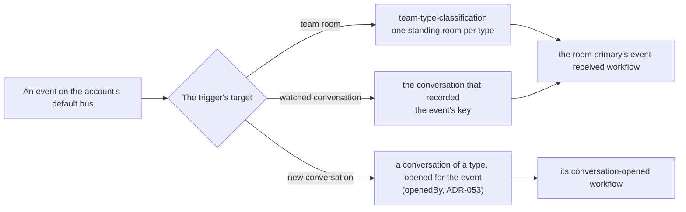
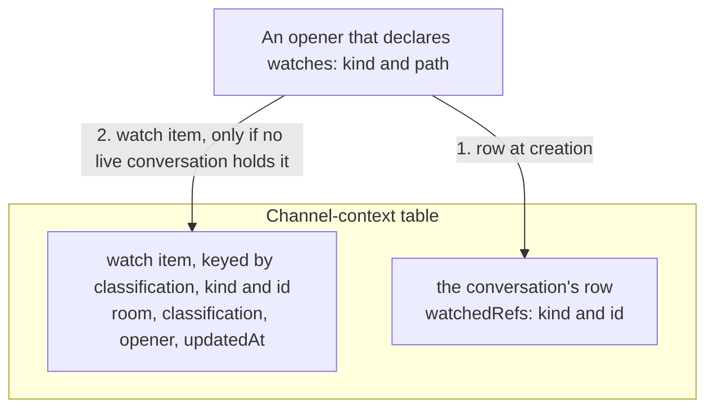
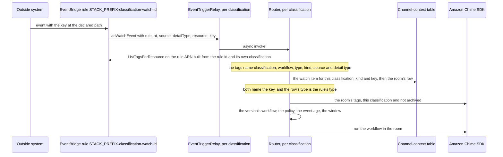
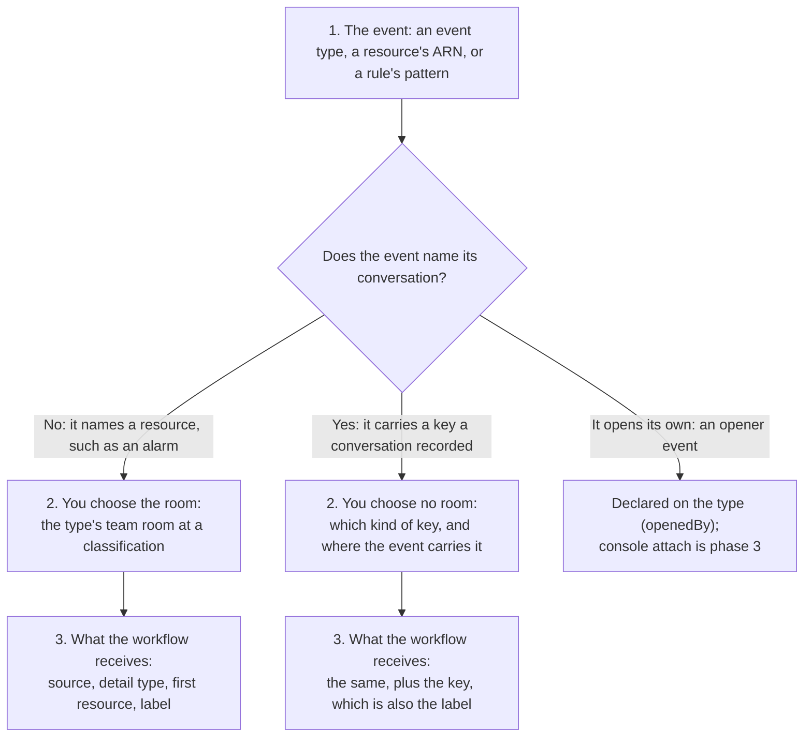
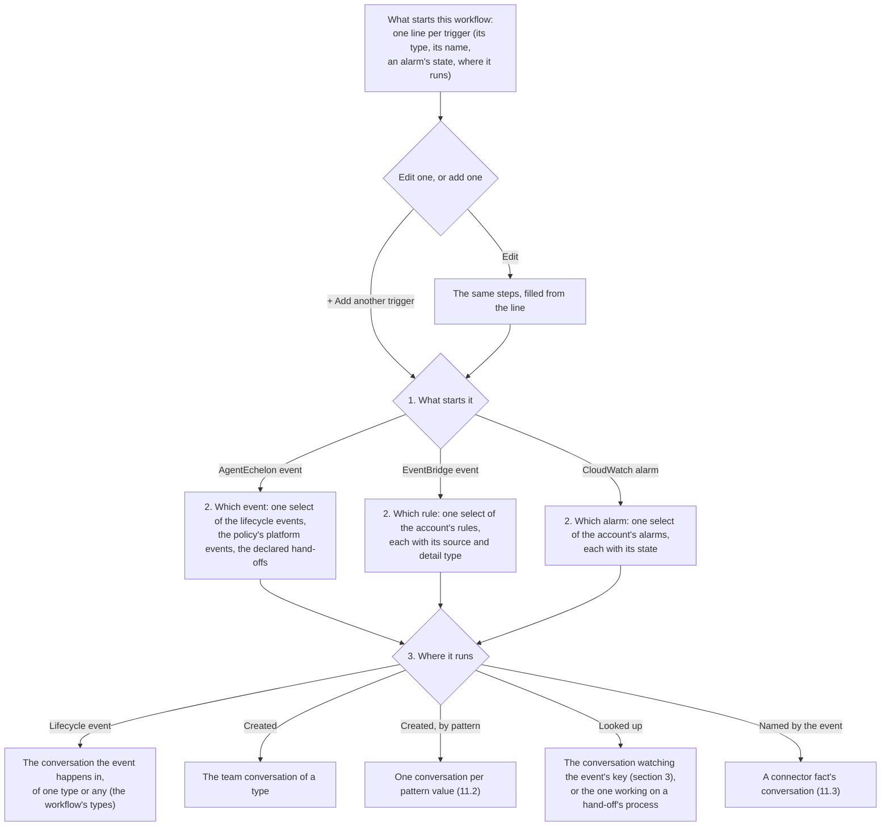
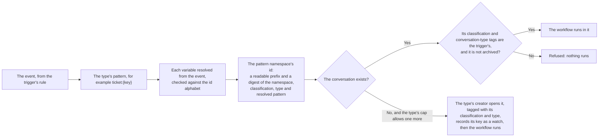
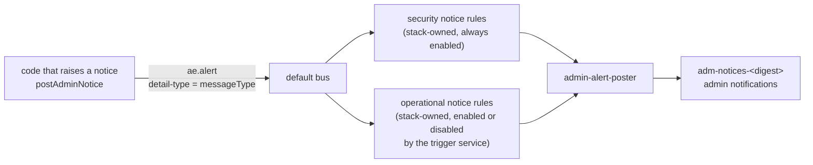
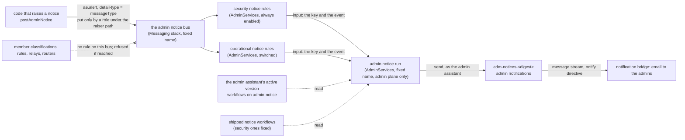

# DESIGN: Where an event's workflow runs

**Status:** Partial. The team room target is built and verified (WT121). The new-conversation target is built as a deploy-time declaration (ADR-053 `openedBy`). Phases 5 to 7 (the trigger form, a standing conversation named by a pattern, and a fact's person or named conversation, section 11) are built and proven by unit tests; their dev run is owed. Phase 1, the watched-conversation target, the watch it reads and the console's choice of target, is built and proven by unit tests (`an-opener-records-the-key-it-watches.test.ts`, `an-event-reaches-only-the-conversation-that-watches-its-key.test.ts`, `EventTriggerPanel.test.tsx`); its dev run is owed. Phases 2 to 4 are **ROADMAP**. Section 13, the admin notices as workflows on the admin assistant, is **NOT BUILT**. Its requirements are in [SPEC-WORKFLOWS-AND-TASKS](./SPEC-WORKFLOWS-AND-TASKS.md) section G (WT123 to WT127).

**Coverage:** `tests/e2e/an-event-reaches-the-conversation-that-watches-its-key.spec.ts` (the watch trigger, the watch an opener records, one room per key, an update reaching the room that watches it once per window); written, its dev run owed.

**Related:** [SPEC-WORKFLOWS-AND-TASKS](./SPEC-WORKFLOWS-AND-TASKS.md) - the requirements and their status (WT80 to WT84, WT116, WT121 to WT127). [ADR-067](../../../design/decisions/067-a-workflow-is-triggered-by-an-event-or-an-intent-and-its-steps-create-tasks.md) - G7, G32, G33 and G38, which later phases answer. [ADR-061](../../../design/decisions/061-a-welcome-is-a-workflow-an-event-starts.md) - the incident watch this generalizes. [ADR-053](../../../design/decisions/053-a-conversation-records-its-type-rather-than-being-pinned-to-it.md) - `openedBy`. [DESIGN-CONVERSATION-TYPES](./DESIGN-CONVERSATION-TYPES.md) - types, openers and participant roles. [SPEC-CONNECTORS](../../communication/SPEC-CONNECTORS.md) - the `ae.connector` fact and its `ExternalRef`. [TENETS](../../../overview/TENETS.md) - D3, D8, D9, D11, D12, D13.

**Site section:** Interaction layer, conversation.

---

## 1. The problem

An outside event belongs to a conversation, and which conversation depends on the event:

- An alarm opens an incident from the team's standing room.
- A registration or a new sales lead opens a conversation of its own.
- A support ticket's later events (assigned, updated, resolved) belong in the conversation the request came from.

The platform reaches the first today. It reaches the second only through a deploy-time declaration, and the third not at all, so a ticket's resolution cannot reach the person who asked. The third is the hard case, because the event comes from outside the platform's control. The event may name only a key that a conversation recorded, and the platform decides everything else.

## 2. Three targets



| Target | What the event chooses | What the platform chooses | Example | Status |
|---|---|---|---|---|
| Team room | Nothing | The room (fixed id, `team-room` tag), the workflow, the type | An alarm opens an incident from the ops team room | Built (WT121) |
| New conversation | The opener's fields (the person, the label) | The type and the classification | A registration opens onboarding; a lead opens a sales conversation | Built at deploy (`openedBy`); console attach is **ROADMAP** (phase 3) |
| Watched conversation | The key, so only among conversations that recorded it | The workflow, the type, the classification and the kind of key | A ticket's resolution, a lead's assignment | Phase 1, built |

A vendor's events reach these targets through the connector receiver. The receiver takes the vendor's partner event bus, resolves and admits the people the event names, and re-publishes the event on the default bus as an `ae.connector` fact carrying an `ExternalRef` (SPEC-CONNECTORS). The console's trigger form attaches rules on the default bus only.

## 3. The watch

A conversation **watches a key** only when the platform records it. This generalizes the incident watch (ADR-061), which already does this for one alarm, and it is built on the same two records and the same API (tenet D8).



- **A key is a kind and an id.** The platform declares the kind (for example `support-ticket` or `sales-lead`), never the event. A kind belongs to one event source: synth refuses two openers that declare the same kind under different sources, and an attach refuses a watch trigger whose source differs from the source of that kind's openers. The id is read from the event at a declared path. A string or a number is normalized by one function (`refId`) that both the creator and the router use. The id matches `[A-Za-z0-9._:-]{1,128}` and the kind `[a-z0-9-]{1,40}`. A row watches at most 8 keys.
- **The item is per classification.** It is stored at `watch#ref#<classification>#<kind>#<id>` and also carries its classification, which the router compares (as `conversationWatches` does for an alarm). One classification can neither read nor evict another's watch.
- **Two records, both checked.** The watch item names the room, and the room's row lists the key. An event is accepted only when the two agree. The row is written at creation and the item after it, which is the alarm's order.
- **The first live conversation keeps the key.** An opener event whose key a live conversation already watches opens no second conversation: it returns that conversation, as a repeated opening event does (`claimOpening`). The item is written conditionally: only where it is absent, names the same room, or names a room that is archived or gone. So a later event cannot move a key away from the conversation that holds it.
- **One deployment's events only.** A watch rule on a platform source (one whose opener declares `matchInstance`) matches this deployment's instance, fixed at deploy, as the opener's rule does, so another deployment in the account never reaches this one's conversations.
- **The trust boundary.** A watch is only as trustworthy as the source that may put the opening event. A platform function's `events:PutEvents` is conditioned on its own source (`ae.connector`, `ae.alert`), which restricts that function. It does not stop another principal in the account putting the same source: the default bus has no resource policy, so every source on it, a platform's included, is trusted only at the account boundary, and `ae.ops` is put by an operator's script. The own-app bus (WT84, **NOT BUILT**) is where a deployment's own application gets a source no other principal can use. The first-live-conversation rule bounds what an untrusted source can do: it can open a conversation for a key nobody holds, but it cannot take one over.
- **Who writes a watch.** Phase 1: the typed creator, when an opener that declares `watches` opens the conversation. Phase 4 (**ROADMAP**): an outbound step (G7) that creates the ticket and records the key it gets back. Nothing else writes a watch, and no API takes one from a caller.

## 4. Phase 1: an event reaches the conversation that watches its key



- **The rule names its own binding.** A team-room trigger tags its one room. A watch trigger has no single room to tag, so its rule carries the binding as tags: `classification`, `workflow`, `conversation-type`, `watch-kind`, `source` and `detail-type`. The router builds the rule ARN from the payload's rule id (12 hex characters) and its own classification, reads the tags, refuses a rule whose `classification` tag is not its own, and refuses an event whose `source` or `detailType` is not the rule's. IAM grants the router `events:ListTagsForResource` only on `rule/<STACK_PREFIX>-<classification>-watch-????????????`. A forged payload can therefore name only a rule this classification's admin attached, and it gets that rule's workflow.
- **One run per rule, key and window.** The natural key is `watch-<rule>-<key>-<window>`, with the team room's 15-minute window (tenet D9). A ticket updated 50 times in a quarter hour starts one run, and a repeat in the same window starts nothing. The team room's incident dedupe and its open-incident cap are specific to team rooms and do not apply here.
- **A continuation re-checks the watch.** A run that goes on after an agent, task, wait or open step re-reads the watch item and the row before it continues, as an alarm run does. A conversation that stopped watching continues nothing.
- **The workflow's values** are `source`, `detailType`, `resource`, `key` and `label` (the key). This is the shape a team-room run gets, plus the key. The event's `detail` is not passed.
- **The policy holds.** The deployment policy is the same as for a team-room trigger (WT122): the allowed event types, the switch, retries and the maximum event age, checked on attach and on every event. The deployment cap `maxTriggers` counts team-room and watch rules together. A new `maxWatchTriggersPerType` caps watch rules per type, as `maxTriggersPerRoom` caps a room's triggers.
- **The template is safe by construction.** The target input keeps every placeholder unquoted, as `triggerTargetInput` does. The router accepts `key` only as a string or a number that `refId` accepts, and refuses an object, an array or a missing value.
- **What phase 1 does not do.** It starts a run. Resuming a waiting run on a declared edge, which is ADR-067 G33's inbound half, stays **OPEN**: it needs the `ExternalRef` on the run or task, and that is phase 2.

## 5. The opener records the key

An opener gains one optional declaration:

```ts
openedBy: [{ source: 'ae.ops', detailType: 'Incident opened', matchInstance: true,
  fields: PLATFORM_EVENT_FIELDS, watches: { kind: 'support-ticket', path: '$.detail.ticketId' } }]
```

At synth, `resolveEventOpeners` refuses a kind or a path outside its shape, and a kind declared under two sources. A path must be a plain path under `$.detail.` or `$.resources[`. When the event arrives, the creator does four things in order:

1. It reads the id and refuses one `refId` does not accept.
2. It returns the conversation that already watches the key, when that conversation is live.
3. Otherwise it creates the conversation with `watchedRefs` on its row.
4. Then it writes the watch item conditionally (section 3).

An opener's `watches` only records the key. Delivering later events needs a watch trigger attached in the console (section 7), which asks for the key's kind and path.

## 6. Which types an event-received workflow may name

| Target | The workflow's one type |
|---|---|
| Team room | A team room type: the platform opens it and keeps one room (`isTeamRoomType`) |
| Watched conversation | A declared type one of whose openers records the key it watches (`openedBy[].watches`), except `meeting`, whose conversation is opened from its parent, one per meeting |

The two rows are one rule, `eventUnreachableReason` in `backend/lib/config/conversation-types.ts`, which Validate, the console's type list and the trigger API all read, so a workflow that validates names a type a trigger can attach to. Validate accepts either row. The trigger decides the target, and the attach refuses a mismatch: a watch target on a team room type, or a team room target on any other type.

## 7. What an event must carry, and what the form asks for

A workflow needs two things to start: a conversation to run in, and the values its steps read. An event supplies what it carries, and the attach form asks only for the rest, saying why.



| The event | Example | What it supplies | What the form asks for | Why |
|---|---|---|---|---|
| Names no conversation | A CloudWatch alarm state change, an AWS service event | Its source, detail type and resources | The room: the type's team room at a classification | Nothing in the event says where it belongs |
| Names its conversation by a key | An incident update, a ticket assigned, a lead's assignment | The key, at a path the admin gives | The key's kind (from the type's openers) and its path | The conversation that recorded the key is the target; choosing a room would be a second, conflicting answer |
| Opens its own conversation | A registration, a new lead, an incident opened | The opener's fields | Nothing in this form: it is declared on the type (`openedBy`) | The opener names the type and fills the person; phase 3 attaches it in the console |

**The form reads the chosen event before step 2.** An event type is described from its schema (`GET /admin/event-types?describe=<schema>`): its source, its detail type, and the plain path to each field of its detail. An alarm's ARN means a CloudWatch alarm change. A copied rule is read when attached. From what it knows, step 2 adjusts:

- The key's kinds are those of the type's openers whose source is the chosen event's; a source that can carry none of them is said, and the form will not attach.
- The key path is chosen from the event's declared fields, starting at the path the kind's openers read, rather than typed.
- An event that matches a declared opener is said to open its own conversation.

The workflow's type decides which row applies (section 6), and the form says so in step 2 before it asks anything. For a watched type, choosing an alarm shows that an alarm names no conversation and can reach one only through a key the conversation recorded (for example the alarm's ARN at `$.resources[0]`).

**What the workflow receives** is fixed and listed in step 3: the event's `source` and `detailType`, its first resource, a `label` (the resource's last segment, or the key), and for a watched conversation the `key`. The rest of the event's `detail` is not passed, so a template or condition can rely only on these.

**Requirements a workflow states but the event cannot meet are refused at attach**, with the reason: a watch target on a type whose openers record no key, a kind under another source, or a key path outside `$.detail.` or `$.resources[`.

The workflow editor's type list for `event-received` offers every non-meeting type, and its help names the two targets. A watch trigger is listed and removed by its type and classification: the API lists the rules under the watch prefix and reads each rule's tags.

## 8. Refusals proven by test

| Case | Refused by | Test |
|---|---|---|
| A payload names another classification's rule | The router builds the ARN from its own classification; IAM limits the tag read to its own watch rules; the rule's `classification` tag is compared | `an-event-reaches-only-the-conversation-that-watches-its-key` (unit) |
| A payload's source or detail type is not the rule's | Compared with the rule's tags | same |
| A payload names a workflow or a type | Neither is read from the payload | same |
| A key no conversation at this classification watches, or a watch item whose room's row does not list the key | The two-record check, with the item's classification compared | same |
| A room of another type, archived, or at another classification | The row's type against the rule's tag; the channel tags | same |
| A key that is an object, an array or missing | `refId` | same |
| A second event for a key in the same window | The natural key | same |
| An event type the policy does not allow, or the switch off | `readEventPolicy` on every event | same |
| A continuation after the conversation stopped watching | `handleEventContinuation` re-reads the watch | same |
| An opener event for a key a live conversation holds | The creator returns that conversation; the conditional write | `an-opener-records-the-key-it-watches` (unit) |
| A kind under two sources; a kind, id or path outside its shape | `resolveEventOpeners`; the attach API | same |
| A watch target on a team room type, or the reverse | The attach API | `an-aws-event-starts-a-workflow-in-a-team-room` (unit) |

## 9. Later phases (**ROADMAP**)

| Phase | What | Gate |
|---|---|---|
| 2 | `ae.connector` facts become watch events: the kind is the connector id and the id is the `ExternalRef`'s record id. An `add` step (G32) then adds the person the fact names, already resolved and admitted by the connector receiver (SPEC-CONNECTORS K1 and K4), as the holder of a participant role the type declares. A Salesforce Omni-Channel assignment arrives this way, and the routing stays in Salesforce. A fact may also resume a waiting run on a declared edge (G33) | A consumer of `ae.connector` facts (WT82) |
| 3 | The console attaches an opener: a runtime rule whose target is the typed creator, as the team-room trigger's target is the relay | The creator accepts a runtime opener named by a tagged rule, as the phase 1 router does |
| 4 | An outbound step (G7) creates the ticket and records the key it gets back as a watch, so a support request's later events reach the conversation it left | An outbound connector action that a person confirms (WT83) |
| 5 | Built; its dev run is owed. The trigger form starts from what is attached and from what exists in the account: a workflow opens on its triggers, each edited in place, and a new one is chosen by its source (an AgentEchelon event, an EventBridge event or a CloudWatch alarm) from lists rather than typed (section 11) | None: the reads it needs are the attach function's own, plus a read of the account's alarms |
| 6 | A standing conversation is named by a pattern its type declares and is created on its first event, generalizing the team room; a pattern takes the event's key or first resource (section 11) | Built; its dev run is owed |
| 7 | Built; its dev run is owed. A pattern takes the event's person (`{person}`), and a connector fact names its conversation (section 11.3), each trusted by the connector receiver's own record; the deployment's own app is a connector over its own bus (WT84, ADR-068) | Built |

## 10. What phase 1 changes

| File | Change |
|---|---|
| `backend/lib/config/event-openers.ts` | `watches` on `EventOpener`; the kind, id and path shapes; `refId`; one source per kind, checked at synth |
| `backend/lambda/src/lib/channel-context-client.ts` | `watchedRefs` on the row; the alarm watch API generalized to a ref watch, keyed per classification, with the conditional write |
| `backend/lambda/src/typed-conversation-from-event.ts` | Reads the key; returns the conversation that holds it; writes the row, then the item |
| `backend/lambda/src/lib/event-triggers.ts` | The watch rule name and id, its tags, its target input |
| `backend/lambda/src/event-triggers-api.ts` | `target: 'watched'` with `kind` and `keyPath`; list and remove watch rules by type; `triggerCount` counts both rule kinds; `maxWatchTriggersPerType` |
| `backend/lambda/src/lib/event-policy.ts` | `maxWatchTriggersPerType` |
| `backend/lambda/src/event-trigger-relay.ts` | Passes `aeWatchEvent` on |
| `backend/lambda/src/router-agent-handler.ts` | `handleWatchEvent` with every check in section 4; `handleEventContinuation` re-checks a watched run |
| `backend/lambda/src/lib/event-workflow.ts` | Validate's type rule (section 6); the natural key |
| `backend/lib/constructs/conversation-creator.ts` | `eventWatchRulePrefix` beside `eventTriggerRulePrefix` |
| `backend/lib/stacks/admin-services-stack.ts` | The attach function's rule and target grants on the watch rule names |
| `backend/lib/stacks/assistant-profile-stack.ts` | The relay's invoke permission from watch rules; the router's `events:ListTagsForResource` on its own watch rules |
| `frontend/packages/admin/src/components/admin/EventTriggerPanel.tsx`, `EventWorkflowEditor.tsx` | What starts a workflow and where it runs: one line per trigger, and the form's three steps (section 11.1) |

## 11. Phases 5 to 7: the trigger form, and a standing conversation named by a pattern (built; dev run owed)

Every trigger answers two questions: which event starts the workflow, and which conversation it runs in. A trigger's conversation is found one of three ways: the platform creates it (section 2's team room and new conversation), looks it up by a key (the watched conversation), or a trusted event names it (11.3). This section makes the form ask these in order, and generalizes the created conversation from one room per type to a conversation named by a pattern.

### 11.1 The form (phase 5)



- **One section, one line per trigger.** The workflow editor's section "What starts this workflow" is the only place a workflow's event and the conversation it runs in are set; the editor has no separate event select or conversation-type list. Each trigger is one line: a type badge (AgentEchelon event, EventBridge event or CloudWatch alarm), its name, an alarm's state ("When it goes into ALARM") and where it runs ("Runs in: the team conversation of ops-team"). A person holding `manage-event-triggers` sees **Edit** and **Remove** on each attached trigger and **+ Add another trigger** below the lines. A person holding `view-event-triggers` sees the lines of their own assistant's attached triggers, read only, on the team route.
- **Two kinds of trigger, one form.** A lifecycle event (a person is added to a conversation, a conversation is created, an assistant is added to a conversation, an invitation is sent, an invitation is not accepted in time) and the conversation's watched alarm (`alarm-state-changed`) are the workflow's own `on`, saved with the version: "where it runs" sets its `types` to one type, or none for any, and an invitation not accepted in time takes its deadline in minutes. Each event is named as what happens and when: "A conversation is created" fires once, when the platform creates a conversation of the type, never when a person opens or reads one. A version's workflow has one `on`, so a workflow on its own event shows one line, edited and never added to. A hand-off, a platform event, an EventBridge rule and a CloudWatch alarm are attached triggers: the workflow runs on `event-received` in the one type its target names, and Save attaches the rule. A workflow's own event replaces every attached trigger, so it is offered only where no other attached trigger stands. Choosing it changes the draft only: the attached trigger's rule keeps starting the active version, listed beside the new event, and activating the draft removes it. After every activation, manage-profiles names the assistant to the trigger service (an asynchronous invoke, its one grant for this), which reads that assistant's active version itself and detaches each rule attached for it whose workflow no longer runs on `event-received` (it starts on a lifecycle event, or is gone), as a removal does: the team conversation's tag, then the target, then the rule. Only rules the trigger service owns (its prefix, a trigger or watch rule) and tagged for that assistant are read. A rule that cannot be removed is logged and left for the next activation, and the activation stands either way (`an-activation-removes-the-triggers-its-version-no-longer-runs.test.ts`).
- **Edit replaces in place.** The form opens filled from the line, on the same steps. A rule's id is a digest of its room or type, workflow, pattern and assistant (`triggerRuleId`, `watchRuleId` in `event-triggers.ts`), so a change that keeps all four is the same rule, rewritten in place. A change that does not is counted once against the event policy's caps as a replacement (`replaces`), attaches the new rule, moves the room's `event-rule:` tag to it, then removes the old one, so the workflow is never without a trigger; an event matched by both rules during the swap starts one run, because the new rule's run claims the same natural key (`supersedes`). An edit keeps the trigger's type, the type the replace route names.
- **One select per list, filled as soon as the type is chosen.** The AgentEchelon events are one select, grouped: the lifecycle events by their plain names, the event policy's allowed types whose source is the platform's (`readEventPolicy`), never `ae.alert` or a process source, and the hand-offs the active versions declare ("Hand-off: security-review, from the sending team's process"), whose typed fields are shown read only under "It arrives with". An EventBridge event is a rule already in the account, copied: the account's rules on the default bus are one select, each option naming the rule's source and detail type, and this deployment's own trigger and watch rules are disabled as already a trigger. A CloudWatch alarm is one select of the account's alarms, each with its state now, and starts the workflow on entering `ALARM` only (`alarmEntersAlarmOnly`), said as fixed text. The rules and alarms are read with an empty name prefix, a page of 100 at a time. Above each select a filter narrows its options once three or more characters are typed; fewer show the whole list, and the chosen option always stays listed. Edit opens the form with the trigger's type, its choice and where it runs (the target, the type, the kind and the key path) already chosen.
- **One choice per trigger, held as a list.** The form holds what starts a trigger as a list of choices and saves the first, one rule per trigger. Choosing several alarms or rules for one trigger, attached as one rule matching any of them, is **ROADMAP**.
- **Every row fits its column.** The section is fluid to the column it sits in (no fixed width), its rows wrap, and every select and input is held to its column's width (`admin-event-trigger-select`), at the console's usual widths and at a phone's. The Workflows section takes the console's widest column (`admin-assistant-page-wide`), and the trigger section spans the editor above the flow rather than sitting in the step inspector.
- **Where it runs offers only what the trigger service attaches.** For an attached trigger: the team conversation of a team room type; one conversation per value of a pattern type, with the type's `conversationPattern` shown read only ("Named `ticket:{key}`"), declared in `conversation-types.ts` and never edited here, and the event field its `{key}` is read from; the conversation of a watched type already watching the event's key, with the kind its openers record for that source and the key's field; for a hand-off, one conversation per process (a type whose pattern is `process:{key}`) or the conversation already working on that process, the key fixed to `$.detail.processId`; and for a connector fact, the conversation the event names. A new conversation per event is a deploy-time `openedBy` declaration (section 2) and is not offered here. A target with no type the workflow may name is not shown, and the declared types left out are said beside the choice with why.
- **The event policy is the deployment's.** What an AWS event may do at all (WT122) is edited on the Operations Alerts tab beside the admin notices, by a session holding `manage-event-policy`, never inside a workflow's trigger form.
- **Reads, served under IAM.** Listing and describing rules are reads the attach function already holds (`events:ListRules`, `events:DescribeRule`). Listing alarms adds `cloudwatch:DescribeAlarms` to the attach function, which reads alarms only. The account's rules and alarms are served on routes named among `manage-event-triggers`' resources, so IAM refuses them to a team session; a team member reads only the attached lines above, of their own assistant's triggers, on the `view-event-triggers` team route.

### 11.2 A standing conversation named by a pattern (phase 6)

The created target today is the team room, one per type and classification (`team-<type>-<classification>`, `teamRoomChannelId`), and a new conversation per event (`openedBy`). Phase 6 adds a conversation named by a pattern its type declares (`conversationPattern`) and created on its first event. A pattern trigger is a watch rule tagged with the reserved kind `pattern` (`PATTERN_WATCH_KIND`), so it is attached, listed, edited, relayed and removed as a watch trigger is; the router resolves the type's pattern from the event where a watch would look up its key, after holding the policy, the event's type and its age, derives the conversation's id as the creator does, and runs the event at once in a conversation of that type at its classification that stands and is not archived. Any other is asked of the creator asynchronously (`openPatternConversation`), which creates or recreates it and hands the event back (`handWatchEventBack`), marked so it never asks again; the router fires no synchronous invoke. It uses the context conversation's derivation (`contextChannelId` in `channel-creation.ts`: a readable prefix and a digest, within 64 characters) under its own namespace, so the two never produce the same id.



- **No two paths or types name the same conversation.** The id is derived from a namespace of its own, the classification, the type and the resolved pattern, with a digest of all four. A pattern never chooses a raw channel id or an ARN: `{resource}` is a resource's last segment and `{key}` is the key the event carries, and the id is cut to the Amazon Chime SDK's 64 characters with the digest keeping it unique. A host application's context type and id therefore never produce a pattern conversation's id, and a create-or-get on either path refuses a conversation whose `conversation-type` tag is not its own.
- **The pattern belongs to the type.** It is declared on the conversation type beside `openedBy` as `conversationPattern`, by whoever owns the type, and validated at synth (`conversationPatternErrors`): its variables are the declared ones, its literal parts use the id alphabet, and only a type the platform opens declares one.
- **One classification's event never reaches another's conversation.** The creator is per classification (tenet D12) and stamps its own classification at creation (`createOwnClassificationOnly` on its `chime:CreateChannel`), its writes require the channel's `classification` tag, and the classification is part of the id, so the same pattern at two classifications names two conversations. A standing conversation is reused only where its `classification` and `conversationType` tags are this trigger's.
- **A pattern type records no watch.** A type that declares a pattern declares no opener that watches a key, and no opener records a key of the reserved kind; synth refuses either. So a pattern and an opener's `watches` are never two answers to which conversation holds a key.
- **A cap bounds what a pattern creates.** The event policy holds `maxPatternConversationsPerDay`, the conversations a pattern type creates in a day, counted by one conditional write per creation (`claimPatternCreation`) before the creator creates, so an event stream cannot create conversations without limit. It counts creations rather than open conversations, because a conversation that expires on its type's TTL is deleted with no event to count it down by.
- **Its members.** A pattern conversation opens with the type's primary assistant and the holders of the participant roles the type fills from groups. No person named by the event is added before phase 7.
- **The team room is the pattern with no variables.** Its id stays `team-<type>-<classification>`, so the rooms that exist keep working.

| Variable | Resolved from | Which sources may supply it | Example |
|---|---|---|---|
| `{key}` | The event, at a path the trigger declares, normalized by `refId` (section 3) | Any source the event policy allows | `ticket:{key}`: one conversation per ticket |
| `{resource}` | The event's first resource, its last segment | Any source the event policy allows | `alarm:{resource}`: one conversation per alarm |
| `{person}` (phase 7) | The one person a connector fact admitted, as their person id, never an ARN | A connector fact (`ae.connector`) only, where the receiver's own record shows it admitted exactly that person for the event (`connectorRecordConfirms`, ADR-068) | `main:{person}`: a person's primary conversation |

**A person variable is the trust boundary.** Any principal in the account can put an event on the default bus, a platform source included (section 3), so a pattern that takes `{person}` from such an event would let it open, or post into, any person's conversation. `{person}` is therefore read only from a connector fact, and only where the connector receiver's replay record, which no other principal writes, shows it admitted exactly that one person for that event at this classification; a trigger whose type's pattern names `{person}` on any other source is refused at attach, and the router refuses a fact the record does not confirm. The person's conversation is opened for them (`forUserArn`), so they are its member. The person was resolved and admitted by the receiver at the connector's classification before the fact was published, so a conversation is never created for a person the platform did not admit.

**The second layer within a classification.** Beside the code's checks, IAM denies the creator a `chime:CreateChannel` whose `conversationType` is a type its classification does not permit, and one tagged `pattern-room` with anything but a declared pattern type (`creatorTypeBounds` in `conversation-creator.ts`). IAM cannot compare a channel's id with its type, so the code's tag check before reuse stays the first layer, and IAM bounds what any create may stamp.

**An archived pattern conversation is recreated at the same id** (owner decision 2026-11-19). Its `archived` tag stays one-way (ADR-017), so the creator deletes the archived channel, whose history stays in the conversation archive, the system of record, and opens the conversation again at the same id. The archive records the recreation as a new generation of that id, so a reader of its history sees each generation apart. Before it deletes the channel, the creator resets the conversation's channel-context row, removing every field but its key (`resetPatternRoomContext`), so the new generation inherits none of the previous one's role holdings, member identities, summary, watched keys or children and starts from what its own creation writes. The row records its generation, and the reset is conditioned on the row still naming the archived generation, so a later generation's row is never wiped; a reset that fails deletes nothing, and the next event tries again. The reset is an `UpdateItem` the creator already holds on the table, so it adds no grant. The creator may delete only a channel tagged `archived` of its own classification and type: IAM conditions its `chime:DeleteChannel` on those tags, and its code checks them first.

### 11.3 A conversation the event names (phase 7)

An event that names its conversation by id chooses its target, which section 3 keeps from any source another principal can put. Only the deployment's own app names a conversation: its events arrive on a bus whose policy admits the app's principal alone (WT84, ADR-068), and the receiver records the conversation it published. A trigger whose target is `named` (a watch rule tagged with the reserved kind `named`) is attached only on a connector fact, and the router runs it only where the receiver's record names that conversation for the event, and only in a conversation of the rule's type at its classification, read from the conversation's own tags. Unlike a pattern, it names a raw id, which the record is what makes trusted.

### 11.4 Refusals each phase proves by test

| Phase | Case | Refused by | Test (owed) |
|---|---|---|---|
| 5 | A team member attaches, edits or removes a trigger, or lists the account's rules or alarms | IAM: those routes are `manage-event-triggers`' | `a-team-sees-its-own-triggers` (extended) |
| 5 | An edit that keeps the rule's parts removes the rule it just wrote | The id is the same, so the rule is rewritten, not swapped | `an-edited-trigger-keeps-its-workflow-triggered` |
| 5 | An edit at the event policy's cap | The replacement is counted once | same |
| 5 | One event during a swap starts two runs | The natural key the two rules share | same |
| 5 | `ae.alert` attached as a trigger | The form's list; the attach API | same |
| 6 | A pattern names an undeclared variable, or a literal outside the id alphabet | Synth validation | `a-pattern-names-its-conversation` |
| 6 | A host's context type and id produce a pattern conversation's id | The pattern namespace in the derivation; the `conversation-type` tag check on conflict | same |
| 6 | An existing conversation at the id of another type or classification, or archived | The tag and archive checks before the workflow runs | same |
| 6 | A pattern creates past its type's cap | The event policy's cap, checked on create | same |
| 6 | The creator deletes a channel that is not archived, or of another type or classification | IAM: `chime:DeleteChannel` conditioned on the `archived`, `classification` and `conversation-type` tags; the creator's check | same |
| 6 | A resolved variable outside the id alphabet, or missing | The creator: nothing is created | same |
| 7 | A forged `ae.connector` event from another principal names a person or a conversation | The match against the receiver's record (`connectorRecordConfirms`) | `an-own-app-event-from-another-principal-is-refused` |
| 7 | Another principal, or another source, puts on the app's bus | The bus's resource policy denies | same |
| 7 | A fact that admitted several people, or none, names a `{person}` | The record must show exactly one | same |
| 7 | An event names a conversation of another type or classification | The router, from the conversation's tags | same |

## 12. The admin notifications conversation as a target (built; dev run owed)

Every platform notice already travels as an event: the code that raises one puts an `ae.alert` on the default bus (`postAdminNotice`, `lib/admin-notice.ts`), its `detail-type` the notice's `messageType`, its detail the notice's typed fields (`words`). One rule (`AdminAlertRule`, `admin-services-stack.ts`) sends every `ae.alert` to the poster (`admin-alert-poster.ts`), which words it through the admin assistant's template named by `words.name` (`wordedNotice`, ADR-062 decision 6), posts it as the admin assistant and notifies the admins. The conversion splits that one rule into one rule per notice type, each shown in the console's Admin notices panel (Operations, Alerts), deployment-wide and apart from any workflow's triggers, with the security notices always on and the operational ones switchable.



**The notice types are declared.** One catalog in code (`ADMIN_NOTICE_TYPES`), keyed by `messageType`, lists each type, the templates it is worded from and whether it is a security notice:

| `messageType` | Template | Raised by | Kind |
|---|---|---|---|
| `membership_audit_finding` | `uncleared-membership`, `recorded-clearance-mismatch` | `membership-audit.ts` | Security |
| `activated-past-golden-gate` | `activated-past-golden-gate` | `manage-profiles.ts` | Security |
| `cloudwatch_alarm`, the boundary refusal alarm (`AssistantRefusedByClassification`, ADR-045) | `cloudwatch-alarm` | `alarm-to-admin-channel.ts` | Security |
| `cloudwatch_alarm`, every other alarm | `cloudwatch-alarm` | `alarm-to-admin-channel.ts`, through each alarm's SNS topic: the Archive, Meetings and Notifications alarms once, and the Assistants alarms once per classification | Operational |
| `assistant_error` | `assistant-error` | `async-processor-core.ts` | Operational |
| `turn_not_started` | `turn-not-started` | `router-agent-handler.ts` | Operational |
| `connector_grant_unrevoked` | `connector-grant-unrevoked` | `connector-grant-revoker.ts` | Operational |
| `guest-unavailable` | `guest-unavailable` | `guest-session.ts` | Operational |
| `clean_copy_run` | the run's own words | `clean-copy-batch.ts` | Operational |

The two `cloudwatch_alarm` rows are two rules: the security one matches the boundary refusal alarm's name in `detail.notice.extra.alarmName`, and the operational one matches every other name. A test (`every-admin-notice-type-is-catalogued.test.ts`) scans the `adminNotice(` and `postAdminNotice(` callers and refuses a `messageType` the catalog does not list or a template that is not shipped, since an unshipped template posts the raiser's own text.

**Every notice rule is the stack's.** AdminServices owns one rule per catalogued type, each targeting the poster, outside the trigger service's rule prefix, as `AdminAlertRule` is today, so no person creates one (O4) and the trigger service's targets stay relays only (`TargetOnlyARelay`, unchanged). A fresh deployment and an upgrade post exactly what they post today.

**Security notices are always on.** The trigger service holds no grant on their rules (the IAM layer) and refuses a request naming one (the handler). The panel lists them with the reason they cannot be switched off.

**Operational notices are switched, not detached.** The trigger service holds `events:EnableRule` and `events:DisableRule` on the operational notice rules' ARNs alone, and an administrator (`manage-event-triggers`) switches one off or on in the panel; a team's view lists none. A switch survives a deploy: the service records the state in `<root>/admin-notices/<key>/state` (the catalog entry's `key`), a parameter no stack owns, each rule's `State` resolves it at deploy, and the deploy scripts write `ENABLED` where it is absent. Switching off stops the post and its email, which the notification bridge sends from the message stream, so a notice is one message in the conversation and in email. The one alarm emailed directly as well is the archival pipeline alarm (`ALERT_RECIPIENT_ARNS`, `alarm-to-admin-channel.ts`), because it fires when the message stream the bridge reads has stopped; its direct email is unaffected by the switch. `ae.alert` stays a source no trigger starts a workflow on (section 11).

**The poster trusts what it trusts today.** It takes only an `ae.alert` for this instance and posts what the admin assistant's template words from the typed fields.

**A fixed id.** The conversation is created at `adm-notices-<digest>`, the digest of the deployment's app instance ARN (`adminNoticesChannelId` beside `patternChannelId`, building its own prefix), so its ARN follows from the deployment alone and two deployments never share one. Creation is create-or-get: on a conflict the existing channel is reused only where the admin bot created it and its tags, never member-writable, name it the admin notifications conversation of the admin classification; its Metadata decides nothing, and anything else at that id is refused (`the-admin-notifications-conversation-has-a-fixed-id.test.ts`). That a bot bearer may set `ChannelId` is proven on dev before the build lands. The `AdminNotificationChannelArn` parameter stays, as the one place the poster reads it. A deployment whose conversation has another id moves to the fixed one on its next AdminServices deploy: the provisioner creates the conversation at the fixed id and returns its ARN, CloudFormation deletes the old one through the same handler, and the poster and the parameter take the new ARN in that deploy, since nothing outside the stack reads it. The old conversation's history stays in the conversation archive.

**Not converted yet.** The admin assistant runs no workflows today (`admin-agent-lex-handler.ts`, and the router is per classification), so a notice is posted, never run as a workflow. Section 13 makes each notice a workflow on the admin assistant's version, run in this conversation, and moves `ae.alert` to a bus of its own, which pins who may put it and who may subscribe to it (**NOT BUILT**). Until it is built, pinning who may put `ae.alert` on the default bus is **OPEN**, and so is who may subscribe to it there, where any principal holding `events:PutRule` can write a rule that matches it.

**Proven by refusal.** The service refusing a switch of a security notice and writing nothing (`an-admin-notice-is-switched-not-rewritten.test.ts`), the synthesized role naming no security notice rule and no write on any notice rule (`admin-notices-are-rules-security-ones-always-on.test.ts`), and a raiser with an uncatalogued type (`every-admin-notice-type-is-catalogued.test.ts`). On the deployment, **NOT BUILT**: a team session switching a notice, and the trigger service enabling a security notice rule under its deployed role.

## 13. Admin notices as workflows on the admin assistant (**NOT BUILT**)

Each platform notice becomes a workflow on the admin assistant's version (profile `admin-agent`, classification `admin`, the admin plane), started by its notice event and run in the admin notifications conversation at its fixed id (section 12). The workflows are listed and edited under the admin assistant in the console, as any assistant's are. Only the admin classification's workflows may pick up a notice event, and an admin workflow picks up nothing else.



### 13.1 Where admin workflows run

| Option | What it reuses | Verdict |
|---|---|---|
| **(c) An admin notice run: the shared interpreter with an admin-plane step set** | `runEventWorkflow` (`lib/event-workflow.ts`), which takes its steps' effects as injected `EventRunDeps`; the poster's wording and post (`wordedNotice`, `deliverAdminNotice`) as the `send` dependency; the poster's role and its grants; the stack-owned rules | **Recommended** |
| (a) An `Assistants-admin` stack, the per-classification router built for the admin plane | The whole assistant stack: router, processor, Lex bot and AppInstanceBot, guardrail, vend, relay, task service, deadlines | Rejected: synth refuses an admin-plane topology by design (`profiles.ts`, "the admin plane has no conversational runtime and no assistant stack"), it would mint a second admin-plane AppInstanceBot beside the admin assistant, and it deploys roughly 40 resources and a standing cost to run one send step |
| (b) The poster grows its own small engine | The poster | Rejected: a second interpreter for the same workflow format forks the run engine (tenet D9), and every step kind added later is written twice |

**The admin notice run** (`admin-notice-run.ts`, replacing `admin-alert-poster.ts`) is one function in AdminServices with a fixed name. It holds the admin plane alone, so it is one classification's principal (tenet D12), and it reaches no member classification's data, conversation, router or task service. It runs the same interpreter every router runs, with only the dependencies a notice needs:

| Step kind or dependency | In the run | Why |
|---|---|---|
| `send` | The template is read from the admin assistant's family (`templates/admin/_assistants/admin-agent/`), else the shipped one, rendered and posted as the admin assistant with the `notify` directive, falling back to the notice's carried wording as the poster does | Every notice today is one send |
| The run's end (`disposition`) and conditions on the run's values | In the interpreter already; a condition reads the declared source `notice:template` (13.4) | The membership audit is worded from one of two templates |
| `mentionName`, `dispatchAgent` (required by `EventRunDeps`) | Refusing stubs: `mentionName` answers empty and `dispatchAgent` answers `absent`, and Validate keeps any step that would call them out of an admin version | The interpreter requires them; a notice names no person and calls no model |
| `agent` | **OPEN**: needs a model call as the admin assistant, which the admin plane has no processor for | Summarizing or triaging a notice |
| `task` (a task for the on-call admin) | **OPEN**: needs an admin-plane task service and run store, which the admin plane has none of | Acknowledgement of a security notice |
| `action`, `wait`, `open`, `handoff` | Refused by Validate | No notice needs them, and each reaches a member classification's engine |

**A notice workflow runs on its own event.** It declares `on: 'admin-notice'` and `notice: '<key>'`, a key of `ADMIN_NOTICE_TYPES`, and no `types`: its conversation is the one admin notifications conversation, not a type's room. `admin-notice` is a workflow event of its own, so `event-received`'s rule (one `types` entry, `eventWorkflowErrors` in `event-workflow.ts`) does not apply, and no member path reads it: no router selects a workflow on it and the trigger form never offers it. Validate (`adminWorkflowErrors`, read by Validate, the console and the run) refuses `admin-notice` on any version but an admin-plane one, and on an admin-plane version refuses any other `on`, a key outside the catalog, a security key (13.5), and a step kind the run does not build.

**At least once, then exactly once.** EventBridge delivers at least once, and the run must post at least once. The interpreter claims a send step before it calls `deps.send` (`runEventWorkflow`), and a redelivered run whose run claim is held returns at once, so a step claim kept after a failed post would lose the notice on a transient Amazon Chime SDK failure. The run therefore takes one run claim and no step claims of its own: its `claimStep` dependency answers true, and its `send` dependency, when the post fails, releases the run claim and throws, so EventBridge delivers the event again (the rules keep `retryAttempts: 2`, as the poster's do). A delivery after a post that succeeded finds the claim held and posts nothing. The claim is a conditional put of `admin-run#<event id>` in the channel-context table, whose partition key is `channelArn`; the event's id is the one EventBridge keeps across retries. The table gains `timeToLiveAttribute: 'ttl'` (`conversations-stack.ts`; no row sets `ttl` today, so nothing else expires), and a claim carries a `ttl` a day ahead. A claim is a record of one event's run, keyed by the event and never by a classification (tenet D13).

### 13.2 The trigger: one stack-owned rule per notice type, on a bus of its own

The nine rules stay the stack's, one per catalogued type (`ADMIN_NOTICE_TYPES`), as COMMUNICATION-PATHS lists for "a platform or AWS event the deployment always handles". Their target becomes the admin notice run, through an input transformer that carries the rule's `key`, fixed at deploy, and the event (`source`, `detail-type`, `id`, `time` and `detail`). No rule is attached through the trigger service: a security notice must be always on and not detachable, and an attached rule is detachable by definition. The operational rules keep their switch (`events:EnableRule`, `events:DisableRule` on those rules alone, and the state parameter read at deploy); the switch (`switchAdminNotice`, `event-triggers-api.ts`) passes the bus's `EventBusName` to both calls.

**The alarm split is checked twice.** The `boundary-refusal-alarm` and `alarm` rules split `cloudwatch_alarm` by the alarm's name (`BOUNDARY_REFUSAL_ALARM_SUFFIX`). The run reads the same split again from the event: a `boundary-refusal-alarm` key with any other name, or an `alarm` key with the boundary refusal alarm's name, runs nothing. So the editable `alarm` workflow never receives the security alarm, even from a rule written wrongly.

**The admin notice bus.** `ae.alert` moves from the default bus to a bus of its own, `<prefix>-admin-notices`, created in the Messaging stack beside the process event bus (`createProcessEventBus`, `agent-classification-common.ts`), so it exists in every deployment and a raise never fails for want of it. Every raiser's grant comes from one helper (`alertEmitterWiring`, `agent-classification-common.ts`, eight call sites), which names the new bus, and `postAdminNotice` (`lib/admin-notice.ts`) puts with its `EventBusName`.

**Who may put: an IAM path, not a tag.** `alertEmitterWiring.grant` takes an `iam.Role` and sets its `CfnRole` `path` to `/<prefix>-alert-raiser/`, and synth refuses a role that already has another path. A role's path is set by the stack that creates it and is part of its ARN, so no session can claim it. A tag gate is weaker: several vended sessions set session tags without pinning `aws:TagKeys`, so a tag a raiser carries can be asserted by a session that is not one.

**Who may subscribe: any CloudFormation deploy in this account.** The rule-write statement names the CloudFormation execution role, read from `DefaultStackSynthesizer.cloudFormationExecutionRoleArn` at synth, and synth refuses a deployment with any other synthesizer, so the ARN is never guessed from a bootstrap qualifier. That role is what any CloudFormation deploy in this account runs as, so the gate is the account's deploy permission, not this stack alone.

| Statement | Owned by | Effect | What it closes |
|---|---|---|---|
| `NoOtherSource` | Messaging | Deny `events:PutEvents` to every principal for any source but `ae.alert` | The bus carries notices and nothing else |
| `OnlyARaiserPuts` | Messaging | Deny `events:PutEvents` where `aws:PrincipalArn` is `ArnNotLike` `arn:aws:iam::<account>:role/<prefix>-alert-raiser/*` | Who may put `ae.alert`, **OPEN** in section 12 |
| `OnlyADeploySubscribes` | Messaging | Deny `events:PutRule`, `events:PutTargets`, `events:DeleteRule`, `events:RemoveTargets`, `events:TagResource` and `events:UntagResource` on the bus's rules to every principal but the CloudFormation execution role; deny `events:EnableRule` and `events:DisableRule` to every principal but that role and the trigger service's role (`eventTriggersRoleName`), which IAM grants them on the operational rules alone | Who may subscribe to `ae.alert`, **OPEN** in section 12 |
| `OnlyTheRunIsATarget` | AdminServices, as a `CfnEventBusPolicy` statement, as `processBusSenderPolicy` is the classification stack's | Deny `events:PutTargets` on the bus's rules where `events:TargetArn` is not the admin notice run's ARN | A notice is never forwarded to another bus, a relay or a router |

The move closes both open items of section 12: who may put `ae.alert` and who may subscribe to it. COMMUNICATION-PATHS' known exception for them is removed when this lands.

### 13.3 Only the admin classification picks up a notice event

Two layers each way, and each proven by a refusal.

| Direction | Layer 1 (IAM and resource policy) | Layer 2 (handler) | Today |
|---|---|---|---|
| A member classification picks up `ae.alert` | `ae.alert` is never on the default bus, where the trigger service's rules and the member relays live; on the admin notice bus only a CloudFormation deploy writes a rule, and only the admin notice run may be a target. The trigger service's rule grants name the default and process buses alone (`WriteOnlyTriggerRules`, `TargetOnlyARelay`, `admin-services-stack.ts`), and stay so | The trigger service refuses `ae.alert` as a platform event (`event-triggers-api.ts`, the `ADMIN_NOTICE_SOURCE` check in the platform event branch), kept, and the form leaves it out of its list (`EventTriggerPanel.tsx`, the `ADMIN_NOTICE_SOURCE` filter), kept. **NOT BUILT**: the trigger service checks the final pattern every branch produces (`patternOfChoice`: a copied rule, a schema, a platform event, an alarm) and refuses any `source` that could match `ae.alert`, whether an exact value, a prefix or an anything-but; and every member router refuses an `ae.alert` source in `handleRuleEvent` and `handleWatchEvent` directly after the `malformed` check, before any tag or binding read | Platform-event refusal built; the rest **NOT BUILT** |
| An admin workflow picks up a member event | The run's rules exist only on the admin notice bus and match `source: ae.alert` and this instance; the run's role holds no `lambda:InvokeFunction` on any relay, router, creator or task service, no `chime:SendChannelMessage` but on the admin notifications conversation's exact ARN, and no read of a member classification's templates or versions. There is no admin relay (`<prefix>Assistants-admin-EventTriggerRelay` cannot exist while synth refuses an admin topology), so the trigger service's `TargetOnlyARelay` can never reach an admin workflow | The run refuses an event whose source is not `ae.alert`, whose instance is not this one, whose `detail-type` is not the catalogued type of the input's `key`, or whose alarm name is on the other side of the split; Validate refuses `admin-notice` on a member version; the trigger service refuses attaching any trigger to an admin-plane assistant's workflow | **NOT BUILT** |

### 13.4 The target: the admin notifications conversation

The run's conversation is fixed by the stack, not chosen by the event: the conversation at `adminNoticesChannelId` (`channel-creation.ts`), whose ARN the run is given at deploy (`AdminNotificationChannelArn`), as the poster is today. Before its first send the run reads the conversation's tags once per container, and runs nothing unless the `classification` tag is `admin` and the admin notifications kind tag (`ADMIN_CHANNEL_TAG_KEY`) is set; Metadata decides nothing. The conversation has no conversation type, and a notice workflow names none.

**What the workflow receives.** The notice's typed fields for its template (`words.values`), `messageType`, and the carried `subject` and `content`, as message values. A notice is a platform-written fact on a bus only raisers may put on, so its typed fields are passed, unlike an outside event's `detail` (section 7). A condition reads one declared source, `notice:template`: the template the raiser named, accepted only where the catalog lists it for the type, and declared in the condition source table (`buildSourceTable`) for `admin-notice` workflows alone. The shipped membership audit workflow chooses its template by it.

### 13.5 The shipped workflows

One shipped workflow per notice type (`SHIPPED_ADMIN_NOTICE_WORKFLOWS`, `notice-<key>`), each a send of the type's template. They run by default, as the shipped welcome runs where a version declares none (`platformWorkflowsRunByDefault`, `assistantSections.ts`), so nothing is seeded into the admin assistant's version, the seed's `seeded` label rule (`seed-profile-definitions.ts`) is untouched, an administrator's version is never overwritten, and a notice type a later release adds reaches every deployment.

- **Security notices are fixed.** For the membership audit, the golden-gate activation and the boundary refusal alarm, the run always runs the shipped workflow, and Validate refuses a version's workflow that names their key. Their words are the admin's through the admin assistant's templates, as today. A workflow no version may replace is new: the shipped catalog gains a `fixed` flag, set on these three, and the console shows a fixed workflow with the platform badge and no Copy.
- **Operational notices are the version's to replace.** A version's workflow naming an operational key runs in place of the shipped one, which a draft copies in to start from, as any shipped workflow is copied.
- **An unreadable version** runs the shipped workflow and logs it: a notice that never posts is the failure the poster exists to prevent (tenet D5).

### 13.6 The console

The admin assistant's versions are listed, drafted, validated and activated on the routes every assistant's are (`/admin/profiles`, `/admin/profiles/version`, `/admin/profiles/draft`, `/admin/profiles/validate`, served by `manage-profiles.ts`), since `allProfileNames` (`profile-lifecycle.ts`) already includes `admin-agent`. Under the admin assistant, the workflows list shows one group, "Admin notices", with each notice's workflow. Its trigger section (`EventTriggerPanel.tsx`) shows one line per workflow: the notice's name, "Runs in: the admin notifications conversation", and **Always on** for a security notice, or an **On**/**Off** switch for an operational one, which calls the existing switch route (`/admin/admin-notices`) under `manage-event-triggers`. There is no Add, Edit or Remove on these lines, because the rule is the stack's. The Admin notices panel on the Alerts tab (`AdminNoticesPanel.tsx`) is removed; the event policy stays there.

### 13.7 What stays

The notification bridge emails the admins from the message stream through the `notify` directive. The archival pipeline alarm's direct email (`alarm-to-admin-channel.ts`) stays, because it fires when that stream has stopped. Cost sleep mode's notices stay on Amazon SNS.

### 13.8 New principals and grants

| Principal | Grant | Second layer |
|---|---|---|
| Admin notice run role (replaces the poster's) | Everything the poster holds (the admin assistant's templates and pointers, `chime:SendChannelMessage` on the conversation's exact ARN and on the admin assistant's AppInstanceBot) | The run's checks in 13.3 |
| Same | `ssm:GetParameter` on the admin assistant's definition parameter alone (`definitionParamName(<root>, 'admin-agent')`) and `s3:GetObject` on its body prefix | Validate's admin step set |
| Same | `chime:ListTagsForResource` on the conversation's exact ARN | The tag check in 13.4 |
| Same | `dynamodb:PutItem` and `dynamodb:DeleteItem` on the channel-context table with `dynamodb:LeadingKeys` `admin-run#*` | The claim's condition |
| Admin notice bus | The statements in 13.2, three owned by Messaging and one by AdminServices | The trigger service's own refusals |
| Every raiser role | `events:PutEvents` moves from the default bus to the admin notice bus, still conditioned on `ae.alert`; the role is created under the path `/<prefix>-alert-raiser/` | The bus's `OnlyARaiserPuts` |
| Trigger service role | `events:EnableRule`, `events:DisableRule` move to the operational rules' ARNs on the admin notice bus | The handler's refusal of a security key |

### 13.9 Build steps

| Step | What | Estimate |
|---|---|---|
| 1 | The admin notice bus and its Messaging statements; the raiser path in `alertEmitterWiring`; `postAdminNotice` on the bus; the rules moved onto it with the input transformer; the switch's `EventBusName` | 1.5 days |
| 2 | `admin-notice-run.ts` over `runEventWorkflow`: the send, the run claim and its release, the refusing stubs, the alarm split; the `ttl` attribute; `OnlyTheRunIsATarget`; the poster removed | 1.5 days |
| 3 | `admin-notice` as a workflow event, `notice` and `notice:template`, `SHIPPED_ADMIN_NOTICE_WORKFLOWS` with `fixed`, `adminWorkflowErrors` | 1 day |
| 4 | The member routers' `ae.alert` refusal after `malformed`; the trigger service's check of the final pattern; its refusal on an admin-plane workflow | 0.5 day |
| 5 | The console: the admin assistant's notice workflows, their trigger lines, `fixed` hiding Copy; the Alerts tab panel removed | 1 day |
| 6 | Tests (13.10), docs (COMMUNICATION-PATHS, section 12), one deploy and a dev run | 1 day |

### 13.10 Tests

| Case | Refused by | Test |
|---|---|---|
| A role outside the raiser path puts `ae.alert`; any principal puts another source on the bus | The bus policy | `only-a-raiser-puts-an-admin-notice` (synth) and its dev run |
| A raiser role created with another path | Synth | same |
| Any principal but the CloudFormation execution role writes, tags or untags a rule on the bus; a target other than the run; a synthesizer other than the default | The bus policy; synth | `only-a-deploy-subscribes-to-admin-notices` (synth) and its dev run |
| The trigger service switches an operational notice on the bus, and cannot switch a security one | IAM and the handler | `an-admin-notice-is-switched-not-rewritten` (extended) and its dev run |
| The trigger service attaches a pattern that could match `ae.alert` from any branch: an exact source, a prefix, an anything-but | The final pattern check | `an-admin-notice-is-never-a-member-trigger` |
| A member router receives a payload whose source is `ae.alert` | `handleRuleEvent`, `handleWatchEvent`, before any read | same |
| A trigger attached to an admin-plane assistant's workflow | The attach API; no admin relay exists | same |
| The run receives another source, another instance, a `detail-type` not its key's, or an alarm on the other side of the split | The run | `an-admin-workflow-runs-only-its-notice` |
| The run's role names a relay, router, creator, task service, member conversation, member template or version | Synth: the role's statements | same |
| A failed post is posted on retry | The send dependency releases the run claim and throws | `a-failed-post-is-posted-on-retry` |
| A redelivered notice after a post that succeeded | The run claim | same |
| `admin-notice` on a member version; `types` on a notice workflow; a security key on a version; an unbuilt step kind; a condition on an undeclared source | `adminWorkflowErrors` | `admin-notice-workflows-validate` |
| A conversation at the fixed ARN without the admin tags | The run's tag check | `the-admin-notifications-conversation-has-a-fixed-id` (extended) |
| The shipped workflow runs when the version names none, or is unreadable | The run | `an-admin-workflow-runs-only-its-notice` |
