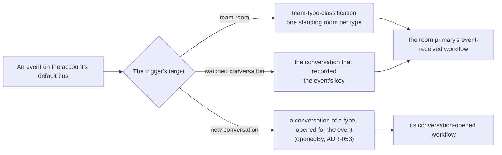
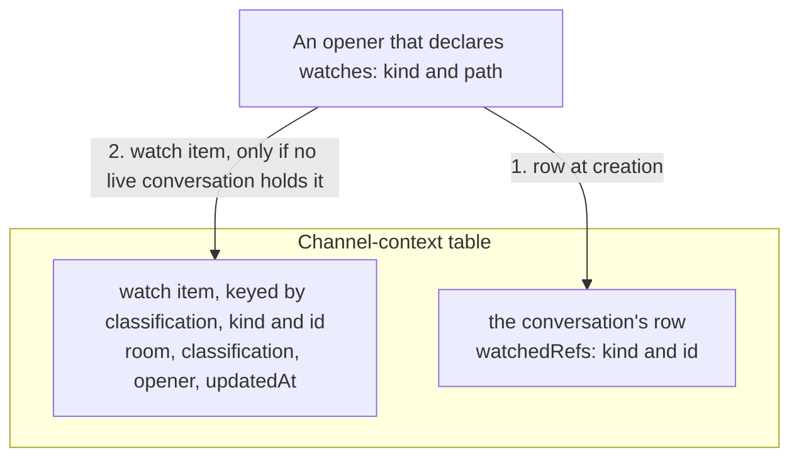
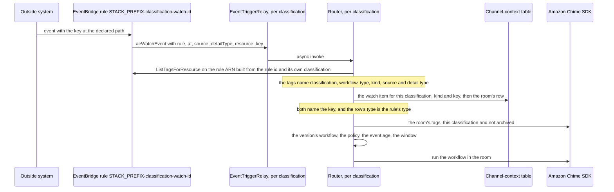
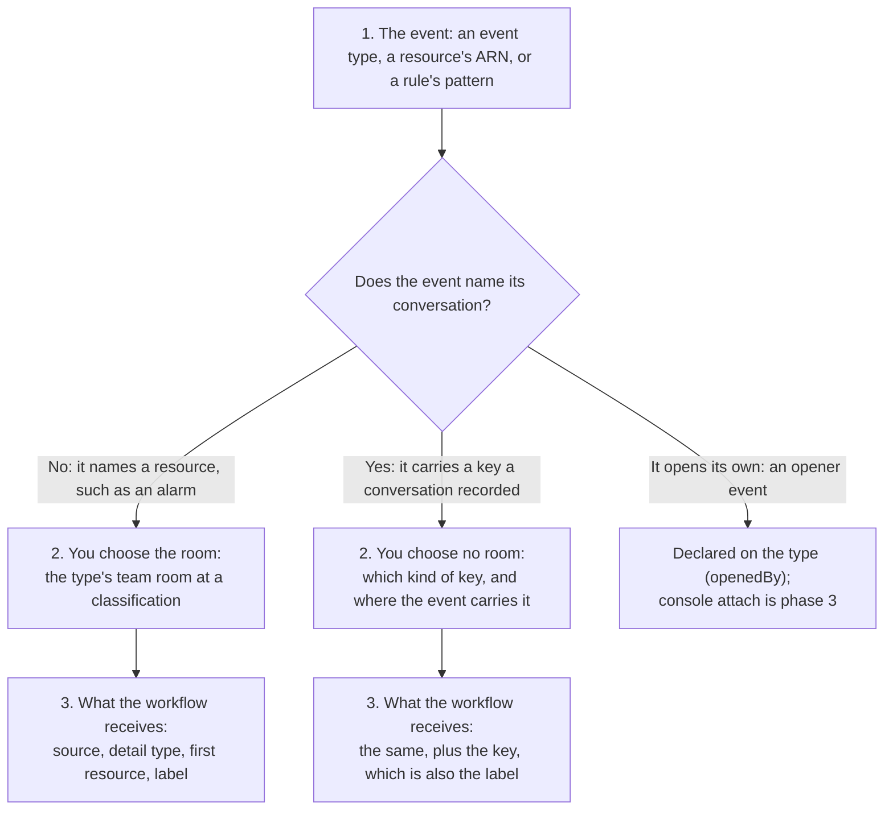

# DESIGN: Where an event's workflow runs

**Status:** Partial. The team room target is built and verified (WT121). The new-conversation target is built as a deploy-time declaration (ADR-053 `openedBy`). Phase 1, the watched-conversation target, the watch it reads and the console's choice of target, is built and proven by unit tests (`an-opener-records-the-key-it-watches.test.ts`, `an-event-reaches-only-the-conversation-that-watches-its-key.test.ts`, `EventTriggerPanel.test.tsx`); its dev run is owed. Phases 2 to 4 are **ROADMAP**. Its requirements are in [SPEC-WORKFLOWS-AND-TASKS](./SPEC-WORKFLOWS-AND-TASKS.md) section G (WT123 to WT127).

**Coverage:** `tests/e2e/an-event-reaches-the-conversation-that-watches-its-key.spec.ts` (the watch trigger, the watch an opener records, one room per key, an update reaching the room that watches it once per window); written, its dev run owed.

**Related:** [SPEC-WORKFLOWS-AND-TASKS](./SPEC-WORKFLOWS-AND-TASKS.md) - the requirements and their status (WT80 to WT84, WT116, WT121 to WT127). [ADR-067](../../../design/decisions/067-a-workflow-is-triggered-by-an-event-or-an-intent-and-its-steps-create-tasks.md) - G7, G32, G33 and G38, which later phases answer. [ADR-061](../../../design/decisions/061-a-welcome-is-a-workflow-an-event-starts.md) - the incident watch this generalizes. [ADR-053](../../../design/decisions/053-a-conversation-records-its-type-rather-than-being-pinned-to-it.md) - `openedBy`. [DESIGN-CONVERSATION-TYPES](./DESIGN-CONVERSATION-TYPES.md) - types, openers and participant roles. [SPEC-CONNECTORS](../../communication/SPEC-CONNECTORS.md) - the `ae.connector` fact and its `ExternalRef`. [TENETS](../../../overview/TENETS.md) - D3, D8, D9, D11, D12, D13.

**Site section:** Interaction layer, conversation.

---

## 1. The problem

An outside event belongs to a conversation, and which conversation depends on the event:

- An alarm opens an incident from the team's standing room.
- A registration or a new sales lead opens a conversation of its own.
- A support ticket's later events (assigned, updated, resolved) belong in the conversation the request came from.

The platform reaches the first today. It reaches the second only through a deploy-time declaration, and the third not at all, so a ticket's resolution cannot reach the person who asked. The third is the hard case, because the event comes from outside the platform's control. The event may name only a key that a conversation recorded, and the platform decides everything else.

## 2. Three targets



| Target | What the event chooses | What the platform chooses | Example | Status |
|---|---|---|---|---|
| Team room | Nothing | The room (fixed id, `team-room` tag), the workflow, the type | An alarm opens an incident from the ops team room | Built (WT121) |
| New conversation | The opener's fields (the person, the label) | The type and the classification | A registration opens onboarding; a lead opens a sales conversation | Built at deploy (`openedBy`); console attach is **ROADMAP** (phase 3) |
| Watched conversation | The key, so only among conversations that recorded it | The workflow, the type, the classification and the kind of key | A ticket's resolution, a lead's assignment | Phase 1, built |

A vendor's events reach these targets through the connector receiver. The receiver takes the vendor's partner event bus, resolves and admits the people the event names, and re-publishes the event on the default bus as an `ae.connector` fact carrying an `ExternalRef` (SPEC-CONNECTORS). The console's trigger panel attaches rules on the default bus only.

## 3. The watch

A conversation **watches a key** only when the platform records it. This generalizes the incident watch (ADR-061), which already does this for one alarm, and it is built on the same two records and the same API (tenet D8).



- **A key is a kind and an id.** The platform declares the kind (for example `support-ticket` or `sales-lead`), never the event. A kind belongs to one event source: synth refuses two openers that declare the same kind under different sources, and an attach refuses a watch trigger whose source differs from the source of that kind's openers. The id is read from the event at a declared path. A string or a number is normalized by one function (`refId`) that both the creator and the router use. The id matches `[A-Za-z0-9._:-]{1,128}` and the kind `[a-z0-9-]{1,40}`. A row watches at most 8 keys.
- **The item is per classification.** It is stored at `watch#ref#<classification>#<kind>#<id>` and also carries its classification, which the router compares (as `conversationWatches` does for an alarm). One classification can neither read nor evict another's watch.
- **Two records, both checked.** The watch item names the room, and the room's row lists the key. An event is accepted only when the two agree. The row is written at creation and the item after it, which is the alarm's order.
- **The first live conversation keeps the key.** An opener event whose key a live conversation already watches opens no second conversation: it returns that conversation, as a repeated opening event does (`claimOpening`). The item is written conditionally: only where it is absent, names the same room, or names a room that is archived or gone. So a later event cannot move a key away from the conversation that holds it.
- **One deployment's events only.** A watch rule on a platform source (one whose opener declares `matchInstance`) matches this deployment's instance, fixed at deploy, as the opener's rule does, so another deployment in the account never reaches this one's conversations.
- **The trust boundary.** A watch is only as trustworthy as the source that may put the opening event. Platform sources are put only by functions whose `events:PutEvents` is conditioned on their source (`ae.connector`, `ae.alert`). A custom source on the default bus is trusted at the account boundary: any principal in the account with `events:PutEvents` can put it. The own-app bus (WT84, **NOT BUILT**) is where a deployment's own application gets a source no other principal can use. The first-live-conversation rule bounds what an untrusted source can do: it can open a conversation for a key nobody holds, but it cannot take one over.
- **Who writes a watch.** Phase 1: the typed creator, when an opener that declares `watches` opens the conversation. Phase 4 (**ROADMAP**): an outbound step (G7) that creates the ticket and records the key it gets back. Nothing else writes a watch, and no API takes one from a caller.

## 4. Phase 1: an event reaches the conversation that watches its key



- **The rule names its own binding.** A team-room trigger tags its one room. A watch trigger has no single room to tag, so its rule carries the binding as tags: `classification`, `workflow`, `conversation-type`, `watch-kind`, `source` and `detail-type`. The router builds the rule ARN from the payload's rule id (12 hex characters) and its own classification, reads the tags, refuses a rule whose `classification` tag is not its own, and refuses an event whose `source` or `detailType` is not the rule's. IAM grants the router `events:ListTagsForResource` only on `rule/<STACK_PREFIX>-<classification>-watch-????????????`. A forged payload can therefore name only a rule this classification's admin attached, and it gets that rule's workflow.
- **One run per rule, key and window.** The natural key is `watch-<rule>-<key>-<window>`, with the team room's 15-minute window (tenet D9). A ticket updated 50 times in a quarter hour starts one run, and a repeat in the same window starts nothing. The team room's incident dedupe and its open-incident cap are specific to team rooms and do not apply here.
- **A continuation re-checks the watch.** A run that goes on after an agent, task, wait or open step re-reads the watch item and the row before it continues, as an alarm run does. A conversation that stopped watching continues nothing.
- **The workflow's values** are `source`, `detailType`, `resource`, `key` and `label` (the key). This is the shape a team-room run gets, plus the key. The event's `detail` is not passed.
- **The policy holds.** The deployment policy is the same as for a team-room trigger (WT122): the allowed event types, the switch, retries and the maximum event age, checked on attach and on every event. The deployment cap `maxTriggers` counts team-room and watch rules together. A new `maxWatchTriggersPerType` caps watch rules per type, as `maxTriggersPerRoom` caps a room's triggers.
- **The template is safe by construction.** The target input keeps every placeholder unquoted, as `triggerTargetInput` does. The router accepts `key` only as a string or a number that `refId` accepts, and refuses an object, an array or a missing value.
- **What phase 1 does not do.** It starts a run. Resuming a waiting run on a declared edge, which is ADR-067 G33's inbound half, stays **OPEN**: it needs the `ExternalRef` on the run or task, and that is phase 2.

## 5. The opener records the key

An opener gains one optional declaration:

```ts
openedBy: [{ source: 'ae.ops', detailType: 'Incident opened', matchInstance: true,
  fields: PLATFORM_EVENT_FIELDS, watches: { kind: 'support-ticket', path: '$.detail.ticketId' } }]
```

At synth, `resolveEventOpeners` refuses a kind or a path outside its shape, and a kind declared under two sources. A path must be a plain path under `$.detail.` or `$.resources[`. When the event arrives, the creator does four things in order:

1. It reads the id and refuses one `refId` does not accept.
2. It returns the conversation that already watches the key, when that conversation is live.
3. Otherwise it creates the conversation with `watchedRefs` on its row.
4. Then it writes the watch item conditionally (section 3).

An opener's `watches` only records the key. Delivering later events needs a watch trigger attached in the console (section 7), which asks for the key's kind and path.

## 6. Which types an event-received workflow may name

| Target | The workflow's one type |
|---|---|
| Team room | A team room type: the platform opens it and keeps one room (`isTeamRoomType`) |
| Watched conversation | A declared type one of whose openers records the key it watches (`openedBy[].watches`), except `meeting`, whose conversation is opened from its parent, one per meeting |

The two rows are one rule, `eventUnreachableReason` in `backend/lib/config/conversation-types.ts`, which Validate, the console's type list and the trigger API all read, so a workflow that validates names a type a trigger can attach to. Validate accepts either row. The trigger decides the target, and the attach refuses a mismatch: a watch target on a team room type, or a team room target on any other type.

## 7. What an event must carry, and what the form asks for

A workflow needs two things to start: a conversation to run in, and the values its steps read. An event supplies what it carries, and the attach form asks only for the rest, saying why.



| The event | Example | What it supplies | What the form asks for | Why |
|---|---|---|---|---|
| Names no conversation | A CloudWatch alarm state change, an AWS service event | Its source, detail type and resources | The room: the type's team room at a classification | Nothing in the event says where it belongs |
| Names its conversation by a key | An incident update, a ticket assigned, a lead's assignment | The key, at a path the admin gives | The key's kind (from the type's openers) and its path | The conversation that recorded the key is the target; choosing a room would be a second, conflicting answer |
| Opens its own conversation | A registration, a new lead, an incident opened | The opener's fields | Nothing in this form: it is declared on the type (`openedBy`) | The opener names the type and fills the person; phase 3 attaches it in the console |

**The form reads the chosen event before step 2.** An event type is described from its schema (`GET /admin/event-types?describe=<schema>`): its source, its detail type, and the plain path to each field of its detail. An alarm's ARN means a CloudWatch alarm change. A copied rule is read when attached. From what it knows, step 2 adjusts:

- The key's kinds are those of the type's openers whose source is the chosen event's; a source that can carry none of them is said, and the form will not attach.
- The key path is chosen from the event's declared fields, starting at the path the kind's openers read, rather than typed.
- An event that matches a declared opener is said to open its own conversation.

The workflow's type decides which row applies (section 6), and the form says so in step 2 before it asks anything. For a watched type, choosing an alarm shows that an alarm names no conversation and can reach one only through a key the conversation recorded (for example the alarm's ARN at `$.resources[0]`).

**What the workflow receives** is fixed and listed in step 3: the event's `source` and `detailType`, its first resource, a `label` (the resource's last segment, or the key), and for a watched conversation the `key`. The rest of the event's `detail` is not passed, so a template or condition can rely only on these.

**Requirements a workflow states but the event cannot meet are refused at attach**, with the reason: a watch target on a type whose openers record no key, a kind under another source, or a key path outside `$.detail.` or `$.resources[`.

The workflow editor's type list for `event-received` offers every non-meeting type, and its help names the two targets. A watch trigger is listed and removed by its type and classification: the API lists the rules under the watch prefix and reads each rule's tags.

## 8. Refusals proven by test

| Case | Refused by | Test |
|---|---|---|
| A payload names another classification's rule | The router builds the ARN from its own classification; IAM limits the tag read to its own watch rules; the rule's `classification` tag is compared | `an-event-reaches-only-the-conversation-that-watches-its-key` (unit) |
| A payload's source or detail type is not the rule's | Compared with the rule's tags | same |
| A payload names a workflow or a type | Neither is read from the payload | same |
| A key no conversation at this classification watches, or a watch item whose room's row does not list the key | The two-record check, with the item's classification compared | same |
| A room of another type, archived, or at another classification | The row's type against the rule's tag; the channel tags | same |
| A key that is an object, an array or missing | `refId` | same |
| A second event for a key in the same window | The natural key | same |
| An event type the policy does not allow, or the switch off | `readEventPolicy` on every event | same |
| A continuation after the conversation stopped watching | `handleEventContinuation` re-reads the watch | same |
| An opener event for a key a live conversation holds | The creator returns that conversation; the conditional write | `an-opener-records-the-key-it-watches` (unit) |
| A kind under two sources; a kind, id or path outside its shape | `resolveEventOpeners`; the attach API | same |
| A watch target on a team room type, or the reverse | The attach API | `an-aws-event-starts-a-workflow-in-a-team-room` (unit) |

## 9. Later phases (**ROADMAP**)

| Phase | What | Gate |
|---|---|---|
| 2 | `ae.connector` facts become watch events: the kind is the connector id and the id is the `ExternalRef`'s record id. An `add` step (G32) then adds the person the fact names, already resolved and admitted by the connector receiver (SPEC-CONNECTORS K1 and K4), as the holder of a participant role the type declares. A Salesforce Omni-Channel assignment arrives this way, and the routing stays in Salesforce. A fact may also resume a waiting run on a declared edge (G33) | A consumer of `ae.connector` facts (WT82) |
| 3 | The console attaches an opener: a runtime rule whose target is the typed creator, as the team-room trigger's target is the relay | The creator accepts a runtime opener named by a tagged rule, as the phase 1 router does |
| 4 | An outbound step (G7) creates the ticket and records the key it gets back as a watch, so a support request's later events reach the conversation it left | An outbound connector action that a person confirms (WT83) |

## 10. What phase 1 changes

| File | Change |
|---|---|
| `backend/lib/config/event-openers.ts` | `watches` on `EventOpener`; the kind, id and path shapes; `refId`; one source per kind, checked at synth |
| `backend/lambda/src/lib/channel-context-client.ts` | `watchedRefs` on the row; the alarm watch API generalized to a ref watch, keyed per classification, with the conditional write |
| `backend/lambda/src/typed-conversation-from-event.ts` | Reads the key; returns the conversation that holds it; writes the row, then the item |
| `backend/lambda/src/lib/event-triggers.ts` | The watch rule name and id, its tags, its target input |
| `backend/lambda/src/event-triggers-api.ts` | `target: 'watched'` with `kind` and `keyPath`; list and remove watch rules by type; `triggerCount` counts both rule kinds; `maxWatchTriggersPerType` |
| `backend/lambda/src/lib/event-policy.ts` | `maxWatchTriggersPerType` |
| `backend/lambda/src/event-trigger-relay.ts` | Passes `aeWatchEvent` on |
| `backend/lambda/src/router-agent-handler.ts` | `handleWatchEvent` with every check in section 4; `handleEventContinuation` re-checks a watched run |
| `backend/lambda/src/lib/event-workflow.ts` | Validate's type rule (section 6); the natural key |
| `backend/lib/constructs/conversation-creator.ts` | `eventWatchRulePrefix` beside `eventTriggerRulePrefix` |
| `backend/lib/stacks/admin-services-stack.ts` | The attach function's rule and target grants on the watch rule names |
| `backend/lib/stacks/assistant-profile-stack.ts` | The relay's invoke permission from watch rules; the router's `events:ListTagsForResource` on its own watch rules |
| `frontend/packages/admin/src/components/admin/EventTriggerPanel.tsx`, `EventWorkflowEditor.tsx` | Where it runs, kind and key path; the type list |
