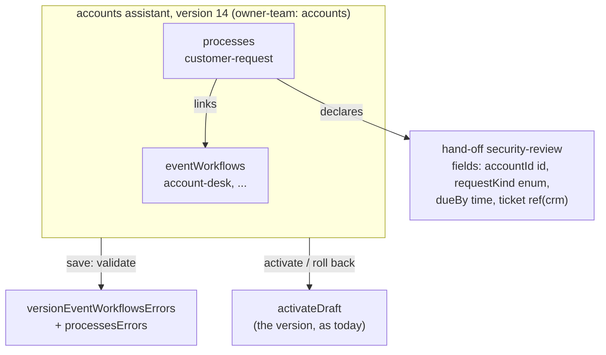
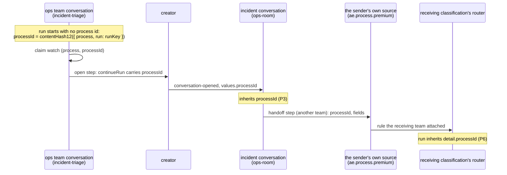
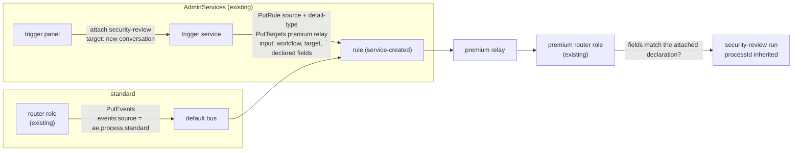
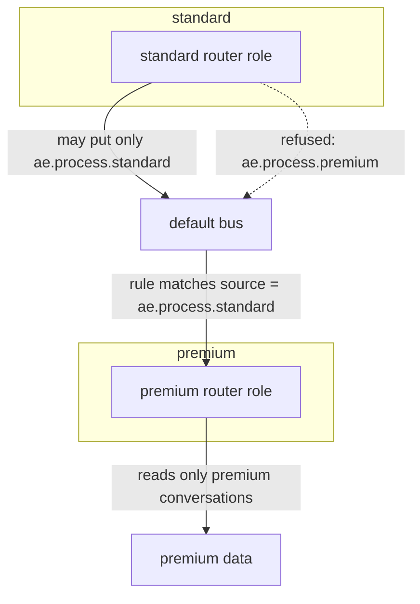
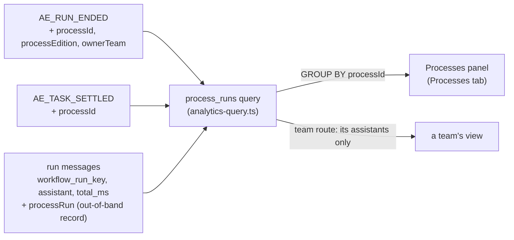
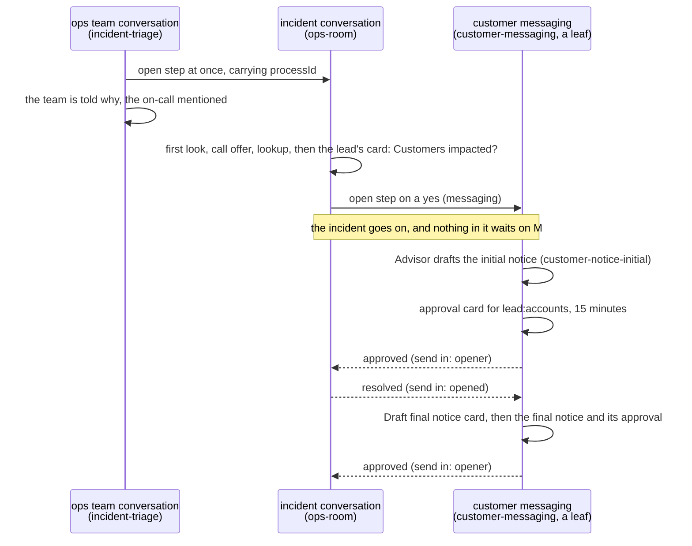
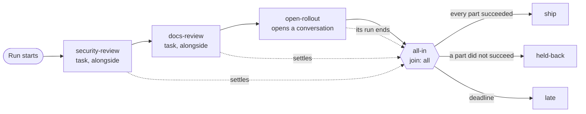

# DESIGN: Processes across teams and classifications

**Status:** Partial. Steps 1, 2, 6, 7 and 9 to 12 of section 8 are built and deployed to dev; steps 3 to 5, the hand-off of sections 4 and 5, are designed and **NOT BUILT**, planned for the Stratum customer request demo (O22); step 8 is planned. The requirements and their status are in [SPEC-PROCESSES](./SPEC-PROCESSES.md) (P1 to P15).

**Coverage:** `e2e/a-process-is-declared-on-its-teams-version.spec.ts`, `e2e/process-analytics-groups-runs-by-process-id.spec.ts` (written, not run); section 8 names the test each build step adds.

**Related:** [SPEC-PROCESSES](./SPEC-PROCESSES.md) - the requirements, the goals, the mocks and the demos. [SPEC-WORKFLOWS-AND-TASKS](./SPEC-WORKFLOWS-AND-TASKS.md) and [DESIGN-WORKFLOWS-AND-TASKS](./DESIGN-WORKFLOWS-AND-TASKS.md) - the workflow a process links. [DESIGN-EVENT-TARGETS](./DESIGN-EVENT-TARGETS.md) - the targets a received hand-off runs in. [SPEC-CONNECTORS](../../communication/SPEC-CONNECTORS.md) - the outbound connector event P12 depends on (FR14). [SPEC-MESSAGE-METADATA-CODEBOOK](../../communication/SPEC-MESSAGE-METADATA-CODEBOOK.md) - the message metadata cap and the out-of-band record section 6 uses. [ADR-042](../../../design/decisions/042-an-assistant-acts-in-exactly-one-classification.md), [ADR-061](../../../design/decisions/061-a-welcome-is-a-workflow-an-event-starts.md), [ADR-067](../../../design/decisions/067-a-workflow-is-triggered-by-an-event-or-an-intent-and-its-steps-create-tasks.md). [TENETS](../../../overview/TENETS.md) - D1, D3, D7, D8, D9, D11, D12, D13.

**Site section:** Interaction layer, conversation.

---

## 1. What is reused

A process is a definition, an id and a hand-off. Everything else is an existing seam (D8, D9).

| Part | Existing seam | What changes |
|---|---|---|
| The definition | The version body beside `eventWorkflows` (`backend/lambda/src/lib/active-profile.ts:744`); its validation (`versionEventWorkflowsErrors`, `backend/lambda/src/lib/event-workflow.ts:2409`); activation (`activateDraft`, `backend/lambda/src/lib/profile-lifecycle.ts:2097`); team ownership (`OWNER_TEAM_TAG`, `backend/lambda/src/lib/assistant-ownership.ts:20`) | A `processes` key and its validator |
| The process id | The run key (`eventRunKey`, `backend/lambda/src/lib/event-workflow.ts:1462`); the run context (`EventRunContext`, `backend/lambda/src/lib/event-workflow.ts:1489`); the task's run reference (`WorkflowRunRef`, `backend/lambda/src/lib/task-tracking.ts:560`); `contentHash12` (`backend/lambda/src/lib/canonical-json.ts:24`) | One field on the context and the reference |
| Same classification | The `open` step (`openChildConversation`, `backend/lambda/src/router-agent-handler.ts:3856`); the opened run's values, as the incident's `resource` is carried (`backend/lambda/src/router-agent-handler.ts:7009`) | The process id rides beside `resource` |
| The hand-off put | The pinned-source put the alert path uses (`alertEmitterWiring`, `backend/lib/stacks/agent-classification-common.ts:1704`) | A `handoff` step and one IAM statement on the router's existing role |
| Attaching | The trigger service (`backend/lambda/src/event-triggers-api.ts`), its rule pattern (`patternFor`, `backend/lambda/src/lib/event-triggers.ts:53`), its IAM (`backend/lib/stacks/admin-services-stack.ts:1350`); the console panel (`frontend/packages/admin/src/components/admin/EventTriggerPanel.tsx`); the event policy (`backend/lambda/src/lib/event-policy.ts:36`) | The panel lists declared hand-offs, read from the active versions' definitions (section 4.2); the rule's fixed input records the attached declaration |
| Receiving | The rule event (`handleRuleEvent`, `backend/lambda/src/router-agent-handler.ts:6671`) and the watched target (`handleWatchEvent`, `backend/lambda/src/router-agent-handler.ts:6795`; `claimRefWatch`, `backend/lambda/src/lib/channel-context-client.ts:1009`) | A field check, a `process` check on the watched target, and the `process` watch kind |
| Analytics | `RunEndedFact` and `TaskSettledFact` (`backend/lambda/src/lib/archive-facts.ts:53`, `backend/lambda/src/lib/archive-facts.ts:26`), written by `recordRunEnded` and `settledFact` (`backend/lambda/src/task-service.ts:824`, `backend/lambda/src/task-service.ts:842`); the out-of-band analytics record (`writeMessageAnalytics`, `backend/lambda/src/lib/message-analytics.ts`; `wireMessageAnalytics`, `backend/lib/stacks/agent-classification-common.ts:2563`) and the run fields archival projects from it (`runFieldsOf`, `backend/lambda/src/analytics-aurora/kinesis-archival.ts:692`); `getWorkflowEditions` (`backend/lambda/src/analytics-aurora/analytics-query.ts:7908`); the team route's query list (`ASSISTANT_FILTERED_QUERIES`, `backend/lambda/src/analytics-aurora/analytics-query.ts:2174`); the Processes tab (`frontend/packages/admin/src/components/admin/ProcessesTab.tsx`) | Fields on the facts and on the out-of-band record, one query, one tab |

No table, IAM role, session, Lambda function, EventBridge bus or trigger mechanism is added. Two existing roles gain scoped statements: the router's role gains the pinned put (section 4.2) and the write-only put on the out-of-band analytics table (section 6), and the trigger service's role gains the read of active definitions (section 4.2).

## 2. The definition on the version



```json
"processes": {
  "customer-request": {
    "label": "Customer request",
    "workflows": ["account-desk"],
    "handoffs": {
      "security-review": {
        "fields": {
          "accountId": { "type": "id" },
          "requestKind": { "type": "enum", "values": ["data-export", "access-change", "integration"] },
          "dueBy": { "type": "time" },
          "ticket": { "type": "ref", "store": "crm" }
        }
      }
    },
    "metrics": [
      { "id": "decision-in-2d", "label": "Security decision within 2 days", "workflow": "account-desk", "step": "decided", "outcome": "success", "within": "P2D", "target": 0.8 }
    ]
  }
}
```

The validator refuses: a linked workflow the version does not declare; a workflow linked by two processes on one version; a field type outside `enum`, `number`, `boolean`, `time`, `id` and `ref`; an `enum` with no values; a `ref` whose `store` is not a connector the deployment declares ([SPEC-CONNECTORS](../../communication/SPEC-CONNECTORS.md)); a `handoff` step naming a hand-off its process does not declare; and a metric naming a workflow or step the process does not link. A free-text type does not exist, so no declaration can carry one (O2). Each refusal is a reason code the console renders from the locale bundle (P5, D11).

## 3. The process id



- **Created once.** A run of a workflow its version's process links, starting with no process id, sets `processId` to `contentHash12({ process: <name>, run: <runKey> })`. The run key already names the event, its natural key and the assistant, so a repeat that the run already took makes no second process (WT122).
- **The process edition.** The same run sets `processEdition` to `contentHash12` of its version's `processes` entry for that process, as it stood on the active version the run started on, so an edit to the entry (a linked workflow, a hand-off's fields or a metric) is a new edition and an edit elsewhere on the version is not, as a workflow's edition is its workflow hash (WT60). Declared metrics are computed per edition (P10).
- **Carried.** The id and the edition are fields of `EventRunContext`, so they are held on the run record for every wait, and of `WorkflowRunRef`, so a task the run opens carries them to its settlement. A run never changes either. A run the `open` step starts inherits both; a run a hand-off starts takes the process id from the event, and the query reads a process's edition from the run that started it. So a receiving workflow that serves several processes, through several attached hand-offs, gives each run the id of the process that started it.
- **Same classification (P3).** The `open` step's `continueRun` already carries the run's values to the creator, which hands them to the opened conversation's run as the incident's `resource` is handed today. The process id is one more value, read only where `openedBy` is `workflow`.
- **Watched.** The first conversation of a process at a classification claims the watch `process` / `<processId>` through `claimRefWatch`, so a hand-off answered back to that classification reaches it (section 4). The `process` kind is the platform's own: recorded by the runner, never read from an event, and matched only on an `ae.process.*` source the rule names. The rest of WT124 holds unchanged: kept per classification, both items name it, the first live conversation keeps it.

## 4. The hand-off

### 4.1 The event

```json
{
  "source": "ae.process.standard",
  "detail-type": "customer-request.security-review",
  "detail": {
    "instance": "<deployment instance>",
    "processId": "7c1e09a4b2d1",
    "process": "customer-request",
    "handoff": "security-review",
    "fields": {
      "accountId": "acct-1042",
      "requestKind": "data-export",
      "dueBy": "2026-11-14T17:00:00Z",
      "ticket": { "store": "crm", "id": "T-88213" }
    }
  }
}
```

The shape is fixed: these five keys, and `fields` holding exactly the declared names. A step writes it as `{ handoff: { process, name, fields: { accountId: "event:accountId", ... } }, onSuccess, onFailure }`, each value read from the run's own values. Before the put, the sending router checks every value against its declared type (an enum value among its values, an id against `REF_ID`, a time as ISO 8601, a `ref` naming its declared store) and takes `onFailure` with the outcome `refused` on any mismatch. Sensitive data stays in the approved system; the event carries a reference that each side reads with its own identity ([Designing an event for a use case](../../../guides/admin/WORKFLOW-STEP-REFERENCE.md#designing-an-event-for-a-use-case)).

### 4.2 Sending and attaching



The router's existing role gains one statement, built as `alertEmitterWiring` builds the alert's:

```ts
{ Effect: 'Allow', Action: 'events:PutEvents', Resource: 'arn:aws:events:<region>:<account>:event-bus/default',
  Condition: { StringEquals: { 'events:source': 'ae.process.<this classification>' } } }
```

The trigger panel lists, beside the event types it lists today, each hand-off the deployment's active versions declare: its process, name, sending classification and fields. Attaching writes the rule as today, with one target, the receiving classification's relay, and a pattern that matches the exact sending source and the exact `detail-type` `<process>.<handoff>`, never a prefix or a wildcard. The declared fields as they stood at attach are recorded on the rule's fixed input. The deployment's event policy allows the `ae.process.*` sources, with its caps and its switch applying as to any event (WT122).

**The trigger service's read of the declarations.** The service reads each assistant's active definition, the SSM parameter `<root>/assistant/<name>/definition` at its `active` label (`definitionParamName`, `backend/lambda/src/lib/active-profile.ts:1757`), for the names the deployment's profile registry lists, and takes only its `processes` key. Its role gains one statement and nothing wider:

```ts
{ Sid: 'ReadActiveDefinitions', Effect: 'Allow', Action: 'ssm:GetParameter',
  Resource: 'arn:aws:ssm:<region>:<account>:parameter<root>/assistant/*/definition' }
```

No `ssm:GetParametersByPath`, no `ssm:GetParameterHistory`, no draft (`<root>/assistant/<name>/draft`), no KMS decrypt and no S3 read of a definition's bodies: a hand-off's declaration is inline on the definition, as `eventWorkflowsListed` is. IAM cannot narrow a read to one JSON key, so the parameter is the narrowest resource, and the service parses `processes` and discards the rest.

This read does not make the trigger service a principal of two classifications (D12). A definition is configuration: the assistant's declared workflows, templates and hand-offs, published by its team and read by name, as the console's Profiles tab and the processors already read it. It holds no conversation, no message, no person's data and no record of a classification's work, and the service writes nothing classified from it, only a rule whose fixed input names a workflow and the declared field types. The classified data stays where it is: in each classification's conversations, read only by that classification's router.

A synth assertion (`the-trigger-service-reads-only-active-definitions.test.ts`, planned) holds the trigger function's role to exactly that statement for SSM: `ssm:GetParameter` on the `assistant/*/definition` parameters, and no other SSM read beyond the event policy's parameter it holds today.

### 4.3 Receiving

The relay hands the event to the receiving router's `handleRuleEvent`, which already refuses a rule its conversation does not name. It then refuses, before any run starts, an event whose `source` is not the one the rule was attached for, whose `detail-type` is not the attached `<process>.<handoff>` or disagrees with `detail.process` and `detail.handoff`, whose `detail.fields` carries a name or a type the recorded declaration does not, or whose `processId` is not a `contentHash12` value. The run starts in the attached target: a new conversation of the workflow's type, or the conversation at this classification that watches `process` / `<processId>`. The watched target also refuses an event whose `detail.process` is not the process of the run that claimed the watch, so a hand-off of one process never continues a conversation of another process. Its context takes `processId` from the event, its values take the fields, read by its steps as `event:<field>`, and its run-end record names its trigger as `handoff:<process>.<name>`.

A receiving workflow may serve several processes: the receiving team attaches each hand-off to it separately, each attachment is its own rule with its own recorded declaration, and each run carries the id of the process whose hand-off started it.

A changed declaration on the sender's version is not what the receiver approved: its events carry fields the recorded declaration lacks and are refused until the receiving team attaches again (O3).

**Where a refusal is seen.** A hand-off the sending router refuses (a value outside its type) takes the step's `onFailure` edge with the outcome `refused`, recorded on the run's `steps` and shown in the run drill (section 6); the sending workflow's `onFailure` edge says it in the sending conversation through one of the sending version's own message templates, in the conversation's language (D11), as any failing step's edge does. A hand-off the receiving router refuses starts no run, and its refusal is logged by rule, process and hand-off with no field value; analytics shows it as sent and not received, which is what the sending team reads.

**The refusals are proven on the deployment.** A planned deny-test script beside the existing ones in the backend scripts (deny-test-process-handoffs.mjs) puts, under the sending router's deployed role, an event on the wrong classification's source (refused by IAM), an event whose fields differ from the declaration recorded at attach, an event whose `detail-type` disagrees with its `process`, an event of a hand-off nobody attached, and a watched-target event of another process, and asserts that none starts a run.

## 5. Why IAM still proves the sender



- **D1, an actor acts only as itself.** The sender is the standard router, under its own role. IAM refuses that role a put on any other classification's source, so an event on `ae.process.standard` was put by a principal of `standard` (or by an account principal outside the platform holding an unconditioned `events:PutEvents`, which no platform role holds; keeping that grant off such principals is the account owner's part, under [SECURITY.md](../../../../SECURITY.md) "Deploying securely"). The receiving rule matches the exact source, so the receiver knows which classification sent it without trusting anything in the payload.
- **D3, two enforcement layers.** Layer one is IAM: the pinned put on the sending side, and on the receiving side a rule that only the trigger service creates and that targets only a relay. Layer two is the handler: the sending router's type check before the put, and the receiving router's check against the declaration recorded at attach. One missed check is not a crossing.
- **D12, no principal holds two classifications.** No component reads or writes both sides. The sending router holds standard's reach, the receiving router holds premium's, and EventBridge carries a fixed-shape record of typed values between them. The trigger service creates rules, reads only configuration (the active definitions, section 4.2) and holds no conversation data. Factoring the hand-off into a shared process service would put both classifications' data on one principal, which is why there is none.
- **D11 and O2, typed fields only.** No value that a person or a model wrote crosses, and no decision on either side reads prose: an enum, a number, a time, an id or a reference is checked as data.
- **D13, keyed by the conversation.** The process id is carried on runs, tasks and facts, never a partition; the watch is the existing per-classification watch item.

## 6. Analytics



`recordRunEnded` and `settledFact` write `processId` where the run or the task's `workflowRun` carries one, and `recordRunEnded` also writes the run's `processEdition` and `ownerTeam`; the fact lands in the projection's `metadata` as every fact field does, so no migration is needed. The owner team is read from the assistant's `owner-team` tag when the run starts (`OWNER_TEAM_TAG`, `backend/lambda/src/lib/assistant-ownership.ts:20`) and held on the run's context, so every record of the run names the team that owned it when it ran. The router's role reads the tags of its own classification's assistants only (`ReadItsOwnAssistantsOwnerTeam`, pinned by the bot's `classification` tag, O16). The process's name rides beside its id on the out-of-band record and the run-ended fact, so the view groups by process without reading a version.

### The run's messages, and why nothing is added to the message metadata

A run's messages already carry their run on the Amazon Chime SDK message `Metadata` (`eventStep` and `eventRun`), which archival projects to `workflow_run_key`, `workflow_name` and the other run columns (`runFieldsOf`, `backend/lambda/src/analytics-aurora/kinesis-archival.ts:692`; `getWorkflowEditions` reads them at `backend/lambda/src/analytics-aurora/analytics-query.ts:7915`). That field is capped at 1024 encoded characters (`encodeURIComponent(JSON.stringify(m)).length`, [SPEC-MESSAGE-METADATA-CODEBOOK](../../communication/SPEC-MESSAGE-METADATA-CODEBOOK.md)), and a run's card is held under it by `withinMetadataCap` (`backend/lambda/src/lib/notify-directive.ts:60`), which sheds the email's words and then the run's oldest moves.

| Shape, encoded characters | Today | With `processId` and `ownerTeam` inline |
|---|---|---|
| `processId` (12 hex characters), added to an existing object | - | 39 |
| `ownerTeam` at its bound (48 characters, `TEAM_NAME_PATTERN`, `backend/lib/config/profiles.ts:400`) | - | 75 |
| The run card the guard test models (`backend/test/lib/a-meeting-workflow-runs-in-its-room-and-goes-on.test.ts`), one move | 831 | 945, leaving 79 |
| The same card, 8 moves | 1342, moves shed | 1456, more moves shed |
| A card at its field bounds (64-character workflow and step, 200-character run key, 48-character assistant name), no moves | 1430, over before any move | 1544 |

The two fields together cost 114 encoded characters on every run message, a card already sheds its oldest moves from about three moves on, and the 32-step bound (WT129) lengthens the runs that shed. They do not fit with margin, so **the carrier is the out-of-band analytics record**, and the Amazon Chime SDK metadata does not grow:

- **The key.** Each message a run says has its out-of-band record (`MessageAnalyticsTable`, keyed by the message id, `writeMessageAnalytics`) carry `processRun: { processId, processEdition, ownerTeam }`, 186 encoded characters at the bounds, on a record with no cap. It is a key of its own, never a field of `eventRun`, because archival merges the record over the inline metadata one key deep (`backend/lambda/src/analytics-aurora/kinesis-archival.ts:950`), so an `eventRun` in the record would replace the inline one with its run key and moves.
- **The writers.** The processor writes the record for its turns today. The router's run sends gain the same write, keyed by the id the send returns, through the write-only `dynamodb:PutItem` on that one table that `wireMessageAnalytics` grants the processor, added to the router's existing role.
- **The order.** The router learns a message's id only once the send returns, so its record can land after archival has read the message. The three values are the same on every message of a run, so the query takes them per `workflow_run_key` from any of the run's message records or from its `AE_RUN_ENDED`: a message archived before its record costs the run nothing.
- **The projection.** The merged record lands in `messages.metadata` (JSONB) as every out-of-band field does, read as `metadata->'processRun'`, so no migration is needed. Process analytics is Aurora mode, as the workflow analytics are (WT109); in Athena mode the table is absent and nothing is written.

One query beside `getWorkflowEditions` reads, over the window:

| Measure | Read from |
|---|---|
| Runs started and ended | Process ids with a run message; process ids with every run ended |
| Open runs | Run keys of a process with a run message and no `AE_RUN_ENDED` |
| End-to-end time | First message of the process's first run to the last `AE_RUN_ENDED` of its runs |
| Time per workflow, per team | Each run's first message to its `AE_RUN_ENDED`, grouped by workflow and by the run's `ownerTeam` |
| Stages and time per stage | Each run's steps in time (`step_times`): the first message each step of the run said, by its `workflow_run_key`, `workflow_step` and `created_at`; the console names the stages from the owner's version (below) |
| Hand-offs sent and refused | The sending run's `steps` outcomes (`sent`, `refused`) on its `AE_RUN_ENDED` |
| Hand-offs received | Runs carrying the process id whose `trigger` names the hand-off (`handoff:<process>.<name>`) |
| Outcomes | Each run's `disposition` and each task's `terminal` |
| Declared metrics | The share of process runs meeting the metric's workflow, step and outcome within its time, per process edition (`processEdition`, section 3) |

The query joins the facts and records the archive already holds (D7): no counter, no table. It is added to `ASSISTANT_FILTERED_QUERIES`, so a team's route answers for its own assistants' runs only; an admin route answers for every classification the admin's scope reaches. A sent hand-off with no received run is the measure a partner team is held to.

### Stages and their times

A process's stages are its workflows' labeled steps, in run order, each tied to its workflow: for incident response, Triage in the team conversation (`incident-triage`), then the incident conversation's Incident owner, Root-cause investigation, First look, the runbook's steps, Resolve and the post-incident review (`ops-room`). A step with no label is an internal move (`open`, `hold`, the room's opening, a send that only tells the room) and is not shown. The labels and the order are read from the owner team's active version, the version the process view's listing already names as the process's owner (`activeProcesses`, read with `view-profiles`): its `processes` entry gives the workflows in order, and each workflow's states give the steps and their labels (`processStages.ts`). No label is added to a run's messages or facts, and no store or query is added to read them.

A stage's time is read from what the run's own messages already record, and nothing is added to record it:

| Value | Read from |
|---|---|
| A stage's start | The first message its step said in the run (`MIN(created_at)` per `workflow_run_key` and `workflow_step`, the `step_times` of each `run` row of `process_runs`) |
| A stage's end | The first message of the run's next labeled step, or the run's `AE_RUN_ENDED`; an unlabeled step (a send that only tells a room, an `open`, a wait) belongs to the stage before it and never ends it (`runStages`, the console's one reading of the boundary); a stage of a run still open has no end yet |
| Median and p95 per stage | Over the runs read in the window in which the stage ended, interpolated as `PERCENTILE_CONT` interpolates |
| End to end, in the drill | The process's first run's first message to its last run's `AE_RUN_ENDED` |

Three consequences follow from reading only what is recorded. A step with no label, whether it says nothing (a `wait`, an `open`, an action) or only tells a room, has no stage of its own, so its time counts toward the stage before it: the incident's wait on the investigation counts toward the stage that tells the team. A task the run goes on alongside (the owner's task, the investigation) is timed to the run's next step, not to its settlement. And a message said under a step the workflow does not declare (a reminder, a repeated event) never ends a stage. The run's order is the median time from each run's start to the stage's start, so a workflow declared out of order still shows in the order its runs took it. A window holds at most 500 runs, newest process first (`PROCESS_RUNS_CAP`); a window that held more answers `truncated`, and the panel says its stages and runs cover only the newest processes. The panel exports each owner's version once while its listing stands, however many of its processes are opened. A process's cost is the model spend of every priced turn of every one of its runs, read per run and step from each turn's tokens priced by the one rate table: a turn's tokens ride its message's create, and the run and step it answers are read from that message, else from the edit that holds its answer (a task's turn, whose placeholder is posted before it knows its task); an unlabeled step's spend counts in the process's cost and is shown beneath the stages as other steps; a process with no priced turn has no cost, never a cost of nothing, and a model the table cannot price is said to be not priced.

### Customer messaging beside the incident (O26 to O34)



The track is workflow content over the existing steps, with one conversation type and three task machines added:

- **Impact is data (O27).** The `customer_impact` machine's two endings, `impacted` and `not_impacted`, are pressed on a card (triage's, or the lead's `impact-confirm` after the affected-accounts lookup). An `open` step carries the latest such ending of its run, from a step of its workflow whose task is the `customer_impact` machine and no other, to the opened run (`customerImpactOf`), which reads it as `event:customerImpact`, a platform-computed enum. Nothing reads text.
- **The leaf (O32).** `customer-messaging` is a conversation type at `premium` with `leaf: true`: the validator and the runtime let a child open one, and refuse anything a leaf would open and anything a grandchild would, however the open is asked: the validator refuses an `open` step and an `open_conversation` proposal that would nest, and a send `in: opened` in a leaf's workflow; the router asks the rule (`openIsNested`) before an `open` step asks the creator, and the typed creator asks it again (`openIsNestedBy`) for every open, a step's, a proposal's or an event opener's, before it creates anything. Its members are the `account-management` group, its lead the `lead:accounts` role's one holder (`account-team-lead`), and its workflow owner the ops assistant, whose version declares the process, so the opened run inherits the process id as every `open` step's run does (section 3).
- **Never in the incident's way.** No step of `ops-room` waits on a child, and every way out of either `open` step goes on with the incident's work. The messaging run's end tells its opener through the held-run record, which continues only a run that waits on it (`tellOpener`), so it continues nothing in the incident.
- **The deadline (O34).** `initial-approval` is an `approval` task for `lead:accounts` with `deadline: { afterMinutes: 15 }`; its `onDeadline` edge says `customer-notice-late` privately to the lead and offers the card again (`initial-revise`). The miss is the task's timed-out settlement on the archive, and the run's steps record `initial-late`, which the declared `first-notice-missed` metric counts.
- **The resolve reaches the track through the conversation the incident opened (O33).** The seam is the parent and child link the creator already records: at resolve, `tell-messaging-resolved` is a `send` with `in: 'opened'`, said in the conversation whose link the run's own `open` step handed back (`conversation_link`) and only where that conversation's row names the incident as its opener (`sayInOpened`). The messaging run is not continued by it: the lead reads it and presses **Draft final notice** on the card the run holds (`customer_updates` or `final_notice`), so a person confirms the move and no run continues another conversation's run.
- **Templates (O30).** `customer-notice-initial`, `customer-notice-update` and `customer-notice-final` are shipped message templates the drafting request asks with (`ask.template`), so the account team's saved template of the same name is the shape Advisor fills. The platform sends no notice.
- **Completion (O31).** The process links `incident-triage`, `ops-room` and `customer-messaging`, and a process ends only when every run of it has ended (`all_ended`, section 6), so it completes once both tracks have.

## 7. Owner decisions

| # | Decision | Date |
|---|---|---|
| O1 | The minimal design: a definition on the version, a process id, a hand-off event and an attached trigger. No ledger, store, role, session or trigger mechanism of its own. | 2026-11-16 |
| O2 | Typed fields only cross a hand-off: enum, number, boolean, time, id and a store reference to an approved system both sides can read. No free text. | 2026-11-16 |
| O3 | Both teams approve a crossing: the sender by declaring the hand-off on its version, the receiver by attaching it. | 2026-11-16 |
| O4 | No person creates an EventBridge rule; the trigger service creates every rule. | 2026-11-16 |
| O5 | Incident vocabulary is generic: incident response, triage, escalate, mitigate, resolve, post-incident review; sev0 to sev3 appear only in workflow copy as the incident tool's values. | 2026-11-16 |
| O6 | Registration and onboarding are demonstrated in the separate guest-widget deployment: pre-registration information goes to the business's CRM through a declared connector, the CRM routes to sales or support and posts an event back that starts the matching process, and the run carries a store reference, not the data. | 2026-11-16 |
| O7 | Every event's structure is reviewed per use case; sensitive data stays in the approved system and the event carries a reference. | 2026-11-16 |
| O8 | Incident response is redesigned as workflow content, not process machinery: the shape decided on 2026-11-15 (triage on an incident card in the ops team conversation; escalate, mitigate and resolve in the incident conversation; a living root-cause investigation task; a resolve that moves the run on; a post-incident review that starts once resolve is reached and the investigation is complete) changes `incident-triage` and `ops-room` with the existing steps only, raises the per-workflow step bound to 32, is owned by the ops team, and uses generic vocabulary only. The process links the two workflows by id. Severity is not a platform concept (O11). Specified as SPEC-WORKFLOWS-AND-TASKS WT129. | 2026-11-16 |
| O9 | A scoped outbound connector write: a declared connector may send one declared, typed event out to the business's system, recorded per FR8, built once as a connector capability and not for one process, with the reply coming back through the existing receiver. P12 depends on it. Specified as SPEC-CONNECTORS FR14. | 2026-11-16 |
| O10 | The review items are applied: `processId`, the process edition and the run's owner team ride each run message's out-of-band analytics record and the run-ended fact, on the condition that nothing added to message metadata puts a message over its limit, which the out-of-band carrier meets with no inline growth (section 6); the trigger service reads only the active definitions (section 4.2); a receiving rule matches the exact source and `detail-type`, and the watched target checks the process (section 4.3); the refused crossings are proven by a deployed deny test; the process edition is the hash of the `processes` entry (section 3); a receiving workflow may serve several processes; a refused hand-off is shown on the sending run; and the D1 carve-out points to the account owner's guidance (section 5). | 2026-11-16 |
| O11 | Severity is not a platform or process concept: no severity field, enum, filter or handling is built. The platform holds no severity: it is tracked in the business's incident management or ticketing tool, which stays the authority, and where an incident crosses to another team the hand-off carries a store reference to the incident record in that tool (a declared connector), so each side reads the current severity from the tool. | 2026-11-16 |
| O12 | Design for incident management, and plan ahead without building for the documented future demos. Built now: the definition on the version, the process id and its carriage by the `open` step (P1 to P3), the process id on the facts and the out-of-band record, the process view and declared metrics (P8 to P10), and incident response as a process (P11) over the WT129 workflow content, with the processor's run card held to the metadata cap first. Designed and not built: the `handoff` step, the pinned put, hand-offs in the trigger panel, the receiving check and the `process` watch kind (P4 to P7), the guest onboarding demo (P12) and the outbound connector event (SPEC-CONNECTORS FR14). | 2026-11-16 |
| O13 | Amends O12: the hand-off is built for one use within incident management, external customer communication: the ops incident workflow at `premium` sends one `customer-communication` hand-off to the account team at `standard`, carrying typed fields only: a store reference to the incident record in the business's incident tool (a declared connector) and a customer-impact enum (O18), with no incident content and no severity; the account team attaches it in its trigger panel (its approval), targeting a new conversation at `standard`, where its own workflow drafts the external customer message for the account team to review and send, with the existing steps only; nothing returns to ops. P4 to P7 are built for this use; the `process` watch kind is not, since the use is one-way and targets a new conversation. The Stratum customer request, guest onboarding (P12) and the outbound connector event (SPEC-CONNECTORS FR14) stay designed and not built. | 2026-11-16 |
| O14 | Amends O13: ops is told when customer messaging is finalized, and is never blocked by it or by the message's delivery: when the account team's workflow finalizes (approves) the customer message, not on its delivery, it sends a second hand-off, `customer-communication-finalized` (standard to premium), carrying typed fields only: `finalizedAt` (a time) and a store reference to the message record, with no content; ops attaches it in its own trigger panel (its approval), targeting the conversation watching the process id (the incident conversation), to a small workflow whose only step posts a notice there through an existing `send` step and message template; the incident run never waits on it at any step, the post-incident review included, so its arrival early, late or never changes nothing in the incident run. This needs the `process` watch kind (section 3), built for this use. Analytics shows both hand-offs and the account team's time from receipt to finalized. | 2026-11-16 |
| O15 | A resolve moves the incident run on: one task-step field beside `endsRun`, `movesTo`, names the step the run goes on to; settling the task cancels the run's open runbook tasks, keeps the tasks it went on alongside (the investigation) open, and moves the run to that step, where the post-incident review follows. WT129 and step 7 are built on it. | 2026-11-16 |
| O16 | The run's owner team is read live from the assistant's `owner-team` tag, as everywhere else: the router's role gains `chime:ListTagsForResource` on its own classification's assistants only, with a synth assertion, and no registry fallback. | 2026-11-16 |
| O17 | The new-conversation target is accepted as built: the receiving team's team conversation receives the hand-off, and its workflow's `open` step opens the conversation the work is done in. | 2026-11-16 |
| O18 | The `customer-communication` hand-off carries the incident reference (a store reference to the incident tool) and the customer-impact enum only; the account team's workflow reads the affected accounts from the incident tool with its own access. | 2026-11-16 |
| O19 | The ops team conversation, the conversation that opened the incident, is told "resolved" once, at the moment of resolve, while the incident run goes on to the investigation and the post-incident review; it is not told again when the run ends, and a redelivered resolve tells it nothing more. It uses an existing `send` step aimed at the opener, or the existing opener notice. Built by O24: a `send` step with `in: 'opener'`. | 2026-11-16 |
| O20 | The post-incident review runs in the incident conversation: drafted by the ops assistant from the incident's timeline and the investigation's findings, and completed there on a card. It starts only when resolve is reached and the investigation task is complete, so a failed wait never starts it, and the incident run ends after the review; the team conversation runs no review. Built on one wait value, `wait: { alongside: 'settled' }`, which holds the run on the tasks it went on alongside through the same held record its end holds on (WT129). | 2026-11-16 |
| O21 | The account team's demo content ships under `demo/`, as the ops content does, and not in core: the account team's assistant at `standard` (its `owner-team` tag), its team conversation type and its drafting conversation type at `standard`, a version declaring `incident-response` with the `customer-communication-finalized` hand-off (`finalizedAt`, a time, and `message`, a reference to the CRM connector), workflows that open the drafting conversation from the team conversation, draft the customer message (the assistant reading the affected accounts from the incident tool by the incident reference), finalize it on an approval card and then send the hand-off, its templates, a setup script, and a runnable walkthrough step with the deployment configuration it needs. **NOT BUILT**: a conversation type is declared only in core (`CONVERSATION_TYPES`, `backend/lib/config/conversation-types.ts`), and a conversation's workflows run on the version of its type's owner role (`workflowOwner`), which at `standard` is the primary's alone; the shape awaits the owner. | 2026-11-16 |
| O22 | Amends O13, O14, O17, O18 and O21: the cross-classification hand-off code is removed until it is needed. Customer messaging stays inside the incident at `premium` with Advisor, so P4 to P7 have no current user. Removed: the `handoff` step, the router's pinned `ae.process.*` put, hand-offs in the trigger panel and the trigger service's read of active definitions, the receiving check, the `process` watch kind, the deployed deny test, hand-off declarations in a `processes` entry and the validator's hand-off rules, the `customer-communication` and `customer-communication-finalized` hand-offs, the "messaging finalized" notice workflow, and the hand-off measures in the process view. Kept: the definition, the process id and its `open` step (P1 to P3), the process id on the facts and the out-of-band record (P8), the process view and declared metrics (P9, P10), incident response as a process (P11), WT129, the owner-team tag read, `movesTo`, `wait: { alongside: 'settled' }` and the run card's metadata cap. P4 to P7 return to designed and **NOT BUILT**, planned for the Stratum customer request demo, with sections 4 and 5 as designed. | 2026-11-16 |
| O23 | Superseded by O26 to O31 (2026-11-16). Customer messaging inside the incident is a runbook step: in the incident conversation's run, after the mitigation (approved and made, declined, or with no recommendation to decide) and before the recovery reading, Advisor drafts the customer notice in one turn through its existing `customer_notice_draft` intent (the `notice-draft` step, a request to the conversation's primary). The draft is posted marked as one and sent to nobody; the account teams finalize it in the incident meeting, where Advisor already invites their CSMs (SPEC-ASSISTANT-MEETINGS FR42). The run goes on to the recovery reading once the turn has ended, whether or not a draft was made. No approval card, new role, membership, step kind or store; the platform delivers nothing. | 2026-11-16 |
| O24 | Amends O19, telling the team at resolve. The owner: "An assistant can send in any conversation in which it is a member. A run that stores arn as reference to different conversations in the same classification could use this to send across conversations... There is enough design already we should be able to handle this." A `send` step may post in a conversation the run already references by its stored ARN (the conversation that opened it, through the parent link the opened conversation's row records), at the same classification; the assistant posts as itself, and Amazon Chime SDK membership decides: an assistant that is not a member is refused, and the refusal is the step's outcome. The ops team conversation hears "resolved" once, at resolve, and not again at the run's end; a redelivered resolve posts nothing more. No new store or grant beyond what posting in a member conversation already needs. | 2026-11-16 |
| O25 | The process view shows the process, not the plumbing, with timing for each stage, as in the owner's mockup ("The view needs to show names process steps tied to workflows with timing for each like the mockup I was given"): each process shows its stages in run order, each named by its step's label and tied to its workflow, with the median and p95 time across the window's runs, where each run spent its time (a grid on a wide screen and stacked stage cards on a phone), and, for one process id, each stage's start, end, time and outcome, in words, and the process end to end. Internal moves are hidden. Stage time is read from the run's messages and its run-ended fact (section 6, Stages and their times), with no new record. Hand-offs and joins in the mockup are not built (O22). | 2026-11-16 |
| O26 | Customer messaging is a track of the incident's process that runs alongside it, with a deadline. The owner: "the account team ... needs to start customer messaging as soon as they are known to have impacted customers. In many companies high paying companies have slas that are minutes long, so messaging that at least says 'we are looking into it' is required as soon as customer impact is known." Everything stays at `premium`, in one classification, so no hand-off between teams is needed. Supersedes O23. | 2026-11-16 |
| O27 | Customer impact is known when the on-call confirms it on a card: "Customers impacted?" on the incident conversation's lead card, once Advisor has named the affected accounts (the shipped incident opens its conversation at once, so triage is the incident conversation's; a team that declares a triage card before the open records its answer the same way and the incident carries it). The answer is recorded as data and never decided from text (D11). Advisor's affected-accounts lookup (`impacted_accounts`) names the accounts. | 2026-11-16 |
| O28 | On a yes, the incident run opens a customer-messaging conversation (its own conversation type, at `premium`) for the account team, Advisor and the affected accounts' CSMs. The process id links it, inherited by the opened run as every `open` step's run inherits it. It runs alongside the incident, and the incident never waits on it at any step. The account team does not join the incident, so the incident hands it the facts it has confirmed: the conversation's opening states what is affected, when the event that started the incident arrived (UTC) and the AWS Region of its resource, read from the event once and carried by each `open` step, each kept only in its own shape. The incident says each later confirmed status there too: an approved mitigation, then the resolve. Each draft is asked from those facts and leaves out what is not there. The platform holds no severity; that is the incident tool's (O11). Advisor drafts the initial notice there at once, and the CSMs approve it on an approval card (the existing `approval` machine). The incident conversation is told when each notice is approved. After the incident resolves, the messaging run drafts the final notice. The platform delivers nothing: the account team sends notices through its own tools. | 2026-11-16 |
| O29 | The initial notice has a deadline declared per process, 15 minutes from impact confirmed by default, which a deployment may tighten. A miss alerts the account team lead and is recorded, so analytics shows the time to first notice and the misses. | 2026-11-16 |
| O30 | The owner: "Account team should have default messaging templates to work with." Three default message templates (ADR-062), owned and edited by the account team in the console like other templates: the initial notice (what is affected, when it started, when the next update comes), an update (status, what is being done, the next update time) and the resolved or final notice (when it was resolved, what customers saw, and that a follow-up review comes). Advisor fills them from the incident's known facts and the affected-accounts lookup, and the CSMs adjust before approving. | 2026-11-16 |
| O31 | The process completes only when both tracks have ended, which is how completion already works (every run of the process ended). The process view shows the messaging track's stages (Initial notice, Updates, Final notice) with their timing beside the incident's. The runbook's `notice-draft` step and its copy are removed. | 2026-11-16 |
| O32 | Nesting allows exactly one more level: a child conversation's run may open a conversation only of a type marked as a leaf (`leaf: true` on its conversation type, which opens nothing itself; `customer-messaging` is the one). Both layers enforce it: the validator refuses an `open` step at `conversation-opened` unless it opens a leaf, and any `open` step in a leaf's workflows; the router (`openIsNested`, asked before the creator) refuses an open from a leaf, of a non-leaf from a child, and of anything from a grandchild. A yes on the lead's card (or on a triage card a team declares before the open) opens it, once per incident, and a redelivery opens nothing more. | 2026-11-16 |
| O33 | Members and the final notice. The messaging type's members are the account team's membership group (the existing `account-management` group, which holds the CSMs), the notice approvals go to the one-holder `lead:accounts` role (the `account-team-lead` group), and Advisor names the affected accounts and their CSMs in each draft. An implementation's own types are to belong to the implementation rather than the core registry, which is not built, so the type is declared in core as the ops types are. The final notice is human-confirmed: at resolve the incident run posts "resolved" into the conversation it opened (a `send` with `in: 'opened'` beside `in: 'opener'`, by the link its open step handed back and the parent link that conversation's row records, at the same classification, refused cleanly where the assistant is not a member), and the account team lead asks for the final notice on their card ("Draft final notice"), which has Advisor draft it from the template for approval. | 2026-11-16 |
| O34 | The initial notice's deadline is an approval task with a 15-minute default deadline, declared on the messaging workflow (`initial-approval`), which a deployment tightens by editing it. On the deadline the account lead is told privately and the approval is offered again; the miss is the task's timed-out settlement, shown in analytics as the Initial notice stages' times and the declared `first-notice-missed` metric. No `ae.alert` reaches admins. | 2026-11-16 |
| O35 | A process is its own artifact, not part of its owner's assistant manifest: it travels as a process manifest carrying what it requires of a deployment, checked on import and again at activation (section 9). | 2026-11-17 |
| O36 | Processes often run workflows in parallel, so a run waits on several parallel parts at once, all of them or any one, with no new record kind: the existing waits, their claims, continuations and hand-backs are extended (section 10, P14). | 2026-11-17 |

## 8. Build plan

| Step | Scope (O12) | Status | Builds | Test |
|---|---|---|---|---|
| 1 | Now | Built, not deployed, without hand-off declarations, which are refused until step 3 (O22) | The `processes` key, its validator and its reason codes; `processId`, `processEdition` and the owner team on `EventRunContext` and `WorkflowRunRef`, created on a linked workflow's first run and carried by the `open` step (P1 to P3, P10, P11) | Unit: a-process-definition-is-refused-when-incomplete.test.ts, a-process-id-follows-the-open-step.test.ts (planned) |
| 2 | Now | Built, not deployed | `processId` on `RunEndedFact` and `TaskSettledFact`, the edition and owner team on `RunEndedFact`, and `processRun` on each run message's out-of-band record, with the router's write-only put on that table (P8) | Unit: a-run-end-carries-its-process-id.test.ts (planned), which also asserts that no run message's Amazon Chime SDK `Metadata` gains a key; synth: the router's role holds `dynamodb:PutItem` on the analytics table only |
| 3 | Planned, the Stratum customer request demo (O22) | **NOT BUILT** | The `handoff` step, the pinned put statement and the type check before the put (P4, P5) | Unit and IAM: a-router-puts-only-its-own-process-source.test.ts (planned) |
| 4 | Planned, the Stratum customer request demo (O22) | **NOT BUILT** | Declared hand-offs in the trigger panel, read from the active definitions; the exact `source` and `detail-type` rule pattern; the attached declaration on the rule's input; the receiving check; the `process` watch kind and the watched target's process check (P5 to P7) | Unit and deny: a-hand-off-is-refused-when-its-fields-change.test.ts (planned); synth: the-trigger-service-reads-only-active-definitions.test.ts (planned); e2e: a-hand-off-crosses-to-a-team-that-attached-it.spec.ts (planned) |
| 5 | Planned, the Stratum customer request demo (O22) | **NOT BUILT** | The deployed refusals: a wrong source, a changed declaration, a mismatched `detail-type`, an unattached hand-off and another process's event at a watched target each start no run (P4, P6, P7) | Deny, deployed: deny-test-process-handoffs.mjs (planned), beside the existing deny-test scripts |
| 6 | Now | Built, not deployed, without the hand-off measures, which follow step 4 (O22) | The `process_runs` query, the Processes panel, its stages in run order with their times (O25), and declared metrics per process edition (P9, P10) | Unit: process-runs-group-by-process-id.test.ts (planned); e2e: process-analytics-groups-runs-by-process-id.spec.ts (planned) |
| 7 | Now | Built, not deployed | Incident response as a process over the WT129 workflow content (and its 32-step bound), after the processor's run card is held to the metadata cap (P11) | e2e: an-incident-is-one-process-from-triage-to-review.spec.ts (planned) |
| 9 | Now | Built, not deployed | Customer messaging beside the incident (O26 to O34): the `customer-messaging` leaf type, the nesting rule, `customer_impact`, `customer_updates` and `final_notice`, `event:customerImpact`, the `in: 'opened'` send, the `customer-messaging` workflow and its templates, and the runbook's notice-draft step removed | Unit: customer-messaging-is-a-track-beside-the-incident.test.ts; e2e: an-incident-is-one-process-from-triage-to-review.spec.ts (written, not run) |
| 8 | Planned, future demos | Planned | The Stratum customer request over hand-offs, and guest onboarding started by a CRM event over the outbound connector event (SPEC-CONNECTORS FR14) (P12) | e2e: a-crm-event-starts-guest-onboarding.spec.ts (planned) |
| 10 | Now | Built, not deployed | The process manifest, its export and import routes, the requirement check on import and activation, the console's Export and Import process, and the ops demo importing its process separately (P13, O35) | Unit: a-process-travels-as-its-own-manifest.test.ts, a-process-imports-only-where-its-requirements-are-met.test.ts, ProcessesFields.portable.test.tsx |
| 11 | Now | Built, not deployed | Joins: `wait: { join }` in the run engine and the validator, each part held on its own record, the join's deadline, the console's steps, forks, alongside phases and joins in the wizard and the flow view, and what a join waited for in the Processes tab (P14, O36) | Unit: a-join-waits-on-several-parts.test.ts, processChain.test.ts, ProcessesFields.test.tsx, ProcessFlow.test.tsx, processStages.test.ts, ProcessesPanel.stages.test.tsx |
| 12 | Now | Built, not deployed | A request-started workflow in a process: the validator and the manifest read `intentWorkflows`, an intent's run starts or joins the process and carries it, a task's turns carry it on their out-of-band record, the console's wizard and flow read request-started workflows, and the demo's `account-briefs` process on Advisor (P15) | Unit: a-request-started-workflow-starts-or-joins-a-process.test.ts, ProcessesFields.test.tsx, processStages.test.ts; e2e: a-request-starts-its-own-process.spec.ts (written, not run) |

One full suite pass, one deploy and one e2e run follow the last step built now (O12).

## 9. A process travels as its own manifest (P13, O35)

A process is a `processes` entry on its owner's version, and its workflows are that version's, so the workflows travel in the assistant manifest. What the workflows depend on does not: the conversation types they run in and open, the participant roles those types declare, the assistants holding a role in the classification and the intents their active versions advertise, the templates they say and the machines they open. A process manifest (`lib/process-manifest.ts`) carries the entry and those dependencies as `requires`, computed from the linked workflows, never written by hand.

- **Export** (`POST /admin/profiles/process-export`) reads the active or draft version as a profile export reads it and builds the manifest from its `processes` entry and event workflows. It names no ARN, id, account or Region, carries a content hash over the process name, the entry and `requires`, and is signed where profile manifests are.
- **Import** (`POST /admin/profiles/process-import`) reads the manifest as untrusted input (shape, size, hash, signature), then checks `requires` joined with what the target draft's own workflows need, so a manifest edited to require less cannot pass. Its target is the owner's draft, or the active version where none exists. Each refusal is a code with the missing names (D11). Only when nothing is refused is the process written into the draft, a draft created for it being discarded again if the write is refused.
- **Activation** computes `requires` from the draft itself for every process it declares and refuses `409 PROCESS_REQUIREMENTS_UNMET` with the same codes, so a role or an intent withdrawn after the import is caught before the version serves.
- **What it reads.** Types and roles from the deployment's conversation types at the owner's classification; each asked role's declared holder (`roleAssistantName`) and its published advertisement (`readAdvertisement`), the same readers validation's role warnings and the router's requests use, with the owner's own intents read from the version being checked; templates from the shipped set, then the owner's and its classification's store; machines from `versionTaskMachines`. The profile API already holds each read, so no grant is added.

## 10. Parallel parts and their joins (P14, O36)

A run starts parallel work two ways, each already built: an `open` step opens a conversation whose own run does the work, and the opener may run alongside it or wait on it (`wait: { child: 'ended' }`); a task step with `continue: 'alongside'` runs beside the run, and a later step may wait on it (`wait: { alongside: 'settled' }`). Each of those waits names one thing. A join names several:

```
'all-in': {
  label: 'Everything is in',
  wait: { join: { of: ['security-review', 'docs-review', 'open-rollout'], when: 'all', minutes: 1440 } },
  onSuccess: 'ship', onFailure: 'held-back', onDeadline: 'late',
}
```



- **Its parts.** Each entry of `of` is a step of the same workflow: an `open` step that opens a conversation (not a move), or a task step that goes on alongside. Two to eight, each named once and by at most one join. A workflow whose join names an opened conversation does not also wait on it with `wait: { child }`, because both would hold on that conversation's one end record.
- **When it goes on.** `all`: once every part that started has ended. `any`: at the first part to end. A part whose step the run never reached (its own `when` did not hold, or an edge went around it) never started: it holds nothing and is recorded as `skipped`. A reached part that never started its work (the conversation could not be opened, or its open step's backstop took the failure edge; nobody could take the task) ended as it failed.
- **Its edge.** `onSuccess` where every part it counted ended in a success; `onFailure` otherwise, whose conditions read `task:outcome`, why the first part that did not succeed ended, in the words the single waits use (`timed-out`, `ended`, `failed`). Past its deadline it goes on `onDeadline`, else `onFailure`, with `task:outcome` `timed-out`; with no `minutes` its deadline is the backstop a wait on an opened conversation has (31 days).
- **How it is woken.** Reaching the join, the run reads its own claims to see which parts started and which already ended, holds its continuation on each part still running, and reads the claims again. Each part holds on the record its ending already meets: an opened conversation's run end meets the opener's record for that conversation (`tellOpener`), and a task's settlement meets a join record of its own (`joinPartWaitId`), beside the one its run's end holds on, so a join that went on at its first part never stands in for the run's end. The continuation left on each record names its part. Whichever side comes first writes the record and the other reads it, so no order loses an ending.
- **Claimed once.** A part's ending is claimed once (`after#<join>#<part>`, with how it ended), then the parts are read again from the run's claims, read consistently, and where they now decide the join it goes on under its continuation claim (`after#<join>`), once. Two parts that end together each write their claim before they read, so the later reader sees both, and a redelivered hand-back continues nothing.
- **Its outcome.** `joined:<edge>:<part waited on last>:<part>=<state>,...`, each state `success`, `failed`, `timed-out`, `ended`, `open` or `skipped`. It is recorded among the run's steps, which its run-ended fact already carries (P8), so the Processes tab says which part a join waited on last with no new store.
- **What is not new.** No record kind, table, schedule kind or IAM grant: the join's records are the run-wait records every held wait uses, its deadline is a one-shot run-wait schedule, and an alongside task a join waits on carries one flag (`joined`) on the run reference it already carries.

### An open step's backstop

An `open` step waits on the typed creator's hand-back. A creator that stops outside its own failure path hands nothing back, so the step holds its continuation on a run-wait record with a one-shot schedule 10 minutes out, on the scheduler every timed wait uses. The hand-back and the backstop go on under the step's one continuation claim: whichever comes first decides, the backstop taking `onFailure` as `timed-out`, and the other continues nothing. A conversation the creator opens after its backstop fired stands, and its own run runs; the run that asked for it has already gone on.

## 11. A request starts or joins a process (P15)

A process links the owner version's workflows by name, and a request-started workflow (ADR-067) is one of them: the version's `intentWorkflows` entry for an intent, keyed by the intent, which runs when a person's request is classified to it. The validator and the manifest read both maps as one (`linkableWorkflows`), an event workflow taking a name both declare, as the runner reads a name.

- **It starts.** The router starts an intent's run on the turn that classified the request (`startIntentRun`), keyed `intent#<correlation>#<assistant>`. Before any step, where the version links the intent's workflow into a process, the run starts that process under P2's scheme (`startedProcess`): the id is a hash of the process and the run's key, so a redelivered request starts nothing twice. An accepted queued request and a request a task's turn opened start their runs the same way.
- **It joins.** A run another assistant's run asked for (WT118) carries the asking run's record on its task (`askedBy`), written by the platform when the asking step opened it. Where the asked assistant's version links the intent's workflow, its run joins the asking run's process, under that id and edition, and names its own owner team. Nothing said in the conversation decides it. A request a person makes in a conversation a process's `open` step opened joins that process too: as the opened conversation's own run starts, the router writes the process the canonical creator named into that conversation, once, on the task service's write-once run record (`CONVERSATION_PROCESS_WAIT_ID`), without the owner team, and a request there whose version links the intent's workflow reads it. A record that cannot be read joins nothing, and the run starts its own process.
- **It rides the run.** The id is on the request's own task (`workflowRun.process`), which the run's continuation reads back from the row, never from a hand-back. Each turn that works the task writes it on its message's out-of-band record (`processRun`, beside the run's key the archive already reads), as the run's own sends and agent steps do, and never on the Amazon Chime SDK `Metadata`. An `open` step the run takes hands it to the conversation it opens, as an event run's does.
- **It ends.** A request's run waits on its task, so the task's settlement continues the run to its end, and that end writes the run's `AE_RUN_ENDED` fact with the process, as every run's end does; a stopped request ends its run the same way. The Processes view reads the process as ended once every run carrying its id has an end, so a request's process ends when its task does.
- **What it requires.** A process manifest names each linked request-started workflow's intent (`requires.intents`) and the machine its own task step opens; an import and an activation refuse `PROCESS_REQ_OWN_INTENT` where the owner's version does not answer the intent, and `PROCESS_REQ_WORKFLOW` where it declares no workflow for it. A process import into a draft cloned from the active version reads the workflows that draft will hold, which declare every multi-step intent's workflow.
- **Its stage.** A request-started workflow's stages are its labeled steps, as an event workflow's are. A task's turn posts its placeholder before it knows its task, so the turn's step is read from the edit that holds the answer, and the stage starts at the turn's first message.
- **What is not new.** No store, record kind, schedule or IAM grant: the process rides the fields an event run's process rides, the conversation's process is a record of the kind every run wait already writes, and the request's end is the settlement that already ends its run.

The demo's request-started process is Advisor's `account-briefs` over its `account_brief` workflow (`demo/portable-assistants/advisor-processes.ts`), shipped as a process manifest and imported by `npm run demo-processes -- import`, which also labels the workflow's one step `Brief` on Advisor's version, since a stage's label is the version's own. It touches nothing the incident response runs.
