# DESIGN: Task access, and where the queue's work happens

**Status:** Built, and each row cites what it claims. The access half: the task service is the only holder of the tables, every turn-path caller goes through the seam, triage runs on message arrival, and an operator can see and stop a stalled task. The open lock question in section 9 is resolved and recorded there.

**Coverage:** `e2e/task-state-machine.spec.ts`, `e2e/task-answer.spec.ts`, `e2e/task-resolution.spec.ts`, `e2e/concurrent-tasks.spec.ts`

**Site section:** Interaction layer, conversation.

**Problem and who it is for:** A person mid-conversation sends a second message before the first is answered, because that is what people do. They need to keep sending, to be able to redirect the work while it is still running rather than after it finishes, to see what the assistant understood, and to wait as little as possible for any of it. Separately, an operator running the platform needs to see and unblock an item when one stalls. A store holding that work reachable only by the assistants themselves has no boundary an auditor can point at and no operator path at all, so an operator who sees a stalled item acts on the analytics copy instead, which lags exactly when it matters.

**References:** SPEC-TURN-QUEUE (the requirements and what each phase delivers), [ADR-024](../../../design/decisions/024-task-ownership.md) (task ownership), [ADR-033](../../../design/decisions/033-a-conversation-answers-one-turn-at-a-time.md) (one turn at a time), SPEC-CONVERSATION-SECURITY, SPEC-TASK-STATE-TRANSITIONS, MESSAGE-FLOW, LATENCY-TARGETS. This document is the mechanism only; what is delivered belongs to the spec's requirement table.

---

## 1. What the person needs, and how the design meets it

Each requirement names the mechanism that satisfies it and what it costs on the path the person is waiting on. **A requirement with no cost number is not specified**, which is why every row has one.

| The person needs | Mechanism | Cost on their path |
|---|---|---|
| To keep sending, never blocked | The lock defers a turn, never a send. Amazon Chime SDK accepts the message regardless | 0. Sending is not gated |
| To know it landed | One ordinary visible message, updated in place, not one notice per send | ~20 to 50ms (section 7.2) |
| Near-real-time control when they need to redirect | Two paths, section 1.2 | ~250 to 550ms deterministic; 1.5 to 4s judged |
| To see what is happening | The proposal, plus the tasks as work items in their own right | 1.5 to 4s, behind the acknowledgment |
| Minimal delay, and delay off the critical path | Section 1.3 | Every step on a waiting path has a number in section 7 |

### 1.1 Sending is never blocked, and deferral is never silence

The lock governs which turn *answers*. It does not gate the send, so a person is never prevented from saying the next thing, and nothing about being queued is a failure state to them.

ADR-033 tenet 4: refusing or deferring is a reply, not silence. The queued message therefore draws a real, visible message saying what the assistant is working on and that the waiting messages are next. One notice, **updated** as more arrive, never one per message, because a second notice for a second message is the same doubling the lock exists to prevent wearing different clothes.

**What the model speaks, and what it does not.** The proposal and the stop's judged question are spoken by the model, so they carry the persona and the conversation's language. The two deterministic acknowledgments - queued, and stopped - are configured copy, because a model call in front of them is the thing they exist to avoid.

### 1.2 Near-real-time control needs two paths, not one

A redirect that has to be *judged* cannot also be *immediate*: a triage loop is seconds. So the two are separated rather than averaged, and the deterministic path runs first and alone.

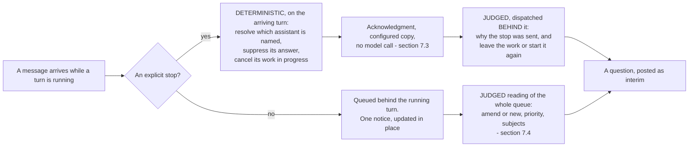

| Path | Trigger | Decides | Latency | Acts or asks |
|---|---|---|---|---|
| **Deterministic** | An explicit stop or redirect from the person | Nothing about intent. Only WHICH assistant is addressed | Stream hop, ~250 to 550ms | **Acts.** Suppresses the in-flight answer and cancels the work in progress |
| **Judged** | The queue, and every stop once the work is canceled | Why the person stopped, what relates to the work in flight, what becomes its own task, and in what order | ~1.5 to 4s, bounded in section 7 | **Asks.** Posts the proposal or a clarifying question |

The deterministic path is what "near-real-time control" means, and it must never wait on the judged one. A person who says stop has removed the ambiguity themselves; making them wait on a model call to have that honored is the design failing at the one moment it is most visible.

**A stop is deterministic in its effect and judged in its consequence.** Suppressing the turn and canceling the work in progress need no model call and get none, and completed work is never in the set they cancel. What the person wants to happen NEXT is unanswerable from the token `/stop`, so it is asked rather than assumed, and their answer is read against that question before any routing - ordinary routing classifies "drop it" as whatever it sounds like (ADR-033, "The question owns its follow-up").

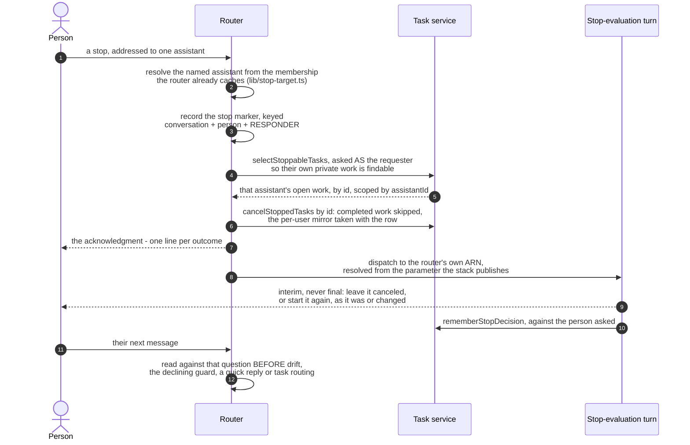

**Deterministic does not mean untargeted.** Which assistant a stop is aimed at is a lookup over membership rather than a judgment, so it stays on the fast path: a room can hold several assistants and stopping all of them destroys work nobody asked to lose. `assistantId` is what the cancellation selection is scoped by, because it is stable where the owner is not. An addressed stop names its assistant, a one-assistant room means that one, and an unaddressed stop in a room with several is asked about with nothing stopped. In a MENTIONS-mode room that ask branch is defensive rather than common: Amazon Chime SDK carries an unaddressed message to no assistant there, so the deliverable form is a mention around the command. ADR-033 records both, and records that the full parallel-assistants stop story - flow delivery of a bare stop, cross-assistant coordination - is a later phase.

The judged path asks rather than acts because the ambiguity is real and unresolvable from the text: a person who says "actually, what was Q3 headcount?" mid-report may have amended nothing and may have abandoned the report, and guessing wastes their time in both directions. ADR-033 already settles this as pause-and-ask.

**Both require triage to trigger on message ARRIVAL** (`lib/triage-on-arrival.ts`). Triage in the processor's `finally` begins only when the turn ends, and asks its question about a report that has already finished. An interrupt evaluated after the work completes is not an interrupt, and moving triage to a stream consumer without changing that trigger relocates the problem rather than fixing it.

### 1.3 Delay comes off the critical path, and what stays is named

ADR-033 tenet 1 puts the claim where a turn is committed, so the common path is one conditional write. Everything the queue subsequently needs is work nobody is synchronously waiting on and moves to post-processing: reading the queued messages, triage, task creation, prioritization, and the decision about work in flight. What legitimately stays on a person's path is the acknowledgment and the proposal, both budgeted in section 7. The commitment is not "no delay" but that **every step on a waiting path has a number, and a step without one is not approved.**

### 1.4 What the person sees is a fact, not an inference

Queued messages do not map one-to-one onto answers: three may be answered by one reply or by two. ADR-033 resolves this by making the affordance track a fact the platform records, that a message has been *triaged*, rather than an attribution it would have to infer. Task creation is therefore what clears a queued message, which is another reason it belongs where the record is written rather than strung across call sites.

### 1.5 The client cannot be the mechanism, and that is what this design is for

Everything here could be faked in the web client - disable the send box, gray out the composer, hold the text locally and release it when the reply lands. A morning's work, and the wrong design, for two reasons.

**A channel with no client to manage.** On SMS there is no composer to disable, no waiting state to render and nothing to hold text in: a person sends three texts in twenty seconds because that is how texting works, and they arrive whatever the assistant is doing. Email is the same, and so is any integration that posts on somebody else's behalf. A rule enforced by a client is not enforced on any channel that has no client, so the queue, the lock and the reading of what arrived live where every channel meets the same answer, which is the server. It is also why the deferral notice is a MESSAGE rather than a UI state: a message reaches whoever is holding the conversation, on whatever they are holding it in.

**More than one person, talking at once.** Several people share a room with the same assistant, and two of them typing at nearly the same moment is ordinary rather than a race worth engineering around. No client can serialize that, because no client can see the other person's keystrokes - only the record can. It also changes what the queue MEANS: one person's three messages are a train of thought, two people's are requests that collided, and the distinctions below exist because of the second case.

| The rule | What multi-user makes of it |
|---|---|
| Targeting travels per message (2.4.1) | a private request from one person must not be merged with a public one from another, and one person's answer may not dispose of another's message |
| The offer is recorded against the person it was put to (2.4.2) | a split is the requester's decision, so a third party answering it disposes of work they may not be able to see |
| The lock is keyed on (conversation, assistant) | busy is a property of the assistant, not of the room, so two assistants can work at once while neither answers twice |

A single-user reading of any of these looks like over-engineering, and stops looking like that the moment two people are in the room.

---

## 2. Where each step runs

**Claiming the conversation is on the response path and stays one write. Everything the queue then needs is not, and moves off it.**

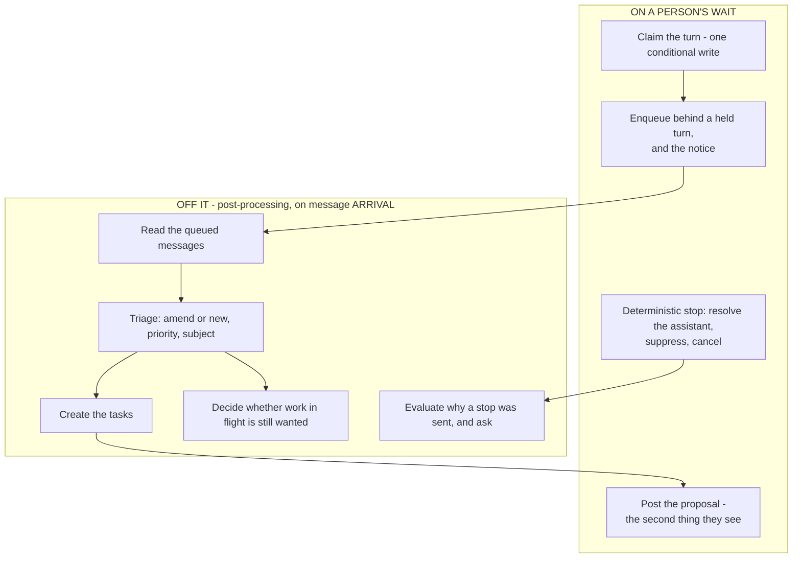

The processor's `finally` does not triage. Two owners of "who reads the queue" produce a message triaged twice - work somebody closes by hand - and a queue cleared by whichever ran second, losing what the first had not finished with.

### 2.0 The whole flow, end to end

The components here do not talk to each other: every one of them reads and writes one DynamoDB row, and every handoff between them is a conditional write on a field of it. A diagram of messages passing between boxes hides that, and a defect in this design is almost always a field written by the wrong party, read at the wrong moment, or never cleared.

#### The record, which is the whole of the shared state

One row per channel and responder, keyed `turn#{channelArn}#{responderId}`. Nothing else is shared: no component here holds state of its own between invocations.

| Field | What it means | Set by | Cleared by |
|---|---|---|---|
| `holder` / `holderAt` | A turn is EXECUTING and holds the conversation. This is what "busy" is derived from; there is no `busy` field | the router claiming a turn, or a handover | `releaseLock`, only by the holder |
| `holderMessageId` | The message the running turn is answering, so a reading can say what the work in flight IS instead of "the work already in progress" | the processor, after the claim, from a content match bounded by the instant the turn started; a turn with only later copies of its text writes nothing (SPEC-TURN-QUEUE AR11) | `claimTurn`, which removes it so a fresh claim carries no id from the turn before it |
| `queued` | Message ids held behind the running turn, in arrival order | the router enqueuing | `clearQueue`, by the turn that read them |
| `noticeId` | The one visible "waiting" message, updated in place rather than reposted | the router, conditional on `attribute_not_exists` so only the first send creates it | `clearQueue` |
| `triagedBy` / `triageAt` | A reading has CLAIMED this queue. Prevents a second reading, and is how the handover recognizes a reading that is ending | arrival triage, or a handover starting its own reading | `clearQueue`, or `releaseTriage` |
| `queueStatus` | The drain stage a person is shown (section 2.6), written by a conditional advance that refuses an illegal predecessor | each stage of the drain | `clearQueue` |
| `drainTaskId` | The task this drain IS (section 2.6). Claimed by conditional write, so of several readings racing to open one drain exactly one creates the row and the rest are told which row it is | the first message to queue | `clearQueue`, **and only when the queue empties** - a remainder is the same queue still being worked |
| `amendments` | Ids the reading judged to AMEND the running work, waiting for that turn to fold them | the reading | the fold, or `returnAmendmentsToQueue` at the handover the rescue rule below names |
| `pendingSplit` / `awaitingPerson` | A split was offered and to whom; the offer is outstanding | the reading, when the queue spans subjects | the answer to the offer |
| `stoppedAt` | The person stopped this turn; the drain must not do further work on their behalf | a stop, on the fast path | the next turn |

#### The four identities, which are not one identity

Confusing any two of these is the shape every queue defect here has taken, so they are stated before the flow rather than after it.

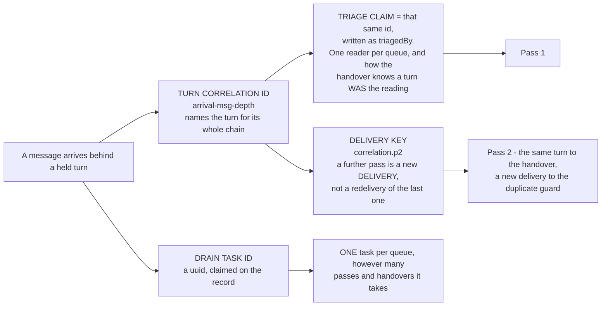

| Identity | What breaks if it is shared |
|---|---|
| **Turn correlation id** | Give a further pass a fresh one and the handover stops recognizing it, hands the conversation to a turn that has ended, and nothing releases it |
| **Delivery key** | Key it on the correlation id and every re-read is dropped as a duplicate, so a queue that moved is never re-read |
| **Triage claim** | Two readings drain one queue and the second clears what the first had not finished |
| **Drain task id** | Derive it from the correlation id and it changes per pass, which is the delivery key's whole purpose, and one queue draws a task per pass |

A correlation id also travels in the placeholder marker, so it is bounded at 64 characters. Over that, the mapping is never written and the turn pays a poll and a billed channel scan to find its own placeholder.

#### The flow, with every write shown

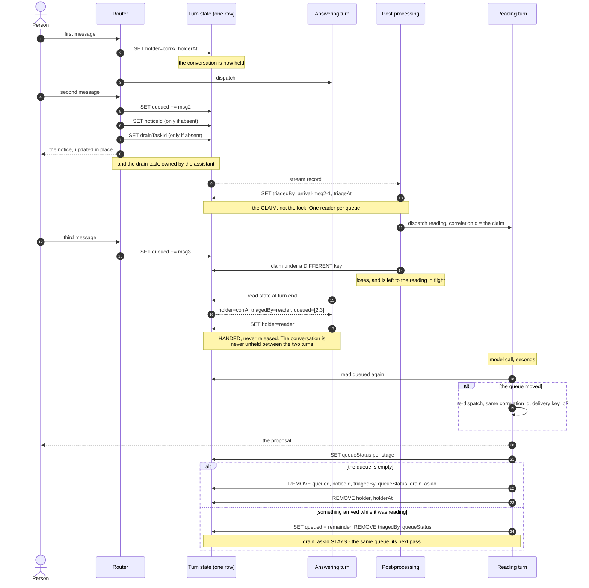

Four properties of that picture are the design rather than incidental to it.

- **The reading OVERLAPS the answer**, because an amendment can only be folded into work that is still running. When the answer is ready before the reading has recorded its follow-ups, the answer parks and the reading resumes it, so an answer is not delivered past follow-ups the reading is still deciding about (ADR-033, "Follow-ups are rolled into the answer before it is sent").
- **Concurrency is bounded by the CLAIM rather than the lock**, so a second arrival does not start a second reading.
- **The answering turn HANDS the lock over rather than releasing it.** The gap a release would open is one an arriving message would claim, producing exactly the second answer the lock exists to prevent.
- **The clear is ASYMMETRIC.** A pass ends at either branch, so the claim and the stage reset at both, but the DRAIN ends only when the queue does. That is the whole of "one drain per queue, not per pass", and the two branches differ by a single attribute, which makes it the thing an ordinary refactor flattens - so `one-drain-per-queue-not-per-pass.test.ts` asserts that the remainder branch really is the remainder branch rather than merely that no id was written.

#### Which handover returns an amendment

The rescue is gated on whether anything is STILL ANSWERING, read from the record as `busy`, which is `!!holder` - and a triage turn never claims the lock.

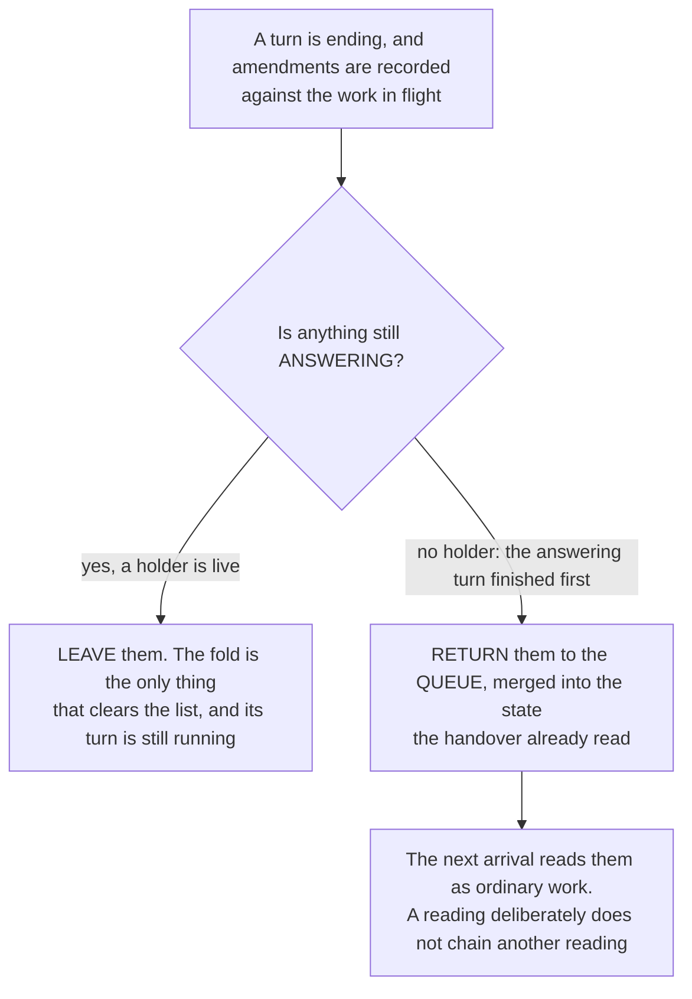

Both of the obvious rules are wrong in one direction each. *Every turn rescues:* the reading is shorter by design, so it usually finishes first and would return the amendment it had just recorded, leaving the answering turn to read an empty list and deliver unamended - the feature defeated on its normal path, with a log line claiming a rescue. *No reading rescues:* that assumes the reading always finishes first, and when the answering turn finishes first the amendment is recorded for a turn that has already ended, with the queue empty so no drain looks and the lock released so nothing folds. Observed live: the answer at 11:49:26, the reading's proposal at 11:49:32, and a record holding two amendment ids with an empty queue and no holder, while the proposal had told the person it would answer both. Merging the returned ids into the state the handover already read is required, or the release-on-an-empty-queue branch strands them a second time by the very thing meant to catch them. *Guarded by* `backend/test/lib/an-amendment-outlives-the-turn-that-ended-first.test.ts`, which pins both directions.

Returning them puts the work back in the queue rather than answering it immediately, because a reading that chains another reading consumes a queue piecemeal and stops the split offer being made at all. The proposal's copy says the work starts "now", and that mismatch is open (section 9).

#### Where a failure will have stopped, and what says so

Every transition above logs, and the log line is the instrument: a queue that did not empty stopped at exactly one of these, and the line that is missing says which.

| The last line you see | What had happened | What did not |
|---|---|---|
| `a reading holds the queue; handing it the conversation` | the answering turn ended and handed the lock to a reading | the reading has not produced yet |
| `the queue moved under the reading; reading it again` | the re-read fired | the next pass may still be dropped - check for `Duplicate invocation` next |
| `Duplicate invocation, skipping` | a delivery was treated as a redelivery | if it names a triage pass, the delivery key is wrong |
| `No placeholder mapping yet; deferring to a scan` | the marker was never readable | the correlation id is over 64 characters |
| `this turn was the reading; releasing now that it is done` with `stillQueued > 0` | the reading released | it did NOT clear the queue - this is the stranding signature |
| `nothing queued behind this turn; releasing normally` | the ordinary exit | nothing is wrong |
| `an amendment outlived the work it amended` | the fold was missed and the amendment went back on the queue | it was not folded into the answer |
| `could not show the queue stage` | a stage advance was refused by its own condition | the drain continues; the stage is lost |

**What is NOT instrumented, and should be.** There is no line for the ordinary claim or enqueue, so "the message was never queued" and "the message was queued and then lost" look identical from the log alone and have to be told apart by reading the record. That gap is what makes a defect here take a live trace to find rather than a search.

**What the ledger records, separately from the log.** A deferral notice carries the id of the message it acknowledges, and that lands in `turn_events.acknowledges`. It is the only key a deferral has: the notice declares no turn, because it carries no correlation marker, and it is one message updated in place, so without the id a burst of queued sends collapses into a single instant. A `notice_posted` row with a NULL `acknowledges` therefore means that person's wait is unmeasurable rather than fast, and `v_queue_acknowledgement` has no row for them.

### 2.1 Why post-processing rather than a new component

`post-processing-stack.ts` is already a Kinesis consumer over the message stream, already holds `TASKS_TABLE` and a `dynamodb:GetItem` grant on `agentTasksArn`, already treats a task as the authority for which assistant owns work, and already dispatches turns through the routers. Triage is that component's existing shape applied to a new rule (tenet D8).

### 2.2 The batching window is zero, and that is not a preference

The dispatch consumer sets **no batching window**, and the reason is recorded on the event source: with the archival consumer's 5-second window copied onto it, the cost was measured live at **3.0s and 3.4s from message to dispatch, essentially all of it the window**. With no window, a comparable dispatch-off-stream deployment measures **~200 to 500ms end to end** for exactly this shape, where a stream record triggers a whole model turn. Triage inherits those settings, so any change that adds a window adds it directly to a waiting person.

### 2.3 What the triage turn is told, and what it may do

**It is a bounded loop over the WHOLE queue, with a scoped tool surface and a declared output contract.** Not a single classification call, which cannot look anything up, and not an open agent, which can execute the work it was only asked to read.

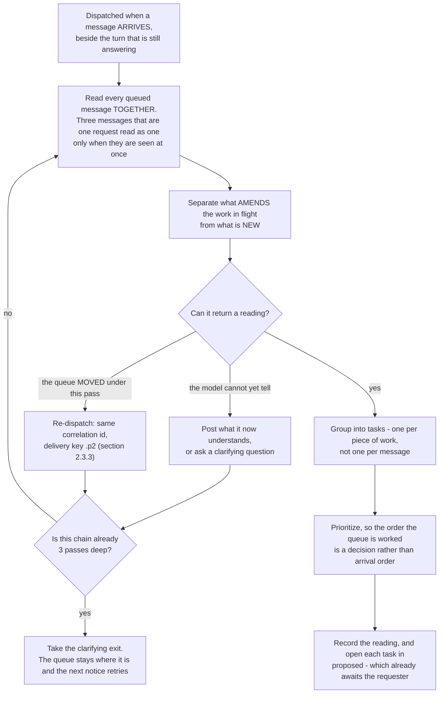

Another loop is what makes this a loop rather than a pass, and the two reasons for one are not the same reason. A reading assembled from a queue the assistant only partly understands is worse than a slower one, because the person corrects it by hand. A reading of a queue that has since changed is not a reading of the queue at all, and section 2.3.3 is why that case is routine rather than exceptional.

**ONE bound, and it counts passes.** An unbounded loop on a path a person is waiting on is a latency defect wearing an intelligence costume, so `TRIAGE_MAX_PASSES` is three and `mayTakeAnotherPass` asks how deep the chain already is - a question answerable identically before a turn runs and after it answers. On exhausting it the loop takes the clarifying exit rather than returning its best guess: late is recoverable, and a half-understood reading that has already created tasks is not.

**A wall clock is the bound that cannot work here, and it is worth stating so nobody re-adds one.** Six seconds measured from the first dispatch was tried, and it bound always rather than first: every check of it happens after a model call has answered, and a model call is longer than six seconds, so the option was granted before the turn ran and refused the moment it came back. A reply that took the offer carried no reading, which read as an unusable answer and dropped the whole queue to the derived floor - the person waited LESS and got WORSE, and was never told why. The impatience it guards against is real and answered better by the notice, the stage machine and a placeholder updated in place: **a deadline on this path should change what is SAID, never whether the reading may continue.** Nor is spend what it bounded, so nothing here loosens a cost control - the pass count IS the spend bound for one drain, at most three model calls, with the per-user and global hourly Bedrock budgets in `abuse-controls.ts` as the backstop. Elapsed time never counted a call.

#### The tool surface is scoped, not absent

The turn is dispatched through the router like any other, so it inherits the deployment's persona, the reply-language instruction and the placeholder the person sees. What it may reach is deliberately narrower than what an answering turn may reach:

| Available to triage | Not available to triage |
|---|---|
| Read the queued messages and the work in flight | Advance or complete a task |
| Read the conversation's own recent history | Generate or upload a document |
| Read the task list it is triaging against | Post an answer to any queued message |
| Ask the person a clarifying question | Any tool with a side effect outside this conversation |
| **Record its reading** (`record_reading`) - the output contract, not a capability | Decide what happens next: tasks, the proposal, the clear and the notice are platform machinery |

**The guard is what the tools ARE, never a sentence in the prompt.** "Do not answer any of them yet" is the weakest possible instruction while the model holds tools that advance a task, fetch company context or generate a document, and through the tool surface the execution arrives *before* the reply exists, so no amount of parsing the reply catches it. Both dispatch sites - the external-provider path and the default Bedrock path - constrain a triage turn to the read-only set above. Removing tools altogether satisfies the same guard and also removes the loop, which is the part the design needs most.

#### The output contract

The JUDGEMENT is the model's and has to be: whether a message amends the work in flight, whether it can be understood at all, how it ranks against what is already open. None of that is mechanical. **The SELECTION that drives everything downstream is not left in prose.**

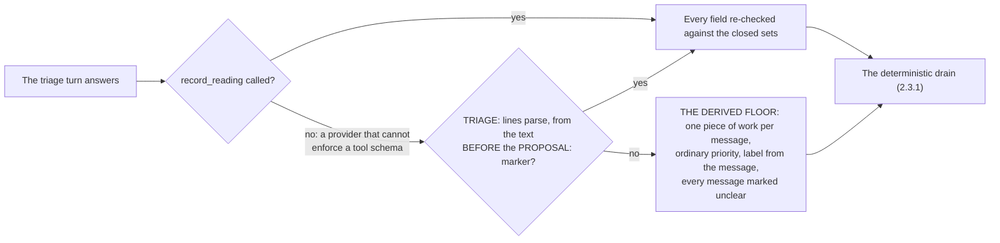

The reading is recorded by calling `record_reading`, whose fields are enums: the three intents, the three priorities, and the ids of THIS queue. What that makes impossible rather than merely detectable:

| | |
|---|---|
| An intent or priority outside the declared set | Not a value to reject - a value the model cannot express |
| A message id that was never queued | The ids ARE the enum, so a reading cannot classify a message that does not exist, or quietly rename one that does |
| A reply that is prose | A tool call is structure or it is not a tool call |

**A text contract alone was measured failing.** A triage turn is dispatched as an ordinary turn, so it runs the profile's persona and answers in prose: "zero `TRIAGE:` lines, no `PROPOSAL:` marker, and not even the `ANOTHER_PASS:` escape hatch". The decision was constrained; the channel carrying it was not, which is what the derived floor exists to survive.

**The two outer tiers need no cooperation from the model.** The tool is preferred whenever the reading arrives through it; the text contract is the fallback for a provider that cannot enforce a tool schema; the derived floor runs when neither yields a usable reading. Only the middle tier depends on the model following a format. **Every field is re-checked on both channels**, because a schema is a request to the provider rather than a guarantee from it, and this is the value that decides what happens to somebody's message.

**The reading tool is not behind the per-profile tool allowlist.** Every other tool there is a capability a deployment grants or withholds; this one is the platform's own output contract. Behind the allowlist, an assistant could be configured into a state where it can be asked to read a queue and has no way to answer, and the symptom would be a drain silently falling to the derived floor on every turn. It is side-effect free, which is what keeps it inside the read-only guard: it records a decision, it does not act on one.

**Offering the tool without saying so is worse than not offering it.** Measured the first time it shipped: `toolCalled: false` on every turn, because the tool was registered while the directive still described the line format, so the model had two contracts for one answer and followed the prompt - which is the correct thing for it to do. The directive names the channel, and the RULES are identical either way; only how the answer travels differs.

**Every literal in the contract belongs to the channel that parses it.** `TRIAGE:`, `TOPIC:`, `PROPOSAL:`, `ANOTHER_PASS:` and `IN_FLIGHT_UNCLEAR` are asked for only on the text channel. On the tool channel the reading is recorded by the call and nothing parses the model's text, so a literal asked for there is a runtime marker the model is told to write into a paragraph the same directive has already said is entirely for the person - and given both, it writes both, with the marker as the first thing a person reads. Nothing is lost by gating them: `in_flight_unclear` is a field on the call, the another-pass escape hatch is stated once by the system directive, and the spoken half is still asked for.

**And the spoken half is stripped, however a marker is dressed.** `spokenFromReply` removes any line that is one of the runtime markers, markdown forms included: `**PROPOSAL:**`, `## PROPOSAL:`, `> PROPOSAL:` and a backticked `PROPOSAL:` all go. A decorated marker is removed only when the ENTIRE line is the token, so a heading with content after it - "**Proposal:** ship on Friday" - is the assistant speaking and survives whole, because eating the assistant's own sentence costs a person more than the marker it would catch. Matching these tokens is matching what the platform wrote into its own prompt rather than what anybody said, which is the pattern tenet D11 keeps for a `<!--corr:-->` marker or an ARN.

Two properties remain load-bearing for the fallback. **The decision is read from declared markers, never inferred from prose:** a line that does not match `TRIAGE:` is not a decision, every field is checked against a closed set, and a reply that does not account for every queued message yields nothing at all. And **`PROPOSAL:` is a security boundary on the TEXT channel**, not a formatting convention: the machine lines are parsed only from the text *before* the marker, so a proposal that quotes a person's message back - "you asked me to TRIAGE: ..." - cannot contribute a line to the decision. On the tool channel that boundary is structural, because tool arguments are a separate channel from the prose.

What follows the reading is ordinary platform machinery rather than anything the model drives: the tasks are created at the priority the reading assigned, the proposal is posted as `interim` (a question, not an answer), the queue is cleared by the turn that read it, and the deferral notice is settled. Nothing is executed - a `queued_request` starts in `proposed`, which awaits the requester, so the confirmation is the state machine every other awaiting task already uses rather than a confirm step built beside it.

### 2.3.1 The drain is deterministic, the reading is judged, and both always run

**The queue is ALWAYS drained.** A model that fails to produce a usable reading does not get to leave messages sitting in it.

| Half | What it guarantees | What it must never do |
|---|---|---|
| Deterministic drain | every queued message becomes work, and the queue is emptied | depend on the model producing a parseable reply |
| Judged reading | the grouping, the priority, and what the assistant expects the outcome to be | be the thing that decides whether the queue empties |

This is stated as a rule because the opposite was built and it removed the feature: clearing the queue only when a reading parsed, on the reasoning that "a queue cleared with no proposal behind it is a set of requests that silently never happened". The reading was never usable, so the queue was never cleared, and the queued question was never answered at all. The rule written to prevent silent loss produced it.

When the judged reading is unusable, the drain runs against the derived floor. What the assistant captured and what it could not read are both said plainly, and the person is asked to confirm. A request never ends as a row in a queue nobody drains.

### 2.3.2 What the input guardrail screens, and what it deliberately does not

A triage turn is a model call like any other, so it passes the deployment's input guardrail. What it sends to that guardrail is not obvious, and getting it wrong disables the judged reading completely.

| Screened | Not screened | Why |
|---|---|---|
| the queued message contents, as the people wrote them, carried on the triage payload separately from the prompt | the triage contract that wraps them | the messages are the untrusted input, which is what a guardrail is for; the contract is the platform's own text, and screening it protects nobody while breaking the turn |

Screening the whole assembled prompt sends the guardrail a block of directives wrapped around quoted user text, which is the exact shape of a prompt-injection attempt: the prompt-attack filter fires on the platform's own scaffolding and blocks every triage turn BEFORE the model is called. The failure is silent in the worst way, because the drain is deterministic and falls back to the derived reading - so the queue still clears, tasks are still created, and the person still gets a message, while the grouping, prioritizing and amendment-detection this design is largely about never run once.

This narrows what is screened to what is actually untrusted rather than weakening it: no user-authored text stops being examined. The rule generalizes - **a guardrail is pointed at input the platform did not write** - and the same mistake is available anywhere a prompt is assembled before being screened.

### 2.3.3 The reading runs beside the work, so the queue moves under it

**The reading is dispatched when a message ARRIVES, not when the turn it is waiting behind ends.** That is what section 1.2 is built on: an amendment can only be folded into work that is still running, so a reading that waits for the turn to finish has nothing left to amend by the time it looks. When the answering turn ends it does not start a second reading: it hands the lock to whichever reading holds the claim, and reads the queue itself only when nothing does.

**A reading therefore sees the queue as of its own dispatch, and a burst is not one dispatch.** With no batching window (2.2) the first message of a burst is dispatched in ~200 to 500ms while a model call takes seconds, so the second and third routinely arrive after the reading has started. Reading the whole queue together is what the design asks for and parallel dispatch cannot deliver on its own; the re-read is what reconciles the two, which makes it load-bearing rather than an optimization. Without it the design degrades to reading the first message of a burst and leaving the rest queued behind a notice it cannot honestly settle.

**A re-dispatched pass is a new turn and needs its own identity.** The processor claims a correlation id to make an at-least-once delivery idempotent, so a pass dispatched under the id of the pass that spawned it is indistinguishable from a redelivery and is dropped - nothing then clears the queue, and the conversation is released still holding it. A pass therefore carries `<correlation>.p<n>` as its DELIVERY key while keeping the correlation id itself, because the handover recognizes a reading by that id and a fresh one would hand the conversation to a turn that had ended. *Verified by* `a-further-pass-is-not-a-redelivery.test.ts` and `the-queue-is-read-again-when-it-moves.test.ts`.

---

## 2.4 A targeted request is answered targeted, always

**An assistant replies to a targeted or private request with a targeted or private response.** Privacy is a property of the REQUEST, and it propagates to everything that request produces. A private question answered into the room is the leak, even when the task row was marked private correctly.

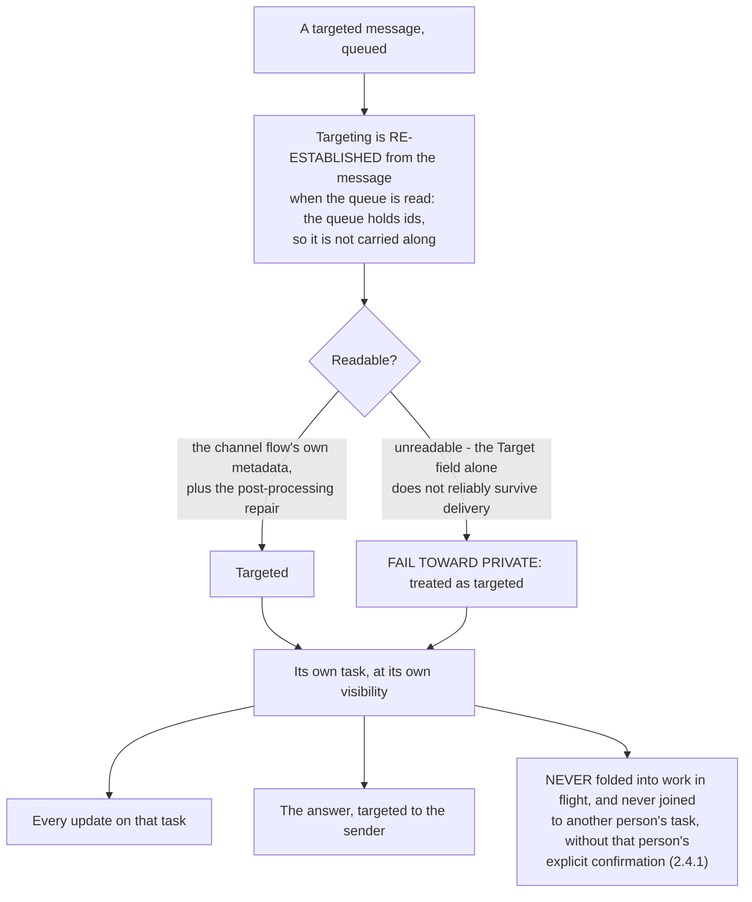

Being wrong in the direction of "not targeted" publishes a private request, and there is no recovering it once it is in the room. Being wrong in the other direction shows a member less than they could have seen, which they can ask about.

**The deferral notice is the deliberate exception and does not contradict this.** It is posted untargeted so that other members understand the assistant is occupied rather than broken, and it carries no detail of what is waiting - not the request, not its excerpt, not who it belongs to. It says that something is waiting and nothing about what.

### 2.4.0 A targeted request is COUNTED in the room, never described there

The proposal a person reads is posted UNTARGETED, and every word of it is read by every member. That makes the LABEL of a targeted request a disclosure rather than a courtesy: a label is a short description of what somebody asked for privately, and on the derived reading it is the opening of their message copied verbatim.

So the room gets a COUNT. That the queue held private requests is not itself private, since the deferral notice already says how many messages are waiting; whose they are and what they are about is. The requests themselves are put to the people who sent them, one message each. Three consequences, each a way to get this wrong:

- **A targeted item is dropped from the list, not redacted in place.** A redaction sitting in an ordered list still says where in the order it fell.
- **The reading's own paragraph is refused when the batch was mixed.** The model is shown every queued message and nothing in its contract tells it which the room may not see, so its prose is free to narrate a private request into a message it cannot know is public. The composed list, built from the untargeted items alone, is used instead. Its voice is worth a lot and not that.
- **The private half is driven by the ITEMS, not by the subjects.** A derived reading names no subjects, and it is the reading that runs whenever the judged one is refused, so keying the private half on subjects means the commonest path tells the room everything and the sender nothing.

### 2.4.0a ONE thing shows progress, and the proposal lands at the END

Owner's rule: one placeholder, updated as each new message arrives, until the lock is released - then a final response that falls at the end of the conversation.

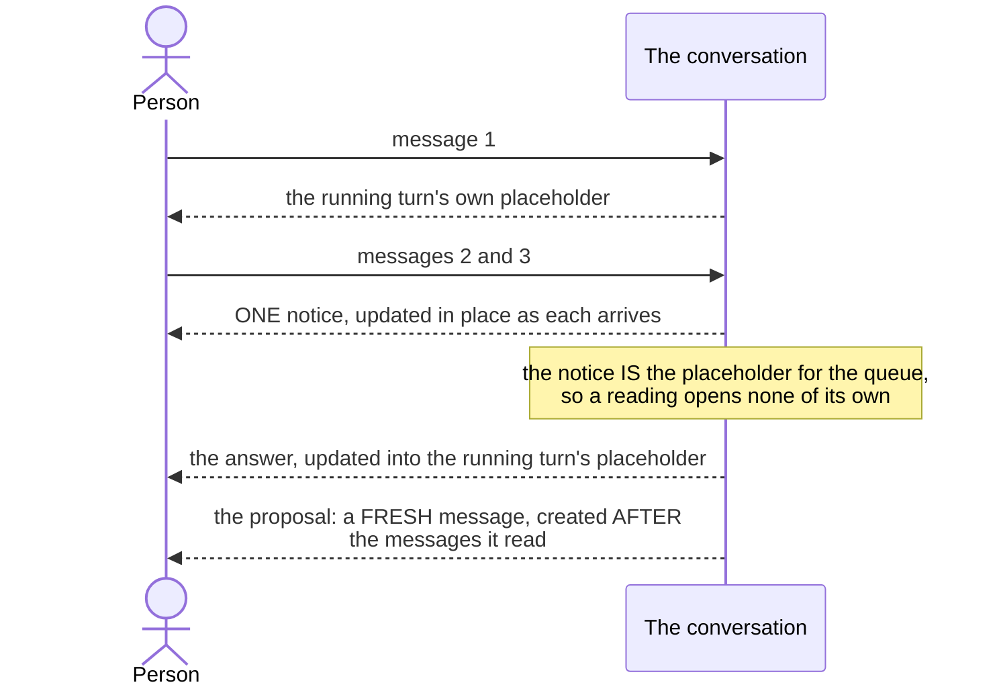

A queue already draws a notice, and that notice IS the placeholder a person watches fill up as they keep typing. A reading turn that opens a second "One moment..." beside it shows two working indicators for one piece of work, reported by the owner as "why so many placeholders". So a reading opens nothing: the router returns silence for a self-dispatched reading exactly as it already does for the turn that posted the notice, and the processor sends a fresh message when it has the proposal.

**The fresh message is the half that matters, and the obvious shortcut is the one thing that must not be done.** Handing the reading the notice to answer onto removes the second bubble and introduces a worse defect: Amazon Chime SDK orders by creation time and an update does not move a message, so the proposal would appear at the notice's position - created when the queue FORMED, before the later messages the proposal is about. A finished answer above the question that produced it is precisely the defect [ADR-029](../../../design/decisions/029-clarification-is-public-and-answers-get-their-own-placeholder.md) exists for, and `router-agent-handler.ts` says so at `placeholderMessageId`: *"Do not add a caller."* *Guarded by* `backend/test/lib/a-reading-opens-no-placeholder-of-its-own.test.ts`, which also asserts that the trap stays shut and `placeholderMessageId` keeps having no producer.

### 2.4.1 Targeted and untargeted queued messages are not combined without consent

**A queued targeted message and a queued untargeted message may not become one task, or one action, unless the person who sent the targeted one confirms it.** Triage reads the queue as a whole, which is the point of reading it at all, and it may say that two messages look like one request. It may not merge them across the targeting boundary on its own authority.

Merging is how a private request becomes visible without anyone deciding it should, and it happens quietly in two places:

| Where | What it does | Why it leaks |
|---|---|---|
| An `amends` reading | folds the message into the work already in flight instead of opening its own task | a targeted message folded into untargeted work is now part of something the room can see |
| One visibility per batch | every task from one reading inherits a single visibility, computed as "private if ANY queued message was targeted" | per-message targeting does not survive the dispatch, so the distinction is gone before any task is written |

Asking is the cheap half and the machinery already exists: a `queued_request` starts in `proposed`, which awaits the requester, so a proposed combination is a question like any other. Combining is the half that must not happen by default.

### 2.4.2 A queue that spans topics is said out loud, and splitting it is the person's choice

**When the reading of a queue covers more than one topic, the assistant says so, and offers to continue each topic in its own conversation. Which topics move, if any, is the person's decision.**

The queue makes this common rather than rare: a person who keeps typing while an assistant is busy is usually adding the next thing, and the thing after that. It matters because a conversation is the unit of grounding - everything in the room is context for every later answer, so three unrelated topics in one conversation make each subsequent answer worse. Retrieval pulls from all of it, the summary describes none of it, and the assistant carries an argument about a billing question into a question about a deployment.

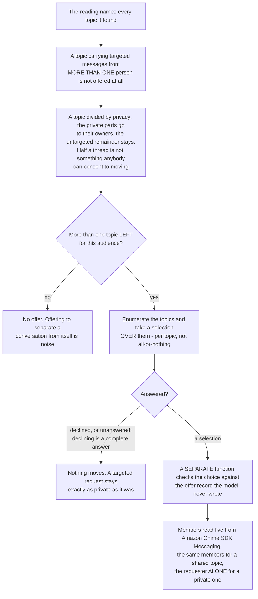

**Deterministic, judged and confirmed, in the same division 2.3.1 sets for the drain.**

| Half | What it covers | Why it is that half |
|---|---|---|
| Deterministic | the offer is made whenever the reading names more than one topic, and it always names every topic it found | an offer a reading may decline to make is an offer a person never learns exists, and the case it skips is the crowded queue that needed it most |
| Judged | what the topics ARE, and which messages belong to which | there is no mechanical test for two requests being about the same thing, and a wrong grouping costs a person one correction rather than a lost message |
| Confirmed | whether anything moves, and which topics move | a person asked "shall I split this?" who answers "yes" has not said which parts they wanted apart |

This is the consent machinery of 2.4.1 rather than a second one: a proposed split is a `queued_request` in `proposed`, awaiting the person who would be affected, exactly as a proposed combination is. **The reading may propose how the queue is organized, and may not reorganize it on its own authority.**

**Creating the conversation is not done by the assistant's own turn.** `chime:CreateChannel` cannot be tag-scoped the way the assistant's other rights are, because the tag that would gate it does not exist until the channel does. Granting it to the component that runs model output would mean a reply that talks its way past the contract can open rooms, so the request goes to a separate function that checks it against the offer record: no offer means no conversation, a label nobody offered means no conversation, and an offer put to somebody else is not visible to the call at all.

**Membership is read live, and an unreadable membership carries NOBODY.** It is Amazon Chime SDK-owned state and a copy can be stale in the direction that matters, which is a person who joined since. A conversation missing people is a visible problem somebody reports; one holding a person who should not be there is a disclosure nobody sees. Which audience a spawned conversation holds is the one rule with two opposite answers:

| The topic | Who the spawned conversation holds | Why the other rule would be wrong |
|---|---|---|
| ordinary, the room could already read it | the SAME members as the conversation it came from | carrying only the person who answered makes a shared thread vanish for everyone else, which is worse than not splitting at all |
| private, it exists because somebody sent a targeted message | its requester, and nobody else | carrying the room publishes the request by the act of moving it, which is the leak 2.4 exists to prevent |

A split may narrow who sees something and never widen it, so where a proposed split would widen it the proposal is not made.

**The order is part of the rule: shared in the open, then each person privately.**

1. **The shared topics are addressed in the room, and acted on.** They do not wait on anybody's private answer. A room whose common work is blocked while one person confirms something the others cannot see is a room where nothing visible is happening for no visible reason.
2. **Then each person is written to separately about their own targeted requests.** One message per person covering everything of theirs, addressed to them alone. Three notifications for one turn is how a private channel becomes something people mute.
3. **While that happens the public notice carries a generic line**, such as "addressing private requests". Silence reads as a stalled turn, and detail would defeat the point of the message being private at all.

**Two people's targeted messages on one topic are two requests, not one.** A message has exactly one sender, so a topic holding targeted messages from two people is two private requests that happen to be about the same thing. Merging them would put two people's private requests into one room on the authority of whichever answered first; dropping the topic would silently lose both.

**It is on by default wherever drift and the queue both are, rather than a third switch.** Drift is what spawns a conversation from a parent one, so a deployment running drift has already accepted that grant and the split function is wired alongside it; the queue is what produces a reading covering several subjects at all. A separate opt-in would add a switch nobody turns on for a behavior both halves already imply. The queue half is read from the environment rather than fixed at synth, for the same reason `turnQueueWiring` gives about its own grant: turning the queue on is a configuration change to a deployed function, not a redeploy. What stays refused is a HALF-WIRED deployment: naming the subjects costs nothing and happens regardless, but OFFERING to move them waits until something can move them, because an option the runtime would then refuse leaves a person answering a question nobody can act on.

### 2.5 Every combination, and what the assistant does

The rules above are stated one at a time, which makes it easy to satisfy each and still get a combination wrong. This is the whole surface. Throughout: **1:1** is one person and one assistant, **group** is more than one person; **targeted** is addressed to specific members and unreadable by the rest, **broadcast** is readable by the room.

While the assistant is IDLE nothing is queued and there is nothing to reconcile, so the only question is where the answer goes: a broadcast message is answered in the room, and a targeted one is answered targeted to the sender with its task private (2.4.1). In a 1:1 the targeting distinction changes nothing a person can see, and is preserved anyway so it survives the room gaining a second member.

While the assistant is WORKING:

| Conversation | Message | Content | What happens |
|---|---|---|---|
| any | any | **interrupt** (a stop) | acted on IMMEDIATELY, never queued. The work in flight is suppressed and the queue is NOT collateral: what arrived while it ran is still read. A stop is a decision about work in progress, so evaluating it after that work finishes would not be an interrupt at all |
| 1:1 | broadcast | related to the work in flight | queued, then read as `amends`: it changes what is already running rather than opening new work |
| 1:1 | broadcast | new subject | queued, then read as `new`: its own task, its own priority |
| 1:1 | broadcast | off topic | queued and read as `new`. Off topic is not a category the assistant judges: a person is entitled to change the subject, and the only consequence is that the reading finds a second subject |
| 1:1 | targeted | any | as above, and the reply is targeted; the task is private |
| group | broadcast | related to work in flight | queued, read as `amends`. The amendment is the room's, whoever sent it |
| group | broadcast | new or off topic | queued, read as `new`, and it becomes a second subject the reading can name |
| group | targeted | any | queued, and it becomes a PRIVATE subject belonging to its sender. It is never merged with an untargeted message without that person's consent (2.4.1), never described in the room, and is taken up with them directly |
| group | targeted, from two people, same subject | any | TWO private requests, not one |

**Interrupt is listed as a content kind because it behaves like one**, and it is the only kind acted on before the queue is read at all. What the reading then does with more than one subject is 2.4.2's pipeline.

### 2.6 Clearing the queue, step by step

The drain is a declared state machine in the same form and validated by the same validator as every task machine in this codebase (`queue_drain` in `backend/lambda/src/lib/task-state-machines.ts`), and the edges are what the conditional write conditions on. Working a queue is a workflow with states, legal moves between them, and a point at which it is over, which is exactly what that framework already describes - a second vocabulary for it would be a second thing to learn and a second validator to keep honest.

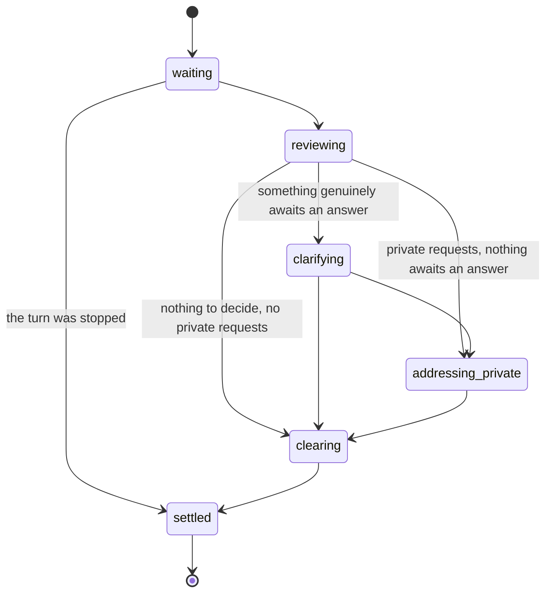

| Stage | What it means, and what the assistant does |
|---|---|
| `waiting` | Held, and nothing has looked at it. The assistant finishes the turn it is already on. The person is told their message is waiting, and how many are |
| `reviewing` | The reading is running. It reads every queued message TOGETHER and decides for each whether it amends the work in flight or asks for something new, how urgent it is, and which subject it belongs to. It does not begin, continue or describe the work any of them ask for |
| `clarifying` | The reading has been put to the room and is waiting on an answer. **Entered only when something genuinely awaits one**: a split was offered, the reading could not tell whether the work in flight is still wanted, or a task could not be created and somebody has to resend |
| `addressing_private` | Targeted requests are being taken up one to one, one message per person covering everything of theirs. The public line says only that private requests are being handled |
| `clearing` | The work exists; the holding pen is emptied of exactly the messages the reading read. A message that arrived since stays queued rather than being cleared unread, and because it stays, the reading takes another pass at it (2.3.3) |
| `settled` | Nothing is waiting. The notice settles to zero, which is what tells every client the waiting styling can go, and the lock is released - or HANDED to the turn that will read what arrived during all of this |

**Targeted requests with nothing to decide still show their stage.** Targeted requests are not in the `clarifying` list, and they are what drives `addressing_private`, so `addressing_private` declares `reviewing` as a second predecessor. A drain carrying targeted requests and nothing to decide advances `reviewing` to `addressing_private` to `clearing`, and the client's progress and arrival triage both see the stage. *Verified by:* `backend/test/lib/the-queue-says-what-it-is-doing.test.ts` ("the private half is reachable however the reading went").

**Declared edges rather than an ordering**, and the difference is not cosmetic. An ordering says only "later than", which waves through a drain that jumps from `waiting` straight to `settled`. The edges say which moves exist: `clarifying` is reachable only from a reading, because nothing can be put to somebody about a queue nobody has read, and `clearing` only from a reading or a conversation, because clearing a queue that was never read discards it unanswered. The one jump that IS legal, `waiting` to `settled`, is the stopped turn, and declaring it keeps it distinguishable from the ones that are not.

**The stages only ever move forward**, because the private half and the clear are driven by different awaits in the same turn. A late write of an earlier stage would show somebody "reviewing" after they had already been asked to confirm something, which reads as the turn having restarted.

#### The drain IS a task, and what that buys

| What a task carries | What the drain does with it |
|---|---|
| An owner | the assistant. A drain never waits on a person: it asks, records the work, and clears on the assistant's own timescale, because a queue that lives until somebody answers lives too long - and every message still in it is somebody else's wait too |
| An identity | opened when the queue forms, its id claimed on the shared record, so a burst opens one drain and a handover chain advances one task rather than one per link |
| An ending | it closes exactly when the queue empties, at the same point and on the same condition as the notice settles. The queue emptying, the notice settling and the drain closing are one fact said three ways - to the record, to the person, and to the system - so they are never gated on two different answers |
| Stall supervision, an operator stop, resolution timing | each of which the queue would otherwise grow a bespoke half of |

The question a drain raises is not dropped by not being held: each queued message that became work opens a `queued_request` in `proposed`, which DOES await the requester, so the follow-up is owned, visible in their list, and answered against the task it is actually about. An `awaits` on `clarifying` cannot be made coherent, because a drain that hands over is closed the moment the queue empties, which is the same turn - so it would be handed to somebody and taken back before they could see it.

**Closing it needs the STATUS, not only a terminal state.** `clearQueue` removing the drain's id while nothing closed the row left it alive to its 24-hour TTL, and an open drain is not inert: it is the NEWEST live task the assistant owns in that channel, and the router reads the newest, so it masked a chain genuinely blocked on a person and that person's reply stopped resuming their own work. Every query that decides what is live filters on status.

**A drain carries the message's ID, never its text.** A queued message may be targeted and the drain row is one the room can see, so an excerpt would publish a private request's words - the thing 2.4.0 exists to prevent. Content is resolved AS THE CALLER when something displays it, which is the rule the queue itself already follows and the reason `queued` holds ids. It is also the only honest choice: a drain covers a whole queue from possibly several people, so no single message's text describes it.

**The stage and the task state are ONE fact.** Two vocabularies means one of them freezes: a person reads the stage off the notice while the task sits in `waiting` for the drain's whole life, which reports every drain as never having started to the operator view and to the resolution timing that reads it. The RECORD still decides, because its conditional advance refuses a stage that cannot legally follow the stored one, which is what settles the genuine race between the private half and the clear; the task follows that decision rather than asking the machine a second time, since two independent answers to "did this stage happen" is precisely how the two records drift. The task is read once per drain and its state carried forward locally, since the ordering is already settled and a drain sits on the path somebody is waiting on (7.4).

The hand-back that returns an unmoved awaiting task to the person it awaits still matters - 56 tasks were found stranded on the deployment in exactly that condition, invisible in their own requesters' lists - but a drain does not depend on it, because a drain awaits nobody.

### 2.7 Public work: creating it, and changing it without surprising anybody

The matrix in 2.5 answers what happens to a MESSAGE. This answers what happens to a WORK ITEM, which outlives the message and is the thing other people are affected by.

#### Reaching the assistant

A room has exactly one assistant per classification: the flow resolves the responder from a single per-classification parameter (`resolvePrimaryBotArn`), so "which assistant" is not a question the product can currently be asked. Three ways to reach it, differing only in how the Amazon Chime SDK routes:

| How | What routes it | What the room sees |
|---|---|---|
| `@all` | Not an Amazon Chime SDK mention value, so AUTO would never route it. The channel flow detects it and hands the turn to the classification's handler. **The flow reads the member count to decide whether it owns the turn:** in a 1:1 AUTO routes everything, so the Lex entry already has the turn and the flow stands aside rather than producing a second answer; above a 1:1 AUTO routes nothing unaddressed, so the flow is the only entry and dispatches | The request and the answer both broadcast. The work item is conversation-visible |
| a mention | Amazon Chime SDK AUTO routes messages whose mentions name the bot. In a 1:1 AUTO routes everything, so no mention is needed; in a group only mentions route | The same. A mention is public unless the message was also targeted |
| an unaddressed command | **A command not addressed to a specific assistant goes to the primary one**, routed the same way `@all` is and for the same reason: AUTO routes nothing unaddressed in a room, so in a 1:1 the flow stands aside and AUTO's Lex entry handles it. The commands are declared in one registry (`CHAT_COMMANDS`, `lib/flow-bypass.ts`), so this is a rule rather than a per-command wiring exercise. A stop is matched as the whole message, so "stop the report and summarize it instead" is a redirect and stays on the judged path. `/battle` is in the registry too but declares its own handler, because a duel is not a turn the primary runs | Broadcast, and necessarily so: a stop halts the assistant for everybody, so a stop the room cannot see leaves people watching an assistant that stopped for no visible reason. A privately sent stop is refused rather than routed - it reaches both entries, the flow's copy stands down once it reads the stored message's `Target`, and the Lex entry refuses it with a reply that inherits the private targeting (`lib/private-command.ts`) |

**The trap worth stating.** Adding a second bot to a 1:1 flips that conversation from AUTO-routes-everything to mentions-only, because AUTO counts other non-hidden members and bots count. A room that answered every message stops answering unaddressed ones the moment a second assistant joins it, and nothing about the conversation looks different to the person in it.

#### More than one assistant in a room

Planned in [ADR-030](../../../design/decisions/030-a-message-is-answered-by-the-assistant-whose-work-it-answers.md), which owns the rule this extends: a message is answered by the assistant whose work it answers. The fan-out mechanism for one assistant spinning up ephemeral sub-agents is a different thing, owned by [DESIGN-MULTI-AGENT-ORCHESTRATION](../assistants/DESIGN-MULTI-AGENT-ORCHESTRATION.md).

> **`@all` reaches the PRIMARY assistant, which decides what to do with it.** It answers, or it hands the turn to the assistant whose work it is. It does not fan the message out to every assistant, and it does not refuse it.

The size of the room changes only the mechanics beneath that rule, not the rule. Two alternatives were rejected. **Refusing `@all`** and making people name an assistant is cheap to build and pushes routing onto the person on every turn, including the many turns where they neither know nor care which assistant should take it - and asking the room rather than a directory is the reason a shared room exists. **Fanning out to every assistant** produces N answers to one question, which is the doubling the whole turn design exists to prevent. The cost of the chosen rule is not optional: a hand-over must be ANNOUNCED, naming the assistant it went to, because an answer arriving from an assistant nobody addressed is a surprise even when it is the right answer.

Two properties from the built design constrain whatever is chosen: the turn lock is keyed per (conversation, ASSISTANT), so busy is a property of the assistant rather than of the room and two assistants may legitimately work at once; and one turn produces one responder, so a rule that lets both answer the same message is a change to that rather than an application of it.

#### Changing a public work item that already exists

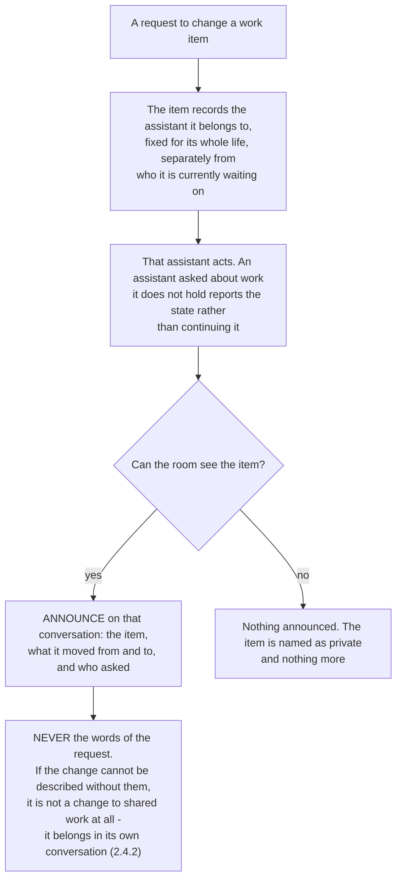

> **A change to a work item the room can see is itself visible to the room: what changed, and who asked for it. This holds even when the request that caused it was targeted.**

A shared work item changed by a request nobody else saw means the outcome changes under people who were never told why. A person who asked privately keeps their wording private; they do not get to change shared work invisibly. The same reasoning appears three times in this document, which is the reason to state it once as a rule: a targeted message may not be merged into untargeted work without consent (2.4.1), a private subject may not be moved into a room-visible conversation (2.4.2), and a private request may not silently reshape what the room is looking at.

Nothing on the task path posts to the conversation today, so a state change is written to the store and the assistant's own reply is the only thing a person sees - and when the request was targeted, that reply is targeted too. The shape the announcement needs is already in the codebase: the existing task read is built field by field so it cannot carry message text, which is the property that makes such an announcement safe to send to a room, and the announcement has to be assembled the same way rather than by quoting a request.

#### Reaching an assistant about a work item, on any channel

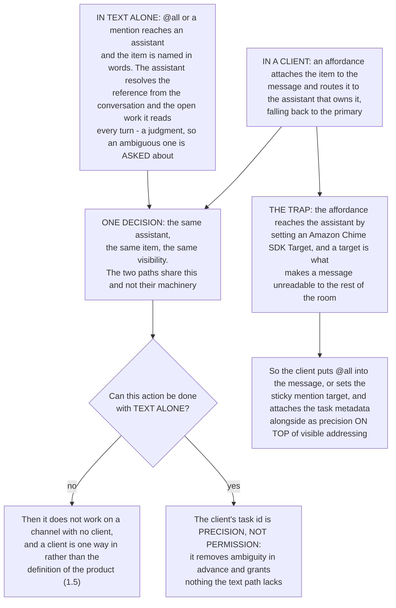

Answering a room-visible work item through a target makes that exchange invisible to everyone else, which is this section's own surprise arriving through the convenience feature. So **the norm is `@all` for work on a shared item**, which is also the form that survives every channel, because `@all` is text.

**A targeted request that turns out to touch a shared item is confirmed, and the person is told it will be announced.** They may not have realized: they addressed one assistant, privately, and the thing they are changing is something other people are waiting on. Consent without the consequence attached is not consent, and a person who would have kept it to themselves has to be able to say so and take it elsewhere, which is what 2.4.2 offers.

**A channel without targeting does not solve this, and does not have to defeat it either.** SMS and MMS are not always one to one: a group thread has several recipients and no way to address one of them, so such a channel does not grant privacy, it removes the ability to be private IN THE MESSAGE. That is a limit on the message rather than on the product, because **the content does not have to travel on the channel**: a message to a group thread can be a notification and a deep link rather than the thing itself. This is the shape the design already uses twice - a deferral notice says how many messages are waiting and never which (2.4.0), and a private work item is visible to the room as existence, type and state with its detail stripped. **Existence is not content**, and a channel that cannot carry the second can still carry the first. Identity there comes from the pair rather than from a field: a conversation associated with its own number identifies an inbound message by the sender's number and the conversation's number together, which is the same question a member ARN and a channel ARN answer everywhere else - and it is what lets the text path carry identity and routing with no metadata at all.

**And it must not need a person to be watching.** The room learning about a change because somebody happened to be reading at that moment is luck rather than a property. The change belongs on the work item, where it is still there for whoever comes back to it later, which is what the item's own history is for and why the history records the state it moved from as well as the state it moved to.

---

## 3. Access model

### 3.1 What each path is enforced by

| Path | Enforced by | Verified by |
|---|---|---|
| Assistant to Amazon Chime SDK channel | IAM: `classification` tag condition, bearer pinned to `/bot/*`, archived-channel Deny (`assistant-profile-stack.ts`) | `backend/test/cdk-synth.test.ts` |
| User to Amazon Chime SDK channel | IAM: exchange-vended session policy scoped to `[channelResource, bearerArn]`, bearer pinned by session tag (`credential-exchange.ts`), then Amazon Chime SDK membership | `backend/test/cdk-synth.test.ts` |
| Assistant to tasks | The service boundary, plus **application code** for the row-level rules. The conversation scope is `KeyConditionExpression: 'channelArn = :ch'` (`task-tracking.ts`) | `backend/test/task-store-boundary.test.ts` pins the blast radius: which principals, which verbs. The row-level rules remain unenforced by IAM by design; see 3.2 |
| User to own tasks | **Application code.** `userTasksTable.grantReadData` covers every partition (`conversations-stack.ts`); the scope is `getActiveTasksForUser(personId)`, read through `lib/task-store.ts` (`user-tasks-api.ts`); every task-service call goes through one invoke, `invokeTaskServiceOp` (`lib/task-service-op.ts`) | `backend/test/user-tasks-api.test.ts` covers behavior, not the boundary |
| Operator to live tasks | The capability-gated routes of 4.2, reaching the live store through the service | `admin-tasks.ts` unit coverage |

**What asserting the boundary found immediately.** The router's role held `dynamodb:Scan` on `agentTasksArn`, `userTasksArn` and both index sets, on the same statement that carried the keyed verbs. A `Scan` has no key condition, so it does not merely leave the conversation scope unasserted, it makes `channelArn = :ch` inapplicable, across every conversation and every classification at once. The only code that would have used it, `scanActiveDueTasks` (the due-date reminder sweep, `task-tracking.ts`), **has no caller anywhere in the repository**. The verb is needed for the experiments table, which the router genuinely does scan (`experiment-manager.ts`), so the statement is split: keyed verbs on tasks and the profile store, `Scan` on experiments alone. `scanActiveDueTasks` is left in place and un-grantable; whether it is revived behind a sparse `dueBy` GSI, as its own comment proposes, or deleted, is a separate decision.

### 3.2 The bar this design must meet or exceed

SPEC-CONVERSATION-SECURITY sets the bar and states how it is held: layered defense where **any one layer prevents the leak**, with the synthesized IAM policy asserted by `cdk-synth.test.ts` so a widened boundary fails the build. Tasks start outside its six layers; this design brings them inside it.

| Property the bar requires | How Amazon Chime SDK holds it | With this design |
|---|---|---|
| Classification isolation, fail-closed | IAM tag condition; an untagged conversation matches no Allow (Layer 1) | **Parity.** One service function per classification; a classification holds `lambda:InvokeFunction` on its own alone, so asking the wrong one is denied at IAM (3.4) |
| Caller identity cannot be self-declared | Bearer pinned by session tag; role trust policy pins it | **Parity.** Which function you may invoke for assistants, gateway-verified `sub` for users, exchange capability for operators |
| More than one layer | IAM plus the Amazon Chime SDK service's own membership check | **Parity.** Service authorization plus the grant that permits only the service to hold the tables |
| Privileged action gates on a capability | Exchange-vended `execute-api:Invoke` on the exact resource | **Parity.** `tasks-read` and `tasks-manage` |
| The boundary is asserted, not described | `cdk-synth.test.ts` Layer 1 and Layer 4 blocks fail the build on a widened policy | **Parity.** `task-store-boundary.test.ts` fails the build on a new holder or a widened verb |
| Row-level rules: private to requester, current membership, owner-versus-requester | Not expressible in IAM at all | **Exceeds.** A service can express these; no IAM arrangement on DynamoDB can |

The one row marked Exceeds is the reason a service beats tightening the grants: `aws:ResourceTag` on DynamoDB is table-level and `dynamodb:LeadingKeys` reaches a partition key and nothing else, so splitting the table per classification buys a coarser boundary than a service gives for free, at the cost of a migration. Every other row is parity, deliberately: the goal is to stop being the exception, not to invent a different standard.

**Nothing here weakens an existing control.** The queue holds ids and never content (`turn-lock.ts`), so redaction and deletion keep working through the channel and no parallel copy of a person's words acquires a second lifetime. Triage on the stream does not change that, because the authority stays the channel.

### 3.3 Why a service rather than tighter IAM on the table

A service collapses **the modules that call the task store directly** - `assistant-async-processor.ts`, `lib/async-processor-core.ts`, `router-agent-handler.ts`, `lib/task-tools.ts`, `lib/task-answer-repair.ts`, `lib/turn-triage-proposal.ts` and `user-tasks-api.ts`, some of them at several call sites each - into one place that can be read, tested and audited. IAM then guards the service, which it can express precisely. Three further modules (`lib/turn-triage.ts`, `lib/task-notify.ts`, `analytics-aurora/turn-events-live.ts`) import types or constants only and hold no table access.

### 3.4 Identity must be attested, not declared

A service that trusts a `channelArn` and a `viewerId` from its payload is the same application-code enforcement with a hop added. It is a boundary only where it derives what it can from facts IAM attests.

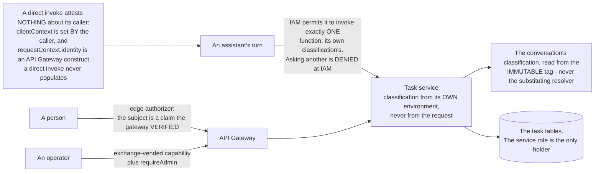

`lib/auth.ts` is the repository's only principal reader and it reads exactly that gateway field, which is the corroboration: any design that has the service "read the caller's role from the invoke context" does not work. Attestation is therefore achieved per caller, and the mechanism is chosen by which path can afford an HTTP hop - the assistant path pays ~20 to 60ms for a direct invoke (7.1), while the user and operator paths pay a gateway hop deliberately, because they are not inside a turn and the gateway is what makes their identity attested rather than asserted.

**The assistant row is the load-bearing one, and it is stronger than reading a principal would have been.** A classification cannot ask the wrong service, because the invoke is denied at IAM rather than refused inside the handler. That makes the classification boundary expressible in IAM and assertable in `cdk-synth`, which is the parity claim in 3.2, and it keeps the critical path a single invoke with no gateway in front of it. Reading the conversation's classification from the immutable tag rather than from the substituting resolver is the same rule one level down: substitution turns "unknown" into "permitted".

### 3.5 Operator access is capability-gated, and graded

`admin-credential-exchange.ts` describes the mechanism already: a capability maps to the API Gateway resource ARN it authorizes, and the exchange vends a session policy of `execute-api:Invoke` on exactly that resource, intersected with the admin-plane role boundary. Five capabilities, following the existing `manage-membership` and `manage-channel` naming:

| Capability | Grants | Notes |
|---|---|---|
| `tasks-read` | See any conversation's live tasks | Short-lived, audited. A distinct clearance from acting |
| `tasks-manage` | Cancel a stalled item | Never held by a standing role |
| `tasks-read-assignee` | See everything one principal is ASSIGNED, across conversations | Principal-scoped rather than channel-scoped |
| `tasks-read-owned-by` | See everything one person OWNS, across conversations | A different set from the above: work in flight is assigned to the assistant and still owned by the person who asked (ADR-024 D8) |
| `tasks-reassign-owner` | Hand a task to a different owner | Its own clearance rather than part of `tasks-manage`: stopping work and giving it away are different authorities |

**An operator acts on the authority, never on the projection.** The Aurora task rows are a lagging projection of the same records, and acting on them would break the rule that an archived copy is never the authority for a live decision. The absence of an operator path is what creates the pressure to do exactly that, which is why the route exists before any console control does.

---

## 4. API surface

### 4.1 Endpoints that exist

| Method | Path | Stack | Auth | Purpose |
|---|---|---|---|---|
| `GET` | `/tasks/mine` | Foundations | Cognito | The caller's own open work, across conversations |
| `POST` | `/create-conversation` | Foundations | Cognito | Create a conversation |
| `POST` | `/conversations/{archive,remove-member,leave}` | Foundations | Cognito | Conversation management |
| `POST`, `GET` | `/feedback` | Foundations | Cognito, admin on `GET` | User feedback |
| `GET` | `/analytics/*` | Analytics | Admin | Console reads, including task metrics |
| `POST` | `/admin/experiments/*`, `/admin/profiles/*` | Experiments | Admin | Experiment and profile management |

### 4.2 What this design adds

The assistant does not call these over HTTP. It calls a typed client seam that invokes one function, in the shape `data-plane-client.ts` to `data-plane-handler.ts` already uses: named functions over one `op` switch (tenet D8). Only the user-facing and operator-facing routes are HTTP.

**The turn path's own seam operations** (invoked, not HTTP; the seam carries the operator reads and the task-answer path beside them):

| Op | Returns | Notes |
|---|---|---|
| `tasksForTurn` | The turn's task context in one call | **Composite by design.** See 7.1 |
| `createTask` | The created task | Fails closed for triage; see ADR-033 |
| `advanceTaskState` | The new state, or a lost-race response | Keeps the existing optimistic guard |
| `updateTaskStatus` | Acknowledgement | |
| `cancelStoppedTasks` | The canceled set | The stop path's cancellation, by id (1.2) |

**HTTP routes**, all of them in `admin-tasks.ts` except the first:

| Method | Path | Auth | Purpose |
|---|---|---|---|
| `GET` | `/tasks/mine` | Cognito, sub from token | Unchanged contract. A client of the service rather than a second holder of the table |
| `GET` | `/admin/tasks/channel/{channelId}` | `tasks-read` | An operator sees a conversation's live tasks, asked of every classification, because an operator does not know which owns the conversation. The conversation is in the PATH so a vended session policy can pin it |
| `POST` | `/admin/tasks/channel/{channelId}/cancel` | `tasks-manage` | Unblock a stalled item. Takes `taskId` in the body; the channel is in the path, and together they are the task's key |
| `GET` | `/admin/tasks/assignee/{assigneeId}` | `tasks-read-assignee` | Everything one principal is ASSIGNED, across conversations |
| `GET` | `/admin/tasks/owned-by/{ownerPersonId}` | `tasks-read-owned-by` | Everything one person OWNS, across conversations |
| `POST` | `/admin/tasks/channel/{channelId}/owner` | `tasks-reassign-owner` | Hand a task to a different owner. Does NOT move the assignee, which is a separate axis |

The capabilities live in `admin-credential-exchange.ts`, matching the hyphenated `manage-membership` and `manage-channel` beside them. There is no `/admin/tasks/owner/` path: it served the ASSIGNEE read under the wrong word, and was retired rather than repurposed when the roles were separated, because keeping the path while changing what it returns leaves one route naming two different facts either side of a deploy (ADR-024 D8). Re-prioritizing is named here and has no route, and no console control calls the cancel route: the console's task drill reads the Aurora projection, so wiring a cancel into it means the drill asks the live route first rather than acting on the row it is showing, which is the rule 3.5 exists to keep rather than an implementation detail to skip. Until then an operator cancels by calling the route.

---

## 5. Storage

| Table | Key | Indexes | TTL | Held by |
|---|---|---|---|---|
| `AgentTasksTable` | PK `taskId`, SK `channelArn` | `contextId-index` (sparse), `channelArn-updatedAt-index` | `ttl`, 24h default (`DEFAULT_TASK_TTL_SECONDS`); plan tasks pass their own | Per-classification processor and handler roles, post-processing (`GetItem`) |
| `UserTasksTable` | PK `principalId`, SK `taskId` | `principalId-taskType-index` | `ttl`, mirrors the task | Same, plus `userTasksApiFn` (`grantReadData`) |
| `TurnStateTable` | PK `pk` = `turn#<channelArn>#<responderId>` | none | **None, deliberately** | Processor and handler roles |

The service is a boundary rather than a migration, so it changes nothing about the keys or the indexes. Two notes:

- **The conversation read is a GSI query** on `channelArn-updatedAt-index`. Whether `dynamodb:LeadingKeys` binds a GSI partition key is unconfirmed against AWS behavior and is in section 9; no future design should lean on it first. If it does not bind, keying the table by `channelArn` is what the conversation-centered read wants anyway, and that is a migration to cost separately.
- **`TurnStateTable` carries neither a TTL nor point-in-time recovery, and both are decisions.** The lock is released by a recorded fact and never by a clock, so a TTL on this table is a second releasing authority nobody asked for (tenet 2). Recovery is unnecessary for the same reason the row is cheap: a lost lock row reads as "not busy", which is the fail-open answer, and a lost queue row loses at most `TURN_QUEUE_MAX` message ids whose content still lives in the channel. The two task tables carry `pointInTimeRecoveryEnabled: true`, because a task IS the record.

---

## 6. Regions

Forward-looking: the deployment is single region, and a task is regional by construction, because a task belongs to a conversation, a conversation belongs to an app instance, and an app instance is regional.

**The model call is the only multi-region thing.** `us.` cross-region inference profiles route to `us-east-1`, `us-east-2` and `us-west-2`, and Bedrock evaluates authorization against the destination foundation-model ARN in whichever member region it routes to, so the IAM grant already spans all three (`crossRegionFoundationModelArns`, `model-strategy.ts`).

| Component | Coupling |
|---|---|
| Amazon Chime SDK app instance | Regional. The conversation's home region |
| Kinesis message stream | Regional. A stream in one region does not trigger a consumer in another, so post-processing is co-located with the conversation |
| `TurnStateTable` | Must be regional. See the lock constraint below |
| Task tables | Replicable for reads; writes single-region-authoritative |
| Bedrock | Already cross-region within `us.` |
| Aurora projection | Regional, and already a projection rather than the authority, so replication lag is covered by the existing rule |

**Regional isolation - one full deployment per region, no shared data - is the natural shape for data residency.** People in different deployments do not share a conversation, so their tasks never need to meet, and the seam makes "which deployment owns this task" a routing question with one answer instead of a client guessing a table name. The known blocker is the model rather than the tasks: `model-strategy.ts` states that the catalog hardcodes `us.` profiles and that a true non-US deployment is out of scope.

**Two constraints to design for rather than discover, if tasks ever ride DynamoDB Global Tables.** Global Tables resolve conflicts last-writer-wins, while `advanceTaskStateTo` runs an optimistic guard on status plus audit length and a losing writer fails loudly and re-reads rather than clobbering - last-writer-wins silently discards exactly the write that guard exists to catch, so task state transitions stay **single-region-authoritative** and a passive region serves reads and must not advance state. And **the turn lock cannot be a global table at all**: its mechanism is a conditional write evaluated per region, so two regions can each satisfy `attribute_not_exists` and both believe they hold the conversation, which is the duplicate-answer defect the lock exists to prevent arriving through replication. Active-active is therefore not supportable at record granularity; the conversation is the unit of affinity, and pinning each conversation to a home region is a substantial design that this document commits only to not foreclosing, which the seam does by making the home-region lookup one place.

---

## 7. Latency

Targets from LATENCY-TARGETS: TTFF at or under 1s (Nielsen focus limit), end to end at or under 10s.

### 7.1 The turn's own path (every turn)

| Step | Cost | Notes |
|---|---|---|
| `claimTurn`, uncontended | 1 conditional `UpdateItem`, ~5 to 10ms | The common path by construction |
| `tasksForTurn`: the invoke | ~20 to 60ms warm | **Replaces three sequential reads** in `assistant-async-processor.ts`, ~15 to 45ms |
| `tasksForTurn`: the classification check | ~20 to 40ms on a container's FIRST turn for a conversation, then 0 | Cached per container. See below |
| `tasksForTurn`: the three store reads | ~10ms | Concurrent inside the service, not sequential |

`tasksForTurn` is composite for exactly this reason. Wrapping those three call sites individually costs +60 to 180ms warm against a 1s TTFF budget, which is not affordable; asked as one question it is one invoke, and the reads inside it run concurrently. **A future op that adds a fourth read to the turn's critical path goes into this composite, not beside it.**

**The classification check is a new cost and it is stated rather than absorbed.** Refusing a conversation this instance may not serve requires reading the channel's tag, which the router already read earlier in the same turn; warm and uncached that is ~20 to 40ms, which would make the composite a regression rather than a wash. It is cached per container instead, which is correct rather than merely convenient: the classification tag is immutable for a conversation, so a cached value cannot go stale, and only the first turn per conversation per container pays it. **A refusal is never cached**, because an untagged conversation may be tagged moments later and caching that answer would outlive the fix.

Cold start on the service is the open risk. The seam must be provisioned or kept warm on the same basis the routers are, or the first turn after idle pays a full cold start inside TTFF.

### 7.2 The queued person's acknowledgment

| Step | Cost | On the response path? |
|---|---|---|
| `claimTurn` fails (conditional `UpdateItem`) | ~5 to 10ms | Yes |
| `GetItem` for the holder | ~5 to 10ms | Yes |
| `readPlaceholderMapping` (abuse-controls read) | ~5 to 10ms | Yes |
| `enqueueMessage` (`UpdateItem`, `ALL_NEW`) | ~5 to 10ms | Yes |
| Overflow trim (`UpdateItem`) | ~5 to 10ms | Only above `TURN_QUEUE_MAX` |
| Takeover write, when the holder is dead | ~5 to 10ms | Rare |
| **Total** | **~20 to 50ms, 4 to 6 round trips** | |

**This instant is measured, and measuring it took a change.** `ttff_ms` and `ack_ms` both anchor on a placeholder and a queued message produces none, so a queued turn reports NULL and leaves the latency population entirely - the budget above is then a number nothing checks. The notice names the message it acknowledges, that id is captured to `turn_events.acknowledges`, and `v_queue_acknowledgement.ack_ms` reports this figure per queued message (migration 039). A burst gets one row each, because a single notice updated in place would otherwise collapse three waits into one instant.

**This is the worst number in the design**, and it is what "the lock and start of the queue must be fast" is about: four to six round trips against one for the uncontended path. Each is load-bearing. `readPlaceholderMapping` is the expensive one and cannot simply be dropped, because a holder whose correlation is already fulfilled means this turn should **answer** rather than queue, and getting that wrong strands the conversation. Reducing it is worth real effort and is scoped separately.

### 7.3 The deterministic redirect

| Step | Cost |
|---|---|
| Kinesis to consumer, no batching window | ~200 to 500ms |
| Resolve which assistant the stop is aimed at | ~0 warm; ~20 to 50ms on a container's FIRST membership read |
| Select the work being held (1 GSI query + up to 25 full reads, CONCURRENT) | ~15 to 60ms: the query plus one read's latency, not the list's length in round trips |
| Resolve this assistant's configured copy | ~0 warm; one SSM read on a container's FIRST stop |
| Recognize the declared stop, suppress that assistant's in-flight answer and cancel its work in progress through the task service | ~10 to 20ms, plus the task service invoke |
| **Total** | **~250 to 550ms** |

**Every row is here because a step without a number is not approved**, including the two that round to zero warm. The selection's full reads run together deliberately: they sit on the acknowledgment's own path, and paying the list's length in round trips at the one moment the design promises immediacy was the sequential version's cost.

**No model call on this path, ever.** The person has already made the decision; re-deriving it would add seconds to the one interaction where immediacy is the whole point. Targeting belongs here because it is a lookup rather than a judgment, and it is free on the warm path: the router reads channel membership live and caches it for the container's life, so one read serves both and the escape hatch pays a filter. An unreadable membership resolves to "no ambiguity" rather than to a question, because a stop that answers with a question has not stopped anything. What happens NEXT is judged and costed in 7.4, and that split is the point: the person sees the stop honored in under half a second, and is asked about the consequence after.

### 7.4 The proposal

| Step | Cost | Notes |
|---|---|---|
| Kinesis to consumer, no batching window | ~200 to 500ms | Measured on a comparable deployment |
| Read queued message content from the channel | ~20 to 50ms, one read's latency for all N (N at or under `TURN_QUEUE_MAX`, 5) | Concurrent; order comes from the queue, not the network |
| Triage loop, first pass | ~1 to 3s, plus ~20 to 50ms per scoped read it makes | The common case is one pass |
| Each further pass | ~1 to 3s | When the loop cannot yet return a reading, or when the queue moved under the one it holds (2.3.3). The second is the common trigger, not the rare one |
| Create tasks | ~10ms, one write's latency for all N | Concurrent; each write carries its own landed-or-lost outcome |
| Post the proposal | ~20 to 50ms | |
| **Total, one pass** | **~1.5 to 4s** | The number 1.2 quotes |
| **Limit** | **3 passes** | `TRIAGE_MAX_PASSES`, counted the same way whether the chain stays in one turn or crosses several |

**The limit is affordable only because the acknowledgment is already delivered.** TTFF is met by the deferral notice (7.2), so what a further pass spends is the 10s end-to-end target rather than the first-feedback one. A pass that crosses turns spends no more of the person's attention than the notice already accounts for, which is why the bound counts calls rather than seconds (2.3).

**A batching window here is a regression of known size**: archival's 5s window cost 3.0s and 3.4s measured live. That number exists so nobody re-adds it. The two reductions once available here are taken - the channel reads and the task writes are independent per message and run concurrently, with order carried by the queue rather than by arrival and each write keeping its own landed-or-lost outcome. What remains on this path is the stream hop and the model, which are its floor.

### 7.5 What is deliberately on no response path

Task writes for work nobody is waiting on, the queue clear, the lock release, and analytics. If any of these appears in a latency budget, something has been wired to the wrong path.

---

## 8. How it is verified

Unit coverage sits with each component. What no unit test can show is the property the design is judged on, because it spans five Lambdas and a React hook that are each green in isolation - which is how this feature shipped inert once already.

| Claim | Where it is asserted |
|---|---|
| A deferred message is answered with a notice, and the person sees their message marked as waiting | `tests/e2e/turn-queue.spec.ts` |
| Several messages draw ONE notice, updated in place, not one line each | Same, counted by message id rather than by wire frame |
| A stop answers without reaching a model, the stopped answer never lands, and the queue is not collateral | Same |
| Busy is keyed on the responder, so one assistant working is not the conversation being closed | Same, asked about a second responder in the same conversation |
| A room with several assistants unions their queues, and a FAILED read is not an empty answer | `frontend/packages/chat/src/hooks/useTurnState.test.ts` |
| The queued request becomes durable work, not a sentence in a reply | `turn-queue.spec.ts`, read from the task store |
| A stop aimed at one assistant leaves another in the same room running | `backend/test/lib/stop-reaches-the-running-turn.test.ts`, asked with the same person and two responders |
| An unaddressed stop in a room with several assistants asks, and stops nothing | `backend/test/lib/stop-names-its-assistant.test.ts` |
| A stop cancels work in progress by id, keeps completed work, and says only what happened | `backend/test/lib/a-stop-cancels-work-in-progress-and-asks.test.ts` |
| The person's answer to the stop question is read before routing, and restarts, leaves or passes the message on | `backend/test/lib/a-stop-question-owns-its-follow-up.test.ts` |
| The judged half is dispatched behind the acknowledgment, never in front of it | Same, asserted on the order of the two in the stop path |
| Triage stops looping at the pass bound and asks rather than guessing | `backend/test/lib/triage-is-a-bounded-loop.test.ts` |
| A triage turn cannot reach a side-effecting tool | `backend/test/lib/triage-on-arrival.test.ts` |
| One drain per queue, and the remainder branch really is the remainder branch | `backend/test/lib/one-drain-per-queue-not-per-pass.test.ts` |
| An amendment recorded against a turn that ended first is returned, and one recorded against a live turn is not | `backend/test/lib/an-amendment-outlives-the-turn-that-ended-first.test.ts` |
| A reading opens no placeholder of its own, and `placeholderMessageId` keeps having no producer | `backend/test/lib/a-reading-opens-no-placeholder-of-its-own.test.ts` |
| A further pass is a new delivery rather than a redelivery, and a queue that moved is read again | `a-further-pass-is-not-a-redelivery.test.ts`, `the-queue-is-read-again-when-it-moves.test.ts` |
| Which principals hold the task tables, and with which verbs | `backend/test/task-store-boundary.test.ts` |
| The judged half of a stop ARRIVES on a deployment, and posts as a question rather than an answer | `tests/e2e/turn-queue.spec.ts`, with nothing queued so the only `interim` that can follow is the evaluation |
| A stopped private request's own words never reach the room | Same, asserted on a nonce phrase across every bot frame, with the task's `private` visibility read from the store first |
| A proposal reads as prose, with no runtime marker in the channel | Same, across every bot frame rather than the proposal alone |

**Some rows are asserted against SOURCE rather than behavior**, because observing them needs a whole Lex turn and each is a one-line edit away from being untrue. The responder-keyed stop is deliberately asserted behaviorally: before the responder was part of the key that property was unassertable, because both assistants read the same marker and a test could only have restated the bug.

**The self-dispatch is the one that had to leave source assertion.** The router dispatches the judged half to ITSELF, and that shipped inert once: it held the right to invoke itself but no way to learn its own ARN, so the dispatch resolved to undefined and every stop logged "the stop goes unexplained" while every unit test stayed green and `cdk synth` passed. Synth proves a template deploys; it cannot prove a runtime resolves.

**Two claims have no test at any level, and the reason is a missing fixture rather than an oversight.** A stop aimed at one assistant leaving another RUNNING, and the ambiguous-stop question, both need a room with two assistants that each take the turn lock. This deployment provisions a second answering assistant only for a duel, and a duel never takes this lock - the same gap that keeps the client-side queue union in a unit test rather than the e2e. Writing them against a one-assistant room would produce guards that pass on exactly the untargeted implementation they exist to catch, so they are recorded here as uncovered rather than written vacuously. The fixture belongs with the parallel-assistants phase ADR-033 defers, which needs it anyway.

The e2e phase is `turn-queue` in `backend/scripts/validate.mjs` and needs the deployment synthesized with `-c turnQueue=true`. Without the flag nothing ever queues and the phase fails rather than passing vacuously.

---

## 9. Open questions

**The lock, when triage runs off the turn. Resolved, by separating two questions.** The TURN lock answers "who may ANSWER", and the turn being triaged behind is still running and still holds it, correctly and unchanged. Triage answers nothing: it reads a queue, creates tasks and posts a proposal, so what it needs is exclusion from ITSELF, so two notices arriving together do not create the same work twice. That second claim may expire on a timer, and safely, because a stranded one silences nothing - answering is unaffected, the queue keeps its messages, and the next notice triages them. **The lock that must never be timed out is not the lock triage needed.** The mechanism is `claimTriage` / `releaseTriage` in `turn-lock.ts`: a five-minute claim whose staleness is evaluated in the condition expression rather than left to DynamoDB's TTL sweep, because that sweep is best-effort and can lag by hours, long enough to look like a permanent stall.

**Whether `tasks-read` sees a task marked `visibility: private`.** The likely answer is yes on the admin plane, short-lived and audited, because that is what the plane is for. It is recorded here so it is answered deliberately rather than becoming an accident of which code path runs first.

**Whether a returned amendment's copy is honest.** The proposal says the work starts "now", while a returned amendment goes back on the queue for the next arrival to read (2.0).

**Secondary:** whether `dynamodb:LeadingKeys` binds a GSI partition key (section 5), and the `CONTROL` message size limit ADR-033 flags as unverified, which the notification path depends on.

---

## Appendix A: The trigger is deterministic, and visibility comes from addressing

Nothing in this design decides whether the assistant speaks. A response is triggered by how the request arrived - AUTO in a 1:1, a mention, or `@all` - and what varies between those three is the visibility of the response, not whether one happens. Visibility therefore comes from addressing rather than from a per-response approval step. Access is gated on the conversation's classification, and the assistant serving it holds that same classification, so every member's reach through the assistant is identical by construction and there is no per-response question to ask. Obtaining data others in the conversation lack requires a conversation whose classification grants it, and moving it requires copying it across by hand, which is a person disclosing something they were entitled to read; no access model closes that, and policing it would mean inspecting content rather than enforcing access, which tenet P4 deliberately does not do. Enforced before the request runs, uniform, and provable with a deny-test is the stronger property for tenet P4 than a per-response human control that can be clicked through - and it is why none of the machinery in 2.4 needs an approval step. Section 2.4 protects the REQUEST, keeping a targeted message counted rather than described; there is no separate answer-side disclosure problem, because there is no reach to differ over.

What the queue buys is the trade this settles. Explicit invocation alone would remove the need for everything in 2.0 through 2.6: no lock, no claim, no reading, no proposal, no re-read, because each invocation is a discrete addressed request with nothing to reconcile it against. What it would also remove is the behavior this design exists for - noticing that three messages are one request, folding an amendment into work that is still running, offering to split a queue that spans subjects, and stating the order the work will be taken in. The cost of the choice is precisely the mechanism in 2.3.3: reading beside the running work is what makes the fold possible, and it is also what lets the queue move under the reading. A design that wants the first accepts the second.
