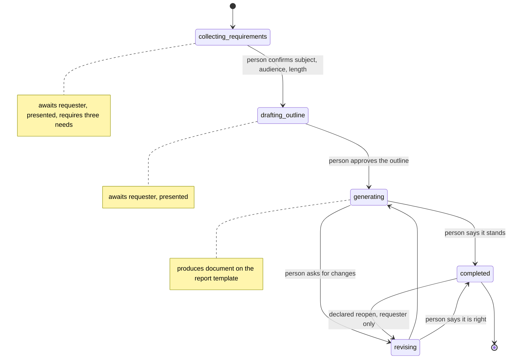
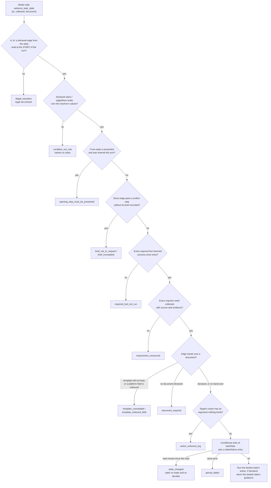
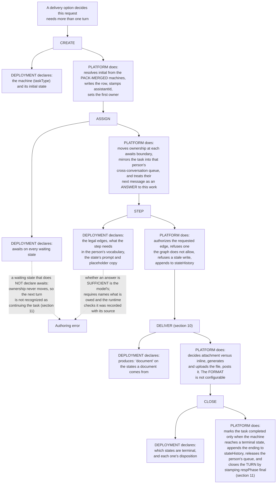
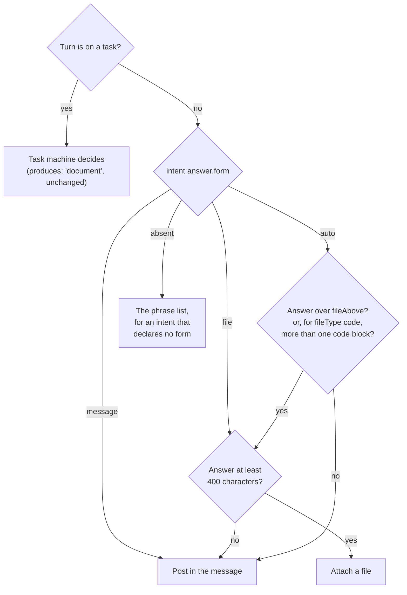
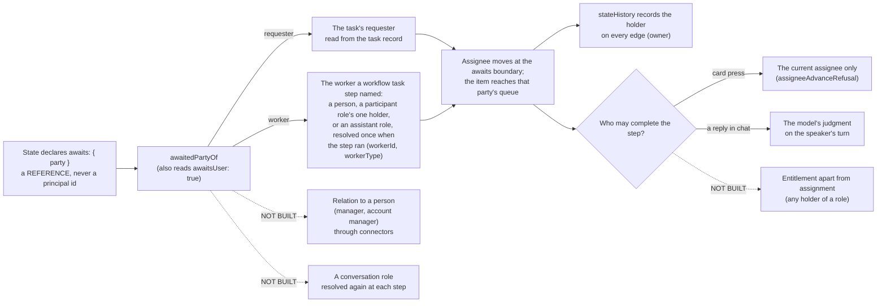
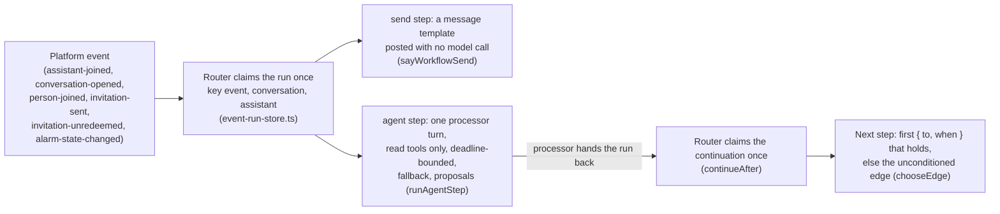
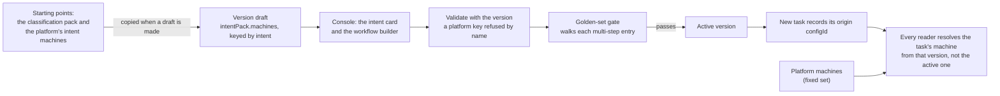
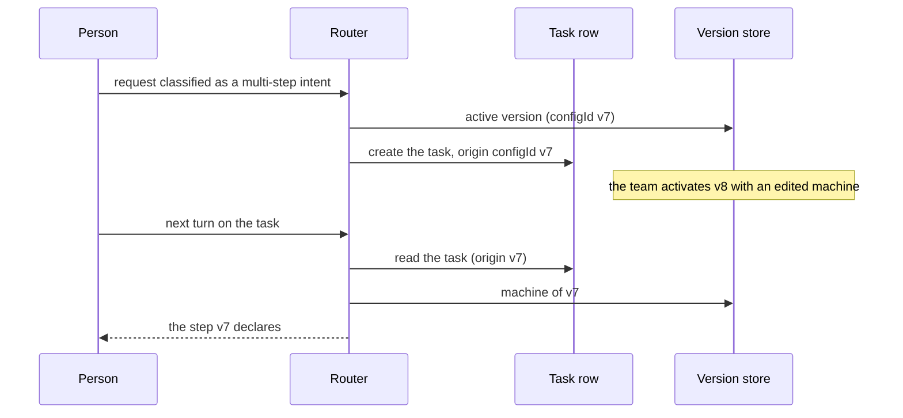
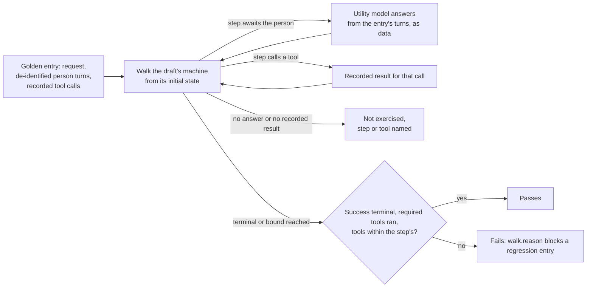

# DESIGN: Task state transitions

Status for workflows and tasks lives in [SPEC-WORKFLOWS-AND-TASKS](./SPEC-WORKFLOWS-AND-TASKS.md).

**Status:** Partial. This describes the target: sections 1 to 15 are built except where a section marks **NOT BUILT**, and section 16 ([ADR-066](../../../design/decisions/066-an-intents-workflow-rides-the-assistants-version.md)) is built except the console editor (16.4) and the gaps it marks **OPEN**. Each requirement's proof level is in the requirement table of [SPEC-TASK-STATE-TRANSITIONS](./SPEC-TASK-STATE-TRANSITIONS.md).

**Coverage:** `tests/e2e/task-state-machine.spec.ts`, `tests/e2e/tasks.spec.ts`, `tests/e2e/report-flow-branches.spec.ts`, `tests/e2e/place-item-flow.spec.ts`, `tests/e2e/a-step-requires-its-lookup-before-the-task-moves-on.spec.ts`, `tests/e2e/a-workflow-step-opens-a-task-for-a-person.spec.ts`, `tests/e2e/a-task-deadline-ends-the-task-and-continues-the-run.spec.ts`, `tests/e2e/an-idle-assistant-takes-up-its-own-work.spec.ts` - what each proves is in the spec's Coverage line.

**Related:** [SPEC-TASK-STATE-TRANSITIONS](./SPEC-TASK-STATE-TRANSITIONS.md) - the requirements this design serves. [ADR-024](../../../design/decisions/024-task-ownership.md) - task ownership. [ADR-063](../../../design/decisions/063-a-workflow-step-assigns-a-task-and-an-idle-assistant-takes-up-its-own.md) - a workflow step assigns a task. [DESIGN-TASK-ACCESS-AND-QUEUE-PROCESSING](./DESIGN-TASK-ACCESS-AND-QUEUE-PROCESSING.md) - the task service, its access model and the queue's machines. [CROSS-CHANNEL-TASKS](./CROSS-CHANNEL-TASKS.md) - what a person owes across conversations.

**Site section:** Interaction layer, conversation.

---

Sections 1 to 13 keep the numbers source files cite (a comment citing `SPEC-TASK-STATE-TRANSITIONS §3` resolves, through the spec's section index, to section 3 here). Who may reach a task at all, the task service, and the queue's own machines are [DESIGN-TASK-ACCESS-AND-QUEUE-PROCESSING](./DESIGN-TASK-ACCESS-AND-QUEUE-PROCESSING.md); resume across conversations is [CROSS-CHANNEL-TASKS](./CROSS-CHANNEL-TASKS.md).

## Delivery shapes a task serves

| Shape | What it means | How a task serves it |
|---|---|---|
| **Broadcast** | Work and result visible to the whole conversation | The default for an ordinary turn and for a resumed chain, whose answer posts as its own public message |
| **Private / targeted** | A person addresses one assistant; only they and the assistant see the exchange | A targeted request makes its task private (`markTaskPrivate`), and every later turn on a private task answers in a message targeted at the person, a duel included (`planResumedChainDelivery`; SPEC-WORKFLOWS-AND-TASKS WT68) |
| **Battle** | One prompt, several assistants, publicly comparable replies | Each side runs the ordinary request path with its own identity and task chain; its clarification is public so a rival sees it ([ADR-029](../../../design/decisions/029-clarification-is-public-and-answers-get-their-own-placeholder.md), [ADR-026](../../../design/decisions/026-task-shaped-battle-rounds.md)) |

## Two kinds of shipped machine

`DEFAULT_TASK_STATE_MACHINES` holds sixteen machines in three groups, and only the first may be replaced.

**Reference workflows for intents** (`guided_troubleshooting`, `data_extraction`, `report_generation`, `code_delivery`, `technical_design`, `image_generation`, `place_item`, `action_item`) prove the contract and exist to be replaced or expanded. None carries an SLA, a retry policy, an approval bound to an entitled approver, or a hop to a system outside the conversation. `place_item` ends at the machine's terminal, not a host system's write; `report_generation` produces a document, not a distribution.

**Machines a workflow opens**: `incident_first_look`, the one machine an event's agent step may open (`EVENT_TASK_MACHINES`, `event-workflow.ts`, section 14), and `approval` and `acknowledgement`, the reference machines a workflow's task step opens to ask its worker to decide or to confirm, with their choices on the task card (ADR-063 decision 1, section 12.9).

**Platform machines** (`queue_drain`, `queued_request`, `queued_clarification`, `queued_combination`, `work_still_wanted`) are how the turn queue works ([ADR-033](../../../design/decisions/033-a-conversation-answers-one-turn-at-a-time.md)). Code depends on their states by name: the drain's stage is written from `queue_drain`, and the queue opens the others directly. An assistant's workflow selection narrows the reference workflows and never these, or selecting one report workflow would strip the queue from that assistant. `action_item`, `place_item`, `approval` and `acknowledgement` belong to the same fixed set (`PLATFORM_MACHINE_KEYS`), which no version may declare (section 16.2). Two properties look like rule violations and are not:

- **`queue_drain` declares no `awaits` at any state**, alone among the machines. A drain reads a queue that may hold several people's messages, so waiting on one person would block everyone else. The waiting lives on the `queued_*` or `work_still_wanted` task it opens. A drain that handed over at its asking state would be handed over and taken back in the same turn, because it closes when the queue empties.
- **`queued_clarification` claims nothing about the work.** `queued_request` starts at `proposed` ("here is the work I propose"); a clarification starts at `asked`, because the assistant cannot tell what the message asks for.

## Directions the model grows into

| Direction | What exists | The missing joint |
|---|---|---|
| Handoff between a person and an assistant | Ownership changes hands at every wait boundary and the item reaches that person's queue (section 2, [CROSS-CHANNEL-TASKS](./CROSS-CHANNEL-TASKS.md)) | A step names `requester` or a workflow's `worker` only; a specific other person or a role's holder resolved at each step is **NOT BUILT** (section 12, FR15) |
| Handoff between assistants | A message answering another assistant's work goes to that assistant, and the task carries `assistantId` ([ADR-030](../../../design/decisions/030-a-message-is-answered-by-the-assistant-whose-work-it-answers.md)) | A machine cannot DECLARE a handoff as a step (**NOT BUILT**) |
| Sub-agents | Nothing | A step that fans out and collects results; the record has no parent-child relation (FR21, **NOT BUILT**) |
| Deterministic steps | A state's `action` runs on entry and takes `onSuccess` or `onFailure` (sections 3, 4, 6, FR29), following two precedents: a `place_item` proposal advances `collecting` to `confirming` (section 5), and `queued_combination` advances `merging` to `merged` once its merge returned an id | Reach: an action runs a registered tool that executes in the turn; an action on a connector operation is **NOT BUILT** |

## 1. What a task is, and what it is not

A **task** is a multi-turn unit of work with a declared shape. It is neither a conversation nor a to-do item: it exists because a delivery option said the request needs more than one turn (`DeliveryOption`, `lib/delivery-options.ts`). It carries two orthogonal states:

| | Field | Answers | Values |
|---|---|---|---|
| **Lifecycle** | `status` | Is the work still live? | `pending`, `in_progress`, `completed`, `failed`, `cancelled`, `abandoned` |
| **Machine** | `taskState` | Where in the declared graph is it? | Per machine, for example `collecting_requirements` to `drafting_outline` to `generating` |

A machine-backed task is `completed` only once its machine reaches a terminal state (`shouldMarkTaskCompleted`), so the console never shows Completed while the machine is generating. A task with no machine completes on its turn. The shipped `report_generation` machine, as an example of a declared graph:

## 2. A task has three roles, because they change at different rates (ADR-024)

| Role | Field | Answers | Changes |
|---|---|---|---|
| Assigned assistant | `assistantId` | Whose work is this? | Never |
| Owner | `ownerPersonId` | Which person does this work belong to? | Only on a handover |
| Assignee | `assigneeId`/`assigneeType` | Who acts NEXT? | At every `awaits` boundary |

**The assignee moves at every `awaits` boundary.** `report_generation`, `data_extraction` and `guided_troubleshooting` start in a state that awaits the requester, so the person is the first assignee and the task reaches their queue immediately; `queued_request`, `queued_clarification`, `queued_combination` and `work_still_wanted` do the same. Where the initial state awaits nobody (`place_item`, `action_item`), the owner is the first assignee, except `queue_drain`, which is assigned to the ASSISTANT for its whole life because reading a queue is the assistant's own work.

**The owner holds still.** It defaults to the requester and is a ROLE, not history: after a handover the task belongs to the new owner. A requester is a fact about how the task started; an owner is a position somebody holds. It cannot fold into the assignee, because while the assistant works the person is not on the row at all. Two runtime questions depend on that:

- **"What do I owe?"** reads the ASSIGNEE. That is a person's queue, which is why the mirror is partitioned by assignee (ADR-024 D2).
- **"Which of my work here is this message about?"** reads the OWNER with the assigned assistant (ADR-024 D8, section 12.8). Asked of the assignee it would only ever see parked work.

**Disclosure follows the owner.** A private task's content is readable by its OWNER, its ASSIGNED ASSISTANT and the REQUESTER, and nobody else; detail is stripped at read behind a `viewerId` gate, so the room sees that the task exists and not what it is (`readTaskVisibility`, `lib/task-visibility.ts`; an absent or unrecognized visibility reads as private). The owner is named so a handover carries the ability to read the work it hands over. The requester keeps access after handing on, because they wrote the request; it also covers every row written without an owner field.

## 3. How a transition is requested and authorized

The model does not set state. It calls **`advance_task_state`**, registered only when the active task is machine-backed, and the runtime authorizes the edge before persisting it. Every check reads the machine resolved for the task's intent, the same set the edge is authorized against, so a declared property is enforced and an omitted one is left to the model. None reads what a person or model wrote (tenet D11): the runtime verifies that a judgment was made and recorded with its source, not whether it was right.

**The checks, by refusal.** `AdvanceResult` separates `illegal_transition` (the graph forbids it) and `condition_not_met` (allowed, but a declared condition does not hold) from `persist_failed` (infrastructure) and `state_changed` (the only retry candidate).

- **`condition_not_met`**: the target's `when` or the current state's `edgeWhen` entry must hold over the deciding values the turn's resolver read (`authorizeTransition`, `lib/task-state-machines.ts`). The values travel with the move as data, already held back by the resolver's second layer (ADR-060 decision 3), so a member-trust value or one not settled at the turn decides nothing, and a move with no values holds no condition. A step action's outcome edge is held to the same conditions.
- **`opening_step_must_be_presented`**: the current state declares `presented` and was entered on this turn, including the turn that created the task (the router records its correlation id, `Task.correlationId`) and a state an earlier advance in the same turn entered. The model is told to present the step and ask the person to confirm or correct it.
- **`brief_not_in_request`, `brief_incomplete`**: a direct edge past a `confirm: 'when-incomplete'` step is taken only from a step entered on this turn, and only where every need of its `brief` is recorded with its source (`directEdgeRefusal`, ADR-064 decision G).
- **`required_tool_not_run`**: a tool the step lists in `requiresTool` has not returned success since the task last entered it (section 4).
- **`requirement_unsourced`**: a declared `requires` need is missing from `collected`, or has no valid `source` (`message` or `context`) or no `evidence`. The refusal names the missing needs. A workflow offering a choice of templates with no default also refuses here with `template` missing until a choice is recorded.
- **`template_unavailable`, `template_unbound_field`**: the move hands over a document from a state that declares a template ([SPEC-DOCUMENT-TEMPLATES](./SPEC-DOCUMENT-TEMPLATES.md)), and the template cannot be loaded for the classification, or it is platform-filled and a field has nothing recorded.
- **`document_required`**: the edge hands over a document (into a `produces: 'document'` state, or from one to a terminal) with no `document` argument. Finishing from a delivering state needs none when the document already went out this turn or is recorded in the task's `deliveries` from that state.
- **`action_unbound_arg`**: the target declares an `action` and an argument binds to nothing the task will hold once the move lands, so the model collects it instead of the platform running the tool on a gap.

One refusal is not an advance's: a call to a tool the current step does not list in `tools` is refused at the call with `tool_not_in_step` (FR28), whichever step an earlier advance in the turn landed on. Every refusal carries the structured `refusal` marker, so it is recorded as `workflow_refusal` and kept out of the tool-error rate. A first-turn move out of a requirements step that declares every need met and names a source nobody gave is refused three ways: by `presented`, by `requires` and by the evidence check.

**The runtime never advances on its own judgment.** A model that ends its answer on a step whose required tools ran is asked once, in the same turn, to take the move it owes (section 7a); the move is still the model's call. A model that fails to drive its task produces a stall signal (section 7), not a state change. Every runtime edge is one a declaration names or a platform machine's own step (the table in section 6): a declared step action's outcome (FR29), a declared choice pressed by the assignee (section 12.9), the queue drain's stages, `merging -> merged`, the delivered step's close, and an event task's first step once its turn posted. **A declared step action** runs as follows. When a task enters a state that declares `action`, by the model's move, a runtime move, or as the state it was created in, the platform runs it and takes `onSuccess` or `onFailure` (`runStepActions`, `lib/state-actions.ts`), bounded as follows:

- **The edge is declared.** Validation refuses an outcome edge that is not one of the state's `transitions`, an action on a step that awaits somebody, and an action state with no failure edge (neither `onFailure` nor a transition into a terminal `failure` state). The move is authorized like any other, as `by: 'system'`, so a declared reopen is never taken this way.
- **It is decided by a fact**: the tool returned a result or an error (tenet D11).
- **It runs as the assistant**, through the handler a model's call reaches, under the assistant's own vended session, only where the turn's allowlist (the profile's, narrowed by the intent's) permits it and its runtime precondition holds; otherwise `action_tool_not_allowed` and `onFailure` (tenets D1, D4). `deliver_document` and `generate_image` are the platform's own actions and are not checked against the tool allowlist; `generate_image` draws only on the image model the intent's route names, and records `image_model_unavailable` where the turn has none.
- **An unbound argument fails the step.** `action_unbound_arg` refuses the model's move into the step (section 3 refusals), and on a runtime move, where nobody can be asked, the action records it and takes `onFailure` (`state-actions.ts`).
- **Once per entry.** The entry is claimed with a conditional write on the task row (`claimStateAction`), keyed `<state>#<entry sequence>`, the sequence being how often the log shows the task entering the state. A retried call or redelivered turn finds the claim and runs nothing. At most once: an entry whose turn died between claim and record is not rerun, and the task rests in the state, whose outcome edges the model can still take.
- **Bounded per turn**: at most `MAX_RUNTIME_MOVES_PER_TURN` (four) runtime moves, retries included; a cycle stops and is recorded as `runtime_move_bound`.

The model is told where actions left the task: the advance's result carries `platform_actions` (each state, tool, outcome and destination) and, when the task moved on, `now_at` with that state's `finished`, `next_states` and guidance. A task that starts a turn resting in an action state with an unclaimed entry is run before the model is called, and the prompt says where it reached.

## 4. Machines are configuration, not code

`DEFAULT_TASK_STATE_MACHINES` holds the built-in graphs keyed by `taskType`. The machines a turn runs are these merged with the classification's intent pack (`taskStateMachines`, `intent-pack.ts`; [SPEC-CONFIGURABLE-INTENT-PACK](../assistants/SPEC-CONFIGURABLE-INTENT-PACK.md)), validated when the pack is read (`validateTaskStateMachines`). An assistant's version selects among them with `workflows`, and may declare its own in `intentPack.machines`, which run over these for the keys it declares (section 16, [ADR-066](../../../design/decisions/066-an-intents-workflow-rides-the-assistants-version.md)); a legacy top-level `machines` on a patch is refused, naming `intentPack.machines`, and dropped on read (`bodyFrom`, `active-profile.ts`). Task creation resolves the initial state from the merged set, so a pack-declared type is never created stateless. A machine maps each state to a `TaskStateDef` (`task-state-machines.ts`):

| Field | Meaning | Validation and enforcement |
|---|---|---|
| `transitions`, `terminal` | Legal edges; `[]` marks a terminal, whose `terminal` kind is `success`, `failure` or `handoff` | An edge outside `transitions` is `illegal_transition` |
| `reopens` | On a terminal only: states a FINISHED task may return to when its requester asks for changes (`report_generation.completed` declares `reopens: ['revising']`) | Refused on a state with transitions, and for a target that is undeclared or terminal. Only the model's call (`by: 'tool'`) may take it; a `system` request is `illegal_transition`. The edge records `reopen: true` and its author, and returns `status` to `in_progress` in the same write |
| `awaits` | `{ party: 'requester' }` or `{ party: 'worker' }`: the state blocks on that party, which moves ownership to them. A REFERENCE resolved late, never a principal id (section 12) | Read only through `awaitedPartyOf`; the deprecated `awaitsUser: true` normalizes to `requester` |
| `resolvedByOneResponse` | Opt-in, rare: ONE clear answer completes the step (a confirmation, an approval, a single choice); never on requirements gathering | Rendered into the prompt only; never a license for the runtime to advance |
| `requires` | What the step needs from the person, in their vocabulary, read back when missing | Rides in the tool's schema; `requirement_unsourced`. Refused on a state awaiting nobody |
| `presented`, `confirm`, `brief` | The step is put to the person before the task leaves it; `confirm: 'when-incomplete'` lets a request carrying its complete `brief` go past it | `opening_step_must_be_presented`; `brief_*`. `presented` is refused on a state awaiting nobody |
| `produces` | `'text'` (default), `'image'` or `'document'`; replaces the retired `delivers`, which is refused naming `produces` | A state that `awaits` somebody cannot produce a document |
| `template`, `templates`, `defaultTemplate` | The document template a delivering step follows | Only on `produces: 'document'` |
| `tools` | The tools the step's turn may use | Narrows, never widens; `tool_not_in_step`. Refused for a name the registry does not hold |
| `requiresTool` | Tools that must return success before the task leaves the step | `required_tool_not_run`; a version whose tools omit one is refused at validate and activate (`requiredToolErrors`) |
| `action`, `onSuccess`, `onFailure` | The platform runs the step on entry, with no model call | Section 3 |
| `when`, `edgeWhen` | Conditions on declared variables (ADR-060 decision 6) | `condition_not_met` |
| `choices` | Edges offered as buttons on the task card to the assignee (ADR-063 decision 2) | Only on a state that awaits somebody (section 12.9) |
| `rests` | A state awaiting nobody that an idle assistant does not take up on its own (ADR-063 decision 5) | Section 12.9 |
| `prompt`, `placeholder`, `label` | The step's instructions, the in-progress placeholder, and the status-chip name | Pack-configurable and localizable |

**`awaits` is the declaration with the widest blast radius.** A state that ends its turn on a question needs it, and where a machine has no separate waiting state the producing state IS the wait. Three machines name their wait explicitly (`awaiting_result`, `confirming`, `options_presented`), so the producing state passes within the turn and awaits nobody. `report_generation.drafting_outline` exits only to `generating` and `data_extraction.validating` only to `formatting`, both the assistant working, so those two carry the declaration themselves. Omitted there, ownership stays with the assistant, and anything keyed on "the person holds work here" answers wrongly: a direct answer to the outline question reads as topic drift (`SPEC-DRIFT-CONVERGENCE`, "Active-Task Suppression"). A consumer that only needs to know whether a workflow is RUNNING must not key on `awaits`. Every consumer reads it through one normalizer, because a consumer left on one form stops firing for a machine authored in the other without failing.

**`resolvedByOneResponse` does not mean any reply completes the step.** A correction ("make it 45 minutes and put it before the kickoff") and a decline ("do not add it") arrive at the same step as a "yes", and no structural test separates them. The flag is rendered into the prompt (`buildTaskContextForPrompt`), where the model decides: agreement advances, a correction is put back to the person with the step unmoved, and a decline advances nothing and is not reported as done. `applyUserResponseToTask` moves no state; it hands the work back to the assistant, which is what makes the reply trigger the next turn.

**`requires`: needs ride in the tool and carry their source.** When the state declares `requires`, the tool's description names each need and its input schema requires one `collected` entry per need: `need` (an enum of the declared needs), `value`, `source` and `evidence`. `source` is `message` (the person said it; `evidence` quotes them) or `context` (a passage retrieved this turn; `evidence` is that passage or its source id). There is no value for a need the model supplied itself. The check is structural, a closed enum and a present string; evidence is recorded, never parsed. On the transition, values merge into `task.details.requirements` and each need with its source and evidence into `task.details.collectedRequirements`, so the delivery check, the revision branch and an audit read the agreed value and where it came from instead of re-deriving it from the transcript. A task written before needs carried their source has `requirements` and no `collectedRequirements`, and reads as before. Absent `requires`, any response is sufficient; whether an answer satisfies a need stays the model's judgment.

**`presented`.** On a requirements step, the turn that has everything lists what it is taking for each need and where it came from, asks the person to confirm or correct it, and the person's reply moves the task on. Omitted, the step is the model's judgment. The shipped `report_generation`, `data_extraction`, `code_delivery`, `technical_design` and `guided_troubleshooting` machines declare it on their opening requirements step, and on `drafting_outline` and `data_extraction.validating`.

**`tools`.** The turn is offered the intersection of the profile's allowlist, the intent's `tools` and the step's list (`toolsForStep`, `lib/task-tools.ts`), so a checking step cannot call a writing tool even where the profile allows one. The task tools (`advance_task_state`, `deliver_document`) stay available. Enforced twice: the turn is offered only these, and a call to any other is refused at the call. Absent, the step narrows nothing.

**`requiresTool`** is for a tool whose arguments need the model's judgment, which an `action` cannot supply ([ADR-064](../../../design/decisions/064-a-turn-takes-its-model-from-the-intent-and-the-step-it-runs.md) decision 3). Each success is recorded once per entry under `tool:<name>:` on the task's `actionRuns` by the step-action claim's conditional write (`claimStateAction`, `recordToolRun`); the refusal is `requiredToolsNotRun` (`task-tools.ts`) and is a workflow refusal the tool-error rate does not count. **NOT BUILT:** a required tool unreachable at runtime taking the state's `onFailure`; such a version is refused at write instead.

**`action`.** On entry the platform runs `tool`: a registered tool that executes in the turn, `deliver_document` on a delivering step (declaring the step's platform-filled template as the document, [SPEC-DOCUMENT-TEMPLATES](./SPEC-DOCUMENT-TEMPLATES.md) FR9), or `generate_image` (`GENERATE_IMAGE_ACTION`) on a step that produces an image, which draws from a requirement-bound prompt on the image model of the intent's route under the image guardrail ([ADR-064](../../../design/decisions/064-a-turn-takes-its-model-from-the-intent-and-the-step-it-runs.md) decision E). Each of `args` binds through the reader the template fill uses (`lib/step-bindings.ts`): `requirement:<need>`, `detail:<key>`, `tool:<state>.<path>` (an earlier action's result), `literal:<text>`, a variable source ADR-060 declares (`conversation:type`, `ctx:<source>.<field>`, inserted from the turn's resolver by `bindActionArgs`), or a number or boolean as written. The outcome is recorded at `details.actions[<state>]` (`tool`, `ok`, the entry `key`, `at`, and the result when it succeeded and is at most 8000 characters as JSON, else a bounded `errorClass` and, for a refusal, its code). Validation (`validateStepAction`) refuses a tool the platform cannot run (a proposal tool, `advance_task_state`, an unregistered name), `deliver_document` on a non-delivering step, an argument binding nothing, a `requirement:` need no state requires, a `tool:` result of a state with no action, a variable source the platform does not publish, an action on a step that awaits somebody, and outcome edges that are not transitions or have no action. **NOT BUILT:** an action on a connector operation, because the platform has no outbound connector invocation path for an action to reach.

**`when`, `edgeWhen`.** A state's `when` must hold for any move into it; an `edgeWhen` entry for the move to that target, whoever asks. Validation refuses a condition on member text, an operator on a type it does not apply to, and an `edgeWhen` key that is not a transition. A machine is validated without the classification's catalog, so a `ctx:` condition is refused there. A pack carries both as written (`intent-pack.ts`).

**`prompt`, `placeholder`, `label`.** `prompt` is the only source of a step's instructions for every machine: the turn renders the `## CURRENT TASK` header, the state's `prompt`, then the legal next states (`buildTaskSystemPrompt`, `lib/task-step-prompt.ts`). Default machines declare theirs the same way, so a classification pack that redeclares a default type has its own prompts rendered and nothing in code supplies step text by task type. A declared `placeholder` is what a reply in progress shows, ahead of the assistant's `task-placeholder` message template and the shipped one (`getTaskPlaceholder`, ADR-062; `backend/test/lib/every-line-a-person-reads-is-a-template.test.ts`). `label` names the state in the chat client's status chip, since a pack-declared or renamed state has no entry in any shipped label table.

**`produces: 'document'`: the file is the document the turn DECLARES.** A turn moving into a delivering state, or from one to a terminal, passes the complete deliverable as the `document` argument of `advance_task_state`. A follow-up INSIDE a delivering state that re-produces it ("add a section on churn") declares it with `deliver_document`, offered only while the state delivers and granted wherever a profile grants `advance_task_state`. The gate packages exactly that text; the reply posts as chat beside it, and nothing about the reply's shape decides, so a greeting, a narration or an apology about files written beside the advance never becomes the file. The `document` argument's schema description carries the contract: the complete deliverable for a reader outside the conversation, with no greeting, no address to the person, no offers or questions, nothing about files. Below the 400-character minimum artifact size the declared document posts inline after the reply; the task advances identically. The attachment gate derives its delivery states from the merged machines, never a hardcoded list.

- **The new step's contract arrives with the move.** The prompt renders the state the turn STARTED in, so a successful advance returns the landed state's `guidance` (its prompt as the turn would render it, plus the delivering contract on a delivering state), and `produces: 'document'` when it delivers.
- **The model does not claim a packaging.** Whether the document arrives as a file or inline is decided after the text exists, so a delivering state's grounding carries `deliveringContract` (rendered by `buildTaskContextForPrompt`, returned with an advance into the state): the document goes in `document`, the reply goes to the person, and neither asserts a saved, attached or downloadable file. It is read off the same flag, so a renamed or added delivering state carries the rule.
- **The document is CHECKED before it ships** (`lib/deliverable-check.ts`). It must OPEN as a document, read from its markup (`opensAsADocument`): a heading, a table row, a fenced block, a bold title line, a setext heading, a CSV header with rows, or structured data; a code deliverable (`fileType: 'code'`) is exempt. The English greeting, question and file-claim patterns decide nothing (tenet D11) and are logged as `deliverable_phrase_check`. Its LENGTH is compared with the size recorded when the person confirmed (`details.lengthTarget`); nothing recorded means nothing to enforce, and "as a table" is a legitimate answer that names no size. A failing document returns to the model with its faults and an instruction to return the corrected document alone, for up to three rounds (`MAX_CORRECTION_ROUNDS`, `assistant-async-processor.ts`). A rewrite for the opening alone is accepted when its structure survived (every table row, heading and fenced block), since removing a greeting can remove half a short document; a length fault keeps the content floor. When rounds are spent, a document that still does not open as one posts inline; one that misses only its length is delivered as the best version seen. Rounds are spent only on failing documents. The check is whether the document is the one agreed; wording and language remain the person's to ask for through `revising`.
- **A delivering state hands over a GENERATED ARTIFACT**: a report, an extraction, a summary. The conversation itself is not offered as a file, because an assistant's history read carries targeted messages the requester may not be entitled to ([SPEC-CONVERSATION-SECURITY](../governance/SPEC-CONVERSATION-SECURITY.md), "Not offered: a file containing the conversation").
- **It follows its template, where the step declares one.** `template: <name>` (or `name@<sha256>`), or `templates: [...]` with an optional `defaultTemplate`. The platform loads it from the classification's own `templates/` prefix before the turn, renders its sections, levels, tables and guidance into the step's guidance and the guidance returned with an advance, and adds a structural check: required sections in order by position and heading level, and each declared table's column count, never heading text (tenet D11). A miss is a fault the correction is asked to fix; a document that still misses posts inline. With `templates`, the person chooses on the requirements step, the choice is recorded as the `template` need, and the delivering step loads it. A `fill: platform` template is rendered from what the task recorded, with no model call. The shipped `report_generation` declares the platform's `report` template on `generating` and `revising`; the deploy writes it for each classification whose workflows declare it, and a deployment replaces it by activating its own `report`, or offers a choice by redeclaring those states with `templates` and `defaultTemplate`. Format, storage and activation are [SPEC-DOCUMENT-TEMPLATES](./SPEC-DOCUMENT-TEMPLATES.md).

Every threshold above (passes, artifact floor, words-per-page band, rewrite floor) is a constant with a stated reason, and both limits worth designing around (the bound delivers the best version; completion is the model's call) are movable. They are listed with their trade-offs in [HOW-TO-ADD-OR-MANAGE-A-PROFILE](../../../guides/developer/HOW-TO-ADD-OR-MANAGE-A-PROFILE.md), "What the runtime checks before it delivers".

## 5. Proposals drive their own edges

A step that proposes something (`propose_item`, `place_item`) advances the machine as a consequence of the proposal: the proposal IS the transition from collecting to confirming, so "what the assistant did" and "where the task is" cannot disagree.

## 6. The transition log

`stateHistory` is **append-only**: one entry per transition with `at`, `by` (`tool` when the model requested it, `system` when the runtime did), the edge (`from`/`to`), the holder in force when it moved (`owner`, as `<type>:<id>`), and optionally `reason` and `messageId`.

| Entry | What it carries |
|---|---|
| Model's edge | `by: 'tool'`, `from`/`to`, `owner` |
| Step action's outcome (FR29) | `by: 'system'`, `action: { tool, outcome }` (`success` or `failure`) and a `reason` naming the tool; the result is on the task (`details.actions[<state>]`) in the same conditional write, and the entry key in `actionRuns` |
| Other runtime edges | `by: 'system'`: `merging -> merged` after a combination's merge, the delivered step's close once its document is attached, the queue drain's stages (`queue-drain-task.ts`), an event task's first step once the turn that ran it posted (`assistant-async-processor.ts`), and a card press relayed for its assignee (section 12.9) |
| Declared reopen | `reopen: true`, `by` always `tool`; it ends the previous ending, so `taskEndedAt` reads the task as not ended and re-completion appends the next ending |
| Ownership change | `ownerFrom`/`ownerTo` INSTEAD of `from`/`to`, because an ownership change is not a graph edge |
| Ending | A terminal entry carrying its outcome (`terminal`), appended by `updateTaskStatus` |

**A task's ending is an entry in this log, with no `resolvedAt` column beside it**, because a scalar beside the log would be a second source for one fact. `v_task_resolution` reads the ending from here (`LATENCY-TARGETS.md`). **The ending also releases the person's queue.** `/tasks/mine` reads the user-task mirror, so a task that ends without mirroring stays `in_progress` in that person's list for its TTL, and the composer, which addresses a person's next message at the assistant holding their open item (ADR-032), would point a reply at finished work.

### 6a. `abandoned` means PAUSED, and that is the defect

`abandoned` is **not** terminal. `ACTIVE_TASK_STATUSES` includes it, `resumeTask`'s resumable set is `['abandoned', 'pending', 'in_progress']`, and its only writer is `pauseTask`, an interrupt that lets a person step out and return, with `taskState` left untouched. So **a task nobody came back to is indistinguishable from one parked two minutes ago**: both read as active, both resume on the next message, and the completion rate counts both as not completed. The name promises one fact and holds another.

**The split (FR18, NOT BUILT):**

| Status | Meaning | Active | Resumable |
|---|---|---|---|
| `paused` | The person stepped out; `pauseTask` writes it | yes | yes |
| `abandoned` | Nobody came back, and a batch job said so | no | no |

It touches `TaskStatus`, `ACTIVE_TASK_STATUSES`, `resumeTask`'s set, the user-task mirror and the completion rollup, and existing rows carry the old meaning, so a migration reads them as `paused`.

### 6b. Abandonment is decided in batch, from the log

**Nothing marks a task abandoned.** The `abandonment-detector` Lambda (every five minutes) is about **drift**: it writes `outcome='abandoned'` to `drift_events` for a person who accepted a split and never engaged. **A scheduled sweep is the right shape**, because the absence of an event cannot be event-sourced; tenet D6's first qualification covers it, and `abandonment-detector.ts` is the pattern: low frequency, best effort, reprocessing the same rows next run. **It measures from the last OWNERSHIP entry, not `updatedAt`**, which moves on every write including the assistant's own; the question is whether the OWNER acted since the work became theirs. An ownership entry records `ownerTo` and `at`, so no new column is needed, and a task reassigned mid-flight gets a fresh clock. **It never advances `taskState`**: abandonment is a lifecycle verdict, and the state stays where the work stopped.

### 6c. What the console says

The Effectiveness view reports task execution in its own column beside relevance: per intent, how many tasks completed, failed, were abandoned and are still running, counted from the flow's lifecycle `status` (`analytics-query.ts`, `EffectivenessTab.tsx`, FR19). Its abandoned figure is the paused reading of 6a, since that is what `status` holds. **Relevance is not part of that column**: relevance judges a message, completion judges work, so they are two columns, with task execution blank where there are no tasks.

## 7. Stall telemetry

`turnsInState` counts consecutive active-task turns that applied NO transition; it resets on every authorized advance. It feeds `task_state_stalled` as a **dashboard signal, never a control**: nothing reads it to advance, because a runtime that advances a machine the model did not drive is inventing progress.

## 7a. A turn that ends owing a move

A step whose work ran is left by the model's own move, in the turn that did the work. A model can do a step's work, and the next step's, and end its answer without calling `advance_task_state`; on a step only the model moves, the task would then rest there. So when the model ends its answer, the tool loop checks the record for a move the step owes (`owedTransitionOf`, `lib/task-tools.ts`). One is owed when all of these hold, none of them read from what anybody wrote (tenet D11):

- the step is the assistant's: it awaits nobody and is not terminal (`stepIsTheAssistants`), and the task is live;
- the platform does not move it itself: it declares no `auto` and no `action`, and does not `rest`;
- it declares `requiresTool`, and every one of those tools returned success since the task entered the step (`requiredToolsNotRun` is empty), which is the step's own record that its work ran;
- the turn offers `advance_task_state` (an intent that narrows its tools keeps it where the profile allows it, `toolsForIntent`) and is not a requester's turn on a task someone else holds.

Where one is owed, the loop continues once, in the same turn: the model's answer stays in the conversation it is sent, followed by a platform note naming the step, the required tools that ran, that the task has not left the step, and the moves the step offers (`owedTransitionPrompt`). The model takes the move, and the move of the step it enters where its answer already did that step's work, through `advance_task_state` and every check of section 3; or it ends without a tool call where the step's work is not done, and the task stays where it is. The note is given at most once per turn, and the continuation has `OWED_MOVE_ITERATIONS` (two) tool rounds beyond the turn's bound.

**The reply is the answer the model already wrote.** What the continuation writes is added after it only when the continuation moved the task; otherwise the reply is unchanged. Each extra call is a step of the turn like any other, with its tokens and cost: the answer that ended owing the move is recorded as `generate:owed-move`, followed by the continuation's own steps. Every task turn logs the decision with each fact it read (`owed-move check`: the step, its required tools and recorded runs, the stop reason, whether the move was offered), never what was written. It costs one model call on a turn that owes a move, and one more for each move it takes; a turn whose step declares no required tool, or whose required tool has not run, costs nothing extra.

A step that declares no `requiresTool` has no record that its work ran, so a turn that ends in it is left there (a step that asks the person something, a step still gathering), and its stall is counted (section 7). A workflow whose step is done the moment its turn answers declares `auto` on it instead, and the runtime takes that edge.

## 8. One authorized path

State advances through `advance_task_state`, and on the runtime side only along edges a declaration names or a platform machine's own steps (section 3), which are declarations rather than a second writer. The keyword shadow detector that preceded it runs in comparison mode only, on purpose: two writers to one state field is the divergence this design removes.

## 9. Who decides what: the platform and the deployment

The runtime owns mechanism: authorizing an edge, persisting state, moving ownership, packaging a delivery, closing the turn, metering spend. The deployment owns meaning: which states exist, what each needs, which block on a person, which produce a document, and what the assistant says in each. Every step's instructions come from its declared `prompt`; the runtime adds only the header and the legal next states.

## 10. Delivery: attachment or inline, and how an author steers it

`produces: 'document'` is the deployment's control over the TASK path. On it, a file is generated from the document the turn declares (section 4); a turn that ends by asking something declares none and stays chat. **Two doors bypass the task path**: a turn that reads as an ad-hoc document request generates one with no task, and a `/battle` round-1 `report_generation` turn skips the declared-transition gate so both sides produce a comparable artifact. Both are subject to the 400-character floor. **Off the task path, the intent decides**, through its `answer.form` (SPEC-CONFIGURABLE-INTENT-PACK FR20, Appendix A "Answer guidance"):

- **Code decides, from what was produced**, so the same answer is always delivered the same way. The model is told the rule and told not to claim a file. The "more than one code block" rule applies only where `fileType` is `code`.
- **A code file is named by its language** from the fenced block's tag (a TypeScript block becomes `.ts`; an unrecognized tag `.txt`). Any other intent's answer is Markdown.
- **The phrase list (`isDocumentRequest`) answers only for an intent with no form**, and retires when every intent declares one. It and the `no-file-claim` check are English-only meaning tests (tenet D11).
- **File generation requires an attachments bucket.** Without one, a delivering state advances as declared and never attaches.
- **Below 400 characters the content posts as chat**, so a one-sentence answer is not buried behind a click; the machine advances identically.
- **The file** is Markdown (`text/markdown; charset=utf-8`), except a single-block code answer from a `fileType: 'code'` intent (`text/plain; charset=utf-8`). The attachment record carries the bare media type; the file is named for its task (`report-*`, `extract-*`, `code-*`, `design-*`, else `document-*`) plus a timestamp, under `generated-docs/<channelId>/`. The declared charset prevents a viewer decoding UTF-8 as windows-1252. **The format is a platform decision**: a machine cannot ask for PDF or XLSX (FR24).
- **A state's `prompt` must not promise a file.** An assistant told to announce a saved file announces one on a turn that posted inline. State the conditional, or say nothing about files. The runtime does not infer delivery from what the answer looks like, which is why the shadow detector of section 8 is never a writer.

## 11. Defaults an author has to know, because nothing asks

**Finality is declared.** Every posted update carries a `respPhase`, and only `final` closes a turn; an unrecognized phase fails closed to a progress update. A delivering turn that does not stamp `final` leaves the turn open in the latency ledger for good (`LATENCY-TARGETS.md`), a measurement defect that survives a demo.

**A just-closed task is still context**, for **10 minutes by default**, tunable with `RECENTLY_ENDED_TASK_WINDOW_MINUTES`, because a message just after a task ends is usually about it ("where is the file?"). The trade: someone who changes subject inside the window is answered in this conversation, on every turn of the window, rather than offered a split.

**A just-closed task that declares `reopens` is handed to the turn.** Within the window, a follow-up from the task's requester to the assistant that did the work is answered against the finished task (`reopenableFollowUpSubject`, `lib/task-continuity.ts`), and the prompt names the reopen as the one move, for a change request only. A question about the delivered work is answered without moving the task, and a short acknowledgment keeps its quick reply. Past the window, or from anybody else, a change request opens new work. Being offered does not change the task's status.

**Three decisions run BEFORE the model sees the turn**, and none of them runs the model, so each relies on the machine having DECLARED that the person owes an answer:

| Decision | Reads | Without declared task state |
|---|---|---|
| Topic drift | The message embedding against the conversation summary | A direct answer to the assistant's question is offered a new conversation |
| Intent classification | The message text alone | A short answer inside a workflow classifies as an acknowledgment |
| Model selection | The classified intent | A trivial-looking turn resolves to the cheapest model and produces the deliverable on it |

## 12. Who a step awaits

### 12.1 A step awaits a PRINCIPAL, often a ROLE

The question a workflow asks is "which principal is entitled to complete this step", and the answer is often a role held by a person or an assistant: the traveler's manager approves the trip, whoever holds the finance role signs off the spend, the assistant owning the booking capability places the reservation. Two questions hide in one flag and separate as soon as a conversation has more than one person:

- **Assignment**: who is ASKED to act, whose queue it is in, who is nudged.
- **Entitlement**: who MAY complete it, often broader than the assignee (any account manager) and sometimes narrower than anyone who can post.

A step that records an approval from somebody never entitled to give it is worse than one that waits, which makes this a control rather than a convenience.

### 12.2 Three ways an owner is chosen, one mechanism

| Category | Reference a step declares | Resolved by | Cost and failure |
|---|---|---|---|
| **Relation to the task** | `requester`, `initiator`, the assigned user, the assigned assistant | The task record | Free, always resolvable |
| **Relation to a person** | The requester's manager, an account manager | An external system of record, through the connectors seam | A network call that can fail, return nobody, or return a non-member |
| **Role in the conversation** | Whoever holds a named role in THIS conversation | Membership plus a role binding | Local; the binding is stored (section 12.4) |

The second and third overlap in the RESOLVER, not the declaration, so one shape serves all three and resolvers stay pluggable.

### 12.3 Declare a reference, resolve late, record what was resolved

A step declares a REFERENCE; the runtime resolves it when the step needs an owner and records the resolved principal in the log (section 6). That survives a **swap**: when an account manager changes, a task that stored the resolved person points at someone who left the account, while a stored reference resolves to the new person and the log still answers who held the step at each point. The same holds for a conversation role changing hands mid-task. Rule for authors: a field naming WHO a step awaits holds a reference, never a principal id. Three consequences, each a decision:

1. **Failure to resolve is a state, not an error.** A lookup that fails, returns nobody or returns a non-member leaves the step ownerless, so it needs a declared landing state.
2. **Admitting a resolved principal is an access-control event.** Bringing a manager in grants them the channel's history at its classification, so admission is bounded by the rules of any membership change and is never a side effect of resolution. Nothing enforces that yet, because nothing resolves by relation.
3. **A resolver's cost is visible to the caller.** A task relation is a record read; a person relation is a call to another company's system.

### 12.4 A role is often specific to ONE conversation

A role is frequently local: the approver on this case, the reviewer of this document. What is in the tree:

- **The conversation type declares the vocabulary and admission shape.** `ParticipantPolicy` (`backend/lib/config/conversation-types.ts`) carries `seed` (roles admitted at creation), `mayAdmit` (roles pulled in on demand) and `resolveVia` (connectors that turn "bring in a role" into an identity). No code reads those three fields; the contract its comment states (resolved participants admitted at the channel's classification, connectors feeding admission rather than bypassing it) is **stated, not enforced**.
- **The channel context store holds per-conversation bindings.** `memberIdentities` carries an optional `role` per member (`backend/lambda/src/lib/channel-context-client.ts`), server-only rather than in member-writable channel Metadata, written on the federated create and add-member paths. The add-member writer records an identity only when it has an issuer, so a NATIVE member's role cannot be stored, and the create path truncates a role to 16 characters.

The consumption side is participant roles ([DESIGN-CONVERSATION-TYPES](./DESIGN-CONVERSATION-TYPES.md) section 6.1, SPEC-CONVERSATION-TYPES FR30, where its proof is recorded): the type declares `participantRoles`, a step reads the `participantRoles` holdings on the context row, resolved from platform-trust sources, and `memberIdentities[].role` is the member-trust `host` source, said to its member and never deciding who owns a step. A workflow task step's worker may be a participant role's one holder (section 12.9). `seed` and `mayAdmit` stay declared and unread; `resolveVia` names the connectors runtime, whose path is design ([SPEC-CONNECTORS](../../communication/SPEC-CONNECTORS.md)), **NOT BUILT**.

### 12.5 The assigned assistant is the fail-safe for progress

`assistantId` never moves (section 2), which makes it the anchor for PROGRESS: the awaited party changes at every boundary and the accountable assistant does not. A task blocked on a person who never answers, or on a failed action, needs a principal accountable for nudging, re-asking, reassigning, escalating or closing it honestly. Ownership answers who acts next; this answers who is responsible when nobody does (FR20).

| Piece | State |
|---|---|
| Stall signal | `turnsInState` feeds `task_state_stalled`; a dashboard signal, never a control (section 7) |
| Landing state | `abandoned`, misnamed: it means paused (6a); the batch verdict does not exist (6b, FR18) |
| Resume path | `pauseTask` and `resumeTask`, unit-covered, with no production caller |
| Accountable principal | `assistantId` |
| Taking up its own work | An idle assistant takes up the tasks assigned to it in a conversation (section 12.9) |
| Ending at a deadline | A workflow task's deadline closes it and its run continues (section 12.9) |
| Nudging or reassigning a task no workflow opened | **NOT BUILT**: such a task nobody advances stays open until its row TTL, with no nudge and no notice |

Two adjacent mechanisms are not this. The abandonment detector is drift-specific. The battle orchestrator evaluates a round-1 deadline only when an event invokes it, and its degraded branch is unreachable without a time-based trigger the battle stack lacks, so a stranded battle also ends at its row TTL. **OPEN:** what an assistant may do unasked and how often; that a nudge posted in the room is visible to everyone, which collides with a targeted request; whether a fail-safe action is metered as a turn; and whether "close it honestly" means `abandoned`, `failed`, or a terminal saying the platform gave up.

### 12.6 The declaration's shape

A state declares `awaits: { party: 'requester' }` or `awaits: { party: 'worker' }` (`AWAITED_PARTIES`). `awaitsUser: true` remains accepted and normalizes to `requester`, so a classification pack written before the declared form reads the same. An imported manifest's machines are dropped, so the old spelling survives only where `awaitedPartyOf` reads it in a pack. The shape changed from a boolean to an object first because that is the breaking half; adding reference kinds afterward is additive. Only resolvable references are accepted, because declaring a value nothing resolves would describe a capability that does not exist; `awaitedPartyOf` returns null for an unknown party, and every ingress validates the party first (`validateTaskStateMachine`).

**NOT BUILT, and not implied by the above:** a reference resolved again at each step, any reference beyond `requester` and `worker`, resolver plumbing by relation, entitlement apart from assignment, reading a conversation role to decide ownership outside a workflow task step, and a landing state for a failed resolution (FR15, FR16).

### 12.7 Not every step is answered by a chat message

| Case | What moves the step | State |
|---|---|---|
| A deterministic action | Its outcome, through `action` and `onSuccess`/`onFailure` (FR29, section 3) | Built |
| Out-of-band input | A submission from another surface: a card press on a workflow task (section 12.9) | Built for a task card; a host system applying a proposal is **NOT BUILT** |
| A platform event | A task step's deadline (section 12.9) | Built for the deadline; any other event is **NOT BUILT** |

**None is a model turn.** `advance_task_state` is callable only inside a turn's tool loop, and the reply path keys on a message arriving, so anything else needs its own declared entry point.

**The affordance half is partial.** An assistant can emit a control marker (`backend/lambda/src/lib/message-markers.ts`), and the chat client renders the active-task and battle markers. The proposal and suggestions markers are emitted for a HOST widget outside this platform, whose Apply calls a host endpoint that does not exist here. **So `placed` records the APPROVAL, not the apply.** `place_item` was drawn for a step a host completes by applying the proposal, and nothing delivers that completion; on the other reading every place-item task would sit in `confirming` until its TTL. The record therefore cannot distinguish an approval from an applied change. Two rules follow:

1. **An advance from outside a model turn needs a DECLARATION, not just an entry point.** A runtime advancer without a state that expects one is the unbounded second writer section 8 prevents. A task card's `choices` is that declaration.
2. **An out-of-band advance is an authorization decision.** The submitter is checked against the party the step awaits, or anyone holding the endpoint advances somebody else's task. This is why a step declares WHO it awaits: an out-of-band advance has no sender to infer it from.

**Mandatory input has a better answer than `requires`**: a tool that DECLARES its fields required in its input schema (`corporate-travel-tool.ts` declares `origin`, `destination` and `departDate`). The model provider honors that, so it is a stronger signal, but it is **not** a runtime check: `advance_task_state` declares `reason` required and its handler accepts a call without one.

### 12.8 Which open item a plain reply is about

A reply sent from the work item carries `Metadata.task.id` and needs no inference. That path is inert in a one-to-one, by design: with one assistant every message reaches it, so the composer does not target and there is no task id. Everything below is the only mechanism a one-to-one has.

**The runtime ranks; the assistant decides; it asks when it cannot.** Candidates are the open tasks in this conversation whose assigned assistant is this one and whose OWNER is the speaker, so work in flight and parked questions are both eligible (`rankReferentCandidates`, `lib/task-referent.ts`). Three rules order them:

1. **This assistant's own chain first**, an ownership rule that outranks likelihood: two battle sides can wait on the same person, and a side reading its rival's question as its own is another assistant's work.
2. **Work in flight ahead of a parked question.** `awaits` licenses reading a message as an answer; it never established that THIS message is one.
3. **Recency only breaks a tie**, because recency orders the WORK and the question is about the MESSAGE. Deciding on recency is how a reply reached the newest item instead of the one it answered.

The ordering travels to the turn as an ASSUMPTION. The model names the item through `task_id` on `advance_task_state`, whose values are the runtime's set and nothing else; each candidate is listed with its own machine's legal next states. **Asking is a declared outcome**: when the model cannot tell, it asks, naming the choices, and advances nothing, because a guess advances a machine nobody moved. The set is closed and runtime-built, so a redirect reaches only work the speaker owns here; a private request travels without its excerpt because the reply is visible to the room.

### 12.9 A workflow step assigns a task, and an idle assistant takes up its own (ADR-063)

- **Assignment (FR15).** A workflow's task step names the person the task is for and its worker (a person, a participant role's one holder, or an assistant role), resolved when the step runs and recorded on the task (`workerId`, `workerType`); a state awaits `requester` or `worker`. The task service opens it only for a conversation of its own classification and a live assistant of that classification. A task no workflow step opened has no worker.
- **The card (FR16, FR17).** A state declares `choices`; the chat client's task card offers them to the assignee alone, and `POST /tasks/advance` takes one through `advanceAsAssignee`. The person id comes from the authorizer, and `assigneeAdvanceRefusal` checks that the caller is the current assignee, the task is live and still in the state the card showed, and the choice is one that state declares. The move is relayed through the one advance as `by: 'system'` with the reason "chosen by its assignee on the task card". A step completed by writing is still the model's judgment on the speaker's turn.
- **The deadline (FR17, FR20).** A task step's deadline cancels a task still open and still naming a run, recorded as the deadline's ending (`TASK_DEADLINE_ENDING`), and the run continues on `task:deadline` (`settlementOutcome`).
- **Pickup (FR20).** An assistant idle in a conversation takes up the tasks assigned to it there, in one order (priority, then age, then id, `orderForPickup`), on two events: a turn's exit with nothing queued, and work becoming its own while it holds no lock. Ready, blocked and waiting are read from declarations and the row (`pickupReadiness`), so a task that is blocked, a state that `rests`, or a state that awaits somebody is not taken up. **NOT BUILT:** the reconciliation sweep behind those events (a lost event leaves ready work until its deadline), and pickup where the turn queue is off beyond a task's first step.

## 13. One thread per piece of work, and the way out of it

A message about work the assistant already owes never starts a second turn on it, and a person can always get out.

### 13.1 The runtime declines to start a second turn on work it already owes

Two facts the turn has are enough, with no lock and no timeout: **drift ran and did not fire**, so the message is about the work in hand; and **the task records whose turn it is**, so a non-terminal state that awaits nobody is one the ASSISTANT owes (`stepIsTheAssistants`). The runtime replies that the work is in progress and dispatches nothing, with one exception: a STALLED step resumes when the speaker owns the task, the classifier placed the message as that work (an acknowledgment such as "go ahead" counts), the turn queue is on and readable and shows no turn holding the conversation, and the task has delivered nothing (`isStalledStepCandidate`, `resumesAStalledStep`, `lib/task-continuity.ts`). A state that awaits a party (the requester or a worker) is untouched, because that message may be the answer it waits for. A terminal state is owed by nobody, so a message about finished work is never declined, and with `reopens` it may be a change request.

**It fails toward answering**: a deployment-declared type or a renamed state resolves to no definition and the guard does not fire, since a conversation that stops replying is worse than a duplicate turn. **It does not close the sub-turn window**: the decision reads the RECORDED state, which the running turn updates, so two messages seconds apart can both arrive while the state says the person owes the step. Closing that needs a claim written at turn start and released on both exit paths, and a claim needs a non-temporal release, or a dead turn leaves the task unanswerable.

### 13.2 `/stop` is what makes declining safe

A STALLED task is also one the assistant owes, so without an escape it would answer every message with the same sentence. The reply names the way out. `/stop` cancels every active task the person holds in that conversation, in the task row and the per-user mirror, because a task canceled in one and not the other returns on the next turn (`selectStoppableTasks`), scoped to the channel and the owner, and reaches a turn already mid-flight. It runs BEFORE the guard, so the guard cannot swallow it. It is a **command**, as `/battle end` is: "stop" mid-sentence is ambiguous, a wrong guess discards work, and a phrase test does not survive another language ([tenet D11](../../../overview/TENETS.md)). Changing the subject also works: drift runs first.

### 13.3 A task remembers what it handed over

A task records each hand-over (`deliveries`: what, when, and the state it came from), appended when a document is uploaded, and the task prompt carries it (`buildTaskContextForPrompt`). The assistant is told not to produce it again, to advance to the final state if the work is finished, to the revising step if a change was asked for, and to ANSWER when the person only asked whether it was done. **This is context, not a completion trigger**: completion stays the single path of section 3.

## 14. Event-started workflows (FR30)

The design is [ADR-061](../../../design/decisions/061-a-welcome-is-a-workflow-an-event-starts.md) (decisions 1, 2, 5 and 8) over ADR-060's variables and ADR-062's templates; this section records what the code runs.

- **Built:** `assistant-joined` and `conversation-opened` start the platform's event workflows (`SHIPPED_EVENT_WORKFLOWS`, `event-workflow.ts`), validated as acyclic with a `send` first (`eventWorkflowErrors`). A `send` posts to `room`, `subject` or `{ people: event:person }`, with `mention:` bound to `event:person` or `subject` rendered inert. An `agent` step (`event-agent-step.ts`) is metered `machineWritten`, declared `event_step`, and ends in its output or its fallback by one conditional write. The run and each step are task records claimed once through the task service, marked `event_run`, expiring, and never open work. Each message a run posts carries its key and moves (`eventRun`), which is how the run reaches the archive.
- **Built:** conditioned `{ to, when }` edges and a step's own `when` (ADR-060 slice 1d): a step whose `when` does not hold posts nothing (`nextStep`). `person-joined`, `invitation-sent` and the deadline `invitation-unredeemed`, participant-role audiences and mentions, and `propose` with its confirmation card and apply endpoint (ADR-061 "What is built"). `person-joined` always runs: the version's own workflow with the join recap composed before each terminal step (`withJoinRecap`), or else the platform's `join-recap`. An agent step that `reads: messages` reads the room's recent messages as a turn does, with every targeted message kept out, and records `skipped` with no model call where no person has spoken. An action step `{ tool: start_intake, to }` offers the intake to the one person its event names (`IntakeAction`). An agent step's `workflow:` opens an `incident_first_look` task (`EVENT_TASK_MACHINES`, `openEventTask`, `event-task.ts`) whose first step the turn runs, advanced once the turn posted. `alarm-state-changed`, the incident watch, starts the version's workflow in the room watching the alarm.
- **NOT BUILT:** the meeting events (`meeting-joined`, `meeting-starting`, `meeting-started`, `expected-attendee-absent`), which need a meeting path; the variables `person:firstSeen` and `task:`, which no record answers, and `meeting:`, which waits on the meetings code, each refused at validation by name (`NOT_BUILT_SOURCES`, `variables.ts`, [ADR-060](../../../design/decisions/060-a-variable-is-declared-once-and-its-trust-decides-what-it-may-do.md)); and an agent step fanned out over several people, which waits on sub-agent identity (**BLOCKED**, SPEC-ASSISTANT-MEETINGS).

## 15. A step's model and its output (FR31, FR32)

- **A step's model** ([ADR-064](../../../design/decisions/064-a-turn-takes-its-model-from-the-intent-and-the-step-it-runs.md) decisions B and D). A version may set `models.byIntent[<intent>].steps[<state>]`. A turn bound to a task runs on that override, else on the task intent's route where the step delivers, else on its message's intent, which the classifier reads with the conversation's task state, so a message it places in the open task carries the task's intent and one it reads as a request of its own leaves the task open (decision B as amended 2026-11-12, `classifierPlacement` in `task-continuity.ts`; `routedModel`, `resolveModelPlan`, `resolve-model-plan.ts`; validation `stepRouteErrors`, `step-models.ts`). A task entering such a step mid-turn moves the rest of the loop onto its model (`stepModel`, `async-processor-core.ts`). The turn records the task's type, the step it started in, and which rule chose the model (migration 092). A task records the intent its opening request was classified as (`openingIntent`, written only by the platform, on the task and its copy), so a platform machine's steps route under it and its turns are attributed to it (`taskIntentOf`, migration 093); a task no classified request opened routes by each turn's message.
- **A step's output** (decisions 2, E and G). `produces: 'text' | 'image' | 'document'`, absent meaning text. A turn needs an image model exactly when its step produces an image, and such a step is the platform's `generate_image` action on entry, so a multi-step image intent asks on a text model and draws on an image model. `image_generation` ships as gather, confirm (presented, `confirm: 'when-incomplete'`), generate, revise (`task-state-machines.ts`, the action's runner in `state-actions.ts`, the processor's `generateImage`).

## 16. An intent's workflow on the assistant's version (ADR-066, FR34 to FR38)

The design is [ADR-066](../../../design/decisions/066-an-intents-workflow-rides-the-assistants-version.md). Sections 16.1, 16.2, 16.3 and 16.5 are built and proven by backend unit tests (`an-intents-workflow-rides-the-version.test.ts`, `a-task-records-the-version-it-started-on.test.ts`, `a-task-turn-records-the-machine-its-task-started-on.test.ts`, `a-golden-run-walks-a-multi-step-task.test.ts`, `a-golden-walk-cannot-act.test.ts`, `a-pack-cannot-override-a-platform-machine.test.ts`); 16.4 is **NOT BUILT**; no e2e phase exists for this section (ADR-066 build order step 6).

### 16.1 Machines on the version (FR34)

A version's intent pack declares `machines`, keyed by intent, and those are what its intents run. The classification's pack and the platform's intent machines (`report_generation`, `data_extraction`, `image_generation` and the other intent-keyed defaults) become starting points copied into a draft, as the console copies a platform event workflow; the classification's parameter is read when a draft is made, never at runtime. A draft carrying machines is validated with the version (shape, reachability, each step's tools within the version's `tools`, models within the classification's), activated through the golden-set gate, exported, imported and rolled back with it (ADR-066 decisions 1 and 6; `versionMachineErrors`, `active-profile.ts`; `withStartingMachines`, `profile-lifecycle.ts`). A new draft is given its multi-step intents' machines only where the deployment keeps version bodies in S3. **OPEN:** a key a version does not declare still resolves at runtime from the classification's and the platform's set (`machinesForVersion`, `version-machines.ts`).

### 16.2 The platform machines are fixed (FR35)

The platform machines are the ones every assistant uses to interact: the turn queue (`queue_drain`, `queued_request`, `queued_clarification`, `queued_combination`, `work_still_wanted`), the work items (`action_item`, `place_item`) and asking a person (`approval`, `acknowledgement`). A version declaring one is refused by name at draft, validate, activate and import; the builder shows them read-only; and the runtime resolves a platform key only from the platform set. One exported list (`PLATFORM_MACHINE_KEYS`, `task-state-machines.ts`) is read by the refusal and the runtime (`withVersionMachines` lays the platform set last), and the task service drops a platform key a caller sends (ADR-066 decision 2, tenet D9). The builder half is 16.4. A classification pack is held to the same rule: `taskStateMachines` (`intent-pack.ts`) drops a platform key a pack declares, and `writeClassificationPack` refuses such a pack, naming the key, before anything is stored (`backend/test/lib/a-pack-cannot-override-a-platform-machine.test.ts`). A version that declares no machines runs the classification's merged set.

### 16.3 A running task stays on its version (FR36)

A task records the version (`configId`) whose machine it started on, and every reader of its machine resolves the machine from that version: the router's task sites, the processor's `turnMachines`, the task service client, and a workflow `task` step's machine. An edit or a rollback never strands a task in a state the new machine lacks, and a task started on an experiment's arm stays on that arm. As built, `createTask` writes `originConfigId` and `originMachineHash` on the task and its copy (`task-tracking.ts`, from `originTaskFields` in `router-agent-handler.ts`; the arm's version where the turn is on one), and the router, the processor and the queue drain resolve through `machinesForTask` (`version-machines.ts`). **OPEN:** a task a workflow `task` step opens records no origin, and the task service's own reads (a card choice, a deadline, ready tasks) use the classification's and the platform's machines.

### 16.4 The editor (FR37) - **NOT BUILT**

An intent keeps its response type (`DIRECT`, `PLACEHOLDER_UPDATE`, `TASK_MULTI_STEP`). Choosing multi-step gives it a workflow, created from the starting point when the version has none; switching away keeps the workflow in the draft, marked unused, until it is removed. The intent's instructions, summary, description, tools and needs are edited on its card, and its models where they are edited today (ADR-064). The workflow opens in the event-workflow builder: the same canvas, list view, palette, edges, validation and saved layout, with a state's settings (prompt, `requires`, `requiresTool`, `produces`, `presented`, `action`, who it awaits, its deadline) in place of an event step's, platform machines listed read-only, and a preview that walks the machine's steps (ADR-066 decisions 3 and 4).

### 16.5 The golden walk (FR38)

A golden run walks a multi-step entry through the draft's machine in a sandbox and changes nothing (`walkTask`, `golden-walk.ts`; `walkAttempt`, `golden-run.ts`).

- **What an entry carries.** Nominating an answer whose exchange records a task copies that exchange into `golden_set_entries.walk_exchange` (migration 096): each person turn from the de-identified copy, and each recorded tool call with its arguments and result passed through the detector (`walkExchangeOf`, `golden-entry.ts`; `deIdentifyTexts`, `de-identify.ts`). A turn with no de-identified copy, or no detector, refuses the nomination rather than store raw text.
- **The walk** starts at the machine's initial state, renders each step with `buildTaskSystemPrompt`, offers its tools through `toolsForStep`, runs it on `routedModel`, authorizes moves with `authorizeTransition`, and refuses leaving a `presented` step on its entry turn or a step before its `requiresTool` returned, as the runtime does. A side's machines are its `intentPack.machines` merged over the platform's, with its `confirmBrief` applied. Each attempt is bounded by the machine's state count times `WALK_STEP_FACTOR` (3) and by `WALK_DEADLINE_MS` from the run's start.
- **Tools replayed.** A call is answered by the recorded call of the same tool whose arguments are equal once normalized (keys sorted, nulls dropped, whitespace collapsed), else the earliest unused recorded call of that tool; each recorded call answers once, and a step action runs through the same executor.
- **The person simulated.** The utility model reads the entry's person turns inside delimiters, as data, and answers as one JSON object; `{"answer": null}` ends the walk not exercised, naming the step.
- **What blocks**, as a breach `walk.<reason>`: `non-success-terminal`, `no-terminal`, `tool-outside-step`, and `left-before-required-tool` (including routing around a step whose tool the source task ran). An error or an empty answer fails as for a text entry, and a delivered answer passes through the guardrail, the answer-shape check and the judge.
- **Reported** per attempt (`golden_run_attempts.walk`, `not_exercised` as `step` or `tool`) and per entry and intent in the gate result (`walksOf`, `promotion-gate.ts`). An entry without an exchange runs as a text entry.
- **Cannot act.** The golden run's role holds no Amazon Chime SDK action, no DynamoDB write and no Lambda invoke, so no task row and no task service is reachable.

## Known limits

- **FR2 authorizes declared needs, not their sufficiency.** The runtime checks that a need was recorded with a source and evidence (section 3), never whether the evidence is good or the answer named an audience.
- **FR11's guard has no test that drives a turn.** `one-thread-per-piece-of-work` re-implements the router's predicate over the machine declarations, `a-stalled-step-resumes-for-its-own-work` executes the resume-or-decline decision, and the ordering (the command before the guard) and the wiring are asserted against the router's source, so together they catch the declarations or the decision changing and the property being edited out, not a router that stops calling them. It closes the reported window, not the sub-turn window (13.1).
- **FR15, FR16, the event and submission halves of FR17, and FR20 are ordered dependencies**: entitlement cannot be enforced until a step names the entitled principal, and an out-of-band advance needs both a declaring state and that answer. The action half of FR17 (FR29) needs neither, because the platform is the only actor and acts as the assistant.
- **FR29**: a claim that cannot be made is never run around, so an entry whose turn died between claim and record leaves the task resting in the action state (its outcome edges remain the model's to take); a redirected task's action runs when a turn starts on that task, not on the turn that redirected; and a result over 8000 characters as JSON is recorded as truncated and binds nothing.
- **FR23: a terminal disposition does not reach the ledger.** `guided_troubleshooting.escalated` is terminal with disposition `handoff`, and nothing routes it: no person notified, no queue, no external call. Where an escalation goes belongs to the deploying organization, so the missing destination is a boundary. The missing distinction is not: any terminal marks the lifecycle `completed`, a completed task's terminal kind is recorded as `success`, and the declared disposition reaches only the model in the tool's return value.

## How the invariants are proven

| Invariant | The test that can fail |
|---|---|
| An illegal edge is refused | `task-transitions.test.ts`: a `to` absent from `transitions` returns `illegal_transition` and writes nothing |
| A task that moved mid-turn is not clobbered | `task-transition-concurrency.test.ts`: authorizing against a stale read returns `state_changed` |
| Lifecycle follows the machine | A machine-backed task mid-flow is not `completed` (`shouldMarkTaskCompleted`) |
| An ending is recorded, and releases the queue | `task-has-an-end.test.ts`: a terminal status appends an entry carrying its outcome and mirrors; a per-turn `in_progress` write does neither and spends no read |
| An ownership entry is not read as an edge | `from`/`to` absent and `ownerFrom`/`ownerTo` present |
| Production never starts before the person has answered | `task-state-machines.test.ts`: in every declared machine, a state with an edge into a `produces: 'document'` state from outside one awaits somebody |
| Both wait declarations mean one thing | `a-step-declares-who-it-awaits.test.ts`: the same machine said each way gives the same first owner, boundary, hand-back and pack-merged reading; `the-router-reads-either-wait-declaration.test.ts` drives a real turn through each |
| A machine that awaits nobody cannot declare `requires` | `step-needs-are-checked.test.ts`: the rule fires for the declared form, and a party nothing resolves is refused |
| A manifest cannot carry machines onto a version, and the old wait spelling still resolves | `profile-manifest.test.ts`: an imported manifest's machines are dropped from the draft, and `awaitsUser: true` resolves to `requester` |
| A stall is counted, never acted on | `task-stall-telemetry.test.ts`: `turnsInState` increments on each turn with no transition, emits `task_state_stalled` once at the threshold, resets on an authorized advance, and is untouched by a refused one |
| A step action runs once per entry, takes only its declared outcome edge, and is bounded per turn | `a-step-runs-its-declared-action.test.ts`: invalid outcome edges and an action on an awaiting step are refused; the action runs with bound arguments and takes `onSuccess` or `onFailure` as `by: 'system'`; a claimed entry runs nothing; a cycle stops at `MAX_RUNTIME_MOVES_PER_TURN`; a model move with an unbound argument is refused and writes nothing |
| A step's tools narrow and never widen | `a-step-runs-its-declared-action.test.ts`, `a-deterministic-workflow-runs-in-the-turn.test.ts`: the intersection keeps the task tools, and a call outside them is `tool_not_in_step` |
| A deterministic workflow needs no model after its requirements | `a-deterministic-workflow-runs-in-the-turn.test.ts`: through the real tool loop, one model move records requirements, the platform runs the search, fills and declares the templated document and closes the task, and the model's next call is the reply |
| A private task describes itself to nobody else | `task-visibility.test.ts`: existence only to another member, in full to the requester and the assigned assistant, redacted when the caller does not say who it is |
| A finished report is revisable and is not open work | `a-report-is-revisable.test.ts`: `completed -> revising` only as a declared reopen and only for the model's call; other terminals stay final; the reopen records its author and returns the status to running; a recent report is handed to its requester's follow-up and nobody else's; the open-work read filters it out |
| A reply reaches the item it answered | `which-work-a-reply-is-about.test.ts`: work in flight outranks a parked question, this assistant's chain outranks both, recency only breaks a tie |
| A card press moves only what it was drawn for | `a-person-completes-their-task-on-the-card.test.ts`: every deny case of `assigneeAdvanceRefusal` |
| A step requires its lookup | `a-step-may-require-a-tool-before-the-task-leaves-it.test.ts`: `required_tool_not_run` until the tool succeeded since entry, outside the tool-error rate |
| A turn that ends owing a move is asked for it once, and nothing else is pushed | `a-turn-that-owes-a-move-is-asked-for-it.test.ts`: through the real tool loop, the account brief that read its record, wrote the brief and took no move is continued once and reaches `completed`, with the brief as the reply; the next turn on a task whose lookup ran earlier is continued the same way; a step waiting on the person, a step with no required tool, a step whose required tool has not run, a requester's turn and a step that declares `auto` or rests are not continued; a model that declines leaves the task and the reply as they were |
| A golden walk follows the runtime, blocks on what the runtime refuses, and cannot act | `a-golden-run-walks-a-multi-step-task.test.ts`: a walk passes on an unchanged machine and fails on a skipped required tool, a route around it, a failure terminal or a tool outside the step; unmatched calls and unanswerable steps are not exercised and named; `a-golden-walk-cannot-act.test.ts`: the run role has no `chime:*`, no task-table write and no Lambda invoke |
