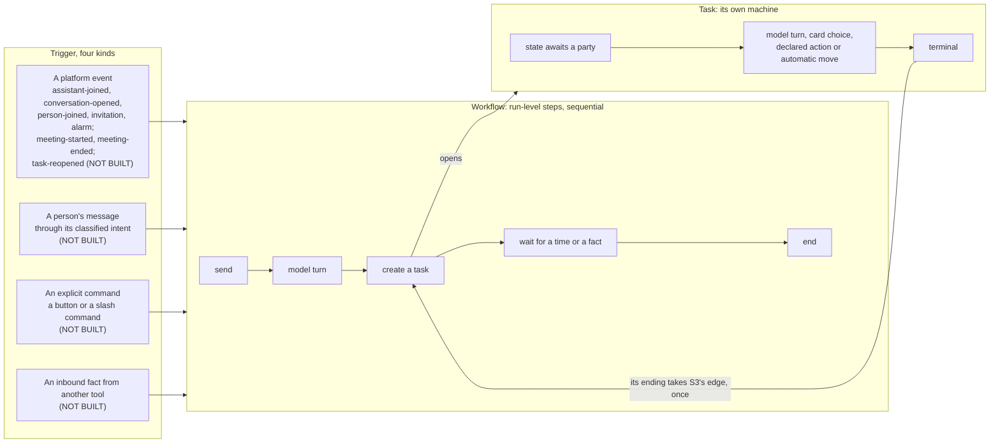
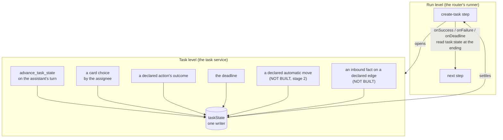
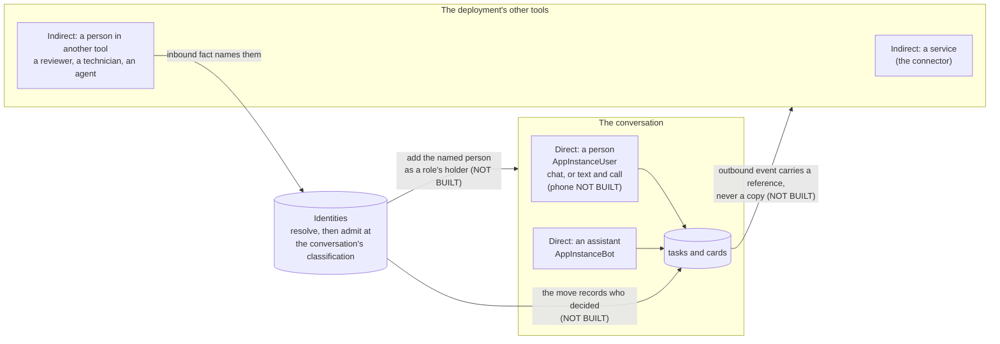
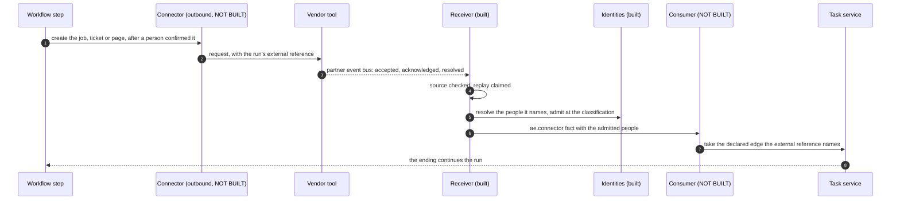
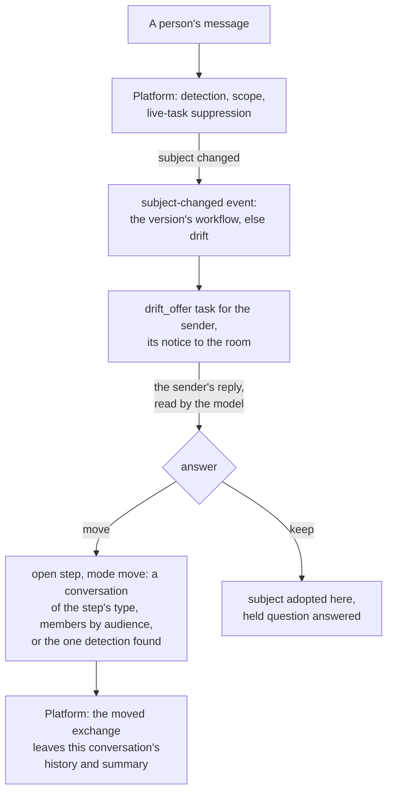
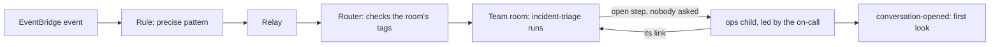
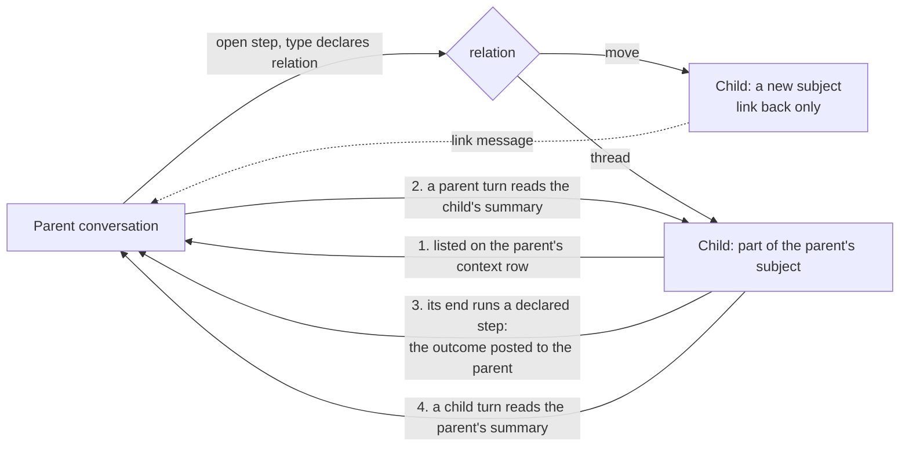

# DESIGN: Workflows and tasks

**Status:** Partial. Each part's status is in [SPEC-WORKFLOWS-AND-TASKS](./SPEC-WORKFLOWS-AND-TASKS.md), the one place it is recorded. Event workflows, task steps and the task machine are built and verified on dev. ADR-067 stages 1 to 5 are built and proven by unit tests, and their dev runs are owed. The ownership tenet below is the rule every part is held to; the parts that do not meet it yet are **NOT BUILT** and named in section 1. The meeting events `meeting-started` and `meeting-ended` are built with the `meetings` capability, and their dev run is owed; `meeting-starting`, `meeting-joined` and `expected-attendee-absent` are **NOT BUILT**. Commands, connectors and indirect participants are **NOT BUILT**.

**Coverage:** `tests/e2e/a-workflow-step-opens-a-task-for-a-person.spec.ts`, `tests/e2e/a-task-deadline-ends-the-task-and-continues-the-run.spec.ts`, `tests/e2e/an-idle-assistant-takes-up-its-own-work.spec.ts`, `tests/e2e/a-participant-role-holder-completes-a-task-on-the-card.spec.ts`, `tests/e2e/an-invitation-runs-its-workflow-until-it-is-revoked.spec.ts`, `tests/e2e/admin-workflow-builder.spec.ts`. The spec's rows name the rest.

**Related:** [SPEC-WORKFLOWS-AND-TASKS](./SPEC-WORKFLOWS-AND-TASKS.md) - the requirements and their status. [ADR-067](../../../design/decisions/067-a-workflow-is-triggered-by-an-event-or-an-intent-and-its-steps-create-tasks.md) - the decisions, and eleven worked examples in Appendix A. [DESIGN-TASK-STATE-TRANSITIONS](./DESIGN-TASK-STATE-TRANSITIONS.md) - the task machine in detail. [WORKFLOW-STEP-REFERENCE](../../../guides/admin/WORKFLOW-STEP-REFERENCE.md) - every trigger, step and task state, with its inputs and outputs.

**Site section:** Interaction layer, conversation.

---

## 1. The model

A trigger starts a workflow; a workflow's steps may create tasks; a task runs its own steps.

Every trigger, run and task acts in one classification, the axis IAM evaluates for every principal, and every actor's credential names only itself; each new boundary ships with a test that is refused, and each question has one store (section 7). That is what makes the model this platform's rather than a generic workflow engine.

### The tenet of this design: ownership is never broken

**A workflow and every task it creates belong to the assistant whose version declares them, and no workflow reaches into another assistant's.** An assistant is handed work because it holds an access the asking assistant does not (the ops assistant reads the deployment's health). The team that owns that assistant owns the process for using its access, what it costs, and whether what it reaches is provided at all. So:

- **A handoff is a request, never a run as the other assistant.** Work that needs another assistant is a task step naming one of the intents that assistant advertises (`by: { assistantRole }`). No step of one assistant's workflow runs a turn as another assistant, under its identity or on its grants. The asking workflow never writes the other assistant's prompt, picks its tools, chooses its models or reads its definition; it reads only the other assistant's advertisement.
- **The asker says what is needed; the owner declares what is delivered and how.** The request states specifically what the asking assistant needs, in the request's own words and values. What comes back, in what form, through which steps, at what cost, and whether anything is provided at all, is declared by the owning assistant's version and the team that owns it. The asker can ask precisely; it cannot shape the answer.
- **Any advertised intent may be asked for.** A request names any intent the other assistant advertises, single-turn or multi-step. A multi-step intent runs as that assistant's own run with its own task. A single-turn intent is one turn of that assistant's, answering in the conversation under the intent's own instructions and tools, with no task, and its ending is handed back the same way.
- **The owner runs it its own way.** The other assistant's own version runs the request: its workflow for the intent, its task steps, its models, its tools and its grants, on its own session. It may decline.
- **Only the outcome comes back.** The asking run receives how the task ended, and continues on that ending where the step blocks (or at once, with `continue: opened`). It receives a value the task recorded only where the owning machine declares that value shared. What the other assistant chooses to say, it says itself.
- **Requests never loop.** A run carries the chain of requests that led to it, so an assistant the chain already asked for an intent is never asked for it again within the chain, and a chain stops at three runs (`MAX_ASK_CHAIN`): the step that would ask takes its failure edge, and nobody is asked. Within one assistant's work, a run's steps cannot cycle and a machine's automatic moves must end at a state that declares none, so no chain of turns, and none of their cost, runs without end (proven by `backend/test/lib/a-request-to-another-assistant-runs-its-own-workflow.test.ts`).
- **Each assistant is judged on its own declared intents, the same way whoever asked.** A request to another assistant runs as one of that assistant's intents, so its turns are measured under that intent and that assistant's run, with what started it recorded beside them: a person, another assistant's run, or an event. The owning team manages the experience through its analytics, so Effectiveness shows each declared intent as one population with one set of measures (completion, time to complete, cost, quality, declines), whatever started it, and what started it is a breakdown of that population rather than a separate report. A request from another assistant is never folded into the asking assistant's workflow, and never missing from the owner's view.
- **The asker sees its own side.** The asking assistant's analytics show its step as a request: which intent it asked of which assistant, how it ended, and how long it waited, never the other assistant's turns, costs or steps.
- **A step declares who may respond, and that is who is assigned and notified.** Each step names its responders by role (a participant role or an assistant role), by id (an AppInstanceUser or an AppInstanceBot), or as any member of the conversation, and an answer from anyone else is refused where it arrives (**NOT BUILT**, [SPEC-WORKFLOWS-AND-TASKS](./SPEC-WORKFLOWS-AND-TASKS.md) WT119).
- **A person is handed the owner's steps.** A task given to a person runs the steps the owning assistant declared, with the needs and the instructions that assistant wrote for each, so the person knows exactly what is needed (a billing approval, for one).

#### Why ownership is the tenet

Each benefit below follows from the tenet and is lost the moment one workflow reaches into another assistant's:

| Benefit | What it gives the deployment | Project tenet it carries |
|---|---|---|
| Access stays with the assistant granted it | Only the assistant that holds a grant ever uses it. An asking assistant never inherits that reach, not for one step, so least privilege holds by construction and an IAM refusal still has one principal to refuse. | [D1, D3, D4](../../../overview/TENETS.md) |
| The owning team controls its process | The team that owns an assistant decides the steps, the models and what they cost, the policies the work is held to, and whether anything is provided at all. A request cannot move any of those decisions to the asker. | [P5](../../../overview/TENETS.md) |
| Only the outcome crosses | The asker receives how the work ended, and a value only where the owner declares it shared. What the owner's work read, recorded and reasoned over stays the owner's, which keeps the data that crosses an assistant boundary to the minimum the owner chose. | [D1, D15](../../../overview/TENETS.md) |
| One measure per declared intent | Each intent is measured the same way whoever asked, so the owning team sees all of the demand on its intent (a person's, another assistant's, an event's) with one set of measures, and the asker sees its own wait and outcome. Nothing is counted twice or under the wrong assistant. | [D7](../../../overview/TENETS.md) |
| An owner changes its side without breaking the asker | The contract between assistants is the advertised intent and its ending. The owner may change its workflow, its machine, its model or its version, and every assistant that asks it keeps working. | [P3](../../../overview/TENETS.md) |
| Simpler to reason about, and auditable | A workflow holds only its own assistant's steps, so reading one workflow says everything that runs in its name, and every handoff is a recorded request with what started it. | [P4](../../../overview/TENETS.md) |

Where the build does not meet this yet, it is **NOT BUILT** and recorded in [SPEC-WORKFLOWS-AND-TASKS](./SPEC-WORKFLOWS-AND-TASKS.md) WT118: a value the other assistant would share has no place in its advertisement, so a request hands its asking run its ending only; a step has no instructions written for the person who holds it; and the asking assistant's analytics do not show its step as a request (which intent of which assistant, how it ended, how long it waited). Built (proven by unit tests, `a-request-to-another-assistant-runs-its-own-workflow`; its dev run is owed): an agent step naming another assistant's role (`as`) is retired, refused on a draft and never dispatched where stored; a request (a task step with `by: { assistantRole }`) starts the owning assistant's own run of the advertised intent on its served version, says what is needed in one of the asking assistant's message templates (`ask`), may not declare the task's visibility, priority, fields or deadline, asks nobody and takes its failure edge where more than one assistant in the room holds the role, and continues the asking run on how the task ended, handed only its own values; and every run records what started it (a person, another assistant's run, or an event), which the Workflow editions breakdown reads per declared intent.

| Term | What it is | Where it is stored |
|---|---|---|
| Trigger | A platform event, an intent label, an explicit command, or an inbound fact; all but the built events are **NOT BUILT** | Declared by the workflow: `on: <event>`, `on: { intent }`, `on: { command }`, `on: { fact }` |
| Workflow | Acyclic, sequential run-level steps whose edges read step outcomes | The version's `eventWorkflows`; intent workflows in `intentWorkflows` (WT7, **NOT BUILT**) |
| Task | A tracked record with a requester, an assignee, an assistant, a state, a card and a deadline | The task table; its machine on the version's `intentPack.machines` or the platform set |
| Settlement and naming | A task reaching the ending its run waits on; the naming is the task service's notice that continues the run | The task's transition log; the archive fact (WT61) |
| The router's door | The router's own task creation on the turn that classified the request (`createTask`), which works the first step on that turn | The task table |
| The first look | `incident_first_look`, the ops room's first read of the deployment's health, opened when the room opens | A version machine from stage 2 (WT52) |
| The next record | The design record after ADR-067, "events in and out" (section 10) | Not yet written |

## 2. Two levels, one writer

A run never writes a task's state. A task moves only through its own machine; the run reads the ending.

A wait on a person is always a task, because a person's wait must be in their open work, carry a deadline and be answerable on a card. A wait for a time or for an inbound fact is a run-level `wait` step, because nobody's open work holds it.

| The platform's, fixed | The team's, per version |
|---|---|
| The platform machines: the queue's five, `action_item`, `place_item`, `approval`, `acknowledgement` (refused by name in a draft) | The welcome, event workflows, intent machines, `incident_first_look` (**NOT BUILT**, stage 2) |
| Drift detection, its scope, the offer's lifecycle and the move | What happens when the subject changes (**NOT BUILT**) |
| The exits: `/stop` and "get me a person", never withheld, even on a private run (WT28) | Everything else in a run |

## 3. How a request becomes a workflow

| Rule | What happens |
|---|---|
| The canonical intent workflow | A version that declares no workflow for a multi-step intent runs one create-task step over the intent's machine, exactly as the router opens the task today: no deadline, the work items' options, the `general` fallback |
| The triggering turn works the first step | The task opens through the router's door on the turn that classified it, so the person waits no longer than today |
| Continue before trigger | A person with a live task of this assistant gets their next message routed to that task's turn, where the model judges whether it is about the task; a new request for another multi-step intent opens its own task (WT106) |
| `continue: opened` | A create-task step may continue once its task leaves its first state, so a resting task (the first look) does not hold the run; refused on an intent trigger (WT113) |
| A task that reopens | Steps after it run once, at its first settlement; a later reopen raises `task-reopened`, which starts its own run |

## 4. Who takes part, and who sees what

The platform does not route or assign work (Accepted 2026-11-05). The deployment's tools choose the person; the platform identifies them, admits them at the conversation's classification and adds them.

| A run started by | Takes the visibility of | On a private run |
|---|---|---|
| An intent | the message that triggered it | every step that reaches the room, another person or an outside tool is withheld, refused again at the send path, the create-task door and the connector-action path; a task it opens is private whatever its step declares; the requester is told by a templated notice (WT72, WT110) |
| An event about a task (`task-reopened`, an inbound fact naming it) | that task | the same |
| A command | the surface it came from: a targeted message or a button press is private; an untargeted room message runs in the room | the same |
| An event about a conversation (an assistant joins, a conversation opens) | the room, as today | not applicable |

A text to a member who joined by phone is the one exception to "only a reference leaves": it is a message template that may carry the full text or a link, the link by default, and a text carrying full text cannot be recalled by a later erasure (WT73). A reply binds to the member by the verified number on their identity; a choice from any other number settles nothing (WT77).

## 5. Events in and out

The receiver is built up to a fact; the consumer, outbound actions and the add step are **NOT BUILT**. They are the next design record, proven with the PagerDuty connector.

## 6. Drift as an event

Detection stays the platform's; the response is a workflow (SPEC-WORKFLOWS-AND-TASKS WT88 to WT93, built, awaiting dev verification). The platform's `drift` runs where a version declares none: the room is told, or the sender alone where their message was private; the sender's reply, read by the model, answers the offer, which is one record, the run's task, and the run continues in the same turn; a move that fails is told; a move opens a conversation of the step's `type`, or links the person to the one detection found. A version copies `drift` to choose that type, and a type with drift off keeps the child from drifting again.

**An outside event reads off AWS resources (WT121).** The rule `<prefix>-<classification>-trigger-<id>` (precise pattern, one target) names the team room in its fixed input; the room is the channel `team-<type>-<classification>`, tagged `team-room` and `event-rule:<id>`; the workflow declares that one type. So one main room always exists for a type, nothing looks it up, and a workflow on this event runs there and in no other room.

**One step opens a conversation, whichever event started the run (WT90, WT120).** Drift is an event the platform raises itself; an alarm reaches the platform from outside. Each starts a workflow, and that workflow's step opens the child at the parent's classification. The type being opened declares its members, so the workflow names a type and never a list:

| | An alarm or other outside event | Drift, a native event |
|---|---|---|
| Raised by | The source, through the event's adapter | Platform detection, on the turn (`subject-changed`, WT88), where the instance and the conversation type both have drift on |
| Who decides | Nobody is asked: the event starts the workflow and the conversation opens proactively | The person whose message drifted: the assistant offers, and that person accepts or declines |
| Child's type | `ops` | `general` |
| Child's members | The type's group and assistants | The triggering message's audience (WT92) and the type's assistants |
| What the parent keeps | The link to the child | On accept, the link, and the message's context is left out of its history and summary (FR26); on decline, everything, and the subject stays here |

### A child's relation to its parent: `move` or `thread`

Built, awaiting dev verification, the meeting half included: a meeting's conversation is a child whose end is the `meeting-ended` event. A child conversation either leaves its parent's subject or carries on part of it. Which one is a property of the child's conversation type, declared as `relation`, so the team that owns the type decides it once and no workflow, turn or model infers it.

| | `move` (the default) | `thread` |
|---|---|---|
| Meaning | The subject left the parent. The child is its own conversation from here on | The child works part of the parent's subject. The parent still owns the subject and needs to know how the child went |
| Examples | Drift; a new support case raised in an ordinary conversation | An ops incident opened from the team's room; a meeting's conversation |
| What the child holds of the parent | `parentRef` (a link to the parent and the originating message) and `priorSubject` on its context row. No turn in the child reads the parent's messages or summary | The same, and a child turn may read the parent's latest summary as grounding (rule 4) |
| What the parent holds of the child | The link message only. The moved exchange leaves the parent's history and summary (FR26) | The child, on the parent's context row (rule 1). A parent turn reads each live child's latest summary as grounding (rule 2), and the child's end is reported to the parent (rule 3) |
| Shared context | None. The one thing that crosses is the person's own message, quoted in the child's welcome, which for a support case is its opening | Summaries, by reference, each read at the moment a turn needs it. Nothing is copied |

**The rules for `thread`.**

1. **The parent lists its children on its own context row.** The creator writes the child's channel id, its type and when it opened on the parent's context row (`recordChildConversation`), server-side, keyed by the parent conversation (tenet D13). Never channel Metadata, which members can write. A child stays listed after it ends, and the list keeps the newest fifty; whether a turn may read a child is decided when it is read (rule 5). A turn considers the newest six and reads the first three that pass, so an incident still open is not crowded out by newer ones that ended and expired.
2. **A parent turn reads a child's latest summary as grounding**, from the summary store the conversation already keeps. The turn's data plane serves a channel-keyed read only for the conversation the turn was routed in, and for one more thing: the latest summary of a relative the router named on the turn's routing record, from the server-side row. The child is always at the parent's classification, because a step opens it there (WT90), so no read crosses a classification.
3. **A child's end is reported by a declared step, never inferred.** The workflow that opened the child declares what happens when it ends: for an ops incident, the team conversation's run waits on the child (`wait: { child: 'ended' }`), and the step after it is a send to the team conversation naming an outcome that was not a resolve, as a template in the assistant's words; a resolve is said there by the child's own run at the moment of resolve, through a `send` step that posts in the conversation that opened it (`in: 'opener'`, DESIGN-PROCESSES O24). The incident is the child's own work. Its `conversation-opened` workflow (`ops-room`, where `event:openedBy` is `workflow`) gives the on-call the `incident_ownership` task in the child (`incident-owner-task`, what it is, the steps and when to resolve it, in place of the generic lead welcome) and goes on alongside it (`continue: 'alongside'`): once its first look has started it offers the lead the incident call (`meeting_offer`), whose start starts the conversation's meeting and rings it, and then runs the team's runbook. The ops assistant is asked for each reading (`runbook_cause`, then after the change `runbook_verify`), requests to the ops role naming intents its version advertises, whose instructions are the runbook and whose own run reads the telemetry its role reaches; between them the lead decides the recommended change on an `approval` card, makes it and confirms on an `acknowledgement` card, and confirms the people affected were told. The ops assistant holds no write: every change is the on-call's. The child's run ends only once the lead's task has settled (resolved, its deadline, or the child's archive). The lead's task declares that its settlement ends the run where it stands (`endsRun`), and a resolve while the runbook still has steps open is confirmed first (`confirmEnd: confirming_resolve`; owner decision 2026-11-14, SPEC-WORKFLOWS-AND-TASKS WT128): the on-call alone is asked, naming the steps still open, and once they confirm, the run ends now and its open runbook tasks are cancelled with the run's end as their reason. Its end tells the conversation that opened it through the parent link the child's row records (`parentRef`): the two meet on one record of the waiting run, written once, whichever comes first (`held-run.ts`). The runbook is the ops team's, on the ops assistant's version (its intents, its `ops-room` workflow and its message templates), so the team improves it as it improves the assistant, versioned and rolled back like any change. The incident shape the owner decided on 2026-11-15 (SPEC-WORKFLOWS-AND-TASKS WT129, built and not deployed) is a change to this content, from the same steps and two fields, a task step's `movesTo` and a wait's `alongside`: an alarm that opens the incident conversation at once and tells the team why, triage (customer impact included) in the incident conversation, a living root-cause investigation task, a resolve that moves the run on rather than ending it, and a post-incident review in the incident conversation that starts once resolve is reached and the investigation is complete, after which the run ends. A meeting's end is the `meeting-ended` event, and the version's `meeting-ended` workflow declares what follows.
4. **A child turn may read the parent's latest summary as grounding**, under the same rules as rule 2 in the other direction.
5. **A summary reaches only people who could already read it.** A summary read into a turn may be repeated in that turn's reply, so a child's summary grounds a parent turn only when every current human member of the parent is also a member of the child, read live from Amazon Chime SDK membership, never from a stored copy. Rule 4 applies the same check the other way. This is the rule a related-conversation suggestion already follows (ADR-012). A member the check excludes still gets the outcome step's post (rule 3), because its author wrote that post for the parent's room.
6. **The relation never changes a child's membership or classification.** Those are the child type's own, as today.
7. **The router names the relatives; the processor checks and reads them, off the first frame's path.** The router takes the references from the row its host grounding already reads (`lib/host-grounding.ts`), unchecked. The processor reads both conversations' members as the turn's assistant, whose role reaches only its own classification's conversations (ADR-042), so another classification's conversation and one the assistant is not in are refused at the read, and a roster that stopped at its page bound fails the check (`readableRelatives`, `lib/related-conversations.ts`). Then it reads each latest summary with the rest of the turn's grounding (`lib/turn-grounding.ts`).

**What it changes, and the refused tests it ships with.** `relation` on the conversation type (`lib/config/conversation-types.ts`), `move` or `thread`, defaulting to `move`; `ops` is a `thread`. The creator writes the child entry for a `thread` type. The router checks relatives under rule 5, and the processor reads their summaries. `incident-triage` reports the on-call's resolution to the team conversation (`incident-resolved-team`). Refused tests, in `a-thread-child-is-read-by-its-parent.test.ts`:
- A parent turn whose room has a member the child lacks receives no child summary.
- A `move` child's summary is never read into the parent.
- A child entry written to channel Metadata is ignored.

## 7. Boundaries and stores

| Concern | How it holds |
|---|---|
| Classification | A workflow, its triggers and its tasks are data on a version, and a version acts in one classification; a task step reaches only assistants of the conversation's own classification (`isOwnAssistant`), and a person a tool names is added only where they were admitted at the conversation's classification (WT76) |
| Acting as itself | Each run-level model turn and each outbound write runs under the assistant's own session; a person acts through their own bearer-pinned credential, a command press included |
| Proof | Each new boundary ships with a refused test: a private run's room send, outbound event and task for another person (WT72), another classification's body prefix (WT117), a person admitted elsewhere (WT76), a forged own-app event (WT84), a non-member's command (WT6), a reply from another number (WT77), an indirect move from another connector (WT74), a body in an outbound event (WT73), an unconfirmed outbound action (WT83) |
| Stores | The task row answers a task's state; the run record answers only where a run stopped, at most 45 days, references only (WT26); the archive is the record of every turn, transition, settlement and run end (WT61, WT62); the Aurora projection answers analytics; no counter counts what the archive holds |
| Retention | Archive facts carry the AppInstanceUser id and references only and follow the archive's erasure path; a reference an outside tool holds resolves to nothing after erasure (WT116) |

## 8. Versions and editions

A task finishes on the version it started on (`originConfigId`), and a run continues on its origin version from stage 2. A run's edition is its workflow hash; each task's edition is its own machine hash, so a workflow edit and a machine edit are measured separately, and a persona edit changes neither (WT60, WT109).

## 9. When decisions meet

| Case | Rule |
|---|---|
| A report reopens while its run waits on the approval of the first delivery | The approval stays live and decides the first delivery; the reopen raises `task-reopened`, whose workflow may ask again; the card names which delivery it decides |
| The live task's turn reads a new request (WT106) | The new task opens through the router's door on that turn, under the same turn lock, and starts its own intent run keyed by the turn's correlation id; its first step is worked by the next turn on it |
| A person with a live task sends a command | A command is recognized before any task binding, as `/stop` and `/battle` are, and starts its own run |
| A private requester asks for a person | The exits are not run steps, so "get me a person" is never withheld; the handoff carries a reference only (WT28) |
| An outside approver and a private task | A private run sends nothing outside (WT72); a conversation task's reference is readable by the person an outbound event named, under their own credential, only where they are admitted at its classification (the next record) |
| A run is canceled after it wrote to an outside tool | The undo runs under the assistant's own session through the connector's declared undo; a failure is recorded and raised; a fact arriving later names a settled task and takes no edge (WT27) |
| A reopened task's new run and the run-end record | Each run writes its own run-end record; the original run's record stays as written |
| A team edits the first look's automatic move | Validation refuses an `auto` that names an edge the state does not declare; the runtime takes it once per entry (WT52) |

## 10. Build order

| Stage | What it builds | Status |
|---|---|---|
| Event workflows (ADR-061) | Events, `send`, `agent`, intake, the welcome as a workflow, participant roles, proposals, the visual builder | Built; verified on dev 2026-11-05. The meeting events `meeting-started` and `meeting-ended` are built with the `meetings` capability (`backend/test/lib/a-meeting-workflow-runs-in-its-room-and-goes-on.test.ts`), and their dev run is owed |
| Task steps (ADR-063) | A step opens a task, the card, the deadline, idle pickup | Built; verified on dev 2026-11-05 |
| Machines on the version (ADR-066) | Intent machines on the version, platform keys fixed, origin pinning, the golden walk | Partly: built and unit-proven for a request-opened task and a step-opened one (WT58, WT117); an undeclared key resolves from the pack (WT57); no e2e. The intent editor is **NOT BUILT** |
| ADR-067 stage 1 | One Workflows list (WT98), the welcome's three-way Edit and its kept workflow (WT112), intent entries (WT97), the Platform section, "Shipped" (WT53) | Accepted 2026-11-05. Partly built: the list, the welcome's form, the Platform section and "Shipped" passed on dev 2026-11-05 (`the-workflows-list-is-grouped-by-trigger.spec.ts`); a task's steps are edited on the builder's task-machine mode and saved as the version's machine, its console half passed on dev 2026-11-05 and its runtime half is owed (WT97); the stored kept welcome (WT112) is **NOT BUILT** |
| ADR-067 stage 2 | A step-opened task and a run on their origin version (WT17, WT117); `incident_first_look` editable, its automatic move declared (WT52); `continue: opened` (WT18); failure reasons (WT25) | Built 2026-11-06, proven by unit tests; its dev run is owed |
| ADR-067 stage 3 | An intent triggers a workflow (WT3), its later steps (WT19), the requester (WT71), the audience rules (WT72, WT110, WT111), `task-reopened` (WT104), a new request mid-task (WT106), `continue: opened` refused on an intent (WT113), a requester's move on another's task (WT114), the roommate's version (WT78), a queued request's workflow (WT115), the exits (WT28), run cancel's task half (WT27), run fields, run end and Effectiveness per edition and rework (WT60, WT62, WT105, WT109), run records to 45 days (WT26). Prerequisites, one list: stage 2 on dev, `intentWorkflows` (WT7), declared types (WT4), the settlement facts (WT61), the reconciliation sweep (WT15), the duel rule recorded in SPEC-BATTLE (WT107) | Proposed. **NOT BUILT** |
| ADR-067 stage 4 | One step schema over both levels: the agent step that opened a task retired into a task step (WT52), a task's steps edited on the same builder | Built 2026-11-06, proven by unit tests; its dev run is owed |
| ADR-067 stage 5 | The run-level `wait` for a time (WT20), three kinds of deadline (WT21), typed values (WT22), notices on entry (WT23), the form machine (WT50) | Built 2026-11-06, proven by unit tests; WT20 for a duration, WT21 for a task step, WT22 inside a task. Its dev run is owed |
| Events in and out (next record) | The `ae.connector` consumer and `on: { fact }` (WT82), outbound actions (WT83), the add step (WT76), the indirect worker (WT74), who decided (WT75), the own app (WT84), the outbound undo (WT27), references after erasure (WT116), admission at the conversation's classification (WT81), what leaves the platform (WT73) and the phone transport (WT77). Done when a PagerDuty e2e on dev opens a room from an alert, adds the named responder and settles on the acknowledgement | **NOT BUILT** |
| Drift as a workflow event | `subject-changed` (WT88), the `drift_offer` machine (WT89), the open and go steps (WT90). Done when a drift e2e on dev moves a subject through a team's workflow | Built, awaiting the drift e2e on dev |
| A child's relation to its parent | `relation: move \| thread` on the conversation type; a `thread` child listed on its parent, its summary read under the membership rule, its end reported by a declared step (section 6) | Built, awaiting dev verification, the meeting half included |

## 11. Worked examples

ADR-067 Appendix A writes eleven workflows in this model, with the gaps each exposes (G1 to G44): the welcome (A.1), the ops room (A.2), `image_generation` (A.3), a report with an approval (A.4), `account_brief` (A.5), a delivery (A.6), a service call (A.7), triage (A.8), drift (A.9), a service appointment across a phone, a ticket and a new conversation (A.10), and a legal sign-off from another tool (A.11).
