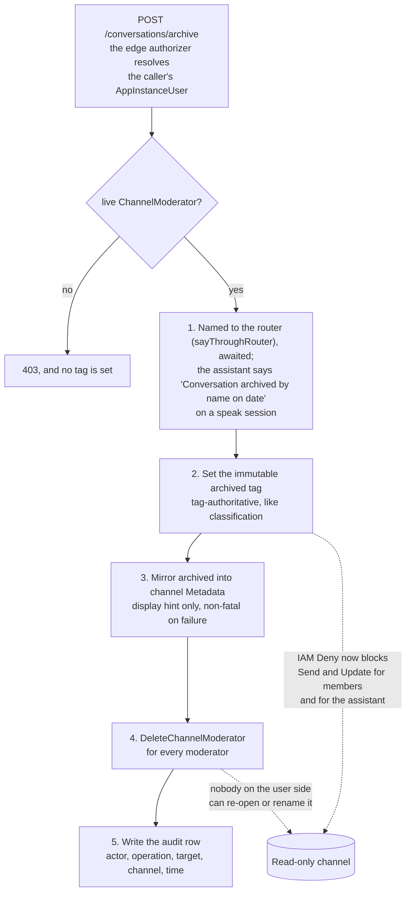

# SPEC: Conversation Archive and Member Removal (moderator)

**Status:** Partial (archive and remove-member ship with their controls; the leave route and its provider action ship with no control in the client, so a member cannot leave from this app). Meeting events and transcript segments reaching the archive first, and rebuilding the projection from the archive, are design: FR18 is **NOT BUILT** and FR19 is **OPEN**.

**Coverage:** `tests/e2e/archive-membership.spec.ts` - asserts the creator is a moderator (the archive control is gated on it), then archives through the real UI path and checks BOTH sides of the transition: the conversation leaves the user's active list, and the admin archive still holds it in the archived state. Asserting only the disappearance would pass equally if the record had been destroyed, which is the failure that matters. The admin read is SigV4-signed and polls until the state settles, because the flag reaches Aurora through the channel-event stream and the row appears before it flips.

**Related:** [ADR-017](../../../design/decisions/017-conversation-archive-mechanism.md) - the archive mechanism this implements. [SPEC-ADMIN-IDENTITY.md](../governance/SPEC-ADMIN-IDENTITY.md) - the two credential planes the authorization rests on. [SPEC-CONVERSATION-SECURITY.md](../governance/SPEC-CONVERSATION-SECURITY.md) - the layered access model.

**Site section:** Interaction layer, conversation.

---

## Overview

**A conversation ends by being archived, and archiving is a moderator's own action rather than an administrator's favor.** What is unique here is who holds the authority and what survives the action. The person who created the conversation is a `ChannelModerator` of it, and that standing - read live from Amazon Chime SDK Messaging rather than from stored metadata - is the whole gate. They archive the conversation for everyone or remove a member; no administrator is involved, and nothing is destroyed. Leaving is served by the same path and is not offered by the chat client.

**Read-only is enforced by IAM on an immutable tag, not by application logic.** Archiving sets an `archived` tag on the channel, and an IAM Deny conditioned on that tag blocks `chime:SendChannelMessage` and `chime:UpdateChannelMessage` for the user exchange credential and for the per-classification assistant. Once the tag is set neither a member nor the assistant can physically write, whatever any client believes. The tag is the authority for every decision, for the same reason the `classification` tag is: channel Metadata is member-writable and a tag set by `UpdateChannel` is not.

**Archiving is the end-of-life path for a conversation, and conversation deletion is not a product action.** `chime:DeleteChannel` is refused outright, because it would take the administrators' copy with it. The conversation event archive persists regardless of membership and outlives the channel, so what archive removes is the members' write access and their moderator standing - never the record.

**Three distinct actions share one server-side path.** Archive is whole-conversation and moves every member's list. Remove-member takes one named member out and never the assistant. Leave takes the caller out and nobody else. All three run through one membership Lambda behind the edge authorizer (`backend/lambda/src/conversation-management.ts`) that authorizes per operation and then acts as the app-instance-admin bearer, so user credentials stay least-privilege and every action lands on one audit path.

**Moderation is channel-scoped; administration is cross-conversation.** Everything in this document is the first: a moderator acting inside one conversation they moderate. Reading or acting across conversations is administration and is served by a different identity plane.

## Business Problem

Someone who runs their own conversations wants to keep their list tidy: finish one and put it away, take a person out who should not be in it, or step out themselves. In most chat products every one of those is an administrator's job, so a person either files a request or lives with a list that only grows. The alternative is building membership-and-archival management from scratch on top of the messaging layer, and the obvious cheap version - hiding the row in the client - reappears on the next reload and leaves the conversation writable by everyone in it. What is needed is an action a conversation's own moderator can take, that actually holds, and that does not cost the organization its record of what was said.

## Personas

Personas are defined in [PERSONAS.md](../../../overview/PERSONAS.md) and are not redefined here. Four of them meet this capability, and they divide on one line: the first two act, and the last two depend on the action not destroying anything.

### End user

**How this relates to them:** they are the conversation's moderator, because they created it. This is the one place an end user holds an authority that is normally an administrator's, and it is scoped to the conversations they moderate and to nothing else. They also meet the capability as an ordinary member, when they want out of a conversation somebody else runs.

| What they need | Requirement |
|---|---|
| Put a finished conversation away, for everyone, without asking an administrator | FR1, FR2 |
| A clear statement of what archiving costs before it happens, and no ambiguity with deletion | FR17 |
| Still be able to read the thread afterward, and find it again | FR7, FR8 |
| Leave a conversation somebody else runs, without affecting anyone else in it | FR9, FR10 |
| Take one member out of their own conversation, with a confirmation first | FR11 |
| An action that holds across a reload rather than hiding a row | FR3, FR5 |

### Admin / operator

**How this relates to them:** they answer for the deployment's record. They do not archive on a user's behalf and do not need to: their copy is preserved by construction, and the queryable trail of who archived, removed or left is what they read when somebody asks why a person lost access.

| What they need | Requirement |
|---|---|
| The archived conversation still readable in the console, in the archived state | FR6 |
| A queryable record of every archive, removal and leave, independent of the conversation | FR14 |
| The action visible in the conversation's own timeline, naming who did it and when | FR13 |
| Administration unaffected by the read-only Deny a member is subject to | FR4 |
| Re-admitting a member remains an administration action rather than a user one | Non-Goals |

### Legal

**How this relates to them:** their interest is entirely in what archiving does NOT do. A matter can attach to a conversation that a moderator archived months earlier, and the preserved history has to be the same history.

| What they need | Requirement |
|---|---|
| The full event sequence retained after archive, and after the channel itself expires | FR6 |
| Archive never available as a way to destroy a conversation | Non-Goals |
| A record of who removed whose access, and when | FR14 |

### Platform developer

**How this relates to them:** without this they hand-roll membership and archival management on the messaging layer, and the version that looks cheapest is the one that does not work. They also own the invariant the design is written to protect: the chat-plane credential stays pinned to its own caller.

| What they need | Requirement |
|---|---|
| One server-side path for every membership mutation, authorized where it is checkable | FR2, FR9, FR11 |
| The bearer pin on the chat plane left intact rather than widened | Non-Goals, Appendix A |
| Enforcement by IAM condition rather than by client behavior | FR3, FR4 |
| Idempotent mutations, so a retry is not an error | FR12 |
| The three routes behind the same authorizer as every other management route | FR16 |

## Functional Requirements and Acceptance Criteria

**Priority is a keep-or-cut decision set against what the field expects.** `Table stakes` means a deployment without it is behind. `Differentiator` is worth the cost because few platforms do it. `Gap - prioritize` marks a requirement whose absence puts this below comparable systems. `Above bar - optional` is more than the field asks. `Optional - attach instead` should be bought rather than built. `Enabler` is not user-visible and is what makes another row work.

| # | Requirement | Priority | Delivered | Validated by |
|---|---|---|---|---|
| FR1 | A moderator archives the conversation for everyone: it becomes read-only for every member and leaves every member's active list | Table stakes | Yes | `conversation-management` (unit, behavior), `archive-membership` (e2e, behavior) |
| FR2 | Only a live `ChannelModerator` may archive or remove a member, checked server-side against `ListChannelModerators` rather than against stored metadata | Table stakes | Yes | `conversation-management` (unit, behavior) |
| FR3 | Read-only is enforced by an IAM Deny conditioned on the immutable `archived` tag, covering `chime:SendChannelMessage` and `chime:UpdateChannelMessage` on the user exchange credential and on the per-classification assistant grant | Differentiator | Yes | `conversation-archive-wiring` (unit, behavior) |
| FR4 | The archived Deny never reaches the app-instance-admin bearer, so administration of an archived conversation still works | Enabler | Yes | none |
| FR5 | Archiving removes every `ChannelModerator`, so nobody on the user side can re-open, rename or un-archive the conversation | Table stakes | Yes | `conversation-management` (unit, behavior) |
| FR6 | The administrators' copy survives: the conversation event archive persists regardless of membership and outlives the channel | Table stakes | Yes | `archive-membership` (e2e, behavior) |
| FR7 | Members keep read access for a grace window, and the conversation hard-expires 90 days after its last activity on the Amazon Chime SDK expiration setting applied at creation | Differentiator | Yes | `conversation-archive-wiring` (unit, behavior) |
| FR8 | An archived conversation stays reachable read-only behind a "Show archived" control rather than disappearing from the client | Table stakes | Yes | none |
| FR9 | Any member may leave a conversation, removing only their own membership; the backend refuses a target other than the caller and applies no moderator check | Table stakes | Partly - the route and the provider action ship; the client offers no control, so a member cannot leave from this app | `conversation-management` (unit, behavior) for the route |
| FR10 | A member can still leave an archived conversation, because the Deny covers message writes and not `chime:DeleteChannelMembership` | Table stakes | Partly - the Deny permits it and no control in the client calls the route | none |
| FR11 | A moderator may remove one named member, and the assistant is never a valid target - refused server-side before any delete and independently of the UI hiding the control | Table stakes | Yes | `conversation-management` (unit, behavior) |
| FR12 | Remove-member and leave are idempotent: an already-absent membership is a success, not an error | Table stakes | Yes | `conversation-management` (unit, behavior) for leave only |
| FR13 | Archive posts a notice into the conversation naming who archived it, by the name the room shows, and when, before the tag is set. Conversation management names the notice to the router of the conversation's classification (`sayThroughRouter`), and the conversation's assistant says it, in its configured words (`conversationArchived`), on a speak session; the platform posts nothing as itself | Differentiator | Yes; **NOT VERIFIED** on a deployment | `conversation-management` (unit, behavior) |
| FR14 | Every action writes an audit row - actor, operation, target, channel, timestamp - to a dedicated store, queryable independently of the conversation | Table stakes | Yes | `conversation-management` (unit, behavior), `conversation-archive-wiring` (unit, behavior) |
| FR15 | The active list filters on a channel-Metadata display mirror and never on the tag; the tag remains the authority for every decision, and a failed mirror write is non-fatal | Enabler | Yes | none |
| FR16 | The three routes sit behind the edge authorizer on `PersonApi`, and the API's own CORS configuration answers for them | Enabler | Partly - the authorizer is checked at synth; whether a refusal the gateway answers itself carries CORS headers is not verified | `conversation-archive-wiring` (unit, behavior) |
| FR17 | The user-facing flow requires an explicit confirmation that states the consequences, and never calls the archive action a deletion | Table stakes | Yes | `archive-membership` (e2e, behavior) |
| FR18 | A meeting is conversation state, so its events (start, end, an attendee joining or leaving) and every transcript segment of a meeting or a call are appended to the conversation's event archive first, and any projection or roster is derived from the archive. Each record names the conversation's channel ARN and the AppInstanceUser it concerns: an attendee through its `ExternalUserId`, which is the AppInstanceUser id, and a segment through its attendee or call leg, never through a speaker label | Table stakes | **NOT BUILT.** No meeting or call path exists; the archive ingests the Amazon Chime SDK messaging stream only | none |
| FR19 | The analytics projection can be rebuilt from the retained archive, so a fresh deployment, or a move between analytics modes, loses nothing the archive holds | Gap - prioritize | **OPEN.** No rebuild job exists: the projection fills only from the live stream, and the analytics guide states that no tool loads one mode's data into the other ([AURORA-MODE-GUIDE.md](../../../guides/admin/AURORA-MODE-GUIDE.md#switching-modes)). Whether one is built, and from which archive prefixes, is undecided | none |

**Reading the "Validated by" column.** Each entry names one test file by its own name. Unit and synth tests live in `backend/test/`; end-to-end specs live in `tests/e2e/` and are listed against their phase in [e2e-coverage-matrix.md](../../../reference/e2e-coverage-matrix.md). The status in brackets is what the test does:

- **behavior** - executes the code path, or synthesizes the template, and asserts on the result.
- **source text** - asserts that a convention still appears in the source; it catches the convention being dropped, not a wrong value.
- **none** - no test exists.

**Known limits on the delivered rows.** FR4 holds in the code, which adds the Deny only to the user-exchange and per-classification assistant principals; the synth assertion proves that every archived Deny carries the tag condition and asserts nothing about which principals carry it, so the absence from the admin bearer is unguarded. FR8 and FR15 are built and uncovered: the "Show archived" control and the Metadata display mirror each have working code and no test that would fail if they broke. FR12's idempotency is asserted for leave only; remove-member's already-gone path has no test. The archive sequence of Appendix B is pinned only as far as the system message preceding the tag; the unit test counts the later calls without asserting their order. The end-to-end spec drives the archive transition and the administrators' copy; it does not attempt a send against the archived channel, so the IAM refusal is proven by synth rather than against the deployment.

## Non-Goals - Out of Scope

| Out of scope | Why | Where it is covered instead |
|---|---|---|
| **Conversation deletion** (`chime:DeleteChannel`) | It would destroy the administrators' archive along with the members' access. Archiving is the end-of-life path for a conversation, and deletion is not a product action at all | FR6 keeps the record; FR7 is the only path by which a channel goes away, on its own expiration |
| Un-archive or restore, for the user | Archive is defined as permanent loss of the user's write access and of their moderator standing. Only re-admission by an administrator could reverse it, which is an administration action rather than part of this capability | [SPEC-ADMIN-IDENTITY.md](../governance/SPEC-ADMIN-IDENTITY.md) and the administration actions in [DESIGN-ADMIN-CONSOLE.md](../../interface/DESIGN-ADMIN-CONSOLE.md) |
| A per-user hide | A moderator archiving for themselves alone would leave the others writing into a conversation its owner considers finished, and would make "archived" mean two things | FR1 is whole-conversation by decision ([ADR-017](../../../design/decisions/017-conversation-archive-mechanism.md)) |
| Message-level redaction and deletion | Those are channel-scoped moderation of one message, a different decision with a different record | The administration actions table in [DESIGN-ADMIN-CONSOLE.md](../../interface/DESIGN-ADMIN-CONSOLE.md), and [SPEC-CONVERSATION-SECURITY.md](../governance/SPEC-CONVERSATION-SECURITY.md) |
| Widening the chat-plane credential so a moderator can name another member | It would unpin the membership resource from the caller's own ARN, which is the bearer pin the credential-exchange model rests on. Keeping the mutation server-side avoids paying that | Appendix A, and [SPEC-CREDENTIAL-EXCHANGE.md](../governance/SPEC-CREDENTIAL-EXCHANGE.md) |
| Reading the `archived` tag to build the conversation list | `ListChannelMembershipsForAppInstanceUser` returns no tags, so it would cost one `ListTagsForResource` per channel on every list render | FR15: a Metadata mirror answers the display question only, and the tag answers every decision |
| Auditing membership deletion on the channel-event stream | The membership auditor consumes membership create and update events only, so a deletion is not on that path | FR14 writes the row from the Lambda that performed the action, which also knows the actor and the operation |

## User Experience Description and Mocks

This vertical is the user experience, so the journeys matter more here than the mechanism. Each one below is what a person does, in order.

### The end user, archiving a conversation they run

1. **The control is there because they are the moderator.** The conversation header's actions row shows Archive beside Share and Members, and only when the live moderator read says this person is one. A member who is not a moderator never sees it rather than seeing it fail.
2. **The action is labeled "Archive", never "Delete".** The word matters because the data is not deleted; access is. The only deletion the confirmation names is the channel's own expiry, 90 days after its last activity (FR17).
3. **A modal states the consequences in full before anything happens.** Archiving makes the conversation read-only for everyone and moves it out of the active list; members keep read-only access until it is permanently deleted 90 days after its last activity; administrators keep an archived copy; this cannot be undone. Confirmation is explicit rather than one-click.
4. **The conversation's own timeline records it.** The conversation's assistant posts "Conversation archived by `<name>` on `<date>`. It is now read-only.", or the line its profile configures, before the tag is set (FR13).
5. **It leaves the active list for everybody in it** (FR1), and stays reachable read-only behind the "Show archived" control (FR8).
6. **A send is refused by IAM rather than by the client** (FR3). Nobody can un-archive, rename or re-open it, because archive took every moderator with it (FR5).
7. **Leaving is still permitted** (FR10). The Deny covers message writes, so nothing stops a member taking themselves out of an archived conversation; the chat client offers no control for it, so the route is reachable only by a direct call.

### The end user, as an ordinary member

1. **The leave route accepts any member, not only a moderator** (FR9). It removes their membership and touches nothing else: the conversation and the other members carry on.
2. **The chat client offers no leave control.** The provider action exists and no component calls it, so a member who wants out of a conversation somebody else runs cannot do it from this app.
3. **Leaving twice is not an error** (FR12).

### The end user, removing somebody from their own conversation

1. **The members panel carries a remove affordance, for moderators only** (FR11).
2. **The assistant's row has no remove control**, and a crafted request for it fails server-side anyway. A conversation without its assistant is broken, so this is two layers rather than a hidden button.
3. **A confirmation precedes the removal**, and the removed member loses access at once.

### The admin / operator

1. **Open the conversation in the console and it is still there**, in the archived state, with its full timeline (FR6). Nothing about a user's archive removes an administrator's read.
2. **Read the archive event in the conversation itself** (FR13), which is the fastest answer to "when did this stop being active".
3. **Or query the action trail** (FR14) for archive, removal and leave across conversations, when the question is about a person rather than about a conversation.
4. **Administration is unaffected** by the member-facing Deny (FR4), so a redaction or a membership change on an archived conversation still runs.

### Legal

1. **Attach a matter to a conversation a moderator archived**, and read the same preserved history (FR6). The event archive is append-only and survives channel expiry, so the archive state changes what members can do and not what the record holds.
2. **Confirm nobody could have destroyed it.** There is no product path to conversation deletion (Non-Goals).

**Mocks:** none. The surfaces are the existing conversation header actions row, the confirmation modal, the conversation list's archived control, and the members panel; no new screen is introduced.

## Related Documents

- [ADR-017](../../../design/decisions/017-conversation-archive-mechanism.md) - the archive mechanism, and why the grace window decided it
- [SPEC-ADMIN-IDENTITY.md](../governance/SPEC-ADMIN-IDENTITY.md) - the two credential planes, and the app-instance-admin bearer the Lambda acts as
- [SPEC-CREDENTIAL-EXCHANGE.md](../governance/SPEC-CREDENTIAL-EXCHANGE.md) - the capability vend, and the bearer pin Appendix A protects
- [SPEC-CONVERSATION-SECURITY.md](../governance/SPEC-CONVERSATION-SECURITY.md) - the layered access model these Denies sit inside
- [DESIGN-ADMIN-CONSOLE.md](../../interface/DESIGN-ADMIN-CONSOLE.md) - the administration actions, including re-admission and message-level moderation
- [SPEC-CONVERSATION-TYPES.md](./SPEC-CONVERSATION-TYPES.md) - where the 90-day expiration setting is declared
- [PERSONAS.md](../../../overview/PERSONAS.md) - the canonical definitions of the four personas above

## Appendix A - Why this needs a server-side path

The credential-exchange model draws a hard line between the chat plane, which is the user's own least-privilege identity, and the admin plane. Three facts about that line decide the design.

**Self-leave is almost reachable and not vendable.** The chat-plane IAM boundary already permits `chime:DeleteChannelMembership` pinned to the caller's own ARN, through `exchangeVendStatements` (`backend/lib/constructs/exchange-role.ts`). No capability vends it: the only capability containing `DeleteChannelMembership` is `manage-membership`, which is in `MODERATION_CAPS` and therefore admin-plane only. So a chat user cannot request a credential to leave.

**Removing another member is not reachable on the chat plane at all.** The chat-plane grant pins the membership resource to the caller's own AppInstanceUser (`aws:PrincipalTag/person`), so a chat credential can only ever delete the caller's own membership. Removing somebody else, or archiving for everyone, is structurally an admin-plane action.

**A moderator who is not in the `admins` group therefore holds no credential that can do either.** The remaining choices are to widen the chat plane or to put the authority server-side, and widening it would unpin the membership resource and weaken the bearer pin the whole model rests on.

**So one membership Lambda handles all three operations** (`backend/lambda/src/conversation-management.ts`), hosted in the Conversations stack on `PersonApi`, behind the edge authorizer. The edge authorizer resolves the caller to their AppInstanceUser (`callerPersonId`, `backend/lambda/src/lib/auth.ts`); the handler builds the caller's ARN from that person id (`claims.actor`) and records the same id as the audit row's actor (the `actorSub` field holds that person id), never a token's `sub`. The Lambda authorizes per operation and performs the Amazon Chime SDK mutation as the app-instance-admin bearer. Routes: `POST /conversations/archive`, `POST /conversations/remove-member`, `POST /conversations/leave`. Authorization: archive and remove-member require the caller to be a live `ChannelModerator`; leave requires only that the target is the caller. This mirrors the server-side pattern the deployment already uses for a host's remove (`membershipHandler`, in the same file), `membership-audit.ts` and `user-management.ts`, which all mutate memberships as the admin bearer (tenet D9).

## Appendix B - The archive sequence, and what each step is for

**The order is load-bearing.** The notice is posted before the tag exists, because the archived Deny refuses an assistant's post once it does. Moderators are removed after the tag, so the lock and the record are both in place before the authority to undo them is dropped. Members are deliberately NOT removed: they keep read access for the grace window, which is the reason the archive is a mark rather than a teardown.

**The Deny is scoped narrowly on purpose.** An IAM Deny is evaluated for the whole principal, so the archived Deny is attached only to the user-exchange and per-classification assistant principals. Attaching it to the app-instance-admin bearer would block step 1 and every administration action on an archived conversation.

**Naming.** The interface says "Archive" for the conversation-level action and "Remove" for a single member. The backend and its logs say membership removal, because that is what it is. The user-facing archive flow never calls the archive action a deletion, since the data is not deleted - access is; the one deletion its confirmation names is the channel's own expiry after 90 days.

## Appendix C - What the stores answer, and which one decides

Three stores with three jobs, and one source per question (tenet D7).

| Question | Answered by | Never answered by |
|---|---|---|
| Is this conversation archived, for any decision | The immutable `archived` tag on the channel, read live from Amazon Chime SDK Messaging | The channel Metadata mirror, which is member-writable, or a projection that inherits its pipeline's lag |
| Should this row appear in the active list | The channel Metadata mirror, which is a display hint and nothing else | The tag, because the list read returns no tags and per-channel tag reads would cost one call per row |
| Is this caller a moderator | `ListChannelModerators`, live | Stored metadata of any kind |
| What was said, and what happened to this conversation | The S3 and Athena conversation event archive, which is append-only and outlives the channel | Amazon Chime SDK Messaging, which is not durable beyond the channel's life |
| Who attended a meeting, and who said what in it or in a call (FR18, **NOT BUILT**) | The same event archive, each record naming an AppInstanceUser | A projection, a roster count, or a transcription speaker label |
| Who archived, removed or left, and when | The dedicated conversation-actions audit store, written by the Lambda that performed the action | The membership-audit findings store, which consumes membership create and update events only |

The archive copy is never the authority for a live decision. A read that cannot establish the tag refuses rather than assuming a value.

## Appendix D - The event archive's partitions

The conversation event archive's Firehose writes each record under `conversations/user_type=<classification>/year=/month=/day=/` in the archive bucket: the classification the turn declared, or `unknown` for a record that carries none (a person's message carries no Metadata at all, so `unknown` is a normal, permanent partition). The `conversations` Glue table is partitioned by `user_type`, `year`, `month` and `day`, in both analytics modes.

**The table registers its partitions; it projects none.** Each object the Firehose creates under `conversations/` invokes the partition registrar (`backend/lambda/src/archive-partition-registrar.ts`, an S3 event notification, built by `registerArchivePartitions` in `backend/lib/constructs/archive-partitions.ts` in the stack that owns the bucket and the table), which creates the object's `(user_type, year, month, day)` partition in Glue with the table's own storage descriptor at that partition's prefix. A partition that exists is success, and the registrar asks Glue once per partition per event and remembers nothing across invocations, so Glue is the only record of what is registered and a partition removed from Glue is registered again by the next object written to it. Every query over the table reads the registered partitions exactly as it read projected ones, with no change to a query.

| Shape | Why it is not the one built |
|---|---|
| A projected `enum` of the declared classifications and `unknown` | The table would name every classification the deployment declares, so adding or removing one would change the archive's template, and a value written but absent from the enum is never scanned |
| A projected `injected` `user_type` | Athena refuses a query on an injected column whose WHERE clause carries anything but a static equality on it, and the analytics queries count and group across every classification (`lambda/src/analytics-query.ts`); the client events table records the same refusal |
| `user_type` as a column rather than a partition | The records are the raw stream lines; the classification is not a field of the line, so every query reading it would change |

**What it guarantees.** A classification added or removed changes no table: its partitions appear as its records are written and stay readable after it is removed. The partition key is still the conversation's classification, and the reach of a caller is still filtered by it (`archive-reader.ts`, `scopeAnalyticsRows`).

**Event-driven, and self-healing within a partition (tenet D6).** The Firehose writes a partition's objects every buffer interval, so a partition whose first registration was missed is registered by the next object written to it. An invocation that fails is retried twice by Lambda and then kept on the registrar's dead-letter queue, and the `<stack>-archive-partition-unregistered` alarm fires on any message there; the event names the object, so an operator registers its partition by redriving the event to the registrar.

**Backfilled at deploy.** Objects archived before the registrar existed have no event. The same function is the handler of a custom resource (`ArchivePartitionBackfill`) in the stack that owns the bucket: on Create, and on a change to the bucket or prefix it lists, it lists the partition prefixes under `conversations/` (names only, `s3:ListBucket` conditioned on that prefix) and registers each with `BatchCreatePartition`, an existing partition being success and any other error failing the deploy.

**Verified by:** `backend/test/lib/the-archive-registers-each-partition-it-writes.test.ts` (the registrar, the backfill, and the dead-letter queue and its alarm as synthesized), `backend/test/a-partition-key-survives-the-slimming.test.ts` (neither table projects a partition, and both register the prefix the Firehose writes), and the deploy matrix's classification pairs (`backend/test/deploy-matrix/`: adding or removing a classification changes no archive table). **NOT VERIFIED** against a deployment: the S3 event reaching the registrar, the backfill registering the partitions already written, and Athena reading a registered partition.
