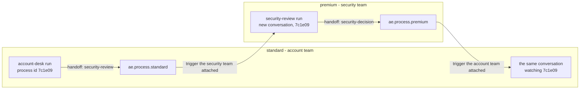

# SPEC: Processes across teams and classifications

**Status:** Partial. P1 to P3, P8 to P11 and P13 to P15 are built and deployed to dev; the processes e2e phase passed 16 of 16 on dev on 2026-11-18 at 1266ce74f, with skips refused. P4 to P7, the hand-off between teams, are built and not deployed, on the process event bus and the event targets (DESIGN-PROCESSES section 12, O37); P12 is planned for a future demo (O12). The incident's opening changed on 2026-11-18 (8492437e7, deployed): the alarm opens the incident conversation at once, the team conversation is told why, and triage runs in the incident conversation; its e2e is rewritten (2599fa0be) and **NOT YET RUN** on dev. The design reuses the assistant version, its publish and activation, the workflow runner, the `open` step, the console's trigger panel, the event targets and the workflow analytics, each named in [DESIGN-PROCESSES](./DESIGN-PROCESSES.md).

**Coverage:** `e2e/a-process-is-declared-on-its-teams-version.spec.ts`, `e2e/process-analytics-groups-runs-by-process-id.spec.ts`, `e2e/an-incident-is-one-process-from-triage-to-review.spec.ts`, passed 7 of 7 on dev on 2026-11-16 at fb9cc908 without asserting that a process completes; they now assert it and are not yet re-run. `e2e/a-request-starts-its-own-process.spec.ts` (P15) passed 3 of 3 on dev on 2026-11-18 at 9593c6ffd, in the processes phase's 12 of 12: the request's task carries `account-briefs` on its `intent#` run, the brief is written and the task completes on its machine's success (the assistant took `researching` to `drafting` to `completed` in the one turn), and the process view reads that process ended and succeeded with the request's run as its one run. `e2e/a-join-goes-on-once-both-parts-are-in.spec.ts` (P14) is in the processes phase and not yet run. Each requirement row names its unit tests.

**Related:** [DESIGN-PROCESSES](./DESIGN-PROCESSES.md) - the mechanics, the seams reused, the boundary argument, the owner decisions and the build plan. [SPEC-WORKFLOWS-AND-TASKS](./SPEC-WORKFLOWS-AND-TASKS.md) - the workflow a process links. [DESIGN-EVENT-TARGETS](./DESIGN-EVENT-TARGETS.md) - where a received hand-off runs. [ADR-067](../../../design/decisions/067-a-workflow-is-triggered-by-an-event-or-an-intent-and-its-steps-create-tasks.md) - workflows, triggers and team ownership. [ADR-042](../../../design/decisions/042-an-assistant-acts-in-exactly-one-classification.md) - an assistant acts in exactly one classification. [SPEC-CONNECTORS](../../communication/SPEC-CONNECTORS.md) - the approved systems a store reference names. [SPEC-ADMIN-CONSOLE](../../interface/SPEC-ADMIN-CONSOLE.md) 2.8 Processes - where the process view sits, and the assistant's page, where a process is declared. [TENETS](../../../overview/TENETS.md).

**Site section:** Interaction layer, conversation.

---

## Overview

A **process** is a definition plus a **process id** that links the workflows it runs, with a lightweight **hand-off** where the work changes assistant or classification. It adds no step engine, no store, no role and no trigger mechanism: every part of a process is an ordinary workflow run ([SPEC-WORKFLOWS-AND-TASKS](./SPEC-WORKFLOWS-AND-TASKS.md)), started, owned and measured as workflows already are.

- **The definition** is a `processes` entry on the owner team's assistant version: a name, a label, the workflows it links, its hand-offs and optional declared metrics. It is versioned, published, activated and owned like everything else on the version.
- **The process id** is created when the process's first workflow starts, as a hash of that run's key, and is carried on every run the process starts.
- **In one classification**, a workflow's existing `open` step opens the next conversation, and the run there inherits the process id.
- **Across an assistant or a classification**, a workflow step puts one fixed-shape hand-off event on the sender's own source, `ae.process.<classification>`, carrying the process id, the hand-off's name and its declared typed fields only. The receiving team attaches that hand-off as an ordinary trigger on its own workflow, through the console's existing trigger panel.
- **Analytics** groups the existing run-ended and task-settled facts, and the run's messages, by the process id, which each fact gains as one field and each run message's out-of-band analytics record carries beside the run's owner team, so nothing is added to the size-capped Amazon Chime SDK message metadata.

### Goals

| Goal | How the design meets it |
|---|---|
| **Single-threaded ownership** | Each team owns its assistants and its workflows on its own version, and works with other teams only through a narrow set of declared hand-offs. No team edits, runs or reads another team's workflow. |
| **Measurable end to end** | One process id joins every run, so each team monitors its own part and the platform team sees the whole: time per workflow and per team, hand-offs sent against hand-offs received, and outcomes. A partner team is held to account by numbers both sides read from the same facts, not by a status chase. |
| **Platform team control and accountability** | The process view is the console's **Processes** tab under Performance, beside the analytics that already show where AI is used, how effective it is and which models ran each step, now grouped by process. |
| **Clear controls, flexibility to build** | What crosses a team or a classification is declared (typed fields only) and approved by both teams: the sender by declaring the hand-off on its version, the receiver by attaching it. Inside its own workflows each team builds freely. |
| **Reuse** | The existing security, turn flow and analytics are unchanged: no new IAM role, session, principal, table, function or trigger mechanism. |

What is unique to this platform comes first: a classification is the access IAM evaluates for every principal, every actor acts only as itself, and each assistant acts in exactly one classification ([ADR-042](../../../design/decisions/042-an-assistant-acts-in-exactly-one-classification.md)). A process keeps all three. A hand-off is not a principal reaching across a boundary: the sending router may put only its own classification's source (IAM-pinned), and the receiving classification's own router runs the receiving workflow under its own role. No component reads two classifications, so the boundary that proves a sender is the same IAM boundary that proves every other actor here.

## Business Problem

Work that matters to a business crosses teams: an incident is triaged by operations and handled in its own conversation, a customer's request at an account desk needs a security review held by a team cleared for more, and a new visitor is routed by the business's CRM to sales or support. Each team runs its own part well, but nobody can say how long the whole took, where it waited, or whether a hand-off was ever picked up, because the parts are not linked. A shared workspace is not the answer, because the teams are deliberately separated by classification and data must stay in the approved systems that hold it. A business needs each team's work linked by one id and measured end to end, with only declared, typed data crossing between teams, and with no new access paths to review.

## Personas

Personas are defined in [PERSONAS.md](../../../overview/PERSONAS.md).

### Process owner team (an AI developer team)

**Goal:** define a process its team owns, link the workflows it runs, and see the whole process measured end to end.

| Use case | Requirement |
|---|---|
| Declare the process on its assistant's version, with the workflows it links | P1 |
| Know that every run the process starts carries one process id | P2, P3 |
| Hand work to another team with only the fields that team needs | P4, P5 |
| Read runs, end-to-end time, time per workflow and outcomes, and the hand-offs that were never picked up | P8, P9 |
| Track the team's own measure, such as "post-incident review started within 2 days" | P10 |

### Partner team (receives a hand-off)

**Goal:** take on its part of another team's process in its own workflow and classification, and approve what it accepts.

| Use case | Requirement |
|---|---|
| Attach a declared hand-off as a trigger on its own workflow, in the console's trigger panel | P6, P7 |
| Receive only typed fields and references, never another team's content | P5 |
| Answer back into the conversation that is waiting on its decision | P6 |
| See its own part of the process measured: what it received, how long it took, how it ended | P9 |

### Platform team (admin)

**Goal:** know where AI is used across the business's processes, how effective it is, which models run it, and which team holds each part.

| Use case | Requirement |
|---|---|
| See every process, every team's part and every hand-off across classifications | P9 |
| Know that a process added no new principal, role or access path to review | P4, P7 |
| Hold partner teams to account with hand-offs sent against received and time per team | P9 |

### Participant (an incident lead, an account manager, a guest)

**Goal:** do the work in the conversation they are in, with the next team picking it up without a chase.

| Use case | Requirement |
|---|---|
| Triage an incident in the ops team conversation and work it in the incident conversation it opens | P3, P11 |
| Send a customer request for security review and see the decision arrive back in the same conversation | P4, P6 |
| Register in a business's guest widget and be routed to sales or support onboarding | P12 |

## Functional Requirements and Acceptance Criteria

Every spec file is under `tests/e2e/`; those marked planned do not exist yet.

### A. The definition and the process id

| # | Requirement | Priority | Status | Validated by | Detail |
|---|---|---|---|---|---|
| P1 | A process is declared on the owner team's assistant version, as a `processes` entry: a name, a label, the workflows it links, its hand-offs and optional declared metrics. It is validated when the version is saved and activated (a linked workflow the version does not declare, a hand-off field of an undeclared type, a metric naming an unknown workflow or step are refused), and it is versioned, published, activated, rolled back and owned with the version. On the assistant's page it is created in four steps: the workflow that starts it, chosen from the version's workflows grouped by what starts them (request-started workflows under "Started by a request", linkable as a starting workflow and as phases, P15); its name and owner; its phases, one workflow each, with the hand-off between two phases read from their definitions (where it goes, how and on what condition, who leads it, what it carries, whether the phase before waits, and what is told each way); and its metrics and review (`processChain.ts`, `ProcessesFields.tsx`). | Enabler | Built and deployed to dev (2026-11-16), without hand-offs: an entry declares its label, its workflows and its metrics, and a hand-off declaration is refused until P4 to P7 are built (O22). The console declares one in the **Processes** section of the assistant's page, beside Workflows (UX section 1); proven by unit tests. Verified on dev 2026-11-17 at 3999b9b08, and again at 9462b50f6 after the flow was renamed to incident-triage: the processes e2e phase passed 9 of 9 with skips refused (`a-process-is-declared-on-its-teams-version.spec.ts`, `an-incident-is-one-process-from-triage-to-review.spec.ts`, `process-analytics-groups-runs-by-process-id.spec.ts`), asserting that an incident with customers impacted runs triage, the incident and customer messaging under one process id, that the account team's opening states the incident's start (UTC) and AWS Region carried from the alarm's event, the initial notice is drafted naming that start and approved within its deadline, that the review follows the resolve and the investigation, and that the completed process reads ended and succeeded with every run ended. | `a-process-definition-is-refused-when-incomplete.test.ts`, `ProcessesFields.test.tsx`, `AssistantPage.processes.test.tsx` (unit); a-process-is-declared-on-its-teams-version.spec.ts (e2e, written, not run) | Reuses the version, its publish and activation, and the `owner-team` tag (WT63). The console's section is one draft area (`processes`), saved with **Save draft edits** and activated with the version under the same IAM as every other edit of it, and checks an entry with the server's own validator, saying each refusal in its reason code's words. |
| P2 | A run of a linked workflow that carries no process id starts the process: its process id is a hash of that run's key. Every run the process starts carries the same id, on its run record and in its run context, and a run never changes its process id. | Enabler | Built and deployed to dev (2026-11-16); proven by unit tests. Verified on dev 2026-11-17 at 3999b9b08, and again at 9462b50f6 after the flow was renamed to incident-triage: the processes e2e phase passed 9 of 9 with skips refused (`a-process-is-declared-on-its-teams-version.spec.ts`, `an-incident-is-one-process-from-triage-to-review.spec.ts`, `process-analytics-groups-runs-by-process-id.spec.ts`), asserting that an incident with customers impacted runs triage, the incident and customer messaging under one process id, that the account team's opening states the incident's start (UTC) and AWS Region carried from the alarm's event, the initial notice is drafted naming that start and approved within its deadline, that the review follows the resolve and the investigation, and that the completed process reads ended and succeeded with every run ended. | `a-process-definition-is-refused-when-incomplete.test.ts`, `a-process-id-follows-the-open-step.test.ts` (unit); an-incident-is-one-process-from-triage-to-review.spec.ts (planned, with WT129) | One run is one process, so a repeat of the same event that the run already took starts nothing new (WT122). |
| P3 | In one classification, a workflow's existing `open` step opens the next conversation, and the run there inherits the process id through the link the opened conversation records. | Table stakes | Built and deployed to dev (2026-11-16); proven by unit tests. Verified on dev 2026-11-17 at 3999b9b08, and again at 9462b50f6 after the flow was renamed to incident-triage: the processes e2e phase passed 9 of 9 with skips refused (`a-process-is-declared-on-its-teams-version.spec.ts`, `an-incident-is-one-process-from-triage-to-review.spec.ts`, `process-analytics-groups-runs-by-process-id.spec.ts`), asserting that an incident with customers impacted runs triage, the incident and customer messaging under one process id, that the account team's opening states the incident's start (UTC) and AWS Region carried from the alarm's event, the initial notice is drafted naming that start and approved within its deadline, that the review follows the resolve and the investigation, and that the completed process reads ended and succeeded with every run ended. | `a-process-id-follows-the-open-step.test.ts` (unit); an-incident-is-one-process-from-triage-to-review.spec.ts (planned, with WT129) | Reuses the `open` step and the opened-by link (WT120). |

### B. Hand-offs between teams and classifications

| # | Requirement | Priority | Status | Validated by | Detail |
|---|---|---|---|---|---|
| P4 | A workflow step (`handoff`) puts one fixed-shape event on the sender's own source, `ae.process.<classification>`, with the `detail-type` `<process>.<handoff>`, carrying the process id, the process name, the hand-off's name and its declared fields. It is put on the deployment's process event bus, whose policy admits each classification's source from that classification's router role alone, and the router's own put is pinned to its own source, so another classification's router, or any other principal, is refused putting it. A refused hand-off is shown where the sending run is: the step's outcome on the run, and its `onFailure` edge in the sending conversation, which says it through one of the sending version's message templates. | Differentiator | Built, not deployed (2026-11-20) | a-router-puts-only-its-own-process-source.test.ts (unit, synth, deny); deny-test-process-handoffs.mjs (deny, deployed, not run); a-hand-off-crosses-to-a-team-that-attached-it.spec.ts (planned) | The step's outcome (`sent` or `refused`) is recorded on the run, and the run goes on by its `onSuccess` or `onFailure` edge. |
| P5 | A hand-off carries its declared typed fields only: an enum, a number, a boolean, a time, an id, or a store reference to an approved system both sides can read (a declared connector). No free text crosses. The sending router refuses a value outside its declared type before the put, and the receiving router refuses an event whose fields do not match the hand-off's declaration before any run starts. | Differentiator | Built, not deployed (2026-11-20) | a-process-definition-is-refused-when-incomplete.test.ts, a-router-puts-only-its-own-process-source.test.ts, a-hand-off-is-refused-when-its-fields-change.test.ts (unit, deny); a-hand-off-carries-only-its-declared-fields.spec.ts (planned) | Owner decision O2. Sensitive data stays in the approved system, and the event carries a reference that each side reads with its own identity. |
| P6 | The receiving team attaches a declared hand-off as an ordinary trigger on its own workflow, in the console's existing trigger panel, which lists the hand-offs the deployment's active versions declare. The rule matches the exact sending source and the `detail-type` `<process>.<handoff>`, and nothing wider. The trigger targets a new conversation, a conversation per process (a type whose pattern is `process:{key}`), or the conversation watching the process id (the existing event targets); the watched target also refuses an event whose `process` is not the watching run's process. The run it starts inherits the process id. A receiving workflow may serve several processes, through several attached hand-offs, and each of its runs carries the id of the process that started it. | Differentiator | Built, not deployed (2026-11-20) | a-hand-off-is-refused-when-its-fields-change.test.ts (unit, deny); the-trigger-service-reads-only-active-definitions.test.ts (synth); EventTriggerPanel.test.tsx (console); a-hand-off-crosses-to-a-team-that-attached-it.spec.ts (planned) | The rule is created by the trigger service, never by a person (WT121, WT123); the process event bus denies a rule write on it to every other principal. |
| P7 | Both teams approve a crossing: declaring the hand-off on its version is the sending team's approval, and attaching it is the receiving team's. Detaching stops new runs; a run already started finishes. A hand-off nobody attached is delivered nowhere, and analytics shows it as sent and not received. A crossing neither team approved is refused on the deployment, not only in a unit test: an event from the wrong source, an event whose declaration changed after attach, and a hand-off nobody attached each start no run. | Table stakes | Built, not deployed (2026-11-20); the process view's sent and received measures are not built | a-hand-off-is-refused-when-its-fields-change.test.ts (unit, deny); deny-test-process-handoffs.mjs (deny, deployed, not run); a-hand-off-crosses-to-a-team-that-attached-it.spec.ts (planned) | Owner decision O3. No approval record, session or role is added. |

### C. Analytics

| # | Requirement | Priority | Status | Validated by | Detail |
|---|---|---|---|---|---|
| P8 | The existing run-ended and task-settled facts each gain the process id, written where the run carries one, and the run-ended fact also records the owner team of the run's assistant. Each message a run says carries the process id and the owner team on its out-of-band analytics record, beside the `workflow_run_key` and `workflow_name` it already carries, so open runs, runs started and time per team are computable before a run ends. Neither field is added to the Amazon Chime SDK message metadata. | Enabler | Built and deployed to dev (2026-11-16); proven by unit and synth tests. Verified on dev 2026-11-17 at 3999b9b08, and again at 9462b50f6 after the flow was renamed to incident-triage: the processes e2e phase passed 9 of 9 with skips refused (`a-process-is-declared-on-its-teams-version.spec.ts`, `an-incident-is-one-process-from-triage-to-review.spec.ts`, `process-analytics-groups-runs-by-process-id.spec.ts`), asserting that an incident with customers impacted runs triage, the incident and customer messaging under one process id, that the account team's opening states the incident's start (UTC) and AWS Region carried from the alarm's event, the initial notice is drafted naming that start and approved within its deadline, that the review follows the resolve and the investigation, and that the completed process reads ended and succeeded with every run ended. | `a-run-end-carries-its-process-id.test.ts` (unit, synth); process-analytics-groups-runs-by-process-id.spec.ts (e2e, written, not run) | No new fact, table or counter (D7). The carrier and its byte arithmetic are in [DESIGN-PROCESSES](./DESIGN-PROCESSES.md) section 6. |
| P9 | The console's **Processes** tab, under Performance, shows a process view built on the existing workflow analytics: the list of every declared process and its owning assistant, with a note that a process is created and changed on that assistant's page, and nothing opened until one is chosen; per process, its description, its key figures (started, succeeded, open now, median end to end, cost per process: the priced model spend of every turn of every run of the process, a task turn's spend under the run and step its answer names, an unlabeled step's included and shown as other steps, and no cost rather than $0.00 where nothing is priced), the flow of its stages with how many runs reached each, the median time and where open runs are now, for all runs or one, and a stage table in which each stage carries its label, its description, who is answerable for it (the assistant that answered it, or a person's role, with its team), how many runs reached it, its median and p95 time, its model cost per run and a link to the workflow that runs it, each run read against the version it ran on (its origin), so a version activated, edited or rolled back since never removes a stage, who answers it or the time waiting on it, a choice of every version or one, and the versions compared side by side, newest first, with their processes, success, end to end, cost per process and each stage's median time, then where each run spent its time and the time waiting on each team, which goes to who is answerable for each stage (a person's team, or the assistants) (deployed to dev 2026-11-17 at e8d6a0200 with the ops assistant re-imported as v55; read through the signed analytics API, the latest incident's runs carry each step's answering assistant and its priced model spend, such as Advisor's initial notice draft at $0.0139 and the affected accounts lookup at $0.0306; a stage worked as another assistant's task, such as the first look, names the asking step on its turns' records (`askedStep`, from the task's `askedBy`) and counts under that stage, verified on dev 2026-11-17 at 1eaa94c2d after the processes e2e passed 9 of 9: the new incident's first look and shared dashboard are timed as stages and priced at $0.0221 and $0.0493, answered by the ops assistant), hand-offs sent, received and refused, and outcomes; and a drill from one process id to its runs, each stage's start, end, time and outcome, and the process end to end. From a process down to its work: each run, in the drill and in one run's flow, names its workflow, which opens in the editor of the assistant whose workflow it is (the assistant its run key names), and offers **Open conversation** for the conversation it ran in (the conversation of its first message, else of its end record), which opens in the Conversations tab under that tab's own access; the stage table's workflow opens the same way. Internal moves (a step with no label) are not shown. A team reads its own assistants' part through its team route; the platform team reads every part. | Gap - prioritize | Built and deployed to dev (2026-11-16), without the hand-off measures, which follow P4 to P7 (O22); proven by unit tests. The stages and their times are built, not deployed (O25): a stage's start is its step's first message in the run and its end the run's next labeled step's first message or the run's end (an unlabeled step belongs to the stage before it), read from the run's messages and its run-ended fact with no new record ([DESIGN-PROCESSES](./DESIGN-PROCESSES.md) section 6, Stages and their times). Verified on dev 2026-11-17 at 3999b9b08, and again at 9462b50f6 after the flow was renamed to incident-triage: the processes e2e phase passed 9 of 9 with skips refused (`a-process-is-declared-on-its-teams-version.spec.ts`, `an-incident-is-one-process-from-triage-to-review.spec.ts`, `process-analytics-groups-runs-by-process-id.spec.ts`), asserting that an incident with customers impacted runs triage, the incident and customer messaging under one process id, that the account team's opening states the incident's start (UTC) and AWS Region carried from the alarm's event, the initial notice is drafted naming that start and approved within its deadline, that the review follows the resolve and the investigation, and that the completed process reads ended and succeeded with every run ended. | `process-runs-group-by-process-id.test.ts`, `ProcessesPanel.test.tsx`, `ProcessesPanel.stages.test.tsx`, `processStages.test.ts`, `ProcessesTab.test.tsx`, `AdminDashboard.tabs.test.tsx` (unit); an-incident-is-one-process-from-triage-to-review.spec.ts (e2e, the stages in order with their times, written, not run); process-analytics-groups-runs-by-process-id.spec.ts (e2e, written, not run) | Aurora mode, as the workflow analytics are (WT109). The tab reads with `view-analytics`, as Effectiveness does, and is a team tab, so a team reads it on its assistant's team route. |
| P10 | A process may declare metrics, each a share or a time read from the same facts: a linked workflow or step reaching an outcome, within a time from the process's start. | Above bar - optional | Built and deployed to dev (2026-11-16); proven by unit tests. Verified on dev 2026-11-17 at 3999b9b08, and again at 9462b50f6 after the flow was renamed to incident-triage: the processes e2e phase passed 9 of 9 with skips refused (`a-process-is-declared-on-its-teams-version.spec.ts`, `an-incident-is-one-process-from-triage-to-review.spec.ts`, `process-analytics-groups-runs-by-process-id.spec.ts`), asserting that an incident with customers impacted runs triage, the incident and customer messaging under one process id, that the account team's opening states the incident's start (UTC) and AWS Region carried from the alarm's event, the initial notice is drafted naming that start and approved within its deadline, that the review follows the resolve and the investigation, and that the completed process reads ended and succeeded with every run ended. | `a-process-definition-is-refused-when-incomplete.test.ts`, `process-runs-group-by-process-id.test.ts`, `ProcessesPanel.test.tsx` (unit); process-analytics-groups-runs-by-process-id.spec.ts (e2e, written, not run) | Computed per process edition: the content hash of the `processes` entry on the active version the process's first run started on, recorded beside the process id by that run and the runs its `open` step starts (P8). A changed metric is a new edition, so it is never applied to runs that started before it. |

### D. The demos the design serves

| # | Requirement | Priority | Status | Validated by | Detail |
|---|---|---|---|---|---|
| P11 | Incident response is one process that links its workflows by id and adds nothing else: triage in the ops team conversation (`incident-triage`) opens the incident conversation, whose `ops-room` run escalates, mitigates, resolves and then runs the post-incident review there, once the investigation is complete, under one process id; the run ends after the review. Once customer impact is confirmed on a card, the incident opens the account team's customer messaging beside it (`customer-messaging`), under the same process id, and the process completes only when both tracks have ended ([SPEC-WORKFLOWS-AND-TASKS](./SPEC-WORKFLOWS-AND-TASKS.md) WT130). The incident shape itself (the incident card, the root-cause investigation task, a resolve that moves the run on, and the post-incident review) is workflow content, specified as [SPEC-WORKFLOWS-AND-TASKS](./SPEC-WORKFLOWS-AND-TASKS.md) WT129. | Table stakes | Built and deployed to dev (2026-11-16); proven by unit tests, with WT129. The customer messaging track (WT130) is built and deployed to dev, proven by `customer-messaging-is-a-track-beside-the-incident.test.ts` and the e2e below. Verified on dev 2026-11-17 at 3999b9b08, and again at 9462b50f6 after the flow was renamed to incident-triage: the processes e2e phase passed 9 of 9 with skips refused (`a-process-is-declared-on-its-teams-version.spec.ts`, `an-incident-is-one-process-from-triage-to-review.spec.ts`, `process-analytics-groups-runs-by-process-id.spec.ts`), asserting that an incident with customers impacted runs triage, the incident and customer messaging under one process id, that the account team's opening states the incident's start (UTC) and AWS Region carried from the alarm's event, the initial notice is drafted naming that start and approved within its deadline, that the review follows the resolve and the investigation, and that the completed process reads ended and succeeded with every run ended. | `an-incident-resolve-moves-its-run-to-the-review.test.ts`, `a-run-reads-its-owner-team-from-its-assistants-tag.test.ts` (unit); an-incident-is-one-process-from-triage-to-review.spec.ts (e2e, written, not run) | Owner decisions O8, O20, O22 and O26 to O34. One classification, so no hand-off: customer messaging is a track beside the incident at `premium`, where Advisor drafts each notice from the account team's templates and the account team lead approves it, with a deadline on the first notice (O26 to O34). The platform holds no severity: it is tracked in the business's incident management or ticketing tool, which stays the authority (owner decision O11). |
| P12 | A process may start from any trigger a workflow takes, including a connector's event: the guest-widget deployment's registration workflow sends the pre-registration to the business's CRM through a declared connector's outbound event, the CRM routes it to sales or support, and its reply, received as an event, starts the matching onboarding process, its run carrying a store reference and not the visitor's data. | Table stakes | **NOT BUILT**, planned for a future demo ([DESIGN-PROCESSES](./DESIGN-PROCESSES.md) O12); depends on the scoped outbound connector event, [SPEC-CONNECTORS](../../communication/SPEC-CONNECTORS.md) FR14 (**NOT BUILT**) | a-crm-event-starts-guest-onboarding.spec.ts (planned) | Owner decision O9. The reply reuses the connector receiver (WT80 to WT82). |

### E. A process travels as its own artifact

| # | Requirement | Priority | Status | Validated by | Detail |
|---|---|---|---|---|---|
| P13 | A process is exported and imported as its own manifest, never inside its owner's assistant manifest: `{ schemaVersion, kind: 'process', ownerProfileName, processName, process, requires, provenance, contentHash }`, instance-agnostic, with `requires` computed from the owner version's linked workflows: the workflows, every conversation type they run in or open, every participant role a step addresses or an open step leads with (by its type), every assistant role a task step asks with the intent asked (by the type its workflow runs in), every template sent, prompted with, asked or assigned, and every machine a step opens itself. `POST /admin/profiles/process-export` (`view-profiles`) answers one process of the active or draft version. `POST /admin/profiles/process-import` (`edit-profiles`) checks the manifest's shape, size, content hash and signature, requires the owner to be an assistant here, and checks the requirements (the manifest's joined with what the target draft's own workflows need) against this deployment: the owner's version declares each workflow, each type is declared at the owner's classification with each role, each asked role has a declared holder whose active version advertises each intent asked (the owner's own from the draft), each template is shipped or held by the owner or its classification, and each machine is one the version runs. On success the process lands in the owner's draft (cloned from the active version where none exists; an existing draft only when `replaceConfigId` names it, `409 DRAFT_EXISTS` otherwise), never active; on failure every refusal is returned as a code (`PROCESS_REQ_WORKFLOW`, `PROCESS_REQ_TYPE`, `PROCESS_REQ_ROLE`, `PROCESS_REQ_ASSISTANT_ROLE`, `PROCESS_REQ_INTENT`, `PROCESS_REQ_TEMPLATE`, `PROCESS_REQ_MACHINE`, and `PROCESS_MANIFEST_*` for the manifest itself) with the missing names as data, and nothing is written. Activation runs the same check for every process the draft declares and refuses `409 PROCESS_REQUIREMENTS_UNMET` when something is missing now. The console's Processes section offers Export on each process and Import process (a file or pasted JSON), and says each refusal from the locale bundle. | Table stakes | Built, not deployed; proven by unit tests. The ops assistant's manifest no longer carries the process: `npm run ops-assistant -- import` imports the assistant manifest, then the incident response process manifest (`opsIncidentProcessManifest`) into that draft, then validates and activates. | `a-process-travels-as-its-own-manifest.test.ts`, `a-process-imports-only-where-its-requirements-are-met.test.ts`, `the-ops-assistant-is-created-by-importing-its-manifest.test.ts` (unit), `ProcessesFields.portable.test.tsx` (unit, console) | The check reads what the runtime reads: the classification's declared role holder (`roleAssistantName`) and its published advertisement (`readAdvertisement`), which the router decides a request from. No new table, stack, service or IAM grant: the profile API already reads both. A process links workflows the assistant manifest carries, so the assistant is imported first. [DESIGN-PROCESSES](./DESIGN-PROCESSES.md) section 9. |

### F. Parallel parts and their joins

| # | Requirement | Priority | Status | Validated by | Detail |
|---|---|---|---|---|---|
| P14 | A process runs work in parallel and waits on it: a workflow step `wait: { join: { of, when, minutes? } }` holds the run until the parts it names have ended, `all` of them or `any` one, each part a step of the same workflow that started something in parallel: an `open` step (the part is the opened conversation's own run) or a task step with `continue: 'alongside'` (the part is that task). A part whose step the run never reached is recorded as skipped and holds nothing. The join takes `onSuccess` where every part it counted succeeded, `onFailure` otherwise, whose conditions read why (`task:outcome`), and `onDeadline` (else `onFailure`) at its deadline; it is woken by the hand-backs the single waits use, each part claimed once and the join going on once. The validator refuses a join that names fewer than 2 or more than 8 parts, a part twice, a step of another kind or none, a part another join names, or an opened conversation the workflow also waits on with `wait: { child }`. The console reads parallel work from the definitions: the wizard's phases step numbers phases in the order they run and names parallel phases by their range ("Phases 2 to 3, in parallel"); "step" is kept for a workflow's steps. It shows a fork where one phase starts several, marks a phase that runs alongside the one that opened it ("runs alongside X; X does not wait for it"), and shows each join as its stage, which "waits for all of" or "any of" its parts, named; the flow view shows parallel phases side by side under that range and marks each join. The Processes tab says, for a run, which part a join waited on last. | Table stakes | Built and deployed to dev (2026-11-18); proven by unit tests. The shipped incident response declares no join and runs as it did: on dev on 2026-11-18 at 9593c6ffd the incident e2e passed 5 of 5 (`an-incident-is-one-process-from-triage-to-review.spec.ts`). Verified on dev on 2026-11-18 at 1266ce74f (`validate.mjs --only=processes`, 16 of 16): `a-join-goes-on-once-both-parts-are-in.spec.ts` passed 4 of 4, installing its own two-check workflow on the ops version, and the incident e2e passed 5 of 5 again. | `a-join-waits-on-several-parts.test.ts` (unit: all, any, a skipped part, a deadline, a part ended before or after the join was reached, a part that could not be held, redelivery, the validator's refusals, and the e2e's own workflow), `processChain.test.ts`, `ProcessesFields.test.tsx`, `ProcessFlow.test.tsx`, `processStages.test.ts`, `ProcessesPanel.stages.test.tsx` (unit, console, on a test fixture); a-join-goes-on-once-both-parts-are-in.spec.ts (e2e: an alarm opens two checks beside each other, the join holds after the first is acknowledged, goes on once at the second with both parts named, and the process view reads the run's join outcome) | No new record kind: each part holds the run's continuation on the record its ending already meets (an opened conversation's end record; a task's own join record beside the one its run's end holds on), the parts' endings are claims of the run (`after#<join>#<part>`), and the join's outcome, which names every part and the one it waited on last, reaches the console on the run's end record with its other steps. [DESIGN-PROCESSES](./DESIGN-PROCESSES.md) section 10. |

### G. A request starts or joins a process

| # | Requirement | Priority | Status | Validated by | Detail |
|---|---|---|---|---|---|
| P15 | A process links the owner version's request-started workflows (`intentWorkflows`, each keyed by the intent it runs on, ADR-067) as well as its event workflows: a name the version declares as neither is refused (`PROCESS_WORKFLOW_UNDECLARED`), one workflow is linked by one process (`PROCESS_WORKFLOW_LINKED_TWICE`), and a metric may name a request-started workflow and its steps. A run of a linked request-started workflow that carries no process id starts the process under P2's id scheme, keyed by the process and the request's own run key (`intent#<correlation>#<assistant>`); a run another assistant's run in a process asked for (WT118) joins that process, read from the asking run's own record the platform wrote on the request's task (`askedBy`); a person's request in a conversation a process's `open` step opened joins that process, read from the record the router writes in that conversation, once, as its opening run starts. The id rides the request's run as it rides an event run: on the request's own task (`workflowRun.process`), on each message the run's turns and sends write (their out-of-band `processRun` record), on the run's `AE_RUN_ENDED` fact when the task's settlement ends the run, and through any `open` step it takes. A process manifest's `requires` names the intent of each linked request-started workflow (`intents`) with the machine its own step opens, and a target whose owner does not answer the intent is refused `PROCESS_REQ_OWN_INTENT`. The console's wizard offers request-started workflows as a starting workflow and as phases, under "Started by a request", reading their stages, who answers each, deadlines and hand-offs from `intentWorkflows`. | Table stakes | Built and deployed to dev (2026-11-18 at 90b9b4c1c), with Advisor v127 activated by the demo import; proven by unit tests. Verified on dev on 2026-11-18 at 9593c6ffd: `a-request-starts-its-own-process.spec.ts` passed 3 of 3, asserting the request's task carries `account-briefs` on its `intent#` run with a 12-hex id and edition, the task completes on its machine's success, and `process_runs` reads that process ended 1 and succeeded 1, with one run, `account_brief`, that has an end and a success. An intent that narrows its tools keeps its workflow's task tools, so the request's turns are offered `advance_task_state`. The demo ships Advisor's `account-briefs` process over its `account_brief` workflow as a process manifest (`advisorBriefProcessManifest`), imported by `npm run demo-processes -- import`, which also labels the workflow's one step `Brief` on Advisor's version, so the process has a stage; the incident response is unchanged. Verified on dev on 2026-11-18 at 1266ce74f, with Advisor v131 activated by the demo import: the same spec passed 3 of 3, also asserting that the `Brief` stage has a time and the brief's step a cost above zero. A request joining the process of the conversation it arrives in is built and **NOT YET VERIFIED** on dev: no e2e drives it. | `a-request-started-workflow-starts-or-joins-a-process.test.ts`, `a-process-definition-is-refused-when-incomplete.test.ts`, `a-run-end-carries-its-process-id.test.ts` (unit), `ProcessesFields.test.tsx`, `processStages.test.ts` (unit, console); a-request-starts-its-own-process.spec.ts (e2e, passed on dev 2026-11-18) | No new store, record kind or IAM grant: the process rides the fields an event run's process rides, and the request's end is the task settlement that already ends its run. The process of a conversation a process opened is a write-once record of the task service's (`CONVERSATION_PROCESS_WAIT_ID`), written by the router from the process the canonical creator named, never from what anyone said. [DESIGN-PROCESSES](./DESIGN-PROCESSES.md) section 11. |

### H. Roadmap

Each of these was designed and built once in an earlier, heavier processes design that stored definitions as editions in a ledger of their own; that design was set aside for this one, which links an owner version's workflows. Each is to be designed again on this model, reading the earlier one only for ideas: it is kept as the git tag `archive/processes-full-2026-11-16`.

| # | Requirement | Priority | Status | Validated by | Detail |
|---|---|---|---|---|---|
| P16 | A hand-off between teams shows its card to the receiving side with each field and its value, a store reference as its reference and title, and **Confirm** and **Withhold**; a sent hand-off that reached nothing is marked undelivered, recorded, and its stage told, and nothing is re-sent. | Differentiator | **NOT BUILT** | - | Completes P4 to P7. |
| P17 | A workflow starts on a declared connector's event with no conversation to start in, and opens a conversation of the type its trigger names. | Table stakes | **NOT BUILT** | - | The connector receiver's fact starts it; a team attaches it by the connector's id and the event's name. |
| P18 | A stage worked in another tool is settled by that tool's decision through its connector, recording who decided. | Differentiator | **NOT BUILT** | - | The deployment's own app is one such connector. |
| P19 | A provisioning stage runs the deterministic action its definition declares, through a function its classification alone invokes, and records the result; a canceled run undoes each stage's action once, and an undo that fails alerts the operators. | Differentiator | **NOT BUILT** | - | - |
| P20 | A run is canceled by one event, put by its owner team, an administrator or the platform. | Table stakes | **NOT BUILT** | - | - |
| P21 | An approval stage is decided by any holder of its group-sourced role on a press, and a step declares who may respond to it. | Table stakes | **NOT BUILT** | - | - |
| P22 | A participant asks the assistant in any of the process's conversations where the run stands, answered from the run's own records in that classification. | Differentiator | **NOT BUILT** | - | - |
| P23 | Each stage's conversation is told by template when its stage starts and ends, and the run's first conversation when the run ends. | Table stakes | **NOT BUILT** | - | - |
| P24 | An owning team or an administrator archives a process with no open run; its earlier versions stay readable. | Table stakes | **NOT BUILT** | - | - |
| P25 | Erasing a person redacts their values inside the hand-off records that name them, keeping the hash. | Table stakes | **NOT BUILT** | - | - |
| P26 | Onboarding runs as a process, filtered by where its people came from. | Above bar - optional | **NOT BUILT** | - | - |

## Non-Goals - Out of Scope

Each item is out of scope unless the owner asks for it.

| Item | Where the need is covered, or the decision |
|---|---|
| Stages declared apart from a workflow's steps | A stage is a labeled step of a workflow, timed from the run's messages (P9, [DESIGN-PROCESSES](./DESIGN-PROCESSES.md) O25); a workflow's steps are also measured per step by the workflow analytics ([SPEC-WORKFLOWS-AND-TASKS](./SPEC-WORKFLOWS-AND-TASKS.md) WT109) |
| Joins (waiting on several parallel parts) | A future decision; a run waits on one opened conversation (WT20, WT120) |
| Severity as a platform or process field | The business's incident tool holds it; a hand-off carries a store reference to the incident record (P5, owner decision O11) |
| Provisioning actions | A future decision; a step's declared action reaches a connector ([SPEC-WORKFLOWS-AND-TASKS](./SPEC-WORKFLOWS-AND-TASKS.md) WT46) |
| A participant run view page | The conversation itself and the opener's notice of how its child ended ([SPEC-WORKFLOWS-AND-TASKS](./SPEC-WORKFLOWS-AND-TASKS.md) WT120) |
| A request form | An intent's declared needs ([SPEC-WORKFLOWS-AND-TASKS](./SPEC-WORKFLOWS-AND-TASKS.md) WT33) |
| Archiving a process | The conversation archive ([SPEC-CONVERSATION-ARCHIVE-AND-MEMBERSHIP](./SPEC-CONVERSATION-ARCHIVE-AND-MEMBERSHIP.md)) and the version's own history ([SPEC-PORTABLE-PROFILES](../assistants/SPEC-PORTABLE-PROFILES.md)) |
| Activation per side | The version's activation, one per team ([SPEC-PORTABLE-PROFILES](../assistants/SPEC-PORTABLE-PROFILES.md)) |
| Process sessions or roles | The existing sessions; no new principal ([DESIGN-PROCESSES](./DESIGN-PROCESSES.md) section 5) |
| A separate analytics store | The archive and the Aurora projection, one source per question ([TENETS](../../../overview/TENETS.md) D7) |
| Cancel and deadlines beyond a workflow's own | A run's cancel and a step's deadline ([SPEC-WORKFLOWS-AND-TASKS](./SPEC-WORKFLOWS-AND-TASKS.md) WT13, WT21, WT27) |

## User Experience Description and Mocks

### 1. A team declares a process

The ops team opens its assistant in the console (**Assistants**, Ops), opens the draft (**Edit**, or **Draft** while one exists), and chooses **Processes**, the section beside **Workflows**. **Add process** opens the entry: its **Name** (`incident-response`, fixed once added), its **Label** (Incident response), its **Linked workflows**, checked from the version's own event workflows (`incident-triage`, `ops-room`), and under **Metrics**, **Add metric**: an **Id**, a **Label**, the **Workflow** and **Step** it reads (or **The run's end**), an optional **Outcome**, **Within** (such as `PT4H`) and **Target**. Each refusal shows as it is written, in its reason code's words, and holds **Done** back; **Done** puts the entry in the draft, and **Save draft edits** saves it. **Validate** and **Activate draft as vN** check it with the version; activating the version activates the process. Rolling the version back rolls the process back. A reader without `edit-profiles`, and the active version, show the processes with no control.

### 2. The work runs where the people are

An alarm raises the ops team conversation's `incident-triage` run: triage, where the lead confirms the scope on the incident card; the severity is the incident tool's own value, which the platform does not hold. Its `open` step opens the incident conversation, led by the on-call, where `ops-room` runs: escalate, mitigate, resolve, and then the post-incident review, drafted by the ops assistant and completed there on a card once the root-cause investigation is complete ([SPEC-WORKFLOWS-AND-TASKS](./SPEC-WORKFLOWS-AND-TASKS.md) WT129). The team conversation is told "resolved" at the resolve, by the incident conversation's run (O24). Nobody sees a process: they see their conversations and cards. Both runs carry one process id.

### 3. A hand-off to another team

At Stratum, the account team's assistant at `standard` takes a customer's request that needs a security review. Its workflow's `handoff` step sends `security-review` with an account id, a request kind, a due time and a reference to the CRM ticket. The security team at `premium` attached `security-review` in its trigger panel, targeting a new conversation, so a review conversation opens at `premium` and its workflow runs. When the review ends, the security team's workflow sends `security-decision` (approved or declined), which the account team attached targeting the conversation watching the process id: the decision arrives in the customer's request conversation, and the account desk's workflow goes on.



### 4. Attaching a hand-off

In the trigger panel, a team chooses **A hand-off from another team**, sees each declared hand-off with its sending classification and its typed fields, picks one, chooses the target (a new conversation, or the conversation watching the process id) and attaches it. The panel says what attaching approves: the fields listed, from that classification, starting this workflow.

### 5. The process analytics view

The console's **Performance** section, **Processes** tab, beside **Overview**. The platform team sees every row; a team sees the rows its own assistants ran, and its hand-offs sent and received.

```text
Processes                                         Window: last 30 days   Edition: all

 Process                     Owner team   Runs  Ended  Success  End-to-end p50 / p95   Hand-offs sent / received / refused
 Incident response           ops            42     39      92%      3h 10m / 19h 40m     -
 Customer request            accounts       18     15      87%      1d 4h / 3d 2h          18 / 17 / 1
 Guest onboarding - sales    growth         64     58      95%      2h 05m / 9h 30m      -

Customer request  (process edition 3f9a21, 18 runs)

 Time per workflow                     Team        Runs  p50       p95       Success
 account-desk (standard)               accounts      18  1h 20m    6h 10m      94%
 security-review (premium)             security      17  22h 40m   2d 18h      88%
 account-desk, after decision          accounts      15  35m       2h 15m     100%

 Time per team                         accounts 1h 55m p50    security 22h 40m p50

 Hand-offs                             Sent  Received  Refused  Sent, not received
 security-review   standard->premium     18        17        1                    0
 security-decision premium->standard     15        15        0                    0

 Outcomes                              approved 11   declined 4   open 3

 Declared metrics                      Value   Target
 Security decision within 2 days       73%     80%   (below target)

 Runs  [process id]  started            end-to-end   workflows                              outcome
       7c1e09        2026-11-12 09:14   1d 2h        account-desk > security-review > ...   approved   [open]
       a90d42        2026-11-12 11:02   open         account-desk > security-review         waiting on security

Process 7c1e09
 workflow          assistant   classification  started            ended              time     outcome   tasks
 account-desk      accounts    standard        11-12 09:14        11-12 10:31        1h 17m   sent      2 settled
 security-review   sec-review  premium         11-12 10:31        11-13 09:02        22h 31m  success   1 settled
 account-desk      accounts    standard        11-13 09:02        11-13 11:20        2h 18m   success   1 settled
```

```text
Incident response  (ops)                                      Window: last 30 days

 Stages
  Stage 1 Triage            Stage 2 Incident owner  ...   Stage 5 Resolve        Stage 8 Post-incident review
  incident-triage           ops-room                      ops-room               ops-room
  12 runs reached it        12 runs reached it            11 runs reached it     10 runs reached it
  median 6m, p95 22m        median 4s, p95 11s            median 2s, p95 9s      median 38m, p95 2h 10m

 Where each run spent its time
  Process id   Triage   Incident owner   First look   ...   Resolve   Post-incident review
  7c1e09       5m       4s               2m                 3s        41m
  a90d42       9m       5s               [open]

Process 7c1e09     End to end 2h 0m, from 2026-11-12 09:14 to 2026-11-12 11:14. Ended: 1. Succeeded: 1.
 incident-triage   ops, Succeeded, 1h 0m
   Triage                 09:14 to 09:19   5m    Done (acknowledged)
 ops-room          ops, Succeeded, 1h 55m
   Incident owner         09:19 to 09:19   4s
   ...
   Post-incident review   10:54 to 11:14   20m   Done (acknowledged)
```

Every value is read from the run-ended and task-settled facts and the run's messages; the drill shows references (run keys, workflows, assistants, times, outcomes), never a message. A row at a classification the reader's scope does not reach is not shown.

As built, the tab reads over the Performance window and the shared filters' classification and assistant, and shows: the process list (**Process**, **Started**, **Ended**, **Success**, **End to end p50 / p95**); for the chosen process, **Stages**, its stages in run order as cards (**Stage 1** Triage, `incident-triage`, the runs that reached it, its median and p95), **Where each run spent its time**, one row per process id and one column per stage, each cell the stage's time in one hue, darker where longer (under 10m, 10 to 30m, 30m to 1h, over 1h) and an open stage outlined, then **Time per workflow**, **Time per team**, **Outcomes** (in words; a run still open reads `open`), **Declared metrics (edition ...)** and **Runs**. Each process id opens **Process <id>**: its end to end, whether it ended and succeeded, and each run, in the order the process declares its workflows, with its stages' start, end, time and how each ended, in words; **All processes** goes back. On a phone's width the stages stack as one column of cards and each process id's time is a stacked list of its stages, each with its time. The stages' names and order come from the owner team's active version, read with `view-profiles` as the declared metrics are; a reader without it sees each step under its own name. With no run of a process in the window it says "No runs of a process in this window." The owner team column on the process list and the hand-off measures follow P4 to P7 (O22).

### Demos this design serves

| Demo | Workflows | Hand-off | What the process view shows |
|---|---|---|---|
| Incident response (the walkthrough's live incident, Act 3.3b) | `incident-triage` (triage, in the ops team conversation) opens the incident conversation, where `ops-room` escalates, mitigates, resolves and runs the post-incident review once the investigation is complete (WT129). Once customer impact is confirmed, the account team's customer messaging runs beside it in its own conversation (`customer-messaging`): Advisor drafts the initial notice at once, the account team lead approves it within its deadline, and the final notice follows the resolve (WT130, O26 to O34) | None: one classification, linked by the `open` step | Incidents, time to resolve, time per workflow, outcomes, the time to first notice (the Initial notice stages), and declared metrics such as "Initial customer notice missed its deadline" |
| Stratum customer request | The account team's `account-desk` at `standard`; the security team's `security-review` at `premium` | `security-review` (standard to premium, new conversation) and `security-decision` (premium to standard, the conversation watching the process id), each attached by the receiving team | Time per team, sent against received, refusals, approved against declined, and the run drill |
| Guest registration and onboarding (the separate guest-widget deployment) | The guest assistant's registration workflow at `guest` sends the pre-registration through a declared connector's outbound event to the business's CRM (**NOT BUILT**, [SPEC-CONNECTORS](../../communication/SPEC-CONNECTORS.md) FR14); the CRM routes to sales or support and posts an event back that starts `sales-onboarding` or `support-onboarding` | None from the platform: the CRM's event is the trigger, carrying a store reference to the CRM record | Registrations routed to each team, time to onboarded, outcomes per team |
| The walkthrough's narrative | Platform framing, then the live incident, then process analytics, then creating a process on the version, then assistant management, workflows, and hand-offs between teams and classifications | As above | Each step of the narrative is a screen this spec describes: the view (section 5), the definition (section 1), the trigger panel (section 4) |

## Related Documents

- [DESIGN-PROCESSES](./DESIGN-PROCESSES.md) - how it is built and which seams it reuses.
- [SPEC-WORKFLOWS-AND-TASKS](./SPEC-WORKFLOWS-AND-TASKS.md) and [DESIGN-WORKFLOWS-AND-TASKS](./DESIGN-WORKFLOWS-AND-TASKS.md) - workflows, the `open` step and the run-end record.
- [DESIGN-EVENT-TARGETS](./DESIGN-EVENT-TARGETS.md) - the new-conversation and watched-conversation targets.
- [ADR-061](../../../design/decisions/061-a-welcome-is-a-workflow-an-event-starts.md) and [ADR-067](../../../design/decisions/067-a-workflow-is-triggered-by-an-event-or-an-intent-and-its-steps-create-tasks.md) - event workflows and the workflow model.
- [SPEC-CONNECTORS](../../communication/SPEC-CONNECTORS.md) - the approved systems a store reference names, and the outbound connector event P12 depends on (FR14).
- [SPEC-MESSAGE-METADATA-CODEBOOK](../../communication/SPEC-MESSAGE-METADATA-CODEBOOK.md) - the message metadata cap, and the out-of-band record a run's process rides.
- [SPEC-EMBEDDABLE-WIDGET](../../interface/SPEC-EMBEDDABLE-WIDGET.md) and [GUEST-ISSUER](../../../guides/admin/GUEST-ISSUER.md) - the guest-widget deployment.
- [SPEC-ADMIN-CONSOLE](../../interface/SPEC-ADMIN-CONSOLE.md) - the Processes tab (2.8) and the assistant's page, whose Processes section declares a process.
- [Designing an event for a use case](../../../guides/admin/WORKFLOW-STEP-REFERENCE.md#designing-an-event-for-a-use-case) - keeping sensitive data in the approved system.
- [Walkthrough](../../../../demo/portable-assistants/WALKTHROUGH.md) - the demo this design serves.
