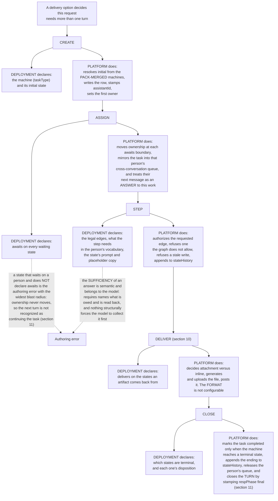
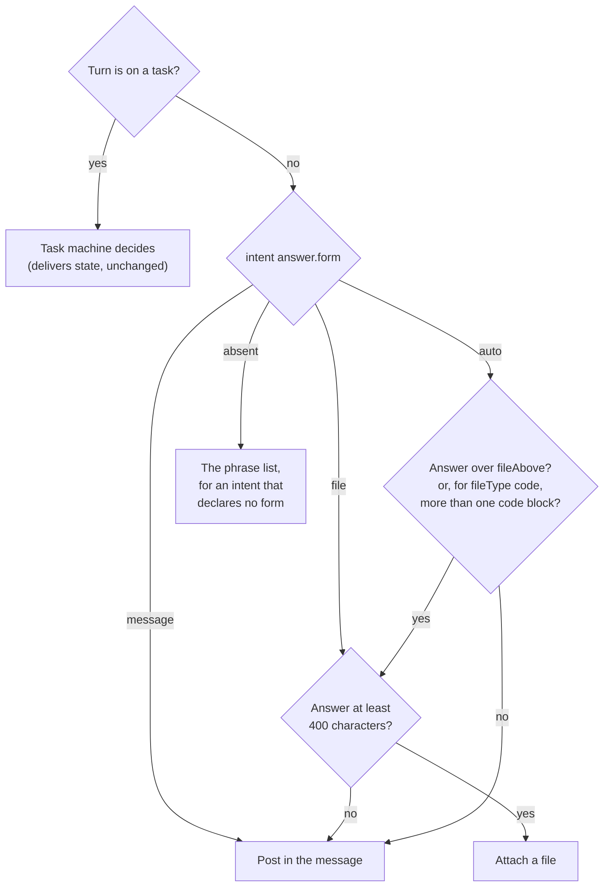

# SPEC: Task state transitions

**Status:** Partial (the machine, the tools, the delivery check, a step's declared tools and its declared action ship; the event-started workflows of ADR-061 slice 1 are built, not verified on a deployment; a workflow step that assigns a task to a person or an assistant, the card that completes it, its deadline, and an idle assistant taking up its own work are built, **NOT VERIFIED** on a deployment (ADR-063); entitlement apart from assignment and abandonment are design). **Verified by:** `backend/test/lib/a-workflow-step-opens-a-task-for-a-person.test.ts`, `backend/test/lib/a-person-completes-their-task-on-the-card.test.ts`, `backend/test/lib/a-task-deadline-ends-the-task-and-continues-the-run.test.ts`, `backend/test/lib/an-idle-assistant-takes-up-its-own-work.test.ts` (ADR-063), `backend/test/lib/task-loop-machines.test.ts`, `backend/test/task-state-machines.test.ts`, `backend/test/lib/task-ownership.test.ts`, `backend/test/lib/task-has-an-end.test.ts`, `backend/test/lib/a-delivering-step-claims-no-file.test.ts`, `backend/test/lib/a-step-declares-who-it-awaits.test.ts`, `backend/test/lib/the-router-reads-either-wait-declaration.test.ts`, `backend/test/lib/step-needs-are-checked.test.ts`, `backend/test/lib/profile-manifest.test.ts`, `backend/test/lib/a-step-records-what-it-was-told.test.ts` (the step's needs ride in the tool, and what the person answered is recorded on the task), `backend/test/lib/a-deliverable-is-checked-before-it-ships.test.ts` (the delivering turn's write-check-correct pass, against documents this deployment actually produced), `backend/test/lib/a-presented-step-is-put-to-the-person.test.ts` (a `presented` step is not left on the turn it was entered, for a shipped machine and a pack-declared one, and not enforced where a machine omits it), `backend/test/lib/converse-tool-loop.test.ts` (the loop keeps only the declared document, and nothing written beside the call), `backend/test/lib/a-step-is-told-what-its-workflow-declares.test.ts` (every default step renders its declared `prompt`, and a pack-declared machine's prompt replaces the platform's), `backend/test/lib/a-step-runs-its-declared-action.test.ts` (a step's declared tools narrow and never widen; a declared action's validation, its bound arguments, its outcome edge, its once-per-entry claim and the turn's bound on runtime moves), `backend/test/lib/a-deterministic-workflow-runs-in-the-turn.test.ts` (a workflow whose only model move is its requirements step, driven through the real tool loop, and a step's tools refused at the call).

**Coverage:** `tests/e2e/a-step-requires-its-lookup-before-the-task-moves-on.spec.ts` - a step requiring a lookup is left only after the lookup ran, and no advance is recorded as a tool error; the refusal of an early advance is asserted when the model attempts one, and is otherwise proven by the unit test `a-step-may-require-a-tool-before-the-task-leaves-it`, since only the model makes the advance; `tests/e2e/an-image-is-asked-for-confirmed-drawn-and-revised.spec.ts` - an image task gathers and confirms on text, the confirming turn returns the image and a revision draws again; `tests/e2e/a-step-picks-the-model-where-it-overrides-or-delivers.spec.ts` - a step override, the general route and the report route each serve their own turns of one report task, and the rows say which; `tests/e2e/task-state-machine.spec.ts` - drives a machine-backed task through real turns and asserts the persisted `taskState` moves along declared edges rather than being inferred from the reply text; `tests/e2e/tasks.spec.ts` - a report request opens a tracked task and the `task_id` reaches analytics, which is what makes the machine observable to an operator rather than only to the turn that ran it; `tests/e2e/report-flow-branches.spec.ts` - drives the report journey past the outline into a scoping change, a revision and completion, asserting the turn continues the task rather than being offered a new conversation; `tests/e2e/place-item-flow.spec.ts` - the propose, confirm and place journey with its breakout branches, where a correction is not a confirmation and a decline does not silently complete. `tests/e2e/an-invitation-runs-its-workflow-until-it-is-revoked.spec.ts` (phase `welcome-workflows`) drives ADR-061's invitation events: `invitation-sent` runs the version's workflow for the inviter alone, the router schedules the `invitation-unredeemed` deadline and deletes a revoked invitation's, and when the deadlines fire the kept invitation's runs and the revoked one's runs nothing. It fails on a deployment whose invitations function has no landing origin, which issues no invitation. Verified on dev 2026-10-29, 2/2 passed (`node scripts/validate.mjs --only=welcome-workflows`). `tests/e2e/a-proposal-is-applied-once-by-its-addressee.spec.ts` (same phase) drives ADR-061 decision 8's proposals: an `invitation-unredeemed` agent step proposing `send_nudge` posts a confirmation card to the inviter alone; `POST /proposals/apply` refuses another member (`NOT_ADDRESSEE`), applies it for the inviter (the proposal records `applied`, the invitation records `nudgedAt`), refuses a second apply (`PROPOSAL_DECIDED`), and one reminder reaches the address the inviter typed. Verified on dev 2026-10-29, 2/2 passed (`node scripts/validate.mjs --only=welcome-workflows --spec=a-proposal-is-applied-once`). `tests/e2e/a-workflow-step-opens-a-task-for-a-person.spec.ts` (with `E2E_WORKFLOW_TASKS=1`) - FR15, FR16 and FR17: a workflow assigns an approval to a person, who completes it on the card; `tests/e2e/a-task-deadline-ends-the-task-and-continues-the-run.spec.ts` (with `E2E_WORKFLOW_TASK_DEADLINE=1`) - FR17 and FR20: a task nobody answers ends at its deadline and its run continues; `tests/e2e/an-idle-assistant-takes-up-its-own-work.spec.ts` (with `E2E_WORKFLOW_TASK_PICKUP=1` and the turn queue on) - FR20: an assistant takes up the step it holds with no further message. Each is **NOT VERIFIED** on a deployment.

**Related:** [ADR-024](../../../design/decisions/024-task-ownership.md) - one owner at a time, and why the assigned assistant is separate. [CROSS-CHANNEL-TASKS.md](./CROSS-CHANNEL-TASKS.md) - what a person owes across conversations. [SPEC-CONFIGURABLE-INTENT-PACK.md](../assistants/SPEC-CONFIGURABLE-INTENT-PACK.md) - how a deployment supplies its own machines.

**Site section:** Interaction layer, conversation.

---

> **This document is cited by its section numbers from source files.** The numbered sections live in Appendix A and keep their numbers, because the code is the older artifact and renumbering it to suit a new document would break every reference at once.

## Overview

**Multi-turn, multi-party work is completed inside the flow of the conversation, not beside it.** That is what is unique here. A person who asks for something that takes several turns finishes it where they started it, without being sent to a portal, a form or a second thread. The measure of success is negative: nobody leaves the conversation to finish what they began in it, and no assistant re-derives "where are we" from the transcript on every turn.

**A task is a declared graph, and the graph is configuration.** Each state names its legal edges, whether it blocks on a person, what it still needs from them, whether it hands a document back, and what the assistant says while it is there. A deployment's intent pack supplies its own machines; the platform owns the mechanism and refuses an edge the graph does not declare.

**"Multi-party" is the load-bearing word.** A conversation may hold one person and one assistant, or several people, or several assistants, or both. The same declared machine has to work in all of them, which is why ownership is a separate axis from authorship and why a step DECLARES whether it blocks on a person rather than the runtime guessing from who spoke last.

**A task has ONE owner, and a step's owner is a PRINCIPAL - often a role rather than an identity.** Both people and assistants can carry a role that decides whether they are the correct owner of a step: the traveller's manager approves the trip, whoever holds the finance role signs off the spend, the assistant that owns the booking capability places the reservation. The question a step has to answer is not only "is this blocked on a human" but "is THIS principal entitled to complete it". The declaration's SHAPE is what admits the second half; only the reference `requester` resolves today, and naming the entitled principal is what turns a workflow convenience into a control, since a step that records an approval nobody entitled gave is worse than one that waits.

**Two states, never conflated.** `status` answers whether the work is still live; `taskState` answers where in the declared graph it is. A machine-backed task is only `completed` once its machine reaches a terminal state, so a console can never show Completed while the machine is still generating.

**The runtime never force-advances, except where the workflow declares it.** State moves when the model calls the declared tool and the runtime authorizes the edge. A model that fails to drive its task produces a stall signal, not a state change, because a runtime that advances a machine the model did not drive is inventing progress. The one authorized exception is a step the workflow declares the platform's: a state with an `action` runs it on entry and the runtime takes the declared `onSuccess` or `onFailure` edge on the outcome, logged as runtime-driven (FR29). That is progress the workflow's author declared, decided by a fact about the platform's own work, never by reading what anybody wrote.

## Business Problem

Real requests do not fit in one turn. Somebody asks for a report, an extraction from a pile of records, or help working through a fault, and what they expect is that the assistant remembers where they got to, asks only for what is still missing, and finishes. What they get from a system with no declared shape is an assistant that reconstructs its position from the transcript on every turn: it drifts, it loops, it re-asks a question that was answered two messages earlier, and it announces a document it never produced. The organization has the mirror-image problem - a task that has gone quiet looks exactly like a task that is working, so nobody can tell a stalled piece of work from a slow one, and a completion rate that collapses failed, canceled, paused and still-running into one number cannot be acted on by anybody.

## Personas

Personas are defined in [PERSONAS.md](../../../overview/PERSONAS.md) and are not redefined here. Four of them meet task state, and they need different things from it: one wants the work finished, one authors the graph, one needs to tell a stall from a delay, and one needs to know whether the work achieved anything.

### End user

**How this relates to them:** they are the person whose request took more than one turn. They never see a state name. What they see is whether the assistant remembers, whether it asks only for what is missing, whether the thing they agreed to is the thing that arrives, and whether they can get out.

| What they need | Requirement |
|---|---|
| Be remembered between turns rather than re-asked | FR1, FR6 |
| Have what they asked for recorded once, at the moment they confirmed it, and honored later | FR7, FR8 |
| Not be told a file was saved when the answer posted inline | FR8 |
| Not have the work done twice because they asked whether it was done | FR11, FR12 |
| A way out of a task that has stopped going anywhere | FR11 |
| Their reply land on the item they meant, and be asked when it is genuinely ambiguous | FR14 |
| A private request stay private, visible to the room as existence only | FR5 |
| Step out and come back, rather than being recorded as having given up | FR18 |

### AI developer

**How this relates to them:** they author the machines. Everything they get wrong is an authoring error with a blast radius, and the two largest are a waiting state that does not declare its wait and a delivering state whose prompt promises a file.

| What they need | Requirement |
|---|---|
| Declare the graph as configuration rather than change code | FR13 |
| An edge the graph forbids refused, so a machine means what it says | FR3 |
| Declare who a step awaits, in a shape that survives a stored profile version | FR6 |
| Declare what a step needs from the person, in the person's own vocabulary | FR7 |
| Declare which states hand a document back, and have the runtime check what it hands over | FR8 |
| Name a specific person or a role as the party a step awaits | FR15, FR16 |
| Advance a step on the outcome of an action rather than only on a model turn | FR17, FR29 |
| Limit which tools a step may use, so a checking step cannot write | FR28 |
| Fan a step out to several assistants and collect the results | FR21 |

### Admin / operator

**How this relates to them:** they answer for whether work is moving. Their question is never "what state is this in" but "is anything wrong", and the distinction between a task nobody came back to and a task parked two minutes ago is the whole of it.

| What they need | Requirement |
|---|---|
| See that a model is failing to drive its task, without anything acting on that signal | FR10 |
| Tell a paused task from an abandoned one | FR18 |
| Read task execution as what happened rather than as one rate meaning four things | FR19 |
| A task nobody advanced noticed and acted on rather than left until its row expires | FR20 |
| An ending recorded with its outcome, and a queue that lets go when it ends | FR9 |

### Manager

**How this relates to them:** they answer for what the assistant achieves rather than how it is built, so the unit that matters is the task and not the turn, and the reading has to hold up without opening a transcript.

| What they need | Requirement |
|---|---|
| Whether tracked multi-turn work reached its goal | FR1, FR9 |
| Completion reported apart from relevance, which is a judgment about a message | FR19 |
| Delivered documents that read as documents rather than as chat replies | FR8 |
| An approval bound to somebody entitled to give it | FR16 |

## Functional Requirements and Acceptance Criteria

**Priority is a keep-or-cut decision set against what the field expects.** `Table stakes` means a deployment without it is behind. `Differentiator` is worth the cost because few platforms do it. `Gap - prioritize` marks a requirement whose absence puts this below comparable systems. `Above bar - optional` is more than the field asks. `Optional - attach instead` should be bought rather than built. `Enabler` is not user-visible and is what makes another row work.

| # | Requirement | Priority | Delivered | Validated by |
|---|---|---|---|---|
| FR1 | Lifecycle and machine state are two separate fields, and a machine-backed task is `completed` only when its machine reaches a terminal state | Table stakes | Yes | `task-loop-machines` (unit, behavior), `task-state-machines` (unit, behavior) |
| FR2 | State advances only through `advance_task_state`, registered only when the active task is machine-backed, and the runtime never force-advances beyond the outcome edges a workflow declares on a step action (FR29) | Table stakes | Yes | `task-tools` (unit, behavior) |
| FR3 | An edge the graph does not declare is refused, and a task that moved mid-turn reports `state_changed` rather than being clobbered - each outcome distinguished from an infrastructure failure | Table stakes | Yes | `task-transitions` (unit, behavior), `task-transition-concurrency` (unit, behavior) |
| FR4 | A task names one assigned assistant that never moves, one owner that holds still, and one assignee that changes hands at every wait boundary | Table stakes | Yes | `task-ownership` (unit, behavior), `task-hand-over` (unit, behavior) |
| FR5 | A private task is room-visible as EXISTENCE only, with its detail stripped at read behind a viewer gate, and readable in full by its owner, its assigned assistant and the requester | Differentiator | Yes | `task-visibility` (unit, behavior), `only-a-private-request-makes-a-private-task` (unit, behavior) |
| FR6 | A state declares the party it awaits as a REFERENCE the runtime resolves late, never a principal id; both accepted forms normalize to one reading, including for a machine already stored in a profile version | Table stakes | Yes | `a-step-declares-who-it-awaits` (unit, behavior), `the-router-reads-either-wait-declaration` (unit, behavior), `profile-manifest` (unit, behavior) |
| FR7 | A step's declared needs ride in the tool's own schema, each recorded on the task with its source (the person's message, or a retrieved passage) and evidence, and the step is not left while a declared need lacks one, so every later reader uses the agreed value rather than re-deriving it from prose | Differentiator | Yes | `step-needs-are-checked` (unit, behavior), `a-step-records-what-it-was-told` (unit, behavior) |
| FR8 | A delivering turn checks and corrects the document it declared before handing it over, against the length the step recorded and an opening read from its markup, posts a declared document that still fails inline, and never claims a packaging it was not given | Differentiator | Yes | `a-deliverable-is-checked-before-it-ships` (unit, behavior), `a-delivering-step-claims-no-file` (unit, behavior) |
| FR9 | A task's ending is an entry in the append-only transition log carrying its outcome, with no second scalar beside it, and the ending releases the person's queue | Table stakes | Yes | `task-has-an-end` (unit, behavior) |
| FR10 | Stall telemetry counts consecutive task turns that applied no transition and is a dashboard signal that nothing reads to act | Enabler | Yes | `task-stall-telemetry` (unit, behavior) |
| FR11 | The runtime declines to start a second turn on work it already owes, replies that the work is in progress, and names a command that cancels it - the command running before the guard, and reaching a turn that is already mid-flight | Differentiator | Yes | `one-thread-per-piece-of-work` (unit, machine declarations) for which states the assistant owes; none for the router's guard itself; `stop-reaches-the-running-turn` (unit, behavior), `a-stop-cancels-work-in-progress-and-asks` (unit, source text) |
| FR12 | A task records each hand-over - what, when, and the state it came from - and the turn is told, so an assistant does not produce a delivered document a second time | Differentiator | Yes | `a-task-remembers-what-it-delivered` (unit, behavior) |
| FR13 | Machines are configuration: a deployment's intent pack supplies its own, the flags that change behavior survive the merge, and task creation resolves the initial state from the merged set | Differentiator | Yes | `a-pack-machine-keeps-its-flags` (unit, behavior), `intent-pack` (unit, behavior) |
| FR14 | A plain reply is ranked against the speaker's open items in this conversation by a closed runtime-built set, the model names the item it read the message as addressing, and it asks rather than guessing when it cannot tell | Differentiator | Yes | `which-work-a-reply-is-about` (unit, behavior), `a-reply-names-its-item` (unit, behavior) |
| FR15 | A step names WHICH principal it awaits - a specific person, a role, or a particular assistant - with the reference resolved late and the resolved principal recorded | Gap - prioritize | Partly - built, **NOT VERIFIED** on a deployment (ADR-063): a state awaits `requester` or `worker`, and a workflow's task step names the person the task is for and its worker (a person, a participant role's one holder, or an assistant role), resolved when the step runs and recorded on the task (`workerId`, `workerType`); the transition log records the holder on every edge. NOT BUILT: a reference resolved again at each step (the worker is resolved once, at the step); a task no workflow step opened has no worker | `a-workflow-step-opens-a-task-for-a-person` (unit, behavior) |
| FR16 | Only a principal entitled to complete a step may complete it, and the entitlement is separate from the assignment | Gap - prioritize | Partly - built, **NOT VERIFIED** on a deployment (ADR-063): a card press is taken only for the task's current assignee (`advanceAsAssignee`, `assigneeAdvanceRefusal`). NOT BUILT: entitlement separate from assignment (a role with several holders any of whom may complete it, ADR-063 decision B1); a step completed by writing is still the model's judgement on the speaker's turn | `a-person-completes-their-task-on-the-card` (unit, behavior, every deny case) |
| FR17 | A step advances on something other than a model turn - the outcome of a deterministic action, a platform event, or a submission from another surface - through a state that DECLARES it expects one, with the submitter authorized against the awaited party | Gap - prioritize | Partly - the deterministic action ships as FR29; the submission is built, **NOT VERIFIED** on a deployment (ADR-063 decision 2): a state declares its `choices`, the chat client's task card offers them, and `POST /tasks/advance` takes one for the awaited party alone; a task step's deadline ends its task as a platform event (decision 4). NOT BUILT: a platform event other than the deadline | `a-step-runs-its-declared-action` (unit, behavior) for the action; `a-person-completes-their-task-on-the-card` (unit, behavior) for the submission; `a-task-deadline-ends-the-task-and-continues-the-run` (unit, behavior) for the deadline |
| FR18 | Stepping out and never coming back are separate statuses, and abandonment is decided by a low-frequency sweep measuring from the last ownership entry rather than from the last write | Gap - prioritize | No | none |
| FR19 | Task execution reports as completed, failed, abandoned or still running, in its own column, separate from relevance | Gap - prioritize | Partly - reported per intent-flow status in its own column; the paused-versus-abandoned split of FR18 is not what it counts | `EffectivenessTab.relevance` (unit, behavior) |
| FR20 | A principal accountable for progress notices a task nobody is advancing and acts on it - nudging, re-asking, reassigning, escalating, or closing it honestly | Gap - prioritize | Partly - built, **NOT VERIFIED** on a deployment (ADR-063 decisions 4 and 5): an assistant idle in a conversation takes up the tasks assigned to it there, in priority order, on two events (a turn's exit with nothing queued, and work becoming its own while it holds no lock), unless a task is blocked or its state requires waiting; a workflow task's deadline closes it honestly and its run continues. **NOT BUILT:** the reconciliation sweep behind those events (a lost event leaves ready work until its deadline), nudging or reassigning a task no workflow opened, and pickup where the turn queue is off beyond a task's first step | `an-idle-assistant-takes-up-its-own-work` (unit, behavior and source text), `a-pickup-turn-is-an-ordinary-task-turn` (unit, behavior), `a-task-deadline-ends-the-task-and-continues-the-run` (unit, behavior) |
| FR21 | A step fans work out to several assistants and collects the results, with a parent-child relationship on the record | Differentiator | No | none |
| FR22 | A task that begins as a targeted request stays targeted across its later turns | Differentiator | No | none |
| FR23 | A terminal state's declared disposition survives to an operator, so a handoff is not recorded as a resolution | Gap - prioritize | No | none |
| FR24 | A machine can declare a delivery format other than Markdown | Above bar - optional | No | none |
| FR25 | A finished task whose terminal state declares `reopens` is revisable by its requester: a change asked for after delivery reopens it into a declared non-terminal state, which re-delivers and completes again, while a finished task is never listed as open work | Table stakes | Partly - unit-tested; the live run of `report-flow-branches` against a deployment is pending | `a-report-is-revisable` (unit, behavior), `task-state-machines` (unit, behavior) |
| FR26 | A step the workflow declares `presented` is put to the person before the task leaves it: the runtime refuses to leave it on the turn it was entered, including the turn that created the task, read from the task row and the turn's own transitions | Differentiator | Yes | `a-presented-step-is-put-to-the-person` (unit, behavior), `converse-tool-loop` (unit, behavior) |
| FR27 | The delivered file is the document the turn declares as a tool argument, never the reply, a move that hands over a document is refused without one, the landed state's guidance returns with the move, and a state that awaits somebody cannot deliver | Table stakes | Yes | `a-delivering-step-claims-no-file` (unit, behavior), `converse-tool-loop` (unit, behavior), `task-state-machines` (unit, behavior) |
| FR28 | A step declares the tools its turn may use (`tools`), which narrows the intent's and the profile's allowlist for that step and never widens it, so a checking step cannot call a writing tool | Table stakes | Yes | `a-step-runs-its-declared-action` (unit, behavior), `a-deterministic-workflow-runs-in-the-turn` (unit, behavior), `a-pack-machine-keeps-its-flags` (unit, behavior) |
| FR29 | A step declares an `action` the platform runs on entering it, with no model call: a registered tool or connector operation whose arguments bind to the task's sourced requirements, run under the assistant's own session and inside the profile's allowlist. Its result is recorded on the task, and the runtime takes the declared `onSuccess` or `onFailure` edge, logged as runtime-driven (the FR17 deterministic action). With a platform-filled template ([SPEC-DOCUMENT-TEMPLATES](./SPEC-DOCUMENT-TEMPLATES.md) FR9) a workflow produces an entirely deterministic outcome | Differentiator | Partly - a registered tool that executes in the turn, `deliver_document`, or `generate_image` (the platform draws a step's image from a requirement-bound prompt on the image model of the intent's route, [ADR-064](../../../design/decisions/064-a-turn-takes-its-model-from-the-intent-and-the-step-it-runs.md) decision E, built, **NOT VERIFIED** on a deployment), runs as declared; a connector operation does not, because the platform has no outbound connector invocation path for an action to reach; no live run | `a-step-runs-its-declared-action` (unit, behavior), `a-deterministic-workflow-runs-in-the-turn` (unit, behavior), `a-pack-machine-keeps-its-flags` (unit, behavior) |
| FR30 | A workflow may be started by a platform event rather than by a turn's intent (`on: <event>`), and such an event workflow adds a `send` step that posts a message template to a declared audience with no model call, an `agent` step (a deadline-bounded, metered model turn with read tools only, a platform fallback, and proposals in place of consequential acts), and outcome edges that choose among `{ to, when }` alternatives over declared variables. An event workflow is acyclic, and its run is recorded on a task record that is never open work. The design is [ADR-061](../../../design/decisions/061-a-welcome-is-a-workflow-an-event-starts.md) (decisions 1, 2, 5 and 8) over ADR-060's variables and ADR-062's templates; this row points there rather than restating it | Enabler | Partly - ADR-061 slice 1, built, **NOT VERIFIED** on a deployment: `assistant-joined` and `conversation-opened` start the platform's event workflows (`PLATFORM_EVENT_WORKFLOWS`, `event-workflow.ts`), validated as acyclic with a `send` first (`eventWorkflowErrors`). The router posts each `send` from a message template with no model call (`sayWorkflowSend`) to `room`, `subject` or `{ people: event:person }`, with `mention:` bound to `event:person` or `subject` rendered inert; an `agent` step is one processor turn (`runAgentStep`, `event-agent-step.ts`) with read tools only, metered `machineWritten`, declared `event_step`, ending in its output or its fallback by one conditional write; the processor that won the step hands the run back to the router, which claims the continuation once and runs the following steps (`continueAfter`). The run and each step are task records claimed once through the task service, keyed `<event>#<conversation>#<assistant>` (`event-run-store.ts`), marked `event_run` and expiring. Each message a run posts carries its key and its moves (`eventRun`), which is how the run reaches the archive. Conditioned `{ to, when }` edges and a step's own `when` are built (ADR-060 slice 1d), **NOT VERIFIED** on a deployment: the runtime takes the first alternative whose condition holds over the values the router holds, else the unconditioned one, and a step whose `when` does not hold posts nothing (`chooseEdge`, `nextStep`, `event-workflow.ts`). Built, **NOT VERIFIED** on a deployment: `person-joined`, `invitation-sent` and the deadline `invitation-unredeemed`, participant-role audiences and mentions, and `propose` with its confirmation card and apply endpoint (ADR-061 "What is built"). Built (ADR-061 slice 3e), **NOT VERIFIED** on a deployment: `person-joined` always runs, the version's own workflow with the join recap composed before each terminal step (`withJoinRecap`) or else the platform's `join-recap`; an agent step that `reads: messages` reads the room's recent messages as a turn does, with every targeted message kept out, and records `skipped` with no model call where no person has spoken; an action step `{ tool: start_intake, to }` offers the intake to the one person its event names (`IntakeAction`); an agent step's `workflow:` opens an `incident_first_look` task (`EVENT_TASK_MACHINES`, `openEventTask`, `event-task.ts`) whose first step the turn runs, advanced once the turn posted; and `alarm-state-changed`, the incident watch, starts the version's workflow in the room that watches the alarm. **NOT BUILT:** the meeting events (`meeting-joined`, `meeting-starting`, `meeting-started`, `expected-attendee-absent`), which need a meeting path; and, among the variables a condition reads ([ADR-060](../../../design/decisions/060-a-variable-is-declared-once-and-its-trust-decides-what-it-may-do.md)), `person:firstSeen` and `task:`, which no record answers yet, and `meeting:`, which waits on the meetings code, each refused at validation by name (`NOT_BUILT_SOURCES`, `variables.ts`); and an agent step fanned out over several people, which waits on sub-agent identity (**BLOCKED**, SPEC-ASSISTANT-MEETINGS) | `an-event-starts-a-workflow` (unit, behavior and source), `a-variable-gates-what-runs` (unit, behavior, source and synth), `a-deadline-is-scheduled-once-and-checked-when-it-fires`, `a-proposal-is-applied-once-by-its-addressee` (unit, behavior and source), `a-joiner-is-caught-up-whatever-the-workflow`, `the-intake-is-a-step`, `an-event-step-opens-a-task-the-room-works-on`, `an-alarm-a-room-watches-starts-its-workflow` (unit, behavior and source), `the-incident-watch-reaches-only-its-own-router` (synth, deny) |
| FR31 | A version may give a step of an intent's workflow a model of its own (`models.byIntent[<intent>].steps[<state>]`), and a turn bound to a task runs on that override, else on the task intent's route where the step delivers, else on its message's intent; a task entering such a step mid-turn moves the rest of the turn's loop onto its model. The turn records the task's type, the step it started in and which rule chose the model ([ADR-064](../../../design/decisions/064-a-turn-takes-its-model-from-the-intent-and-the-step-it-runs.md) decisions B and D) | Differentiator | Yes - built, **NOT VERIFIED** on a deployment: `routedModel` and `resolveModelPlan` (`resolve-model-plan.ts`), `stepRouteErrors` (`step-models.ts`), the loop's `stepModel` (`async-processor-core.ts`), migration 092. A task records the intent the request that opened it was classified as (`openingIntent`, written only by the platform, on the task and its copy), so a platform machine's steps route under it and its turns are attributed to it (`taskIntentOf`, `step-models.ts`; migration 093); a task no classified request opened records none and routes by each turn's message | `a-step-picks-the-model-where-it-overrides-or-delivers` (unit, behavior and source), `a-task-records-the-intent-that-opened-it` (unit, behavior and source), `a-model-is-used-only-where-allowed-and-for-its-use` (unit, deny), `image-gen-iam-parity` (unit, deny) |
| FR32 | A step declares what it produces (`produces: 'text' | 'image' | 'document'`, absent meaning text), which replaces `produces: 'document'` (refused by name). A turn needs an image exactly when the step it runs produces one, and a step that produces an image is the platform's `generate_image` action on entry, so a multi-step image intent asks on a text model and draws on an image model. `image_generation` ships as such a workflow: gather, confirm (presented), generate, revise ([ADR-064](../../../design/decisions/064-a-turn-takes-its-model-from-the-intent-and-the-step-it-runs.md) decisions 2, E and G) | Differentiator | Yes - built, **NOT VERIFIED** on a deployment: `produces`, `deliversDocument`, `GENERATE_IMAGE_ACTION` and the `image_generation` machine (`task-state-machines.ts`), the action's runner (`state-actions.ts`) and the processor's `generateImage` | `an-image-intent-asks-on-text-and-draws-on-an-image-model` (unit, behavior), `task-state-machines` (unit, behavior), `image-generation-is-an-intent-route` (unit, behavior and source) |
| FR33 | A step may require a tool before the task leaves it (`requiresTool: [name]`): `advance_task_state` out of it is refused with `required_tool_not_run`, naming the tool, until each listed tool returned success since the task last entered the step, and the refusal is a workflow refusal the tool-error rate does not count. For a tool whose arguments need the model's judgment, which an `action` cannot run ([ADR-064](../../../design/decisions/064-a-turn-takes-its-model-from-the-intent-and-the-step-it-runs.md) decision 3) | Differentiator | Partly - built, **NOT VERIFIED** on a deployment: the declaration and its validation (`validateStepAction`), the success recorded once per entry under `tool:<name>:` on the task's `actionRuns` by the step-action claim's conditional write (`claimStateAction`, `recordToolRun`), the refusal (`requiredToolsNotRun`, `task-tools.ts`), and a version whose tools omit a required tool refused at validate and activate (`requiredToolErrors`). **NOT BUILT:** a required tool unreachable at runtime taking the state's `onFailure`; such a version is refused at write instead | `a-step-may-require-a-tool-before-the-task-leaves-it` (unit, behavior and source), `the-demo-account-brief-requires-its-lookup` (unit, the demo's premium `account_brief` workflow stores, validates and offers its required tool); e2e `a-step-requires-its-lookup-before-the-task-moves-on` (the `model-routes` phase, on the demo workflow read from premium's deployed pack) |

**Reading the "Validated by" column.** Each entry names one test file by its own name. Unit tests live in `backend/test/` and `backend/test/lib/`, and the admin console's under `frontend/packages/admin/src/`; end-to-end specs live in `tests/e2e/` and are listed against their phase in [e2e-coverage-matrix.md](../../../reference/e2e-coverage-matrix.md). The status in brackets is what the test does:

- **behavior** - executes the code path and asserts on the result.
- **machine declarations** - re-implements a predicate over the declared machines and asserts on them; it catches a machine declaring the wrong wait, not a runtime that stops reading it.
- **source text** - asserts that a convention still appears in the source; it catches the convention being dropped, not a wrong value.
- **none** - no test exists, which is expected where `Delivered` is No.

**Known limits on the delivered rows.** FR2 authorizes the EDGE ONLY: the runtime checks that the requested transition is declared and does not check whether the step's declared needs were met, so an advance over unmet needs is authorized because nothing is looking (Appendix A section 3). FR11's guard has no test of its own: `one-thread-per-piece-of-work` re-implements the router's predicate locally over the machine declarations and never invokes the router, and the ordering - the command evaluated before the guard - is asserted against the router's source rather than by driving a turn, so together they catch the declarations changing and the property being edited out, not a runtime that stops honoring it. FR11 closes the window that was reported - a message arriving while the assistant owes the step - and not the sub-turn window, where two messages seconds apart both arrive before the running turn has updated the state. FR15, FR16, the event and submission halves of FR17, and FR20 are ordered dependencies: nothing can enforce entitlement until a step can name the entitled principal, and an out-of-band advance needs both a declaring state and that same entitlement answer. The action half of FR17 (FR29) needs neither, because the platform is the only actor and it acts as the assistant. FR29's limits: a claim that cannot be made is never run around, so an entry whose turn died between the claim and the record leaves the task resting in the action state, whose outcome edges the model can still take; a redirected task's action runs when a turn starts on that task, not on the turn that redirected to it; and an action result larger than 8000 characters as JSON is recorded as truncated and binds nothing.

**FR23 is the sharpest illustration of what a reference workflow does not carry.** `guided_troubleshooting.escalated` is terminal with disposition `handoff`, and nothing routes that anywhere: no person is notified, no queue receives the work, no external system is called. Where an escalation should GO belongs to the deploying organization, so the missing destination is a boundary rather than a defect. The missing distinction in the record is not: any terminal state marks the lifecycle `completed`, and a completed task's terminal kind is recorded as `success`, so an escalation reaches the ledger indistinguishable from a resolution, and the declared disposition reaches only the model in the tool's return value.

## Non-Goals - Out of Scope

| Out of scope | Why | Where it is covered instead |
|---|---|---|
| A task as a to-do item, or as a conversation | A task exists because a delivery option said this request needs more than one turn. It is neither a list entry somebody maintains nor a thread of its own | Appendix A section 1 |
| The runtime deciding WHEN a step's needs are satisfied | Only the answer's content can say whether it named an audience, and a keyword test for that is worthless in the second language a deployment runs (tenet D11) | FR7 records the accounting and renders the checklist; the sufficiency judgment is the model's, and Appendix A section 3 states plainly that nothing verifies it |
| Inferring delivery, or completion, from what a reply LOOKS like | An output-shape heuristic that decides both packaging and completion ships a clarifying question as a report. A second writer to one state field is the divergence class this document exists to remove | FR2 and FR8: packaging follows the declared transition and the artifact floor, and the shadow detector runs as a comparison rather than a fallback |
| The conversation itself offered as a file | An assistant's history read carries targeted messages the requester may not be entitled to, and a transcript composed from that context would carry them too | [SPEC-CONVERSATION-SECURITY.md](../governance/SPEC-CONVERSATION-SECURITY.md), "Not offered: a file containing the conversation" |
| Replacing the platform's own machines | `queue_drain`, `queued_request`, `queued_clarification`, `queued_combination` and `work_still_wanted` ARE how the turn queue works, not illustrations of how one might. Code depends on their states by name, so replacing one does not customize the queue - it breaks it | Appendix A, "Two kinds of shipped machine, and only one of them is an example", and [ADR-033](../../../design/decisions/033-a-conversation-answers-one-turn-at-a-time.md) |
| Resuming a task in a different conversation | A task is pinned to the conversation it lives in; the assistant is told other work exists and never picks it up here | [CROSS-CHANNEL-TASKS.md](./CROSS-CHANNEL-TASKS.md) |
| A per-state delivery format | The format is a platform decision. A deployment that needs PDF or XLSX is asking for a capability rather than a configuration it has missed | FR24 |
| A time-based claim to close the sub-turn window | A claim needs a non-temporal release, or a turn that dies leaves the task unanswerable - a worse failure than a duplicate turn | FR11's stated limit, and Appendix A section 13.1 |
| Deciding a continuation by recognizing a phrase | The escape is a command for the same reason `/battle end` is one: "stop" typed mid-sentence is ambiguous, a wrong guess throws away work, and the decision does not survive the conversation being held in another language (tenet D11) | FR11, and Appendix A section 13.2 |

## User Experience Description and Mocks

This vertical is the user experience, so what follows is the journey rather than the mechanism. Nobody outside the deployment ever sees a state name.

### The end user, asking for something that takes several turns

1. **They ask for a report.** A delivery option decides this needs more than one turn, so a task opens on a declared machine, and its first state awaits them - which means the work is already in their list and already theirs to move.
2. **They are asked for what is missing, in their own words.** The step names what it needs - "the audience", "the length or format" - and the assistant reads back whatever is still outstanding rather than starting over (FR7).
3. **What they agree is recorded at the moment they agree it.** "A concise one-page report" becomes a recorded requirement, and every later reader - the delivery check, the revision branch, an audit of why the document looks the way it does - reads that value instead of re-reading the sentence (FR7).
4. **The assistant works, and the conversation says so.** Nobody is asked to watch a portal.
5. **The document arrives, and it reads like a document.** It does not greet them, does not announce itself, does not ask them a question, and does not describe its own packaging. If it fails any of those the turn corrects it, for up to three rounds, and hands over the best version it saw (FR8).
6. **If the answer is short it posts inline, and nothing claims otherwise.** The assistant does not know which packaging it got - that is decided after the reply exists - so it is told not to assert a saved, attached or downloadable file (FR8).
7. **Asking "is this done?" gets an answer, not the work again.** The runtime declines to start a second turn on work it already owes, and the task remembers what it handed over, so the assistant answers the question (FR11, FR12).
8. **Asking for a change continues the same task.** A revision is a branch of the machine, not a new request, and wording and language remain theirs to ask for.
9. **They can get out.** The reply that declines a duplicate turn names the way out, and the command works: it cancels their active tasks in that conversation, in both the task record and their own list, and nothing else (FR11).
10. **Changing the subject also works**, because drift runs before the guard.

### The end user, with more than one thing open

1. **They answer from the work item**, and the reply is addressed - there is nothing to work out.
2. **Or they just type.** The runtime builds a closed set of their own open items with this assistant in this conversation, ranks it, and hands it to the turn as an assumption rather than a decision (FR14).
3. **The model names the item it read the message as addressing**, and where it cannot tell, it asks and names the choices. A guess would advance a machine nobody moved, which the person then has to notice and undo; asking costs a sentence.
4. **A private request travels without its excerpt**, because the reply the turn writes is visible to the conversation (FR5).

### The end user, in a room with other people

1. **Their private task is visible to the room as existence only** (FR5). Other members see that something is open; the detail is stripped at read, behind a viewer gate.
2. **Work handed to somebody else goes with the ability to read it** (FR4). Being given work whose contents are withheld is not a handover. The person who wrote the request keeps access, because they already know what it says.

### The AI developer, authoring a machine

1. **Declare the states and their legal edges.** A state with no edges is terminal and records its outcome.
2. **Declare which states wait on a person.** This is the declaration with the widest blast radius: ownership does not move without it, so the turn that follows is not recognized as continuing the task, and three subsystems that run BEFORE the model - drift, intent classification and model selection - each answer wrongly (FR6).
3. **Declare what each step needs, in the person's vocabulary**, and expect the accounting to arrive in the tool call rather than in free text (FR7).
4. **Declare which states hand a document back**, and write the state's prompt fragment so it states the conditional or says nothing about files at all (FR8).
5. **Narrow a step's tools, or make a step the platform's.** `tools` limits what the step's turn may call (FR28). `action` with `onSuccess` and `onFailure` runs a registered tool on entry with no model call and moves on its outcome, and with a platform-filled template a workflow's outcome is deterministic once its requirements are recorded (FR29).
6. **Validate and activate it as a profile version.** A machine authored in the older wait form still exports, imports and activates, and resolves to the same reading (FR6, FR13).
7. **What they cannot express yet:** which person or role a step awaits, an entitlement, an advance driven by an external event or a submission from another surface, an action on a connector operation, or a step that fans out to several assistants (FR15, FR16, FR17, FR21).

### The admin / operator

1. **Open the task list for an intent and read what happened.** A machine-backed task cannot read as Completed while its machine is still generating (FR1).
2. **See a stall as a stall.** The counter says a model is failing to drive its task, and nothing acts on it (FR10).
3. **Read task execution as what happened** (FR19). The Effectiveness view reports, per intent, how many tasks completed, failed, were abandoned and are still running, in its own column beside relevance. **What they cannot do yet:** tell a task somebody parked two minutes ago from one nobody came back to, because both read as active and both resume on the next message, so the column's abandoned count is the paused reading and not a verdict that nobody returned (FR18).
4. **And nothing notices a stranded task** (FR20). It stays open until its row expires, with no nudge and no notice.

**Mocks:** none. The task surfaces are the conversation itself, the person's own open-work list, and the administrators' Effectiveness drill, all of which are specified where they live.

## Related Documents

- [ADR-024](../../../design/decisions/024-task-ownership.md) - one owner at a time, and why the assigned assistant is separate
- [ADR-032](../../../design/decisions/032-where-a-rule-runs.md) - the composer addresses a task answer; post-processing repairs the ones that reach nobody
- [CROSS-CHANNEL-TASKS.md](./CROSS-CHANNEL-TASKS.md) - what a person owes, across conversations
- [SPEC-CONFIGURABLE-INTENT-PACK.md](../assistants/SPEC-CONFIGURABLE-INTENT-PACK.md) - the pack a deployment declares its own machines in
- [SPEC-DRIFT-CONVERGENCE.md](../assistants/SPEC-DRIFT-CONVERGENCE.md) - "Active-Task Suppression", which depends on the wait declaration
- [SPEC-CONVERSATION-SECURITY.md](../governance/SPEC-CONVERSATION-SECURITY.md) - the visibility boundary a delivered artifact sits inside
- [HOW-TO-ADD-OR-MANAGE-A-PROFILE.md](../../../guides/developer/HOW-TO-ADD-OR-MANAGE-A-PROFILE.md) - "What the runtime checks before it delivers", and the numbers behind every threshold
- [LATENCY-TARGETS.md](../../../guides/developer/LATENCY-TARGETS.md) - task resolution is measured separately from turn latency
- [PERSONAS.md](../../../overview/PERSONAS.md) - the canonical definitions of the four personas above

## Appendix A - The mechanism, section by section

The sections below keep the numbers that source files cite. Requirements and delivery status are in the table above and nowhere here.

### The delivery shapes a task has to serve

| Shape | What it means | Where it stands |
|---|---|---|
| **Broadcast** | The work and its result are visible to the whole conversation | The default for an ordinary turn and for a resumed chain, whose answer is posted as its own public message |
| **Private / targeted** | A person addresses one assistant, and the exchange is visible only to them and the assistant | Per TURN, not per task. A turn's reply inherits the targeting of the placeholder it was given; a task that begins with a targeted message does not stay targeted across later turns, and a resumed chain's answer is broadcast (FR22) |
| **Battle** | One prompt is answered by several assistants, whose replies must be publicly comparable | A duel side runs the ordinary request path with its own identity and its own task chain, and its clarification is public so a rival can see it ([ADR-029](../../../design/decisions/029-clarification-is-public-and-answers-get-their-own-placeholder.md), [ADR-026](../../../design/decisions/026-task-shaped-battle-rounds.md)) |

### Two kinds of shipped machine, and only one of them is an example

`DEFAULT_TASK_STATE_MACHINES` holds two groups, and the difference decides whether a deployment may touch them.

**The reference workflows** - `guided_troubleshooting`, `data_extraction`, `report_generation`, `place_item`, `action_item` - exist to prove the contract and to be replaced. They are deliberately minimal, and a deployment that intends to run one in earnest is expected to expand and refine it rather than adopt it as it stands. None of them carries an SLA, a retry policy, an approval bound to an entitled approver, or a hop to any system outside the conversation. `place_item` ends at the machine's terminal, not at a host system's write; `report_generation` produces a document, not a distribution.

**The platform machines are not examples and must not be replaced.** `queue_drain`, `queued_request`, `queued_clarification`, `queued_combination` and `work_still_wanted` are how the turn queue works ([ADR-033](../../../design/decisions/033-a-conversation-answers-one-turn-at-a-time.md)), not illustrations of how one might. Code depends on their states by name: the drain's stage is written from `queue_drain`, and the queue opens the others directly. An assistant's workflow selection narrows the reference workflows and never these, or a selection naming one report workflow would quietly strip the queue machinery from the assistant that made it.

Two properties of that group are worth knowing before reading the rest, because both look like mistakes against the rules stated later:

- **`queue_drain` declares no `awaits` at any state**, alone among every machine here. A drain is the assistant reading a queue that may hold several people's messages, so waiting for one person's answer would make everybody else's message wait on a reply they cannot give. It asks and carries on; the waiting lives on the `queued_request`, `queued_clarification`, `queued_combination` or `work_still_wanted` it opened. A drain that handed over at the asking state could not be made coherent either - it closes the moment the queue empties, which is the same turn, so it would be handed to somebody and taken back before they could see it.
- **`queued_clarification` claims nothing about the work.** Where `queued_request` starts at `proposed` - "here is the work I propose to do" - a clarification starts at `asked`, because the assistant has the message and cannot tell what it asks for. Filing the second as the first is an over-claim the person then has to notice and correct.

### What the model has to grow into

These are directions. Each names the piece that exists so the missing joint is visible rather than implied.

- **Handoff between a human and an assistant.** Ownership already changes hands at every wait boundary and the item reaches that person's cross-conversation queue (section 2, [CROSS-CHANNEL-TASKS.md](./CROSS-CHANNEL-TASKS.md)). What is not expressed is WHICH person or role a step awaits: only `requester` resolves, so a step that must be answered by a specific other person, or by whoever holds a role, cannot say so (FR15).
- **Handoff between assistants.** A message that answers another assistant's work is handed to that assistant, and the task carries `assistantId` so the chain keeps its owner ([ADR-030](../../../design/decisions/030-a-message-is-answered-by-the-assistant-whose-work-it-answers.md)). What a machine cannot do is DECLARE a handoff as a step.
- **Sub-agents.** A step that fans work out to several assistants and collects the results has no representation: the record carries no parent-child relationship, and every task is opened on a person's turn (FR21).
- **Deterministic steps.** Some steps are not model judgments. Creating a resource either succeeds or fails, and the machine should move on the outcome. A state that declares `action` is such a step: the platform runs the tool on entry and takes the declared `onSuccess` or `onFailure` edge, logged as runtime-driven (sections 3, 4 and 6, FR29). It follows two precedents for an authorized edge the model did not request: a `place_item` proposal advances `collecting` to `confirming` as the tool's success side-effect (section 5), and `queued_combination` advances `merging` to `merged` once the merge it ran returned an id. What is still missing is the reach: an action runs a registered tool that executes in the turn, and no connector operation is invocable yet.

### 1. What a task is, and what it is not

A **task** is a multi-turn unit of work with a declared shape. It is not a conversation, and it is not a to-do item: it exists because a delivery option said this request needs more than one turn (`DeliveryOption`, `lib/delivery-options.ts`).

Two orthogonal states, and conflating them is the mistake this document exists to prevent:

| | Field | Meaning | Values |
|---|---|---|---|
| **Lifecycle** | `status` | is this work still live | `pending`, `in_progress`, `completed`, `failed`, `cancelled`, `abandoned` |
| **Machine** | `taskState` | where in the declared graph it is | per-machine, for example `collecting_requirements` to `drafting_outline` to `generating` |

A machine-backed task is only `completed` once its machine reaches a terminal state (`shouldMarkTaskCompleted`), so the admin view can never show Completed while the machine is still generating. A task with no machine has nothing to progress and completes on its turn.

### 2. A task has three roles, and they are three because they change at different rates (ADR-024)

A task names an **assigned assistant**, an **owner**, and an **assignee**. They answer different questions, and collapsing any two of them loses something the runtime needs.

| Role | Field | Question it answers | How often it changes |
| --- | --- | --- | --- |
| Assigned assistant | `assistantId` | Whose work is this? | Never, for the life of the task |
| Owner | `ownerPersonId` | Which person does this work belong to? | Rarely, and only when somebody hands it over |
| Assignee | `assigneeId`/`assigneeType` | Who must act NEXT? | At every `awaits` boundary |

**The assignee moves constantly, and that is its job.** Ownership of the next step changes hands at every `awaits` boundary. The three conversational machines (`report_generation`, `data_extraction`, `guided_troubleshooting`) START in a state that awaits the requester, so the person is the first assignee and the task reaches their queue immediately. The queue's own question machines behave the same way and for the same reason: `queued_request`, `queued_clarification`, `queued_combination` and `work_still_wanted` all start awaiting the requester, so each is born assigned to the person who can answer it.

Where the initial state awaits nobody (`place_item`, `action_item`, both of which open on the assistant doing something), the owner is the first assignee, with one exception. `queue_drain` is created assigned to the ASSISTANT and stays that way for its whole life, because reading a queue is the assistant's own work and belongs in nobody else's list.

**The owner is the human the work belongs to, and it holds still.** It defaults to the requester, which is who it is for nearly every task, and it is a ROLE rather than a record of history: work can be handed to somebody else, and after a handover the task belongs to them. That is the difference between an owner and a requester. A requester is a fact about how the task started and can never be anything else; an owner is a position somebody currently holds.

**Why the owner cannot be folded into the assignee.** The assignee is the assistant for exactly as long as the assistant is working, which is most of the interesting part of a task's life. Any question of the form "which of this person's work is this" therefore cannot be asked of the assignee: the moment work is in flight, the person is not on the row at all. The owner is what stays put, so it is what such a question reads.

Two questions in the runtime depend on that distinction:

- **"What do I owe?"** reads the ASSIGNEE. This is a person's queue, and it is why the mirror is partitioned by assignee (ADR-024 D2): the queue is a partition read rather than a filter.
- **"Which of my work here is this message about?"** reads the OWNER, together with the assigned assistant. Asked of the assignee it can only ever see parked work, because in-flight work is assigned to the assistant. See ADR-024 D8 and section 12.8.

**Disclosure follows the owner.** A private task's contents are readable by three principals and no others: its OWNER, its ASSIGNED ASSISTANT, and the REQUESTER who opened it. Details are stripped at read behind a `viewerId` gate, so the row's existence is visible to the room and its content is not.

The owner is named rather than only the requester so that a handover carries the ability to read the work it hands over: being given work whose contents are withheld is not a handover. The requester keeps access after handing ownership on, because they wrote the request and already know what it says; withdrawing it would hide a person's own words from them without protecting anything. It also covers every row written without an owner field, where the requester is the only owner the row can name.

### 3. How a transition is requested and authorized

The model does not set state. It calls **`advance_task_state`**, and the runtime authorizes the edge against the declared graph before persisting it:

- the tool is registered only when the active task is machine-backed;
- the requested `to` must be in the current state's `transitions`;
- where the machine declares a condition on the move (the target state's `when` or the current state's `edgeWhen` for that target, section 4), it must hold over the deciding values the turn's resolver read, or the move is refused as `condition_not_met` (`authorizeTransition`, `lib/task-state-machines.ts`). The refusal names no value, and the legal set it echoes is the one the conditions admit. The values travel with the move to the task service as data, already held back by the resolver's second layer (ADR-060 decision 3), so a member-trust value or one not settled at the turn decides nothing, and a move with no values holds no condition. A step action's outcome edge is held to the same conditions;
- the transition is authorized against the state read at the START of the turn, and a task that moved in between returns `state_changed` rather than being force-advanced - the caller re-reads and re-decides.

`AdvanceResult` distinguishes `illegal_transition` (the graph forbids it) and `condition_not_met` (the graph allows it and a declared condition does not hold) from `persist_failed` (an infrastructure error) from `state_changed`, because only the last is a retry candidate.

**The runtime NEVER force-advances on its own judgement.** A model that fails to drive its task produces a stall signal (section 7), not a state change.

**The one authorized runtime advance is the outcome of a declared step action (FR29).** A state that declares `action` (section 4) is the workflow's author making the step the platform's. When a task enters it, by the model's move, by a runtime move, or as the state a task was created in, the platform runs the action and takes the state's declared `onSuccess` or `onFailure` edge on the outcome (`lib/state-actions.ts`, `runStepActions`). It is bounded the way the rule above is:

- **The edge is declared.** Validation refuses an outcome edge that is not one of the state's `transitions`, an action on a step that awaits somebody, and an action state with no failure edge (neither `onFailure` nor a transition into a terminal `failure` state). The move is authorized against the graph like any other, as `by: 'system'`, so a declared reopen is never taken this way.
- **It is decided by a fact.** The tool returned a result or an error. Nothing reads what a person or a model wrote (tenet D11).
- **It runs as the assistant.** The tool runs through the same handler a model's call reaches, under the assistant's own vended session, and only when the turn's allowlist (the profile's, narrowed by the intent's) permits it and its runtime precondition holds; otherwise it is refused at run time (`action_tool_not_allowed`) and `onFailure` is taken. An action is never a way to reach a tool the assistant could not call (tenets D1, D4).
- **Once per entry.** Before it runs, the entry is claimed with a conditional write on the task row (`claimStateAction`), keyed `<state>#<entry sequence>`, the sequence being how many times the transition log shows the task entering the state. A retried model call or a redelivered turn on the same entry finds the claim and runs nothing. At most once, not at least once: an entry whose turn died between the claim and the record is not run again on a guess, and the task rests in the state, whose outcome edges the model can still take.
- **Bounded per turn.** A turn takes at most `MAX_RUNTIME_MOVES_PER_TURN` (four) runtime moves, retries included, so a cycle of action states stops and is recorded as `runtime_move_bound`.

The model is told where the actions left the task: the result of the advance that set them off carries `platform_actions` (each state, tool, outcome and where it moved), and, when the task moved on, `now_at` with that state's `finished`, `next_states` and guidance. A task that starts a turn resting in an action state whose entry is unclaimed is run before the model is called, and the turn's prompt says where it reached.

**And it enforces what the workflow DECLARES, structurally.** Beyond the edge, `advance_task_state` refuses an authorized edge, with no state change and an error the model reads and recovers from in the same loop, when the machine's own declarations are not met (section 4):

- **`opening_step_must_be_presented`**: the current state declares `presented` and was entered on this turn. That includes the turn that created the task, which the loop knows from the task row (the router records the opening turn's correlation id on the task, `Task.correlationId`), and a state an earlier advance in the same turn moved into. The message tells the model to present the step in its reply and ask the person to confirm or correct it.
- **`requirement_unsourced`**: the current state declares `requires` and a need is missing from `collected`, or carries no valid `source` (`message` or `context`) or no `evidence`. The refusal names the missing needs.
- **`document_required`**: the edge hands over a document (into a `produces: 'document'` state, or from one to a terminal) and no `document` argument was given. Finishing from a delivering state needs none when the document already went out, declared earlier in the turn or recorded in the task's `deliveries` from that state.
- **`template_unavailable`** and **`template_unbound_field`**: the move hands over a document from a state that declares a template ([SPEC-DOCUMENT-TEMPLATES](./SPEC-DOCUMENT-TEMPLATES.md)), and the template could not be loaded for the classification, or it is filled by the platform and one of its fields has nothing recorded. The refusal names the template or the field. A workflow that offers a choice of templates with no default also refuses to leave its requirements step with `requirement_unsourced` and `template` missing until a choice is recorded.
- **`action_unbound_arg`**: the move enters a state that declares an `action` and one of its arguments binds to nothing the task will have recorded once the move lands. The refusal names the argument and its binding, so the model collects it instead of the platform running the tool on a gap.

One more refusal is not an advance's: a call to a tool the current step does not declare in `tools` is refused at the call with `tool_not_in_step` (FR28), whichever step an earlier advance in the turn landed on. Every refusal here carries the structured `refusal` marker, so it is recorded as `workflow_refusal` and kept out of the tool-error rate.

Every check reads the machine resolved for the task's intent, the same set the edge is authorized against, so a workflow that declares a property gets it enforced and one that omits it leaves the step to the model's judgement. None reads what a person or model wrote (tenet D11): whether the evidence is good evidence, or whether an answer named an audience, remains the model's judgement on the turn that has the text. What the runtime verifies is that the judgement was made and recorded with its source. A live extraction advanced out of `collecting_requirements` on its first turn, declaring all three needs met and naming a data source nobody had given; each of those three checks now refuses that call.

### 4. Machines are configuration, not code

`DEFAULT_TASK_STATE_MACHINES` holds the built-in graphs keyed by `taskType`; a deployment's intent pack can supply its own ([SPEC-CONFIGURABLE-INTENT-PACK.md](../assistants/SPEC-CONFIGURABLE-INTENT-PACK.md)). A machine is a map of state to `TaskStateDef` (`task-state-machines.ts`: `{ transitions[], terminal?, reopens?, awaits?, resolvedByOneResponse?, requires?, delivers?, presented?, template?, templates?, defaultTemplate?, tools?, action?, onSuccess?, onFailure?, prompt?, placeholder?, label? }`):

- `transitions: []` marks a **terminal** state, and `terminal` records its outcome (`success`, `failure` or `handoff`);
- `reopens: string[]` (terminal states only) names the states a FINISHED task may return to when its requester asks for changes. `report_generation.completed` declares `reopens: ['revising']`: delivery closes a report, so a change is almost always asked for after `completed`, and the reopen is how that change reaches the task. The state stays terminal, so a delivered report reads as ended and is never listed as open work; a reopen is a declaration on the ending, not an ordinary edge, because an ordinary edge would make the state non-terminal and leave every delivered report open. Validation refuses `reopens` on a state with transitions, and a target that is undeclared or itself terminal. Only the model's `advance_task_state` call (`by: 'tool'`) may take a reopen, because a reopen is the person asking and no runtime writer has the person's words; a `system` request for the same edge is refused as `illegal_transition`. The reopen edge records `reopen: true` and its author in `stateHistory`, and returns the lifecycle status to `in_progress` in the same write. The re-delivery then closes the task again through `revising -> completed`;
- `awaits: { party: 'requester' }` marks a state blocked on the PERSON, which is what moves ownership to them. It holds a REFERENCE the runtime resolves when the step needs an owner, never a principal id, and `requester` is the only reference that resolves (section 12.6). The deprecated `awaitsUser: true` remains accepted and is normalized to the same reference, so a machine already stored in a profile version or carried through profile export and import keeps working; every consumer reads the wait through one normalizer (`awaitedPartyOf`) rather than off either field, because a consumer left on one form stops firing for a machine authored in the other without failing. **A state that ends its turn on a question needs it, and where a machine has no separate waiting state the producing state IS the wait.** Three of the machines name their wait explicitly (`awaiting_result`, `confirming`, `options_presented`), so the state that produces the thing being waited on is passed through within the turn and awaits nobody. The other two do not: `report_generation.drafting_outline` exits only to `generating` and `data_extraction.validating` only to `formatting`, both of which are the assistant working, so those two carry the declaration themselves. Omitting it there does not merely mislay a queue item - ownership stays with the assistant, so anything keyed on "the person holds work here" is answered wrongly, which is how a direct answer to the assistant's outline question was classified as topic drift (`SPEC-DRIFT-CONVERGENCE`, "Active-Task Suppression"). Consumers that only need to know whether a workflow is RUNNING must not key on this declaration;
- `resolvedByOneResponse: true` (opt-in, deliberately rare) marks a state where ONE clear answer from the person completes the step, so the assistant takes that answer and moves on rather than asking again - set only where the step IS the answer (a confirmation, an approval, a single choice), never on requirements gathering. **It does not mean any reply completes the step, and it is not a license for the runtime to advance.** A correction ("make it 45 minutes and put it before the kickoff") and a decline ("do not add it") arrive at the same step as a "yes", and no structural test separates them - they are all one reply to a one-exit state. The flag is rendered into the turn's prompt (`buildTaskContextForPrompt`), where the only reader that can tell them apart decides: agreement advances via `advance_task_state`, a correction is put back to the person with the step left where it is, and a decline advances nothing and is not reported as done. `applyUserResponseToTask` moves no state at all - it hands the work back to the assistant, which is what makes the reply trigger the next turn, and section 8's single authorized path is then the only writer;
- `requires: string[]` names WHAT the step needs from the person before the workflow can go on, in the person's vocabulary (it is read back to them when something is missing); whether an answer satisfies a need is semantic and belongs to the model. Absent, any response is treated as sufficient. **The step's needs ride in `advance_task_state` itself, and they carry their source**: when the current state declares `requires`, the tool's description names each one and its input schema requires a `collected` entry per need - `need` (an enum of the declared needs), `value`, `source` and `evidence`. `source` is `message` (the person said it, and `evidence` is a short quote of their words) or `context` (it came from a passage retrieved this turn, and `evidence` is that passage or its source id). There is no value for a need the model supplied itself. The declaration is what makes this binding: `advance_task_state` refuses to leave the step (`requirement_unsourced`, section 3) when any declared need lacks a valid source or non-empty evidence. The check is structural, a closed enum and a present string; the evidence is recorded, never parsed. **What was agreed is RECORDED** on the transition: the values merge into `task.details.requirements`, and each need with its source and evidence into `task.details.collectedRequirements`. That is what makes the answers usable rather than conversational: the length someone asked for is agreed once, at the moment they confirm it, and every later reader - the delivery check below, the revision branch, an audit of why a document looks the way it does - reads the same value and where it came from instead of re-deriving an agreement from prose in the transcript. A stored task written before needs carried their source has `requirements` and no `collectedRequirements`, and reads as before;
- `presented: true` marks a step that is put to the person before the task may leave it. `advance_task_state` refuses to leave a `presented` state on the turn it was entered (`opening_step_must_be_presented`, section 3), so on a requirements step the turn that has everything lists what it is taking for each need and where it came from, asks the person to confirm or correct it, and the person's reply is what moves the task on. Validation refuses `presented` on a state that awaits nobody, since nobody's reply could then move it. Omitted, the step is the model's judgement: everything there, carry on. The shipped `report_generation`, `data_extraction`, `code_delivery`, `technical_design` and `guided_troubleshooting` machines declare it on their opening requirements step, and on `drafting_outline` and `data_extraction.validating`, so a workflow's checkpoints hold whichever turn reaches them;
- `tools: string[]` names the tools the step's turn may use (FR28). It narrows and never grants: the turn is offered the intersection of the profile's allowlist, the intent's `tools` and this list (`toolsForStep`, `lib/task-tools.ts`), so a checking step cannot call a writing tool even where the profile allows one. The task tools (`advance_task_state`, `deliver_document`) are the workflow's own mechanism and stay available. It is enforced twice: the turn is offered only these, and a call to any other tool while the task is in the step is refused at the call (`tool_not_in_step`), which also holds a step an earlier advance in the same turn landed on. Validation refuses a name the tool registry does not hold. Absent, the step narrows nothing;
- `action: { tool, args }` with `onSuccess` and `onFailure` makes the step the PLATFORM's (FR29). On entry the platform runs `tool`, a registered tool that executes in the turn, or `deliver_document` on a delivering step, which declares the step's platform-filled template as the document ([SPEC-DOCUMENT-TEMPLATES](./SPEC-DOCUMENT-TEMPLATES.md) FR9). Each of `args` is a binding read through the one reader the template fill uses (`lib/step-bindings.ts`): `requirement:<need>` (a sourced requirement), `detail:<key>`, `tool:<state>.<path>` (an earlier action's recorded result), `literal:<text>`, or a variable source ADR-060 declares (`conversation:type`, `ctx:<source>.<field>`), which the processor inserts from the turn's resolver (`bindActionArgs`, `lib/task-tools.ts`), or a number or boolean taken as written. The outcome is recorded at `details.actions[<state>]` (`tool`, `ok`, the entry `key`, `at`, and the result when it succeeded and is no larger than 8000 characters as JSON, else a bounded `errorClass` and, for a refusal, its code), and the runtime takes `onSuccess` or `onFailure` (absent, the step's transition into a terminal `failure` state), section 3. Validation refuses a tool the platform cannot run (a proposal tool, `advance_task_state`, a name the registry does not hold), `deliver_document` on a step that does not deliver, an argument binding nothing a binding names, a `requirement:` need no state of the workflow requires, a `tool:` result of a state that declares no action, a variable source the platform does not publish, an action on a step that awaits somebody, and outcome edges that are not transitions or are declared with no action. What can only be known at turn time is refused there by name: an argument with nothing recorded (`action_unbound_arg`, which refuses the model's move into the step, and takes `onFailure` on a runtime move) and a tool the turn may not use (`action_tool_not_allowed`);
- `when` and `edgeWhen: { <target>: <when> }` gate a move on declared variables (ADR-060 decision 6): a state's `when` must hold for any move into it, and an `edgeWhen` entry for the move to that target, whoever asks for it, the model's `advance_task_state` or a step action's outcome. A condition that does not hold refuses the move as `condition_not_met` (section 3). Validation refuses a condition on member text, an operator on a type it does not apply to and an `edgeWhen` key that is not one of the state's transitions; a machine is validated without the classification's catalog, so a `ctx:` condition is refused there. A pack carries both as written (`intent-pack.ts`);
- `prompt` and `placeholder` (optional) carry the state's system-prompt fragment and placeholder copy, making both pack-configurable and localizable; a declared `placeholder` is what a reply in progress in that state shows, ahead of the assistant's `task-placeholder` message template and the shipped one (`getTaskPlaceholder`, ADR-062; `backend/test/lib/every-line-a-person-reads-is-a-template.test.ts`); `label` (optional) is how the state is named to the person in the status chip the chat client renders, declared for the same reason `produces: 'document'` and `awaits` are, since a pack-declared type or a renamed state has no entry in any shipped label table and would otherwise show the person its raw key. `prompt` is the only source of a step's instructions, for every machine: the turn's prompt renders the `## CURRENT TASK` header, the state's declared `prompt`, then the legal next states (`buildTaskSystemPrompt`, `lib/task-step-prompt.ts`). The platform default machines declare theirs the same way, so a pack or profile that redeclares a default task type has its own prompts rendered, and nothing in code supplies step text by task type.
- `produces: 'document'` marks a state a document-producing workflow hands its file back from. A state that `awaits` somebody cannot deliver, and validation refuses the combination: a step blocked on a person is putting something to them, which is conversation, while a delivered document is written for a reader outside it. The attachment gate derives its delivery states from the merged machines (never a hardcoded list a per-deployment machine could not match).

  **The file is the document the turn DECLARES, and nothing else.** A turn that moves into a delivering state, or from one to a terminal, passes the complete deliverable as the `document` argument of `advance_task_state`, and the tool refuses that move without it (`document_required`, section 3). A follow-up **inside** a delivering state that re-produces the document ("add a section on churn") declares it with `deliver_document`, which is offered only while the turn's state delivers and is granted wherever a profile grants `advance_task_state`. The gate packages exactly that declared text; the reply posts as chat beside it, whole. No reply text is promoted to the document and nothing about the reply's shape decides: measured live, an extraction wrote a greeting, a narration, the table and "I can't generate a downloadable file" beside the advance, and that text was packaged as the file. The `document` argument's schema description carries the contract the model reads as it writes it: the complete deliverable for a reader outside the conversation, no greeting, no address to the person, no offers or questions, nothing about files. Below the 400-character minimum artifact size the declared document posts inline after the reply instead - the task advances identically either way; only the packaging differs. Task creation resolves the initial state from the same merged machines, so a pack-declared task type is never created stateless.

  **The new step's contract arrives with the move.** The turn's prompt renders the state the turn STARTED in, so a turn that advances mid-loop would otherwise write for a step whose instructions it never saw. The result of a successful `advance_task_state` carries the landed state's `guidance` (its prompt, rendered as the turn's prompt would render it, plus the delivering contract on a delivering state), and `produces: 'document'` when that state delivers.

  **The model does not know which packaging it got, so it does not claim one.** Whether the declared document arrives as a file or inline is decided after the text exists, from the artifact floor and the checks below. A state flagged `produces: 'document'` therefore carries a rule in its grounding (`deliveringContract`, rendered by `buildTaskContextForPrompt` and returned with an advance into the state): the document goes in `document`, what is said to the person goes in the reply, and neither asserts a saved, attached or downloadable file. It is read off the same `produces: 'document'` flag, so a per-deployment machine that renames or adds a delivering state carries the rule with it.

  **And the document is CHECKED, structurally, before it ships** (`lib/deliverable-check.ts`):
  - it must OPEN as a document, read from its markup (`opensAsADocument`): a heading, a table row, a fenced block, a bold title line, a setext heading, a CSV header with rows, or structured data. A code deliverable (an intent whose answer declares `fileType: 'code'`) is exempt. The English phrase patterns for a greeting, a question to the reader and a file claim decide nothing (tenet D11); they are logged as a shadow measurement (`deliverable_phrase_check`);
  - its LENGTH is compared against the size the step recorded when the person confirmed it (`details.lengthTarget`). Nothing recorded means nothing to enforce - an absent agreement is not a violation, and "as a table" is a legitimate answer to "the length or format" that names no size;
  - a failing document goes back to the model with the specific faults and an instruction to return the corrected document alone, for up to three rounds (`MAX_CORRECTION_ROUNDS` in `assistant-async-processor.ts`). A rewrite for the opening alone is accepted when the document's structure survived (every table row, heading and fenced block it had), because removing a greeting and a closing offer from a short document can remove half its words; a length fault keeps the content floor. When the rounds are spent, a declared document that still does not open as a document posts inline after the reply, not as a file; one that misses only its agreed length is delivered as the best version seen. The bound is spent only on documents that fail, because a correction call on every delivery would add to the cost of the most expensive turn the platform runs to fix nothing on the deliveries that were already right.

  Wording and language changes remain the person's to ask for, through `revising` - the check is about whether the document is the one that was agreed, never about whether it is the one they wanted.

  **What a delivering state may hand over is a GENERATED ARTIFACT** - a report, an extraction, a summary the assistant wrote. The conversation itself is deliberately not offered as a file, because an assistant's history read carries targeted messages the requestor may not be entitled to, and a transcript composed from that context would carry them too. The boundary, and what offering it would require, is in [`SPEC-CONVERSATION-SECURITY.md`](../governance/SPEC-CONVERSATION-SECURITY.md) under "Not offered: a file containing the conversation".

  **And it follows its template, where the step declares one.** `template: <name>` (or `name@<sha256>`), or `templates: [...]` with an optional `defaultTemplate`, is allowed only on a `produces: 'document'` state, and validation refuses it anywhere else. The platform loads the template from the classification's own `templates/` prefix before the turn runs, renders its sections, levels, tables and section guidance into the step's guidance and into the guidance returned with an advance, and adds one more structural check to the list above: the template's required sections in order by position and heading level, and each declared table with its column count, never the heading text (tenet D11). A miss is a fault the bounded correction is asked to fix, naming the missing structure, and a document that still misses posts inline. With `templates`, the person chooses on the requirements step, the choice is recorded as the `template` need with its source and evidence, and the delivering step loads the recorded choice. A template that declares `fill: platform` is rendered from what the task recorded, with no model call. The format, storage, activation and recording are [SPEC-DOCUMENT-TEMPLATES](./SPEC-DOCUMENT-TEMPLATES.md). The shipped `report_generation` declares the platform's `report` template on both of its delivering states, `generating` and `revising`, so every report follows a template; the deploy writes it for each classification whose workflows declare it, and a deployment replaces it by activating its own version of `report`, or offers a choice by redeclaring the machine with `templates` and `defaultTemplate` on those two states.

  Every threshold in the above - the number of passes, the artifact floor, the words-per-page band, the floor a rewrite must keep - is a constant with a stated reason rather than a property of the design, and the two limits worth designing around (the bound delivers the best version, and completion remains the model's call) are both movable. They are listed with their trade-offs, and with what changing each one costs, in [`HOW-TO-ADD-OR-MANAGE-A-PROFILE.md`](../../../guides/developer/HOW-TO-ADD-OR-MANAGE-A-PROFILE.md) under "What the runtime checks before it delivers".

### 5. Proposals drive their own edges

A step that proposes something to the person (`propose_item`, `place_item`) advances the machine as a consequence of the proposal rather than by a separate call - the proposal IS the transition from collecting to confirming. This keeps "what the assistant did" and "where the task is" from being two statements that can disagree.

### 6. The transition log

`stateHistory` is an **append-only** record on the task: one entry per transition, each carrying `at`, `by` (`tool` when the model requested it, `system` when the runtime did), the edge (`from`/`to`), and optionally `reason` and `messageId`.

**A runtime-driven entry says what drove it.** The edge a declared step action's outcome takes (section 3, FR29) is `by: 'system'` and carries `action: { tool, outcome }`, `outcome` being `success` or `failure`, with a `reason` naming the tool and how it went, so the log answers why the runtime moved the task and which run did it. The result itself is on the task (`details.actions[<state>]`), written in the same conditional write as the edge, and the entry key it ran under is in the task's `actionRuns`. The other `system` entries are the `merging -> merged` step after a combination's merge, the delivered step's close once its document is attached, and the queue drain's stage.

A declared reopen (section 4, `reopens`) is a graph edge from a terminal state and carries `reopen: true` beside its `by`, which is always `tool`. It also ends the previous ending: `taskEndedAt` reads a task reopened after its last terminal entry as not ended, and the re-completion appends the next ending.

Ownership changes append an entry too, and deliberately carry `ownerFrom`/`ownerTo` INSTEAD of `from`/`to` - an ownership change is not a graph edge, and a reader walking `from` would otherwise get a principal id in a field every other reader treats as a state name.

**A task's ENDING is an entry in this log.** The writer that ends a task (`updateTaskStatus`) appends a terminal entry carrying its outcome, so the log answers *when* it ended and *how it went*, not just that it did. There is deliberately **no separate `resolvedAt` column**: a scalar beside the log would be a second source for one fact, free to disagree with the entry describing it. `v_task_resolution` reads the ending from here (`LATENCY-TARGETS.md`).

**The ending also releases the person's queue.** `/tasks/mine` reads the user-task mirror, so a task that ends without mirroring its status stays `in_progress` in that person's list for the whole of its TTL. That is not cosmetic: the composer addresses a person's next message at the assistant holding their open item (ADR-032), so a queue that never lets go points a reply at work that is already done.

#### 6a. `abandoned` means PAUSED, and that is the defect

`abandoned` is **not** terminal: the task stays active and a nudge can offer to resume it. That reading is written into three places - `ACTIVE_TASK_STATUSES` includes it, `resumeTask`'s resumable set is `['abandoned', 'pending', 'in_progress']`, and the only writer is `pauseTask`, whose own comment calls it an **INTERRUPT**: "pause an active multi-step task so the user can step out of the sequence and return later ... `taskState` is deliberately left untouched, so a later `resumeTask` picks up exactly where it left off."

So the status named for somebody giving up is the status for somebody stepping out, and **a task nobody ever came back to is indistinguishable from one deliberately parked two minutes ago.** Both read as active, both resume on the next message, and the completion rate counts both as not-completed.

This is the same defect this codebase names in three places: a name that promises one fact and holds another ([ADR-051](../../../design/decisions/051-an-assistant-is-an-id-and-a-name-is-display.md) for `agent_type`, the admin console's "Classification" column for classifier confidence, and this).

**The split, which is the precondition for everything below** (FR18):

| Status | Meaning | Active? | Resumable? |
|---|---|---|---|
| `paused` | the person stepped out of the sequence; `pauseTask` writes this | yes | yes |
| `abandoned` | nobody came back, and a batch job said so | no | no |

Renaming is not cosmetic here. It touches `TaskStatus`, `ACTIVE_TASK_STATUSES`, `resumeTask`'s resumable set, the user-task mirror, and the analytics rollup that counts a completion rate - and existing rows carry the old meaning, so a migration has to read them as `paused` rather than as the new `abandoned`.

#### 6b. Abandonment is decided in batch, from the log

**Nothing marks a task abandoned.** The only `abandoned` writer is the pause above, and the `abandonment-detector` Lambda that runs every five minutes is about **drift**, not tasks: it writes `outcome='abandoned'` to `drift_events` for a person who accepted a split by reflex and never engaged. Different table, different question.

**A scheduled sweep is the right shape, and the tenet says so.** You cannot event-source the absence of an event: nobody emits "the owner never came back". Tenet D6's first qualification covers exactly this, and `abandonment-detector.ts` is the pattern already in the tree - a low-frequency reconciliation job, best-effort, reprocessing the same rows on the next run.

**It measures from the OWNERSHIP entry, not from `updatedAt`.** The two are different questions and only one is the one being asked. `updatedAt` moves on every write including the assistant's own advances, so it answers "has anything happened", while the question is "has the OWNER done anything since it became theirs". The transition log already carries what is needed: an ownership entry records `ownerTo` and `at` (section 6), so the clock starts at the last handover and no new column is required. A task reassigned mid-flight therefore gets a fresh clock, which is correct - the new owner has not had it for the old owner's idle time.

**What it must not do.** It never advances `taskState`: abandonment is a lifecycle verdict about whether anybody is still working, not a step in the machine. It leaves `taskState` where it stopped, so the record still says how far the work got.

#### 6c. What the console says

The Effectiveness view reports task execution in its own column beside relevance: per intent, how many tasks completed, failed, were abandoned and are still running, counted from the flow's lifecycle `status` (`analytics-query.ts`, `EffectivenessTab.tsx`). An intent's rate is therefore never a single number that means four things: a reader can tell work that broke from work a person walked away from, and the two have different owners and different fixes (FR19).

What that column counts is `status` as it is written today, so its abandoned figure carries the paused reading of section 6a rather than the verdict of section 6b. The paused-versus-abandoned split is the one distinction the column does not make, and it is FR18's to supply.

**Relevance is NOT part of that column.** Relevance is a judgment about a message and applies to every message, inside a task or not; completion is a judgment about the work. One column that switches between them depending on which shape a row's traffic happens to favor makes two intents in that column incomparable. They are two columns: relevance always, task execution only where tasks exist, and blank where they do not.

### 7. Stall telemetry

`turnsInState` counts consecutive active-task turns that applied NO transition. It resets to 0 on every authorized advance and increments otherwise.

It is a **dashboard signal, never a control**: it feeds `task_state_stalled` so an operator can see that a model is failing to drive its task. Nothing reads it to force an advance, because a runtime that advances a machine the model did not drive is inventing progress.

### 8. One authorized path, and the shadow that proved it

State advances through `advance_task_state`, and through the outcome edges a workflow declares on a step action (section 3), which are declarations rather than a second writer deciding for itself. The keyword shadow-detector that preceded it still runs in comparison mode, and it is a comparison rather than a fallback on purpose: two writers to one state field is the divergence class this document exists to remove.

### 9. Who decides what: the platform's half and the deployment's half

A machine is configuration (section 4), and the line between what the RUNTIME decides and what the DEPLOYMENT declares is the thing most often got wrong when authoring one. The runtime owns mechanism: it authorizes an edge against the declared graph, persists the state, moves ownership, packages a delivery, closes the turn, and meters the spend. The deployment owns meaning: which states exist, what each needs from the person, which of them block on a human, which produce a document, and what the assistant says while it is in one.

**Every workflow's step instructions come from its declared `prompt`.** The platform default machines carry theirs as declared `prompt`s too, so changing what a step tells the assistant is a change to the workflow, never to code, and a machine a pack or profile declares for a default task type replaces the platform's text along with its states. The runtime adds only mechanism around it: the step's header and the exact legal next states.

### 10. Delivery: attachment or inline, and how an author steers it

`produces: 'document'` (section 4) is the deployment's control over the TASK path. It is not the only way a file gets produced, and the rest of this section is the platform's.

**When a file is produced.** On the task path, a file is generated from the document the turn DECLARES: the `document` argument of a transition into a delivering state, or from one to a terminal state, or the `deliver_document` call of a follow-up INSIDE a delivering state that re-produces the document without a transition. The reply is never the file, so a turn that ends by asking something declares no document and stays chat.

**Two doors bypass the task path entirely**, and an author should know both. A turn that reads as an ad-hoc document request generates one with no task, subject to the same 400-character minimum artifact size. A `/battle` round-1 `report_generation` turn skips the declared-transition gate, so both sides of a duel produce a comparable artifact; the artifact floor still applies, so a side whose reply is under it posts inline.

**Off the task path, the intent decides.** An intent's `answer.form` (SPEC-CONFIGURABLE-INTENT-PACK FR20, Appendix A "Answer guidance") replaces the ad-hoc document door above:

- **Code decides, from what was produced.** The threshold is measured on the generated answer, so the same answer is always delivered the same way. The model is told the rule in the instructions and told not to claim a file itself, since only code knows which way the answer went. The "more than one code block" rule applies only to an intent whose `fileType` is `code`, and every file branch is subject to the 400-character floor below.
- **A code file is named by its language** (a TypeScript block becomes a `.ts` file), from the fenced block's language tag; a language tag the platform does not recognize becomes `.txt`. An answer whose intent's `fileType` is not `code` is Markdown.
- **The phrase list (`isDocumentRequest`) answers only for an intent that declares no form**, and retires when every intent in use declares one. It and the `no-file-claim` check are English-only meaning tests (tenet D11).

**One precondition sits above all of them.** File generation is gated on the processor having an attachments bucket configured. Without it a `produces: 'document'` state advances exactly as declared and never attaches anything.

**When it posts inline instead.** Below a 400-character minimum artifact size the content posts as chat text. The machine advances identically either way; only the packaging differs. This is deliberate: a one-sentence answer shipped as a downloadable file buries the answer behind a click.

**What the file is.** A generated artifact is Markdown (`text/markdown; charset=utf-8`), except a single-block code answer from a `fileType: 'code'` intent, stored as that code (`text/plain; charset=utf-8`). The attachment record handed to the client carries the bare media type, and the file is named for the task that produced it (`report-*`, `extract-*`, `code-*`, `design-*`, else `document-*`) plus a timestamp, stored under `generated-docs/<channelId>/`. The declared charset is load-bearing, since a viewer that guesses decodes UTF-8 as windows-1252 and renders punctuation as mojibake. **The format is a platform decision, not a per-state one**: a machine cannot ask for PDF or XLSX, and a deployment that needs one is asking for a capability that does not exist rather than a configuration it has missed (FR24).

**What the state's `prompt` must not promise.** The prompt fragment is where an author tells the assistant how to talk about its output, and it is the ONLY honest control over that. An assistant told to announce a saved file will announce one on a turn that posted inline, and the person is then told to look for something that was never created. State the conditional, or say nothing about files at all and let the attachment speak for itself. The runtime deliberately does not infer delivery from what the answer LOOKS like: an output-shape heuristic that decides both packaging and completion ships a clarifying question as a report, which is why the shadow detector of section 8 runs as a comparison and never as a writer.

### 11. Defaults an author has to know, because nothing asks

**Finality is declared, not inferred.** Every posted update carries a `respPhase`, and `final` is the only phase that closes a turn. The mapping fails closed, so an unrecognized phase becomes a progress update rather than an ending. A delivering turn that does not stamp `final` leaves the turn open in the latency ledger for good, which is a measurement defect rather than a user-visible one, and is therefore the kind that survives a demo (`LATENCY-TARGETS.md`).

**A just-closed task is still context.** A message that arrives shortly after a task reaches a terminal state is usually ABOUT that task ("where is the file?", "can you make it shorter?"). The platform keeps a recently-closed task in scope for exactly this reason, for **10 minutes by default**, tunable with `RECENTLY_ENDED_TASK_WINDOW_MINUTES`. The trade is stated rather than hidden, and it is larger than one turn: someone who genuinely changes subject inside that window is answered in this conversation for the REST of the window, on every turn in it, rather than being offered a split. That is the cheaper of the two failures, but it is a window and not a single grace turn.

**A just-closed task that declares `reopens` is handed to the turn.** Within the same window, a follow-up from the task's own requester, to the assistant that did the work, is answered against the finished task (`reopenableFollowUpSubject`, `lib/task-continuity.ts`), and the prompt names the reopen as the one available move, for a change request only. A question about the delivered work is answered without moving the task, and a short acknowledgment keeps its quick reply. Past the window, or from anybody else, the task is not offered and a change request opens new work. The task's status is unchanged by being offered, so it stays out of every open-work read until a reopen actually moves it.

**Three decisions are made BEFORE the model sees the turn**, and all of them read task state:

| Decision | What it reads | What goes wrong without declared task state |
|---|---|---|
| Topic drift | the message embedding against the conversation summary | a direct answer to the assistant's own question is offered a new conversation |
| Intent classification | the message text alone | a short answer inside a workflow classifies as an acknowledgment |
| Model selection | the classified intent | a trivial-looking turn resolves to the cheapest model, and produces the deliverable on it |

None of the three can consult the model's judgment, because none of them has run it yet. They rely on the machine having DECLARED that the person owes an answer. This is why `awaits` is not a cosmetic flag: it is the signal three separate subsystems use to tell a continuation from a new subject.

### 12. Who a step awaits: the direction, and the shape that ships

> **This section is the DIRECTION.** One part of it is built - the SHAPE of the declaration (section 12.6). The rest is written here so the shape is chosen against the whole problem rather than against the first case; delivery for each piece is FR15, FR16, FR17 and FR20. Where a supporting piece IS in the tree, this section names it, and section 12.5 gives the pieces and the missing joint as a table.

#### 12.1 A step awaits a PRINCIPAL, and the right principal is often a ROLE

A state's wait declaration answers "is this blocked on a human", and `requester` is the only reference that resolves, so it can say nothing more. The question a workflow actually asks is "which principal is entitled to complete this step", and the answer is frequently a role rather than a named identity, held by a person or by an assistant: the traveller's manager approves the trip, whoever holds the finance role signs off the spend, the assistant that owns the booking capability places the reservation.

Two distinct questions hide inside one flag, and they separate as soon as more than one person is in the conversation:

- **Assignment.** Who is ASKED to act, whose queue it appears in, and who gets nudged.
- **Entitlement.** Who MAY complete it. Often broader than the assignee (any account manager), and sometimes narrower than "anyone who can post here".

A step that records an approval from a principal who was never entitled to give it is worse than a step that waits, which is what makes this a control rather than a convenience.

#### 12.2 Three ways an owner is chosen, and one mechanism that serves all three

| Category | The reference a step declares | What resolves it | Cost and failure |
|---|---|---|---|
| **By relation to the task** | `requester`, `initiator`, the assigned user, the assigned assistant | the task record itself | free, always resolvable |
| **By relation to a person** | the manager of the requester, an account manager, a technical account manager | an external system of record, through the connectors seam | a network call: it can fail, return nobody, or return someone who is not a member |
| **By role in the conversation** | whoever holds a named role in THIS conversation | conversation membership plus a role binding | local, and the binding is already stored (section 12.4) |

The third overlaps the second in practice. The overlap is in the RESOLVER, not in what the step declares, so one declaration shape serves all three and the resolvers stay pluggable.

#### 12.3 Declare a reference, resolve late, and record what was resolved

A step declares a REFERENCE to a principal. The runtime resolves it to a concrete principal at the moment the step needs an owner, and records the resolved principal in the transition log (section 6).

That ordering is what survives a **swap**. When an account manager changes, a task that stored the RESOLVED person is now owned by someone who has left the account, and every open approval points at the wrong principal. A task that stored the REFERENCE resolves to the new person on the next read, while the append-only log still answers who actually held the step at each point, which an approval may later have to defend. The same argument applies to a conversation role that changes hands mid-task.

The corollary is a rule for authors: a field that names WHO a step awaits holds a reference, never a resolved principal id.

Three consequences follow, and each is a decision rather than an implementation detail:

1. **Failure to resolve is a state, not an error.** A lookup that fails, returns nobody, or returns a non-member leaves a step with no owner. That outcome needs a declared landing state, or the step stalls with nothing to show for it.
2. **Admitting a resolved principal is an access-control event.** Bringing a manager into the conversation is usually right, because they arrive with the context. It also grants them the channel's history at the channel's classification. Admission must therefore be bounded by the same rules as any other membership change, and must not be a side effect of resolution. Nothing enforces that, because nothing resolves.
3. **A resolver has a cost the caller must see.** A category-one reference is a record read. A category-two reference is a call to another company's system.

#### 12.4 A role is often specific to ONE conversation, and the storage for that exists

A role need not be an organizational job title. It is frequently local to a single conversation: the approver on this case, the reviewer of this document. Two pieces of that are in the tree and are named here so the design is not re-derived:

- **The conversation type declares a SHAPE for the vocabulary and the admission policy, and its `seed`, `mayAdmit` and `resolveVia` fields are read by nothing.** `ParticipantPolicy` (`backend/lib/config/conversation-types.ts`) carries `seed` (roles admitted at creation), `mayAdmit` (roles that may be pulled in on demand), and `resolveVia` (connectors that turn "bring in a role" into a concrete identity). Its own file groups it under seams that are not yet consumed, and no code reads those three fields. Its comment states the intended contract, that resolved participants are admitted at the channel's classification and connectors feed admission rather than bypassing it, but that contract is **stated, not enforced**. Consequence 2 of section 12.3 is therefore a requirement on work not started, not a property the platform has.
- **The channel context store holds the per-conversation bindings.** `memberIdentities` carries an optional `role` per member (`backend/lambda/src/lib/channel-context-client.ts`), in the server-only store rather than in member-writable channel Metadata, and it has writers on the federated create and add-member paths. Two limits an author will hit: the add-member writer records an identity only when it has an issuer, so a NATIVE member's role cannot be stored, and a role is truncated to 16 characters on the create path.

So the layering is: the conversation TYPE supplies the vocabulary, the channel context store supplies the BINDINGS, and an identity provider or a system of record is one resolver among several rather than the source of all roles. **What is missing is the consumption side.** Its design is participant roles ([DESIGN-CONVERSATION-TYPES.md](./DESIGN-CONVERSATION-TYPES.md) section 6.1, SPEC-CONVERSATION-TYPES FR30, built, not verified on a deployment, except the `resolveVia` source, which is **NOT BUILT**): the type declares `participantRoles` beside `seed`, `mayAdmit` and `resolveVia`, the bindings a step reads are the `participantRoles` holdings on the context row, resolved from platform-trust sources, and `memberIdentities[].role` is read as the member-trust `host` source, said to its member and never deciding who owns a step. `seed` and `mayAdmit` stay declared and unread there. Nothing reads a member's role to decide who owns a step, and `resolveVia` names the connectors runtime, whose runtime path is design rather than code ([SPEC-CONNECTORS.md](../../communication/SPEC-CONNECTORS.md)).

#### 12.5 The assigned assistant is the fail-safe for progress

`assistantId` says whose work a task is, and it never moves (section 2). That immovability is what makes it the right anchor for PROGRESS. The awaited party changes at every boundary; the accountable assistant does not. A task blocked on a person who never answers, or on a step whose action failed, needs a principal accountable for noticing and acting: nudging, re-asking, reassigning, escalating, or closing it honestly. Ownership answers who acts NEXT. This answers who is responsible when nobody does.

**Nothing performs that role for an ordinary task** (FR20), and the pieces it would compose exist separately:

| Piece | What it is |
|---|---|
| A stall signal | `turnsInState` counts consecutive task turns applying no transition and feeds `task_state_stalled`. Section 7 states it is a dashboard signal and NEVER a control, and nothing reads it to act |
| A landing state | `abandoned`, and it is MISNAMED (section 6a): it is not terminal because it means PAUSED. The status for nobody coming back does not exist, and neither does the batch verdict that would write it (section 6b, FR18) |
| A resume path | `pauseTask` and `resumeTask`, with unit coverage and no production caller |
| An accountable principal | `assistantId`, which never moves |
| Something that joins them | Nothing (FR20) |

Two adjacent mechanisms are easy to mistake for this and are neither of them it. The abandonment detector runs on a schedule but is drift-specific: it reconciles `drift_events` outcomes, not tasks. The battle orchestrator evaluates a round-1 deadline, but only when an event invokes it, and its degraded branch is documented as unreachable because closing it needs a time-based trigger the battle stack does not have. **There is no scheduled sweep for duels either.** A stranded duel ends by stranding until its row TTL, exactly as an ordinary task does. So a task nobody advances stays open until TTL, with no nudge and no notice.

Open questions this raises, none of them settled: what an assistant may do unasked and how often; that a nudge posted in the conversation is visible to everyone, which collides with a task that began as a targeted request; whether a fail-safe action is metered as a turn; and whether "close it honestly" means `abandoned`, `failed`, or a terminal that says the platform gave up rather than the person did.

#### 12.6 The declaration's shape, and what is deferred

**The SHAPE, with exactly one reference.** A state declares `awaits: { party: 'requester' }`. `awaitsUser: true` remains accepted and is normalized to the same meaning, so a machine authored against the older form keeps working, including one already stored in a profile version or carried through profile export and import.

The reason the shape changed first is that this is the breaking half. Moving from a boolean to an object changes a declaration that lives in versioned, exportable assistant configuration. Adding further reference kinds to the object afterwards is additive and breaks nothing. Only `'requester'` resolves, because declaring a value nothing resolves would describe a capability that does not exist.

**Deferred, and none of it is implied by the above:** any second reference kind; resolver plumbing of any sort; entitlement enforcement; the queue and notification consequences of a step owned by someone other than the requester; reading a conversation role to decide ownership; and the landing state for a failed resolution (FR15, FR16).

#### 12.7 Not every step is answered by a chat message

A step can need three things a chat message does not supply, and they are one capability rather than three (FR17). The first is built:

| Case | What moves the step | Example |
|---|---|---|
| A deterministic action | the action's own outcome, through the state's declared `action` and `onSuccess`/`onFailure` (FR29, section 3) | create the meeting: it either succeeded or it did not, and no judgment is involved |
| An external event | a platform event | someone joins the meeting |
| Out-of-band input | a submission from another surface | an account-request or registration form, or a host system applying a proposal |

**None of the three is a model turn.** A declared action runs inside a turn, when the task enters its state, so its outcome moves the machine. The other two arrive outside any turn: `advance_task_state` is a tool, callable only inside the turn's tool loop, and the reply path keys on a message arriving in the conversation, so a form submitted elsewhere or an event has no way to advance anything.

**The affordance half is partial, and less of it is here than it looks.** An assistant can emit a control marker (`backend/lambda/src/lib/message-markers.ts`), and the chat client renders the ones it parses: the active-task and battle markers. The proposal and suggestions markers are emitted for a HOST widget that is not part of this platform, and the Apply that widget offers calls a host endpoint that does not exist here either. So the emission half exists; the surface and the RETURN path do not.

**And one machine was written against that return path.** `place_item` proposes an item and waits for the person to confirm it. The step it was drawn for is completed by something other than a chat message - a host applying the proposal - and nothing delivers that completion.

**So `placed` records the APPROVAL, not the apply.** A state meaning "the host actually applied it" is a deferred capability that waits on the out-of-band advance, not a rename of this one: nothing outside a model turn can move a machine, so on the other reading every place-item task would sit in `confirming` until its TTL expired. What the runtime does is complete the step when the person agrees and the model advances it.

The cost of that is worth stating plainly, because it is the reason the deferred capability matters: the record cannot distinguish an approval from an applied change. A `place_item` task that reaches `placed` says a person said yes, and says nothing about whether anything was placed.

Two things follow, and both are decisions rather than implementation details:

1. **An advance from outside a model turn needs a DECLARATION, not just an entry point.** Section 3 authorizes the edge a model proposes; section 8 exists to keep state to one writer. A runtime advancer without a state saying it expects one is exactly the unbounded second writer that rule prevents, and the removed force-walker is the precedent for what that costs.
2. **An out-of-band advance is an authorization decision.** A submission that moves a task arrives on an API call, so the submitter has to be checked against the party the step awaits. Otherwise anyone holding the endpoint advances somebody else's task. This is the entitlement question of section 12.1 arriving as a concrete requirement, and it is the strongest argument for a step declaring WHO it awaits: an out-of-band advance has no sender to infer that from.

Note what this does NOT change. Mandatory INPUT, as opposed to a mandatory event, has a better answer than `requires`: a step whose fields must be supplied gives its work to a tool that DECLARES them required in its input schema (`corporate-travel-tool.ts` declares `origin`, `destination` and `departDate`). That is structural presence rather than semantics, and it is a stronger signal than `requires` (section 4) because the model provider honors it. It is **not** a runtime check: this document's own tool declares `reason` required, and its handler accepts a call without one. Declaring a field required makes it far likelier to arrive; it does not guarantee it.

#### 12.8 Which open item a plain reply is about

When somebody answers from the work item, the client addresses the reply with `Metadata.task.id` and there is nothing to work out. That path is inert in a one-to-one conversation, by design: with a single assistant in the room every message reaches it regardless of addressing, so the composer does not target and there is no task id on the message. A one-to-one therefore has no addressed path at all, and everything below is the only mechanism it has.

**The runtime ranks; the assistant decides; it asks when it cannot.**

The candidates are the open tasks in this conversation whose assigned assistant is this one and whose OWNER is the person speaking. Read that way the question does not care who holds the next step, so work in flight and parked questions are both eligible. Asked of the assignee instead, only parked work could ever appear, because in-flight work is assigned to the assistant.

They are ordered by three rules, in this order:

1. **This assistant's own chain first.** An ownership rule rather than a likelihood one, so it outranks the rest: two duel sides can wait on the same person at once, and a side reading its rival's question as the one it just got answered is not a worse guess, it is another assistant's work.
2. **Work in flight ahead of a question parked awaiting a reply.** A question just asked is answered or it is not; a question parked a while is one the person may have moved on from, while work actually running is the live thread between them. `awaits` licenses reading a message as an answer. It never established that THIS message is one.
3. **Recency, only to break a tie the first two cannot.** Recency is the arrival order of the WORK, and which work a message is about is a fact about the MESSAGE. Deciding on it outright is how a reply reached the newest open item rather than the one it answered.

The ordering travels to the turn as an ASSUMPTION, not a decision. Deciding needs the message, and the only component holding the message alongside the open work is the turn. The model names the item it reads the message as addressing, through `task_id` on `advance_task_state`, whose values are the runtime's set and nothing else. Each candidate is listed with the legal next states of its OWN machine, because the candidates are different task types and their states are not interchangeable.

**Asking is a declared outcome.** When the model cannot tell which item was meant it asks, naming the choices, and advances nothing. The asymmetry is the argument: a guess advances a machine, and a state advanced by a message that did not address it is a step nobody completed, which the person then has to notice and undo. Asking costs a sentence.

The set is closed and built by the runtime, so a redirect can only ever reach work the speaker owns in this conversation. A private request travels to the turn without its excerpt, because the reply the turn writes is visible to the conversation.

### 13. One thread per piece of work, and the way out of it

A person asked "is this task complete?" while a report task was open. The runtime started a turn, re-entered report generation, and wrote the report a second time - while the finished document sat in the conversation above it and the work item stayed open. Two threads on one piece of work, and neither of them answered the question.

#### 13.1 The runtime declines to start a second turn on work it already owes

Two facts the turn already has are enough, so this needs no lock and no timeout:

1. **Drift has already run**, and did not fire. Its job is to notice a new topic; when it declines, the message is about the work in hand.
2. **The task records whose turn it is.** A state that does not `await` the requester (section 12) is one the ASSISTANT owes. A message arriving then is not the input the task is blocked on - it is somebody asking about work already under way.

So the runtime replies that the work is still in progress and dispatches nothing. A state that DOES await the requester is untouched by this: that message is the answer the task is waiting for, and declining it would refuse the only thing that can move the task. Neither is a terminal state: a finished task is owed by nobody, so a message about it is never declined, and where the terminal declares `reopens` that message may be the requester asking for changes.

**It fails toward answering.** A task type a deployment declared, or a state renamed since the row was written, resolves to no state definition and the guard does not fire. A conversation that stops replying is a far worse outcome than a duplicate turn, so the unknown case takes the duplicate.

**What it does NOT cover, and why that is a different change.** The decision reads the task's RECORDED state, and the turn that is running is what updates it - so two messages sent seconds apart can both arrive while the state still says the person owes the step. The window this closes is the one that was reported: a delivered report whose task was never advanced, sitting in a state the assistant owes while every later message is treated as input to a step nobody is waiting on. Closing the sub-turn window needs a claim written when a turn starts and released on both its exit paths - and a claim needs a non-temporal release, or a turn that dies leaves the task unanswerable. That is deliberately out of scope: this removes the reported failure without introducing something that can strand.

#### 13.2 `/stop` is what makes declining safe

"The assistant owes the next step" is also true of a task that has STALLED. Without an escape, a stalled task would answer every message with the same sentence for ever - so the reply names the way out, and the way out works.

`/stop` cancels every active task the person holds in that conversation, in both the task row and the per-user mirror (a task canceled in one and not the other returns on the next turn). It is scoped to the channel and to the owner, so it never reaches into another conversation or cancels somebody else's work. It runs BEFORE the guard, because a guard that could swallow the escape hatch makes it unreachable exactly when it is needed.

A **command**, for the reason `/battle end` is one: "stop" typed mid-sentence is ambiguous, a wrong guess throws away work somebody wanted, and a decision that depends on recognizing a phrase does not survive the conversation being held in another language ([tenet D11](../../../overview/TENETS.md)).

Changing the subject is the other way through: drift runs first and returns before the guard.

#### 13.3 A task remembers what it handed over

A turn knew everything about the document it was writing and nothing about the one it wrote last time, so an assistant could not see that it had already delivered the report - which is why it answered a question about the work by doing the work again.

A task records each hand-over (`deliveries`: what, when, and the state it came from), appended when a document is uploaded, and the task prompt carries it. The assistant is told not to produce it again, to advance to the final state if the work is finished, to advance to the revising step if a change was asked for, and to simply ANSWER when the person only asked whether it was done.

**This is context, not a completion trigger.** Completion keeps the single path section 3 describes: the model calls `advance_task_state` and the machine reaches a terminal state. The gap was never the authority to close a task - it was knowing there was anything to close.

## Appendix B - How the invariants are proven

| Invariant | The test that can fail |
|---|---|
| An illegal edge is refused | Request a `to` absent from the current state's `transitions`; assert `illegal_transition` and no write |
| A task that moved mid-turn is not clobbered | Authorize against a stale read; assert `state_changed` |
| Lifecycle follows the machine | A machine-backed task mid-flow is not `completed` (`shouldMarkTaskCompleted`) |
| An ending is recorded | `task-has-an-end.test.ts`: a terminal status appends an entry carrying its outcome, and a per-turn `in_progress` write does not |
| An ending releases the queue | `task-has-an-end.test.ts`: terminal statuses mirror; `in_progress` does not touch the mirror or spend a read |
| An ownership entry is not read as an edge | Assert `from`/`to` absent and `ownerFrom`/`ownerTo` present |
| Production never starts before the person has answered | `task-state-machines.test.ts`: in every declared machine, a state with an edge into a `produces: 'document'` state from outside one must await somebody |
| Both wait declarations mean one thing | `a-step-declares-who-it-awaits.test.ts`: the same machine, said each way, produces the same first owner, the same ownership boundary, the same hand-back, and the same pack-merged reading; `the-router-reads-either-wait-declaration.test.ts` drives a real turn through each |
| A machine that awaits nobody cannot declare `requires` | `step-needs-are-checked.test.ts`: the rule fires for a machine authored in the declared form, and a party nothing resolves is refused |
| A stored profile survives the shape change | `profile-manifest.test.ts`: a version whose machine says `awaitsUser: true` exports, imports and activates, and still resolves to `requester` |
| A stall never advances anything | Increment `turnsInState` across turns; assert `taskState` is unchanged |
| A runtime advance is a declared step action's outcome, once per entry, bounded per turn | `a-step-runs-its-declared-action.test.ts`: validation refuses an outcome edge that is not a transition and an action on a step that awaits somebody; the action runs with bound arguments and takes `onSuccess` or `onFailure` as `by: 'system'` with the action; an entry already claimed runs nothing; a cycle stops at `MAX_RUNTIME_MOVES_PER_TURN`; a model move into the step with an unbound argument is refused and writes nothing |
| A step's tools narrow and never widen | `a-step-runs-its-declared-action.test.ts` and `a-deterministic-workflow-runs-in-the-turn.test.ts`: the turn is offered the intersection with the task tools kept, and a call outside the step's tools is refused as `tool_not_in_step` |
| A deterministic workflow needs no model after its requirements | `a-deterministic-workflow-runs-in-the-turn.test.ts`: through the real tool loop, one model move records the requirements, the platform runs the search, fills and declares the templated document and closes the task, and the model's next call is the reply |
| A private task describes itself to nobody else | `task-visibility.test.ts`: existence only to another member, in full to the requester and to the assigned assistant, redacted when the caller does not say who it is |
| A finished report is revisable and is not open work | `a-report-is-revisable.test.ts`: `completed -> revising` is authorized only as a declared reopen and only for the model's call, other terminals stay final, the reopen records its author and returns the status to running, a recently completed report is handed to its requester's follow-up and to nobody else's, and the open-work read filters a completed report out |
| A reply reaches the item it answered | `which-work-a-reply-is-about.test.ts`: work in flight outranks a parked question, this assistant's chain outranks both, and recency only breaks a tie |
