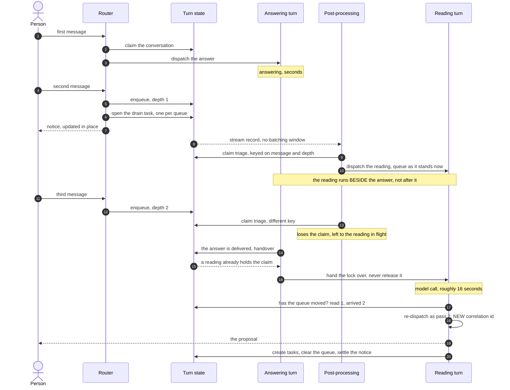
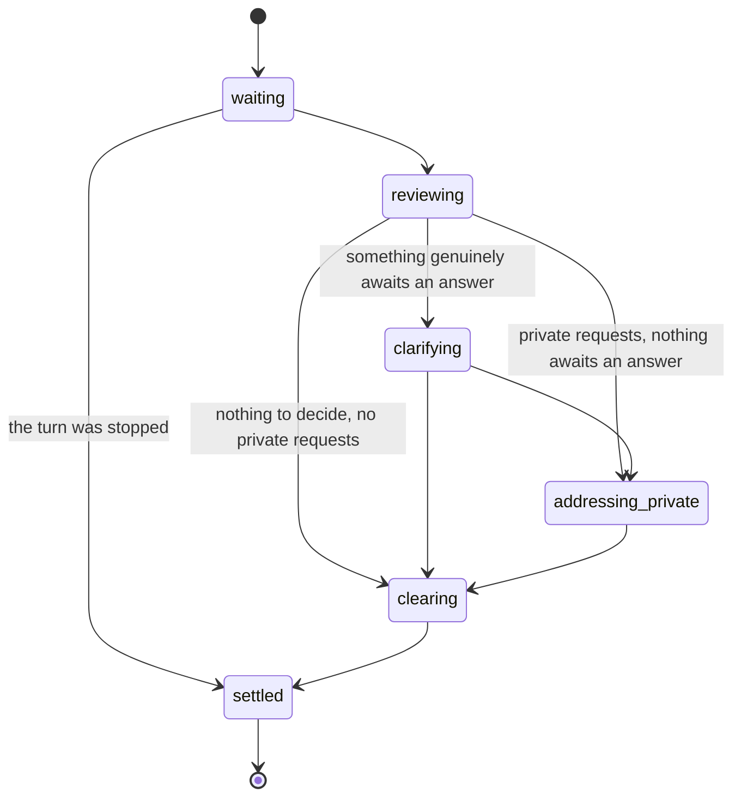

# SPEC: The Turn Queue - managing multiple requests to a single assistant in conversations

**Status:** Partial. The conversation-level claim, the deferral notice and its measurement, the deterministic stop, triage on arrival, the judged reading with a scoped tool surface, task creation from the reading, the split offer and the drain state machine are in place. The requirements table below states what is delivered, what is partial and what each row is validated by, and it is the authority on that - this line is a summary rather than a second record.

**Coverage:** `tests/e2e/turn-queue.spec.ts` - FR1-FR6 and FR8 (with `TURN_QUEUE_E2E=1`, phase `turn-queue`). `tests/e2e/private-stop.spec.ts` (with `PRIVATE_STOP_E2E=1`, phase `private-stop`) - FR5 in a room: a private stop is refused before anything is stopped, the room cannot see the refusal, and the work goes on to finish. `tests/e2e/group-split-offer.spec.ts` (with `GROUP_SPLIT_E2E=1`, phase `group-split`) - the private-subject half of FR7 and FR8 in a room of three, which the 1:1 suite cannot reach: the offer records every person it concerns, each targeted request is its own private subject attributed to its requester, and one person answering leaves the other still asked. All three are opt-in: without their gate variable each spec skips, so none runs on a plain `npx playwright test`, and each is run by `node backend/scripts/validate.mjs --only=<phase>` (`--only=turn-queue`, `--only=private-stop`, `--only=group-split`). FR7's stage transition is covered by unit test (`the-queue-says-what-it-is-doing.test.ts`); no end-to-end spec requires it, because the turn-queue suite above treats `addressing_private` as an optional stage a healthy 1:1 drain never enters. FR9's merged order rests on unit coverage (`new-work-is-not-next-work.test.ts`); no end-to-end assertion reads the order a proposal shows. FR11 has unit coverage (`one-drain-per-queue-not-per-pass`, `a-drain-carries-the-id-and-closes-itself`, `a-drain-row-never-holds-the-message`, `an-unmoved-task-goes-back-to-the-person`) and no end-to-end assertion yet. FR12 is asserted end to end. `tests/e2e/an-idle-assistant-takes-up-its-own-work.spec.ts` (with `E2E_WORKFLOW_TASK_PICKUP=1`) - FR13, **NOT VERIFIED** on a deployment.

**Related:** [DESIGN-TASK-ACCESS-AND-QUEUE-PROCESSING.md](./DESIGN-TASK-ACCESS-AND-QUEUE-PROCESSING.md) - the access model, the drain mechanics and the latency budgets. This document is the product surface: what the queue promises a person, and what it refuses to be.

**Site section:** Interaction layer, conversation.

---

## Overview

An AgentEchelon assistant is a member of a conversation, not a request/response endpoint behind a button. That conversation may hold one human member or several, arriving from more than one channel, and the assistant is expected to behave like a participant: acknowledging, reporting status, and taking things in a sensible order.

**A conversation answers one turn at a time** ([ADR-033](../../../design/decisions/033-a-conversation-answers-one-turn-at-a-time.md)). The turn queue is what makes that livable when messages arrive faster than the assistant can answer. Anything arriving while a turn is running is held, acknowledged visibly, read as a group rather than one at a time, classified into what amends the work in flight and what is new work, turned into durable work items, and put back to the person as a proposal with an order attached before any of it is executed.

**The queue holds ids, not routing decisions.** A queued message is re-resolved at triage, against the conversation as it stands when the reading runs, rather than carrying a decision made at the moment it arrived.

The shape it is modeled on is how a competent person handles the same situation. They take a request and start on it. They hear the next thing said and register it. They do not abandon what they are doing to chase each new sentence, and they do not carry on deaf to the room either. They finish, or they stop because what was just said outranks what they were doing.

**Not answering is not the same as not reading.** Holding a message back from being answered does not hold it back from being understood. Every arriving message is processed at least to the depth classification already reaches, because three things can be true of it and each demands a different response before the current work finishes: it requires immediate action including stopping, it amends the work in flight, or it is new work. That is what separates the design from a mutex. A lock that defers messages without reading them cannot tell a correction from a new question, and will confidently deliver the fifteen-paragraph report the person just asked it not to write.

## Business Problem

People do not wait politely for an assistant to finish; they send a second message, then a third, then a correction to the first, because that is how conversation works. An assistant that answers all of them at once produces overlapping replies nobody can follow, interleaved with whatever it was already writing and with other people talking. An assistant that holds everything until it is done goes silent, so the person concludes it is broken and repeats themselves, and it then acts on an instruction they withdrew two messages ago. Both failures are worse in a room than in a 1:1, and both are invisible in a latency number, because the wait a deliberate queue imposes is indistinguishable from a regression unless the wait is named.

## Personas

Personas are defined in [PERSONAS.md](../../../overview/PERSONAS.md) and are not redefined here. Five of them use the queue, and they want different things from the same wait: the person wants to be heard while they are waiting, and everyone else wants the wait to be explicable after the fact.

### End user

**How the queue relates to them:** they are the one being made to wait, and the wait is deliberate. Everything the queue does that they can see exists so that the wait reads as attention rather than as a fault.

| What they need | Requirement |
|---|---|
| To keep typing while the assistant works | FR1 |
| To see that their message landed and is waiting, once rather than per message | FR2 |
| To redirect or stop the work while it is still running rather than after it finishes | FR5, FR6 |
| To be told what the assistant understood before it acts, and in what order it intends to work | FR3, FR8, FR9 |
| A targeted request taken up with them alone, counted in the room but never described there | FR7 |
| A question the assistant could not make out asked back, rather than guessed at | FR10, FR12 |

### AI developer

**How the queue relates to them:** the reading is a model decision like any other, and a deliberate queue wait lands in the same latency population as a regression unless it is separated. Both of those are theirs.

| What they need | Requirement |
|---|---|
| The wait to be a named, separable number rather than an unexplained residual | AR1, AR2, AR9 |
| A queued turn that was answered to count as a response, labeled as having waited | AR8 |
| The reading's classification quality to be measurable | AR6 |
| A turn's exchange attributed to the turn even when its answer moved to a new message | AR10, AR11 |

### Admin / operator

**How the queue relates to them:** a stranded queue and a busy assistant look identical to a member, and telling them apart is an operations question rather than a product one.

| What they need | Requirement |
|---|---|
| To see a conversation that is holding a queue, and the stage it reached | AR6, FR11 |
| To distinguish "the assistant is busy" from "the drain failed and the queue is stranded" | FR10, FR11 |
| A queue that always empties, whatever the model returned | FR10 |

### BI analyst

**How the queue relates to them:** they take the interaction record into their own stack, so what they need is the wait on the row rather than another view.

| What they need | Requirement |
|---|---|
| Queue depth, wait time and drain outcomes as governed, queryable data on the archive | AR1, AR2 |
| A column that separates the queued population from 1:1 turns without a hand-written join | AR8, AR9 |
| No pipeline of its own, and no third measurement surface for the drain | AR7 |

### QA / test engineer

**How the queue relates to them:** the queue is concurrent by construction, so a failure that does not name where it stopped is unreproducible.

| What they need | Requirement |
|---|---|
| Deterministic, assertable states rather than a timing window | FR11, AR6 |
| A drain that reports the stage it reached, so a failure says whether the reading never started, looped, or died after clearing | AR6 |
| A queue that moved under a reading to be picked up rather than stranded | FR4 |

## Functional Requirements and Acceptance Criteria

**Priority is a keep-or-cut decision set against what the field expects, not against how interesting the work is.** `Table stakes` means a deployment without it is behind. `Differentiator` is worth the cost because few platforms do it. `Gap - prioritize` marks a requirement whose absence puts this below comparable systems. `Above bar - optional` is more than the field asks and can wait. `Optional - attach instead` should be bought rather than built. `Enabler` is not user-visible and is what makes another row affordable.

| # | Requirement | Priority | Delivered | Validated by |
|---|---|---|---|---|
| FR1 | Sending is never blocked. The queue governs which turn *answers*, never whether a message is accepted | Table stakes | Yes | `turn-queue` (e2e, behavior) |
| FR2 | A held message draws one visible notice saying what the assistant is working on, **updated** as more arrive and settled when the queue empties | Table stakes | Yes | `turn-queue` (e2e, behavior) |
| FR3 | The reading sees the whole queue at once, so three messages that are one request are recognizable as one request | Differentiator | Yes | `turn-queue` (e2e, behavior) |
| FR4 | A queue that moved after a reading was dispatched is read again, bounded by a maximum pass count | Differentiator | Yes | `a-further-pass-is-not-a-redelivery` (unit, behavior), `the-queue-is-read-again-when-it-moves` (unit, behavior), `turn-queue` (e2e, behavior) |
| FR5 | A stop suppresses the in-flight answer and cancels work in progress with no model call, keeps completed work, reaches only the assistant it named, and asks separately whether the canceled work is still wanted | Table stakes | Yes | `turn-queue` (e2e, behavior), `private-stop` (e2e, behavior) |
| FR6 | A queued message that amends the running work is folded into it, or returns to the queue and is prioritized with everything else, and is never left recorded against nothing | Differentiator | Yes | `a-reading-is-told-what-the-work-is` (unit, behavior), `turn-queue` (e2e, behavior) |
| FR7 | A targeted request is counted in the room, never described there, and taken up with its sender directly; the room sees only that private requests are being handled | Table stakes | Yes | `the-queue-says-what-it-is-doing` (unit, behavior), `group-split-offer` (e2e, behavior) |
| FR8 | A queue spanning subjects is named out loud, splitting it is offered, and the offer moves nothing until answered | Differentiator | Yes | `turn-queue` (e2e, behavior), `group-split-offer` (e2e, behavior) |
| FR9 | The order shown is the whole order - where arriving messages fall against the items already open - not a fresh list starting at 1, and a private item holds its position and is marked private rather than omitted | Differentiator | Yes | `new-work-is-not-next-work` (unit, behavior) |
| FR10 | A reading that is unusable still empties the queue: one item per message, ordinary priority, labeled from the message and marked **unclear** rather than presented as understood | Table stakes | Yes | `a-message-it-could-not-make-out` (unit, behavior) |
| FR11 | The drain is a task of a declared type: one per queue however many passes it takes, owned by the assistant for its whole life, advancing with the stage a person is shown, and closed exactly when the queue empties | Differentiator | Yes | `one-drain-per-queue-not-per-pass` (unit, behavior), `a-drain-carries-the-id-and-closes-itself` (unit, behavior), `a-drain-row-never-holds-the-message` (unit, behavior), `a-step-declares-who-it-awaits` (unit, behavior) |
| FR12 | Every question the drain raises is work owned by the person who can answer it: a message it could not make out becomes a clarification awaiting its sender, and the fate of work already running becomes its own item | Table stakes | Yes | `a-message-it-could-not-make-out` (unit, behavior), `a-drain-carries-the-id-and-closes-itself` (unit, behavior), `an-unmoved-task-goes-back-to-the-person` (unit, behavior), `turn-queue` (e2e, behavior) |
| FR13 | Then one task at a time, until the queue is clear (ADR-033): when a turn ends with nothing queued, the assistant takes up the next task assigned to it in the conversation that is ready (its accepted queued requests among them), in priority order, holding the lock across the hand-over, and a task named ready while another turn holds the lock is taken up at that turn's exit, each pickup an ordinary task turn on the one turn path | Differentiator | Partly - built, **NOT VERIFIED** on a deployment (ADR-063 decision 5); **NOT BUILT:** the sweep behind the two events and any pickup where the turn queue is off beyond a task's first step | `an-idle-assistant-takes-up-its-own-work` (unit, behavior and source text), `a-pickup-turn-is-an-ordinary-task-turn` (unit, behavior) |

**Measurement requirements.** Queueing deliberately makes a person wait, so it is the one feature where naive measurement reports a working system as a regression. Measurement is a requirement of the feature rather than a follow-on, which is why these rows sit beside the functional ones.

| # | Requirement | Priority | Delivered | Validated by |
|---|---|---|---|---|
| AR1 | The deferral acknowledgment sets time to first feedback, per queued send, so no queued message is left without a first-feedback instant of its own | Enabler | Yes | `a-deferral-is-a-measured-response` (unit, source text) |
| AR2 | The wait is named rather than absorbed: `drained_ms` reports the send to the moment the queue finished draining, and the task carries `userMessageId` so a deferred message joins its own resolution | Enabler | Yes | `a-deferral-is-a-measured-response` (unit, source text) |
| AR3 | `e2e_ms` is not adjusted. It is the person's true wait, and the queue metrics are what explain it | Enabler | Yes | none |
| AR4 | Interaction kind stays `user` for a queued turn. Queueing is a property of the turn, not a different kind of interaction | Enabler | Yes | none |
| AR5 | Triage moves a queued message that became work onto the task-resolution surface, and the two surfaces are never mixed, so human think time never flatters turn latency or damns the workflow | Enabler | Yes | none |
| AR6 | The drain reports the stage it reached, which is the basis for both the operator view and any test asserting progress | Enabler | Yes | `the-queue-says-what-it-is-doing` (unit, behavior) |
| AR7 | The drain's own duration is answered by the same view that answers it for every other task, rather than by a third surface of its own | Enabler | Partly - `drained_ms` is not withdrawn, so it is still what reports when a queue was read | `a-deferral-is-a-measured-response` (unit, source text) |
| AR8 | A queued message folded into a running answer mints its own exchange against that answer, carrying `exchanges.queued_as = 'folded'`, and an ordinary 1:1 turn carries no label | Differentiator | Partly - the wiring is pinned as text; no run exercises a folded burst | `a-queued-message-that-was-answered-is-a-response` (unit, source text) |
| AR9 | The label keeps the two populations countable apart from one column, and `v_queued_exchange` joins the instants the queued message already had rather than recomputing them | Differentiator | Yes | `a-queued-message-that-was-answered-is-a-response` (unit, source text) |
| AR10 | A turn whose answer posts as a new message still attributes the exchange minted against the acknowledgment it left behind, without duplicating the compute figures | Enabler | Yes | `the-close-out-carries-the-turn-not-its-compute` (unit, behavior) |
| AR11 | A turn declares only a message that already existed when it started, so a person repeating themselves cannot bind the running turn to the copy that queued behind it | Enabler | Yes | `a-turn-answers-the-message-that-was-there-when-it-started` (unit, behavior) |

**Reading the "Validated by" column.** Each entry is one specific test, named by its own filename or `describe` block. Unit tests live in `backend/test/lib/` and `backend/test/analytics-aurora/`; end-to-end specs live in `tests/e2e/` and are listed against their phase in [e2e-coverage-matrix.md](../../../reference/e2e-coverage-matrix.md). The status in brackets is what the test does, which matters more than that it is green:

- **behavior** - executes the code path and asserts on the result.
- **source text** - asserts that a declaration still appears in the handler source or the migration. It catches the declaration being dropped; it does not execute the view or the fold.
- **none** - no test exists.

**Known limits on the delivered rows.** FR9's merged order rests on unit coverage; no end-to-end assertion reads the order a proposal shows. FR11 has no end-to-end assertion. AR8 and AR9 are pinned as text at every hop and nothing runs either view, so what is proven is that the wiring exists and says what it should. AR3, AR4 and AR5 are conventions the readers hold rather than code paths a test can enter.

**A drain declares no `awaits` at any step, and that is the design rather than a missing hand-over.** `a-step-declares-who-it-awaits` names it as the one shipped machine that must have none. A drain that handed itself to a person at `clarifying` would be handed over and closed in the same turn, because the drain closes when the queue empties. The wait has a home already: every queued message that became work opens a `queued_request` in `proposed`, which does await the requester, so the question is owned, visible in their list, and answered against the task it is actually about (FR12).

## Non-Goals - Out of Scope

| Out of scope | Why | Where it is covered instead |
|---|---|---|
| Answering more than one turn at a time | A conversation answers one turn at a time, and every promise above rests on it | [ADR-033](../../../design/decisions/033-a-conversation-answers-one-turn-at-a-time.md) |
| A batching window before the reading is dispatched | Deliberately zero. A window adds its full duration to a waiting person, and the archival consumer's 5-second window measured 3.0s and 3.4s from message to dispatch | FR4 reconciles a queue that moved instead |
| A `queue_ms` spanning the send to the moment work starts | Draining the queue does not start the work: a queued message becomes a `queued_request` awaiting the requester, so the span is mostly a person deciding, and one metric across both surfaces would undo AR5 | AR2, which measures to the end of the drain, and AR5 |
| A third measurement surface for the drain's duration | The drain is a task, and task resolution already separates the assistant's work from human think time (tenet D7) | AR7 |
| Inferring which reply answered which queued message | An inferred mapping from adjacency or transcript order is refused. AR8 is not that: the reading produces one entry per queued message and the fold records which it took | [ADR-033](../../../design/decisions/033-a-conversation-answers-one-turn-at-a-time.md), AR8 |
| Parallel multi-assistant stop routing | A stop reaching several assistants in one room is a later phase | [ADR-033](../../../design/decisions/033-a-conversation-answers-one-turn-at-a-time.md) |
| Operator reassign and re-prioritize of queued items | Named in the design as a later capability, so the only order a person can change is the one the proposal puts to them | [DESIGN-TASK-ACCESS-AND-QUEUE-PROCESSING](./DESIGN-TASK-ACCESS-AND-QUEUE-PROCESSING.md) |
| Client-side deferral | The client is one of several ways into a conversation. A message can arrive from another client, another member, a federated participant or an integration, none of them running the web application's code, and state held in one client is invisible to the others and lost on refresh. Deferral is a fact about the conversation, so it is recorded where the conversation is | FR1, and the turn-state record in [DESIGN-TASK-ACCESS-AND-QUEUE-PROCESSING](./DESIGN-TASK-ACCESS-AND-QUEUE-PROCESSING.md) |

## User Experience Description and Mocks

The queue has no surface of its own. It writes one notice into the conversation, one proposal, and a set of task rows the person's own list reads.

1. **Keep typing.** The composer is never disabled and the send always succeeds (FR1). The message appears in the conversation like any other.
2. **See that it landed.** One notice says what the assistant is working on and that the waiting messages are next. A second and third send update that notice's count rather than adding notices of their own (FR2), and each send has its own acknowledged instant behind it (AR1).
3. **Watch the stage, not a spinner.** The notice carries the stage the drain reached: held, being read, put back to you, private requests being handled, clearing, settled (AR6). A stranded queue is therefore distinguishable from a busy one without opening a log.
4. **Redirect or stop while it still matters.** "Actually, keep it to one page" reaches the work in flight and changes it, or comes back as its own item (FR6). `/stop` is honored with no model call, keeps what is already finished, and asks separately whether the canceled work is still wanted (FR5).
5. **Read what was understood, in order, before anything runs.** The proposal names each queued message, where it falls against the items already open rather than starting at 1, and which entries are new (FR9). A queue spanning subjects names them and offers to continue any separately, moving nothing until answered (FR8).
6. **Private requests stay private.** The room is told only that private requests are being handled; the detail reaches the sender alone (FR7).
7. **A question comes back as a question.** A message the assistant could not make out is labeled unclear and becomes a clarification in its sender's list, rather than a guess presented as understood work (FR10, FR12).
8. **The queue always empties.** Whatever the model returned, the notice settles and every queued message has a durable owned item behind it (FR10).

**OPEN:** no mocks exist for the notice, the stage readout or the proposal. Which surface should they be drawn from - the chat client's notice frame, or the task list the `queued_request` rows land in?

## Related Documents

- [DESIGN-TASK-ACCESS-AND-QUEUE-PROCESSING.md](./DESIGN-TASK-ACCESS-AND-QUEUE-PROCESSING.md) - the mechanics: the access model, the drain, the reading turn, the amendment fold and the latency budgets
- [ADR-033](../../../design/decisions/033-a-conversation-answers-one-turn-at-a-time.md) - the decision, its tenets, and the per-entry-point table
- [ADR-038](../../../design/decisions/038-a-turn-answers-the-message-that-was-there-when-it-started.md) - the bound behind AR11, and the two alternatives it rejects
- [ADR-024](../../../design/decisions/024-task-ownership.md) - task ownership, which decides who holds queued work
- [PERSONAS.md](../../../overview/PERSONAS.md) - the canonical definitions of the five personas above
- [SPEC-DRIFT-CONVERGENCE](../assistants/SPEC-DRIFT-CONVERGENCE.md) - keeps a conversation on subject, where this keeps it in sequence
- [SPEC-TASK-STATE-TRANSITIONS](./SPEC-TASK-STATE-TRANSITIONS.md) - the state-machine framework the drain reuses
- [SPEC-CONVERSATION-SECURITY](../governance/SPEC-CONVERSATION-SECURITY.md) - the classification boundary the reading inherits
- [MESSAGE-FLOW](../../../guides/developer/MESSAGE-FLOW.md) - where the queue sits on the turn path

## Open product questions

- Whether a person should be able to reorder the proposed order directly, rather than by correcting it in prose.
- Whether a queue that overflows its bound should drop the oldest or refuse the newest. Current behavior drops the oldest and says so.
- Whether an amendment that arrived too late to fold should be shown differently from one that folded, given the person cannot tell the two apart today.

## Appendix A - How a queue is read, end to end

The reading is dispatched when a message **arrives**, concurrently with the turn it is waiting behind. It does not wait for that turn to finish, and that is what makes the amendment case possible at all: work can only be amended while it is still running.

**How the reading is recorded, and why that is not a formatting detail.** The assistant judges each queued message: does it amend the work in flight, can it be understood at all, how does it rank. The judgment is the model's and has to be. The selection that drives everything after it is not left in prose: the reading is recorded by calling a tool whose fields are enums, so an intent outside the three that exist, a priority outside the three that exist, or a message id that was never queued are not values to detect and reject, they are values the assistant cannot express.

This matters to the person rather than to the code. The reading arrived as text lines the platform then parsed, and a reading that came back as ordinary prose, which is what an assistant does when its persona is doing the talking, was not a reading at all, so every queued message fell to the floor and came back as "I could not tell what this asks for". There are three tiers: the tool, the older text form as a fallback for a provider that cannot enforce a schema, and that floor. Only the middle one depends on a model following a format.

## Appendix B - The drain, stage by stage

The drain is a declared state machine, and a person is shown the stage it has reached. It is also a task, of a declared type, owned by the assistant that is reading. That is what gives the reading an owner, so its state and who owes the next move cannot disagree; supervision when it stops moving; an operator who can see one and stop it; and a resolution time measured the way every other task is measured, with human think time kept out of it.

The edges are declared rather than ordered. An ordering says only "later than", which would permit a drain to jump from `waiting` to `settled` and call it progress.

| Stage | Who holds it | What the person is told | What the assistant is doing |
|---|---|---|---|
| `waiting` | the assistant | Their message is held, and how many are | Finishing the turn it is already on |
| `reviewing` | the assistant | The queue is being read | Reading every queued message together and deciding, for each, whether it amends the work in flight or asks for something new, how urgent it is, and which subject it belongs to. It does not begin, continue or describe the work any of them ask for |
| `clarifying` | the assistant | The reading has been put to them and awaits an answer | Entered only when something genuinely awaits one: a split was offered, the reading could not tell whether the work in flight is still wanted, or a task could not be created |
| `addressing_private` | the assistant | Private requests are being handled, never whose or what | Writing to each person separately about their own targeted requests |
| `clearing` | the assistant | - | Removing exactly the messages it read. Anything that arrived since stays queued |
| `settled` | the assistant | Nothing is waiting | Settling the notice, and either releasing the conversation or handing it to the turn that will read what arrived |

`addressing_private` is reachable directly from `reviewing`, because a queue of purely private messages has nothing needing an answer and would otherwise have its advance refused: the room would watch the drain go from reading to done while the private half was still being written.

One drain covers one **queue**, not one pass over it. A reading that hands over to another turn, or that leaves a remainder because messages arrived while it was reading, is the same reading continuing, so it advances the same task rather than opening a new one, and a burst of three messages opens one drain rather than three. The drain ends when the queue does.

## Appendix C - Which store answers which question

Current queue state and depth come from the turn-state record and the Amazon Chime SDK, never from a projection, because a projection's lag is indistinguishable at read time from the conversation having been quiet. Historical wait times, drain outcomes and per-stage telemetry come from the S3/Athena archive, which is the only store that has them and the only one that outlives the channel. The Aurora projection serves analytical joins over that, and is never the authority for a live decision (tenet D7).

`v_queue_acknowledgement` reports `ack_ms` per queued message and `drained_ms` per drain. It is a separate view from the per-response one because several queued messages share one notice, so folding them together would either duplicate the notice or collapse the messages. `v_queued_exchange` publishes the queued population with the wait, the answer, how many messages that answer addressed, and the `ack_ms` and `drained_ms` the queued message already had, joined rather than recomputed, because one question has one source. `v_turn_latency` skips a labeled exchange when it anchors a turn, so a folded answer's own measurement is never taken from a message it was not answering.
