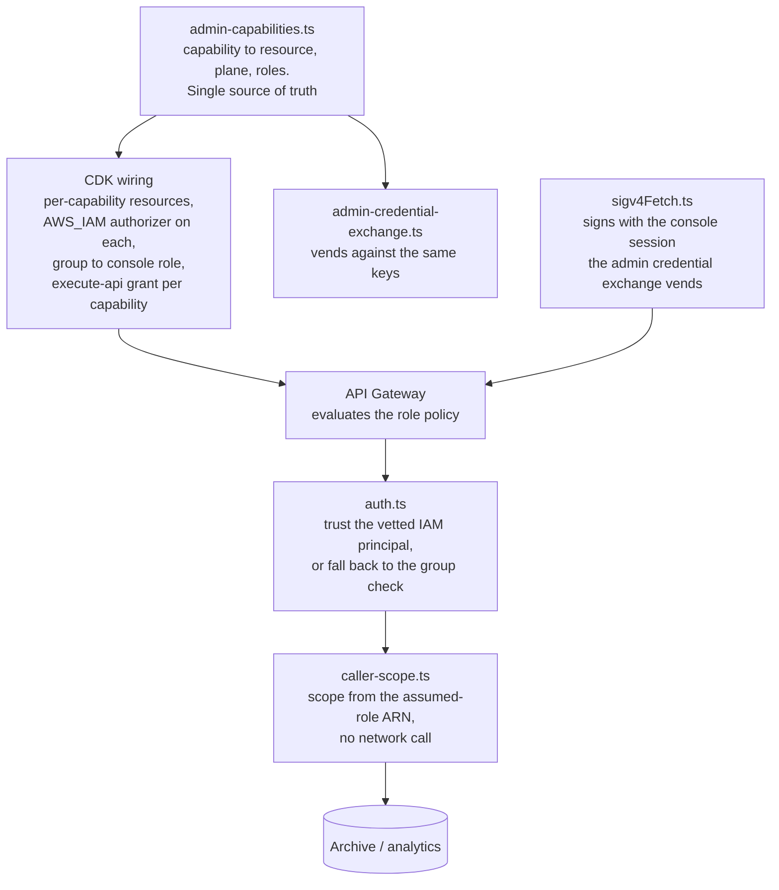
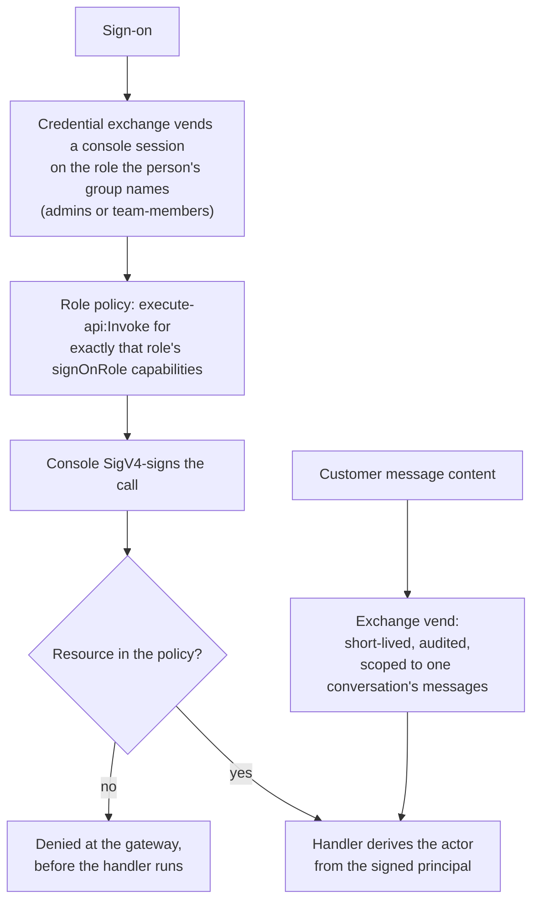
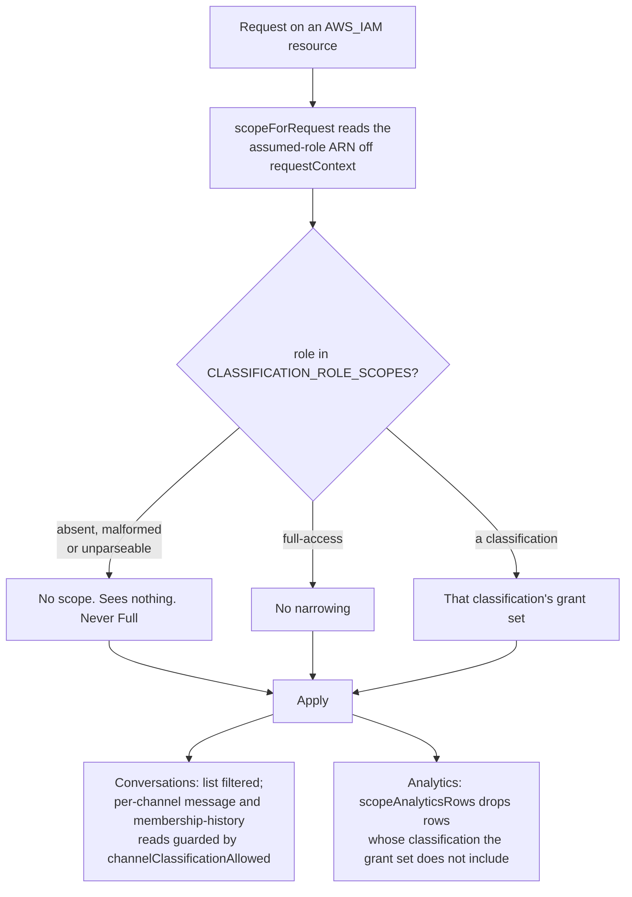

# DESIGN: Admin-Action IAM Enforcement

**Status:** Built, deployed and validated. Every route in the admin capability catalog is `AWS_IAM` in every deployment, and there is no opt-out.

**Coverage:** `tests/e2e/admin-attachments.spec.ts`, `tests/e2e/credential-exchange.spec.ts`

**Related:** [SPEC-ADMIN-IDENTITY.md](./SPEC-ADMIN-IDENTITY.md) - the capability model, the personas, and the fail-closed requirement this implements. Per requirement, what is delivered and what is not is stated there, in Functional Requirements and Acceptance Criteria, and nowhere else. This document is the mechanics only.

**Site section:** Interaction layer, governance.

---

Every privileged archive and analytics admin action is a named capability mapped to a specific API Gateway resource, so a deployer's IAM role can be denied one action, or one slice of data, at the gateway rather than only by an application group check. The Amazon Chime SDK Messaging plane already works this way: the credential exchange vends `chime:*` session policies scoped to exactly the requested capability. This design brings the archive and analytics plane to the same enforceability.

**Always on.** `admin-services-stack.ts` and its two nested stacks, `admin-assistant-administration.ts` and `admin-analytics.ts`, declare every admin route, the `GET /feedback` summary included, and `AdminApi` (`admin-api-stack.ts`) serves each one IAM-authorized, the default for an `AdminApi` route (`authOf` in `http-api.ts`), with the console roles' grants made from the capability catalog (`grantAdminRolesOnApi`, `admin-role-grants.ts`); the user-facing `POST /feedback` is a Conversations route on `PersonApi`, behind the edge authorizer. The handlers that trust the gateway-vetted principal through `isAdminIamEnforcedCall` carry `ADMIN_IAM_ENFORCEMENT=true`: the admin-conversation and admin-task handlers, the analytics query handler (Aurora and Athena), queue health, classifier-replay start, membership-audit admin, deployment sleep and wake, user management, admin experiments, manage profiles and the user-feedback summary (which also refuses any signed principal that is not an admin console session or, under `adminAuthMode=service`, the deployer's trusted proxy, because the summary has no team route). The admin credential exchange (`consoleSessionCaller`), `assistant-ownership` and `conversation-management`'s console archive (`callerPersonId`) do not carry it; they read the person from the console session directly. No context flag returns a route to the Cognito-group gate. The admin console SigV4-signs every catalog call, with a console session the admin credential exchange vends on the role the person's group names (`admins` or `team-members`).

## 1. Architecture

The authorization decision moves from an in-handler group check to an IAM policy the gateway evaluates before the handler runs. Authentication stays at the authorizer; the handler trusts the vetted principal and applies only the classification-scope filter.

The catalog is the `execute-api` analog of the Amazon Chime SDK Messaging plane's `CAPABILITY_ACTIONS`. `isAdminIamEnforcedCall`, `isServiceAdminCall`, `callerIsAdmin`, `callerCanReadArchive` and `callerCanManageProfiles` all fail closed: no enforcement env, or no IAM identity, means the trusted-IAM path is not taken.

**Own resource.** `callerCanSeeUserIdentity` is a sixth check in the same file and it fails closed for the same reason the others do: `see-user-identity` owns `GET admin/conversations/identities`, so satisfying an IAM-signed caller directly is sound - the gateway has already refused any signed principal lacking `execute-api:Invoke` on that resource, and that resource authorizes nothing else. Reaching the code proves the capability, exactly as `callerCanReadArchive` relies on each conversation-read capability (`view-conversations`, `find-conversation`, `view-messages`, `view-clean-conversations`) owning its resources (the same gate admits `/identities`, whose resource `see-user-identity` owns).

**Field checks fail open.** A check guarding a FIELD on a route another capability already admits the caller to has no resource for the gateway to refuse. Satisfying an IAM-signed caller there asserts a proof the gateway never gave: `callerCanReadArchive` is satisfied by a caller proved to hold the conversation-read capability whose resource it reached, while a field on the conversation route would be satisfied by a caller proved only to be entitled to read the conversation. Such a check fails open: every admin route is IAM-authorized, so the trusted-IAM path admits any signed caller who reached the route, and nothing binds. So a capability that would decide a field gets its own resource instead.

## 2. Data model

The catalog partitions privileged actions into enforcement planes.

| Plane | What rides it | Why |
|---|---|---|
| `signOnRole` | `execute-api:Invoke` on the console role, so the console session already encodes the person's access | Metadata, structure, aggregates and the console-session writes. The raw conversation read (`GET admin/conversations/*/messages`) is never a standing grant; a team member's raw read is its own team route (see section 4.1) |
| `exchangeVend` | The raw conversation read (`view-messages`), the Amazon Chime SDK moderation vends and the operator task vends, each requested on its own `exchange-credentials/admin/<key>` route and vended per use, short-lived and audited | A per-conversation "who read this" or "who moderated this" record is worth the round-trip |
| S3 attachment | `attachment-read` (assistant deliverables under `generated-docs/…`, archive grade) and `attachment-read-uploads` (user uploads under `attachments/…`, moderation grade, with a sensitive-audit record) | An `s3:GetObject` session policy rather than an `execute-api:Invoke` grant, so these live in `admin-credential-exchange.ts` as `S3_ATTACHMENT_CAPS` rather than in the `execute-api` catalog |

The archive, analytics and profile capabilities and their resources. "Both" means `admins` and `team-members`; `team-members` hold such a capability only on its team routes under `.../assistants/{assistant}/...`, which the console session narrows to the assistants their team owns:

| Capability | Plane | Resources | Roles |
|---|---|---|---|
| `view-conversations` | signOnRole | `GET admin/conversations`, `GET admin/conversations/membership-history` | both |
| `find-conversation` | signOnRole | `GET admin/conversations/find` | both |
| `see-user-identity` (PII) | signOnRole | `GET admin/conversations/identities` | `admins` |
| `view-messages` | exchangeVend | `GET admin/conversations/*/messages`, reached only by a vended session; requested on `POST exchange-credentials/admin/view-messages` | both |
| `view-clean-conversations` | signOnRole | `GET admin/conversations/*/clean` | both |
| `view-events` | signOnRole | `POST events-log` | `admins` |
| `view-user-activity` (PII) | signOnRole | `POST user-activity` | `admins` |
| `view-moderation-audit` | signOnRole | `POST moderation-audit` | `admins` |
| `record-moderation` | signOnRole | `POST moderation-record` | `admins` |
| `view-analytics` | signOnRole | `POST` analytics root, and the `GET analytics/...` reads the console makes beside it | both |
| `triage-responses` | signOnRole | `POST triage` | both |
| `label-ground-truth` | signOnRole | `POST ground-truth` | both |
| `run-classifier-replay` | signOnRole | `POST classifier-replay-start` | `admins` |
| `view-security` | signOnRole | `GET membership-audit/findings`, `GET membership-audit/enforce` | `admins` |
| `enforce-membership-audit` | signOnRole | `POST membership-audit/enforce` | `admins` |
| `revoke-membership` | signOnRole | `POST membership-audit/revoke` | `admins` |
| `manage-deployment` | signOnRole | `POST deployment/sleep`, `POST deployment/wake` | `admins` |
| `view-profiles` | signOnRole | `GET admin/profiles`, `POST admin/profiles/export`, `.../validate`, `.../preview-run`, `.../golden-gate`, `.../golden-set-batch`, `GET admin/templates` | both |
| `edit-profiles` | signOnRole | `POST admin/profiles/version`, `.../draft`, `.../discard`, `.../import`, `.../variant-version`, `.../golden-run`, `.../golden-set-generate`, `.../golden-set-retire-generation` | both |
| `import-golden-set` | signOnRole | `POST admin/profiles/golden-set-import`, `.../golden-set-retire-upload` | both |
| `activate-profiles` | signOnRole | `POST admin/profiles/activate`, `.../rollback`, `POST admin/experiments/*/promote`, `POST admin/templates/save`, `.../rollback` | both |
| `activate-past-golden-gate` | signOnRole | `POST admin/profiles/activate-past-golden-gate`, with no team route | `admins` |
| `view-config` | signOnRole | none, by design (unwired) | `admins` |

The full catalog, including the experiment, user-management, ownership, conversation archive and delete, Amazon Chime SDK moderation, attachment and task capabilities, is `ADMIN_CAPABILITIES` in `admin-capabilities.ts`; the published matrix is SPEC-ADMIN-CONSOLE "Role-based capability matrix", and `backend/test/admin-role-matrix-is-published.test.ts` fails the build when the two disagree about which role holds a capability.

Each capability owns resources no other capability names (`one-grant-per-function.test.ts`), so a function of a different weight - starting a classifier replay beside reading quality data, activating a profile beside viewing it - is its own grant. `view-config` is unwired because the only runtime-writable config is the assistant-profile registry, already covered by `edit-profiles` and `activate-profiles`, and the rest of the deployment configuration is deploy-time with no runtime API to gate. `see-user-identity` is wired on a resource of its own, because what it decides is a participant's name, the display name the person's identity provider gives (never an address, `displayNameFor` in `person-identity.ts`), and a caller who may not be told it must still be able to read the conversation. That is why the resource is a SUB-PATH of the conversations API rather than a separate API - `GET admin/conversations/{channelId}/messages` splits the same way for `view-messages`, and `membership-history` is the sibling pattern the gateway already routes. The conversation reads return participant ARNs and no names to any caller, and `GET admin/conversations/identities` resolves those ARNs for a caller holding the capability. A role is kept from names by omitting `see-user-identity` from its grant; `USER_IDENTITY_VIEW_GROUP_NAMES`, defaulting to the admin groups, is the handler's fallback for a call with no trusted IAM identity, which no deployed admin route receives. Deployment sleep and wake (`manage-deployment`) and queue health are `AWS_IAM` like every other admin route; only `GET deployment/state` is unauthenticated.

**Role-to-group map** (`ADMIN_ROLE_GROUP` in `admin-capabilities.ts`): `admins` to `admins` and `team-members` to `team-members`, each with its console role (`ADMIN_CONSOLE_ROLE_NAME` in `admin-role-grants.ts`). The four example personas in SPEC-ADMIN-IDENTITY have no group and no role in any stack (**NOT BUILT**).

**Role-to-scope map** (`CLASSIFICATION_ROLE_SCOPES`, built by the `AdminServices` stack and parsed once in `caller-scope.ts`): a JSON array of `{ role, scope }` that names the roles an administrator acts through, the admin-plane role and the admin console role, each as `full`. A team console session is not in the map: its scope is the person's own clearance, which the exchange writes into the session name (`console-<personId>@<clearance>`) and `caller-scope.ts` reads from the caller's ARN. A person's vend role is resolved from its fixed name and the profile registry rather than listed. An absent or malformed map yields no entries, so a caller none of these resolves gets no scope (`undefined`) and sees nothing.

## 3. APIs and interfaces

- **Per-capability resources.** The analytics API is split so each capability has its own `execute-api:Invoke` resource, each `AWS_IAM`-authorized. A role whose policy omits a resource is denied at the gateway before the handler runs.
- **The queryType-to-capability partition** (`admin-capability-map.ts`) is the shared contract that stops a caller reaching an out-of-capability query through an in-capability resource: the handler rejects a `queryType` that does not belong to the resource's capability.
- **The exchange vend request** carries an `identity` of `chat` or `admin` and a capability set. An archive vend is an `execute-api` session policy and an Amazon Chime SDK Messaging vend is a `chime:*` one, so the exchange refuses a request that mixes the two. A content read emits `admin_scoped_credential_vend` and scopes the session policy to the messages route of the one conversation it names (`.../admin/conversations/<id>/messages`); an id that is not a literal is refused.
- **The principal contract.** On an `AWS_IAM`-authorized call, API Gateway populates `requestContext.identity.userArn`, the assumed-role ARN, which carries the scope. `callerPersonId` (`auth.ts`) reads the person id from the console session's role-session name (`console-<personId>`, which only the credential exchange assigns). The deployment creates no Identity Pool, so no other IAM-signed caller carries a person. On a Cognito-JWT call the identity is absent, which is what makes the fallback fail closed.

## 4. Key flows and algorithms

### 4.1 The standing grant, and the cut line

Denying a capability is one `execute-api` statement omitted from a role. The `admins` console role carries every archive and analytics read except the raw conversation read, including the PII reads `see-user-identity` and `view-user-activity`, and the console-session writes (profile edits and activation, user management, membership-audit enforcement and revocation, moderation records, archiving a conversation). For `admins`, the raw conversation read and the whole Amazon Chime SDK Messaging plane go through the exchange, so each leaves an attributable vend record. A team member reads raw messages on its standing team route (`GET admin/assistants/{assistant}/conversations/*/messages`), narrowed to its owned assistants and their membership periods, with a required reason recorded on a `team_conversation_read` audit line rather than a vend.

### 4.2 Classification-scope resolution

Resolution is entirely in-process, mirroring how the credential exchange bakes clearance into the assumed role rather than re-querying Cognito, so a VPC-attached analytics Lambda needs no network path to the Cognito API. `scopeForRequest` is the single seam and it is fail-closed, so the fail-open cannot be reintroduced at a call site.

`scopeAnalyticsRows` is generic rather than per-query: a row is filtered only if it carries a field that both names a classification axis and holds a real classification value. A global aggregate with no classification column passes through unscoped, and a field named `classification` that holds a quality grade is not mistaken for a level.

### 4.3 Fail modes

| Condition | Result |
|---|---|
| A mis-set enforcement env on a route behind the edge authorizer | `requestContext.identity` is empty, `isAdminIamEnforcedCall` returns false, and the call falls through to the group check |
| A malformed `CLASSIFICATION_ROLE_SCOPES` | An empty map, so every IAM-enforced caller resolves to no scope and sees nothing |
| A role that omits a capability's resource | Denied at the gateway, before the handler runs |
| An item with no classification tag | Refused rather than read as any classification |

## 5. Security and IAM

- **Fail-closed scope.** A control that cannot identify the caller narrows, never widens.
- **One conversation per vend.** The Amazon Chime SDK Messaging session policy pins the channel ARN as the IAM resource, so a moderation credential cannot touch another channel. The archive content credential is pinned the same way: the conversation id is a path segment, so the exchange completes the messages route with that one id and refuses a wildcard. This narrows a full admin too. Two further layers stand behind it: a scoped caller is held to its classification's grant set per channel by the fail-closed handler check (`channelClassificationAllowed`), and the per-channel reads are captured by the API Gateway access log on the messages resource.
- **Precedent.** `adminAuthMode=service` makes the admin handlers trust any IAM-signed caller (`isServiceAdminCall`). This design is the per-resource form of the same trust, deriving the actor from the signed principal the same way.
- **Audit tie-in.** The exchange emits `admin_scoped_credential_vend` on every admin-plane vend, Amazon Chime SDK Messaging and archive alike, so "who could read a customer conversation" is auditable next to "who could moderate it", with the same short-lived, attributable record. The record names the human, the admin identity, the scope, the capabilities and the credential lifetime.

## 6. Testing

- **Unit:** `caller-scope` covers `scopeFromGroups`, `classificationAllowed`, `scopeAnalyticsRows` and the fail-closed `scopeForRequest`, including the deny cases where an unresolvable role ARN and a role absent from the map both get no scope. `admin-capability-map` covers the queryType-to-capability partition and the enforcement predicate. `auth` pins the multi-group claim parsing the group fallback rests on, and `auth-admin-mode` covers the four IAM-enforcement branches, two of which are deny cases. `credential-exchange` covers the vend: the plane split, the refusal to mix planes, and the refusals to vend an archive or attachment credential to a non-admin or on the chat plane.
- **Integration:** `admin-iam-enforcement-wiring` asserts that every function behind an `AWS_IAM` analytics method carries `ADMIN_IAM_ENFORCEMENT`, so a route cannot be IAM-authorized while its handler still believes it is on the group gate. `the-feedback-summary-is-an-admin-catalog-route` asserts the same of `GET /feedback` on `AdminApi`, and that the `admins` console role is granted it and the `team-members` role is not.
- **End-to-end:** `credential-exchange` and `admin-attachments` drive the vend path against a deployed stack.
- **Deny-test:** `backend/scripts/deny-test-admin-capabilities.mjs` calls every catalog route as a `team-members` session against the deployed API and requires the gateway's IAM check to refuse each one the role does not hold.
- **Not covered:** the four persona roles are not built, so no deployed test drives one. The membership scope axis has no generic test.

## 7. Modes

- **Aurora analytics.** Split into per-capability resources, each with its own `AWS_IAM` authorizer and its own `execute-api` grant.
- **Athena analytics.** The same per-capability sub-paths under `POST /query` (`ANALYTICS_CAPABILITY_SUBPATHS`), each `AWS_IAM` with its own grant. The Athena handler serves the `view-analytics` queryTypes; a finer capability's queryType it does not implement answers `unsupported` rather than falling back to the root.
- **The classification axis** is wired for both planes.
- **No opt-out.** No context flag takes a catalog route off IAM, in any admin auth mode.

## 8. Open technical questions

| Question | Why it is open |
|---|---|
| Whether the capability split is the right resolution or should be coarser | More resources means more places a grant can be forgotten; fewer means a denial is blunter than the matrix it implements |
| Whether the scoped conditions for the AI developer (by assistant) and the manager (by use case) reuse the classification tag alone or need an ownership tag | The platform records assistant ownership (`owner-team`, `manage-ownership`) but no ownership of a channel or a use case, so the manager condition lands outside this design |
| Whether the per-conversation content vend proves too chatty in practice | The fallback is the content read on the sign-on role plus a per-read audit-log write instead of a vend, which trades the pinned credential for a record |

## Related Documents

- [SPEC-ADMIN-IDENTITY.md](./SPEC-ADMIN-IDENTITY.md) - the requirements, the personas, and what is delivered
- [SPEC-CREDENTIAL-EXCHANGE.md](./SPEC-CREDENTIAL-EXCHANGE.md) - the bearer-pinned vend and the Amazon Chime SDK Messaging capability set this mirrors
- [DESIGN-ADMIN-CONSOLE.md](../../interface/DESIGN-ADMIN-CONSOLE.md) - the console that signs these calls
- [SPEC-ACCESS-AND-CONTROLS-AUDITING.md](./SPEC-ACCESS-AND-CONTROLS-AUDITING.md) - where the vend record lands, and what reads it
- [TENETS.md](../../../overview/TENETS.md) - tenet D3, which the two-layer and fail-closed rules follow from
