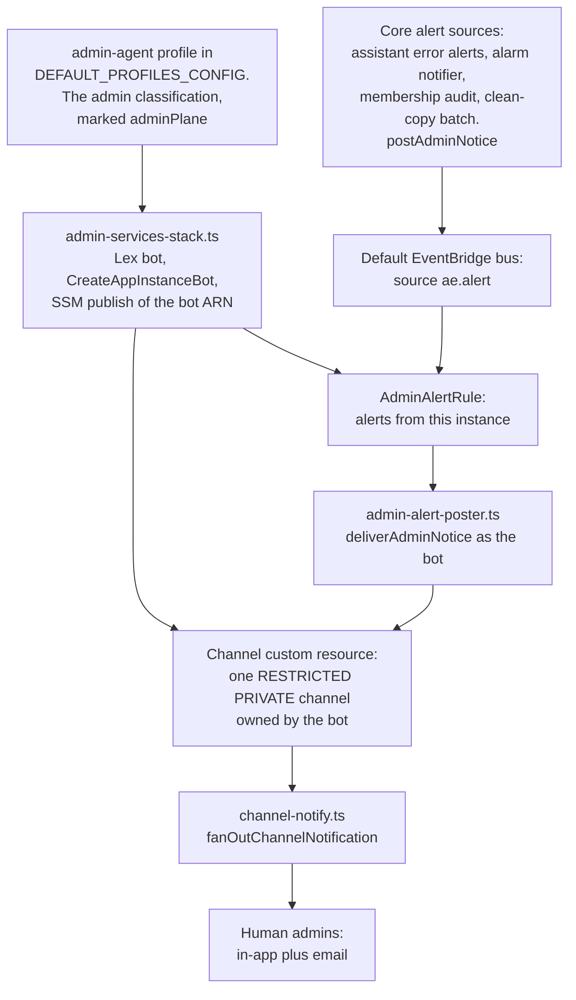
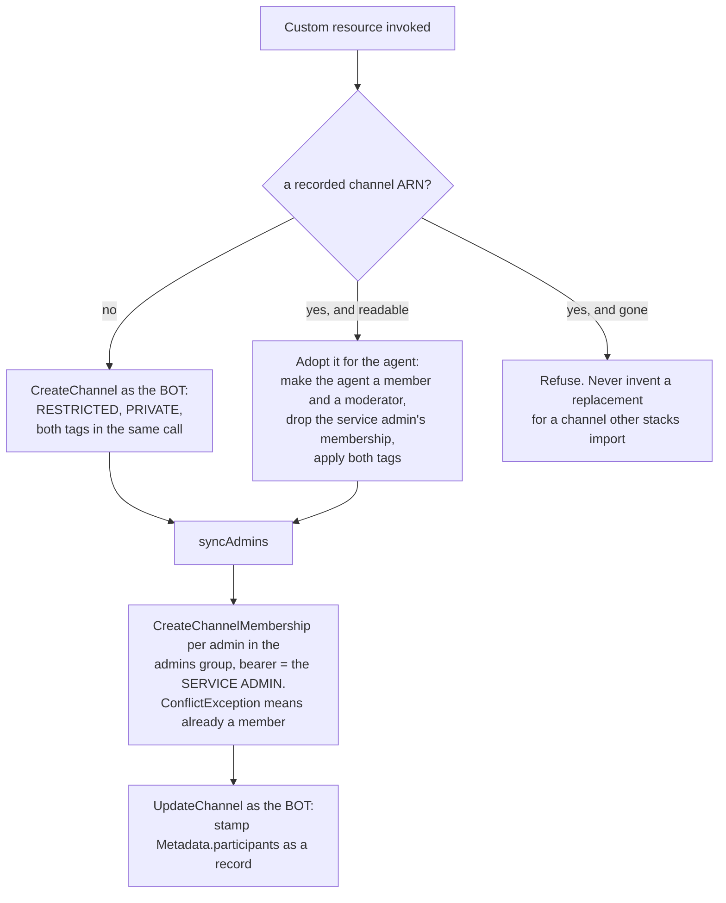
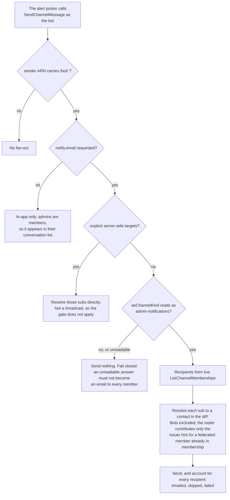

# DESIGN: Admin Assistant and Admin Notification Channel

**Status:** Not built end-to-end. The code is complete and unit-tested; no alert has ever been posted as the admin assistant and seen to land, in-app or by email, against a deployment. That last step is the one the service app-instance-admin cannot perform, so it is the one that decides whether this path works.

**Coverage:** `tests/e2e/notification-bridge.spec.ts` (with `ADMIN_ALERT_E2E=1`, phase `notifications`) - induces a real uncleared membership and requires the resulting alert to land in the admin channel sent by the admin-agent bot ARN published in SSM, the service app-instance-admin to be neither its sender nor a channel member, and the email leg to reach a channel member and not a decoy written into `Metadata.participants`. It has not yet been run against a deployment, so the Status above stands until it passes there. `tests/e2e/an-operator-notice-is-worded-by-the-admin-agent.spec.ts` (phase `notifications`) saves the admin assistant its own `cloudwatch-alarm` template, drives an alarm through the one notifier, and requires the notice in the admin channel to be posted as the admin assistant in that template's words rather than the shipped ones (ADR-062 decision 6). It has not yet run against a deployment.

**Verified by:** `backend/test/admin-agent-notifications.test.ts` - the three identities stay distinct (the channel is created by the bot, members are added by the service admin, the service admin never becomes a member), the roster is written as a record rather than a recipient list, provisioning is refused outright without the agent identity, an existing channel is adopted rather than replaced and the recorded ARN is never silently replaced when the channel is gone, a core function raises an alert only as an `ae.alert` event (an `events:PutEvents` grant for that source, and no channel, bearer or parameter), and one rule in `AdminServices` posts it into its own channel as its own agent.

**Related:** [SPEC-ADMIN-IDENTITY.md](./SPEC-ADMIN-IDENTITY.md) - the two credential planes and the admin trust boundary this delivery path stays inside. Per requirement, what is delivered and what is not is stated there, in Functional Requirements and Acceptance Criteria, and nowhere else. This document is the mechanics only.

**Site section:** Interaction layer, governance.

---

## 1. Architecture

The scope is a delivery path for admin-facing alerts - membership-audit findings, admin-error alerts, alarm notices, and admin notifications added later - that respects the admin trust boundary. A core stack raises an alert as an `ae.alert` event on the account's default EventBridge bus and never names the admin channel; the `AdminServices` stack, present with the `admin` capability, holds the channel, the admin assistant and the one rule that posts each event into the channel.

The admin assistant is an assistant capability profile (`AssistantProfile`, `backend/lib/config/profiles.ts`) rather than a hardcoded identity, which is what makes it native to the platform. It is the profile of the `admin` classification: one whose declared grant set names itself alone (`profiles.ts`, and `profilesConfigFromRows` for the runtime registry), and not one a conversation can be created at. It has no conversational runtime - no router, processor or task service - so its Lex fulfillment is silent (`backend/lambda/src/admin-agent-lex-handler.ts`). The Lex half is required rather than wanted, because `CreateAppInstanceBot` has no form without a `Configuration.Lex` ([ADR-036](../../../design/decisions/036-why-turns-enter-through-amazon-lex.md)).

Three identities are kept distinct:

| Identity | ARN shape | Role in this design |
|---|---|---|
| Admin Assistant | `.../bot/...` (AppInstanceBot) | Creates and moderates the channel; the bearer that posts every alert |
| Service app-instance-admin | `.../user/agent-echelon-admin` | Bearer for `CreateChannelMembership` only; never a channel member. A bot that moderates a channel can add members (`lib/channel-creation.ts` does so bearing the assistant), so this is a choice of one bearer that works on every channel the provisioner handles: on an adopted channel, created by the service admin under an earlier version, the bot is neither a member nor a moderator until adoption grants both |
| Human admins | `.../user/<personId>` | Channel members and email recipients |

## 2. Data model

- **The admin-agent profile** (`profiles.ts`), for example `{ name: 'admin-agent', modelKey: 'haiku', classifierMode: 'llm', timeoutSeconds: 30, contextScope: 'granted' }`, bound to no `DeploymentClassification.profile`. For notifications only its bot identity is used; its persona and model matter if it later gains a conversational role.
- **The bot ARN** published to SSM at `.../assistant/admin-agent/bot-arn` (via the key helper in `agent-classification-common.ts`), for other readers. The channel custom resource takes the bot ARN and the service-admin ARN as its environment (`ADMIN_AGENT_BOT_ARN`, `ADMIN_BEARER_ARN`, `admin-services-stack.ts`) and reads no SSM parameter. The alert poster takes the bot ARN and the channel ARN as its environment, from its own stack.
- **Two channel tags, both set in the `CreateChannel` call rather than by a following `TagResource`**, so a provision that dies partway leaves no permanently untagged channel:

| Tag | Question it answers | Consequence |
|---|---|---|
| `aeChannelKind: admin-notifications` | What the channel **is** | The fan-out emails the whole membership only in a channel carrying this tag (section 4.3) |
| `classification: <the admin plane>` | Where its **boundary** sits | This is a conversation, so it is judged by the same closed axis as every other one. Untagged, it matches no Layer-1 Allow, and every membership event on it logs a security event for a missing tag |

- **The channel `Metadata.participants[]` roster** is stamped at provisioning with the human admins' native subs. It is **a record of the provisioned set, not the recipient list.** The fan-out resolves recipients from live `ListChannelMemberships`, because channel Metadata is member-writable: a channel moderator holds `chime:UpdateChannel`, which rewrites Name and Metadata in one call IAM cannot split, so a roster-derived recipient list is a member-controlled path to having conversation content emailed to somebody of their choosing. That fan-out is shared by every channel, and in an ordinary conversation every person moderates their own. Membership is not forgeable the same way: adding a member is `CreateChannelMembership`, a separate moderated operation visible in the conversation. For this channel the roster and the membership are identical by construction, so nothing is lost by reading membership.
- **The channel** itself: `RESTRICTED` and `PRIVATE`, `Name: "Admin Notifications"`, created and moderated by the admin-agent bot. Its ARN and the bot's reach the one alert poster as `ADMIN_ALERT_CHANNEL_ARN` and `ADMIN_ALERT_BEARER_ARN`; no other stack names either. The ARN is also published to SSM for scripts and the e2e suite, and exported to no stack.
- **The `ae.alert` event**, one per alert, on the account's default EventBridge bus: `Source` is `ae.alert`, `DetailType` is the notice's message type (for example `membership_audit_finding`), and `Detail` is `{ instance, notice }`, where `instance` is the raising deployment's `AE_INSTANCE_NAME` and `notice` is `{ content, subject, messageType, extra? }` (`AlertDetail` and `AdminNotice` in `backend/lambda/src/lib/admin-notice.ts`). The instance is what keeps two instances in one account out of each other's channel.

## 3. APIs and interfaces

- **Bearer contract.** `CreateAppInstanceBot` is an Identity API call and takes no bearer. `CreateChannel` takes the admin-agent bot as `ChimeBearer`. `CreateChannelMembership` takes the service-admin user: the one bearer that can add members on a freshly created channel and on an adopted one alike, where the bot holds neither membership nor moderator status until adoption grants them (a moderating bot can add members, as `lib/channel-creation.ts` does). `UpdateChannel` (the roster stamp) and `SendChannelMessage` (the alerts) take the admin-agent bot.
- **Contracts consumed:** the admin-agent bot ARN and the service-admin ARN, both passed to the channel custom resource as environment variables at deploy time (`ADMIN_AGENT_BOT_ARN`, `ADMIN_BEARER_ARN`). The bot ARN is also published to SSM at `.../assistant/admin-agent/bot-arn`.
- **Raising an alert.** Every admin alert, the membership audit's included, goes through `postAdminNotice` (`backend/lambda/src/lib/admin-notice.ts`): it writes a CloudWatch line, puts one `ae.alert` event on the default bus, never throws, and returns whether the bus accepted the event, so a caller can log the one it could not send. `alertEmitterWiring` (`backend/lib/stacks/agent-classification-common.ts`) stamps `ALERT_INSTANCE` on the function and grants `events:PutEvents` on the default bus conditioned on `events:source` equal to `ae.alert`; the caller holds no message send. The membership audit's `ADMIN_ARN_PARAM` names the service app-instance-admin, which it moderates as.
- **Posting an alert.** `AdminAlertRule` in `AdminServices` matches `source: ae.alert` and `detail.instance` equal to this instance, and targets `AdminAlertPosterFunction` (`backend/lambda/src/admin-alert-poster.ts`) with two retries. The poster checks the source and instance again, posts the notice as the admin assistant with `deliverAdminNotice` (`backend/lambda/src/lib/admin-channel-post.ts`), and throws on a failed post so EventBridge retries it.
- **Notify trigger.** The fan-out honors `notify` metadata only from a `/bot/` sender, so a bot-sent message is the trusted trigger and a person's hand-crafted Metadata never reaches the fan-out.

## 4. Key flows and algorithms

### 4.1 Why the sender is the bot

Two facts force the design, one verified against the live instance.

1. Alerts post into an admin conversation and fan out over email, and a deployment without the `admin` capability has no rule to post them, so they stay log-only until the channel exists.
2. A `SendChannelMessage` by the service app-instance-admin into a `RESTRICTED`, `PRIVATE` channel it is not a member of is rejected (verified: `ForbiddenException: You do not have sufficient access to perform this action`). Making it a member to work around this is wrong: the service admin is the cross-channel administration identity that reads and moderates **without** membership, and as an email recipient it would be incorrect. So the sender is an identity that legitimately owns the channel. A bot that creates a channel is its moderator and may post to it, and a bot-sent message is the trusted fan-out trigger.

### 4.2 Channel provisioning

Idempotent, with the channel ARN as the `PhysicalResourceId`: Create makes the channel, Update reuses that ARN and re-syncs the roster, Delete removes it.

The adoption path exists because a channel created by an earlier version is owned by the service admin, so the bot is neither its member nor its moderator, and membership, moderator status and both tags have to be granted explicitly on a channel that already exists. That is also why the service admin, not the bot, bears the member adds: it is the one identity that can add members on both kinds of channel. Re-provisioning re-tags an adopted channel, which is what clears the missing-tag security events it produces.

### 4.3 Posting an alert, and the fan-out gate

A membership-wide email is sent only in the admin conversation, decided from the immutable `aeChannelKind` tag on the live channel rather than from a copy and never from Metadata. The membership read runs as the service app-instance-admin, which reads across channels without being a member; only the post needs an identity that may speak in the channel. An unresolvable federated member is recorded in the result rather than only logged, because a member of this channel who receives no alert, invisibly, is the one case this bridge exists to make impossible.

### 4.4 Fail modes

| Condition | Behavior |
|---|---|
| An admin with no usable email in the identity provider | In-app delivery only, until another channel (SMS, PSTN, webhook) is attached |
| A new admin added between deploys | Not a member until the next provision or Update re-sync |
| The `aeChannelKind` tag cannot be read | No email is sent |
| `admin` is not declared | No rule exists: the event reaches no target, and the CloudWatch line `postAdminNotice` writes is the record |
| The bus refuses the event | `postAdminNotice` logs it and returns `false`; the caller logs the notice it could not send |
| The post fails | The poster throws and EventBridge retries it twice |

## 5. Security and IAM

**Security boundary (normative).** The admin assistant participates only in admin conversations, and admin conversations are reachable only by admins.

1. **Never in a user conversation.** The agent's bot is never added to, and never responds in, a user or classification channel. No ordinary classification maps to it, so the router never routes a user turn to it, and no code path invokes it from a non-admin channel.
2. **No conversation is created at the `admin` classification.** The admin notification channel, provisioned by the `AdminServices` stack, is the one `admin`-classified channel. Every conversation-creation path refuses an admin-plane classification (`ProfileRegistry.isConversational`): the person-facing API answers `CLASSIFICATION_NOT_CONVERSATIONAL`, drift-spawned and split conversations refuse before creating anything, and a federated deployment configured at it fails at synth. Without this, a conversation could exist that its assistant holds and never answers. *Verified by* `backend/test/lib/no-conversation-at-the-admin-plane.test.ts`, which also proves an administrator - who reaches `admin` and would otherwise pass - is refused.
3. **Admin-only membership.** Every channel the admin assistant owns or joins is `RESTRICTED` and `PRIVATE`, with membership limited to the `admins` Cognito group plus the agent's own bot. A non-admin can neither read nor post, and the service app-instance-admin is not a member either: it is only the member-add bearer.
4. **The boundary binds a future conversational role too.** If the admin assistant gains a conversational role, the same three rules hold unchanged. Admin-plane content and the admin assistant stay strictly inside the admin trust boundary.
5. **Reaching the admin assistant is itself a privileged capability.** It holds admin capabilities, so reaching it is equivalent to reaching those capabilities, and access is gated to admins the same way the console is ([DESIGN-ADMIN-ACTION-IAM-ENFORCEMENT.md](./DESIGN-ADMIN-ACTION-IAM-ENFORCEMENT.md)). It is a deputy rather than an amplifier: it exercises an admin capability only under the requesting admin's own entitlement, so a scoped admin cannot do through the assistant what their own capabilities forbid, and every capability it exercises is scoped and audited (`admin_scoped_credential_vend`) exactly as the equivalent direct action is.

**An admin is a moderator of an admin conversation, not merely a member.** The scheduled reconcile resolves the admin set from the `admins` group and makes each one both, because moderation is what decides who may rename, archive or redact inside a channel: with membership alone the agent's bot is the only moderator these channels have, and a channel whose only moderator is a bot has no person who can administer it. This grants nothing outside the configured admin conversations - moderation is channel-scoped ([SPEC-MODERATION.md](./SPEC-MODERATION.md)), so it is not a chat identity being elevated to cross-channel administration, which stays on the separate `${personId}-admin` plane.

**The notification channel is kept to the admins on the same schedule, as members only.** Its provisioner adds the admins it finds when the channel is created, and on a fresh deployment that is nobody, because people are provisioned after the stacks. The scheduled reconcile (`admin-conversation-sync.ts`, `ADMIN_NOTIFICATION_CHANNEL_ARN`) therefore adds each current admin and removes each former one, and grants no moderation there: the admin assistant created the channel and moderates it, and an alert is not something an admin edits. Verified by `backend/test/the-admin-notification-channel-is-kept-to-the-admins.test.ts`.

**The revoke is load-bearing, because removing a membership does NOT clear moderator status.** Measured 2026-09-28: a member made a moderator (`CreateChannelModerator`) and then removed from the channel disappears from `ListChannelMemberships` and still appears in `ListChannelModerators`. The Amazon Chime SDK API reference states the coupling in neither direction, so it had to be measured. A demoted admin therefore keeps the role until something revokes it, and moderation is what decides who may rename, archive or redact - so without the revoke the roster would read correctly while a former admin still held authority over an admin conversation. The reconcile reads the moderator list rather than inferring it from the roster, which also converges a dropped event or a failed delete (tenet D6), but that is the second reason rather than the first.

The agent's bot is excluded from both directions by identity shape rather than by group membership, since it is not in the admin group and a group-driven revoke would strip the one moderator that must keep it.

This is the same trust separation as the two credential planes in [SPEC-ADMIN-IDENTITY.md](./SPEC-ADMIN-IDENTITY.md): the admin assistant is an admin-plane identity and never crosses into the chat plane.

**IAM grants.**

- **Bot creation:** `chime:CreateAppInstanceBot` on the app instance and on `.../bot/*` (the profile stack already grants this for classification bots), plus the Lex creation actions. The bot's custom resource keeps a retain removal policy, because the bot owns the channel and is the sender on every archived alert.
- **Channel provisioning role** (`admin-services-stack.ts`), each bearer named and never `.../user/*` (any person): `chime:CreateChannel` only for a channel requesting the admin plane's `classification` tag, bearing a bot tagged with the admin plane; `UpdateChannel` and `DeleteChannel` on admin-plane-tagged channels, bearing that bot or the service admin's exact ARN; `DescribeChannel` on any channel, bearing only those identities; `CreateChannelMembership`, `CreateChannelModerator` and `DeleteChannelMembership` on admin-plane-tagged channels bearing the service admin's exact ARN (`adminPlaneMembershipStatements`); tag-on-create for the admin classification (`tagOnCreateStatements`); `cognito-idp:ListUsersInGroup` and the `Identities` read through `grantDirectoryRead`. It receives the two ARNs as environment (`ADMIN_BEARER_ARN`, `ADMIN_AGENT_BOT_ARN`), and its SSM reads are the admin plane's assignment records (`ssm:GetParametersByPath`) and its template pointers (`messageTemplateReadStatements`).
- **Alert sources:** `events:PutEvents` on the default bus, conditioned on `events:source` equal to `ae.alert` (`alertEmitterWiring`), on every core function that raises an alert, the membership audit's included. None holds a message send into the channel.
- **Alert poster:** `chime:SendChannelMessage` on the channel by its ARN, and on `.../bot/*` conditioned on `aws:ResourceTag/classification` naming the admin plane, on `AdminAlertPosterFunction` only.

## 6. Testing

- **Unit and integration** (`backend/test/admin-agent-notifications.test.ts`): the provisioning sequence keeps the three identities distinct and never makes the service admin a member; the roster is a record; provisioning is refused without the agent identity; an existing channel is adopted, its ARN kept, the agent made both member and moderator, and the service admin's membership dropped; a recorded channel that is gone is refused rather than replaced; a core function holds `events:PutEvents` for `ae.alert` and no channel, bearer or parameter; the one rule and its poster are in `AdminServices`, sending into that stack's own channel as its own agent; and the membership audit role holds no `SendChannelMessage`. `backend/test/lib/channel-notify.test.ts` covers the fan-out: recipients from membership with contact details from the IdP, a roster entry who is not a member never emailed, a member absent from the roster still emailed, bots excluded, email only in the admin conversation, an unreadable tag sending nothing, and a federated member skipped rather than resolved against the wrong pool.
- **Empirical, against the live instance:** the service app-instance-admin, when not a channel member, receives `ForbiddenException` on `SendChannelMessage` into a `RESTRICTED`, `PRIVATE` channel. The provisioning sequence runs cleanly there.
- **Not covered:** posting an alert as the admin-agent bot and confirming it lands in-app and by email against a deployment. `tests/e2e/notification-bridge.spec.ts` drives exactly that and has not run there.

## 7. Enablement

The channel is part of the `admin` capability: a deployment that declares `admin` provisions it with the rule that posts `ae.alert` events into it, and one that does not keeps every alert log-only. The poster is in the same stack and takes the channel ARN as its environment, so no other stack imports the `AdminNotificationChannelArn` output; replacing an unreadable channel is one deploy with `-c replaceAdminNotificationChannel=true`, once no stack outside the platform imports that export. A repair is a deploy of `AdminServices`: its channel resource runs on every deploy and re-syncs the roster.

## 8. Open technical questions

| Question | Why it is open |
|---|---|
| Whether the admin assistant needs a persona and model now, or only a bot identity | Notifications use only the bot identity; a persona matters when it gains a conversational role, and the profile carries a default model either way |
| One admin channel, or one per severity | One channel matches the one `AdminAlertRule`; per-severity or per-category channels are a later refinement (a rule per `DetailType`) and multiply the provisioning and the grants |
| Admin roster upkeep | Admins are synced at provision and Update time, so an admin added between deploys is not a member until the next run. A hook on the group change could add them as it happens |
| Host-owned admin authority | The admin assistant still owns the channel, and recipient resolution keys on the host's admin claim rather than the `admins` group |
| Transports beyond email | The directive carries one transport selector per route (`notify.email` today), so a second transport is a selector and a sender on the same fan-out rather than a new trigger |

## Related Documents

- [SPEC-ADMIN-IDENTITY.md](./SPEC-ADMIN-IDENTITY.md) - the two credential planes and the trust boundary this path stays inside
- [DESIGN-ADMIN-ACTION-IAM-ENFORCEMENT.md](./DESIGN-ADMIN-ACTION-IAM-ENFORCEMENT.md) - how reaching the admin assistant is gated
- [SPEC-NOTIFICATION-BRIDGE.md](../../communication/SPEC-NOTIFICATION-BRIDGE.md) - the outbound email hand-off the fan-out uses
- [SPEC-ACCESS-AND-CONTROLS-AUDITING.md](./SPEC-ACCESS-AND-CONTROLS-AUDITING.md) - the membership-audit findings this path delivers
- [PERSONAS.md](../../../overview/PERSONAS.md) - the admin assistant and the service app-instance-admin as system actors
- [ADR-036](../../../design/decisions/036-why-turns-enter-through-amazon-lex.md) - why the bot needs a Lex configuration at all
