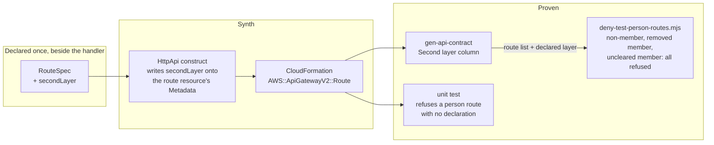
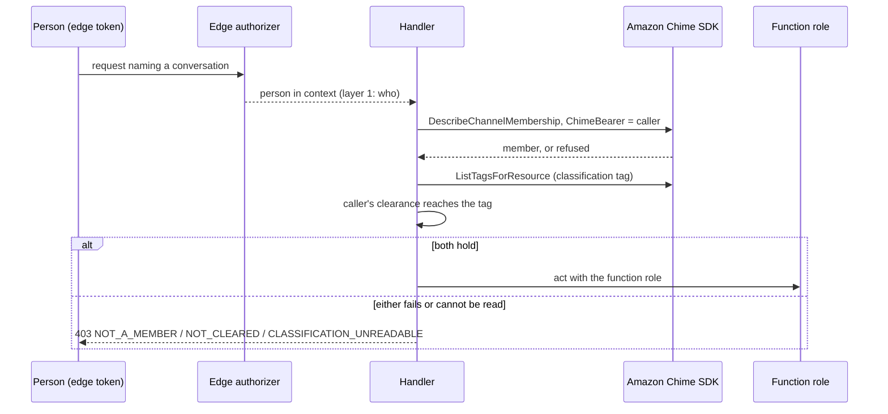
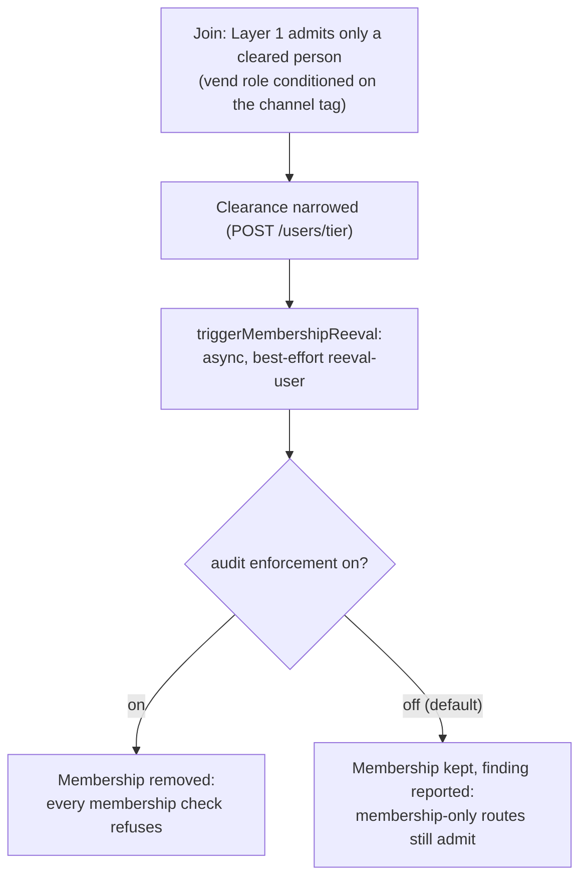
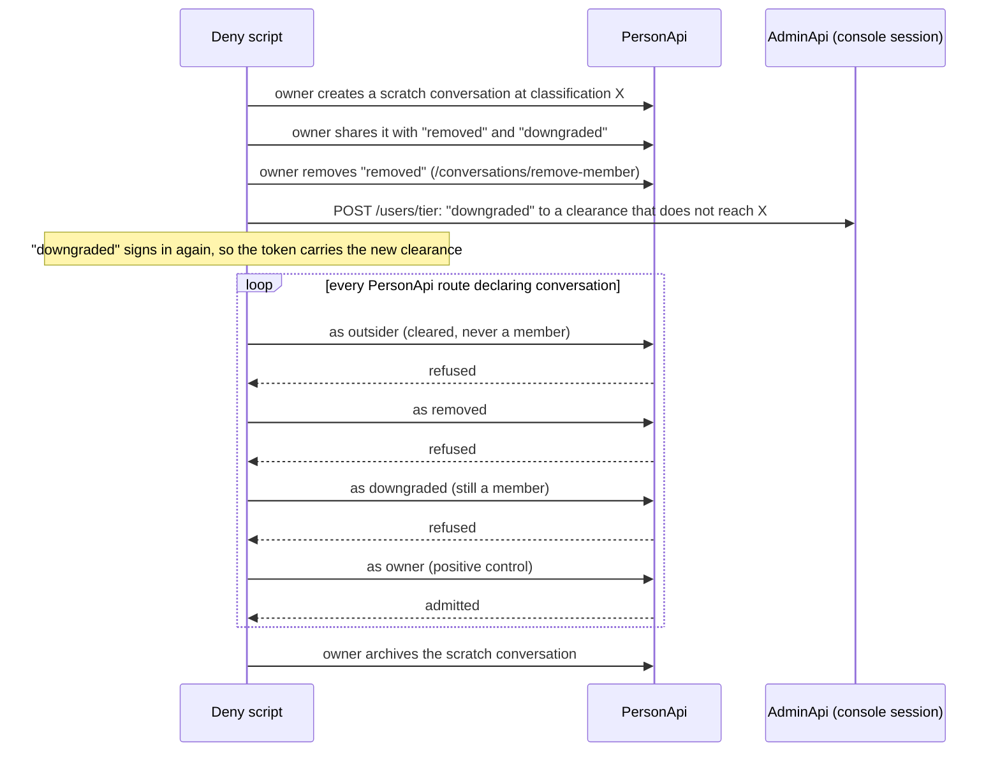

# DESIGN: Person-Route Authorization

**Status:** **NOT BUILT**: the per-route declaration and the API contract column (section 3), the unit test that refuses a person route with no declaration (section 5.1), and the deployed deny script (section 5.2). Built: the conversation check the declaration names (section 3), one helper (`callerReachesConversation`, `backend/lambda/src/lib/conversation-access.ts`) in front of every person route listed in section 2.1 that acts through its own role, verified by `backend/test/lib/a-person-route-reaches-only-a-conversation-its-caller-reaches.test.ts` and `backend/test/lib/a-conversation-file-is-signed-only-for-a-cleared-member.test.ts` (unit, behavior; not yet driven against a deployment). Section 2 states the second layer each person route requires.

**Coverage:** none - not built; the proof this design specifies is a deployed deny script (section 5), not an e2e spec

**Related:** [SPEC-CONVERSATION-SECURITY.md](./SPEC-CONVERSATION-SECURITY.md) - the enforcement layers this design makes declared and provable on the person API. [DESIGN-ADMIN-ACTION-IAM-ENFORCEMENT.md](./DESIGN-ADMIN-ACTION-IAM-ENFORCEMENT.md) - the admin API's counterpart: a capability catalog and a deny script. [DESIGN-REVOCATION-WINDOWS.md](./DESIGN-REVOCATION-WINDOWS.md) - how long each check holds after a person is removed or downgraded. [api-contract.md](../../../reference/api-contract.md) - the generated route table this design adds a column to.

**Site section:** Interaction layer, governance.

---

A person route passes the edge authorizer and then runs a handler whose function role is broader than the caller's own vended session: it can sign an S3 URL, write a table, or act as the app-instance-admin or a classification's assistant identity. The edge proves who the caller is. It does not prove the caller may act on the conversation the request names. That second proof is the handler's, written by hand per route, so nothing holds it uniform, nothing shows it in the contract, and nothing refuses a route that omits it.

Tenet P4 asks that every sensitive operation carry two layers and that isolation be proven by a refusal. This design makes the second layer a declared property of the route (D9: one way to authorize a surface), shows it in the generated contract, refuses a route that declares none, and proves each declaration against the deployment.

## 1. Architecture





## 2. Inventory: the second layer each person route requires

"Acts through" is the identity that performs the work, which is never the caller's own vended session. "Membership" means a call to the Amazon Chime SDK with the caller's own AppInstanceUser as `ChimeBearer` (conversations are `PRIVATE`, `lib/channel-creation.ts`, so a non-member's `DescribeChannel` is refused too). "Clearance" means the caller's clearance reaches the conversation's immutable `classification` tag. Every conversation check fails closed: a caller who does not resolve, a missing `APP_INSTANCE_ARN`, or a lookup that cannot be made refuses.

### 2.1 Conversation-scoped routes

| Route | Handler (file, symbol) | Acts through | Second layer required | What it rules out |
|---|---|---|---|---|
| `POST /presigned-url` | `presigned-url/index.js` `refusedConversation` | function role, S3 presign | membership + clearance | Reference implementation |
| `POST /invitations` | `invitations.ts` `createInvitation` | service admin adds the invitee; invitee minted by the exchange | membership + clearance against the tag | An invitation into a conversation the inviter no longer reaches |
| `GET /invitations`, `POST /invitations/revoke` | `invitations.ts` `listForMember`, `revokeForMember`, `memberScope` | function role on `Tokens`; revoke removes the invitee as the service admin | membership + clearance; moderator or issuer for revoke | Listing or revoking a conversation's invitations after a downgrade |
| `GET /channels/battle` | `channel-battle.ts` `handleGet` | function role reads the battle config table | membership + clearance | A caller the handler resolves to nobody being answered. The edge admits only an ordinary person here, so this is the layer behind the first |
| `POST /channels/battle/enable`, `/disable` | `channel-battle.ts` `handleEnable`, `handleDisable` | the classification's assistant identity (`resolvePrimaryBotArn`) adds or removes the challenger | membership + moderator (`callerIsModerator`) + clearance | A downgraded moderator acting through the assistant identity |
| `POST /channels/battle/outcome` | `battle-outcome-api.ts` `handlePost` | function role writes the outcome table | membership + clearance; the battle bound to the channel when recorded | An outcome recorded when the configuration is missing |
| `GET /channels/battle/outcome` | `battle-outcome-api.ts` `handleGet` | function role reads the caller's own pick | bearer: keyed by the caller's person id | Reading another person's pick |
| `POST /feedback` | `user-feedback.ts` `submitFeedback` | function role writes the feedback table | membership + clearance | Feedback written when the configuration is missing |
| `POST /conversations/archive`, `/remove-member` | `conversation-management.ts` `archive`, `removeMember` | app-instance-admin bearer (`getAdminArn`) | moderator, read live with `ListChannelModerators` as the admin, + clearance | A moderator whose clearance no longer reaches the conversation archiving it or removing members |
| `POST /conversations/leave` | `conversation-management.ts` `leave` | app-instance-admin bearer | bearer: the target is always the caller's own membership | Removing anyone but the caller |
| `POST /share-conversation` | `share-conversation/index.js` `handler` | the room's primary assistant identity adds the recipient | caller membership + caller clearance; the recipient's clearance | A sharer who no longer reaches the conversation adding someone to it |
| `POST /tasks`, `POST /tasks/advance` | `user-tasks-api.ts` `openWorkItem`, `advanceOnCard` | the classification's task service (`invokeTaskService`) | membership + clearance | Reading membership as clearance, which holds only at join time (section 4) |
| `GET /tasks/mine` | `user-tasks-api.ts` `handler` | function role reads the caller's partition | bearer, filtered to conversations the caller is still a member of | A removed member listing open items (title, needs, `channelArn`) from that conversation |
| `GET /turn-state` | `turn-state-api.ts` `handler`, `visibleQueued` | function role reads the queue record | membership + clearance; targeted ids filtered by `GetChannelMessage` as the caller | Queue state for a conversation the caller no longer reaches |
| `POST /proposals/apply` | `proposals-api.ts` `applyProposal`, `performAct` | invitations function, or the classification's typed creator | addressee, membership, tag equals the proposal's classification, role still held, + clearance | `open_conversation` asking `typed-conversation-from-event.ts` to open a manual-membership conversation for a caller no longer cleared for it |

### 2.2 Person-keyed and deployment-wide routes

| Route | Handler (file, symbol) | Second layer | Declaration |
|---|---|---|---|
| `POST /exchange-credentials` (PersonApi) | `credential-exchange.ts` `handler` | bearer pinning: the session's `person` tag pins `…/user/${aws:PrincipalTag/person}` (`exchangeVendStatements`); `refuseInactiveAccount` asks the issuer live | `bearer` |
| `POST /exchange-credentials` (AdminApi) | `admin-credential-exchange.ts` `consoleSession` | issuer declares `admin: true`; `consoleRoleFor`; `refuseInactiveAccount` | `bearer` |
| `POST /create-conversation` | `create-conversation.ts` `handler` | clearance: the token's grants include the requested classification (`TIER_FORBIDDEN`); acts through that classification's creator | `bearer` |
| `POST /upgrade/claim` | `guest-upgrade.ts` `claim` | single-use claim + clearance reaches the target classification | `bearer` |
| `POST /guest/register` | `guest-upgrade.ts` `register` | bearer: the conversation is the signed token's `ch` claim, never the body | `bearer` |
| `POST`/`DELETE /connectors/{connectorId}/grant` | `connector-grant-routes.ts` `handleGrantRoute` | bearer: keyed by `callerPersonId` | `bearer` |
| `GET`/`POST /email/preferences/mine` | `notice-preferences-api.ts` `handlePreferencesMine` | bearer: `callerPersonArn`; role writes `<personId>#notices` attributes only | `bearer` |
| `GET`/`POST /me/language` | `language-preference-api.ts` `handler` | bearer: `callerPersonArn`; role reads and writes `preferences` only | `bearer` |
| `POST /events` | `client-events.ts` `handler` | none: append-only telemetry stamped with `callerPersonId` | `none` with that reason |
| `GET /classifications` | `classifications-api.ts` `handler` | none: the same deployment answer for every caller | `none` with that reason |

### 2.3 Unauthenticated routes

`POST /guest/start`, `POST /guest/refresh`, `POST /invitations/peek`, `POST /invitations/redeem` (`credential-exchange.ts`), `GET`/`POST /email/preferences` (`email-preferences.ts`, the unsubscribe token is the credential) and `GET /deployment/state` (`deployment-sleep.ts`) carry `auth: 'none'`. Each authenticates by the value it is handed and its own abuse controls. They declare `none` with that reason; the deny script does not probe them as a person.

### 2.4 The shapes the requirement rules out

**Membership standing in for clearance**: a member whose clearance is narrowed stays a member, because the membership audit is report-only unless enforcement is on (`membershipAuditEnforce` at deploy, `bin/backend.ts`, or in Aurora analytics mode the console's enforce setting, `/query/membership-audit/enforce`; `membership-audit.ts`). **A check that runs only when a value is present**: the second layer is absent in exactly the case it exists for. **A person-keyed read of conversation content** (`GET /tasks/mine`): the key is the caller's, the content is the conversation's.

## 3. The declaration

`RouteSpec` (`backend/lib/constructs/http-api.ts`) gains one required field for a route whose auth is `person`, and an optional one for `none`:

```ts
type SecondLayer =
  | { kind: 'conversation'; checks: ('membership' | 'clearance')[]; reason?: string }  // conversation named by the request
  | { kind: 'bearer' }                                                  // the caller's own record or pinned session
  | { kind: 'none'; reason: string };                                   // stated, never implied

interface RouteSpec { /* ... */ secondLayer?: SecondLayer }
```

- `conversation` routes call one helper, the generalization of the presigned-URL check (`refusedConversation`) into `lib/conversation-access.ts` (`callerReachesConversation(event, conversationId, checks)`). One implementation, one set of refusal codes (`NOT_A_MEMBER`, `NOT_CLEARED`, `CLASSIFICATION_UNREADABLE`), and the fail-closed rule: a missing `APP_INSTANCE_ARN`, an unresolved caller, an unreadable tag or a failed lookup refuses. The default for a conversation route is both checks; dropping `clearance` needs a written `reason` on the declaration.
- `bearer` routes resolve the caller through `callerPerson` and key every read and write by that person; the function role is narrowed to that key shape where IAM can name it.
- `HttpApi` copies the declaration onto the route resource as CloudFormation `Metadata` (`AgentEchelon:SecondLayer`), because `gen-api-contract.mjs` reads routes from the synthesized templates, not from TypeScript (`lib/docs/api-contract.ts`). Synth throws for a `person` route with no declaration, so a route cannot deploy without one.
- `api-contract.md` gains a **Second layer** column (`membership + clearance`, `bearer`, `none: <reason>`, `AWS_IAM` for the admin catalog).

## 4. Why membership alone is not clearance



Membership is a join-time proof of clearance. After a downgrade the chat plane is bounded by the vended session's role, but a membership-only handler acts through its own role and never sees that boundary. The clearance check against the tag closes this per request, whatever the audit mode. How long it holds after a change is [DESIGN-REVOCATION-WINDOWS.md](./DESIGN-REVOCATION-WINDOWS.md).

## 5. Proof

### 5.1 Unit test

`backend/test/every-person-route-declares-its-second-layer.test.ts` reads the route table the contract reads (`readApiContract`) and fails when:

- a `PersonApi` route with an authorizer carries no `AgentEchelon:SecondLayer` metadata;
- a `none` declaration has an empty reason;
- a `conversation` declaration omits `clearance` without a reason.

It does not judge whether a handler honors its declaration. The deny script does.

### 5.2 Deployed deny script

`backend/scripts/deny-test-person-routes.mjs`, run as `node scripts/run-deny-tests.mjs person-routes`, modeled on `deny-test-admin-capabilities.mjs`: measured against the deployed API, because a declared layer is a claim about what is refused.



- **The route list is the contract, not the script.** Every route in `api-contract.md` whose Second layer is `conversation` must have a probe (method, path, body built from the scratch conversation); a route with none fails the run, so a new route cannot go unprobed.
- **A refusal is 401, 403 or 404 from the handler, and nothing written.** A write probe is followed by a read of the state it would have changed (the feedback row, the battle config, the task partition, the membership list), and a write that landed is a gap even if the response was a refusal.
- **The positive control proves the route works.** An owner refusal means the probe is broken, not that the boundary holds, and is a setup error (exit 2), as in the admin script.
- **Personas** come from the test-credentials secret beside `testAdmin` and `teamOpsUser`: two people cleared for X and one whose clearance can be narrowed and restored. The script restores the clearance in a `finally`.
- `bearer` routes get one probe each: the outsider's call returns the outsider's own record, never the owner's. `none` routes are listed with their reason and not probed.

## 6. Order of work

1. `lib/conversation-access.ts`, generalized from the presigned-URL check; every conversation route in section 2.1 calls it.
2. `SecondLayer` on `RouteSpec`, the metadata, the synth refusal, the contract column, the unit test.
3. `GET /tasks/mine` filters to conversations the caller is still a member of (`ListChannelMembershipsForAppInstanceUser` as the caller), or the route declares the person-keyed read with its reason.
4. The deny script, added to the release deny-test run.
