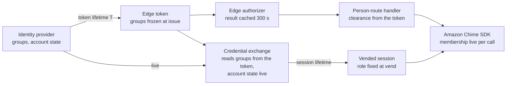
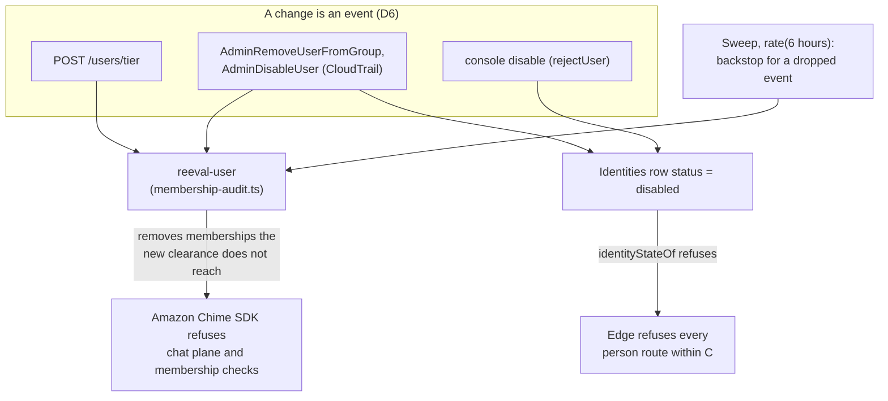
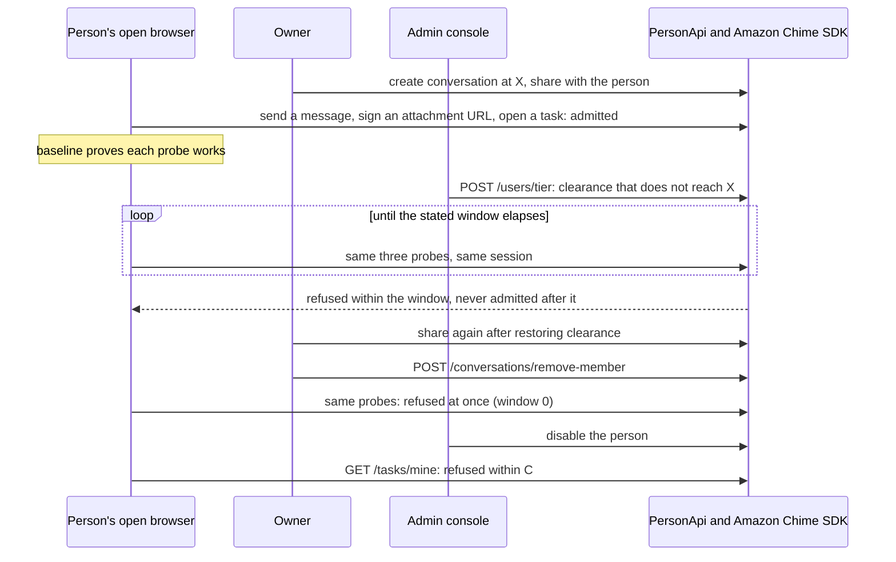

# DESIGN: Revocation Windows

**Status:** Partial. R1 (a downgrade removes what it no longer reaches), R4 (conversation routes read clearance live) and R6 (admin vends recheck the console role) are built, covered by unit tests, and verified on a deployment by the section 4 spec. R2 (a group change outside the console is an event), R3 (disabling is refused at the edge) and R5 (the exchange vends from live groups) are **NOT BUILT**; R7 is **OPEN**. Section 2 is the inventory as it stood before R1, R4 and R6; section 3.1 states the windows as built.

**Verified by:** `backend/test/membership-audit.test.ts` ("trigger #3": the re-evaluation removes in report-only mode, the event stream does not), `backend/test/lib/a-downgrade-reaches-a-conversation-route-within-the-recheck.test.ts` (R4: refused on a live downgrade, never widened, refused on an unreadable directory, one read per window), `backend/test/every-conversation-route-rechecks-clearance-live.test.ts` (every function that runs the check carries the flag and the groups read), `backend/test/lib/a-removed-admin-is-vended-nothing-more.test.ts` (R6).

**Coverage:** `tests/e2e/a-removed-or-downgraded-person-is-refused-within-the-window.spec.ts` (phase `revocation-windows`, `REVOCATION_WINDOWS_E2E=1`), verified 2026-11-03 and 2026-11-05 (section 4)

**Related:** [DESIGN-PERSON-ROUTE-AUTHORIZATION.md](./DESIGN-PERSON-ROUTE-AUTHORIZATION.md) - the per-route membership and clearance check whose freshness this document bounds. [SPEC-CREDENTIAL-EXCHANGE.md](./SPEC-CREDENTIAL-EXCHANGE.md) - the vend, its session tags and the disabled-account refusal. [SPEC-CONVERSATION-SECURITY.md](./SPEC-CONVERSATION-SECURITY.md) - the layers, including the membership audit. [DESIGN-ADMIN-ACTION-IAM-ENFORCEMENT.md](./DESIGN-ADMIN-ACTION-IAM-ENFORCEMENT.md) - the console session the admin routes trust.

**Site section:** Interaction layer, governance.

---

Every credential in the platform expires, every vended one is bearer-pinned (D1), and expiry is how most of them are revoked: nothing is recalled, the credential expires. That makes the lifetime, and what is rechecked before it ends, the actual answer to "how long can a removed or downgraded person keep acting". This document states that answer per credential, closes the windows that are longer than they need to be, and requires a deployed test to prove the stated window rather than a reading of the configuration (P4).

Three changes a person can undergo, each with its own path:

| Change | Made by | What it changes today |
|---|---|---|
| **Removed** from a conversation | a moderator (`POST /conversations/remove-member`), leaving, an invitation revoked, the membership reconcile | the Amazon Chime SDK membership, at once |
| **Downgraded**: clearance narrowed | the console (`POST /users/tier`, `changeClearance` in `user-management.ts`), or the identity provider's groups | the directory's groups; the AppInstanceUser's `classification` tag (`restampIdentityTag`); an async membership re-evaluation (`triggerMembershipReeval`) |
| **Disabled** | the console (`rejectUser`, `AdminDisableUser`), or the identity provider | the issuer's account state, read at each vend (`refuseInactiveAccount`, `refuseInactivePerson`, `lib/vend.ts`) |

Offboarding (`lib/offboarding.ts`) is the strongest path and is not a window: it deletes the person's memberships and AppInstanceUser and replaces each `Identities` row with a `revoked` marker, so the Amazon Chime SDK refuses at once and the edge refuses within `EDGE_RESULT_TTL_SECONDS`.

## 1. Where staleness enters

Membership is always read live: the Amazon Chime SDK evaluates it on every channel call, and handlers read it as the caller. The caller's clearance is not: every handler and the exchange take it from the token's claims (`callerHolderToken` in `lib/auth.ts`, `groupsOf` in `lib/config/issuers.ts`), so a downgrade reaches them only when the person holds a new token. Account state is read live, but only at a vend.

`T`, the token lifetime, is the variable every row below depends on. The self-hosted pool's clients (`WebClient` and `FederatedWebClient`, `buildSelfPool` in `identity-stack.ts`) set no token validity, so the Amazon Cognito defaults apply: one hour for the ID and access token, 30 days for the refresh token. A directly verified OIDC issuer's token may live `DIRECT_TOKEN_MAX_MINUTES` (90) from `iat` to `exp`, or its entry's `maxLifetimeMinutes` (5 to 1440, validated in `lib/config/issuers.ts`), `lib/config/edge-verification.ts`. `C` is `EDGE_RESULT_TTL_SECONDS` (300), the edge authorizer's result cache.

## 2. Inventory: every credential, its lifetime, and its window today

Worst case, from the change to the last accepted use. "Removed" assumes the person is still signed in; "downgraded" assumes the person stays a member, which is the default because the membership audit is report-only unless enforcement is on (`membershipAuditEnforce`, `membership-audit.ts`).

| Credential or grant | Lifetime as configured | Live recheck on use | Removed | Downgraded | Disabled |
|---|---|---|---|---|---|
| Edge token, on person routes | `T`, plus `C` of cached authorizer result (`EDGE_RESULT_TTL_SECONDS`, `lib/config/edge-verification.ts`) | `Identities` row status per uncached evaluation (`identityStateOf`, `lib/person-identity.ts`); groups and account state not read | per route: 0 where the handler checks membership; unbounded on a person-keyed read of conversation content that does not (`GET /tasks/mine`, [DESIGN-PERSON-ROUTE-AUTHORIZATION.md](./DESIGN-PERSON-ROUTE-AUTHORIZATION.md) section 2.4) | unbounded on membership-only routes; `T` where the handler reads clearance from the token | `T + C`: the edge does not read account state |
| Vended chat session (`credential-exchange.ts`) | `SESSION_DURATION_SECONDS`, 3600 (env `EXCHANGE_SESSION_SECONDS`) | Amazon Chime SDK membership per call; at vend: account state live, groups from the token | 0 | `T + 3600`: a session vended late in a stale token's life keeps the old classification's role | 3600 |
| Presigned URL (`presigned-url/index.js`) | `EXPIRATION_SECONDS`, 300 (set in `conversations-stack.ts`) | at signing: membership live, clearance from the token (`refusedConversation`) | 300 | `T + 300` | `T + C + 300` |
| Admin console session (`admin-credential-exchange.ts`) | `CONSOLE_SESSION_SECONDS`, 3600 | none on IAM routes: the gateway evaluates the role and handlers trust the principal (`isAdminIamEnforcedCall`); console role chosen from the token's groups (`consoleRoleFor`) | n/a | removed from `admins`: `T + 3600 + 1800`, because a per-capability credential (`MODERATION_SESSION_SECONDS`, 1800, `lib/vend.ts`) can be vended at the session's end and `adminVend` checks account state, not the group | 3600: per-capability vends refuse at once (`refuseInactivePerson`), the session itself does not |
| Team console session | `TEAM_CONSOLE_SESSION_SECONDS`, 900 | reach (assistants, clearance) is a snapshot at issue; `teamAttachmentVend` checks account state | n/a | `T + 900` | 900 |
| Guest token and session (`guest-session.ts`) | token `tokenMinutes`, default 10, at most `GUEST_TOKEN_MAX_MINUTES` 15; refresh credential `refreshMinutes`, default 60; session `GUEST_SESSION_SECONDS`, 900; visitor `GUEST_LIFETIME_HOURS`, 24 (`lib/config/issuers.ts`) | Amazon Chime SDK membership per call | 0 on the chat plane | n/a | n/a |
| Invitation link session (`lib/invitation-redemption.ts`) | `sessionMinutes`, default and maximum `LINK_SESSION_MAX_MINUTES`, 15 | Amazon Chime SDK membership per call; revoking removes the membership (`revokeRecord`, `invitations.ts`) | 0 | n/a | n/a |
| Email reply token (`email-reply.ts`) | `REPLY_TOKEN_TTL_SECONDS`, 14 days (`lib/reply-tokens.ts`); each post on a 900 s pinned session | `decideReply`: From equals the address the issuer holds now; membership via the pinned send. The `restricted` role carries no classification condition (`exchangeVendStatements`) | 0 | 14 days | 14 days: `decideReply` does not read account state |
| Proposal (`proposals-api.ts`) | `PROPOSAL_TTL_SECONDS`, 3 days (`lib/proposals.ts`) | addressee, membership and held role at apply | 0 | 3 days where clearance is not read at apply (R4) | `T + C` |

The guest and link rows need nothing: both are bounded by membership, and revoking either removes it. The rows this design shortens are the downgraded column, the disabled column on person routes and the admin console.

## 3. Design: which operations recheck live state

**R1. A downgrade removes what it no longer reaches.** Built: `reevalUser` passes `removeOverReach` to `evaluateMembership` (`membership-audit.ts`). The targeted `reeval-user` removes over-reaching memberships whatever the audit's enforce setting. That setting exists so a detection that may be a false positive alerts rather than removes; a downgrade an operator made is not a detection. The sweep keeps its configured mode. With the membership gone, the Amazon Chime SDK refuses the stale vended session and every membership check refuses, so the chat plane's downgrade window becomes the re-evaluation's latency rather than `T + 3600`.

**R2. A group change made outside the console is an event too.** **NOT BUILT.** `AdminRemoveUserFromGroup` reaches `reeval-user` through the same CloudTrail and EventBridge path `offboarding-events.ts` already consumes for a deleted user (`COGNITO_LIFECYCLE_EVENTS`, `lib/issuer-lifecycle.ts`), D8. A provider that emits no event (an upstream OIDC directory) is bounded by `T` and the sweep, and the operator guide says so.

**R3. Disabling is refused at the edge.** **NOT BUILT**, and it reverses a standing rule: `Identities` keeps no copy of what the issuer says about an account (`accountStateOfPerson`, `lib/membership-source.ts`), and the membership audit reads a disabled person on the ordinary active lookup. A `disabled` row status changes both, so it needs its own decision. The console's `rejectUser` and the `AdminDisableUser` event set the person's `Identities` rows to status `disabled`; enabling sets them back to `active`. `identityStateOf` already refuses any status that is not `active`, so every person route refuses within `C` with no new lookup on the request path.

**R4. Sensitive operations read clearance live.** Built for every route that runs the shared check (`callerReachesConversation`, `lib/conversation-access.ts`): the presigner, conversation management, invitations, proposals, turn state, feedback, the person's task list, the share and the two battle routes, each wired by `grantLiveClearance` (`lib/constructs/directory-access.ts`). A turn reads the sender's clearance in the router (`resolveUserClearance`, cached for five minutes per container) and ends when a clearance it can read does not reach the conversation. It reads `Directory.clearedByGroups` rather than `groupsFor`, so each issuer's groups are bounded by that issuer's own classifications, the rule the exchange applies. As designed: The conversation check of [DESIGN-PERSON-ROUTE-AUTHORIZATION.md](./DESIGN-PERSON-ROUTE-AUTHORIZATION.md) section 3 reads the caller's clearance through the one clearance seam (`Directory.groupsFor`, `lib/membership-source.ts`) for every write and every signature: creating a conversation, inviting, sharing, signing a URL, opening or advancing a task, applying a proposal, archiving and removing a member. The live answer may only narrow what the token claims, never widen it, and an unreadable directory refuses. A per-container cache of `CLEARANCE_RECHECK_SECONDS` (60) bounds the cost. Reads that return ids or the caller's own records keep the token's claim.

**R5. The exchange vends from live groups.** **NOT BUILT.** Where the issuer's clearance source is a directory the platform can read, the exchange takes the groups from it, not from the token, so a downgraded person's next vend is at the new classification. A claims-only issuer stays at `T`.

**R6. Admin vends recheck the group.** Built: `refuseLapsedConsoleRole` (`lib/vend.ts`), called by `adminVend` and `teamAttachmentVend` after the account-state check; it answers 403 `CONSOLE_ROLE_LAPSED`. `adminVend` and `teamAttachmentVend` re-read the console role from the person's live groups, not only their account state, so removal from `admins` stops new per-capability credentials at once. The console session itself stays an IAM session the gateway trusts, and is shortened.

**R7. Session lengths.** **OPEN**, a decision for the deployment owner, with the trade stated: the console session to 900 s, the length the team session already uses for the same reason (`TEAM_CONSOLE_SESSION_SECONDS`), at the cost of four times the console's exchange calls. The person session stays 3600 s once R1 and R3 hold, because membership then carries removal and downgrade, and only a disabled person's open session is left, which R3 bounds on every route except the chat plane.

### 3.1 The windows, as built

| Change | Person routes | Chat plane | Presigned URL | Admin console |
|---|---|---|---|---|
| Removed | 0; `GET /tasks/mine` filtered by membership | 0 | signing refused at once; a URL already signed lives 300 s | n/a |
| Downgraded in the console | `CLEARANCE_RECHECK_SECONDS` (60) on every route that runs the shared check | the re-evaluation's latency (R1) | signing within 60 s; a URL already signed lives 300 s | new vends at once (R6); open session `CONSOLE_SESSION_SECONDS` |
| Downgraded at the provider | 60 s on those routes where the provider is a directory the platform reads; `T` for a claims-only issuer | `T + 3600` until R2 and R5, or the next sweep | as person routes, plus 300 s | as the console row where the directory is read |
| Disabled | `T + C` until R3 | `SESSION_DURATION_SECONDS` (3600 s) | `T + C + 300` until R3 | new vends at once; open session `CONSOLE_SESSION_SECONDS` |

**The presigner checks the clearance it can read when it signs.** Without the live recheck it read only the clearance the presented token carries, so a downgrade at the issuer reached it when the token renewed. With R4 it also reads the person's directory, so a downgrade reaches a new signature within 60 s; a URL already signed stays valid for its 300 s lifetime in either case.

**The urgent lever is removal.** Removing a person from a conversation, by its moderator or by the console, is refused on the chat plane, on every person route and at every signature at once. A downgrade or a disable reaches them within the windows above; when that is too long, remove them from the conversation as well.

## 4. The deployed test

`tests/e2e/a-removed-or-downgraded-person-is-refused-within-the-window.spec.ts`, phase `revocation-windows` in `validate.mjs`. One spec, against the deployed stacks, with the person signed in once at the start and never again, so it measures the credentials the person already holds. As built, its probe is a file signature (`POST /presigned-url`), the operation that runs the shared check on every request; the disable step asserts the next vend on the token still held is refused (`PERSON_NOT_ACTIVE`), because a person route stays open for the token's life until R3 is built.

**Verified again on dev, 2026-11-05:** passed 1 of 1, a downgrade refused 50.5 s after the change and a removal 0.1 s after it. **Verified 2026-11-03** on the dev deployment at `c9ead226`: `node scripts/validate.mjs --only=revocation-windows` passed 1 of 1 in 3.9 minutes. A downgrade was refused 50.0 s after the console change, within `CLEARANCE_RECHECK_SECONDS` (60) plus the 30 s re-evaluation allowance; a removal 0.2 s after it; and the disabled person's next vend on the token still held answered 403 `PERSON_NOT_ACTIVE`.

- **The window is the assertion.** Each probe records the elapsed time of its first refusal and fails when that exceeds the section 3.1 value, so a regression that lengthens a window fails the spec even though refusal eventually happens.
- **Once refused, always refused.** A probe that succeeds after its first refusal fails the spec: a cached admission answering intermittently is the case the edge's policy-shaped answer exists to prevent.
- **Every probe has a baseline.** A probe that is refused before the change proves nothing, and fails as a setup error.
- **The person is restored** (clearance, enabled) in a `finally`, and the conversation archived.
- The measured windows are recorded in section 3.1, beside the values they prove, with the run that measured them.
