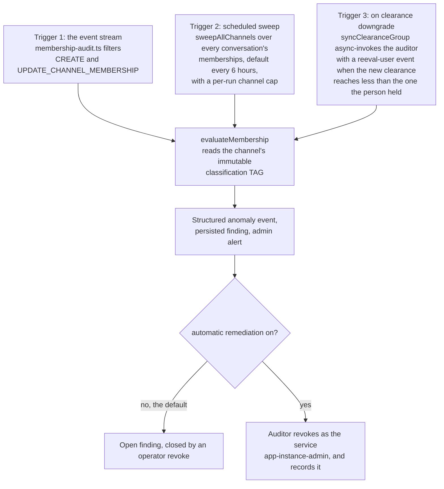

# SPEC: Access and Controls Auditing

**Status:** Implemented (audit capture and the membership-history view; forward extensions noted inline).

**Coverage:** `tests/e2e/access-auditing.spec.ts` - asserts the capture path is deployed AND its Kinesis subscription is Enabled (a disabled mapping stops the record with nothing erroring), then creates a real conversation and requires that specific channel to have a membership record readable through the admin view. The read is SigV4-signed, and asserts on the response body rather than the status, because the membership-history handler answers 200 with an archiveError field when the underlying read fails.

**Verified by:** `backend/test/membership-audit.test.ts` (the sweep flags a member the event stream missed whose clearance does not reach the channel; the on-downgrade re-evaluation flags a downgraded member still on a premium channel; the event-stream path, and enforce versus report-only behavior) and `backend/test/cdk-synth.test.ts` (the sweep EventBridge rule fires the auditor with `{type:'sweep'}`; the auditor's `ListChannels` and `ListChannelMembershipsForAppInstanceUser` grants; user-management's name-scoped `lambda:InvokeFunction` grant and `MEMBERSHIP_AUDIT_FN_NAME` env for the downgrade trigger).

**Related:** [SPEC-INTERACTION-LAYER.md](../SPEC-INTERACTION-LAYER.md) (the model) · [SPEC-MODERATION.md](./SPEC-MODERATION.md) (the surfaces, including the near-real-time Kinesis tap) · [SPEC-CREDENTIAL-EXCHANGE.md](./SPEC-CREDENTIAL-EXCHANGE.md) (the identities and bearer-pinned roles being audited) · [ADMIN-GUIDE.md](../../../guides/admin/ADMIN-GUIDE.md) (the membership-history view) · `backend/lambda/src/admin-conversations.ts` (`membershipHistory`) · `backend/lambda/src/analytics-aurora/kinesis-archival.ts` · `backend/lambda/src/client-events.ts` · `backend/lib/stacks/archive-stack.ts`.

**Site section:** Interaction layer, governance.

---

## Overview

**Enforcement answers "is this allowed right now"; nothing about it answers "what happened, who could act, and when did that change".** This is the Auditing pillar of the interaction layer. The conversation is the audit unit and its event stream is the audit source: the Amazon Chime SDK channel event stream - messages plus membership and moderator events, on Kinesis - is turned into an append-only system of record rather than consumed as a transient feed, and read back as the admin console's membership-history and access-review views. Control-plane access changes, which happen outside a channel, are part of the same model.

**The archive is the system of record for "who could act, and when", not a convenience copy.** Amazon Chime SDK Messaging exposes no membership-history API, so nothing else can answer the question. The store is written and never mutated: history accumulates rather than being edited in place, and because joins, leaves and message create and redact events are all captured, it answers durations as well as point-in-time facts. Auditing queries the Athena archive, the default mode, and needs no SQL or vector features, so Aurora mode is not required for it; Aurora archives the same events and adds nothing the audit queries need (tenet D7).

**Every privileged operator action is attributable because the operator acts as their own short-lived, audited `${personId}-admin` identity rather than as a standing bearer.** The admin credential exchange records `admin_scoped_credential_vend` on every scoped admin vend, naming the human, the admin identity, the channel or owner the credential was narrowed to, the capabilities and the lifetime. Capabilities reach an operator by narrowing a vended, recorded grant rather than by rewriting a policy, so the record of who could reach each capability is the grant itself, and every archive and analytics read that rides the standing sign-on role is recorded by its per-resource IAM grant rather than by a per-read event. The admin identity is `${personId}-admin`, created by the exchange and tagged `owner` with its owner's AppInstanceUser ARN (`ensureAdminIdentity` in `backend/lambda/src/admin-credential-exchange.ts`).

**`classification` is the only closed axis IAM evaluates, and that is what makes an anomaly nameable.** A member whose clearance no longer reaches a channel's classification, or an assistant whose classification is not the one of the channel it was added to, is a set-membership question on one axis that a policy can ask and a detector can restate. Every such decision reads the channel's immutable classification tag rather than mutable metadata.

**Detection observes by default; remediation is a toggle, and the toggle never weakens enforcement.** IAM fail-closes a disallowed action whether or not automatic remediation is on. The toggle decides only whether the residual anomaly - a stale membership IAM cannot retract on its own - is cleaned up automatically or by a person, and every automatic action is itself audited, so there is no unrecorded enforcement.

**Every sensitive operation carries at least two enforcement layers, and the audit is one of the layered controls rather than a report about them** (tenet D3). IAM blocks the disallowed action in real time, the application enforces conversation-level policy, and this record outlives both. Reading the record is itself a gated capability, because who could act is at least as sensitive as what was said.

## Business Problem

A business will not put sensitive or regulated conversations on a platform that can only promise its live configuration is correct; an auditor asks what happened, who could act on a conversation, and when that access changed, and a live permission check answers none of those. The people who need that answer are security and compliance, who reach for it during an incident review, an access certification or a regulatory request, and the operator who has to show that access is recorded and reviewable rather than merely enforced. Without it, that team stands up its own audit pipeline off the raw event stream, or buys a separate audit product and reconciles two records that disagree. Being able to show the record is often the difference between "we can use this" and "no".

## Personas

Personas are defined in [PERSONAS.md](../../../overview/PERSONAS.md) and are not redefined here. Four of them read this record, and they divide by the question they bring to it: an operator asks about a conversation, a compliance role asks about a matter or a person, and a platform developer asks whether the capture path is still running.

### Admin / operator

**How this relates to them:** they run the deployment, so the record is both their working tool for a single conversation and the evidence that their own privileged actions were bounded. They are also the person an anomaly is raised to.

| What they need | Requirement |
|---|---|
| Who joined, left or held moderator in this conversation, when, and who invited them | FR1 |
| A membership a classification no longer permits, surfaced rather than left in logs | FR9, FR10 |
| Remediation they can switch between report-only and automatic at runtime | FR11 |
| Their own privileged reads and moderations on the record, so their scope is provable after the fact | FR6 |
| Retention they can set per conversation rather than only deployment-wide | FR12 |

### Legal

**How this relates to them:** a matter names its conversations, so their question is a chain of custody: the full preserved history of those conversations, and proof of who reached them. Redacted and deleted content is retained in the archive for exactly that completeness.

| What they need | Requirement |
|---|---|
| Who accessed a named conversation, and when | FR4, FR6 |
| A record that cannot be edited to hide a change | FR2 |
| How long a person held access, and how long a piece of content was visible | FR5 |
| Material preserved outside the normal retention lifecycle for the duration of a matter | FR13 |

### HR

**How this relates to them:** the same purpose-scoped, audited read as Legal, entered from a person rather than from a matter, which is why the per-user scope of a hold is broad by design.

| What they need | Requirement |
|---|---|
| The conversations a person was a member of, and their participants | FR1, FR4 |
| Confirmation of who else had access, and when | FR4, FR6 |
| Every conversation the person was in within the period, and the events around them, not only their own messages | FR13 |
| Accountability logging strict enough that the subject can be told what was read, per deployment policy | FR7 |

### Platform developer

**How this relates to them:** they answer for the capture path, and a silently stopped consumer is the failure that makes every reading above worthless while nothing errors.

| What they need | Requirement |
|---|---|
| Proof that the capture path is deployed and its stream subscription enabled | FR3 |
| One shared detection check behind all three triggers, rather than three that can disagree | FR9 |
| An anomaly the platform raised distinguishable from one an actor could never have completed | FR9 |

### End user

Not a reader of this record. They are its subject: it holds their conversation content and their identity, which is why the store inherits the highest classification it captures and why reading it is gated (FR14). Whether a person can be told that their conversation was read is a deployment policy question rather than a platform default.

**Also served, and not personas in `PERSONAS.md`:** the **security and compliance function**, whose incident review, access certification and regulatory requests are the reason the record is append-only (FR2, FR4), and the **business**, which needs to show access is recorded and reviewable rather than trusting that the live system was configured correctly at the time.

## Functional Requirements and Acceptance Criteria

**Priority is a keep-or-cut decision set against what the field expects, not against how interesting the work is.** `Table stakes` means a deployment without it is behind. `Differentiator` is worth the cost because few platforms do it. `Gap - prioritize` marks a requirement whose absence puts this below comparable systems. `Above bar - optional` is more than the field asks and can wait. `Optional - attach instead` should be bought rather than built. `Enabler` is not user-visible and is what makes another row affordable.

| # | Requirement | Priority | Delivered | Validated by |
|---|---|---|---|---|
| FR1 | Membership history reads per conversation: who joined, left, or was granted or revoked moderator, with timestamps and the inviter | Table stakes | Yes | `access-auditing` (e2e, behavior), `admin-conversations-aurora` (unit, behavior) |
| FR2 | The record is append-only and written only by the pipeline: no end-user or assistant role holds write access to it, and no credential-exchange role grants anything on the audit store | Table stakes | Partly - the pipeline is the only writer; nothing asserts that no user or assistant role holds write access to the archive bucket itself | none - `classification-boundary` proves the vector store's reader and writer roles, not the audit record, and nothing covers the archive-bucket write boundary |
| FR3 | The archive answers "who could act, and when" without a live API, and answering it requires no Aurora deployment | Enabler | Yes | `access-auditing` (e2e, behavior) - asserts the capture consumer is subscribed to the channel event stream and enabled, then requires a real conversation's membership record to be readable through the admin view |
| FR4 | Who could act in a conversation at a stated moment is reconstructible from the record | Table stakes | Partly - every event the reconstruction needs is captured and the membership timeline renders them in order; no surface assembles the answer for a stated moment | `access-auditing` (e2e, behavior) |
| FR5 | The record answers durations: how long a person held access, and how long a piece of content was visible | Differentiator | Partly - joins, leaves and message create, redact and delete events are all captured and derivable from, including from the sibling rows a redaction and a deletion write; no surface reports a duration | `admin-conversations-aurora` (unit, behavior) |
| FR6 | Every privileged admin read and every moderation leaves an attributable record naming the human, the admin identity, the scope it was narrowed to, and the capabilities | Differentiator | Yes | `credential-exchange` (unit, behavior), `access-auditing` (e2e, behavior) |
| FR7 | An ordinary member's read of a conversation is attributable | Above bar - optional | No | none |
| FR8 | Control-plane access changes - approve, change classification, disable, delete, role change, sign-up and sign-in - are auditable outside the conversation | Table stakes | Partly - the handlers log, CloudTrail captures each call as an IAM-authenticated AWS API call, and the client-events pipeline carries sign-up, sign-in and session access. The CloudTrail leg holds only because the foundations stack creates a trail logging every management event in the deployment's region by default (`-c platformTrail=false` where an organization trail covers the account); without any trail an account keeps 90 days of event history and nothing durable. CloudTrail names the handler's execution role, not the person who asked, so the person is attributable only where a handler logs its caller or an access log records one (Appendix A, control plane). The `audit-trail` validate phase fails when no trail is logging management events in this region; no test asserts the control-plane record itself | `client-events` (unit, behavior) for the pipeline; `the-platform-trail-records-every-api-call` (unit, synthesized template) for the trail and its selectors; the `audit-trail` validate phase fails when no trail is logging management events in this region |
| FR9 | A membership a classification no longer permits is detected on three triggers - the event stream, a scheduled sweep, and a clearance downgrade - all funneling through one shared check | Differentiator | Yes | `membership-audit` (unit, behavior) - the sweep flags an uncleared member the event stream missed, the on-downgrade re-evaluation flags a downgraded member still on a higher channel, and an unrecognized control event is a no-op; `cdk-synth` (unit, synthesized policy) for the schedule rule, the auditor's grants and the name-scoped invoke grant; `access-auditing` (e2e, behavior) |
| FR10 | Each detection is a first-class anomaly event, surfaced beside the membership history rather than left for someone to grep | Table stakes | Partly - findings are persisted and the console's Security tab, under Oversight beside the conversations, renders the feed; no test covers the rendered feed | `membership-audit` (unit, behavior) for the persisted finding; none for the console feed |
| FR11 | Automatic remediation is a toggle, default off, switchable at runtime with no redeploy; every automatic action is itself audited; and the toggle never weakens enforcement | Differentiator | Yes | `membership-audit` (unit, behavior, negative case): it stays report-only when the runtime toggle is off even with the env flag on, and revokes only when the toggle is on |
| FR12 | Retention is set for live conversations and for the archive, with a more specific policy overriding a more general one | Table stakes | Partly - the app-instance-wide message trim (`PutAppInstanceRetentionSettings`, `messaging-stack.ts`), the conversation-type default and the per-conversation request override ship; and the archive bucket carries a lifecycle rule that transitions every object to infrequent access at 30 days and EXPIRES it at 90, with no prefix or tag filter, no recorded intent and no test - which is a retention default in the wrong direction for a system of record rather than a missing one | `conversation-archive-wiring` (unit, behavior) for the conversation-type default; none for the per-conversation override |
| FR13 | A legal hold outlives the retention policy: matching records already in the period are copied into a hold store, new matching records are routed there, and the hold store cannot be rewritten or prematurely deleted | Above bar - optional | No | none |
| FR14 | The audit is protected at the highest classification it captures, and reading it is itself a gated capability | Table stakes | Yes | `caller-scope` (unit, behavior, negative case): an unknown identity resolves to no scope and reads nothing, an untagged item is refused rather than read as any classification, and an admin-classified row never reaches a scope whose grant set excludes it; the per-channel gate on the membership-history and message reads is `channelClassificationAllowed` in `admin-conversations.ts`, which no test drives directly |

**Reading the "Validated by" column.** Each entry is one specific test, named by its filename without its extension. Backend unit tests live in `backend/test/`, with the shared-library ones under `backend/test/lib/` and the analytics ones under `backend/test/analytics-aurora/`; end-to-end specs live in `tests/e2e/` and are listed against their phase in [e2e-coverage-matrix.md](../../../reference/e2e-coverage-matrix.md). The status in brackets is what the test does, which matters more than that it is green:

- **behavior** - executes the code path and asserts on the result; **negative case** marks a unit refusal, where the test asserts that the code path refuses.
- **synthesized policy** - asserts the IAM document CDK emits, so a widened grant fails the build before a deploy.
- **source text** - asserts that a convention still appears in the source. It catches the convention being dropped; it does not catch a wrong number.
- **none** - no test exists.

**A deny-test runs against a deployed stack and lets IAM decide, and no row in this table carries one.** Tenet P4 asks for isolation proven by deny-test rather than by code review, so a row whose evidence is a unit refusal, or only that the permitted path works, is weaker than it looks.

**Acceptance criteria.** The capture consumer is subscribed to the channel event stream and enabled. A newly created conversation has a membership record readable through the admin view, asserted on the response body rather than on a 200. An uncleared membership is flagged by each of the three triggers. Report-only mode revokes nothing regardless of the deploy-time flag, and enforce mode revokes and records the revocation. Every privileged admin vend emits an attributable record. A reader not cleared for a row's classification reads nothing rather than a filtered approximation.

**OPEN:** what an attributable record for an ordinary member's read would cost (FR7). No shipped capture path sees one: a member reads direct-to-Amazon Chime SDK Messaging with their own bearer-pinned credentials, so the read is neither in the channel event stream - which carries messages plus membership and moderator events, not reads - nor visible to any API access log, because no AgentEchelon API Gateway sits in that path. Amazon Chime SDK Messaging is not a supported CloudTrail data-event resource type, so CloudTrail cannot attribute a per-member read either: its control-plane calls appear as management events, and the high-volume messaging read and write operations are data-plane and are not captured. Covering who merely viewed a conversation therefore requires routing reads through a logged backend read-proxy, which adds latency to every message fetch plus per-read log volume and cost. Whether that price is worth paying, and whether logging could be scoped to the higher classifications alone, is unsettled.

**OPEN:** what effect a redaction in the live conversation should have on the archived record. The archive retains what a message said before it was redacted, which is what makes it the record; the deliberate retention and an erasure obligation are in tension and the resolution is not written down.

**OPEN:** whether the subject of a read can be told about it. The per-user scope of a hold and the accountability logging HR depends on both point at this, and it is a deployment policy question the platform does not currently answer either way.

## Non-Goals - Out of Scope

| Out of scope | Why | Where it is covered instead |
|---|---|---|
| Enforcing access | Auditing records; it never decides. IAM blocks the disallowed action in real time and the application enforces conversation-level policy, and this record is the third leg rather than a substitute for either | [SPEC-CONVERSATION-SECURITY.md](./SPEC-CONVERSATION-SECURITY.md) - the layered access model, with the membership audit as Layer 6 |
| Deciding who may hold a capability | Which operator holds which capability, and how a grant is narrowed and vended, is the identity plane's question. This document records what that plane did | [SPEC-ADMIN-IDENTITY.md](./SPEC-ADMIN-IDENTITY.md) - the capability model and the vend, and [DESIGN-ADMIN-ACTION-IAM-ENFORCEMENT.md](./DESIGN-ADMIN-ACTION-IAM-ENFORCEMENT.md) for where it is enforced |
| Acting on the record | Redacting, deleting, adding or removing a member is administration. This document owns the retention and integrity of the record; the console owns acting on it | [SPEC-ADMIN-CONSOLE.md](../../interface/SPEC-ADMIN-CONSOLE.md) - the operator surface, and [SPEC-MODERATION.md](./SPEC-MODERATION.md) for channel-scoped moderation |
| Near-real-time content moderation | The moderation tap and the after-the-fact membership view are two reads of the same stream, with different latency requirements and different consumers | [SPEC-MODERATION.md](./SPEC-MODERATION.md) - the three surfaces, including the Kinesis tap |
| A second audit substrate of its own | Every actor is an AWS resource and every action an IAM-authenticated call, so CloudTrail is already an independent infrastructure-level complement to the application-level archive. Building a third store would guarantee two records that disagree (tenet D7) | The control-plane plane in Appendix A, which is CloudWatch, CloudTrail and client-events rather than a new store |
| A compliance posture for personal data | The record is calibrated for conversation messages as operational records. A deployment where they are personal data adds erasure propagation into the archive, read-access logging of sensitive reads, retention bounds and its own review | [SPEC-ADMIN-IDENTITY.md](./SPEC-ADMIN-IDENTITY.md) - the calibration, stated as a starting point rather than a policy |
| E-discovery tooling | A hold store and a preserved copy are in scope as toggles; search, review and production workflows over them are a product of their own | FR13 defines the hold; the workflows belong to whatever tool reads the export |
| Logging what an operator did inside the console, as distinct from what they were vended | The vend record proves what a credential could reach, and the console's Access Log reads every vend back with its reason. What was done with a credential once it was held is not recorded | [SPEC-ADMIN-CONSOLE.md](../../interface/SPEC-ADMIN-CONSOLE.md) FR30 |

## User Experience Description and Mocks

Auditing has two surfaces in the console and one non-surface, and the non-surface is the point: most of the record exists so a question can be answered later rather than watched now.

### The operator's journey

1. **Open a conversation from Oversight** and read the membership timeline beside the message history: who joined, who left, who was granted or revoked moderator, when, and who invited them (FR1). The timeline comes from the archive rather than from live membership, because live membership cannot answer a question about the past.
2. **Read the Security tab, which sits under Oversight beside the conversations, for what the platform found** (FR10). One row per finding: who, which conversation, which signal, when. A finding is open until it is closed, so the feed is a worklist rather than a log.
3. **Close a finding, or let the platform close it** (FR11). Report-only leaves the revoke to a person, one finding at a time; the runtime toggle switches to automatic without a redeploy, and the automatic revoke is itself a recorded event.
4. **Set retention where it belongs** (FR12). A conversation type carries a default expiry and a single conversation can override it at creation.

### The compliance journey

1. **Enter from a matter or a person, not from a list** (FR4). The request names its conversations, and the full preserved history is the point: redacted and deleted content is retained rather than overwritten. What "retained" means in time is the archive bucket's lifecycle, which as deployed expires every object at 90 days (FR12), so a matter older than that has no archive to enter from until FR13's hold or a retention decision changes the rule.
2. **Establish who reached it, and when.** The membership record answers who could act; the vend record answers which operator was handed a credential for it, with what scope (FR6).
3. **Accept the boundary of the answer.** Operator reads are on the record; an ordinary member's read is not, and the surface says so rather than implying coverage it does not have (FR7).

**The capture path has no surface at all, and that is the failure mode worth naming.** A stopped stream subscription stops the record with nothing erroring anywhere a person would look, which is why the end-to-end spec asserts the subscription is enabled rather than only that the view renders (FR3).

**OPEN:** this document carries no mocks. Whether the Security feed and the membership timeline warrant rendered mocks drawn with the console's own stylesheets is unsettled.

## Related Documents

- [SPEC-INTERACTION-LAYER.md](../SPEC-INTERACTION-LAYER.md) - the pillar map this document sits in
- [SPEC-ADMIN-IDENTITY.md](./SPEC-ADMIN-IDENTITY.md) - the identities and capabilities this record audits
- [DESIGN-ADMIN-ACTION-IAM-ENFORCEMENT.md](./DESIGN-ADMIN-ACTION-IAM-ENFORCEMENT.md) - where a capability is enforced, and what the vend record covers
- [SPEC-CREDENTIAL-EXCHANGE.md](./SPEC-CREDENTIAL-EXCHANGE.md) - the bearer-pinned roles being audited, and the assistant-side bearer narrowing an identity-spoof finding waits on
- [SPEC-MODERATION.md](./SPEC-MODERATION.md) - the three surfaces over the same capture, including the near-real-time Kinesis tap
- [SPEC-CONVERSATION-SECURITY.md](./SPEC-CONVERSATION-SECURITY.md) - the layered access model; the membership audit is Layer 6
- [SPEC-ADMIN-CONSOLE.md](../../interface/SPEC-ADMIN-CONSOLE.md) - the surfaces that read this record
- [SPEC-CONVERSATION-TYPES.md](../conversation/SPEC-CONVERSATION-TYPES.md) - the conversation-type default that fills in the retention setting
- [PERSONAS.md](../../../overview/PERSONAS.md) - the canonical definitions of the personas above
- [ADMIN-GUIDE.md](../../../guides/admin/ADMIN-GUIDE.md) - the membership-history view in operation
- [TENETS.md](../../../overview/TENETS.md) - tenets D3, D6 and D7, which the layered control, the sweep-behind-an-event-path design and the one-store rule follow from

## Appendix A - The audit model: capture, store, query

The subsection numbers below are stable citation anchors, named from the code that implements them.

The conversation is the hub and its event stream is the audit source. Three stages, all AWS-native:

- **Capture, mode-agnostic.** The Amazon Chime SDK AppInstance streaming configuration emits channel events - messages plus `CREATE_CHANNEL_MEMBERSHIP`, `DELETE_CHANNEL_MEMBERSHIP`, `CREATE_CHANNEL_MODERATOR` and `DELETE_CHANNEL_MODERATOR` - onto a Kinesis data stream that consumers tap in near-real-time: the archival writer and the moderation tap each process an event within seconds of it landing. Kinesis's retention window is how long a record stays re-readable for replay, not a delay before it is processed. The membership and moderator events are the access record; the messages are the content record.
- **Store, append-only.** Athena mode fans the stream through Firehose to S3, as the `conversations` dataset queryable through Glue and Athena, on a bucket that survives a stack delete but whose deployed lifecycle rule transitions every object to infrequent access at 30 days and expires it at 90 (FR12). Aurora mode archives through `kinesis-archival.ts` into Postgres. Either way the store is written and never mutated; in Athena mode it is also, as deployed, deleted on a schedule.
- **Query.** The console reads membership history straight from the archive. Amazon Chime SDK Messaging exposes no membership-history API, so the archive is the system of record rather than a copy, and the audit queries need no SQL or vector features.

### 4a. Two audit planes

- **Data plane.** Conversation content plus membership and moderator changes, through the archive above. This plane backs the admin console.
- **Control plane.** Access-control changes that happen outside a channel - approve, change classification, delete user, role changes in `user-management.ts` - are written to CloudWatch logs by the handlers and captured at the API level by CloudTrail, because every such call is an IAM-authenticated AWS API call. The platform trail in the foundations stack is what makes that capture durable rather than the 90-day event history every account has; a deployment that opts out must have an organization trail covering the account. It records every management event in the deployment's region (a single-region trail, `isMultiRegionTrail: false`, with global service events included) - which include the Amazon Chime SDK messaging calls (sending, listing and reading messages, membership), Bedrock invocations, Cognito and SSM - and the data events for Lambda invocations, DynamoDB item access, S3 object access and Kinesis records (`trailDataEvents=false` keeps management events only). Requests to the platform's own API Gateway APIs are not CloudTrail events at all: CloudTrail records changes to an API, never the calls through it, so each API writes an access log, which is where those requests are recorded. **Who acted is not in CloudTrail.** A call a handler makes is recorded under the handler's execution role, not the person who asked. The person is in the handler's own log line where the handler logs its caller, and, for `AWS_IAM` routes, in the API access log, whose `caller` and `user` fields are IAM identity fields. Routes behind the edge authorizer log no user identity in the access log. `user-management.ts`, an IAM-authorized `AdminApi` route, logs the method, the path and the target user, not the acting administrator; the acting administrator appears only as the console session's IAM identity in the API access log. **Retention differs by record.** The platform trail keeps its logs for `trailRetentionDays` (default 400) in a bucket that is retained when the stack is deleted. The API access logs keep 30 days and are deleted with their stack. **Data events carry identifiers.** A data event records the call's request parameters: for DynamoDB, request parameters including the item keys; for S3, the bucket and object key; for Kinesis, the stream. S3 object contents and Kinesis record data are not recorded. The identifiers stay for the trail's retention whatever happens to the conversation, so an erasure request must cover the trail bucket. Sign-in, sign-up and session access events flow through the client-events pipeline (`client-events.ts` to Firehose).
- **Privileged reads.** The credential exchange emits `admin_scoped_credential_vend` on every scoped admin vend. For moderation and other Amazon Chime SDK Messaging actions it names the human, the `${personId}-admin` identity, the channel and the capabilities. The same record covers the customer-message-content read (the `view-messages` capability), for which the exchange vends a short-lived `execute-api` credential and logs the vend with `plane:'archive'`, so "who could read this customer's conversation" is auditable next to "who could moderate it". The other archive and analytics reads ride the standing sign-on role, and their per-resource IAM grant is the record of who could reach each capability.

### 4b. Detection, and proactive action

The same event stream plus the classification model let the platform detect access that should not be happening and decide whether to act on it. Three signal families:

- **Wrong conversation.** A member whose classification no longer satisfies the channel's, whether downgraded after joining or admitted at a mismatch. IAM already fail-closes their sends, so they cannot message a channel of a classification they are not cleared for, but the membership anomaly persists silently until something detects it. At message time the mismatch is detected and logged: `router-agent-handler.ts` answers at the channel's classification and emits a security event for a clearance mismatch, while IAM fail-closes the send regardless.
- **Disallowed actions.** Attempts IAM denies, which surface as `AccessDenied` in CloudTrail, or actions the conversation-level policy forbids for that role.
- **Passive reads.** A member who reads a conversation they should not. No shipped capture path sees one, for the reasons set out in the open question on FR7.

**Three triggers, so a silent member cannot hide.** All three funnel through one shared `evaluateMembership` check and, when the toggle is on, remediate the memberships the member no longer qualifies for.

Trigger 2 is the catch-all for a member no live event would surface, and trigger 3 exists because a Cognito group change emits no Amazon Chime SDK membership event, so the stream never re-checks that person on its own. Trigger 3 is the control-plane to data-plane link: changing a person's classification does not only affect future vends, it re-evaluates their existing memberships. A sweep behind an event path is a correctness backstop rather than the primary mechanism (tenet D6).

**Worked examples**, as signal, detection, and the action taken when the toggle is on. The first two rows ship; the last two name signals nothing consumes:

| Signal | How it is detected | Action |
|---|---|---|
| A person moved from premium to basic who is still a member of a premium-classified channel | The membership-versus-classification sweep, and at their next send, where IAM already fail-closes the message | Remove the membership and alert |
| A basic person added to a standard channel by a faulty share | At the `CREATE_CHANNEL_MEMBERSHIP` event, where the member's clearance does not reach the channel's classification | Revoke the membership before any exchange happens |
| One principal accumulating `AccessDenied` across channels it is not in | Not built: CloudTrail records the `AccessDenied`, and no shipped consumer reads that signal | Would be: alert, and rate-limit or disable on repeat |
| An actor calling with a `ChimeBearer` that is not its own | Not built: no shipped path records this as an event of its own | See below: self-resolving on the person side only |

**The identity-spoof case differs by actor, and the difference decides whether an operator would act on the event.** A person is denied in IAM: their grant names `.../user/${aws:PrincipalTag/person}` and nothing else, so the attempt never succeeded and the event would be a record rather than a finding. An assistant taking a turn is pinned the same way: its session of the classification's acting role bears `.../bot/${aws:PrincipalTag/bot}`, the bot the vend minted it for from the router's routing record, so a spoof attempt from a turn is denied in IAM too (`assistantActingRole`, `assistant-vend.ts`). The platform roles that still post as a bot outside a turn, and the router's role, hold `/bot/*` conditioned on the classification tag, so they reach that classification's bots and no other's; the channel flow's role reads on `${appInstanceArn}/*` with no condition, so it can read bearing any bot or user (**NOT BUILT** for all of them). So this event is self-resolving on the person side and on an assistant's turn, and a real finding when it comes from one of those roles; the live deny-test that a session for assistant A cannot send as bot B is **NOT YET RUN** - see [SPEC-CREDENTIAL-EXCHANGE.md](./SPEC-CREDENTIAL-EXCHANGE.md), The same construction pins an assistant.

### 4c. Retention and legal hold

Retention is set across two domains, live conversations and the archive, with more-specific policies overriding more-general ones.

**Live conversations, the messages in the Amazon Chime SDK channels:**

1. **Global message retention.** Amazon Chime SDK `AppInstanceRetentionSettings`, app-instance-wide: trims messages older than the window while the channels persist. The one app-instance-level message-retention control, and it is built: `messaging-stack.ts` passes `MESSAGE_RETENTION_DAYS` to a custom resource that calls `PutAppInstanceRetentionSettings`, scoped by IAM to this deployment's own app instance. It is the LIVE WINDOW - how much conversation the client renders and the assistant reads - rather than a record, which is the archive's job and outlives it.
2. **Per conversation type, as a default expiration.** The Amazon Chime SDK per-channel TTL, `ExpirationSettings` (`ExpirationCriterion` of `CREATED_TIMESTAMP` or `LAST_MESSAGE_TIMESTAMP`, plus `ExpirationDays`), set from the conversation type's default so it composes with that pillar. Native and per-channel, set at channel creation with no application-enforced job. The semantics are channel deletion - how long the conversation itself remains stored - which expires the whole conversation at the TTL, distinct from the message-only trim above. Every shipped conversation type carries a 90-day `LAST_MESSAGE_TIMESTAMP` default, so a conversation hard-expires 90 days after its last message unless a request overrides it.
3. **Per specific conversation, as an override.** `ExpirationSettings` on a single channel, at creation or later through `PutChannelExpirationSettings`. `create-conversation` accepts it as a request parameter: `expirationDays` from 1 to the deployment's `MAX_CONVERSATION_TTL_DAYS` limit and `expirationCriterion`, validated, both required together, and omitted when absent so the conversation-type default applies.

**The Athena archive, the audit and analytics copy:**

4. **Global archive default.** An S3 lifecycle across the whole archive.
5. **Per message or per person, as a legal hold.** A separate, longer-lived policy on specific messages or a specific person. Placing it copies any existing records within the policy period into the hold store and routes all new matching records there, so held material lives outside the normal archive lifecycle and, on a store configured for object immutability, cannot be rewritten or prematurely deleted. No shipped bucket configures that immutability, and no hold store exists (FR13).

**The per-person hold scope is broad by design.** It covers every conversation the person is or has been a member of within the retention period, plus all events related to those conversations, rather than only their own messages. Holding a person preserves the full context they had access to, which is what an investigation or a legal request needs, and it is what makes "how long did they have access, and to what" answerable after the fact.

**Precedence.** On the live side a per-conversation policy overrides the conversation-type default, which overrides the app-instance-wide trim. On the archive side a legal hold always wins over the archive default.

**Which `CreateChannel` fields carry retention, and why the others are omitted.** A review of the parameters confirms `ExpirationSettings` is the one field worth surfacing at creation. `ClientRequestToken` is unnecessary because the deterministic `ChannelId` already gives idempotency; `MemberArns` and `ModeratorArns` are omitted because members and moderators are added in ordered post-create steps so the assistant joins first and `WelcomeIntent` fires; and `ElasticChannelConfiguration` does not apply, because these are small `RESTRICTED` and `PRIVATE` conversations rather than elastic ones.

## Appendix B - How this composes with the other pillars

| Pillar | How it composes |
|---|---|
| Identity and Access | The identities and bearer-pinned roles the credential exchange vends are exactly what this record captures acting and joining. Because every actor is an AWS resource and every action an IAM-authenticated call, CloudTrail is an independent infrastructure-level complement to the application-level archive |
| Conversation Configuration | The conversation is the audit unit, and its `classification` tags the sensitivity of the records it produces, which is what decides how the audit store has to be protected |
| Connectors | An externally resolved participant admitted through a connector is audited like any other member, because admission is backend and the membership event is captured the same way |
| Moderation | Auditing and moderation share one capture: the near-real-time tap and the after-the-fact membership view are two reads of the same stream. This document owns the retention and integrity of the record; administration owns acting on it |

## Appendix C - Security and integrity: what must stay true

- **Append-only, and not end-user-writable.** The archive is written only by the pipeline. No end-user or assistant role has write access to it, and the credential-exchange roles grant nothing on the audit store, so the audit cannot be edited to hide a change.
- **Reading the audit is itself a gated capability.** Membership history is an admin-console surface behind an admin capability rather than an end-user one, because the record of who could act is at least as sensitive as the conversation.
- **The audit inherits the highest classification it records.** The store holds conversation content and member identities, so it is protected at the top classification of any conversation it captures. Its S3 and IAM boundary is the deployment's, and query access is gated so the audit never becomes an exfiltration path.
- **Redaction has a defined effect on the archived record.** The store carries message content, so redaction and retention policy live here, and a redaction in the live conversation is reflected in the archive as a sibling row rather than by rewriting the original.
- **Detection observes and never silently weakens enforcement.** IAM fail-closes a disallowed action whether or not automatic remediation is on. The toggle governs only automatic remediation of residual anomalies, every automatic action is itself audited, and turning the toggle off shifts remediation to a person rather than opening a hole.
